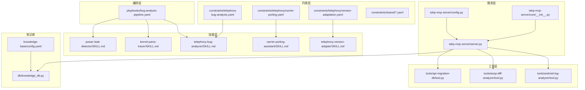
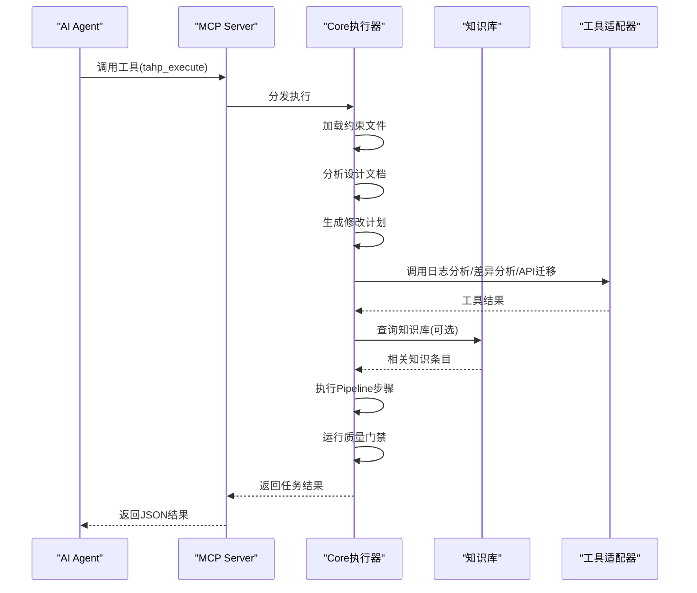
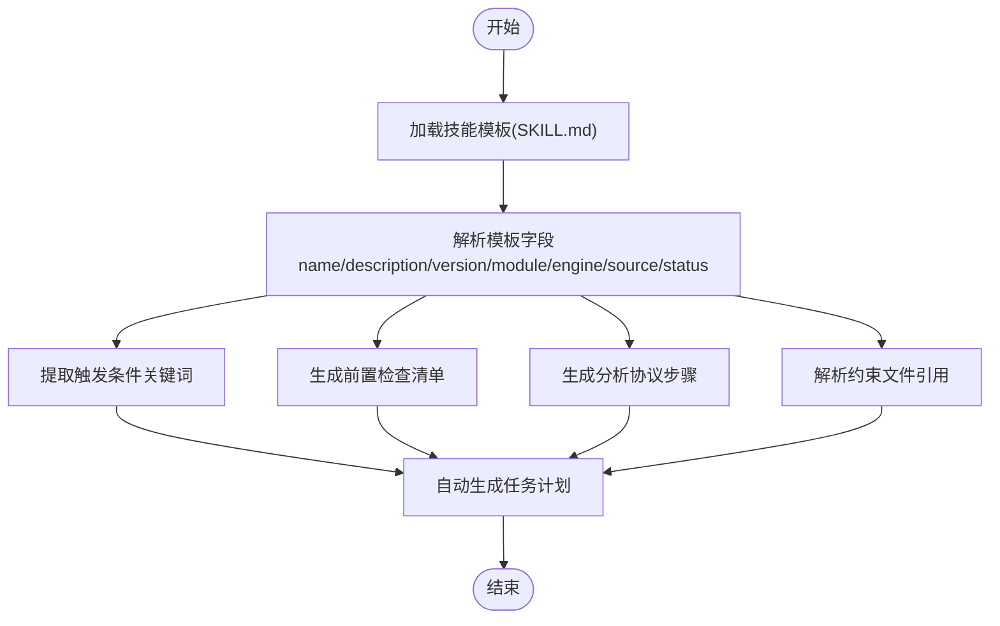
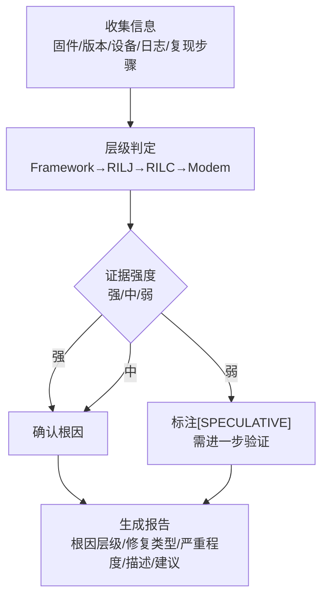
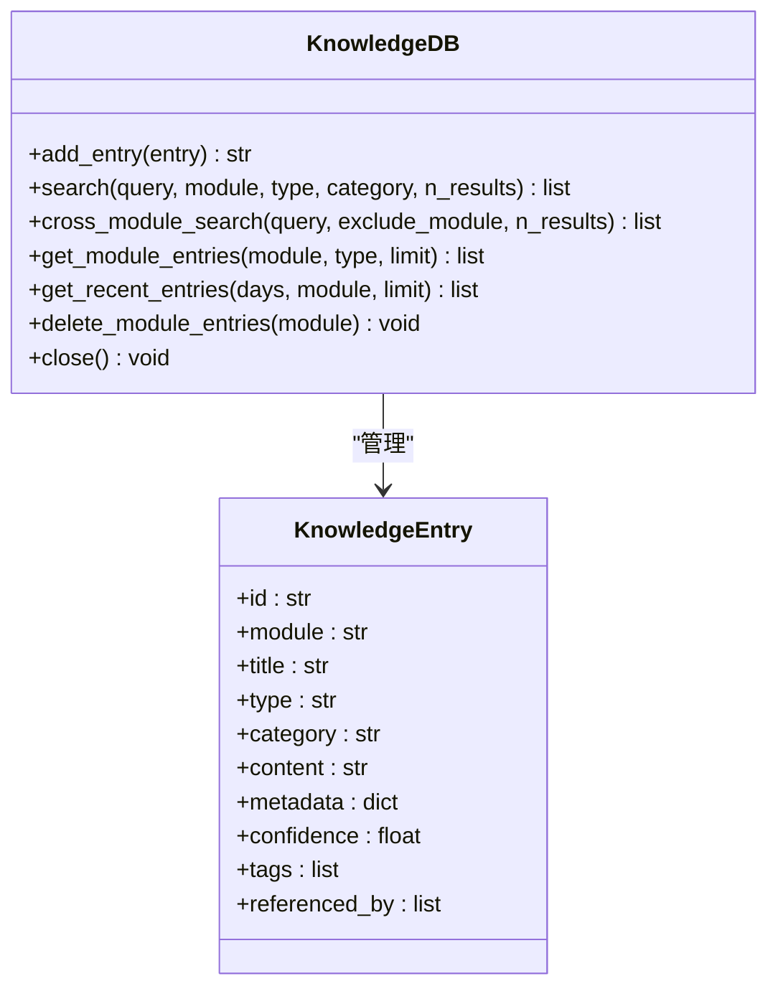
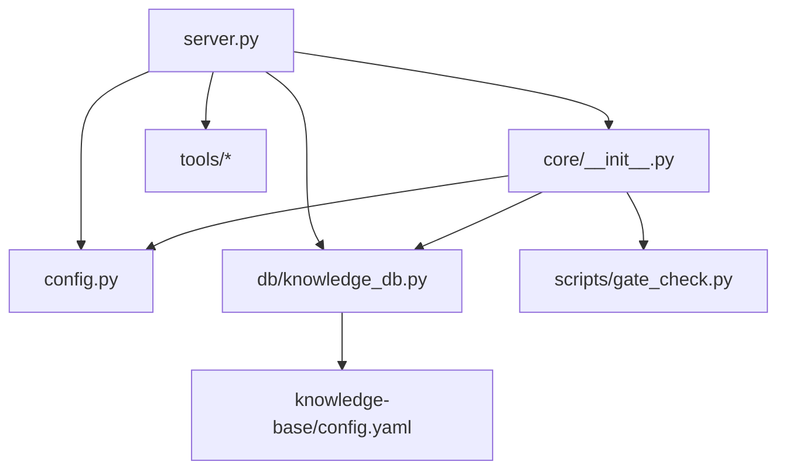

# AI Agent技能系统

<cite>
**本文档引用的文件**
- [AGENTS.md](file://AGENTS.md)
- [server.py](file://tahp-mcp-server/server.py)
- [config.py](file://tahp-mcp-server/config.py)
- [core/__init__.py](file://tahp-mcp-server/core/__init__.py)
- [knowledge_db.py](file://db/knowledge_db.py)
- [knowledge-base/config.yaml](file://knowledge-base/config.yaml)
- [init_module.py](file://scripts/init_module.py)
- [module.yaml.template](file://templates/module-template/module.yaml.template)
- [bug-analysis-pipeline.yaml](file://playbooks/bug-analysis-pipeline.yaml)
- [telephony-bug-analyzer/SKILL.md](file://skills/.claude/skills/telephony-bug-analyzer/SKILL.md)
- [kernel-panic-tracer/SKILL.md](file://skills/.claude/skills/kernel-panic-tracer/SKILL.md)
- [power-leak-detector/SKILL.md](file://skills/.claude/skills/power-leak-detector/SKILL.md)
- [carrier-porting-assistant/SKILL.md](file://skills/.claude/skills/carrier-porting-assistant/SKILL.md)
- [telephony-version-adapter/SKILL.md](file://skills/.claude/skills/telephony-version-adapter/SKILL.md)
- [telephony/bug-analysis.yaml](file://constraints/telephony/bug-analysis.yaml)
- [telephony/carrier-porting.yaml](file://constraints/telephony/carrier-porting.yaml)
- [telephony/version-adaptation.yaml](file://constraints/telephony/version-adaptation.yaml)
- [android-log-analyzer/tool.py](file://tools/android-log-analyzer/tool.py)
- [aosp-diff-analyzer/tool.py](file://tools/aosp-diff-analyzer/tool.py)
- [gate_check.py](file://scripts/gate_check.py)
</cite>

## 目录
1. [引言](#引言)
2. [项目结构](#项目结构)
3. [核心组件](#核心组件)
4. [架构总览](#架构总览)
5. [详细组件分析](#详细组件分析)
6. [依赖分析](#依赖分析)
7. [性能考虑](#性能考虑)
8. [故障排查指南](#故障排查指南)
9. [结论](#结论)
10. [附录](#附录)

## 引言
本文件面向AI Agent技能系统的使用者与开发者，系统化阐述技能架构设计、技能模板格式、自动生成机制与技能管理策略。文档聚焦以下技能域：电话网缺陷分析、内核恐慌追踪、功耗泄漏检测、运营商移植助手、电话网版本适配。围绕这些技能，我们将解释训练数据、模型配置与推理过程，提供创建流程、配置方法与性能优化技巧，并给出扩展指南与自定义技能开发方法。

## 项目结构
TAHP采用“约束驱动 + 技能自动生成”的双引擎范式，将Agent能力封装为MCP工具，供Claude Code等外部Agent调用。核心目录与职责如下：
- constraints：业务约束（Owner输入端），按模块组织，包含各域的约束文件
- skills：AI技能（自动生成/手动维护），以SKILL.md定义技能触发条件、前置检查、分析协议与约束引用
- playbooks：执行编排（Pipeline定义），描述跨模块协同流程
- tools：MCP工具接口定义，封装日志分析、AOSP差异分析、API迁移查询等
- scripts：自动化脚本，包括质量门禁、模块初始化、知识注入等
- db：知识库（SQLite + ONNX嵌入），支持语义检索与跨模块查询
- tahp-mcp-server：MCP服务端，暴露工具接口、任务执行与状态查询

图表来源
- [server.py:103-340](file://tahp-mcp-server/server.py#L103-L340)
- [config.py:36-128](file://tahp-mcp-server/config.py#L36-L128)
- [core/__init__.py:110-298](file://tahp-mcp-server/core/__init__.py#L110-L298)
- [knowledge_db.py:93-164](file://db/knowledge_db.py#L93-L164)
- [knowledge-base/config.yaml:1-36](file://knowledge-base/config.yaml#L1-L36)
- [telephony/bug-analysis.yaml:1-110](file://constraints/telephony/bug-analysis.yaml#L1-L110)
- [telephony/carrier-porting.yaml:1-106](file://constraints/telephony/carrier-porting.yaml#L1-L106)
- [telephony/version-adaptation.yaml:1-117](file://constraints/telephony/version-adaptation.yaml#L1-L117)
- [bug-analysis-pipeline.yaml:1-43](file://playbooks/bug-analysis-pipeline.yaml#L1-L43)

章节来源
- [AGENTS.md:21-34](file://AGENTS.md#L21-L34)
- [server.py:1-485](file://tahp-mcp-server/server.py#L1-L485)
- [config.py:18-176](file://tahp-mcp-server/config.py#L18-L176)
- [core/__init__.py:1-621](file://tahp-mcp-server/core/__init__.py#L1-L621)
- [knowledge_db.py:1-589](file://db/knowledge_db.py#L1-L589)
- [knowledge-base/config.yaml:1-36](file://knowledge-base/config.yaml#L1-L36)

## 核心组件
- MCP服务器：提供工具清单与调用分发，封装任务生命周期管理与进度发射
- 知识库：基于SQLite + ONNX嵌入的向量知识库，支持跨模块检索与语义相似度排序
- 约束文件：定义模块边界、前置条件、分析规则、安全红线与验收标准
- 技能模板：以SKILL.md描述触发条件、前置检查、分析协议与约束引用
- 工具适配器：封装日志分析、AOSP差异分析、API迁移查询等工具
- 质量门禁：分级门禁（P0/P1/P2），支持模块级与管道级检查

章节来源
- [server.py:103-340](file://tahp-mcp-server/server.py#L103-L340)
- [core/__init__.py:110-298](file://tahp-mcp-server/core/__init__.py#L110-L298)
- [knowledge_db.py:93-164](file://db/knowledge_db.py#L93-L164)
- [telephony/bug-analysis.yaml:1-110](file://constraints/telephony/bug-analysis.yaml#L1-L110)
- [telephony/carrier-porting.yaml:1-106](file://constraints/telephony/carrier-porting.yaml#L1-L106)
- [telephony/version-adaptation.yaml:1-117](file://constraints/telephony/version-adaptation.yaml#L1-L117)
- [gate_check.py:36-93](file://scripts/gate_check.py#L36-L93)

## 架构总览
TAHP通过MCP Server将约束驱动能力暴露为工具，Agent可按需调用。任务执行流程分为：加载约束 → 分析设计文档 → 生成修改计划 → 执行Pipeline → 质量门禁检查。跨模块场景由编排文件定义并并行执行。

图表来源
- [server.py:369-447](file://tahp-mcp-server/server.py#L369-L447)
- [core/__init__.py:110-298](file://tahp-mcp-server/core/__init__.py#L110-L298)
- [knowledge_db.py:558-621](file://db/knowledge_db.py#L558-L621)
- [android-log-analyzer/tool.py:31-50](file://tools/android-log-analyzer/tool.py#L31-L50)
- [aosp-diff-analyzer/tool.py:10-41](file://tools/aosp-diff-analyzer/tool.py#L10-L41)

## 详细组件分析

### 技能模板格式与自动生成机制
- 模板字段：name、description、version、module、engine、source、status
- 触发条件：关键词集合，用于自动识别任务场景
- 前置检查：必须按顺序完成的采集步骤（如设备信息、日志、复现步骤）
- 分析协议：分步式分析流程，明确证据强度与产出要求
- 约束文件引用：技能执行时自动加载相关约束文件
- 自动生成：通过模块初始化脚本与模板生成标准化的module.yaml与各域约束文件

图表来源
- [telephony-bug-analyzer/SKILL.md:1-51](file://skills/.claude/skills/telephony-bug-analyzer/SKILL.md#L1-L51)
- [kernel-panic-tracer/SKILL.md:1-33](file://skills/.claude/skills/kernel-panic-tracer/SKILL.md#L1-L33)
- [power-leak-detector/SKILL.md:1-28](file://skills/.claude/skills/power-leak-detector/SKILL.md#L1-L28)
- [carrier-porting-assistant/SKILL.md:1-34](file://skills/.claude/skills/carrier-porting-assistant/SKILL.md#L1-L34)
- [telephony-version-adapter/SKILL.md:1-35](file://skills/.claude/skills/telephony-version-adapter/SKILL.md#L1-L35)
- [module.yaml.template:1-70](file://templates/module-template/module.yaml.template#L1-L70)
- [init_module.py:154-249](file://scripts/init_module.py#L154-L249)

章节来源
- [telephony-bug-analyzer/SKILL.md:1-51](file://skills/.claude/skills/telephony-bug-analyzer/SKILL.md#L1-L51)
- [kernel-panic-tracer/SKILL.md:1-33](file://skills/.claude/skills/kernel-panic-tracer/SKILL.md#L1-L33)
- [power-leak-detector/SKILL.md:1-28](file://skills/.claude/skills/power-leak-detector/SKILL.md#L1-L28)
- [carrier-porting-assistant/SKILL.md:1-34](file://skills/.claude/skills/carrier-porting-assistant/SKILL.md#L1-L34)
- [telephony-version-adapter/SKILL.md:1-35](file://skills/.claude/skills/telephony-version-adapter/SKILL.md#L1-L35)
- [module.yaml.template:1-70](file://templates/module-template/module.yaml.template#L1-L70)
- [init_module.py:154-249](file://scripts/init_module.py#L154-L249)

### 电话网缺陷分析技能
- 适用场景：通话、短信、数据连接、VoLTE/VoWiFi问题
- 前置检查：确认Modem固件版本、Android版本、设备型号、收集logcat、确认复现步骤
- 分析协议：按Framework→RILJ→RILC→Modem层级判定；证据强度分为强/中/弱；产出根因层级、修复类型、严重程度、根因描述与修复建议
- 安全红线：通话窃听、SIM卡密钥/鉴权、网络拥塞/DoS等高风险场景
- 约束文件：telephony/module.yaml、telephony/bug-analysis.yaml、telephony/code-adaptation.yaml、shared/coding-standards.yaml

图表来源
- [telephony-bug-analyzer/SKILL.md:16-44](file://skills/.claude/skills/telephony-bug-analyzer/SKILL.md#L16-L44)
- [telephony/bug-analysis.yaml:1-110](file://constraints/telephony/bug-analysis.yaml#L1-L110)

章节来源
- [telephony-bug-analyzer/SKILL.md:1-51](file://skills/.claude/skills/telephony-bug-analyzer/SKILL.md#L1-L51)
- [telephony/bug-analysis.yaml:1-110](file://constraints/telephony/bug-analysis.yaml#L1-L110)

### 内核恐慌追踪技能
- 适用场景：内核panic、kernel oops、驱动crash
- 前置检查：确认内核版本、获取panic日志、确认复现步骤、defconfig（可选）
- 分析协议：提取PC/LR/Call Trace/寄存器状态 → 层级判定（Driver→Subsystem→Core）→ 产出根因层级、修复类型、严重程度、根因描述与修复建议
- 约束文件：kernel-driver/module.yaml、kernel-driver/bug-analysis.yaml

章节来源
- [kernel-panic-tracer/SKILL.md:1-33](file://skills/.claude/skills/kernel-panic-tracer/SKILL.md#L1-L33)
- [kernel-driver/bug-analysis.yaml:1-200](file://constraints/kernel-driver/bug-analysis.yaml#L1-L200)

### 功耗泄漏检测技能
- 适用场景：功耗异常、耗电快、WakeLock泄漏、续航问题、休眠唤醒异常、待机电流高
- 前置检查：Battery Historian数据、Bugreport（可选）、复现步骤
- 分析协议：功耗分类（Application→Framework→HAL/Kernel）→ 产出根因层级、修复类型、严重程度、根因描述与修复建议
- 约束文件：power-mgmt/module.yaml、power-mgmt/bug-analysis.yaml

章节来源
- [power-leak-detector/SKILL.md:1-28](file://skills/.claude/skills/power-leak-detector/SKILL.md#L1-L28)
- [power-mgmt/bug-analysis.yaml:1-200](file://constraints/power-mgmt/bug-analysis.yaml#L1-L200)

### 运营商移植助手技能
- 适用场景：运营商需求移植（VoWiFi、分钟提醒、USSD、STK定制等）
- 移植协议：加载约束 → 需求解析 → 策略分类（自动/半自动/人工）→ 代码移植（Carrier overlay/carrier_config/CARRIER注释）→ 合规检查
- 质量红线：不能影响generic基础功能、不能硬编码运营商参数、所有定制代码必须有CARRIER注释标记、必须通过CarrierConfigManager标准机制
- 约束文件：telephony/carrier-porting.yaml、telephony/code-adaptation.yaml、shared/android-platform.yaml

章节来源
- [carrier-porting-assistant/SKILL.md:1-34](file://skills/.claude/skills/carrier-porting-assistant/SKILL.md#L1-L34)
- [telephony/carrier-porting.yaml:1-106](file://constraints/telephony/carrier-porting.yaml#L1-L106)

### 电话网版本适配技能
- 适用场景：Android版本升级适配（AOSP Diff分析、API迁移规则匹配、批量Patch生成）
- 适配协议：加载约束 → AOSP Diff分析 → 影响面评估 → 策略分类（全自动/半自动/人工）→ Patch生成 → 验证（编译100%通过 + 回归≥95%）
- 质量红线：不能删除传音自研业务逻辑、新增API必须有@RequiresApi注解、废弃API迁移必须grep确认零残留、不能引入新编译警告
- 约束文件：telephony/version-adaptation.yaml、shared/api-migration-rules/telephony-migration.yaml、telephony/code-adaptation.yaml

章节来源
- [telephony-version-adapter/SKILL.md:1-35](file://skills/.claude/skills/telephony-version-adapter/SKILL.md#L1-L35)
- [telephony/version-adaptation.yaml:1-117](file://constraints/telephony/version-adaptation.yaml#L1-L117)

### 跨模块Bug分析编排
- 触发条件：Bug描述涉及多个子系统
- 并行分析：telephony、kernel-driver、power-mgmt分别由对应技能并行执行
- 结果合成：汇总各模块分析结果，判断根因归属，生成统一报告
- 记录反馈：记录执行轨迹，供EvoSkill分析

章节来源
- [bug-analysis-pipeline.yaml:1-43](file://playbooks/bug-analysis-pipeline.yaml#L1-L43)

### 知识库与检索
- 存储：SQLite持久化，支持knowledge/cases/patterns三类集合
- 嵌入：ONNX DefaultEmbeddingFunction（all-MiniLM-L6-v2，384维），支持跨语言检索
- 检索：按模块/类型/分类过滤，支持跨模块检索与相似度排序
- 配置：最小置信度、默认返回数量、是否重排序等

图表来源
- [knowledge_db.py:93-164](file://db/knowledge_db.py#L93-L164)
- [knowledge_db.py:309-357](file://db/knowledge_db.py#L309-L357)
- [knowledge-base/config.yaml:1-36](file://knowledge-base/config.yaml#L1-L36)

章节来源
- [knowledge_db.py:1-589](file://db/knowledge_db.py#L1-L589)
- [knowledge-base/config.yaml:1-36](file://knowledge-base/config.yaml#L1-L36)

### 工具适配器
- Android日志分析：解析logcat/ril/atcmd日志，提取错误事件与通信事件
- AOSP差异分析：对比Android版本framework差异，识别废弃API、移除/新增API
- API迁移查询：查询API迁移规则库，支持list/search/add操作

章节来源
- [android-log-analyzer/tool.py:1-50](file://tools/android-log-analyzer/tool.py#L1-L50)
- [aosp-diff-analyzer/tool.py:1-41](file://tools/aosp-diff-analyzer/tool.py#L1-L41)

### 质量门禁
- 分级：P0（阻塞）/P1（警告）/P2（记录）
- 检查项：安全红线、无硬编码密钥、约束文件有效性、测试覆盖、文档完整性、命名规范、代码风格、注释密度、示例用例等
- 执行：模块级与管道级两种模式，支持按级别筛选

章节来源
- [gate_check.py:36-93](file://scripts/gate_check.py#L36-L93)
- [gate_check.py:99-188](file://scripts/gate_check.py#L99-L188)
- [gate_check.py:194-350](file://scripts/gate_check.py#L194-L350)
- [gate_check.py:368-435](file://scripts/gate_check.py#L368-L435)

## 依赖分析
- MCP服务器依赖配置、任务跟踪器、进度发射器与工具注册表
- 核心执行器依赖约束加载、Playbook解析、质量门禁检查与知识库查询
- 知识库依赖ONNX嵌入函数（可降级为文本匹配）
- 工具适配器依赖正则表达式与文件解析
- 质量门禁脚本依赖YAML解析与正则匹配

图表来源
- [server.py:71-82](file://tahp-mcp-server/server.py#L71-L82)
- [config.py:36-128](file://tahp-mcp-server/config.py#L36-L128)
- [core/__init__.py:110-298](file://tahp-mcp-server/core/__init__.py#L110-L298)
- [knowledge_db.py:93-164](file://db/knowledge_db.py#L93-L164)
- [knowledge-base/config.yaml:1-36](file://knowledge-base/config.yaml#L1-L36)

章节来源
- [server.py:71-82](file://tahp-mcp-server/server.py#L71-L82)
- [config.py:36-128](file://tahp-mcp-server/config.py#L36-L128)
- [core/__init__.py:110-298](file://tahp-mcp-server/core/__init__.py#L110-L298)
- [knowledge_db.py:93-164](file://db/knowledge_db.py#L93-L164)

## 性能考虑
- 任务并发与超时：最大并发任务数与任务超时时间可在配置中调整，避免资源争用与长时间阻塞
- 知识库检索：合理设置最小置信度与返回数量，减少向量计算开销；跨模块检索时限制返回条数
- 嵌入模型：ONNX模型不可用时自动降级为文本匹配，确保系统可用性
- 日志与差异分析：对大型日志进行分块处理与过滤，避免内存峰值过高
- 质量门禁：按需选择检查级别，避免不必要的全量检查

## 故障排查指南
- 工具调用失败：检查参数合法性与工具名称，查看服务器日志中的异常堆栈
- 任务状态异常：使用tahp_status查询任务详情，确认任务阶段与步骤状态
- 纠偏反馈：通过tahp_correct提交纠偏指令，观察任务是否回到执行阶段
- 门禁检查：根据门禁报告逐项整改，P0阻塞性问题必须解决后方可继续
- 知识库检索：确认嵌入模型可用性与最小置信度设置，必要时降低阈值或切换模型

章节来源
- [server.py:369-447](file://tahp-mcp-server/server.py#L369-L447)
- [core/__init__.py:300-363](file://tahp-mcp-server/core/__init__.py#L300-L363)
- [gate_check.py:437-473](file://scripts/gate_check.py#L437-L473)

## 结论
TAHP通过约束驱动与技能模板实现了AI Agent能力的标准化与可复用化，结合MCP工具链与知识库，形成从问题发现到修复验证的闭环。技能覆盖电话网缺陷分析、内核恐慌追踪、功耗泄漏检测、运营商移植与版本适配五大场景，具备良好的扩展性与可维护性。建议在实际使用中遵循安全红线与质量门禁，持续完善约束文件与技能模板，提升自动化水平与交付质量。

## 附录

### 技能创建流程
- 使用模块初始化脚本创建新模块目录与约束文件
- 编写module.yaml与各域约束文件（bug-analysis/code-adaptation/version-adaptation/carrier-porting）
- 编写技能模板（SKILL.md），定义触发条件、前置检查、分析协议与约束引用
- 添加评估用例与期望输出，完善质量门禁检查
- 运行质量门禁脚本验证约束文件有效性

章节来源
- [init_module.py:154-249](file://scripts/init_module.py#L154-L249)
- [module.yaml.template:1-70](file://templates/module-template/module.yaml.template#L1-L70)
- [telephony/bug-analysis.yaml:1-110](file://constraints/telephony/bug-analysis.yaml#L1-L110)
- [telephony/carrier-porting.yaml:1-106](file://constraints/telephony/carrier-porting.yaml#L1-L106)
- [telephony/version-adaptation.yaml:1-117](file://constraints/telephony/version-adaptation.yaml#L1-L117)
- [gate_check.py:368-435](file://scripts/gate_check.py#L368-L435)

### 技能管理策略
- 版本控制：技能模板与约束文件纳入版本管理，变更需评审
- 自动化：通过EvoSkill与评估数据持续优化技能表现
- 跨模块协作：利用编排文件定义跨模块分析流程，实现并行与协同
- 知识沉淀：通过知识库记录经验案例与错误模式，支持语义检索与再利用

### 扩展指南与自定义技能开发
- 新增技能域：在模块约束中添加新域文件，编写相应分析规则与验收标准
- 工具扩展：在tools目录下新增工具适配器，注册到ToolRegistry并在MCP Server中暴露
- 知识库扩展：通过脚本或API向知识库添加条目，设置标签与元数据，提升检索效果
- 性能优化：针对大规模日志与差异分析，采用分块处理与缓存策略；对知识库检索设置合理的阈值与返回数量