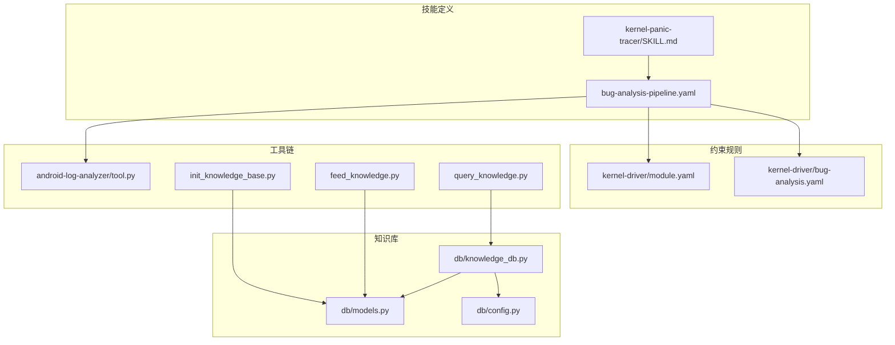
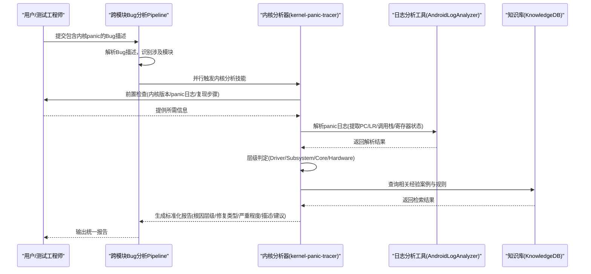
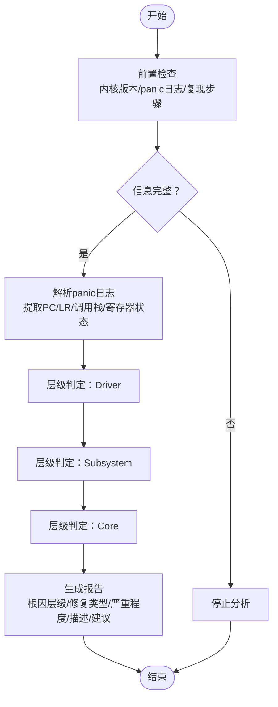
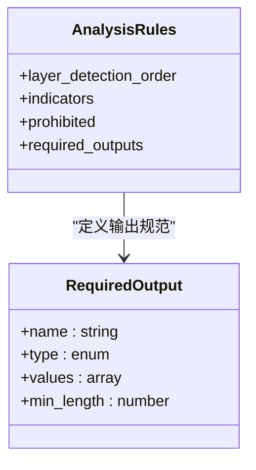
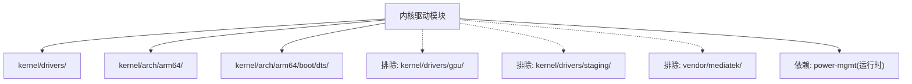
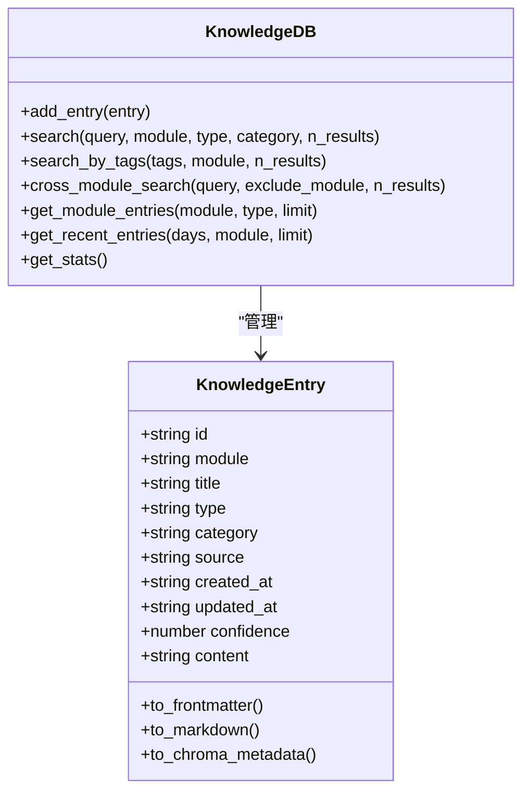
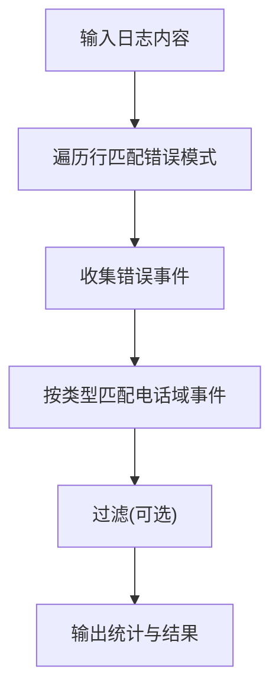
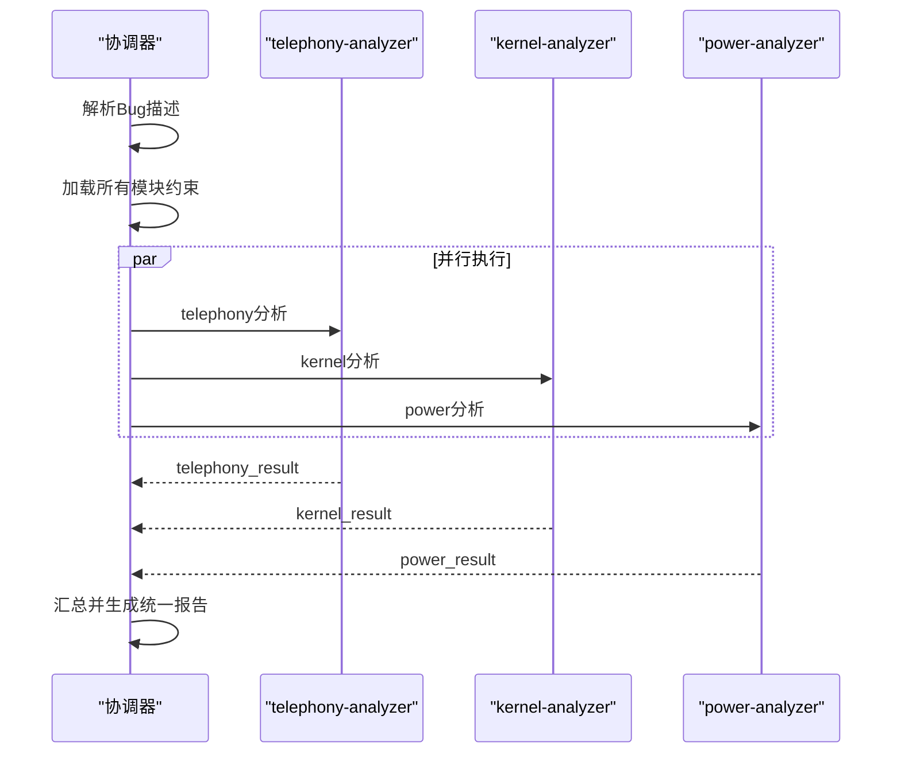
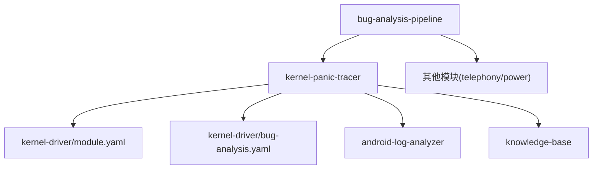

# 内核恐慌追踪技能

<cite>
**本文档引用的文件**
- [skills/.claude/skills/kernel-panic-tracer/SKILL.md](file://skills/.claude/skills/kernel-panic-tracer/SKILL.md)
- [constraints/kernel-driver/module.yaml](file://constraints/kernel-driver/module.yaml)
- [constraints/kernel-driver/bug-analysis.yaml](file://constraints/kernel-driver/bug-analysis.yaml)
- [playbooks/bug-analysis-pipeline.yaml](file://playbooks/bug-analysis-pipeline.yaml)
- [tools/android-log-analyzer/tool.py](file://tools/android-log-analyzer/tool.py)
- [db/models.py](file://db/models.py)
- [db/knowledge_db.py](file://db/knowledge_db.py)
- [db/config.py](file://db/config.py)
- [scripts/init_knowledge_base.py](file://scripts/init_knowledge_base.py)
- [scripts/feed_knowledge.py](file://scripts/feed_knowledge.py)
- [scripts/query_knowledge.py](file://scripts/query_knowledge.py)
</cite>

## 目录
1. [简介](#简介)
2. [项目结构](#项目结构)
3. [核心组件](#核心组件)
4. [架构概览](#架构概览)
5. [详细组件分析](#详细组件分析)
6. [依赖关系分析](#依赖关系分析)
7. [性能考虑](#性能考虑)
8. [故障排查指南](#故障排查指南)
9. [结论](#结论)
10. [附录](#附录)

## 简介
本技能专注于Android内核恐慌事件的自动化分析与追踪，旨在快速定位内核崩溃的根本原因并提供可执行的修复建议。通过对内核panic日志进行系统化分析，结合模块化约束规则与知识库检索能力，实现从驱动层到内核核心的逐层判定，并输出包含根因层级、修复类型、严重程度、根因描述与修复建议的标准化报告。

## 项目结构
该项目采用模块化设计，围绕“内核驱动模块”构建完整的分析流水线。核心文件包括技能定义、约束规则、知识库模型与工具链等。

**图表来源**
- [skills/.claude/skills/kernel-panic-tracer/SKILL.md:1-33](file://skills/.claude/skills/kernel-panic-tracer/SKILL.md#L1-L33)
- [playbooks/bug-analysis-pipeline.yaml:1-43](file://playbooks/bug-analysis-pipeline.yaml#L1-L43)
- [constraints/kernel-driver/module.yaml:1-30](file://constraints/kernel-driver/module.yaml#L1-L30)
- [constraints/kernel-driver/bug-analysis.yaml:1-65](file://constraints/kernel-driver/bug-analysis.yaml#L1-L65)
- [tools/android-log-analyzer/tool.py:1-50](file://tools/android-log-analyzer/tool.py#L1-L50)
- [scripts/init_knowledge_base.py:1-246](file://scripts/init_knowledge_base.py#L1-L246)
- [scripts/feed_knowledge.py:1-320](file://scripts/feed_knowledge.py#L1-L320)
- [scripts/query_knowledge.py:1-200](file://scripts/query_knowledge.py#L1-L200)
- [db/models.py:1-247](file://db/models.py#L1-L247)
- [db/knowledge_db.py:1-589](file://db/knowledge_db.py#L1-L589)
- [db/config.py:1-182](file://db/config.py#L1-L182)

**章节来源**
- [skills/.claude/skills/kernel-panic-tracer/SKILL.md:1-33](file://skills/.claude/skills/kernel-panic-tracer/SKILL.md#L1-L33)
- [playbooks/bug-analysis-pipeline.yaml:1-43](file://playbooks/bug-analysis-pipeline.yaml#L1-L43)
- [constraints/kernel-driver/module.yaml:1-30](file://constraints/kernel-driver/module.yaml#L1-L30)
- [constraints/kernel-driver/bug-analysis.yaml:1-65](file://constraints/kernel-driver/bug-analysis.yaml#L1-L65)

## 核心组件
- 技能定义：明确触发条件、前置检查、分析协议与约束文件引用，确保分析流程标准化。
- 约束规则：定义输入要求、分析规则、禁止事项与输出规范，保障分析质量与一致性。
- 知识库系统：提供知识条目模型、向量检索与跨模块搜索能力，支撑经验案例与规则的沉淀与复用。
- 日志分析工具：提供基础的日志解析与错误模式识别能力，辅助内核panic事件的初步筛选与分类。

**章节来源**
- [skills/.claude/skills/kernel-panic-tracer/SKILL.md:13-33](file://skills/.claude/skills/kernel-panic-tracer/SKILL.md#L13-L33)
- [constraints/kernel-driver/bug-analysis.yaml:1-65](file://constraints/kernel-driver/bug-analysis.yaml#L1-L65)
- [db/models.py:52-247](file://db/models.py#L52-L247)
- [db/knowledge_db.py:93-589](file://db/knowledge_db.py#L93-L589)
- [tools/android-log-analyzer/tool.py:5-50](file://tools/android-log-analyzer/tool.py#L5-L50)

## 架构概览
内核恐慌追踪技能的整体架构由“触发条件识别—前置检查—日志采集—分析判定—报告生成—知识库检索”构成。跨模块分析流水线负责协调多模块并行分析与结果合成。

**图表来源**
- [playbooks/bug-analysis-pipeline.yaml:6-37](file://playbooks/bug-analysis-pipeline.yaml#L6-L37)
- [skills/.claude/skills/kernel-panic-tracer/SKILL.md:16-28](file://skills/.claude/skills/kernel-panic-tracer/SKILL.md#L16-L28)
- [tools/android-log-analyzer/tool.py:31-46](file://tools/android-log-analyzer/tool.py#L31-L46)
- [db/knowledge_db.py:375-401](file://db/knowledge_db.py#L375-L401)

## 详细组件分析

### 技能定义与分析协议
- 触发条件：内核panic、kernel oops、驱动crash、driver probe failed、空指针解引用等。
- 前置检查：确认内核版本、获取panic日志、确认复现步骤；defconfig可选。
- 分析协议：提取PC/LR/调用栈/寄存器状态 → 层级判定(Driver/Subsystem/Core) → 产出标准化报告。

**图表来源**
- [skills/.claude/skills/kernel-panic-tracer/SKILL.md:13-28](file://skills/.claude/skills/kernel-panic-tracer/SKILL.md#L13-L28)

**章节来源**
- [skills/.claude/skills/kernel-panic-tracer/SKILL.md:13-33](file://skills/.claude/skills/kernel-panic-tracer/SKILL.md#L13-L33)

### 约束规则与输出规范
- 输入要求：内核版本、panic日志、复现步骤必填；defconfig可选。
- 分析规则：按Driver→Subsystem→Core顺序判定，使用正则模式识别关键指标。
- 禁止事项：未确认调用栈不给出修复方案；不修改排除范围内的驱动代码；未验证defconfig选项不建议配置变更。
- 输出规范：根因层级(枚举)、修复类型(枚举)、严重程度(枚举)、根因描述(≥50字)、修复建议(≥30字)。

**图表来源**
- [constraints/kernel-driver/bug-analysis.yaml:21-60](file://constraints/kernel-driver/bug-analysis.yaml#L21-L60)

**章节来源**
- [constraints/kernel-driver/bug-analysis.yaml:1-65](file://constraints/kernel-driver/bug-analysis.yaml#L1-L65)

### 模块范围与依赖
- 模块范围：内核驱动代码、ARM64架构、设备树文件；排除GPU驱动、临时驱动与特定厂商目录。
- 依赖关系：与电源管理模块存在运行时依赖，驱动功耗管理需依赖PM框架。

**图表来源**
- [constraints/kernel-driver/module.yaml:11-29](file://constraints/kernel-driver/module.yaml#L11-L29)

**章节来源**
- [constraints/kernel-driver/module.yaml:1-30](file://constraints/kernel-driver/module.yaml#L1-L30)

### 知识库模型与检索
- 知识条目模型：支持多种类型与分类，具备Markdown/YAML双向转换与ChromaDB元数据格式转换。
- 检索能力：支持按模块/类型/分类过滤、跨模块搜索、标签检索与最近条目查询；内置向量嵌入与余弦相似度排序。
- 配置管理：支持从YAML加载配置，控制嵌入模型、检索阈值与来源开关。

**图表来源**
- [db/models.py:52-247](file://db/models.py#L52-L247)
- [db/knowledge_db.py:93-589](file://db/knowledge_db.py#L93-L589)

**章节来源**
- [db/models.py:1-247](file://db/models.py#L1-L247)
- [db/knowledge_db.py:1-589](file://db/knowledge_db.py#L1-L589)
- [db/config.py:65-182](file://db/config.py#L65-L182)

### 日志分析工具
- 错误模式识别：支持内核panic、内核bug等关键错误模式的识别。
- 电话域事件识别：支持RIL/RILD/AT命令/IMS/VoLTE等事件类型的识别（用于跨模块关联分析）。
- 统计输出：提供事件与错误计数、日志行数等统计信息。

**图表来源**
- [tools/android-log-analyzer/tool.py:31-46](file://tools/android-log-analyzer/tool.py#L31-L46)

**章节来源**
- [tools/android-log-analyzer/tool.py:1-50](file://tools/android-log-analyzer/tool.py#L1-L50)

### 跨模块分析流水线
- 触发条件：Bug描述涉及多个子系统。
- 执行步骤：解析Bug→加载约束→并行分析(telephony/kernel/power)→汇总结果→记录反馈。
- 协调机制：通过并行分支分别调用各模块分析技能，最终生成统一报告。

**图表来源**
- [playbooks/bug-analysis-pipeline.yaml:6-37](file://playbooks/bug-analysis-pipeline.yaml#L6-L37)

**章节来源**
- [playbooks/bug-analysis-pipeline.yaml:1-43](file://playbooks/bug-analysis-pipeline.yaml#L1-L43)

## 依赖关系分析
- 技能与约束：kernel-panic-tracer依赖kernel-driver模块的约束文件，确保分析流程与输出规范一致。
- 工具与知识库：日志分析工具为技能提供输入支持，知识库为技能提供经验与规则检索能力。
- 流水线与模块：跨模块分析流水线协调多模块并行分析，形成统一的根因归属与报告输出。

**图表来源**
- [skills/.claude/skills/kernel-panic-tracer/SKILL.md:30-32](file://skills/.claude/skills/kernel-panic-tracer/SKILL.md#L30-L32)
- [constraints/kernel-driver/module.yaml:1-30](file://constraints/kernel-driver/module.yaml#L1-L30)
- [constraints/kernel-driver/bug-analysis.yaml:1-65](file://constraints/kernel-driver/bug-analysis.yaml#L1-L65)
- [tools/android-log-analyzer/tool.py:1-50](file://tools/android-log-analyzer/tool.py#L1-L50)
- [playbooks/bug-analysis-pipeline.yaml:1-43](file://playbooks/bug-analysis-pipeline.yaml#L1-L43)

**章节来源**
- [skills/.claude/skills/kernel-panic-tracer/SKILL.md:30-32](file://skills/.claude/skills/kernel-panic-tracer/SKILL.md#L30-L32)
- [playbooks/bug-analysis-pipeline.yaml:1-43](file://playbooks/bug-analysis-pipeline.yaml#L1-L43)

## 性能考虑
- 向量检索降级：当嵌入模型不可用时，系统自动切换至文本包含匹配模式，保证基本检索能力。
- 相似度阈值：检索阈值可配置，兼顾召回率与相关性；跨模块检索支持排除特定模块。
- 批量操作：知识库支持批量添加与更新，减少频繁I/O开销。
- 索引优化：SQLite WAL模式与多索引提升查询性能。

**章节来源**
- [db/knowledge_db.py:132-156](file://db/knowledge_db.py#L132-L156)
- [db/knowledge_db.py:228-307](file://db/knowledge_db.py#L228-L307)
- [db/config.py:33-82](file://db/config.py#L33-L82)

## 故障排查指南
- 缺失必要信息：若缺少内核版本、panic日志或复现步骤，分析将提前终止。
- 日志解析异常：检查日志格式与编码，确保包含内核panic段落。
- 知识库不可用：确认数据库初始化与权限设置，检查持久化目录是否存在。
- 检索结果不相关：调整查询关键词或增加标签，提高检索准确性。

**章节来源**
- [constraints/kernel-driver/bug-analysis.yaml:11-15](file://constraints/kernel-driver/bug-analysis.yaml#L11-L15)
- [db/knowledge_db.py:148-156](file://db/knowledge_db.py#L148-L156)

## 结论
内核恐慌追踪技能通过标准化的触发条件、严格的前置检查与分析协议，结合模块化约束与知识库检索能力，实现了对Android内核崩溃事件的高效定位与修复建议生成。跨模块分析流水线进一步提升了复杂场景下的根因判定能力，为工程实践提供了可靠的自动化支撑。

## 附录
- 知识库初始化：支持按模块或全部初始化，自动生成目录结构与索引文件，并将约束文件抽取为知识条目。
- 知识投喂：支持Markdown/PDF/Word等多种格式，自动解析并入库，同时更新模块索引。
- 知识查询：支持语义搜索、跨模块搜索、标签检索与统计信息展示，便于快速定位相关经验与规则。

**章节来源**
- [scripts/init_knowledge_base.py:86-141](file://scripts/init_knowledge_base.py#L86-L141)
- [scripts/feed_knowledge.py:49-146](file://scripts/feed_knowledge.py#L49-L146)
- [scripts/query_knowledge.py:116-196](file://scripts/query_knowledge.py#L116-L196)