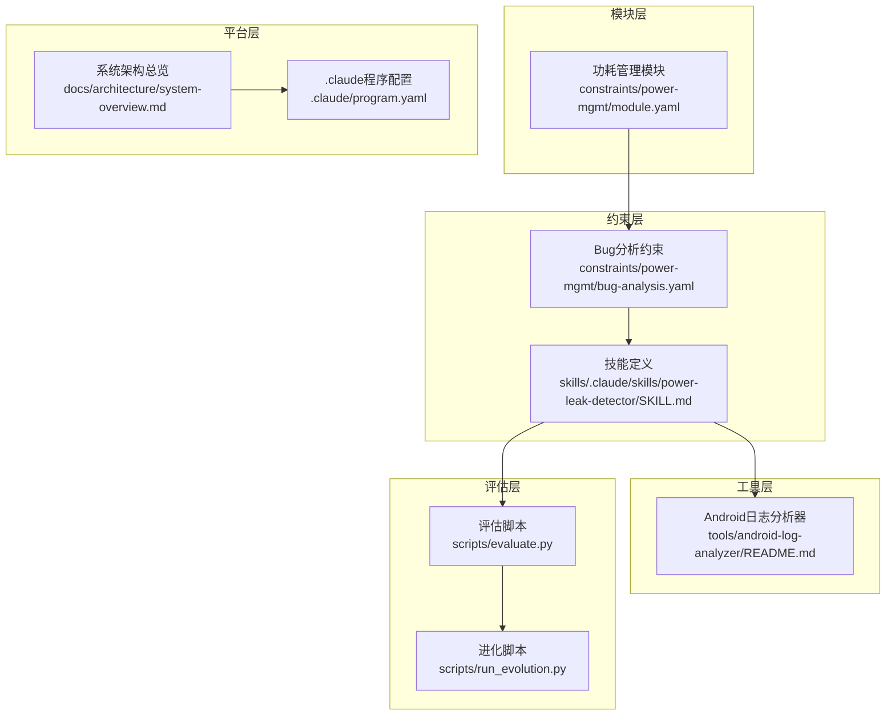
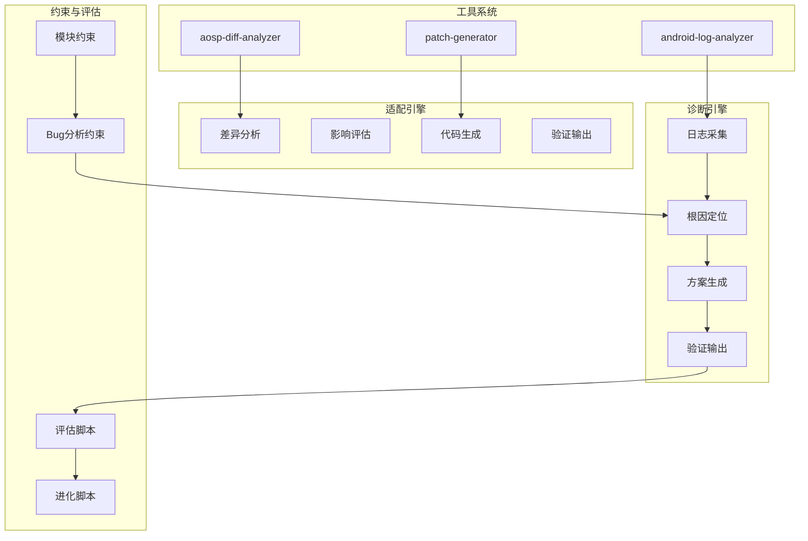
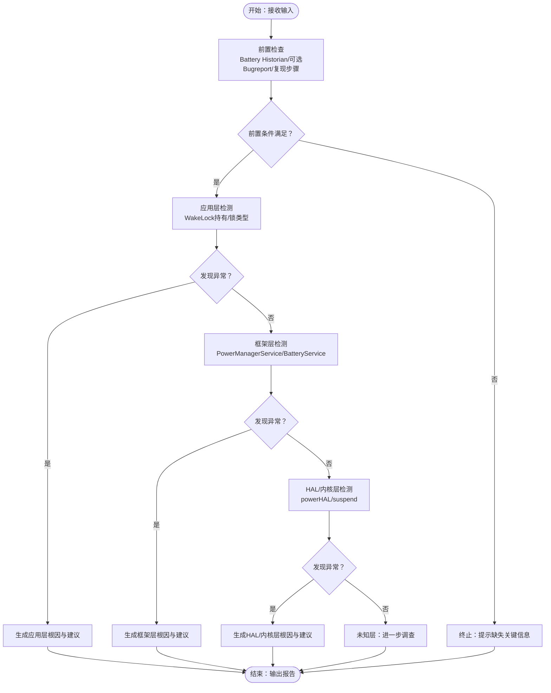
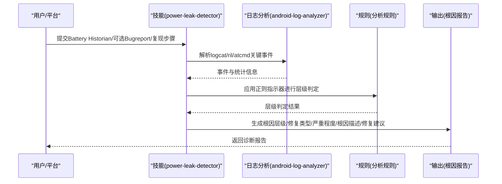
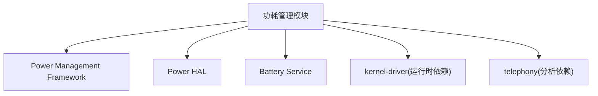
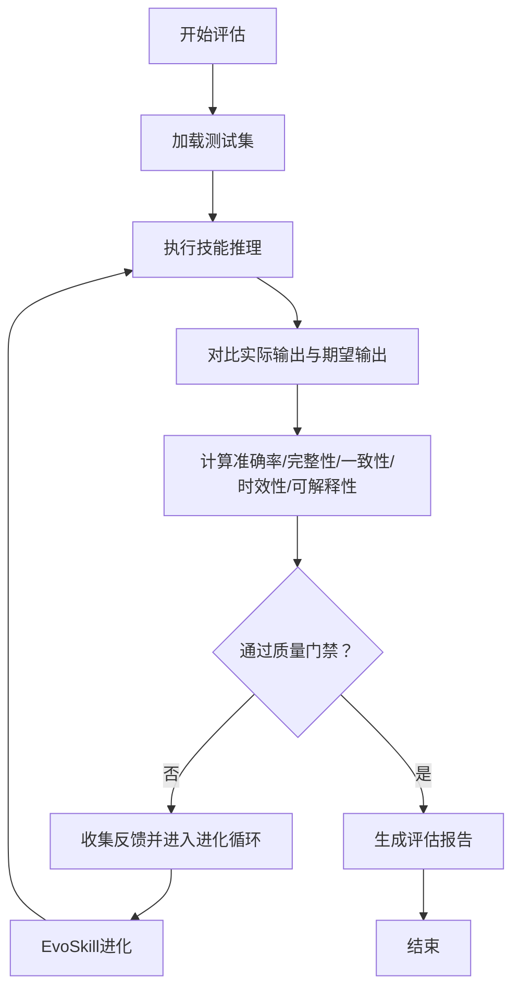
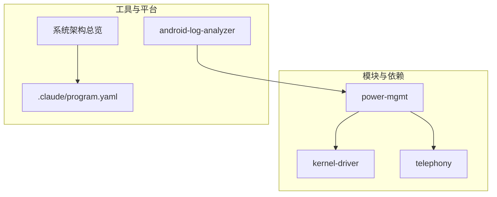

# 功耗泄漏检测技能

<cite>
**本文档引用的文件**
- [skills/.claude/skills/power-leak-detector/SKILL.md](file://skills/.claude/skills/power-leak-detector/SKILL.md)
- [constraints/power-mgmt/module.yaml](file://constraints/power-mgmt/module.yaml)
- [constraints/power-mgmt/bug-analysis.yaml](file://constraints/power-mgmt/bug-analysis.yaml)
- [docs/architecture/system-overview.md](file://docs/architecture/system-overview.md)
- [tools/android-log-analyzer/README.md](file://tools/android-log-analyzer/README.md)
- [.claude/program.yaml](file://.claude/program.yaml)
- [scripts/evaluate.py](file://scripts/evaluate.py)
- [scripts/run_evolution.py](file://scripts/run_evolution.py)
- [scripts/init_module.py](file://scripts/init_module.py)
</cite>

## 目录
1. [引言](#引言)
2. [项目结构](#项目结构)
3. [核心组件](#核心组件)
4. [架构总览](#架构总览)
5. [详细组件分析](#详细组件分析)
6. [依赖关系分析](#依赖关系分析)
7. [性能考量](#性能考量)
8. [故障排查指南](#故障排查指南)
9. [结论](#结论)
10. [附录](#附录)

## 引言
本技能面向Android设备功耗异常问题的诊断与优化，聚焦“功耗泄漏”的根因定位与修复建议生成。其核心目标包括：
- 检测与分析Android设备的功耗异常问题
- 识别功耗泄漏的根本原因（应用层、框架层、HAL/内核层）
- 提供可落地的优化建议与修复路径
- 结合Battery Historian与系统日志进行多维证据链分析
- 以约束驱动的方式确保分析过程可追溯、可评估、可进化

## 项目结构
功耗泄漏检测技能位于约束驱动的TAHP平台中，采用“模块 + 约束 + 评估”的工程化范式：
- 模块层：功耗管理模块（power-mgmt）定义作用域、依赖与边界
- 约束层：bug-analysis.yaml定义前置条件、分析规则、输出要求与评估目标
- 技能层：power-leak-detector SKILL.md定义触发条件、前置检查与分析协议
- 工具层：android-log-analyzer等MCP工具用于日志解析与关键事件抽取
- 评估层：evaluate.py与run_evolution.py支撑自动化评估与Skill进化

图表来源
- [constraints/power-mgmt/module.yaml:1-32](file://constraints/power-mgmt/module.yaml#L1-L32)
- [constraints/power-mgmt/bug-analysis.yaml:1-61](file://constraints/power-mgmt/bug-analysis.yaml#L1-L61)
- [skills/.claude/skills/power-leak-detector/SKILL.md:1-28](file://skills/.claude/skills/power-leak-detector/SKILL.md#L1-L28)
- [tools/android-log-analyzer/README.md:1-13](file://tools/android-log-analyzer/README.md#L1-L13)
- [scripts/evaluate.py:44-407](file://scripts/evaluate.py#L44-L407)
- [scripts/run_evolution.py:282-312](file://scripts/run_evolution.py#L282-L312)
- [docs/architecture/system-overview.md:316-420](file://docs/architecture/system-overview.md#L316-L420)
- [.claude/program.yaml:1-17](file://.claude/program.yaml#L1-L17)

章节来源
- [docs/architecture/system-overview.md:316-420](file://docs/architecture/system-overview.md#L316-L420)
- [skills/.claude/skills/power-leak-detector/SKILL.md:1-28](file://skills/.claude/skills/power-leak-detector/SKILL.md#L1-L28)
- [constraints/power-mgmt/module.yaml:1-32](file://constraints/power-mgmt/module.yaml#L1-L32)
- [constraints/power-mgmt/bug-analysis.yaml:1-61](file://constraints/power-mgmt/bug-analysis.yaml#L1-L61)

## 核心组件
- 技能定义（SKILL.md）
  - 触发条件：功耗异常、耗电快、WakeLock泄漏、续航问题、休眠唤醒异常、待机电流高
  - 前置检查：Battery Historian数据、Bugreport（可选）、复现步骤
  - 分析协议：按Application→Framework→HAL/Kernel的层级判定；输出根因层级、修复类型、严重程度、根因描述（≥50字）、修复建议（≥30字）

- 功耗管理模块（module.yaml）
  - 作用域：Power Management Framework、Power HAL、Battery Service
  - 排除范围：特定vendor路径与内核驱动路径
  - 依赖：kernel-driver（运行时依赖）、telephony（通话功耗分析）

- Bug分析约束（bug-analysis.yaml）
  - 前置条件：battery_history（必填）、bugreport（可选）、repro_steps（必填）
  - 分析规则：按Application→Framework→HAL/Kernel的检测顺序，使用正则指示器匹配关键日志片段
  - 禁止事项：未获取batterystats数据即下结论、将正常业务功耗误判为Bug、修改排除范围内的代码
  - 必产出字段：root_cause_layer、fix_type、severity、root_cause_description、fix_suggestion

- 平台与工具
  - 系统架构：诊断引擎（日志采集→根因定位→方案生成→验证输出）
  - MCP工具：android-log-analyzer用于解析logcat/ril/atcmd日志，提取关键事件与统计信息

章节来源
- [skills/.claude/skills/power-leak-detector/SKILL.md:11-28](file://skills/.claude/skills/power-leak-detector/SKILL.md#L11-L28)
- [constraints/power-mgmt/module.yaml:11-32](file://constraints/power-mgmt/module.yaml#L11-L32)
- [constraints/power-mgmt/bug-analysis.yaml:1-61](file://constraints/power-mgmt/bug-analysis.yaml#L1-L61)
- [docs/architecture/system-overview.md:161-194](file://docs/architecture/system-overview.md#L161-L194)
- [tools/android-log-analyzer/README.md:1-13](file://tools/android-log-analyzer/README.md#L1-L13)

## 架构总览
功耗泄漏检测技能嵌入TAHP双引擎架构，遵循“约束驱动 + 自动评估 + 进化优化”的范式：
- 诊断引擎：以日志与设备信息为输入，按层级判定与证据链生成根因报告
- 适配引擎：版本升级/特性移植/运营商移植的自动化与半自动化流程
- 质量门禁：编译通过、Scope合规、安全红线、API真实性等P0级阻断项
- 评估指标：准确率、完整性、一致性、时效性、可解释性等综合评分

图表来源
- [docs/architecture/system-overview.md:161-194](file://docs/architecture/system-overview.md#L161-L194)
- [docs/architecture/system-overview.md:221-266](file://docs/architecture/system-overview.md#L221-L266)
- [docs/architecture/system-overview.md:268-289](file://docs/architecture/system-overview.md#L268-L289)
- [tools/android-log-analyzer/README.md:1-13](file://tools/android-log-analyzer/README.md#L1-L13)

章节来源
- [docs/architecture/system-overview.md:161-194](file://docs/architecture/system-overview.md#L161-L194)
- [docs/architecture/system-overview.md:221-266](file://docs/architecture/system-overview.md#L221-L266)
- [docs/architecture/system-overview.md:268-289](file://docs/architecture/system-overview.md#L268-L289)

## 详细组件分析

### 技能定义与分析协议
- 触发条件与前置检查
  - 触发条件涵盖功耗异常、WakeLock泄漏、续航问题等典型症状
  - 前置检查强调Battery Historian数据的必要性，以及Bugreport与复现步骤的辅助价值
- 分析协议
  - 层级判定顺序：Application → Framework → HAL/Kernel
  - 输出要求：根因层级、修复类型、严重程度、根因描述（≥50字）、修复建议（≥30字）

图表来源
- [skills/.claude/skills/power-leak-detector/SKILL.md:13-24](file://skills/.claude/skills/power-leak-detector/SKILL.md#L13-L24)
- [constraints/power-mgmt/bug-analysis.yaml:17-37](file://constraints/power-mgmt/bug-analysis.yaml#L17-L37)

章节来源
- [skills/.claude/skills/power-leak-detector/SKILL.md:11-28](file://skills/.claude/skills/power-leak-detector/SKILL.md#L11-L28)
- [constraints/power-mgmt/bug-analysis.yaml:17-37](file://constraints/power-mgmt/bug-analysis.yaml#L17-L37)

### 功耗分类与检测算法
- 分类标准
  - Application：应用层WakeLock持有、锁类型异常
  - Framework：系统服务异常（PowerManagerService、BatteryService）
  - HAL/Kernel：底层功耗问题（powerHAL、suspend）
- 检测算法
  - 正则匹配：基于pattern的指示器匹配关键日志片段
  - 层级判定：按预设顺序依次检测，先发现先输出
  - 禁止事项：避免在无batterystats数据时下结论、避免误判正常业务功耗、避免修改排除范围内的代码

图表来源
- [constraints/power-mgmt/bug-analysis.yaml:17-37](file://constraints/power-mgmt/bug-analysis.yaml#L17-L37)
- [tools/android-log-analyzer/README.md:1-13](file://tools/android-log-analyzer/README.md#L1-13)
- [skills/.claude/skills/power-leak-detector/SKILL.md:16-24](file://skills/.claude/skills/power-leak-detector/SKILL.md#L16-L24)

章节来源
- [constraints/power-mgmt/bug-analysis.yaml:17-37](file://constraints/power-mgmt/bug-analysis.yaml#L17-L37)
- [tools/android-log-analyzer/README.md:1-13](file://tools/android-log-analyzer/README.md#L1-L13)

### 模块作用域与依赖
- 包含范围：Power Management Framework、Power HAL、Battery Service
- 排除范围：特定vendor路径与内核驱动路径
- 依赖关系：runtime依赖kernel-driver（功耗策略依赖内核PM驱动）、analysis依赖telephony（通话功耗分析需了解RIL状态）

图表来源
- [constraints/power-mgmt/module.yaml:11-32](file://constraints/power-mgmt/module.yaml#L11-L32)

章节来源
- [constraints/power-mgmt/module.yaml:11-32](file://constraints/power-mgmt/module.yaml#L11-L32)

### 评估与质量门禁
- 评估指标
  - 准确率：目标≥85%
  - 完整性：目标100%
  - 一致性：目标≥90%
  - 时效性：目标≤5分钟/案例
  - 可解释性：目标≥80%
- 质量门禁
  - P0：编译通过、Scope合规、安全红线、API真实性
  - P1：编码风格、Lint、废弃API、TODO关联
  - P2：代码复杂度、重复率、注释覆盖

图表来源
- [scripts/evaluate.py:44-407](file://scripts/evaluate.py#L44-L407)
- [scripts/run_evolution.py:282-312](file://scripts/run_evolution.py#L282-L312)
- [docs/architecture/system-overview.md:268-289](file://docs/architecture/system-overview.md#L268-L289)

章节来源
- [scripts/evaluate.py:44-407](file://scripts/evaluate.py#L44-L407)
- [scripts/run_evolution.py:282-312](file://scripts/run_evolution.py#L282-L312)
- [docs/architecture/system-overview.md:268-289](file://docs/architecture/system-overview.md#L268-L289)

## 依赖关系分析
- 模块耦合
  - power-mgmt模块与kernel-driver存在运行时依赖，与telephony存在分析依赖
  - 排除范围限制了可修改代码的边界，确保安全与合规
- 外部依赖与集成点
  - MCP工具：android-log-analyzer用于日志解析
  - 平台：.claude/program.yaml声明模块与引擎组合，系统架构总览定义双引擎工作流

图表来源
- [constraints/power-mgmt/module.yaml:25-31](file://constraints/power-mgmt/module.yaml#L25-L31)
- [tools/android-log-analyzer/README.md:1-13](file://tools/android-log-analyzer/README.md#L1-L13)
- [docs/architecture/system-overview.md:316-420](file://docs/architecture/system-overview.md#L316-L420)
- [.claude/program.yaml:1-17](file://.claude/program.yaml#L1-L17)

章节来源
- [constraints/power-mgmt/module.yaml:25-31](file://constraints/power-mgmt/module.yaml#L25-L31)
- [tools/android-log-analyzer/README.md:1-13](file://tools/android-log-analyzer/README.md#L1-L13)
- [docs/architecture/system-overview.md:316-420](file://docs/architecture/system-overview.md#L316-L420)
- [.claude/program.yaml:1-17](file://.claude/program.yaml#L1-L17)

## 性能考量
- 数据采集与处理
  - Battery Historian数据的获取与解析应尽量减少设备端负载，避免额外功耗开销
  - 日志解析工具应具备高效过滤与统计能力，缩短分析时间
- 分析效率
  - 采用层级判定顺序，优先命中异常可显著降低平均分析时间
  - 评估脚本支持超时控制与错误处理，保障执行稳定性
- 资源占用
  - 评估与进化过程中的资源消耗应受控，避免对开发机造成压力

## 故障排查指南
- 常见问题与处理
  - 缺少batterystats数据：根据前置条件提示，补充adb shell dumpsys batterystats输出
  - 误判正常业务功耗：依据禁止事项，避免将正常业务功耗误判为Bug
  - 修改排除范围内的代码：严格遵守排除范围，避免违规修改
- 诊断流程
  - 采集日志与设备信息
  - 应用正则指示器进行层级判定
  - 生成根因报告并进行质量门禁检查
  - 若未通过门禁，进入EvoSkill进化循环，持续优化

章节来源
- [constraints/power-mgmt/bug-analysis.yaml:37-40](file://constraints/power-mgmt/bug-analysis.yaml#L37-L40)
- [scripts/evaluate.py:191-198](file://scripts/evaluate.py#L191-L198)

## 结论
功耗泄漏检测技能通过约束驱动的工程化方法，实现了从日志采集到根因定位再到修复建议生成的闭环。其核心优势在于：
- 清晰的层级判定与严格的输出要求，确保报告质量
- 与平台双引擎与质量门禁体系深度融合，保障可追溯与可评估
- 借助EvoSkill自动进化机制，持续提升准确率与效率

## 附录
- 模块初始化
  - 使用init_module.py可快速创建新模块的约束结构与模板文件，便于扩展新的功耗场景
- 平台配置
  - .claude/program.yaml定义了模块与引擎组合，系统架构总览提供了整体视图与工作流说明

章节来源
- [scripts/init_module.py:154-249](file://scripts/init_module.py#L154-L249)
- [.claude/program.yaml:1-17](file://.claude/program.yaml#L1-L17)
- [docs/architecture/system-overview.md:316-420](file://docs/architecture/system-overview.md#L316-L420)