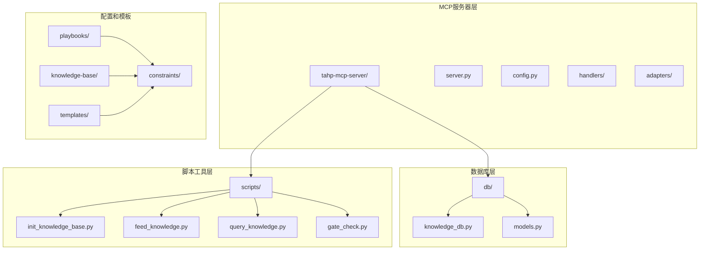
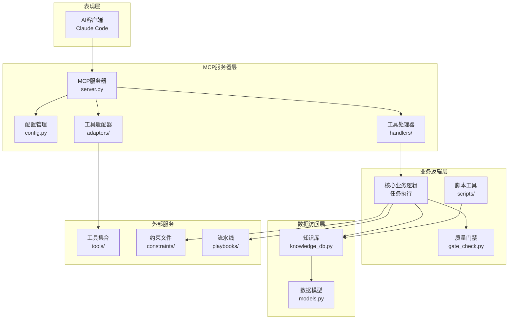
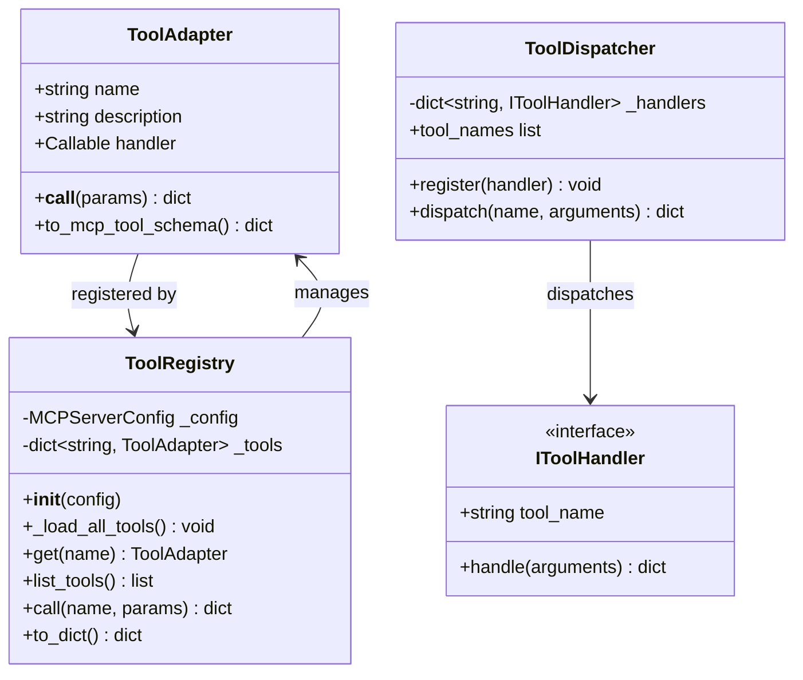
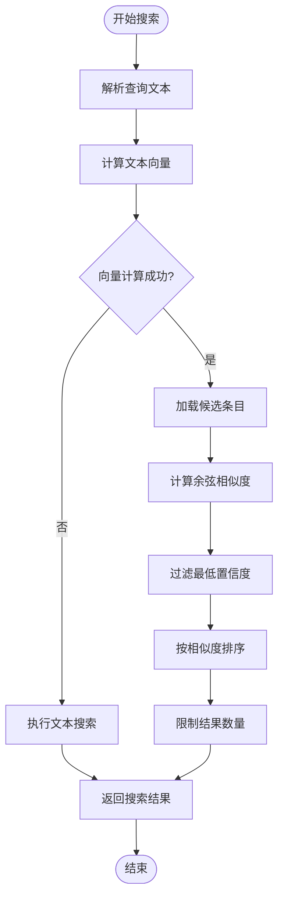
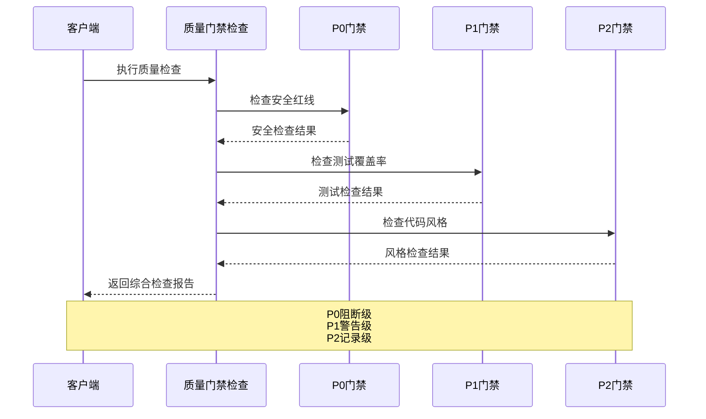
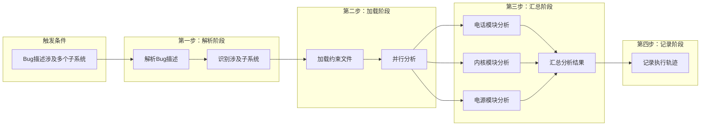
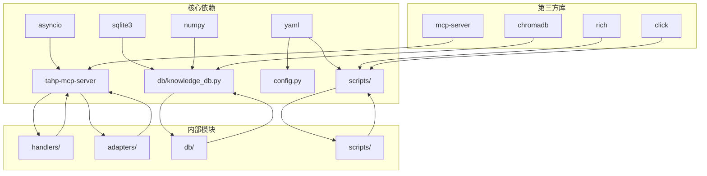

# 技能批量导入系统

<cite>
**本文档引用的文件**
- [server.py](file://tahp-mcp-server/server.py)
- [config.py](file://tahp-mcp-server/config.py)
- [adapters/__init__.py](file://tahp-mcp-server/adapters/__init__.py)
- [handlers/__init__.py](file://tahp-mcp-server/handlers/__init__.py)
- [knowledge_db.py](file://db/knowledge_db.py)
- [models.py](file://db/models.py)
- [init_knowledge_base.py](file://scripts/init_knowledge_base.py)
- [feed_knowledge.py](file://scripts/feed_knowledge.py)
- [query_knowledge.py](file://scripts/query_knowledge.py)
- [gate_check.py](file://scripts/gate_check.py)
- [bug-analysis-pipeline.yaml](file://playbooks/bug-analysis-pipeline.yaml)
- [config.yaml](file://knowledge-base/config.yaml)
- [module.yaml.template](file://templates/module-template/module.yaml.template)
</cite>

## 目录
1. [简介](#简介)
2. [项目结构](#项目结构)
3. [核心组件](#核心组件)
4. [架构概览](#架构概览)
5. [详细组件分析](#详细组件分析)
6. [依赖关系分析](#依赖关系分析)
7. [性能考虑](#性能考虑)
8. [故障排除指南](#故障排除指南)
9. [结论](#结论)

## 简介

技能批量导入系统是一个基于 Model Context Protocol (MCP) 的智能开发助手平台，专门用于自动化处理技术技能的批量导入和管理。该系统通过将约束驱动开发能力暴露为 MCP 工具，为 Claude Code 等 AI Agent 提供强大的技术支持。

系统的核心功能包括：
- **技能批量导入**：支持多种技能类型的批量处理和导入
- **知识库管理**：基于 SQLite + ONNX 的向量知识库
- **质量门禁检查**：三级质量控制（P0/P1/P2）
- **工具适配器**：统一的工具调用接口
- **流水线执行**：支持复杂的多步骤任务流程

## 项目结构

该项目采用模块化的架构设计，主要分为以下几个核心部分：

**图表来源**
- [server.py:1-449](file://tahp-mcp-server/server.py#L1-L449)
- [config.py:1-176](file://tahp-mcp-server/config.py#L1-L176)

**章节来源**
- [server.py:1-449](file://tahp-mcp-server/server.py#L1-L449)
- [config.py:1-176](file://tahp-mcp-server/config.py#L1-L176)

## 核心组件

### MCP 服务器核心

MCP 服务器是整个系统的核心入口点，负责管理所有可用的工具和处理客户端请求。

**主要特性：**
- 支持 12 种不同的 MCP 工具
- 基于异步事件驱动架构
- 完整的错误处理和日志记录
- 可扩展的工具适配器模式

**章节来源**
- [server.py:143-380](file://tahp-mcp-server/server.py#L143-L380)

### 配置管理系统

配置系统提供了灵活的配置管理机制，支持从环境变量和配置文件加载。

**关键配置项：**
- 项目根目录自动推断
- 最大并发任务数限制
- 模块和领域验证
- Playbook 映射配置

**章节来源**
- [config.py:36-176](file://tahp-mcp-server/config.py#L36-L176)

### 知识库管理系统

知识库系统基于 SQLite 和 ONNX 语义嵌入技术，提供强大的搜索和检索能力。

**核心功能：**
- 向量相似度搜索
- 多维度过滤检索
- 跨模块知识关联
- 实时统计和监控

**章节来源**
- [knowledge_db.py:93-589](file://db/knowledge_db.py#L93-L589)
- [models.py:52-247](file://db/models.py#L52-L247)

## 架构概览

系统采用分层架构设计，确保各层之间的职责清晰分离：

**图表来源**
- [server.py:100-139](file://tahp-mcp-server/server.py#L100-L139)
- [adapters/__init__.py:186-239](file://tahp-mcp-server/adapters/__init__.py#L186-L239)

## 详细组件分析

### MCP 工具系统

系统提供了完整的 MCP 工具生态系统，每种工具都有明确的职责和接口规范。

**图表来源**
- [adapters/__init__.py:20-40](file://tahp-mcp-server/adapters/__init__.py#L20-L40)
- [handlers/__init__.py:17-31](file://tahp-mcp-server/handlers/__init__.py#L17-L31)

**章节来源**
- [adapters/__init__.py:186-239](file://tahp-mcp-server/adapters/__init__.py#L186-L239)
- [handlers/__init__.py:33-72](file://tahp-mcp-server/handlers/__init__.py#L33-L72)

### 知识库搜索算法

知识库采用了先进的向量搜索技术，支持语义级别的内容检索。

**图表来源**
- [knowledge_db.py:228-308](file://db/knowledge_db.py#L228-L308)

**章节来源**
- [knowledge_db.py:174-200](file://db/knowledge_db.py#L174-L200)

### 质量门禁检查流程

系统实现了严格的三级质量控制体系，确保技能导入的质量和安全性。

**图表来源**
- [gate_check.py:36-93](file://scripts/gate_check.py#L36-L93)

**章节来源**
- [gate_check.py:368-436](file://scripts/gate_check.py#L368-L436)

### 技能导入流水线

系统支持复杂的多步骤技能导入流程，特别适用于跨模块的复杂场景。

**图表来源**
- [bug-analysis-pipeline.yaml:6-43](file://playbooks/bug-analysis-pipeline.yaml#L6-L43)

**章节来源**
- [bug-analysis-pipeline.yaml:1-43](file://playbooks/bug-analysis-pipeline.yaml#L1-L43)

## 依赖关系分析

系统采用松耦合的设计原则，通过接口和抽象层实现模块间的解耦。

**图表来源**
- [server.py:40-69](file://tahp-mcp-server/server.py#L40-L69)
- [knowledge_db.py:19-22](file://db/knowledge_db.py#L19-L22)

**章节来源**
- [server.py:40-98](file://tahp-mcp-server/server.py#L40-L98)
- [knowledge_db.py:19-24](file://db/knowledge_db.py#L19-L24)

## 性能考虑

系统在设计时充分考虑了性能优化，特别是在高并发和大数据量场景下的表现。

### 知识库性能优化

- **向量索引**：使用 ONNX 模型进行高效的向量计算
- **内存管理**：采用 WAL 日志模式提升并发性能
- **查询优化**：建立多维度索引支持快速检索
- **缓存策略**：智能缓存常用查询结果

### 并发处理

- **异步架构**：基于 asyncio 的非阻塞 I/O 模型
- **任务调度**：支持最大并发任务数配置
- **资源限制**：防止内存泄漏和资源耗尽
- **超时控制**：任务超时自动清理机制

## 故障排除指南

### 常见问题诊断

**知识库连接问题：**
1. 检查 ChromaDB 持久化目录权限
2. 验证 ONNX 模型文件完整性
3. 确认 SQLite 数据库文件可读写

**工具调用失败：**
1. 查看 MCP 服务器日志输出
2. 验证工具适配器是否正确加载
3. 检查工具参数格式是否正确

**性能问题：**
1. 监控并发任务数量
2. 检查内存使用情况
3. 优化查询条件和过滤器

**章节来源**
- [init_knowledge_base.py:144-152](file://scripts/init_knowledge_base.py#L144-L152)
- [server.py:401-407](file://tahp-mcp-server/server.py#L401-L407)

### 调试技巧

1. **启用详细日志**：设置日志级别为 DEBUG 获取完整调试信息
2. **分步验证**：逐个验证配置文件和依赖项
3. **单元测试**：为关键组件编写单元测试确保稳定性
4. **性能监控**：定期检查系统性能指标和资源使用情况

## 结论

技能批量导入系统是一个功能完整、架构清晰的智能开发辅助平台。通过采用 MCP 协议和现代软件架构设计，系统实现了以下优势：

**技术优势：**
- 基于 MCP 协议的标准化接口
- 强大的向量知识库搜索能力
- 灵活的工具适配器模式
- 三级质量门禁控制系统

**架构优势：**
- 分层设计确保职责清晰
- 松耦合实现模块可扩展
- 异步架构支持高并发
- 完善的错误处理机制

**应用价值：**
- 大幅提升技能导入效率
- 标准化开发流程
- 提高代码质量和安全性
- 降低人工成本和错误率

该系统为技术团队提供了一个强大而灵活的技能管理平台，能够有效支撑大规模的技术适配和开发工作。