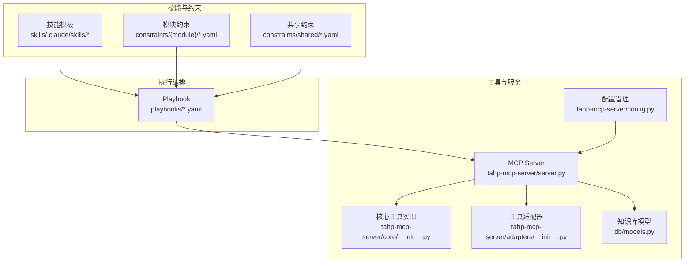
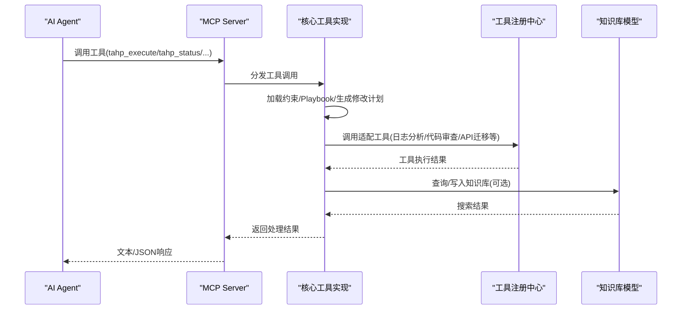
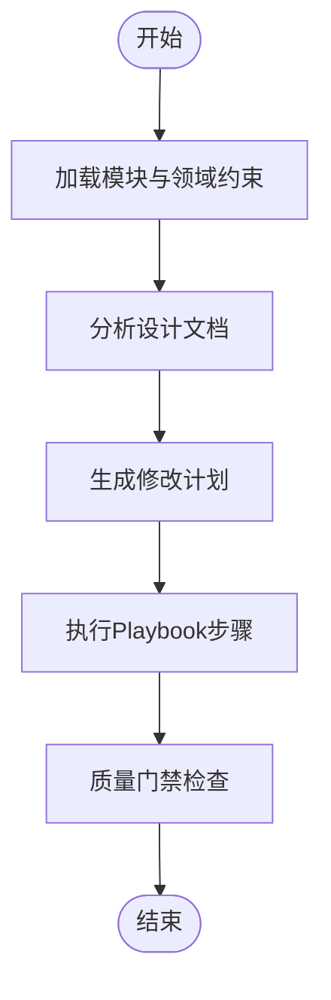
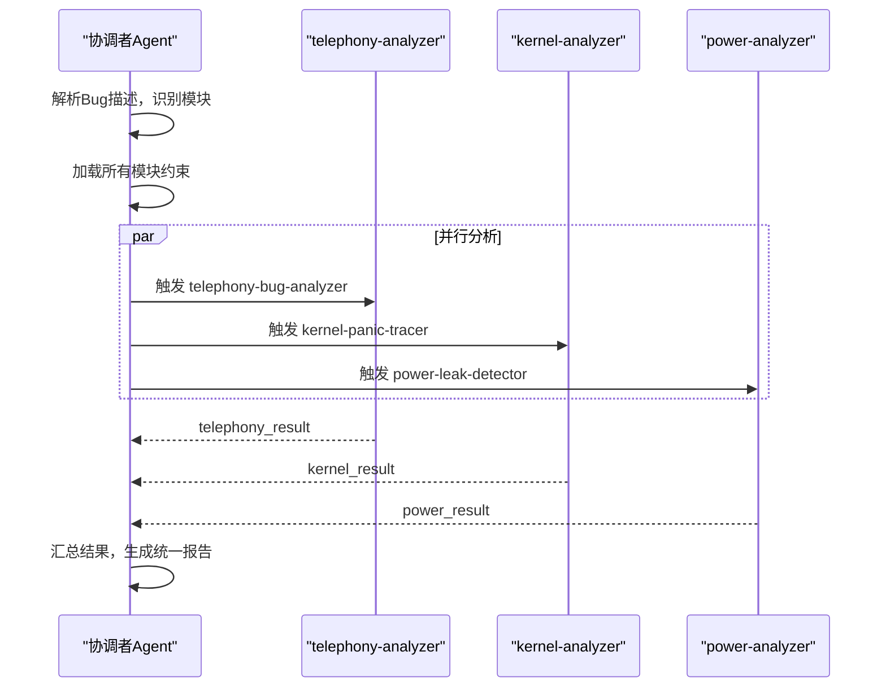
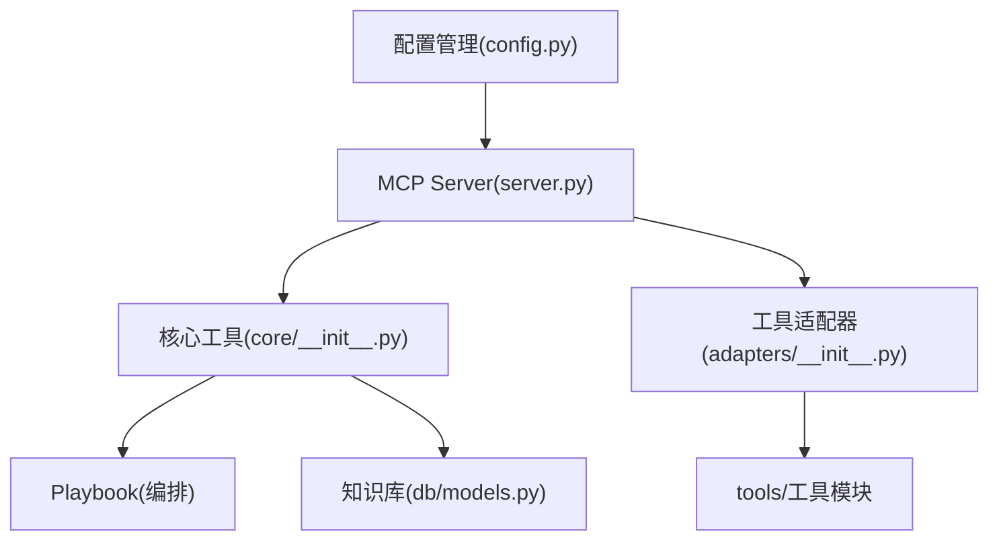

# 技能架构设计

<cite>
**本文档引用的文件**
- [AGENTS.md](file://AGENTS.md)
- [server.py](file://tahp-mcp-server/server.py)
- [config.py](file://tahp-mcp-server/config.py)
- [core/__init__.py](file://tahp-mcp-server/core/__init__.py)
- [adapters/__init__.py](file://tahp-mcp-server/adapters/__init__.py)
- [models.py](file://db/models.py)
- [bug-analysis-pipeline.yaml](file://playbooks/bug-analysis-pipeline.yaml)
- [SKILL.md（kernel-panic-tracer）](file://skills/.claude\skills\kernel-panic-tracer\SKILL.md)
- [SKILL.md（power-leak-detector）](file://skills\.claude\skills\power-leak-detector\SKILL.md)
- [SKILL.md（telephony-bug-analyzer）](file://skills\.claude\skills\telephony-bug-analyzer\SKILL.md)
- [SKILL.md（telephony-version-adapter）](file://skills\.claude\skills\telephony-version-adapter\SKILL.md)
- [SKILL.md（carrier-porting-assistant）](file://skills\.claude\skills\carrier-porting-assistant\SKILL.md)
- [module.yaml（telephony）](file://constraints\telephony\module.yaml)
- [module.yaml（kernel-driver）](file://constraints\kernel-driver\module.yaml)
- [module.yaml（power-mgmt）](file://constraints\power-mgmt\module.yaml)
</cite>

## 目录
1. [引言](#引言)
2. [项目结构](#项目结构)
3. [核心组件](#核心组件)
4. [架构总览](#架构总览)
5. [详细组件分析](#详细组件分析)
6. [依赖分析](#依赖分析)
7. [性能考虑](#性能考虑)
8. [故障排查指南](#故障排查指南)
9. [结论](#结论)
10. [附录](#附录)

## 引言
本文件面向AI Agent技能架构设计，系统化阐述技能系统的整体架构模式、技能模板格式、技能生命周期管理与协作机制。重点覆盖：
- 技能元数据结构与触发条件定义
- 前置检查流程与分析协议规范
- 技能引擎类型（诊断、适配等）与状态管理
- 版本控制策略与扩展点
- 自定义技能开发框架与配置最佳实践
- 技能架构的可视化图表与组件交互示例

## 项目结构
TAHP采用“约束驱动 + 技能引擎”的双引擎架构：诊断引擎用于Bug分析，适配引擎用于版本/特性/运营商移植。技能以标准化模板形式组织，结合Playbook编排执行，并通过MCP Server对外提供工具能力。

图示来源
- [server.py:1-485](file://tahp-mcp-server/server.py#L1-L485)
- [config.py:1-176](file://tahp-mcp-server/config.py#L1-L176)
- [core/__init__.py:1-621](file://tahp-mcp-server/core/__init__.py#L1-L621)
- [adapters/__init__.py:1-239](file://tahp-mcp-server/adapters/__init__.py#L1-L239)
- [models.py:1-247](file://db/models.py#L1-L247)

章节来源
- [AGENTS.md:1-83](file://AGENTS.md#L1-L83)
- [server.py:1-485](file://tahp-mcp-server/server.py#L1-L485)
- [config.py:1-176](file://tahp-mcp-server/config.py#L1-L176)

## 核心组件
- MCP Server：基于MCP协议的工具服务器，暴露统一工具接口给AI Agent调用，负责任务编排、状态跟踪与进度上报。
- 核心工具实现：封装任务执行、状态查询、纠偏、门禁检查、知识库查询等核心能力。
- 工具适配器：将现有tools/工具模块封装为统一接口，供MCP Server调用。
- 知识库模型：定义知识条目的元数据结构与序列化/反序列化规则，支撑知识检索与跨模块搜索。
- Playbook编排：以YAML定义的流水线步骤，驱动多Agent/技能协同执行。

章节来源
- [server.py:100-340](file://tahp-mcp-server/server.py#L100-L340)
- [core/__init__.py:110-298](file://tahp-mcp-server/core/__init__.py#L110-L298)
- [adapters/__init__.py:186-239](file://tahp-mcp-server/adapters/__init__.py#L186-L239)
- [models.py:52-140](file://db/models.py#L52-L140)

## 架构总览
下图展示MCP Server与核心组件之间的交互关系，以及工具调用的典型流程。

图示来源
- [server.py:343-448](file://tahp-mcp-server/server.py#L343-L448)
- [core/__init__.py:110-298](file://tahp-mcp-server/core/__init__.py#L110-L298)
- [adapters/__init__.py:218-234](file://tahp-mcp-server/adapters/__init__.py#L218-L234)
- [models.py:142-247](file://db/models.py#L142-L247)

## 详细组件分析

### 技能模板与元数据结构
技能模板采用Markdown + YAML Front Matter的格式，包含技能元数据、触发条件、前置检查、分析协议与约束文件引用等关键字段。不同技能在元数据中声明所属模块、引擎类型（诊断/适配）、状态与版本等。

- 元数据字段示例（节选）：
  - name：技能唯一标识
  - description：技能描述
  - version：技能版本
  - module：所属模块
  - engine：引擎类型（diagnostic/adaptation）
  - source：来源（manual等）
  - status：激活状态

- 触发条件：以逗号分隔的关键字列表，用于AI Agent自动识别适用场景。
- 前置检查：明确的输入准备清单，缺失关键项时应立即停止分析并提示用户补充。
- 分析协议：标准化的步骤化流程，确保分析一致性与可追溯性。
- 约束文件引用：明确技能依赖的约束文件路径，便于加载与校验。

章节来源
- [SKILL.md（kernel-panic-tracer）:1-33](file://skills\.claude\skills\kernel-panic-tracer\SKILL.md#L1-L33)
- [SKILL.md（power-leak-detector）:1-28](file://skills\.claude\skills\power-leak-detector\SKILL.md#L1-L28)
- [SKILL.md（telephony-bug-analyzer）:1-51](file://skills\.claude\skills\telephony-bug-analyzer\SKILL.md#L1-L51)
- [SKILL.md（telephony-version-adapter）:1-35](file://skills\.claude\skills\telephony-version-adapter\SKILL.md#L1-L35)
- [SKILL.md（carrier-porting-assistant）:1-34](file://skills\.claude\skills\carrier-porting-assistant\SKILL.md#L1-L34)

### 技能生命周期管理
技能生命周期贯穿“加载约束—分析文档—生成计划—执行Pipeline—质量门禁”五个阶段，MCP Server通过任务跟踪器与进度发射器实现状态可视化与纠偏能力。

图示来源
- [core/__init__.py:110-298](file://tahp-mcp-server/core/__init__.py#L110-L298)

章节来源
- [core/__init__.py:110-298](file://tahp-mcp-server/core/__init__.py#L110-L298)

### 技能协作机制与Playbook编排
跨模块Bug分析通过Playbook实现并行与串行混合编排。编排步骤包括：解析Bug、加载约束、并行分析各模块、合成报告与记录反馈。

图示来源
- [bug-analysis-pipeline.yaml:1-43](file://playbooks/bug-analysis-pipeline.yaml#L1-L43)

章节来源
- [bug-analysis-pipeline.yaml:1-43](file://playbooks/bug-analysis-pipeline.yaml#L1-L43)

### 技能引擎类型与状态管理
- 引擎类型：
  - 诊断引擎（diagnostic）：聚焦根因定位与修复建议，如内核panic追踪、功耗泄漏检测、通信模块Bug分析。
  - 适配引擎（adaptation）：聚焦版本/特性/运营商移植，如版本适配、运营商需求移植。
- 状态管理：
  - 任务阶段：加载约束、分析文档、生成计划、执行Pipeline、运行门禁。
  - 任务纠偏：支持在执行过程中接收反馈并调整策略。
  - 终止态：成功/失败/纠偏中等状态，便于外部监控与重试。

章节来源
- [SKILL.md（kernel-panic-tracer）](file://skills\.claude\skills\kernel-panic-tracer\SKILL.md#L6)
- [SKILL.md（power-leak-detector）](file://skills\.claude\skills\power-leak-detector\SKILL.md#L6)
- [SKILL.md（telephony-bug-analyzer）](file://skills\.claude\skills\telephony-bug-analyzer\SKILL.md#L6)
- [SKILL.md（telephony-version-adapter）](file://skills\.claude\skills\telephony-version-adapter\SKILL.md#L6)
- [SKILL.md（carrier-porting-assistant）](file://skills\.claude\skills\carrier-porting-assistant\SKILL.md#L6)
- [core/__init__.py:318-363](file://tahp-mcp-server/core/__init__.py#L318-L363)

### 版本控制策略
- 技能版本：在技能模板元数据中声明，便于演进追踪与兼容性管理。
- 约束文件版本：模块级约束文件包含版本字段，配合模块依赖关系形成清晰的演进链路。
- 知识条目版本：知识库模型支持创建/更新时间戳与ID生成策略，便于增量更新与回溯。

章节来源
- [SKILL.md（kernel-panic-tracer）](file://skills\.claude\skills\kernel-panic-tracer\SKILL.md#L4)
- [SKILL.md（telephony-version-adapter）](file://skills\.claude\skills\telephony-version-adapter\SKILL.md#L4)
- [module.yaml（telephony）](file://constraints\telephony\module.yaml#L7)
- [module.yaml（kernel-driver）](file://constraints\kernel-driver\module.yaml#L7)
- [module.yaml（power-mgmt）](file://constraints\power-mgmt\module.yaml#L7)
- [models.py:44-49](file://db/models.py#L44-L49)

### 扩展点与自定义技能开发框架
- 技能模板扩展：遵循现有Front Matter字段与协议规范，新增触发条件、前置检查与分析步骤。
- 工具适配器扩展：在adapters中新增工具加载器，封装新的tools/工具模块为统一接口。
- Playbook扩展：新增领域对应YAML文件，定义步骤与并行策略，驱动多Agent协作。
- 纠偏与反馈：通过纠偏工具接收外部反馈，动态调整执行策略。

章节来源
- [adapters/__init__.py:186-239](file://tahp-mcp-server/adapters/__init__.py#L186-L239)
- [server.py:437-447](file://tahp-mcp-server/server.py#L437-L447)

### 技能配置最佳实践
- 明确模块边界与依赖：在module.yaml中清晰定义包含/排除范围与依赖关系，避免越界修改。
- 安全红线与门禁：在约束文件中显式声明安全红线，结合门禁检查确保合规。
- 前置检查清单：严格按顺序完成前置检查，缺失关键输入时及时终止并提示用户。
- 知识库治理：统一知识条目类型、类别与来源，提升检索与复用效果。

章节来源
- [module.yaml（telephony）:11-43](file://constraints\telephony\module.yaml#L11-L43)
- [module.yaml（kernel-driver）:11-30](file://constraints\kernel-driver\module.yaml#L11-L30)
- [module.yaml（power-mgmt）:11-32](file://constraints\power-mgmt\module.yaml#L11-L32)
- [SKILL.md（telephony-bug-analyzer）:41-44](file://skills\.claude\skills\telephony-bug-analyzer\SKILL.md#L41-L44)
- [models.py:20-36](file://db/models.py#L20-L36)

## 依赖分析
技能系统围绕MCP Server构建，核心依赖关系如下：

图示来源
- [config.py:1-176](file://tahp-mcp-server/config.py#L1-L176)
- [server.py:1-485](file://tahp-mcp-server/server.py#L1-L485)
- [core/__init__.py:1-621](file://tahp-mcp-server/core/__init__.py#L1-L621)
- [adapters/__init__.py:1-239](file://tahp-mcp-server/adapters/__init__.py#L1-L239)
- [models.py:1-247](file://db/models.py#L1-L247)

章节来源
- [config.py:1-176](file://tahp-mcp-server/config.py#L1-L176)
- [server.py:1-485](file://tahp-mcp-server/server.py#L1-L485)
- [core/__init__.py:1-621](file://tahp-mcp-server/core/__init__.py#L1-L621)
- [adapters/__init__.py:1-239](file://tahp-mcp-server/adapters/__init__.py#L1-L239)
- [models.py:1-247](file://db/models.py#L1-L247)

## 性能考虑
- 并行执行：Playbook支持并行步骤，充分利用多Agent/技能并行能力，缩短整体执行时间。
- 进度与纠偏：通过进度发射器与纠偏工具降低无效重试成本，提高资源利用率。
- 工具降级：适配器提供降级实现，保证在工具模块缺失时仍可返回结构化结果。
- 门禁检查：支持按级别筛选，避免不必要的全量检查，提升响应速度。

## 故障排查指南
- 任务状态查询：使用状态工具查看当前阶段、步骤详情与门禁结果，定位瓶颈。
- 纠偏反馈：在执行阶段接收纠偏指令，系统会记录并调整后续执行策略。
- 门禁失败：根据门禁检查结果逐项修复，重点关注P0阻断项与P1警告项。
- 工具调用异常：检查工具适配器是否正确加载，必要时启用降级模式。

章节来源
- [server.py:343-448](file://tahp-mcp-server/server.py#L343-L448)
- [core/__init__.py:300-363](file://tahp-mcp-server/core/__init__.py#L300-L363)
- [core/__init__.py:366-459](file://tahp-mcp-server/core/__init__.py#L366-L459)

## 结论
TAHP技能架构以“约束驱动 + 技能引擎 + Playbook编排 + MCP工具服务”为核心，实现了诊断与适配两大引擎的统一抽象与可扩展能力。通过标准化的技能模板、严格的前置检查与分析协议、完善的门禁与纠偏机制，系统在保障质量的同时提升了自动化效率与可维护性。建议在实际落地中持续完善约束文件、强化知识库治理，并结合业务场景优化Playbook并行策略与工具适配器覆盖度。

## 附录
- 模块与领域映射参考：诊断/适配引擎与Bug分析、代码适配、版本适配、运营商移植的对应关系。
- 工具清单参考：日志分析、代码审查、API迁移、编译验证、Patch生成、回归测试等工具的调用入口与参数规范。

章节来源
- [AGENTS.md:44-51](file://AGENTS.md#L44-L51)
- [server.py:24-36](file://tahp-mcp-server/server.py#L24-L36)