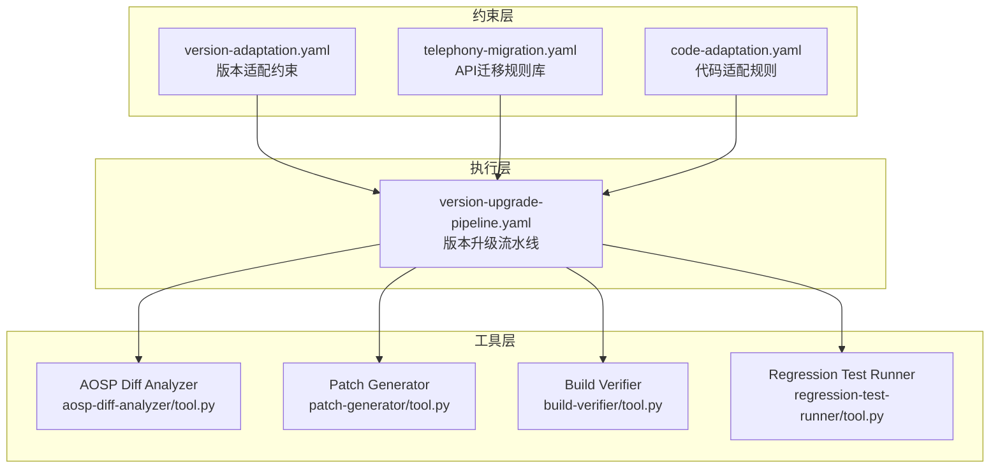
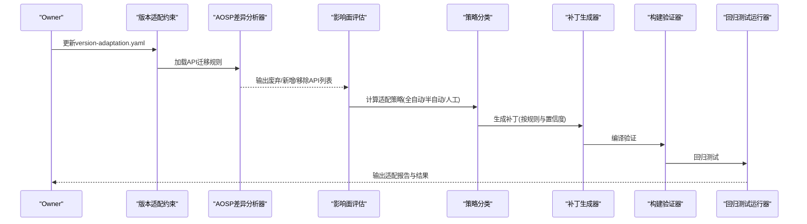
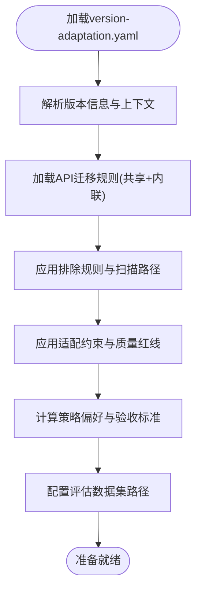
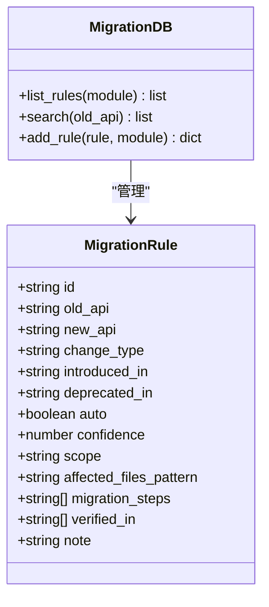
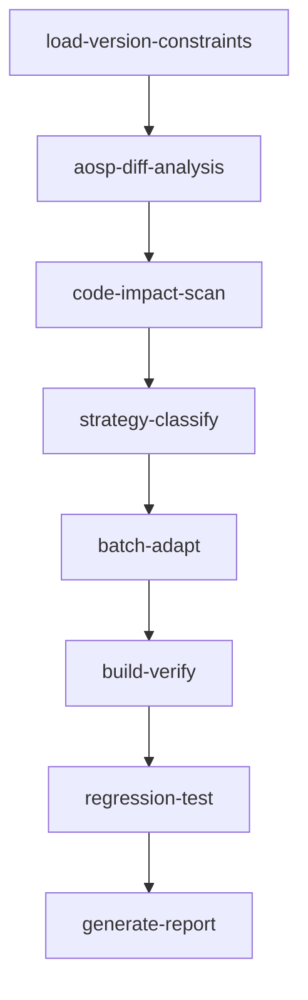
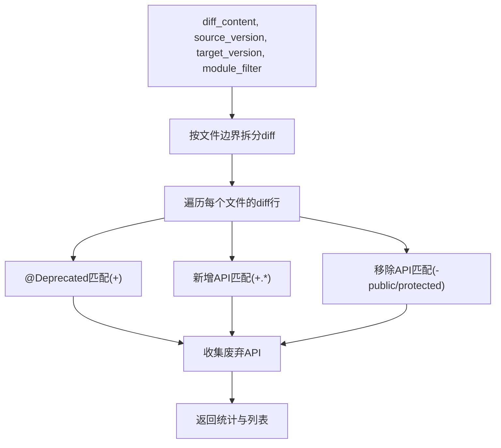
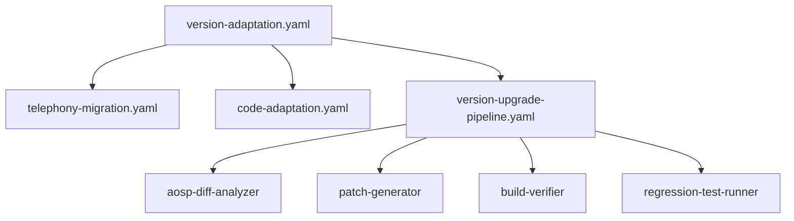

# 电话网版本适配技能

<cite>
**本文档引用的文件**
- [telephony-version-adapter/README.md](file://skills/.claude/skills/telephony-version-adapter/SKILL.md)
- [version-adaptation.yaml](file://constraints/telephony/version-adaptation.yaml)
- [telephony-migration.yaml](file://constraints/shared/api-migration-rules/telephony-migration.yaml)
- [version-upgrade-pipeline.yaml](file://playbooks/version-upgrade-pipeline.yaml)
- [aosp-diff-analyzer/tool.py](file://tools/aosp-diff-analyzer/tool.py)
- [patch-generator/tool.py](file://tools/patch-generator/tool.py)
- [build-verifier/tool.py](file://tools/build-verifier/tool.py)
- [regression-test-runner/tool.py](file://tools/regression-test-runner/tool.py)
- [code-adaptation.yaml](file://constraints/telephony/code-adaptation.yaml)
- [version-adaptation.yaml.template](file://templates/module-template/version-adaptation.yaml.template)
- [TAHP-Architecture-Overview.html](file://TAHP-Architecture-Overview.html)
</cite>

## 目录
1. [简介](#简介)
2. [项目结构](#项目结构)
3. [核心组件](#核心组件)
4. [架构总览](#架构总览)
5. [详细组件分析](#详细组件分析)
6. [依赖关系分析](#依赖关系分析)
7. [性能考虑](#性能考虑)
8. [故障排除指南](#故障排除指南)
9. [结论](#结论)
10. [附录](#附录)

## 简介
本技能专注于Android电话网模块在不同Android版本间的兼容性适配，解决API版本升级与功能迁移问题。其核心目标包括：
- 自动化识别AOSP API变更与废弃API
- 基于规则库进行影响面评估与策略分类
- 批量生成适配补丁并进行编译与回归验证
- 维护质量红线，确保业务逻辑完整性与向后兼容性

该技能适用于Android N到N+1的大版本升级场景，提供从触发条件、适配协议到验收标准的完整流程。

## 项目结构
电话网版本适配技能围绕约束文件、执行流水线与工具集展开，采用模块化设计以支持跨版本迁移：

**图表来源**
- [version-adaptation.yaml:1-117](file://constraints/telephony/version-adaptation.yaml#L1-L117)
- [telephony-migration.yaml:1-57](file://constraints/shared/api-migration-rules/telephony-migration.yaml#L1-L57)
- [code-adaptation.yaml:1-48](file://constraints/telephony/code-adaptation.yaml#L1-L48)
- [version-upgrade-pipeline.yaml:1-61](file://playbooks/version-upgrade-pipeline.yaml#L1-L61)
- [aosp-diff-analyzer/tool.py:1-41](file://tools/aosp-diff-analyzer/tool.py#L1-L41)
- [patch-generator/tool.py:1-24](file://tools/patch-generator/tool.py#L1-L24)
- [build-verifier/tool.py:1-10](file://tools/build-verifier/tool.py#L1-L10)
- [regression-test-runner/tool.py:1-9](file://tools/regression-test-runner/tool.py#L1-L9)

**章节来源**
- [version-adaptation.yaml:1-117](file://constraints/telephony/version-adaptation.yaml#L1-L117)
- [telephony-migration.yaml:1-57](file://constraints/shared/api-migration-rules/telephony-migration.yaml#L1-L57)
- [code-adaptation.yaml:1-48](file://constraints/telephony/code-adaptation.yaml#L1-L48)
- [version-upgrade-pipeline.yaml:1-61](file://playbooks/version-upgrade-pipeline.yaml#L1-L61)

## 核心组件
- 版本适配约束文件：定义源/目标版本、扫描范围、构建与测试目标、迁移规则与验收标准。
- API迁移规则库：集中管理跨版本API变更，包含旧API、新API、变更类型、置信度与迁移步骤。
- 代码适配规则：约束可修改路径、禁止路径、风格规范与质量门禁。
- 版本升级流水线：编排从AOSP差异分析到补丁生成、编译验证与回归测试的全链路。
- 工具集：AOSP差异分析器、补丁生成器、构建验证器、回归测试运行器。

**章节来源**
- [version-adaptation.yaml:14-117](file://constraints/telephony/version-adaptation.yaml#L14-L117)
- [telephony-migration.yaml:7-57](file://constraints/shared/api-migration-rules/telephony-migration.yaml#L7-L57)
- [code-adaptation.yaml:13-48](file://constraints/telephony/code-adaptation.yaml#L13-L48)
- [version-upgrade-pipeline.yaml:6-61](file://playbooks/version-upgrade-pipeline.yaml#L6-L61)

## 架构总览
版本适配技能采用约束驱动的流水线架构，通过规则库与工具集协同工作，实现自动化与半自动化的适配流程。

**图表来源**
- [version-upgrade-pipeline.yaml:6-61](file://playbooks/version-upgrade-pipeline.yaml#L6-L61)
- [aosp-diff-analyzer/tool.py:10-41](file://tools/aosp-diff-analyzer/tool.py#L10-L41)
- [patch-generator/tool.py:3-24](file://tools/patch-generator/tool.py#L3-L24)
- [build-verifier/tool.py:3-10](file://tools/build-verifier/tool.py#L3-L10)
- [regression-test-runner/tool.py:3-9](file://tools/regression-test-runner/tool.py#L3-L9)

## 详细组件分析

### 组件A：版本适配约束文件
- 版本信息：明确源版本与目标版本，支持大版本升级场景。
- 上下文配置：定义扫描路径、构建目标、测试目标与依赖模块，过滤厂商私有路径。
- API迁移规则：支持共享规则文件与内联规则，包含变更类型、置信度与迁移说明。
- 适配约束：质量红线与排除规则，确保业务逻辑完整性与合规性。
- 策略偏好：设置自动化阈值、批处理大小与并行代理数量。
- 验收标准：编译通过、冒烟测试与功能回归测试目标及通过率要求。
- 评估数据集：提供A15→A16的典型适配案例路径。

**图表来源**
- [version-adaptation.yaml:14-117](file://constraints/telephony/version-adaptation.yaml#L14-L117)

**章节来源**
- [version-adaptation.yaml:14-117](file://constraints/telephony/version-adaptation.yaml#L14-L117)

### 组件B：API迁移规则库
- 规则元数据：模块、维护者、最后更新时间与规则总数。
- 规则条目：包含旧API、新API、变更类型、引入/废弃版本、自动化标记、置信度、作用域与迁移步骤。
- 影响范围：通过文件模式限定受影响文件，便于批量定位与处理。
- 验证信息：记录在特定版本中已验证，便于回溯与复用。

**图表来源**
- [telephony-migration.yaml:7-57](file://constraints/shared/api-migration-rules/telephony-migration.yaml#L7-L57)
- [tools/api-migration-db/tool.py:28-44](file://tools/api-migration-db/tool.py#L28-L44)

**章节来源**
- [telephony-migration.yaml:7-57](file://constraints/shared/api-migration-rules/telephony-migration.yaml#L7-L57)
- [tools/api-migration-db/tool.py:28-44](file://tools/api-migration-db/tool.py#L28-L44)

### 组件C：版本升级流水线
- 步骤编排：加载约束→AOSP差异分析→影响面扫描→策略分类→批量适配→构建验证→回归测试→生成报告。
- 并行执行：自动适配、半自动适配与人工任务并行推进，提升整体效率。
- 质量控制：编译与回归测试作为验收门槛，确保迁移质量。

**图表来源**
- [version-upgrade-pipeline.yaml:6-61](file://playbooks/version-upgrade-pipeline.yaml#L6-L61)

**章节来源**
- [version-upgrade-pipeline.yaml:6-61](file://playbooks/version-upgrade-pipeline.yaml#L6-L61)

### 组件D：AOSP差异分析器
- 功能：解析AOSP差异内容，提取废弃API、新增API与移除API，统计汇总信息。
- 模式匹配：使用正则表达式识别@Deprecated、新增与移除的API声明。
- 文件拆分：按diff文件边界分割，逐文件解析，支持模块过滤。

**图表来源**
- [aosp-diff-analyzer/tool.py:10-41](file://tools/aosp-diff-analyzer/tool.py#L10-L41)

**章节来源**
- [aosp-diff-analyzer/tool.py:10-41](file://tools/aosp-diff-analyzer/tool.py#L10-L41)

### 组件E：补丁生成器
- 功能：根据迁移规则与目标文件集合生成补丁，统计生成/跳过/错误数量。
- 影响范围：支持基于规则文件模式筛选受影响文件，提高匹配精度。
- 输出：补丁清单与统计信息，便于后续审核与执行。

**章节来源**
- [patch-generator/tool.py:3-24](file://tools/patch-generator/tool.py#L3-L24)

### 组件F：构建验证器与回归测试运行器
- 构建验证器：接收构建命令与目标/补丁列表，返回编译结果与告警信息。
- 回归测试运行器：执行冒烟与功能测试，统计通过数、失败数与通过率。

**章节来源**
- [build-verifier/tool.py:3-10](file://tools/build-verifier/tool.py#L3-L10)
- [regression-test-runner/tool.py:3-9](file://tools/regression-test-runner/tool.py#L3-L9)

### 组件G：代码适配规则
- 构建规则：构建系统类型、构建命令与前后检查项。
- 修改规则：允许/禁止修改的路径、风格规范与接口变更规则。
- 质量门禁：关键与警告级质量红线，确保迁移过程的安全性与一致性。

**章节来源**
- [code-adaptation.yaml:1-48](file://constraints/telephony/code-adaptation.yaml#L1-L48)

### 组件H：模板文件与架构概览
- 模板文件：提供版本适配约束的完整模板，涵盖版本信息、迁移规则、测试要求、回滚条件、安全红线与评估指标。
- 架构概览：展示仓库结构与各模块角色，突出版本适配技能在整体体系中的位置。

**章节来源**
- [version-adaptation.yaml.template:18-323](file://templates/module-template/version-adaptation.yaml.template#L18-L323)
- [TAHP-Architecture-Overview.html:605-678](file://TAHP-Architecture-Overview.html#L605-L678)

## 依赖关系分析
- 约束文件依赖：版本适配约束文件依赖API迁移规则库与代码适配规则，共同决定适配策略与执行范围。
- 流水线依赖：版本升级流水线串联差异分析、影响评估、策略分类与批量适配等步骤，形成闭环。
- 工具依赖：差异分析器与补丁生成器依赖规则库；构建验证器与回归测试运行器负责质量验收。

**图表来源**
- [version-adaptation.yaml:40-117](file://constraints/telephony/version-adaptation.yaml#L40-L117)
- [telephony-migration.yaml:1-57](file://constraints/shared/api-migration-rules/telephony-migration.yaml#L1-L57)
- [code-adaptation.yaml:1-48](file://constraints/telephony/code-adaptation.yaml#L1-L48)
- [version-upgrade-pipeline.yaml:6-61](file://playbooks/version-upgrade-pipeline.yaml#L6-L61)

**章节来源**
- [version-adaptation.yaml:40-117](file://constraints/telephony/version-adaptation.yaml#L40-L117)
- [telephony-migration.yaml:1-57](file://constraints/shared/api-migration-rules/telephony-migration.yaml#L1-L57)
- [code-adaptation.yaml:1-48](file://constraints/telephony/code-adaptation.yaml#L1-L48)
- [version-upgrade-pipeline.yaml:6-61](file://playbooks/version-upgrade-pipeline.yaml#L6-L61)

## 性能考虑
- 并行化执行：流水线支持并行执行自动与半自动任务，结合策略偏好参数提升吞吐。
- 批处理优化：通过批处理大小与并行代理数量控制资源占用与响应速度。
- 规则匹配效率：利用文件模式与模块过滤减少无效扫描，提高差异分析与补丁生成的准确性与速度。
- 构建与测试优化：严格的编译与回归测试门槛有助于早期发现问题，降低返工成本。

## 故障排除指南
- 编译失败：检查构建命令与目标配置，确认补丁生成是否正确，排查新增API缺失注解或导入问题。
- 回归测试不通过：核对测试目标与通过率阈值，定位失败用例并补充修复；关注质量红线违规。
- 废弃API残留：使用约束文件中的自定义检查命令进行全量扫描，确保零残留。
- 路径与权限问题：确认扫描路径与排除规则配置正确，避免误伤厂商私有代码或无关模块。

**章节来源**
- [version-adaptation.yaml:94-117](file://constraints/telephony/version-adaptation.yaml#L94-L117)
- [code-adaptation.yaml:37-48](file://constraints/telephony/code-adaptation.yaml#L37-L48)

## 结论
电话网版本适配技能通过约束驱动与工具集协同，实现了从AOSP差异分析到补丁生成与质量验收的完整自动化流程。其核心优势在于：
- 明确的质量红线与验收标准，保障业务逻辑完整性与安全性
- 基于规则库的策略分类与批量适配，显著提升效率
- 清晰的模板与架构设计，便于扩展与维护

建议在实际使用中结合模板文件完善约束配置，持续更新API迁移规则库，并定期回顾评估数据集以优化策略与工具。

## 附录
- 触发条件：版本升级、Android N→N+1、AOSP适配、API迁移、接口变更、废弃API替换
- 适配协议：加载约束→AOSP差异分析→影响面评估→策略分类→补丁生成→验证
- 质量红线：不得删除自研业务逻辑、新增API需@RequiresApi注解、废弃API迁移零残留、不得引入新编译警告
- 约束文件引用：version-adaptation.yaml、telephony-migration.yaml、code-adaptation.yaml

**章节来源**
- [telephony-version-adapter/README.md:13-35](file://skills/.claude/skills/telephony-version-adapter/SKILL.md#L13-L35)