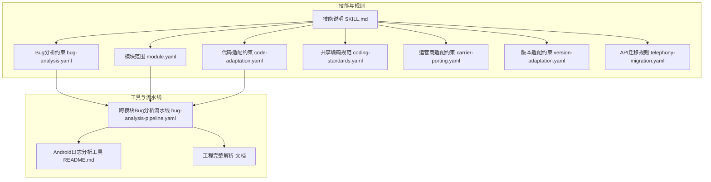
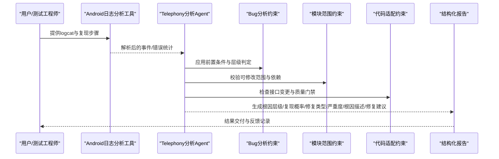
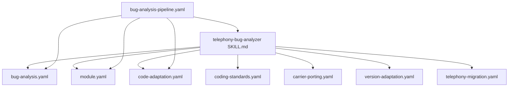

# 电话网缺陷分析技能

<cite>
**本文档引用的文件**
- [技能说明 SKILL.md](file://skills/.claude/skills/telephony-bug-analyzer/SKILL.md)
- [Bug分析约束 bug-analysis.yaml](file://constraints/telephony/bug-analysis.yaml)
- [模块范围 module.yaml](file://constraints/telephony/module.yaml)
- [代码适配约束 code-adaptation.yaml](file://constraints/telephony/code-adaptation.yaml)
- [共享编码规范 coding-standards.yaml](file://constraints/shared/coding-standards.yaml)
- [运营商适配约束 carrier-porting.yaml](file://constraints/telephony/carrier-porting.yaml)
- [版本适配约束 version-adaptation.yaml](file://constraints/telephony/version-adaptation.yaml)
- [API迁移规则 telephony-migration.yaml](file://constraints/shared/api-migration-rules/telephony-migration.yaml)
- [Android日志分析工具 README.md](file://tools/android-log-analyzer/README.md)
- [跨模块Bug分析流水线 bug-analysis-pipeline.yaml](file://playbooks/bug-analysis-pipeline.yaml)
- [工程完整解析 文档](file://docs/TAHP-工程完整解析.md)
- [约束文件编写规范](file://TAHP-约束文件编写规范.md)
</cite>

## 目录
1. [简介](#简介)
2. [项目结构](#项目结构)
3. [核心组件](#核心组件)
4. [架构总览](#架构总览)
5. [详细组件分析](#详细组件分析)
6. [依赖关系分析](#依赖关系分析)
7. [性能考虑](#性能考虑)
8. [故障排查指南](#故障排查指南)
9. [结论](#结论)
10. [附录](#附录)

## 简介
本技能面向Android电话网（Telephony）缺陷分析，覆盖通话、短信、数据连接、VoLTE/VoWiFi等场景，提供从日志采集到根因定位再到修复建议的闭环流程。其核心能力包括：
- 触发条件识别与前置检查（Modem固件版本、Android版本、设备型号、logcat、复现步骤）
- 分析协议三步法：层级判定（Framework→RILJ→RILC→Modem）、根因确认（证据强度标准）、产出结构化报告
- 安全红线与质量门禁，确保高风险问题受控处理
- 与跨模块分析流水线集成，支持多子系统协同诊断

## 项目结构
电话网缺陷分析技能由“技能说明”、“约束文件”、“工具与流水线”三部分构成，形成“规则约束 + 自动化执行 + 质量保障”的体系。

图表来源
- [技能说明 SKILL.md:1-51](file://skills/.claude/skills/telephony-bug-analyzer/SKILL.md#L1-L51)
- [Bug分析约束 bug-analysis.yaml:1-110](file://constraints/telephony/bug-analysis.yaml#L1-L110)
- [模块范围 module.yaml:1-43](file://constraints/telephony/module.yaml#L1-L43)
- [代码适配约束 code-adaptation.yaml:1-48](file://constraints/telephony/code-adaptation.yaml#L1-L48)
- [共享编码规范 coding-standards.yaml:1-23](file://constraints/shared/coding-standards.yaml#L1-L23)
- [运营商适配约束 carrier-porting.yaml:1-106](file://constraints/telephony/carrier-porting.yaml#L1-L106)
- [版本适配约束 version-adaptation.yaml:1-117](file://constraints/telephony/version-adaptation.yaml#L1-L117)
- [API迁移规则 telephony-migration.yaml:1-57](file://constraints/shared/api-migration-rules/telephony-migration.yaml#L1-L57)
- [Android日志分析工具 README.md:1-13](file://tools/android-log-analyzer/README.md#L1-L13)
- [跨模块Bug分析流水线 bug-analysis-pipeline.yaml:1-43](file://playbooks/bug-analysis-pipeline.yaml#L1-L43)
- [工程完整解析 文档:557-605](file://docs/TAHP-工程完整解析.md#L557-L605)

章节来源
- [技能说明 SKILL.md:1-51](file://skills/.claude/skills/telephony-bug-analyzer/SKILL.md#L1-L51)
- [跨模块Bug分析流水线 bug-analysis-pipeline.yaml:1-43](file://playbooks/bug-analysis-pipeline.yaml#L1-L43)

## 核心组件
- 技能说明（SKILL.md）：定义触发条件、前置检查、分析协议、安全红线与约束引用，是本技能的“操作手册”
- Bug分析约束（bug-analysis.yaml）：定义前置条件、层级判定顺序、禁止行为、必须输出字段、安全门禁与评估指标
- 模块范围（module.yaml）：明确通信模块的组件边界、依赖关系与排除范围
- 代码适配约束（code-adaptation.yaml）：限定可修改路径、接口变更规则、构建与质量门禁
- 共享编码规范（coding-standards.yaml）：版本控制、代码评审、文档与Android特定规范
- 运营商适配约束（carrier-porting.yaml）：运营商定制需求、合规标准与回归目标
- 版本适配约束（version-adaptation.yaml）：版本升级策略、API迁移规则与验收标准
- API迁移规则（telephony-migration.yaml）：具体API变更清单与迁移步骤
- 工具与流水线：Android日志分析工具与跨模块Bug分析流水线，支撑自动化与规模化分析

章节来源
- [技能说明 SKILL.md:1-51](file://skills/.claude/skills/telephony-bug-analyzer/SKILL.md#L1-L51)
- [Bug分析约束 bug-analysis.yaml:1-110](file://constraints/telephony/bug-analysis.yaml#L1-L110)
- [模块范围 module.yaml:1-43](file://constraints/telephony/module.yaml#L1-L43)
- [代码适配约束 code-adaptation.yaml:1-48](file://constraints/telephony/code-adaptation.yaml#L1-L48)
- [共享编码规范 coding-standards.yaml:1-23](file://constraints/shared/coding-standards.yaml#L1-L23)
- [运营商适配约束 carrier-porting.yaml:1-106](file://constraints/telephony/carrier-porting.yaml#L1-L106)
- [版本适配约束 version-adaptation.yaml:1-117](file://constraints/telephony/version-adaptation.yaml#L1-L117)
- [API迁移规则 telephony-migration.yaml:1-57](file://constraints/shared/api-migration-rules/telephony-migration.yaml#L1-L57)
- [Android日志分析工具 README.md:1-13](file://tools/android-log-analyzer/README.md#L1-L13)
- [跨模块Bug分析流水线 bug-analysis-pipeline.yaml:1-43](file://playbooks/bug-analysis-pipeline.yaml#L1-L43)

## 架构总览
电话网缺陷分析技能采用“规则驱动 + 流水线编排”的架构，围绕日志输入与多层级分析展开，最终输出结构化报告并受质量门禁约束。

图表来源
- [Android日志分析工具 README.md:1-13](file://tools/android-log-analyzer/README.md#L1-L13)
- [跨模块Bug分析流水线 bug-analysis-pipeline.yaml:1-43](file://playbooks/bug-analysis-pipeline.yaml#L1-L43)
- [Bug分析约束 bug-analysis.yaml:1-110](file://constraints/telephony/bug-analysis.yaml#L1-L110)
- [模块范围 module.yaml:1-43](file://constraints/telephony/module.yaml#L1-L43)
- [代码适配约束 code-adaptation.yaml:1-48](file://constraints/telephony/code-adaptation.yaml#L1-L48)

## 详细组件分析

### 触发条件与前置检查
- 触发条件：telephony bug、通话异常、短信失败、数据连接、VoLTE掉话、VoWiFi问题、SIM卡异常、call drop、SMS failure、RIL错误
- 前置检查（必须按顺序完成）：
  1) 确认Modem固件版本：getprop gsm.version.baseband
  2) 确认Android版本：getprop ro.build.version.release
  3) 确认设备型号：getprop ro.product.model
  4) 收集logcat：adb logcat -d -b radio,main,system
  5) 确认复现步骤：由用户/Bug报告提供
- 缺少上述任一关键信息（尤其是modem_firmware_version、repro_steps、logcat）时，立即停止分析并要求补充

章节来源
- [技能说明 SKILL.md:13-24](file://skills/.claude/skills/telephony-bug-analyzer/SKILL.md#L13-L24)
- [约束文件编写规范:118-152](file://TAHP-约束文件编写规范.md#L118-L152)

### 分析协议三步法
- 步骤一：层级判定（严格按此顺序）
  - 通话/短信/数据问题 → Framework层检查 → RILJ层检查 → RILC层检查 → Modem层检查
  - 每一层的检查要点与指示器在约束文件中明确定义，需结合logcat中的关键字模式进行定位
- 步骤二：根因确认
  - 证据强度标准：
    - 强：logcat异常堆栈/代码逻辑错误/错误码匹配
    - 中：日志异常模式/代码推导/已知pattern
    - 弱：经验推断/平台类比（必须标注[SPECULATIVE]）
  - 根因判定必须基于强或中等证据
- 步骤三：产出报告（必须包含）
  - 复现概率（always/frequent/occasional/rare/unknown）
  - 根因层级（Framework/RILJ/RILC/Modem/Network/Unknown）
  - 影响范围（single_device/device_series/platform/all）
  - 修复类型（code_change/config_change/firmware_upgrade/network_side/further_investigation）
  - 严重程度（critical/high/medium/low）
  - 根因描述（≥50字）
  - 修复建议（≥30字）

章节来源
- [技能说明 SKILL.md:26-40](file://skills/.claude/skills/telephony-bug-analyzer/SKILL.md#L26-L40)
- [Bug分析约束 bug-analysis.yaml:31-94](file://constraints/telephony/bug-analysis.yaml#L31-L94)

### 安全红线与质量门禁
- 安全红线（security_gates）：
  - 通话可能被窃听 → 标记critical，立即通知安全团队，不给出公开修复方案
  - 涉及SIM卡密钥/鉴权 → 标记critical，结果仅限指定接收人
  - 可能导致网络拥塞/DoS → 标记high，评估影响范围后再修复
- 质量门禁（quality_gates）：
  - 不允许引入新的编译错误
  - 不允许修改与目标芯片平台无关的公共代码
  - 不允许硬编码设备型号或IMEI
  - 不允许移除已有的错误处理逻辑
  - 不允许修改安全相关的权限检查代码
- 代码修改限制：
  - 允许路径：frameworks/opt/telephony/、frameworks/base/telephony/、hardware/interfaces/ril/、packages/services/Telephony/、frameworks/base/telecom/
  - 禁止路径：frameworks/base/core/、system/core/、bionic/、external/
- 接口变更规则：涉及HIDL/AIDL接口变更时，必须同时更新接口定义文件和所有实现端；public API签名变更需经模块Owner审核；接口变更必须递增版本号

章节来源
- [技能说明 SKILL.md:41-44](file://skills/.claude/skills/telephony-bug-analyzer/SKILL.md#L41-L44)
- [Bug分析约束 bug-analysis.yaml:95-102](file://constraints/telephony/bug-analysis.yaml#L95-L102)
- [代码适配约束 code-adaptation.yaml:37-47](file://constraints/telephony/code-adaptation.yaml#L37-L47)

### 评估与验收
- 评估目标：bug_analysis_accuracy_target ≥ 0.85
- 必需产物：root_cause_report、affected_components、fix_suggestion
- 评估数据集：eval-data/（按模块提供历史Bug案例）
- 版本升级验收：编译通过、冒烟测试与回归测试通过率≥0.95，且无废弃API残留

章节来源
- [Bug分析约束 bug-analysis.yaml:103-110](file://constraints/telephony/bug-analysis.yaml#L103-L110)
- [版本适配约束 version-adaptation.yaml:94-117](file://constraints/telephony/version-adaptation.yaml#L94-L117)

### 实际应用案例
- 工程落地场景：WiFi Calling在特定运营商网络下崩溃，使用TAHP流水线快速定位IMS服务空指针问题，并输出修复建议
- 日志采集与运行：通过adb logcat收集日志，运行跨模块Bug分析流水线，查看AI分析结果

章节来源
- [工程完整解析 文档:557-605](file://docs/TAHP-工程完整解析.md#L557-L605)

## 依赖关系分析
电话网缺陷分析技能与多个模块存在耦合关系，既依赖于模块范围与约束，又通过流水线与其他模块协同工作。

图表来源
- [技能说明 SKILL.md:46-51](file://skills/.claude/skills/telephony-bug-analyzer/SKILL.md#L46-L51)
- [跨模块Bug分析流水线 bug-analysis-pipeline.yaml:1-43](file://playbooks/bug-analysis-pipeline.yaml#L1-L43)
- [模块范围 module.yaml:1-43](file://constraints/telephony/module.yaml#L1-L43)
- [代码适配约束 code-adaptation.yaml:1-48](file://constraints/telephony/code-adaptation.yaml#L1-L48)
- [共享编码规范 coding-standards.yaml:1-23](file://constraints/shared/coding-standards.yaml#L1-L23)
- [运营商适配约束 carrier-porting.yaml:1-106](file://constraints/telephony/carrier-porting.yaml#L1-L106)
- [版本适配约束 version-adaptation.yaml:1-117](file://constraints/telephony/version-adaptation.yaml#L1-L117)
- [API迁移规则 telephony-migration.yaml:1-57](file://constraints/shared/api-migration-rules/telephony-migration.yaml#L1-L57)

章节来源
- [技能说明 SKILL.md:46-51](file://skills/.claude/skills/telephony-bug-analyzer/SKILL.md#L46-L51)
- [跨模块Bug分析流水线 bug-analysis-pipeline.yaml:1-43](file://playbooks/bug-analysis-pipeline.yaml#L1-L43)

## 性能考虑
- 日志解析效率：优先使用工具对logcat进行过滤与事件抽取，减少无效扫描
- 并行分析：跨模块流水线支持并行分析，缩短整体诊断时间
- 关键路径优化：严格按层级顺序检查，避免在低概率层级浪费时间
- 评估数据集规模：提供充足的评估案例有助于提升模型准确率与稳定性

## 故障排查指南
- 缺少前置信息
  - 现象：无法开始分析或层级判定失败
  - 处理：补齐Modem固件版本、Android版本、设备型号、完整logcat与复现步骤
- 证据强度不足
  - 现象：根因判定为弱证据或未知
  - 处理：补充更多日志片段、复现步骤或交叉验证（如AT命令日志）
- 安全红线触发
  - 现象：高危条件被检测到
  - 处理：立即标记为critical/high，按安全门禁流程上报与限制传播
- 修复建议不可实施
  - 现象：建议涉及禁止路径或接口变更
  - 处理：根据代码适配约束调整修复方向，必要时降级为进一步调查

章节来源
- [技能说明 SKILL.md:16-24](file://skills/.claude/skills/telephony-bug-analyzer/SKILL.md#L16-L24)
- [Bug分析约束 bug-analysis.yaml:59-64](file://constraints/telephony/bug-analysis.yaml#L59-L64)
- [代码适配约束 code-adaptation.yaml:20-24](file://constraints/telephony/code-adaptation.yaml#L20-L24)

## 结论
电话网缺陷分析技能通过“规则驱动 + 流水线编排 + 质量门禁”的方式，实现了对通话、短信、数据连接、VoLTE/VoWiFi等场景的系统化诊断。其关键价值在于：
- 明确的前置检查与分析协议，降低误判与漏判
- 严格的证据强度标准与安全红线，确保高风险问题受控
- 与跨模块流水线和工具链集成，支撑规模化与自动化
- 丰富的约束与评估机制，保障修复质量与可维护性

## 附录
- 约束文件引用清单
  - [模块范围 module.yaml:1-43](file://constraints/telephony/module.yaml#L1-L43)
  - [Bug分析约束 bug-analysis.yaml:1-110](file://constraints/telephony/bug-analysis.yaml#L1-L110)
  - [代码适配约束 code-adaptation.yaml:1-48](file://constraints/telephony/code-adaptation.yaml#L1-L48)
  - [共享编码规范 coding-standards.yaml:1-23](file://constraints/shared/coding-standards.yaml#L1-L23)
  - [运营商适配约束 carrier-porting.yaml:1-106](file://constraints/telephony/carrier-porting.yaml#L1-L106)
  - [版本适配约束 version-adaptation.yaml:1-117](file://constraints/telephony/version-adaptation.yaml#L1-L117)
  - [API迁移规则 telephony-migration.yaml:1-57](file://constraints/shared/api-migration-rules/telephony-migration.yaml#L1-L57)
  - [Android日志分析工具 README.md:1-13](file://tools/android-log-analyzer/README.md#L1-L13)
  - [跨模块Bug分析流水线 bug-analysis-pipeline.yaml:1-43](file://playbooks/bug-analysis-pipeline.yaml#L1-L43)
  - [工程完整解析 文档:557-605](file://docs/TAHP-工程完整解析.md#L557-L605)
  - [约束文件编写规范:118-281](file://TAHP-约束文件编写规范.md#L118-L281)