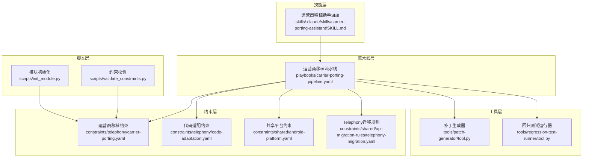
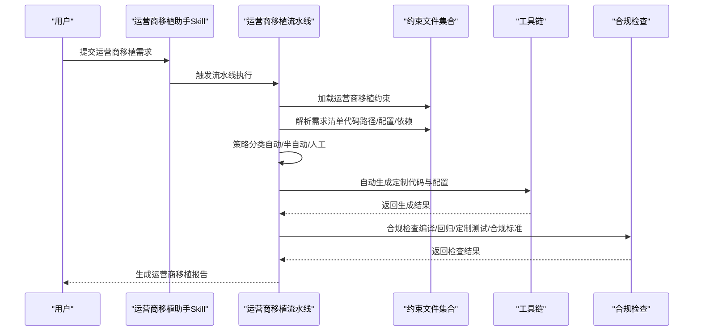
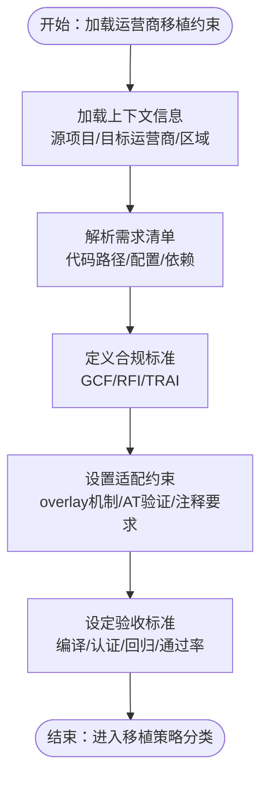
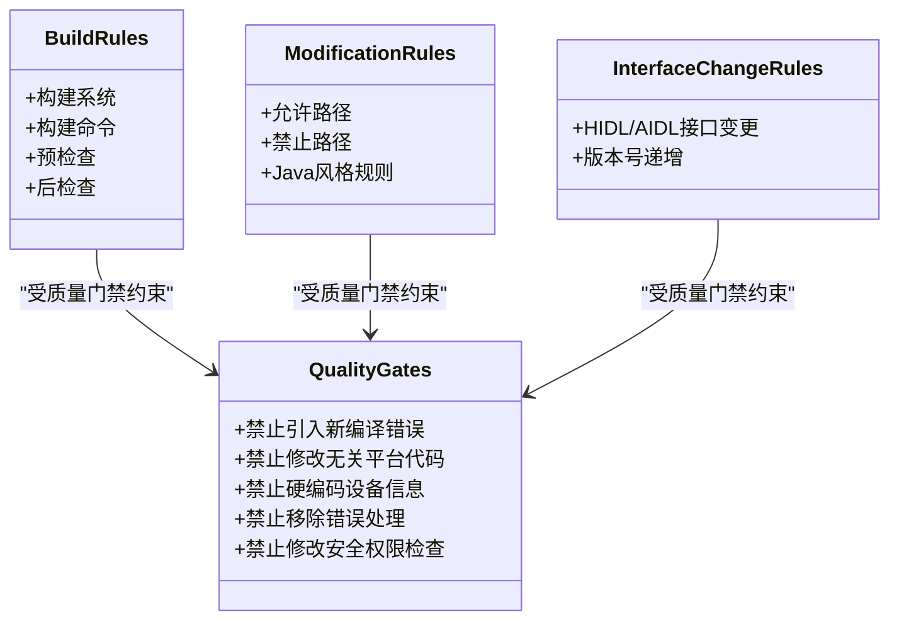
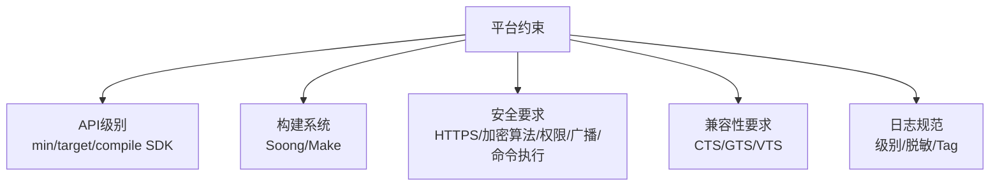
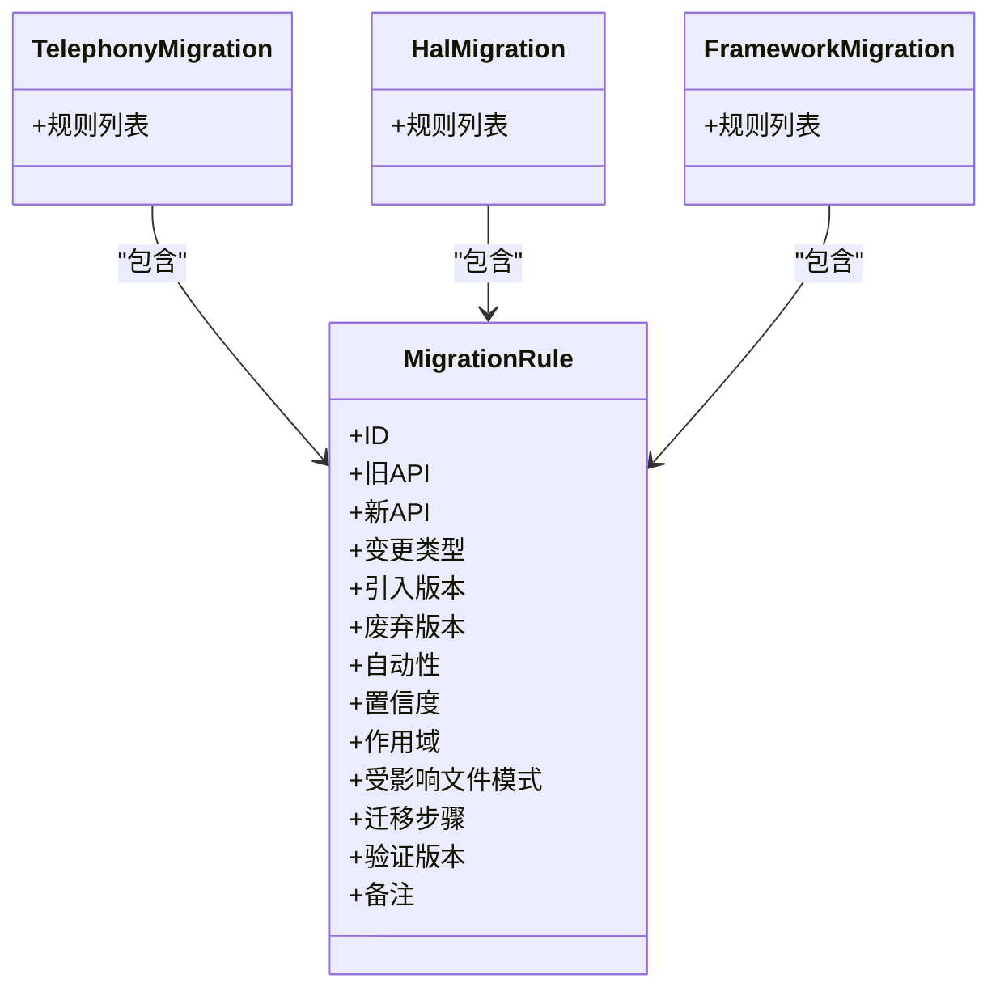
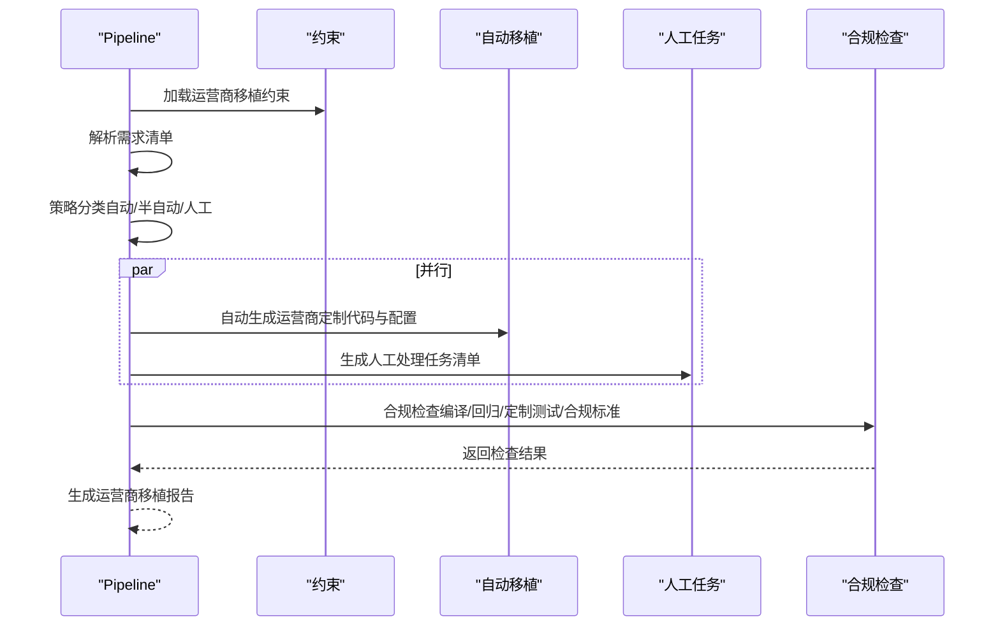
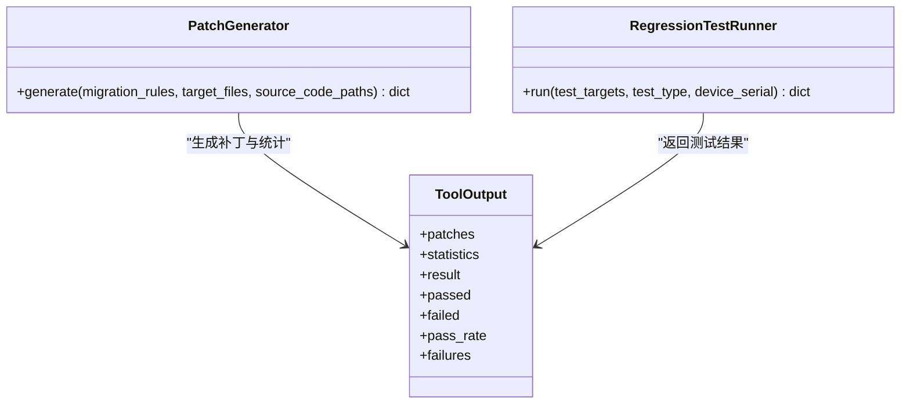
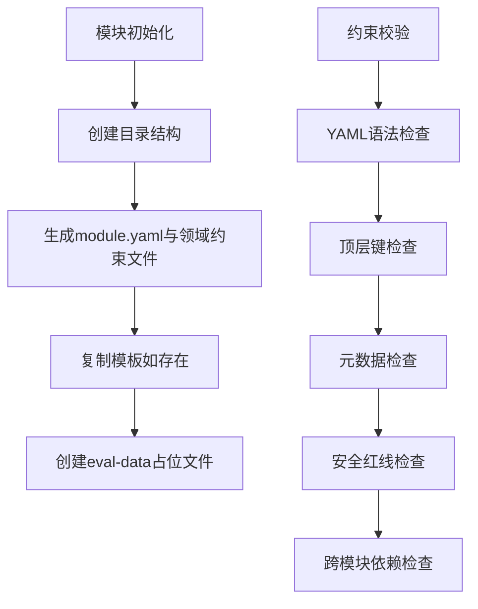
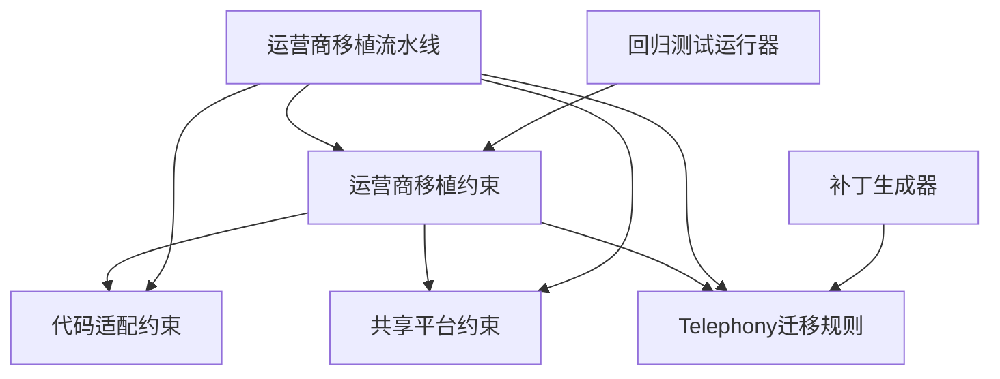

# 运营商移植助手技能

<cite>
**本文引用的文件**
- [技能说明 SKILL.md](file://skills/.claude/skills/carrier-porting-assistant/SKILL.md)
- [运营商移植约束 carrier-porting.yaml](file://constraints/telephony/carrier-porting.yaml)
- [运营商移植流水线 carrier-porting-pipeline.yaml](file://playbooks/carrier-porting-pipeline.yaml)
- [共享平台约束 android-platform.yaml](file://constraints/shared/android-platform.yaml)
- [API迁移规则 telephony-migration.yaml](file://constraints/shared/api-migration-rules/telephony-migration.yaml)
- [API迁移规则 framework-migration.yaml](file://constraints/shared/api-migration-rules/framework-migration.yaml)
- [API迁移规则 hal-migration.yaml](file://constraints/shared/api-migration-rules/hal-migration.yaml)
- [代码适配约束 code-adaptation.yaml](file://constraints/telephony/code-adaptation.yaml)
- [补丁生成器工具 tool.py](file://tools/patch-generator/tool.py)
- [回归测试运行器 tool.py](file://tools/regression-test-runner/tool.py)
- [模块初始化脚本 init_module.py](file://scripts/init_module.py)
- [约束校验脚本 validate_constraints.py](file://scripts/validate_constraints.py)
</cite>

## 目录
1. [简介](#简介)
2. [项目结构](#项目结构)
3. [核心组件](#核心组件)
4. [架构总览](#架构总览)
5. [详细组件分析](#详细组件分析)
6. [依赖关系分析](#依赖关系分析)
7. [性能考虑](#性能考虑)
8. [故障排查指南](#故障排查指南)
9. [结论](#结论)
10. [附录](#附录)

## 简介
运营商移植助手技能旨在帮助Android系统从一个运营商平台迁移到另一个运营商平台，覆盖运营商定制化配置、API适配与功能调整。该技能通过标准化的约束文件、自动化流水线与质量门禁，确保移植过程可控、可追溯、可验证，并满足不同运营商的合规要求。

## 项目结构
该仓库围绕“模块化约束 + 流水线执行 + 工具链支撑”的架构组织，关键目录与职责如下：
- constraints：存放各模块与领域的约束文件，包括运营商移植、代码适配、API迁移规则等
- playbooks：定义跨模块的执行流水线（如运营商移植流水线）
- skills：技能定义与触发条件
- tools：通用工具（补丁生成、回归测试等）
- scripts：项目级脚本（模块初始化、约束校验等）

图表来源
- [运营商移植约束 carrier-porting.yaml:1-106](file://constraints/telephony/carrier-porting.yaml#L1-L106)
- [运营商移植流水线 carrier-porting-pipeline.yaml:1-41](file://playbooks/carrier-porting-pipeline.yaml#L1-L41)
- [共享平台约束 android-platform.yaml:1-25](file://constraints/shared/android-platform.yaml#L1-L25)
- [API迁移规则 telephony-migration.yaml:1-57](file://constraints/shared/api-migration-rules/telephony-migration.yaml#L1-L57)
- [补丁生成器工具 tool.py:1-24](file://tools/patch-generator/tool.py#L1-L24)
- [回归测试运行器 tool.py:1-9](file://tools/regression-test-runner/tool.py#L1-L9)
- [模块初始化脚本 init_module.py:1-365](file://scripts/init_module.py#L1-L365)
- [约束校验脚本 validate_constraints.py:1-360](file://scripts/validate_constraints.py#L1-L360)

章节来源
- [运营商移植约束 carrier-porting.yaml:1-106](file://constraints/telephony/carrier-porting.yaml#L1-L106)
- [运营商移植流水线 carrier-porting-pipeline.yaml:1-41](file://playbooks/carrier-porting-pipeline.yaml#L1-L41)
- [共享平台约束 android-platform.yaml:1-25](file://constraints/shared/android-platform.yaml#L1-L25)
- [API迁移规则 telephony-migration.yaml:1-57](file://constraints/shared/api-migration-rules/telephony-migration.yaml#L1-L57)
- [补丁生成器工具 tool.py:1-24](file://tools/patch-generator/tool.py#L1-L24)
- [回归测试运行器 tool.py:1-9](file://tools/regression-test-runner/tool.py#L1-L9)
- [模块初始化脚本 init_module.py:1-365](file://scripts/init_module.py#L1-L365)
- [约束校验脚本 validate_constraints.py:1-360](file://scripts/validate_constraints.py#L1-L360)

## 核心组件
- 技能定义与触发条件：定义技能名称、描述、触发关键词（如VoWiFi、分钟提醒、USSD、STK定制及主要运营商名称），并指定引擎与状态
- 运营商移植约束：描述源项目、目标运营商、代码基路径、构建目标、测试目标、依赖模块、运营商特性需求、合规标准、适配约束与验收标准
- 代码适配约束：定义构建系统、预/后置检查、允许/禁止修改路径、风格规则、接口变更规则与质量门禁
- 共享平台约束：定义API级别、构建系统、安全与兼容性要求、日志规范
- API迁移规则：提供Telephony/HAL/Framework等模块的API变更规则，支持自动/半自动迁移
- 运营商移植流水线：定义从加载约束、解析需求、策略分类、批量移植、合规检查到报告生成的完整步骤
- 工具链：补丁生成器用于根据迁移规则批量生成补丁；回归测试运行器用于冒烟与功能回归
- 脚本：模块初始化脚本用于生成新模块的标准目录与约束文件；约束校验脚本用于验证约束文件的合法性与一致性

章节来源
- [技能说明 SKILL.md:1-34](file://skills/.claude/skills/carrier-porting-assistant/SKILL.md#L1-L34)
- [运营商移植约束 carrier-porting.yaml:1-106](file://constraints/telephony/carrier-porting.yaml#L1-L106)
- [代码适配约束 code-adaptation.yaml:1-48](file://constraints/telephony/code-adaptation.yaml#L1-L48)
- [共享平台约束 android-platform.yaml:1-25](file://constraints/shared/android-platform.yaml#L1-L25)
- [API迁移规则 telephony-migration.yaml:1-57](file://constraints/shared/api-migration-rules/telephony-migration.yaml#L1-L57)
- [运营商移植流水线 carrier-porting-pipeline.yaml:1-41](file://playbooks/carrier-porting-pipeline.yaml#L1-L41)
- [补丁生成器工具 tool.py:1-24](file://tools/patch-generator/tool.py#L1-L24)
- [回归测试运行器 tool.py:1-9](file://tools/regression-test-runner/tool.py#L1-L9)
- [模块初始化脚本 init_module.py:1-365](file://scripts/init_module.py#L1-L365)
- [约束校验脚本 validate_constraints.py:1-360](file://scripts/validate_constraints.py#L1-L360)

## 架构总览
运营商移植助手技能采用“约束驱动 + 流水线执行 + 工具链支撑”的架构，确保移植过程的标准化与可重复性。

图表来源
- [技能说明 SKILL.md:13-28](file://skills/.claude/skills/carrier-porting-assistant/SKILL.md#L13-L28)
- [运营商移植流水线 carrier-porting-pipeline.yaml:6-41](file://playbooks/carrier-porting-pipeline.yaml#L6-L41)
- [运营商移植约束 carrier-porting.yaml:17-106](file://constraints/telephony/carrier-porting.yaml#L17-L106)

章节来源
- [技能说明 SKILL.md:1-34](file://skills/.claude/skills/carrier-porting-assistant/SKILL.md#L1-L34)
- [运营商移植流水线 carrier-porting-pipeline.yaml:1-41](file://playbooks/carrier-porting-pipeline.yaml#L1-L41)
- [运营商移植约束 carrier-porting.yaml:1-106](file://constraints/telephony/carrier-porting.yaml#L1-L106)

## 详细组件分析

### 组件A：运营商移植约束（Telephony）
该组件定义了运营商移植的上下文、需求、合规标准与验收标准，是整个移植流程的权威依据。

- 上下文信息：源项目、目标运营商、显示名称、区域
- 代码基路径：框架、服务、厂商专有包等路径
- 构建与测试目标：TeleService、TelephonyProvider、CTS测试等
- 依赖模块：framework、settings等
- 运营商特性需求：VoWiFi预置支持、分钟提醒、USSD定制、SIM Toolkit增强等，含需求ID、代码路径、配置变更、覆盖文件、自动性与置信度
- 合规标准：GCF CCv3、RFI需求、TRAI DND合规
- 适配约束：不得影响generic基础功能、必须通过标准overlay机制、网络配置变更需AT命令验证、不得硬编码运营商参数、USSD/STK定制需走标准框架扩展、所有定制代码需有CARRIER注释
- 验收标准：编译通过、认证测试通过、generic回归测试、定制专项测试、回归通过率≥95%

图表来源
- [运营商移植约束 carrier-porting.yaml:11-106](file://constraints/telephony/carrier-porting.yaml#L11-L106)

章节来源
- [运营商移植约束 carrier-porting.yaml:1-106](file://constraints/telephony/carrier-porting.yaml#L1-L106)

### 组件B：代码适配约束（Telephony）
该组件定义了构建规则、修改规则、接口变更规则与质量门禁，确保移植过程中的代码质量与一致性。

- 构建规则：构建系统、构建命令、预/后置检查
- 修改规则：允许/禁止路径、Java风格规则
- 接口变更规则：涉及HIDL/AIDL接口变更时需同步更新接口定义与实现，且需递增版本号
- 质量门禁：禁止引入新的编译错误、禁止修改无关平台公共代码、禁止硬编码设备信息、禁止移除既有错误处理逻辑、禁止修改安全相关权限检查

图表来源
- [代码适配约束 code-adaptation.yaml:1-48](file://constraints/telephony/code-adaptation.yaml#L1-L48)

章节来源
- [代码适配约束 code-adaptation.yaml:1-48](file://constraints/telephony/code-adaptation.yaml#L1-L48)

### 组件C：共享平台约束（Android）
该组件定义了平台级别的约束，包括API级别、构建系统、安全与兼容性要求、日志规范等。

- API级别：最小SDK、目标SDK、编译SDK
- 构建系统：优先使用Soong（Android.bp），遗留模块使用Make（Android.mk）
- 安全要求：禁止明文HTTP、禁止不安全加密算法、Content Provider必须设置权限、Broadcast Receiver必须设置exported=false、禁止使用Runtime.exec()执行未验证命令
- 兼容性要求：必须通过CTS、GTS、VTS测试
- 日志规范：使用标准日志级别、Release版本不输出Debug/Verbose级别日志、日志Tag使用类名或模块名、敏感信息脱敏

图表来源
- [共享平台约束 android-platform.yaml:1-25](file://constraints/shared/android-platform.yaml#L1-L25)

章节来源
- [共享平台约束 android-platform.yaml:1-25](file://constraints/shared/android-platform.yaml#L1-L25)

### 组件D：API迁移规则（Telephony/HAL/Framework）
该组件提供API变更规则，支持自动/半自动迁移，减少手工适配工作量。

- Telephony迁移规则：包含API变更ID、旧API、新API、变更类型、引入版本、废弃版本、自动性、置信度、作用域、受影响文件模式、迁移步骤、验证版本与备注
- HAL迁移规则：当前为空，预留扩展
- Framework迁移规则：当前为空，预留扩展

图表来源
- [API迁移规则 telephony-migration.yaml:1-57](file://constraints/shared/api-migration-rules/telephony-migration.yaml#L1-L57)
- [API迁移规则 hal-migration.yaml:1-7](file://constraints/shared/api-migration-rules/hal-migration.yaml#L1-L7)
- [API迁移规则 framework-migration.yaml:1-7](file://constraints/shared/api-migration-rules/framework-migration.yaml#L1-L7)

章节来源
- [API迁移规则 telephony-migration.yaml:1-57](file://constraints/shared/api-migration-rules/telephony-migration.yaml#L1-L57)
- [API迁移规则 hal-migration.yaml:1-7](file://constraints/shared/api-migration-rules/hal-migration.yaml#L1-L7)
- [API迁移规则 framework-migration.yaml:1-7](file://constraints/shared/api-migration-rules/framework-migration.yaml#L1-L7)

### 组件E：运营商移植流水线
该组件定义了完整的移植执行流程，从加载约束到生成报告。

- 步骤：加载运营商移植约束、解析需求、策略分类、并行自动移植与人工任务生成、合规检查、生成报告
- 并行处理：自动移植与人工任务清单并行生成，提高效率
- 合规检查：涵盖编译、generic回归、定制测试与合规标准

图表来源
- [运营商移植流水线 carrier-porting-pipeline.yaml:6-41](file://playbooks/carrier-porting-pipeline.yaml#L6-L41)

章节来源
- [运营商移植流水线 carrier-porting-pipeline.yaml:1-41](file://playbooks/carrier-porting-pipeline.yaml#L1-L41)

### 组件F：工具链（补丁生成器与回归测试运行器）
- 补丁生成器：根据迁移规则批量生成补丁，统计生成数量、跳过数量与错误数量
- 回归测试运行器：支持冒烟测试与功能回归，返回通过数、失败数、总测试数、通过率与失败列表

图表来源
- [补丁生成器工具 tool.py:1-24](file://tools/patch-generator/tool.py#L1-L24)
- [回归测试运行器 tool.py:1-9](file://tools/regression-test-runner/tool.py#L1-L9)

章节来源
- [补丁生成器工具 tool.py:1-24](file://tools/patch-generator/tool.py#L1-L24)
- [回归测试运行器 tool.py:1-9](file://tools/regression-test-runner/tool.py#L1-L9)

### 组件G：脚本（模块初始化与约束校验）
- 模块初始化脚本：支持交互式与命令行模式，生成新模块的标准目录与约束文件，包含模板复制与占位文件创建
- 约束校验脚本：验证约束文件的YAML语法、顶层键、元数据、安全红线，并进行跨模块依赖检查

图表来源
- [模块初始化脚本 init_module.py:154-249](file://scripts/init_module.py#L154-L249)
- [约束校验脚本 validate_constraints.py:239-355](file://scripts/validate_constraints.py#L239-L355)

章节来源
- [模块初始化脚本 init_module.py:1-365](file://scripts/init_module.py#L1-L365)
- [约束校验脚本 validate_constraints.py:1-360](file://scripts/validate_constraints.py#L1-L360)

## 依赖关系分析
运营商移植助手技能的依赖关系以约束文件为核心，围绕Telephony模块展开，并与共享平台约束、API迁移规则形成层次化依赖。

图表来源
- [运营商移植约束 carrier-porting.yaml:1-106](file://constraints/telephony/carrier-porting.yaml#L1-L106)
- [运营商移植流水线 carrier-porting-pipeline.yaml:1-41](file://playbooks/carrier-porting-pipeline.yaml#L1-L41)
- [共享平台约束 android-platform.yaml:1-25](file://constraints/shared/android-platform.yaml#L1-L25)
- [API迁移规则 telephony-migration.yaml:1-57](file://constraints/shared/api-migration-rules/telephony-migration.yaml#L1-L57)
- [补丁生成器工具 tool.py:1-24](file://tools/patch-generator/tool.py#L1-L24)
- [回归测试运行器 tool.py:1-9](file://tools/regression-test-runner/tool.py#L1-L9)

章节来源
- [运营商移植约束 carrier-porting.yaml:1-106](file://constraints/telephony/carrier-porting.yaml#L1-L106)
- [运营商移植流水线 carrier-porting-pipeline.yaml:1-41](file://playbooks/carrier-porting-pipeline.yaml#L1-L41)
- [共享平台约束 android-platform.yaml:1-25](file://constraints/shared/android-platform.yaml#L1-L25)
- [API迁移规则 telephony-migration.yaml:1-57](file://constraints/shared/api-migration-rules/telephony-migration.yaml#L1-L57)
- [补丁生成器工具 tool.py:1-24](file://tools/patch-generator/tool.py#L1-L24)
- [回归测试运行器 tool.py:1-9](file://tools/regression-test-runner/tool.py#L1-L9)

## 性能考虑
- 自动化优先：通过API迁移规则与补丁生成器减少手工适配工作量，提升移植效率
- 并行执行：流水线中自动移植与人工任务清单并行生成，缩短整体周期
- 质量门禁前置：在构建前执行预检查与后检查，尽早发现潜在问题
- 回归测试聚焦：针对generic与定制专项测试设定明确目标，避免无效测试

## 故障排查指南
- 约束文件校验失败：使用约束校验脚本定位顶层键缺失、元数据不合法、安全红线未满足等问题
- 构建失败：检查代码适配约束中的构建命令与预/后置检查，确认是否违反质量门禁
- 迁移规则误匹配：核对Telephony迁移规则的受影响文件模式与迁移步骤，必要时调整规则或手动修正
- 合规检查不通过：对照运营商移植约束中的合规标准与验收标准，逐项核查并通过专项测试

章节来源
- [约束校验脚本 validate_constraints.py:239-355](file://scripts/validate_constraints.py#L239-L355)
- [代码适配约束 code-adaptation.yaml:1-48](file://constraints/telephony/code-adaptation.yaml#L1-L48)
- [API迁移规则 telephony-migration.yaml:1-57](file://constraints/shared/api-migration-rules/telephony-migration.yaml#L1-L57)
- [运营商移植约束 carrier-porting.yaml:80-106](file://constraints/telephony/carrier-porting.yaml#L80-L106)

## 结论
运营商移植助手技能通过约束驱动、流水线执行与工具链支撑，实现了运营商定制化移植的标准化与自动化。结合严格的适配约束、合规标准与质量门禁，能够有效降低移植风险，提升移植效率与质量。

## 附录
- 最佳实践指南
  - 在移植前先加载并校验运营商移植约束，确保上下文与需求清晰
  - 使用API迁移规则与补丁生成器进行自动迁移，减少手工适配
  - 对高置信度需求采用自动移植，低置信度需求采用人工处理并生成任务清单
  - 严格遵守代码适配约束与共享平台约束，确保安全与兼容性
  - 通过编译、generic回归、定制专项测试与合规标准的全面检查
  - 记录并追踪所有CARRIER注释标记的定制代码，便于维护与审计
- 风险评估标准
  - 不得影响generic基础功能
  - 不得硬编码运营商参数
  - 所有定制代码必须有CARRIER注释标记
  - 必须通过CarrierConfigManager标准机制
  - 必须通过CTS/GTS/VTS兼容性测试
  - 回归通过率不低于95%
- 移植案例参考
  - Airtel India：VoWiFi预置支持、分钟提醒、USSD定制、SIM Toolkit增强等需求的完整落地流程与报告生成

章节来源
- [运营商移植约束 carrier-porting.yaml:32-106](file://constraints/telephony/carrier-porting.yaml#L32-L106)
- [共享平台约束 android-platform.yaml:15-25](file://constraints/shared/android-platform.yaml#L15-L25)
- [运营商移植流水线 carrier-porting-pipeline.yaml:6-41](file://playbooks/carrier-porting-pipeline.yaml#L6-L41)