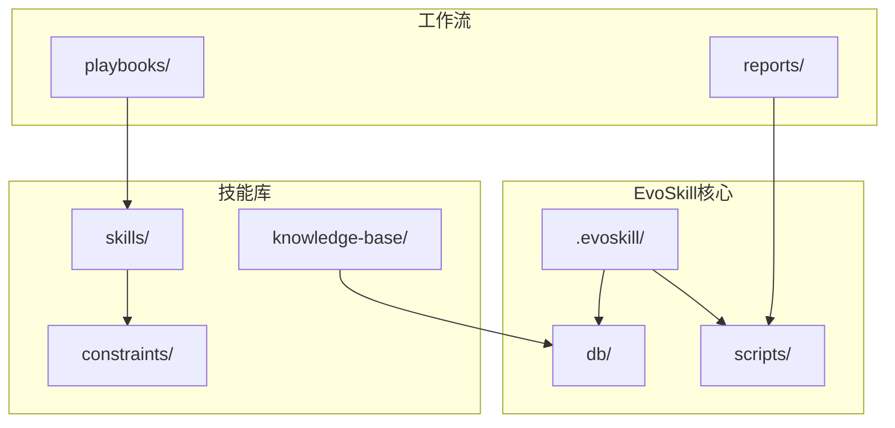
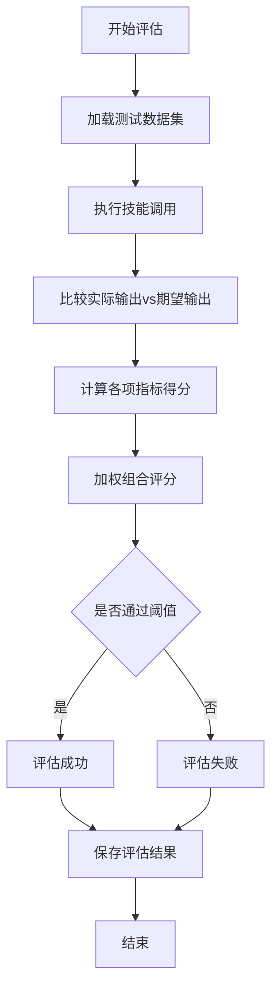
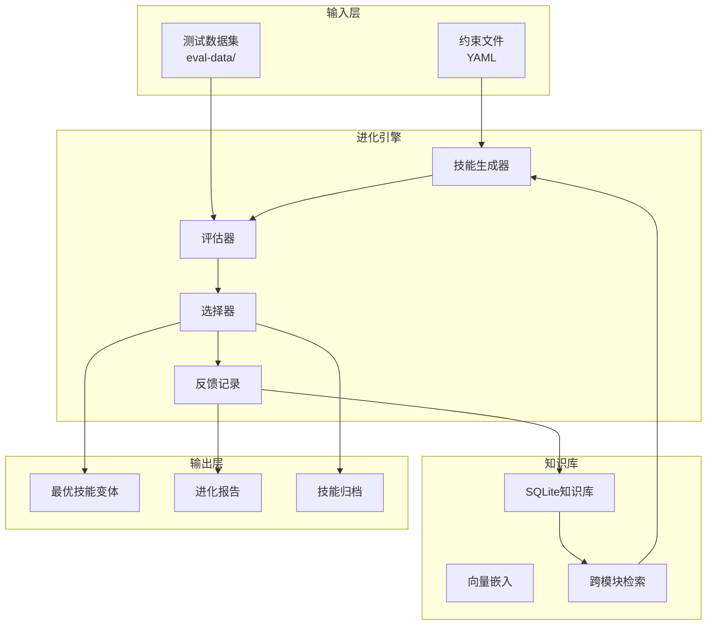
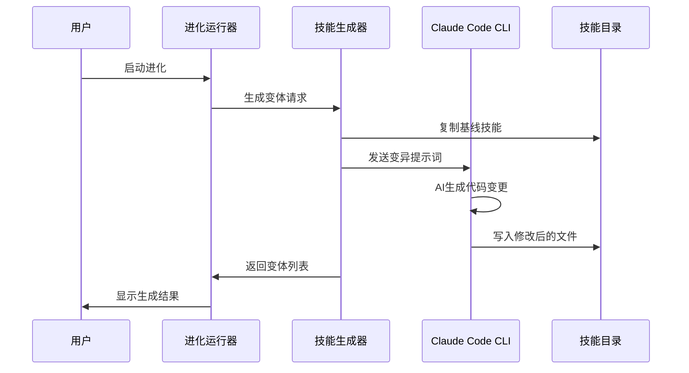
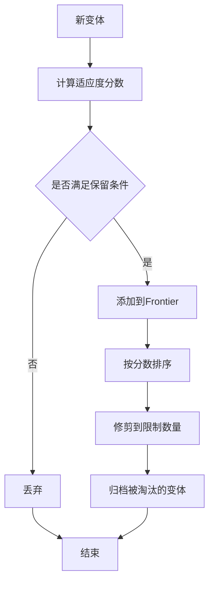
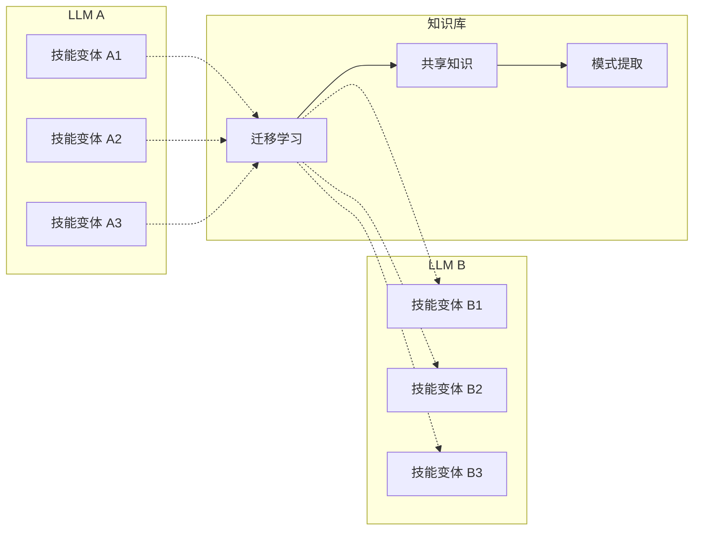
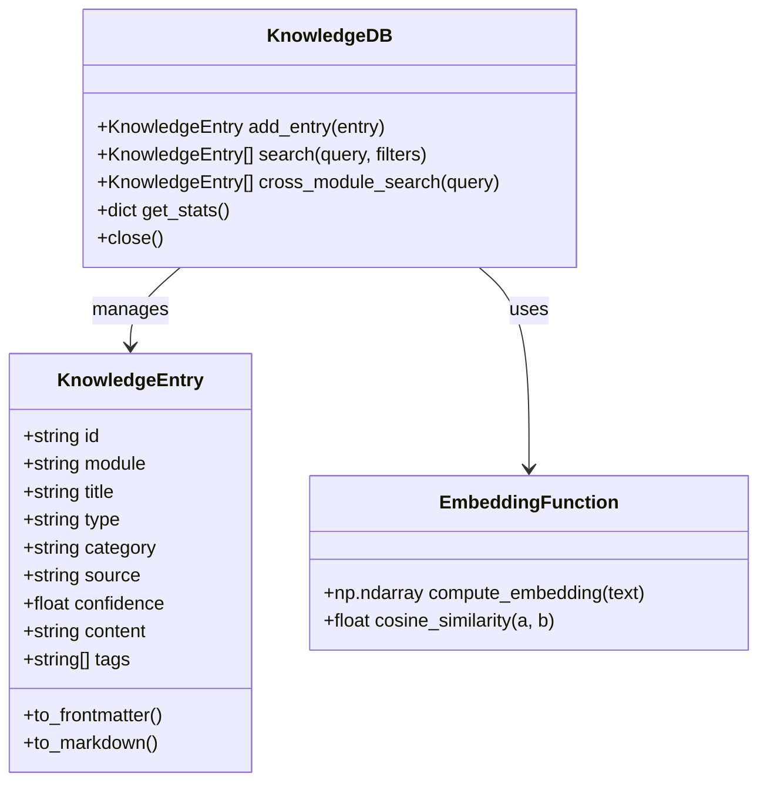
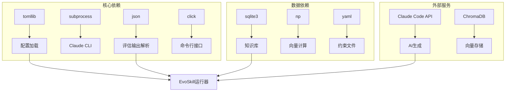
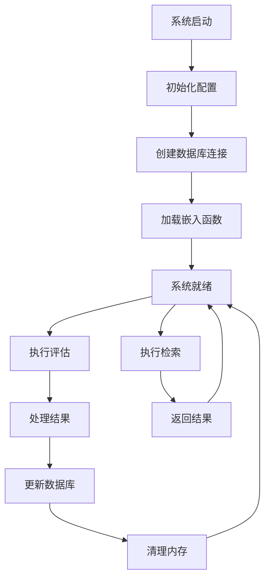
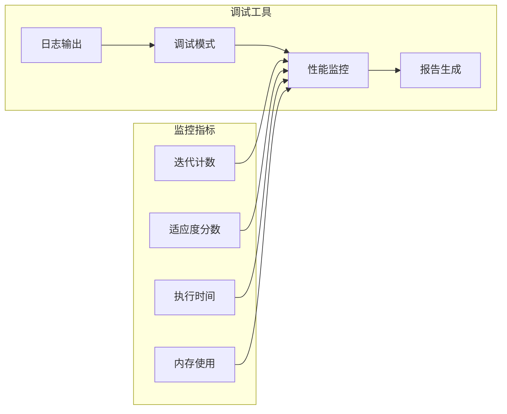

# EvoSkill进化系统

<cite>
**本文档引用的文件**
- [config.toml](file://.evoskill/config.toml)
- [task.md](file://.evoskill/task.md)
- [run_evolution.py](file://scripts/run_evolution.py)
- [evaluate.py](file://scripts/evaluate.py)
- [knowledge_db.py](file://db/knowledge_db.py)
- [models.py](file://db/models.py)
- [feed_knowledge.py](file://scripts/feed_knowledge.py)
- [query_knowledge.py](file://scripts/query_knowledge.py)
- [SKILL.md](file://skills/.claude/skills/telephony-bug-analyzer/SKILL.md)
- [bug-analysis.yaml](file://constraints/telephony/bug-analysis.yaml)
- [config.yaml](file://knowledge-base/config.yaml)
- [code-adaptation-pipeline.yaml](file://playbooks/code-adaptation-pipeline.yaml)
</cite>

## 目录
1. [简介](#简介)
2. [项目结构](#项目结构)
3. [核心组件](#核心组件)
4. [架构概览](#架构概览)
5. [详细组件分析](#详细组件分析)
6. [依赖关系分析](#依赖关系分析)
7. [性能考虑](#性能考虑)
8. [故障排除指南](#故障排除指南)
9. [结论](#结论)
10. [附录](#附录)

## 简介

EvoSkill进化系统是TAHP（Technical Assistance for Hardware Platform）项目中的智能技能进化框架。该系统通过模拟生物进化过程，自动优化和改进AI技能，特别是在Android硬件平台的缺陷分析和代码适配方面。

系统的核心目标是：
- 基于约束文件自动发现和进化AI Skills
- 提升Bug分析准确率和代码适配成功率
- 实现跨模型迁移的技能传承机制
- 建立完整的技能进化监控和反馈体系

## 项目结构

EvoSkill系统采用模块化设计，主要包含以下核心目录：



**图表来源**
- [run_evolution.py:1-567](file://scripts/run_evolution.py#L1-L567)
- [knowledge_db.py:1-589](file://db/knowledge_db.py#L1-L589)

**章节来源**
- [run_evolution.py:1-567](file://scripts/run_evolution.py#L1-L567)
- [knowledge_db.py:1-589](file://db/knowledge_db.py#L1-L589)

## 核心组件

### 进化配置系统

EvoSkill使用TOML格式的配置文件来管理进化参数：

| 配置类别 | 关键参数 | 默认值 | 描述 |
|---------|---------|--------|------|
| evolution | max_iterations | 20 | 最大迭代次数 |
| evolution | frontier_size | 3 | Frontier大小 |
| evolution | population_size | 10 | 种群大小 |
| evolution | mutation_rate | 0.1 | 变异率 |
| evolution | crossover_rate | 0.7 | 交叉率 |
| evolution | elite_ratio | 0.1 | 精英比例 |
| evolution | convergence_threshold | 0.01 | 收敛阈值 |
| evaluation | timeout | 60 | 评估超时时间 |
| evaluation | min_passing_rate | 0.70 | 最低通过率 |
| fitness | accuracy_weight | 0.4 | 准确率权重 |
| fitness | latency_weight | 0.2 | 延迟权重 |

### 技能评估引擎

评估系统支持多维度指标评估：



**图表来源**
- [evaluate.py:290-384](file://scripts/evaluate.py#L290-L384)

**章节来源**
- [config.toml:1-58](file://.evoskill/config.toml#L1-L58)
- [evaluate.py:1-436](file://scripts/evaluate.py#L1-L436)

## 架构概览

EvoSkill系统采用分层架构设计，实现了从技能生成到评估优化的完整闭环：



**图表来源**
- [run_evolution.py:409-527](file://scripts/run_evolution.py#L409-L527)
- [knowledge_db.py:93-127](file://db/knowledge_db.py#L93-L127)

## 详细组件分析

### 技能生成与变异机制

技能生成系统通过AI驱动的方式创建变体：



**图表来源**
- [run_evolution.py:126-159](file://scripts/run_evolution.py#L126-L159)
- [run_evolution.py:213-222](file://scripts/run_evolution.py#L213-L222)

变异算法的关键特性：
- **定向变异**：基于反馈历史和失败案例进行有针对性的改进
- **强度控制**：通过mutation_rate控制每次变异的幅度
- **多样性保证**：通过多种变异策略避免陷入局部最优

**章节来源**
- [run_evolution.py:126-222](file://scripts/run_evolution.py#L126-L222)

### 适应度评估方法

系统采用多指标综合评估：

| 指标 | 权重 | 目标值 | 评估方法 |
|------|------|--------|----------|
| 准确率 | 0.4 | 0.95 | 期望输出匹配度 |
| 延迟 | 0.2 | 100ms | 执行时间测量 |
| 代码质量 | 0.2 | 0.85 | 静态分析和复杂度评估 |
| 覆盖率 | 0.2 | 0.85 | 测试用例覆盖度 |

评估流程：
1. **并行执行**：支持并发评估多个变体
2. **超时保护**：防止长时间阻塞
3. **错误处理**：优雅处理执行异常
4. **结果聚合**：计算加权综合分数

**章节来源**
- [evaluate.py:290-384](file://scripts/evaluate.py#L290-L384)
- [config.toml:45-58](file://.evoskill/config.toml#L45-L58)

### 前沿管理策略

Frontier管理确保保留最优技能变体：



**图表来源**
- [run_evolution.py:470-503](file://scripts/run_evolution.py#L470-L503)

**章节来源**
- [run_evolution.py:470-503](file://scripts/run_evolution.py#L470-L503)

### 跨模型迁移机制

系统支持不同LLM之间的技能迁移：



**图表来源**
- [run_evolution.py:174-210](file://scripts/run_evolution.py#L174-L210)

**章节来源**
- [run_evolution.py:174-210](file://scripts/run_evolution.py#L174-L210)

### 知识库集成与传承

知识库系统提供完整的知识管理和检索能力：



**图表来源**
- [knowledge_db.py:93-127](file://db/knowledge_db.py#L93-L127)
- [models.py:52-70](file://db/models.py#L52-L70)

**章节来源**
- [knowledge_db.py:93-589](file://db/knowledge_db.py#L93-L589)
- [models.py:52-247](file://db/models.py#L52-L247)

## 依赖关系分析

系统各组件间的依赖关系：



**图表来源**
- [run_evolution.py:22-29](file://scripts/run_evolution.py#L22-L29)
- [knowledge_db.py:142-156](file://db/knowledge_db.py#L142-L156)

**章节来源**
- [run_evolution.py:22-29](file://scripts/run_evolution.py#L22-L29)
- [knowledge_db.py:142-156](file://db/knowledge_db.py#L142-L156)

## 性能考虑

### 并发优化策略

系统通过以下方式优化性能：
- **并行评估**：支持多变体同时评估
- **缓存机制**：重用已计算的向量表示
- **增量更新**：只更新发生变化的知识条目
- **超时控制**：防止长时间阻塞操作

### 内存管理



**图表来源**
- [knowledge_db.py:114-127](file://db/knowledge_db.py#L114-L127)

## 故障排除指南

### 常见问题及解决方案

| 问题类型 | 症状 | 可能原因 | 解决方案 |
|----------|------|----------|----------|
| 进化停滞 | 适应度不再提升 | 变异率过低 | 增加mutation_rate |
| 评估超时 | 评估进程挂起 | 模型响应慢 | 调整timeout参数 |
| 知识库访问失败 | SQLite连接错误 | 数据库损坏 | 重建知识库 |
| AI生成失败 | Claude CLI错误 | API限制 | 检查认证配置 |

### 调试工具

系统提供多种调试和监控工具：



**章节来源**
- [run_evolution.py:530-541](file://scripts/run_evolution.py#L530-L541)

## 结论

EvoSkill进化系统通过引入生物进化原理，为AI技能的自动化优化提供了创新的解决方案。系统的主要优势包括：

1. **自适应优化**：能够根据评估结果自动调整技能参数
2. **知识传承**：通过Frontier机制保留最优变体
3. **跨模型兼容**：支持不同LLM之间的技能迁移
4. **全面监控**：提供完整的进化过程跟踪和报告

未来发展方向：
- 增强多模态输入处理能力
- 优化大规模并发评估性能
- 扩展更多类型的约束文件支持
- 集成更多外部知识源

## 附录

### 配置参数详解

#### 进化配置参数

| 参数名 | 类型 | 默认值 | 说明 |
|--------|------|--------|------|
| max_iterations | int | 20 | 最大迭代次数 |
| frontier_size | int | 3 | 保留的最优变体数量 |
| population_size | int | 10 | 每代个体数量 |
| mutation_rate | float | 0.1 | 变异概率 |
| crossover_rate | float | 0.7 | 交叉概率 |
| elite_ratio | float | 0.1 | 精英保留比例 |
| convergence_threshold | float | 0.01 | 收敛判断阈值 |

#### 评估配置参数

| 参数名 | 类型 | 默认值 | 说明 |
|--------|------|--------|------|
| timeout | int | 60 | 评估超时时间（秒） |
| min_passing_rate | float | 0.70 | 最低通过率 |
| full_auto_threshold | float | 0.95 | 全自动评估阈值 |
| semi_auto_threshold | float | 0.70 | 半自动评估阈值 |

### 使用示例

#### 基本进化运行

```bash
python scripts/run_evolution.py skills/telephony-bug-analyzer/
```

#### 高级配置运行

```bash
python scripts/run_evolution.py \
    skills/telephony-bug-analyzer/ \
    --iterations 15 \
    --concurrency 4 \
    --dry-run
```

#### 知识库管理

```bash
# 添加知识条目
python scripts/feed_knowledge.py \
    --module telephony \
    --docs ./docs/*.md

# 查询知识
python scripts/query_knowledge.py \
    --module telephony \
    --query "bug analysis patterns"
```