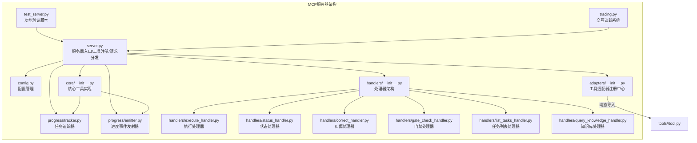
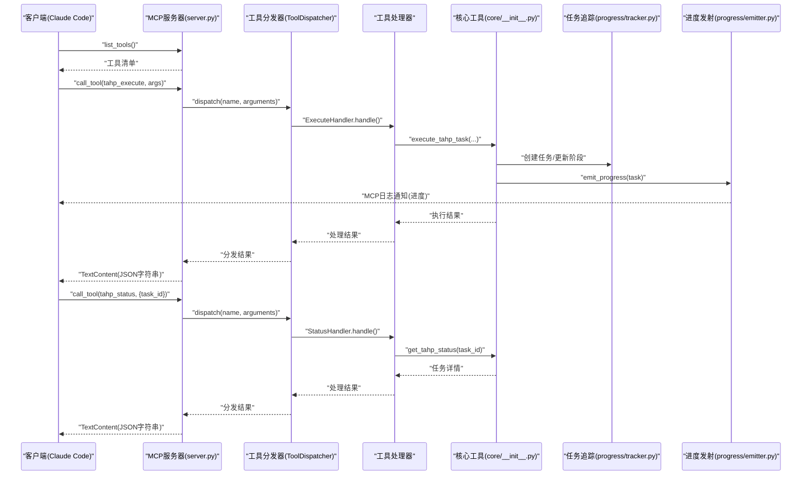
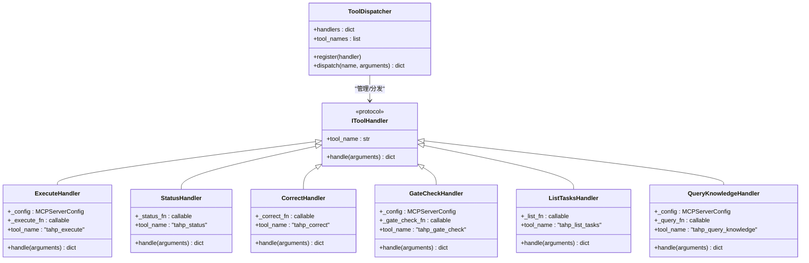
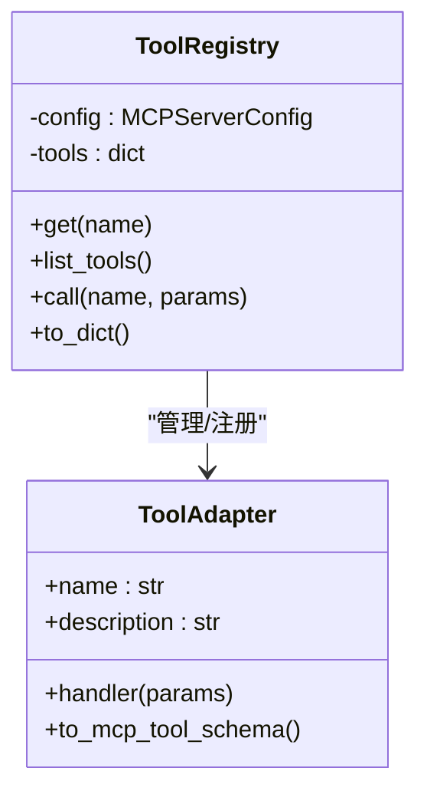
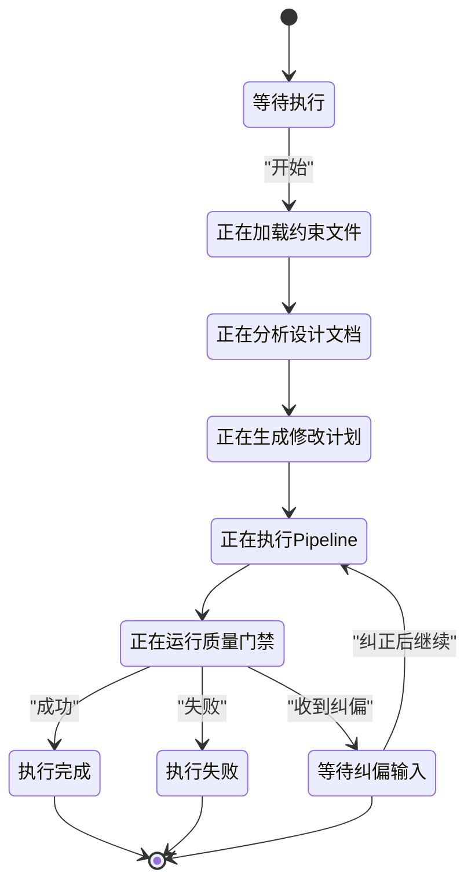
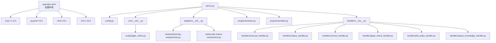

# MCP服务器系统

<cite>
**本文档引用的文件**
- [server.py](file://tahp-mcp-server/server.py)
- [config.py](file://tahp-mcp-server/config.py)
- [core/__init__.py](file://tahp-mcp-server/core/__init__.py)
- [adapters/__init__.py](file://tahp-mcp-server/adapters/__init__.py)
- [progress/tracker.py](file://tahp-mcp-server/progress/tracker.py)
- [progress/emitter.py](file://tahp-mcp-server/progress/emitter.py)
- [handlers/__init__.py](file://tahp-mcp-server/handlers/__init__.py)
- [handlers/execute_handler.py](file://tahp-mcp-server/handlers/execute_handler.py)
- [handlers/status_handler.py](file://tahp-mcp-server/handlers/status_handler.py)
- [handlers/correct_handler.py](file://tahp-mcp-server/handlers/correct_handler.py)
- [handlers/gate_check_handler.py](file://tahp-mcp-server/handlers/gate_check_handler.py)
- [handlers/list_tasks_handler.py](file://tahp-mcp-server/handlers/list_tasks_handler.py)
- [handlers/query_knowledge_handler.py](file://tahp-mcp-server/handlers/query_knowledge_handler.py)
- [tracing.py](file://tahp-mcp-server/tracing.py)
- [test_server.py](file://tahp-mcp-server/test_server.py)
- [pyproject.toml](file://tahp-mcp-server/pyproject.toml)
- [gate_check.py](file://scripts/gate_check.py)
- [tool.py (android-log-analyzer)](file://tools/android-log-analyzer/tool.py)
- [tool.py (code-review-checker)](file://tools/code-review-checker/tool.py)
- [config.yaml (knowledge-base)](file://knowledge-base/config.yaml)
- [requirements.txt](file://requirements.txt)
- [system-overview.md](file://docs/architecture/system-overview.md)
</cite>

## 更新摘要
**所做更改**
- 新增完整的Python MCP服务器架构设计章节
- 更新工具接口定义与适配器注册机制
- 完善配置管理系统详细说明
- 新增核心执行引擎与任务生命周期管理章节
- 更新API接口文档，包含所有11个工具的详细说明
- 新增处理器架构与分发机制说明
- 完善性能监控与追踪系统介绍

## 目录
1. [引言](#引言)
2. [项目结构](#项目结构)
3. [核心组件](#核心组件)
4. [架构总览](#架构总览)
5. [详细组件分析](#详细组件分析)
6. [依赖分析](#依赖分析)
7. [性能考虑](#性能考虑)
8. [故障排除指南](#故障排除指南)
9. [结论](#结论)
10. [附录](#附录)

## 引言
本文件为 TAHP（TECNO AI Harness Platform）MCP（Model Context Protocol）服务器系统的全面技术文档。系统通过 MCP 标准协议，将 TAHP 的约束驱动开发能力封装为可被 AI Agent（如 Claude Code）调用的工具集合，覆盖诊断引擎与适配引擎两大核心场景。本文档重点阐述：

- MCP 服务器架构设计与组件职责
- 工具接口定义与适配器注册机制
- 配置管理与运行参数
- 任务生命周期管理、状态跟踪与纠偏机制
- 请求处理流程与通信协议
- API 接口规范（tahp_execute、tahp_status、tahp_correct 等11个工具）
- 错误处理策略与性能优化方案
- 处理器架构与分发机制
- 性能监控与追踪系统

## 项目结构
MCP 服务器位于 tahp-mcp-server 目录，采用"按功能分层"的组织方式：

- server.py：MCP 服务器入口与工具注册、请求分发
- config.py：配置管理（项目根目录、模块/领域、Playbook 映射、运行参数）
- core/__init__.py：核心工具实现（任务执行、状态查询、纠偏、门禁检查、知识库查询等）
- adapters/__init__.py：工具适配器注册中心，将 tools/ 下现有工具封装为 MCP 工具
- progress/：任务进度追踪与事件发射（tracker、emitter）
- handlers/：工具处理器架构，实现基于协议的处理器模式
- tracing.py：交互追踪日志系统
- test_server.py：功能验证脚本（演示工具调用与结果解析）

**图表来源**
- [server.py:1-449](file://tahp-mcp-server/server.py#L1-L449)
- [config.py:1-176](file://tahp-mcp-server/config.py#L1-L176)
- [core/__init__.py:1-621](file://tahp-mcp-server/core/__init__.py#L1-L621)
- [adapters/__init__.py:1-239](file://tahp-mcp-server/adapters/__init__.py#L1-L239)
- [progress/tracker.py:1-343](file://tahp-mcp-server/progress/tracker.py#L1-L343)
- [progress/emitter.py:1-194](file://tahp-mcp-server/progress/emitter.py#L1-L194)
- [handlers/__init__.py:1-72](file://tahp-mcp-server/handlers/__init__.py#L1-L72)
- [handlers/execute_handler.py:1-46](file://tahp-mcp-server/handlers/execute_handler.py#L1-L46)
- [handlers/status_handler.py:1-27](file://tahp-mcp-server/handlers/status_handler.py#L1-L27)
- [handlers/correct_handler.py:1-30](file://tahp-mcp-server/handlers/correct_handler.py#L1-L30)
- [handlers/gate_check_handler.py:1-30](file://tahp-mcp-server/handlers/gate_check_handler.py#L1-L30)
- [handlers/list_tasks_handler.py:1-26](file://tahp-mcp-server/handlers/list_tasks_handler.py#L1-L26)
- [handlers/query_knowledge_handler.py:1-34](file://tahp-mcp-server/handlers/query_knowledge_handler.py#L1-L34)
- [tracing.py:1-160](file://tahp-mcp-server/tracing.py#L1-L160)
- [test_server.py:1-203](file://tahp-mcp-server/test_server.py#L1-L203)

**章节来源**
- [server.py:1-449](file://tahp-mcp-server/server.py#L1-L449)
- [config.py:1-176](file://tahp-mcp-server/config.py#L1-L176)
- [core/__init__.py:1-621](file://tahp-mcp-server/core/__init__.py#L1-L621)
- [adapters/__init__.py:1-239](file://tahp-mcp-server/adapters/__init__.py#L1-L239)
- [progress/tracker.py:1-343](file://tahp-mcp-server/progress/tracker.py#L1-L343)
- [progress/emitter.py:1-194](file://tahp-mcp-server/progress/emitter.py#L1-L194)
- [handlers/__init__.py:1-72](file://tahp-mcp-server/handlers/__init__.py#L1-L72)
- [handlers/execute_handler.py:1-46](file://tahp-mcp-server/handlers/execute_handler.py#L1-L46)
- [handlers/status_handler.py:1-27](file://tahp-mcp-server/handlers/status_handler.py#L1-L27)
- [handlers/correct_handler.py:1-30](file://tahp-mcp-server/handlers/correct_handler.py#L1-L30)
- [handlers/gate_check_handler.py:1-30](file://tahp-mcp-server/handlers/gate_check_handler.py#L1-L30)
- [handlers/list_tasks_handler.py:1-26](file://tahp-mcp-server/handlers/list_tasks_handler.py#L1-L26)
- [handlers/query_knowledge_handler.py:1-34](file://tahp-mcp-server/handlers/query_knowledge_handler.py#L1-L34)
- [tracing.py:1-160](file://tahp-mcp-server/tracing.py#L1-L160)
- [test_server.py:1-203](file://tahp-mcp-server/test_server.py#L1-L203)

## 核心组件

### MCP服务器实例
基于 mcp.server.Server，注册工具清单并处理 call_tool 请求，支持 STDIO 通信协议。

### 配置管理系统
MCPServerConfig 提供项目根目录、模块/领域、Playbook 映射、运行参数等配置管理，支持从 YAML 文件加载。

### 核心工具实现
execute_tahp_task、get_tahp_status、correct_tahp_task、run_gate_check、list_tahp_tasks、query_knowledge 等核心工具的业务逻辑实现。

### 工具适配器注册中心
ToolRegistry 统一封装 tools/ 下工具，提供 call(name, params) 接口，支持动态导入和降级处理。

### 任务进度追踪系统
TaskTracker（线程安全）和 ProgressEmitter（MCP 日志通知）实现任务状态跟踪与实时进度推送。

### 处理器架构
基于 IToolHandler 协议的处理器模式，通过 ToolDispatcher 实现工具分发，支持扩展新的工具处理器。

### 性能监控系统
InteractionTracer 提供工具调用追踪日志，支持调试、性能分析和使用模式统计。

**章节来源**
- [server.py:138-139](file://tahp-mcp-server/server.py#L138-L139)
- [config.py:36-176](file://tahp-mcp-server/config.py#L36-L176)
- [core/__init__.py:110-621](file://tahp-mcp-server/core/__init__.py#L110-L621)
- [adapters/__init__.py:186-239](file://tahp-mcp-server/adapters/__init__.py#L186-L239)
- [progress/tracker.py:212-343](file://tahp-mcp-server/progress/tracker.py#L212-L343)
- [progress/emitter.py:33-194](file://tahp-mcp-server/progress/emitter.py#L33-L194)
- [handlers/__init__.py:17-72](file://tahp-mcp-server/handlers/__init__.py#L17-L72)
- [tracing.py:47-160](file://tahp-mcp-server/tracing.py#L47-L160)

## 架构总览
MCP 服务器通过 STDIO 通道与客户端（如 Claude Code）通信，遵循 MCP 协议的消息格式。服务器启动后注册工具清单，客户端发起工具调用时，通过 ToolDispatcher 将请求路由到对应处理器，处理器再调用核心工具实现，期间通过 ProgressEmitter 将进度事件推送至客户端。

**图表来源**
- [server.py:383-412](file://tahp-mcp-server/server.py#L383-L412)
- [handlers/__init__.py:57-66](file://tahp-mcp-server/handlers/__init__.py#L57-L66)
- [handlers/execute_handler.py:23-45](file://tahp-mcp-server/handlers/execute_handler.py#L23-L45)
- [handlers/status_handler.py:22-26](file://tahp-mcp-server/handlers/status_handler.py#L22-L26)
- [core/__init__.py:110-316](file://tahp-mcp-server/core/__init__.py#L110-L316)
- [progress/tracker.py:212-343](file://tahp-mcp-server/progress/tracker.py#L212-L343)
- [progress/emitter.py:47-130](file://tahp-mcp-server/progress/emitter.py#L47-L130)

## 详细组件分析

### 服务器启动与生命周期
- 启动流程：main() 调用 main_async()，通过 stdio_server() 建立 STDIO 通道，运行 MCP Server 并传入 InitializationOptions（server_name、server_version）
- 初始化回调：_on_server_initialized() 设置 ProgressEmitter 的 server 实例，记录可用模块与工具适配器
- 配置加载：MCPServerConfig.from_yaml() 从 YAML 文件加载配置，支持环境变量覆盖

**章节来源**
- [server.py:425-449](file://tahp-mcp-server/server.py#L425-L449)
- [server.py:416-423](file://tahp-mcp-server/server.py#L416-L423)
- [config.py:130-161](file://tahp-mcp-server/config.py#L130-L161)

### 工具注册与请求分发
- 工具清单：handle_list_tools() 返回所有 MCP 工具（tahp_execute、tahp_status、tahp_correct、tahp_gate_check、tahp_list_tasks、tahp_query_knowledge、tahp_analyze_log、tahp_code_review、tahp_api_migration、tahp_diff_analyze、tahp_generate_patch）
- 请求分发：_dispatch_tool() 通过 ToolDispatcher 将请求路由到对应处理器；对未知工具抛出参数错误
- 参数校验：所有核心工具均进行必需参数校验与合法性检查

**章节来源**
- [server.py:367-380](file://tahp-mcp-server/server.py#L367-L380)
- [server.py:409-412](file://tahp-mcp-server/server.py#L409-L412)

### 处理器架构与分发机制
- 协议定义：IToolHandler 协议定义了工具处理器的标准接口
- 分发器：ToolDispatcher 实现基于注册表的分发模式，替代传统的 if-elif 链
- 处理器实现：ExecuteHandler、StatusHandler、CorrectHandler、GateCheckHandler、ListTasksHandler、QueryKnowledgeHandler 等
- 扩展机制：新增工具只需实现 IToolHandler 协议并注册到 ToolDispatcher

**图表来源**
- [handlers/__init__.py:17-72](file://tahp-mcp-server/handlers/__init__.py#L17-L72)
- [handlers/execute_handler.py:12-46](file://tahp-mcp-server/handlers/execute_handler.py#L12-L46)
- [handlers/status_handler.py:12-27](file://tahp-mcp-server/handlers/status_handler.py#L12-L27)
- [handlers/correct_handler.py:12-30](file://tahp-mcp-server/handlers/correct_handler.py#L12-L30)
- [handlers/gate_check_handler.py:12-30](file://tahp-mcp-server/handlers/gate_check_handler.py#L12-L30)
- [handlers/list_tasks_handler.py:12-26](file://tahp-mcp-server/handlers/list_tasks_handler.py#L12-L26)
- [handlers/query_knowledge_handler.py:12-34](file://tahp-mcp-server/handlers/query_knowledge_handler.py#L12-L34)

**章节来源**
- [handlers/__init__.py:1-72](file://tahp-mcp-server/handlers/__init__.py#L1-L72)
- [handlers/execute_handler.py:1-46](file://tahp-mcp-server/handlers/execute_handler.py#L1-L46)
- [handlers/status_handler.py:1-27](file://tahp-mcp-server/handlers/status_handler.py#L1-L27)
- [handlers/correct_handler.py:1-30](file://tahp-mcp-server/handlers/correct_handler.py#L1-L30)
- [handlers/gate_check_handler.py:1-30](file://tahp-mcp-server/handlers/gate_check_handler.py#L1-L30)
- [handlers/list_tasks_handler.py:1-26](file://tahp-mcp-server/handlers/list_tasks_handler.py#L1-L26)
- [handlers/query_knowledge_handler.py:1-34](file://tahp-mcp-server/handlers/query_knowledge_handler.py#L1-L34)

### 核心工具实现（核心业务逻辑）
- execute_tahp_task：加载约束 → 分析设计文档 → 生成修改计划 → 执行 Pipeline → 质量门禁检查；期间通过 TaskTracker 更新阶段与步骤，ProgressEmitter 推送进度
- get_tahp_status：查询任务状态详情（阶段、进度、步骤、纠偏历史、门禁结果等）
- correct_tahp_task：接收纠偏反馈，记录纠偏历史并切换到纠正阶段，返回当前状态
- run_gate_check：对指定任务或模块执行质量门禁（P0/P1/P2），内部复用 scripts/gate_check.py 或简化检查
- list_tahp_tasks：列出任务（可选择包含已完成）
- query_knowledge：查询知识库（支持跨模块检索）

**图表来源**
- [core/__init__.py:110-298](file://tahp-mcp-server/core/__init__.py#L110-L298)

**章节来源**
- [core/__init__.py:110-621](file://tahp-mcp-server/core/__init__.py#L110-L621)

### 工具适配器注册与调用
- ToolRegistry：扫描 tools/ 目录，动态导入各工具模块的 tool.py，封装为 ToolAdapter；若工具缺失则提供降级实现
- 适配器接口：ToolAdapter(handler) 统一暴露 call(params) -> dict
- 服务器侧调用：_dispatch_tool() 中对非核心工具（如 android_log_analyzer、code_review_checker、api_migration_db）通过 ToolRegistry.call() 调用

**图表来源**
- [adapters/__init__.py:186-239](file://tahp-mcp-server/adapters/__init__.py#L186-L239)

**章节来源**
- [adapters/__init__.py:1-239](file://tahp-mcp-server/adapters/__init__.py#L1-L239)

### 任务生命周期与状态跟踪
- TaskPhase：pending → loading_constraints → analyzing_document → generating_plan → executing_pipeline → running_gate_check → completed/failed/cancelled/correcting
- TaskTracker：线程安全的任务存储与更新，支持清理旧任务、监听器回调
- ProgressEmitter：将阶段与步骤进度通过 MCP 日志消息推送给客户端，支持纠偏事件

**图表来源**
- [progress/tracker.py:18-30](file://tahp-mcp-server/progress/tracker.py#L18-L30)
- [progress/emitter.py:47-130](file://tahp-mcp-server/progress/emitter.py#L47-L130)

**章节来源**
- [progress/tracker.py:1-343](file://tahp-mcp-server/progress/tracker.py#L1-L343)
- [progress/emitter.py:1-194](file://tahp-mcp-server/progress/emitter.py#L1-L194)

### API接口文档

#### tahp_execute
- 功能：按照设计文档执行 TAHP 开发任务，返回任务ID与执行结果
- 输入参数
  - document_path: string（必填，设计文档路径）
  - module: string（必填，telephony、kernel-driver、power-mgmt）
  - domain: string（必填，bug_analysis、code_adaptation、version_adaptation、carrier_porting）
  - constraints_extra: string[]（可选，额外约束文件路径列表）
- 输出
  - task_id: string
  - status: string（completed/failed）
  - modification_plan: object（包含任务元信息、约束摘要、生成时间等）
  - pipeline_results: array（Pipeline 步骤执行结果）
  - gate_result: object（门禁检查结果）
  - safety_red_lines: string[]
  - constraints_loaded: string[]
  - completed_at: string（ISO 8601）

**章节来源**
- [server.py:143-175](file://tahp-mcp-server/server.py#L143-L175)
- [core/__init__.py:110-298](file://tahp-mcp-server/core/__init__.py#L110-L298)

#### tahp_status
- 功能：查询任务执行状态
- 输入参数
  - task_id: string（必填）
- 输出
  - task_id: string
  - module: string
  - domain: string
  - phase: string（TaskPhase）
  - phase_label: string（中文标签）
  - progress: number（0.0-1.0）
  - status: string（MCP兼容状态）
  - status_message: string
  - steps: array（步骤详情）
  - corrections: array（纠偏历史）
  - is_terminal: boolean
  - error: string
  - result: object
  - gate_result: object

**章节来源**
- [server.py:177-193](file://tahp-mcp-server/server.py#L177-L193)
- [core/__init__.py:300-316](file://tahp-mcp-server/core/__init__.py#L300-L316)
- [progress/tracker.py:169-209](file://tahp-mcp-server/progress/tracker.py#L169-L209)

#### tahp_correct
- 功能：对正在执行的任务进行纠偏
- 输入参数
  - task_id: string（必填）
  - feedback: string（必填）
- 输出
  - task_id: string
  - status: string（correcting/error/not_found）
  - feedback: string
  - current_phase: string
  - corrections_count: number

**章节来源**
- [server.py:195-216](file://tahp-mcp-server/server.py#L195-L216)
- [core/__init__.py:318-363](file://tahp-mcp-server/core/__init__.py#L318-L363)
- [progress/emitter.py:112-129](file://tahp-mcp-server/progress/emitter.py#L112-L129)

#### tahp_gate_check
- 功能：对指定任务或模块执行质量门禁检查（P0/P1/P2）
- 输入参数
  - task_id: string（可选，与 module 二选一）
  - module: string（可选，与 task_id 二选一，telephony、kernel-driver、power-mgmt）
  - level: string（可选，默认 all，取值 P0/P1/P2/all）
- 输出
  - module: string
  - result: string（PASS/BLOCK/WARNING/ERROR）
  - checks: array（检查项详情）
  - total_checks: number
  - passed_checks: number
  - failed_checks: number

**章节来源**
- [server.py:218-244](file://tahp-mcp-server/server.py#L218-L244)
- [core/__init__.py:366-459](file://tahp-mcp-server/core/__init__.py#L366-L459)
- [gate_check.py:36-93](file://scripts/gate_check.py#L36-L93)

#### tahp_list_tasks
- 功能：列出所有任务
- 输入参数
  - include_completed: boolean（可选，默认 true）
- 输出
  - tasks: array（任务详情数组）
  - total: number

**章节来源**
- [server.py:246-259](file://tahp-mcp-server/server.py#L246-L259)
- [core/__init__.py:546-556](file://tahp-mcp-server/core/__init__.py#L546-L556)

#### tahp_query_knowledge
- 功能：语义查询知识库
- 输入参数
  - query: string（必填）
  - module: string（可选）
  - cross_module: boolean（可选，默认 false）
  - top_k: integer（可选，默认 5）
- 输出
  - query: string
  - module: string
  - cross_module: boolean
  - results: array（知识条目预览）
  - total: number
  - error: string（可选）

**章节来源**
- [server.py:261-291](file://tahp-mcp-server/server.py#L261-L291)
- [core/__init__.py:558-621](file://tahp-mcp-server/core/__init__.py#L558-L621)
- [config.yaml (knowledge-base):1-36](file://knowledge-base/config.yaml#L1-L36)

#### tahp_analyze_log
- 功能：解析 Android 日志（logcat/ril/atcmd），提取事件与错误
- 输入参数
  - log_content: string（必填）
  - log_type: string（可选，默认 logcat，取值 logcat/ril/atcmd）
  - filters: string[]（可选，过滤关键词）
- 输出
  - events: array（事件列表）
  - errors: array（错误列表）
  - statistics: object（统计信息）

**章节来源**
- [server.py:293-317](file://tahp-mcp-server/server.py#L293-L317)
- [tool.py (android-log-analyzer):1-50](file://tools/android-log-analyzer/tool.py#L1-L50)

#### tahp_code_review
- 功能：自动化代码审查，检查 P0/P1/P2 规则违规
- 输入参数
  - patch_content: string（必填）
  - check_level: string（可选，默认 P0，取值 P0/P1/P2）
- 输出
  - result: string（pass/warning/fail）
  - violations: array（违规详情）
  - score: number
  - critical_count: number
  - warning_count: number

**章节来源**
- [server.py:319-338](file://tahp-mcp-server/server.py#L319-L338)
- [tool.py (code-review-checker):1-33](file://tools/code-review-checker/tool.py#L1-L33)

#### tahp_api_migration
- 功能：查询 API 迁移规则库（list/search/add）
- 输入参数
  - action: string（可选，默认 list，取值 list/search/add）
  - module: string（可选，list 时使用）
  - old_api: string（可选，search 时使用）
- 输出
  - rules: array（规则列表）
  - total: number

**章节来源**
- [server.py:340-362](file://tahp-mcp-server/server.py#L340-L362)
- [adapters/__init__.py:101-119](file://tahp-mcp-server/adapters/__init__.py#L101-L119)

#### tahp_diff_analyze
- 功能：分析 AOSP 版本差异，检测 API 变更
- 输入参数
  - diff_content: string（必填，版本差异内容）
  - module: string（可选，默认 telephony）
- 输出
  - deprecated_apis: array（废弃API列表）
  - removed_apis: array（移除API列表）
  - added_apis: array（新增API列表）
  - summary: object（统计摘要）

**章节来源**
- [adapters/__init__.py:85-98](file://tahp-mcp-server/adapters/__init__.py#L85-L98)

#### tahp_generate_patch
- 功能：根据迁移规则生成适配 Patch
- 输入参数
  - migration_rules: array（迁移规则列表）
  - source_code: string（源代码内容）
  - target_version: string（目标版本）
- 输出
  - patches: array（生成的补丁列表）
  - statistics: object（生成统计信息）

**章节来源**
- [adapters/__init__.py:154-167](file://tahp-mcp-server/adapters/__init__.py#L154-L167)

### 服务器与客户端通信协议
- 传输：STDIO（stdio_server），遵循 MCP 协议
- 工具清单：list_tools 返回 MCP Tool 对象（name/description/inputSchema）
- 工具调用：call_tool 接收 name 与 arguments，返回 TextContent（JSON 字符串）
- 进度推送：ProgressEmitter 通过 server.request_context.session.send_log_message 发送 info/warning 级日志，客户端可实时显示进度

**章节来源**
- [server.py:367-407](file://tahp-mcp-server/server.py#L367-L407)
- [progress/emitter.py:47-130](file://tahp-mcp-server/progress/emitter.py#L47-L130)

### 错误处理策略
- 参数校验：对必填字段缺失与非法值抛出 ValueError，并返回 JSON 错误信息
- 内部异常：捕获 Exception 并返回 Internal error JSON
- 任务状态：TaskTracker.fail_task 标记失败并更新状态消息
- 工具适配器：ToolRegistry.call 捕获异常并返回错误对象
- 处理器错误：ToolDispatcher.dispatch 对未知工具返回参数错误

**章节来源**
- [server.py:401-407](file://tahp-mcp-server/server.py#L401-L407)
- [core/__init__.py:289-297](file://tahp-mcp-server/core/__init__.py#L289-L297)
- [adapters/__init__.py:226-234](file://tahp-mcp-server/adapters/__init__.py#L226-L234)
- [handlers/__init__.py:63-66](file://tahp-mcp-server/handlers/__init__.py#L63-L66)

### 性能监控与追踪系统
- 交互追踪：InteractionTracer 记录每次工具调用的详细信息到 JSONL 文件
- 追踪内容：时间戳、工具名、参数摘要、执行时长、状态、结果摘要
- 输出格式：trace-{YYYY-MM-DD}.jsonl，便于调试和性能分析
- 敏感信息过滤：自动过滤 API Key、密码等敏感参数

**章节来源**
- [tracing.py:47-160](file://tahp-mcp-server/tracing.py#L47-L160)

## 依赖分析
- 外部依赖：mcp>=1.9.0、pyyaml>=6.0、click>=8.1、rich>=13.0
- 内部依赖：config、progress.tracker、progress.emitter、core、adapters、handlers
- 工具依赖：tools/<tool>/tool.py（动态导入），scripts/gate_check.py（门禁检查）

**图表来源**
- [pyproject.toml:1-19](file://tahp-mcp-server/pyproject.toml#L1-L19)
- [server.py:61-83](file://tahp-mcp-server/server.py#L61-L83)
- [adapters/__init__.py:42-65](file://tahp-mcp-server/adapters/__init__.py#L42-L65)

**章节来源**
- [pyproject.toml:1-19](file://tahp-mcp-server/pyproject.toml#L1-L19)
- [requirements.txt:1-9](file://requirements.txt#L1-L9)

## 性能考虑
- 并发控制：MCPServerConfig.max_concurrent_tasks 控制最大并发任务数
- 超时控制：MCPServerConfig.task_timeout_sec 限制任务执行时间
- 进度映射：ProgressEmitter 使用阶段到进度的映射，确保整体进度平滑推进
- 结果截断：handle_call_tool 对过长结果进行截断并提示使用 tahp_status 查看详情
- 任务清理：TaskTracker 在达到上限时清理最早完成的任务，避免内存膨胀
- 处理器缓存：ToolDispatcher 缓存已注册的处理器，提高分发效率
- 日志优化：TraceRecord 自动过滤敏感信息，减少日志开销

**章节来源**
- [config.py:52-56](file://tahp-mcp-server/config.py#L52-L56)
- [progress/emitter.py:18-30](file://tahp-mcp-server/progress/emitter.py#L18-L30)
- [server.py:395-398](file://tahp-mcp-server/server.py#L395-L398)
- [progress/tracker.py:318-331](file://tahp-mcp-server/progress/tracker.py#L318-L331)
- [handlers/__init__.py:44-49](file://tahp-mcp-server/handlers/__init__.py#L44-L49)

## 故障排除指南
- 工具未找到：检查 ToolRegistry 是否正确加载对应工具模块；确认 tools/<tool>/tool.py 存在并包含相应函数
- 任务状态异常：使用 tahp_status 查询 task_id，查看 phase、status、error 字段
- 门禁失败：检查 constraints/ 模块目录是否存在约束文件、是否包含 safety_red_lines、是否存在硬编码密钥
- 纠偏无效：确认任务未处于终态（completed/failed/cancelled），纠偏仅在 correcting 阶段有效
- 处理器注册错误：检查 ToolDispatcher.register 是否重复注册相同工具名
- 配置加载失败：确认 YAML 配置文件格式正确，路径存在且可读
- 追踪日志写入失败：检查 reports/traces/ 目录权限，磁盘空间充足

**章节来源**
- [adapters/__init__.py:218-234](file://tahp-mcp-server/adapters/__init__.py#L218-L234)
- [core/__init__.py:300-363](file://tahp-mcp-server/core/__init__.py#L300-L363)
- [gate_check.py:99-156](file://scripts/gate_check.py#L99-L156)
- [handlers/__init__.py:53-55](file://tahp-mcp-server/handlers/__init__.py#L53-L55)
- [tracing.py:106-114](file://tahp-mcp-server/tracing.py#L106-L114)

## 结论
MCP 服务器系统通过清晰的分层架构与标准化的 MCP 协议，将 TAHP 的约束驱动能力以工具形式暴露给 AI Agent。核心特性包括：

- 完整的工具清单与参数校验
- 基于协议的处理器架构与分发机制
- 任务生命周期管理与实时进度推送
- 纠偏机制与质量门禁检查
- 可扩展的工具适配器注册中心
- 稳健的错误处理与性能保障
- 全面的性能监控与追踪系统

该系统为诊断引擎与适配引擎提供了统一的执行与编排平台，支撑 TAHP 平台在双引擎场景下的自动化与智能化演进。

## 附录
- 系统架构概览与四域约束体系参见 [system-overview.md:1-420](file://docs/architecture/system-overview.md#L1-L420)
- 工具适配器与知识库配置参考：
  - [adapters/__init__.py:1-239](file://tahp-mcp-server/adapters/__init__.py#L1-L239)
  - [config.yaml (knowledge-base):1-36](file://knowledge-base/config.yaml#L1-L36)
- 测试用例参考：[test_server.py:1-203](file://tahp-mcp-server/test_server.py#L1-L203)
- 项目配置参考：[pyproject.toml:1-19](file://tahp-mcp-server/pyproject.toml#L1-L19)