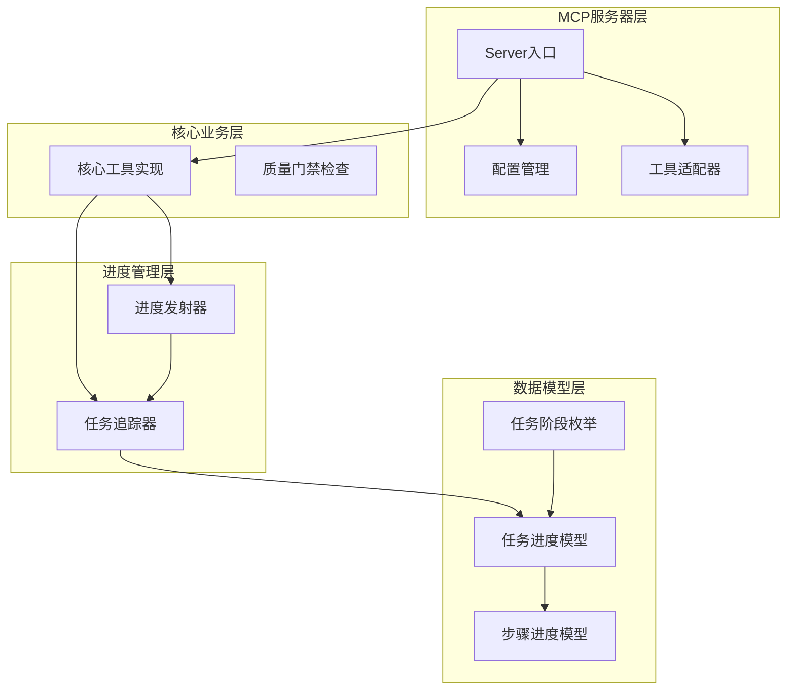
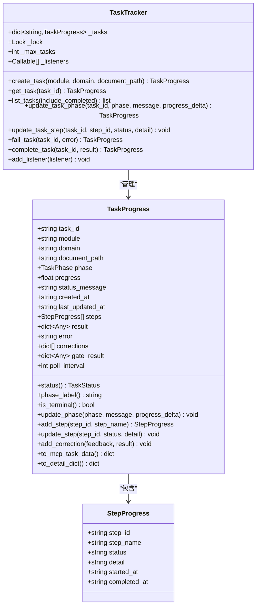
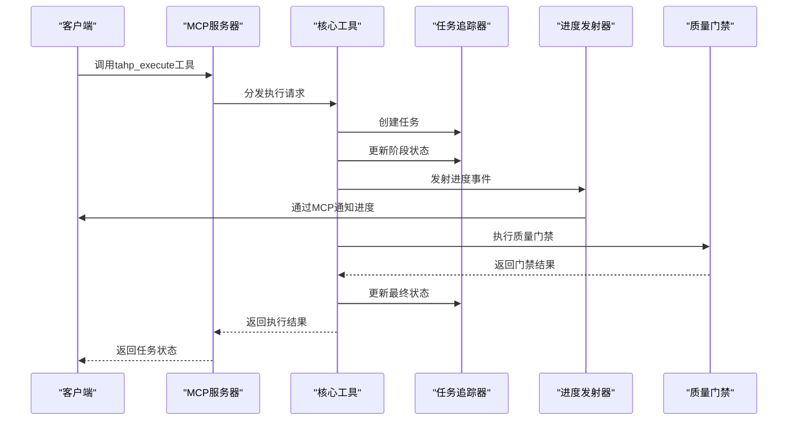
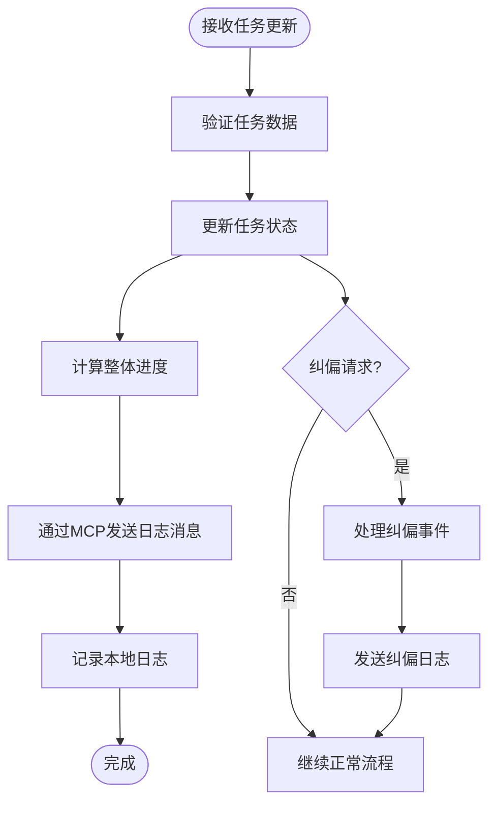
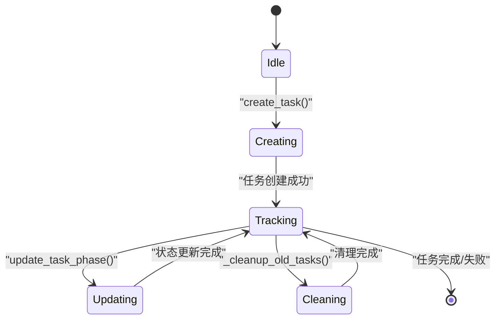
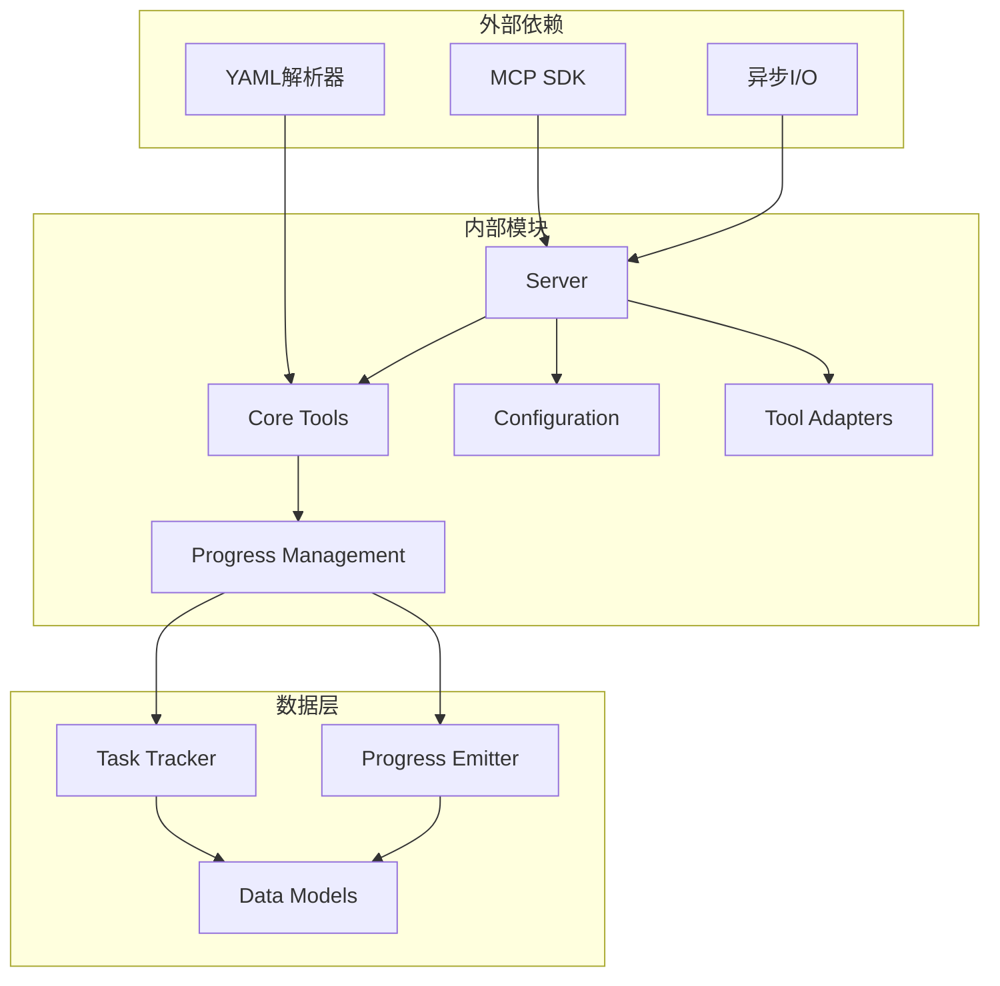

# 任务生命周期管理

<cite>
**本文档引用的文件**
- [tahp-mcp-server/progress/emitter.py](file://tahp-mcp-server/progress/emitter.py)
- [tahp-mcp-server/progress/tracker.py](file://tahp-mcp-server/progress/tracker.py)
- [tahp-mcp-server/server.py](file://tahp-mcp-server/server.py)
- [tahp-mcp-server/core/__init__.py](file://tahp-mcp-server/core/__init__.py)
- [tahp-mcp-server/config.py](file://tahp-mcp-server/config.py)
- [tahp-mcp-server/adapters/__init__.py](file://tahp-mcp-server/adapters/__init__.py)
- [scripts/gate_check.py](file://scripts/gate_check.py)
- [playbooks/bug-analysis-pipeline.yaml](file://playbooks/bug-analysis-pipeline.yaml)
- [playbooks/code-adaptation-pipeline.yaml](file://playbooks/code-adaptation-pipeline.yaml)
</cite>

## 目录
1. [简介](#简介)
2. [项目结构](#项目结构)
3. [核心组件](#核心组件)
4. [架构概览](#架构概览)
5. [详细组件分析](#详细组件分析)
6. [依赖关系分析](#依赖关系分析)
7. [性能考虑](#性能考虑)
8. [故障排除指南](#故障排除指南)
9. [结论](#结论)
10. [附录](#附录)

## 简介

任务生命周期管理系统是TAHP平台的核心组件，负责管理从任务创建到完成的完整生命周期。该系统实现了完整的任务状态跟踪、进度监控、事件通知等核心机制，为AI代理提供了实时的任务执行可视化和交互能力。

系统基于Model Context Protocol (MCP)协议构建，支持Claude Code等AI代理通过工具接口调用任务管理功能。整个系统采用模块化设计，包含进度追踪器、进度发射器、配置管理、工具适配器等多个核心组件。

## 项目结构

任务生命周期管理系统的项目结构清晰地分离了职责，主要分为以下几个层次：



**图表来源**
- [tahp-mcp-server/server.py:1-485](file://tahp-mcp-server/server.py#L1-L485)
- [tahp-mcp-server/core/__init__.py:1-621](file://tahp-mcp-server/core/__init__.py#L1-L621)
- [tahp-mcp-server/progress/tracker.py:1-343](file://tahp-mcp-server/progress/tracker.py#L1-L343)

**章节来源**
- [tahp-mcp-server/server.py:1-485](file://tahp-mcp-server/server.py#L1-L485)
- [tahp-mcp-server/core/__init__.py:1-621](file://tahp-mcp-server/core/__init__.py#L1-L621)

## 核心组件

### 任务阶段枚举 (TaskPhase)

系统定义了完整的任务执行阶段，确保任务状态的精确跟踪：

| 阶段 | 值 | 中文标签 | 状态映射 |
|------|-----|----------|----------|
| PENDING | pending | 等待执行 | WORKING |
| LOADING_CONSTRAINTS | loading_constraints | 正在加载约束文件 | WORKING |
| ANALYZING_DOCUMENT | analyzing_document | 正在分析设计文档 | WORKING |
| GENERATING_PLAN | generating_plan | 正在生成修改计划 | WORKING |
| EXECUTING_PIPELINE | executing_pipeline | 正在执行Pipeline | WORKING |
| RUNNING_GATE_CHECK | running_gate_check | 正在运行质量门禁 | WORKING |
| COMPLETED | completed | 执行完成 | COMPLETED |
| FAILED | failed | 执行失败 | FAILED |
| CANCELLED | cancelled | 已取消 | CANCELLED |
| CORRECTING | correcting | 等待纠偏输入 | INPUT_REQUIRED |

### 任务状态模型

系统采用数据类设计，提供完整的任务状态跟踪能力：



**图表来源**
- [tahp-mcp-server/progress/tracker.py:71-210](file://tahp-mcp-server/progress/tracker.py#L71-L210)
- [tahp-mcp-server/progress/tracker.py:212-342](file://tahp-mcp-server/progress/tracker.py#L212-L342)

**章节来源**
- [tahp-mcp-server/progress/tracker.py:18-68](file://tahp-mcp-server/progress/tracker.py#L18-L68)
- [tahp-mcp-server/progress/tracker.py:82-210](file://tahp-mcp-server/progress/tracker.py#L82-L210)

## 架构概览

系统采用分层架构设计，确保职责分离和可扩展性：



**图表来源**
- [tahp-mcp-server/server.py:369-447](file://tahp-mcp-server/server.py#L369-L447)
- [tahp-mcp-server/core/__init__.py:110-297](file://tahp-mcp-server/core/__init__.py#L110-L297)

**章节来源**
- [tahp-mcp-server/server.py:325-447](file://tahp-mcp-server/server.py#L325-L447)
- [tahp-mcp-server/core/__init__.py:109-297](file://tahp-mcp-server/core/__init__.py#L109-L297)

## 详细组件分析

### 进度发射器 (Progress Emitter)

进度发射器是任务生命周期管理的核心组件，负责将任务状态变化实时通知给客户端：

#### 工作原理



**图表来源**
- [tahp-mcp-server/progress/emitter.py:47-130](file://tahp-mcp-server/progress/emitter.py#L47-L130)

#### 进度计算机制

系统采用阶段映射和步骤进度相结合的方式计算整体进度：

| 阶段 | 基准进度 | 步骤权重 | 进度范围 |
|------|----------|----------|----------|
| PENDING | 0.0 | 0.15 | 0.0-0.15 |
| LOADING_CONSTRAINTS | 0.15 | 0.15 | 0.15-0.30 |
| ANALYZING_DOCUMENT | 0.30 | 0.15 | 0.30-0.45 |
| GENERATING_PLAN | 0.45 | 0.30 | 0.45-0.75 |
| EXECUTING_PIPELINE | 0.75 | 0.15 | 0.75-0.90 |
| RUNNING_GATE_CHECK | 0.90 | 0.05 | 0.90-0.95 |
| COMPLETED/FAILED/CANCELLED | 1.0 | 0.0 | 1.0 |

#### 事件传播机制

进度发射器支持多种事件类型的传播：

1. **进度更新事件**: 通过MCP logging通知机制实时推送
2. **步骤更新事件**: 基于步骤完成情况动态调整整体进度
3. **纠偏事件**: 处理AI代理的实时纠偏请求
4. **格式化事件**: 生成Markdown表格格式的进度报告

**章节来源**
- [tahp-mcp-server/progress/emitter.py:18-30](file://tahp-mcp-server/progress/emitter.py#L18-L30)
- [tahp-mcp-server/progress/emitter.py:47-130](file://tahp-mcp-server/progress/emitter.py#L47-L130)

### 任务追踪器 (Task Tracker)

任务追踪器提供线程安全的任务状态管理和存储功能：

#### 并发控制机制



**图表来源**
- [tahp-mcp-server/progress/tracker.py:212-342](file://tahp-mcp-server/progress/tracker.py#L212-L342)

#### 内存管理策略

系统采用智能的内存管理策略，防止内存泄漏：

1. **最大任务限制**: 默认最多保持100个任务
2. **自动清理机制**: 清理最早完成的任务，保留最新任务
3. **监听器模式**: 支持状态变更监听，便于外部系统集成

**章节来源**
- [tahp-mcp-server/progress/tracker.py:212-342](file://tahp-mcp-server/progress/tracker.py#L212-L342)

### 核心执行流程

系统的核心执行流程严格按照预定义的阶段顺序执行：

```mermaid
flowchart TD
CreateTask[创建任务] --> LoadConstraints[加载约束文件]
LoadConstraints --> AnalyzeDoc[分析设计文档]
AnalyzeDoc --> GeneratePlan[生成修改计划]
GeneratePlan --> ExecutePipeline[执行Pipeline]
ExecutePipeline --> RunGateCheck[运行质量门禁]
RunGateCheck --> CompleteTask[标记任务完成]
LoadConstraints -.-> LoadError[加载失败] --> FailTask[标记任务失败]
AnalyzeDoc -.-> DocError[文档错误] --> FailTask
ExecutePipeline -.-> ExecError[执行错误] --> FailTask
RunGateCheck -.-> GateError[门禁失败] --> FailTask
FailTask --> CompleteTask
CompleteTask --> [*]
```

**图表来源**
- [tahp-mcp-server/core/__init__.py:110-297](file://tahp-mcp-server/core/__init__.py#L110-L297)

**章节来源**
- [tahp-mcp-server/core/__init__.py:110-297](file://tahp-mcp-server/core/__init__.py#L110-L297)

### 质量门禁系统

质量门禁系统提供多级别的质量检查能力：

| 级别 | 类型 | 作用 | 影响 |
|------|------|------|------|
| P0 | Blocking | 必须通过 | 阻止集成 |
| P1 | Warning | 应该通过 | 警告但允许 |
| P2 | Record | 建议通过 | 仅记录 |

#### 门禁检查类型

1. **安全红线检查**: 确保约束文件包含安全红线
2. **密钥检查**: 防止硬编码敏感信息
3. **文档完整性检查**: 验证module.yaml的完整性
4. **命名规范检查**: 统一文件命名约定

**章节来源**
- [scripts/gate_check.py:36-93](file://scripts/gate_check.py#L36-L93)
- [tahp-mcp-server/core/__init__.py:392-543](file://tahp-mcp-server/core/__init__.py#L392-L543)

## 依赖关系分析

系统采用松耦合的设计，通过接口和抽象层实现模块间的解耦：



**图表来源**
- [tahp-mcp-server/server.py:61-82](file://tahp-mcp-server/server.py#L61-L82)
- [tahp-mcp-server/core/__init__.py:18-21](file://tahp-mcp-server/core/__init__.py#L18-L21)

**章节来源**
- [tahp-mcp-server/server.py:61-82](file://tahp-mcp-server/server.py#L61-L82)
- [tahp-mcp-server/core/__init__.py:18-21](file://tahp-mcp-server/core/__init__.py#L18-L21)

## 性能考虑

### 并发控制策略

系统采用多层并发控制机制：

1. **线程安全**: 使用threading.Lock确保任务追踪器的线程安全
2. **异步处理**: 核心工具采用async/await模式提高并发性能
3. **资源限制**: 通过max_concurrent_tasks配置限制同时执行的任务数量

### 内存优化

1. **智能清理**: 自动清理已完成的任务，防止内存泄漏
2. **增量更新**: 仅在状态变化时发送进度更新
3. **缓存策略**: 使用全局单例避免重复创建对象

### 网络优化

1. **流式传输**: 通过MCP协议实现实时进度推送
2. **压缩传输**: 对大型响应进行压缩处理
3. **轮询优化**: 提供合理的轮询间隔配置

## 故障排除指南

### 常见问题及解决方案

#### 任务状态异常

**问题**: 任务状态卡在某个阶段
**解决方案**: 
1. 检查对应阶段的日志输出
2. 验证相关工具的可用性
3. 确认网络连接状态

#### 进度更新丢失

**问题**: 客户端无法接收进度更新
**解决方案**:
1. 检查MCP服务器连接状态
2. 验证日志级别设置
3. 确认客户端订阅状态

#### 内存泄漏

**问题**: 系统内存持续增长
**解决方案**:
1. 检查任务清理机制
2. 验证最大任务数量配置
3. 监控任务生命周期

**章节来源**
- [tahp-mcp-server/progress/tracker.py:318-331](file://tahp-mcp-server/progress/tracker.py#L318-L331)
- [tahp-mcp-server/server.py:361-367](file://tahp-mcp-server/server.py#L361-L367)

## 结论

任务生命周期管理系统通过精心设计的架构和实现，为TAHP平台提供了强大而灵活的任务管理能力。系统的主要优势包括：

1. **完整的生命周期管理**: 从创建到完成的全流程跟踪
2. **实时进度监控**: 基于MCP协议的实时事件推送
3. **灵活的扩展性**: 模块化设计支持功能扩展
4. **强大的错误处理**: 完善的异常处理和恢复机制
5. **高性能设计**: 多层并发控制和内存优化

该系统为AI代理提供了可靠的基础设施，支持复杂的任务编排和实时交互，是TAHP平台能够高效执行各种开发任务的关键技术支撑。

## 附录

### 最佳实践建议

1. **任务设计**: 合理划分任务步骤，确保每个步骤都有明确的输入输出
2. **进度报告**: 定期更新任务进度，提供有意义的状态信息
3. **错误处理**: 实现完善的异常处理机制，确保系统稳定性
4. **性能监控**: 建立性能监控体系，及时发现和解决性能问题
5. **日志管理**: 合理配置日志级别，平衡调试需求和性能影响

### 性能优化建议

1. **并发调优**: 根据硬件配置调整max_concurrent_tasks参数
2. **内存管理**: 定期清理已完成任务，监控内存使用情况
3. **网络优化**: 使用连接池减少连接建立开销
4. **缓存策略**: 合理使用缓存提高响应速度
5. **异步处理**: 充分利用异步特性提高系统吞吐量