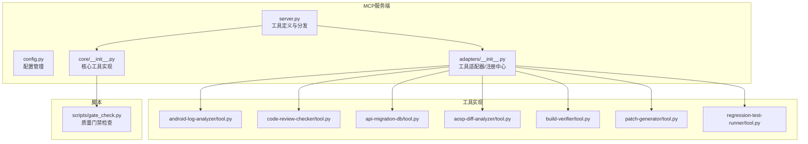
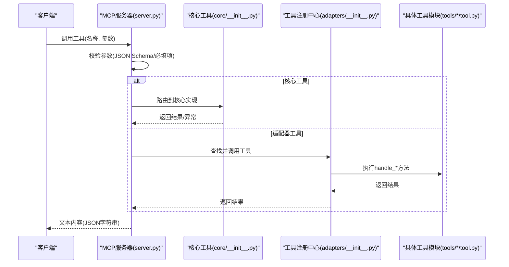
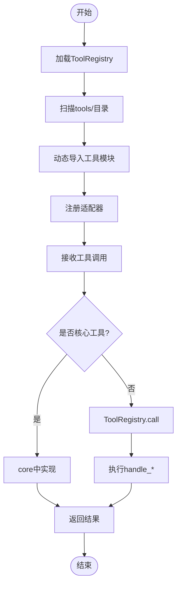
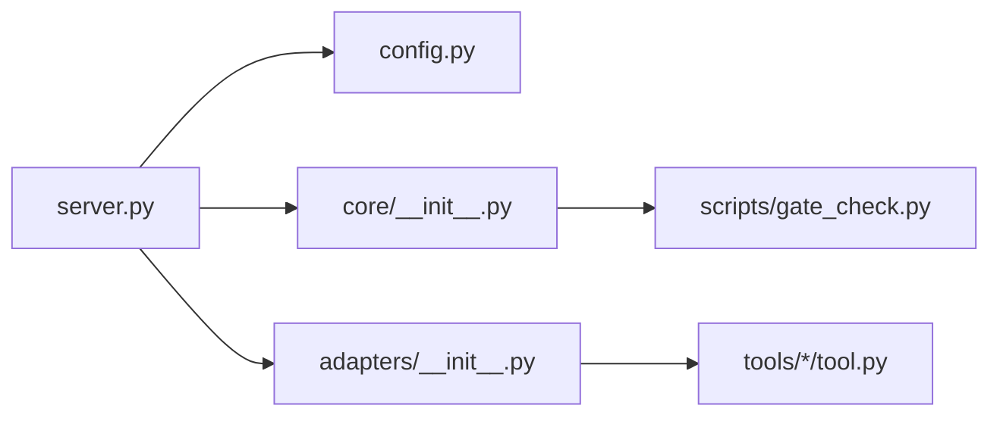

# 工具接口定义

<cite>
**本文档引用的文件**
- [server.py](file://tahp-mcp-server/server.py)
- [config.py](file://tahp-mcp-server/config.py)
- [adapters/__init__.py](file://tahp-mcp-server/adapters/__init__.py)
- [core/__init__.py](file://tahp-mcp-server/core/__init__.py)
- [tool.py（Android日志分析器）](file://tools/android-log-analyzer/tool.py)
- [tool.py（代码审查检查器）](file://tools/code-review-checker/tool.py)
- [tool.py（API迁移数据库）](file://tools/api-migration-db/tool.py)
- [tool.py（AOSP差异分析器）](file://tools/aosp-diff-analyzer/tool.py)
- [tool.py（构建验证器）](file://tools/build-verifier/tool.py)
- [tool.py（补丁生成器）](file://tools/patch-generator/tool.py)
- [tool.py（回归测试运行器）](file://tools/regression-test-runner/tool.py)
- [gate_check.py](file://scripts/gate_check.py)
</cite>

## 目录
1. [简介](#简介)
2. [项目结构](#项目结构)
3. [核心组件](#核心组件)
4. [架构总览](#架构总览)
5. [详细组件分析](#详细组件分析)
6. [依赖分析](#依赖分析)
7. [性能考虑](#性能考虑)
8. [故障排查指南](#故障排查指南)
9. [结论](#结论)

## 简介
本文件面向TAHP MCP工具接口的使用者与维护者，系统性梳理并定义所有TAHP MCP工具的接口规范，覆盖以下工具：
- tahp_execute：按设计文档执行开发任务
- tahp_status：查询任务执行状态
- tahp_correct：对正在执行的任务进行纠偏
- tahp_gate_check：执行质量门禁检查
- tahp_list_tasks：列出所有任务
- tahp_query_knowledge：查询知识库
- tahp_analyze_log：分析Android日志
- tahp_code_review：自动化代码审查
- tahp_api_migration：查询API迁移规则
- tahp_diff_analyze：分析AOSP版本差异
- tahp_generate_patch：生成适配Patch
- tahp_regression_test：执行回归测试

文档内容包括：工具的JSON Schema定义、参数验证逻辑、输入输出模式、错误处理机制、调用示例、使用场景与最佳实践，以及工具分发机制与动态调用处理流程。

## 项目结构
TAHP MCP服务端位于tahp-mcp-server目录，采用MCP Python SDK实现，将TAHP约束驱动开发能力暴露为MCP工具。核心模块职责如下：
- server.py：MCP服务器入口，定义工具清单与调用分发
- config.py：配置管理，提供项目根目录、模块/领域映射、路径解析等
- adapters/__init__.py：工具适配器与注册中心，动态加载tools/目录下的工具
- core/__init__.py：核心工具实现（execute/status/correct/gate等）
- tools/：具体工具实现（日志分析、代码审查、API迁移、AOSP差异、构建验证、补丁生成、回归测试）

图表来源
- [server.py:101-340](file://tahp-mcp-server/server.py#L101-L340)
- [config.py:36-176](file://tahp-mcp-server/config.py#L36-L176)
- [adapters/__init__.py:186-239](file://tahp-mcp-server/adapters/__init__.py#L186-L239)
- [core/__init__.py:110-298](file://tahp-mcp-server/core/__init__.py#L110-L298)

章节来源
- [server.py:1-485](file://tahp-mcp-server/server.py#L1-L485)
- [config.py:1-176](file://tahp-mcp-server/config.py#L1-L176)

## 核心组件
- MCP工具定义与分发：在server.py中声明各工具的JSON Schema，并在_call_tool中进行参数校验与路由分发
- 工具适配器与注册中心：adapters/__init__.py负责动态导入tools/目录下工具模块，统一为ToolAdapter接口，便于server.py按名称调用
- 核心工具实现：core/__init__.py实现tahp_execute、tahp_status、tahp_correct、tahp_gate_check、tahp_list_tasks、tahp_query_knowledge等核心逻辑
- 质量门禁：复用scripts/gate_check.py的门禁检查逻辑，支持P0/P1/P2三级门禁

章节来源
- [server.py:101-447](file://tahp-mcp-server/server.py#L101-L447)
- [adapters/__init__.py:186-239](file://tahp-mcp-server/adapters/__init__.py#L186-L239)
- [core/__init__.py:110-621](file://tahp-mcp-server/core/__init__.py#L110-L621)
- [gate_check.py:1-507](file://scripts/gate_check.py#L1-L507)

## 架构总览
MCP工具调用的总体流程：
- 客户端发起工具调用（如tahp_execute），MCP Server接收并解析参数
- server.py根据工具名进行参数校验与路由
- 对核心工具（execute/status/correct/gate/list/query等）直接在core中实现
- 对适配器工具（日志分析、代码审查、API迁移等）通过ToolRegistry动态调用对应工具模块
- 结果以JSON字符串形式返回；异常按INVALID_PARAMS或INTERNAL_ERROR处理

图表来源
- [server.py:343-447](file://tahp-mcp-server/server.py#L343-L447)
- [core/__init__.py:110-298](file://tahp-mcp-server/core/__init__.py#L110-L298)
- [adapters/__init__.py:226-238](file://tahp-mcp-server/adapters/__init__.py#L226-L238)

## 详细组件分析

### 工具：tahp_execute
- 工具描述：按照设计文档执行TAHP开发任务，读取约束文件，分析设计文档，生成修改计划，执行Pipeline，运行质量门禁
- 输入Schema要点
  - document_path：字符串，设计文档路径（相对或绝对）
  - module：枚举，telephony、kernel-driver、power-mgmt之一
  - domain：枚举，bug_analysis、code_adaptation、version_adaptation、carrier_porting之一
  - constraints_extra：可选，额外约束文件路径数组
- 参数验证
  - 必填校验：document_path、module、domain均不能为空
  - 模块/领域合法性：通过MCPServerConfig.validate_module/domain校验
- 输出
  - 返回任务ID与执行结果，包含修改计划、Pipeline步骤结果、门禁结果、安全红线等
- 错误处理
  - 参数缺失或非法：抛出ValueError，返回INVALID_PARAMS错误
  - 执行异常：捕获异常并返回INTERNAL_ERROR
- 使用场景
  - 从设计文档驱动的自动化开发流程
  - 需要严格遵循约束与门禁的模块升级/移植
- 最佳实践
  - 在调用前确保document_path存在且可读
  - 使用constraints_extra补充临时约束
  - 通过tahp_status轮询任务进度

章节来源
- [server.py:103-135](file://tahp-mcp-server/server.py#L103-L135)
- [server.py:369-395](file://tahp-mcp-server/server.py#L369-L395)
- [core/__init__.py:110-298](file://tahp-mcp-server/core/__init__.py#L110-L298)
- [config.py:122-128](file://tahp-mcp-server/config.py#L122-L128)

### 工具：tahp_status
- 工具描述：查询TAHP任务执行状态，返回当前阶段、进度百分比、步骤详情、门禁结果等
- 输入Schema要点
  - task_id：字符串，任务ID（由tahp_execute返回）
- 参数验证
  - 必填校验：task_id不能为空
- 输出
  - 任务详情字典，包含阶段、步骤、门禁结果、更新时间等
- 错误处理
  - 任务不存在：返回not_found与错误信息
- 使用场景
  - 实时监控任务执行状态
  - 与前端或CI集成展示进度
- 最佳实践
  - 建议每间隔固定时间轮询一次，避免过于频繁

章节来源
- [server.py:137-153](file://tahp-mcp-server/server.py#L137-L153)
- [server.py:397-401](file://tahp-mcp-server/server.py#L397-L401)
- [core/__init__.py:300-315](file://tahp-mcp-server/core/__init__.py#L300-L315)

### 工具：tahp_correct
- 工具描述：对正在执行的TAHP任务进行纠偏，AI可提供反馈建议，TAHP据此调整执行策略
- 输入Schema要点
  - task_id：字符串，任务ID
  - feedback：字符串，纠偏反馈内容
- 参数验证
  - 必填校验：task_id与feedback均不能为空
- 输出
  - 返回纠正状态、当前阶段、纠偏次数等
- 错误处理
  - 任务不存在或处于终态：返回错误信息
- 使用场景
  - AI在任务执行过程中给出修正建议
- 最佳实践
  - 提供明确、可执行的反馈内容

章节来源
- [server.py:155-176](file://tahp-mcp-server/server.py#L155-L176)
- [server.py:403-410](file://tahp-mcp-server/server.py#L403-L410)
- [core/__init__.py:318-363](file://tahp-mcp-server/core/__init__.py#L318-L363)

### 工具：tahp_gate_check
- 工具描述：对指定任务或模块执行TAHP质量门禁检查，支持P0/P1/P2三级门禁
- 输入Schema要点
  - task_id：字符串，任务ID（可选）
  - module：字符串，模块名（可选，与task_id二选一）
  - level：枚举，P0、P1、P2、all，默认all
- 参数验证
  - 必须二选一：task_id或module至少提供一个
- 输出
  - 返回门禁结果、检查项明细、统计信息
- 错误处理
  - 未提供有效目标：返回错误
  - 模块目录不存在：返回错误
- 使用场景
  - 任务完成后自动门禁
  - 指定模块批量门禁
- 最佳实践
  - 优先使用task_id定位任务，若无任务可使用module

章节来源
- [server.py:178-204](file://tahp-mcp-server/server.py#L178-L204)
- [server.py:412-418](file://tahp-mcp-server/server.py#L412-L418)
- [core/__init__.py:366-459](file://tahp-mcp-server/core/__init__.py#L366-L459)
- [gate_check.py:36-507](file://scripts/gate_check.py#L36-L507)

### 工具：tahp_list_tasks
- 工具描述：列出所有TAHP任务及其状态
- 输入Schema要点
  - include_completed：布尔，是否包含已完成的任务，默认True
- 输出
  - 返回任务列表与总数
- 使用场景
  - 管理后台或仪表盘展示任务概览
- 最佳实践
  - 默认包含已完成任务，便于审计

章节来源
- [server.py:206-219](file://tahp-mcp-server/server.py#L206-L219)
- [server.py:420-423](file://tahp-mcp-server/server.py#L420-L423)
- [core/__init__.py:546-555](file://tahp-mcp-server/core/__init__.py#L546-L555)

### 工具：tahp_query_knowledge
- 工具描述：语义查询TAHP知识库，支持按模块过滤和跨模块搜索
- 输入Schema要点
  - query：字符串，搜索查询文本（必填）
  - module：字符串，按模块过滤（可选）
  - cross_module：布尔，默认False
  - top_k：整数，默认5
- 参数验证
  - 必填校验：query不能为空
- 输出
  - 返回匹配的知识条目列表与总数
- 使用场景
  - AI辅助决策时检索相关知识
- 最佳实践
  - cross_module开启时可扩大搜索范围

章节来源
- [server.py:221-251](file://tahp-mcp-server/server.py#L221-L251)
- [server.py:425-435](file://tahp-mcp-server/server.py#L425-L435)
- [core/__init__.py:558-620](file://tahp-mcp-server/core/__init__.py#L558-L620)

### 工具：tahp_analyze_log
- 工具描述：解析Android logcat/ril/atcmd日志，提取错误事件和通信事件
- 输入Schema要点
  - log_content：字符串，日志内容（必填）
  - log_type：枚举，logcat、ril、atcmd，默认logcat
  - filters：字符串数组，过滤关键词（可选）
- 参数验证
  - 必填校验：log_content不能为空
- 输出
  - events、errors、统计信息（总行数、事件数、错误数、日志类型）
- 使用场景
  - 故障诊断与日志分析
- 最佳实践
  - 使用filters缩小关注范围

章节来源
- [server.py:253-277](file://tahp-mcp-server/server.py#L253-L277)
- [server.py:437-438](file://tahp-mcp-server/server.py#L437-L438)
- [adapters/__init__.py:68-82](file://tahp-mcp-server/adapters/__init__.py#L68-L82)
- [tool.py（Android日志分析器）:1-50](file://tools/android-log-analyzer/tool.py#L1-L50)

### 工具：tahp_code_review
- 工具描述：自动化代码审查，检查P0/P1/P2规则违规
- 输入Schema要点
  - patch_content：字符串，Patch/代码差异内容（必填）
  - check_level：枚举，P0、P1、P2，默认P0
- 参数验证
  - 必填校验：patch_content不能为空
- 输出
  - result（pass/warning/fail）、违规列表、分数、统计
- 使用场景
  - 代码合并前的质量把关
- 最佳实践
  - P0级别默认严格，P1/P2可按需放宽

章节来源
- [server.py:279-298](file://tahp-mcp-server/server.py#L279-L298)
- [server.py:440-441](file://tahp-mcp-server/server.py#L440-L441)
- [adapters/__init__.py:138-151](file://tahp-mcp-server/adapters/__init__.py#L138-L151)
- [tool.py（代码审查检查器）:1-33](file://tools/code-review-checker/tool.py#L1-L33)

### 工具：tahp_api_migration
- 工具描述：查询API迁移规则库，支持list/search/add操作
- 输入Schema要点
  - action：枚举，list、search、add，默认list
  - module：字符串，按模块过滤（list时使用）
  - old_api：字符串，旧API名称（search时使用）
- 参数验证
  - action为必需值（默认值在server侧设置）
- 输出
  - list：返回规则列表与总数
  - search：返回匹配规则与总数
  - add：返回新增状态与规则ID
- 使用场景
  - API升级/迁移时的规则查询与维护
- 最佳实践
  - 新增规则前先search确认是否存在重复

章节来源
- [server.py:300-322](file://tahp-mcp-server/server.py#L300-L322)
- [server.py:443-444](file://tahp-mcp-server/server.py#L443-L444)
- [adapters/__init__.py:101-119](file://tahp-mcp-server/adapters/__init__.py#L101-L119)
- [tool.py（API迁移数据库）:1-45](file://tools/api-migration-db/tool.py#L1-L45)

### 工具：tahp_diff_analyze
- 工具描述：对比Android版本framework差异，检测废弃/新增/移除API
- 输入Schema要点
  - diff_content：字符串，diff内容（必填）
  - source_version：字符串，源版本
  - target_version：字符串，目标版本
  - module_filter：字符串，模块过滤（可选）
- 参数验证
  - 必填校验：diff_content不能为空
- 输出
  - deprecated_apis、removed_apis、added_apis与摘要统计
- 使用场景
  - 版本升级时的API兼容性分析
- 最佳实践
  - 使用module_filter聚焦特定模块

章节来源
- [server.py:324-324](file://tahp-mcp-server/server.py#L324-L324)
- [server.py:437-438](file://tahp-mcp-server/server.py#L437-L438)
- [adapters/__init__.py:85-98](file://tahp-mcp-server/adapters/__init__.py#L85-L98)
- [tool.py（AOSP差异分析器）:1-41](file://tools/aosp-diff-analyzer/tool.py#L1-L41)

### 工具：tahp_generate_patch
- 工具描述：根据迁移规则批量生成patch
- 输入Schema要点
  - migration_rules：数组，迁移规则列表（必填）
  - target_files：数组，目标文件列表（必填）
  - source_code_paths：数组，源代码路径（可选）
- 参数验证
  - 必填校验：migration_rules与target_files不能为空
- 输出
  - patches与统计信息（生成数、跳过数、错误数）
- 使用场景
  - 自动生成API迁移补丁
- 最佳实践
  - 先用source_code_paths筛选受影响文件

章节来源
- [server.py:35-35](file://tahp-mcp-server/server.py#L35-L35)
- [server.py:443-444](file://tahp-mcp-server/server.py#L443-L444)
- [adapters/__init__.py:154-167](file://tahp-mcp-server/adapters/__init__.py#L154-L167)
- [tool.py（补丁生成器）:1-24](file://tools/patch-generator/tool.py#L1-L24)

### 工具：tahp_regression_test
- 工具描述：执行冒烟测试和功能回归测试
- 输入Schema要点
  - test_targets：数组，测试目标（必填）
  - test_type：字符串，测试类型，默认smoke
  - device_serial：字符串，设备序列号（可选）
- 参数验证
  - 必填校验：test_targets不能为空
- 输出
  - result、通过数、失败数、总数、通过率与失败列表
- 使用场景
  - 集成测试与回归验证
- 最佳实践
  - smoke测试用于快速验证，full回归用于深度验证

章节来源
- [server.py:35-35](file://tahp-mcp-server/server.py#L35-L35)
- [server.py:443-444](file://tahp-mcp-server/server.py#L443-L444)
- [adapters/__init__.py:170-183](file://tahp-mcp-server/adapters/__init__.py#L170-L183)
- [tool.py（回归测试运行器）:1-9](file://tools/regression-test-runner/tool.py#L1-L9)

### 工具分发机制与动态调用处理流程
- 工具注册与发现
  - server.py在启动时加载ToolRegistry，后者扫描tools/目录，动态导入各工具模块
  - 适配器将工具模块中的handle_*函数包装为统一接口
- 调用分发
  - server.py在_call_tool中根据工具名分发至核心实现或适配器
  - 对于核心工具（execute/status/correct/gate/list/query），直接在core中实现
  - 对于适配器工具（日志分析、代码审查、API迁移等），通过ToolRegistry.call调用
- 错误处理
  - 参数校验失败：返回INVALID_PARAMS
  - 工具执行异常：返回INTERNAL_ERROR
  - 结果过大：自动截断并提示使用tahp_status查看详细信息

图表来源
- [adapters/__init__.py:197-217](file://tahp-mcp-server/adapters/__init__.py#L197-L217)
- [adapters/__init__.py:226-238](file://tahp-mcp-server/adapters/__init__.py#L226-L238)
- [server.py:369-447](file://tahp-mcp-server/server.py#L369-L447)

章节来源
- [adapters/__init__.py:186-239](file://tahp-mcp-server/adapters/__init__.py#L186-L239)
- [server.py:343-447](file://tahp-mcp-server/server.py#L343-L447)

## 依赖分析
- 组件耦合
  - server.py依赖config、core、adapters，承担入口与分发职责
  - core依赖config、progress（追踪器与进度发射器），实现核心业务逻辑
  - adapters依赖config，动态加载tools/目录下的工具模块
  - 工具模块彼此独立，仅通过统一的handle_*接口交互
- 外部依赖
  - MCP Python SDK：提供Server、Tool、CallToolResult等基础能力
  - YAML解析：用于约束文件与配置加载
  - scripts/gate_check.py：质量门禁检查逻辑复用

图表来源
- [server.py:71-82](file://tahp-mcp-server/server.py#L71-L82)
- [core/__init__.py:18-21](file://tahp-mcp-server/core/__init__.py#L18-L21)
- [adapters/__init__.py:17-17](file://tahp-mcp-server/adapters/__init__.py#L17-L17)

章节来源
- [server.py:71-82](file://tahp-mcp-server/server.py#L71-L82)
- [core/__init__.py:18-21](file://tahp-mcp-server/core/__init__.py#L18-L21)
- [adapters/__init__.py:17-17](file://tahp-mcp-server/adapters/__init__.py#L17-L17)

## 性能考虑
- 并发与超时
  - 配置最大并发任务数与任务超时时间，避免资源耗尽
- 结果截断
  - 当工具返回结果过大时自动截断，建议通过tahp_status获取详细信息
- 适配器降级
  - 若工具模块不可用，适配器提供降级实现，保证系统可用性
- 建议
  - 对大规模日志/代码分析任务，建议分批处理或异步执行
  - 合理设置top_k与filters，减少无效计算

## 故障排查指南
- 常见错误
  - 参数缺失或非法：INVALID_PARAMS，检查必填字段与枚举值
  - 任务不存在或处于终态：返回not_found或error，确认task_id正确
  - 工具执行异常：INTERNAL_ERROR，查看服务端日志定位问题
- 排查步骤
  - 确认工具名称拼写正确
  - 校验输入参数类型与范围
  - 使用tahp_status查看任务状态
  - 检查tools/目录下对应工具模块是否可导入
- 日志
  - 服务端日志记录工具调用与异常，便于定位问题

章节来源
- [server.py:361-366](file://tahp-mcp-server/server.py#L361-L366)
- [core/__init__.py:289-297](file://tahp-mcp-server/core/__init__.py#L289-L297)
- [adapters/__init__.py:226-234](file://tahp-mcp-server/adapters/__init__.py#L226-L234)

## 结论
本文档系统化定义了TAHP MCP工具接口规范，覆盖参数Schema、验证逻辑、输入输出模式与错误处理，并结合实际代码实现了工具分发与动态调用流程的可视化说明。建议在生产环境中：
- 严格遵循JSON Schema与参数校验
- 使用tahp_status进行状态跟踪
- 对大规模任务采用异步与分批策略
- 通过适配器机制扩展新工具，保持系统稳定性与可维护性