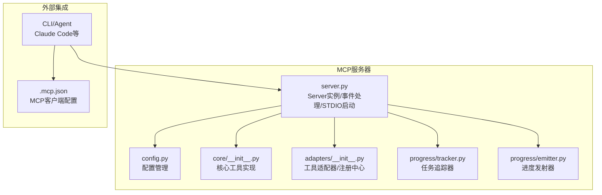
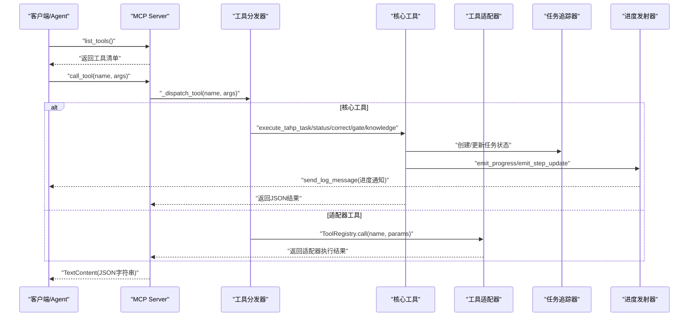
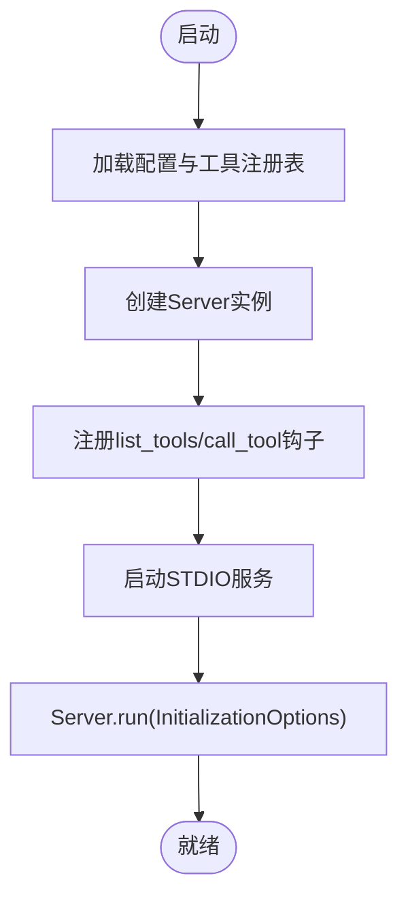
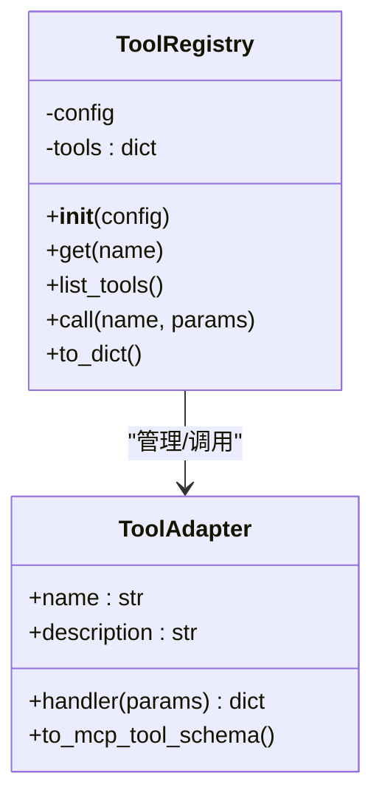
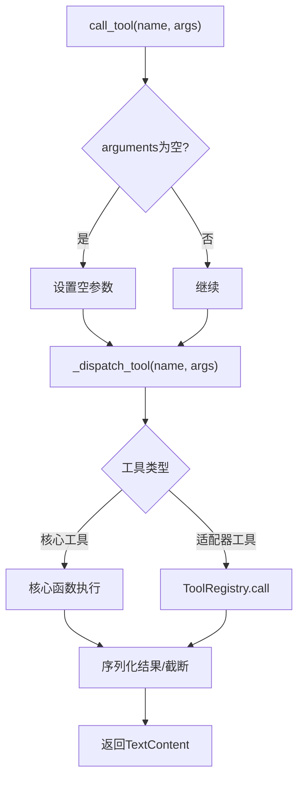
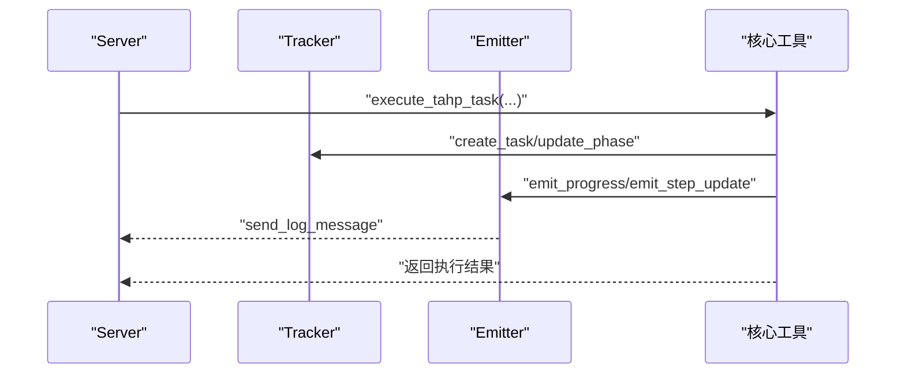
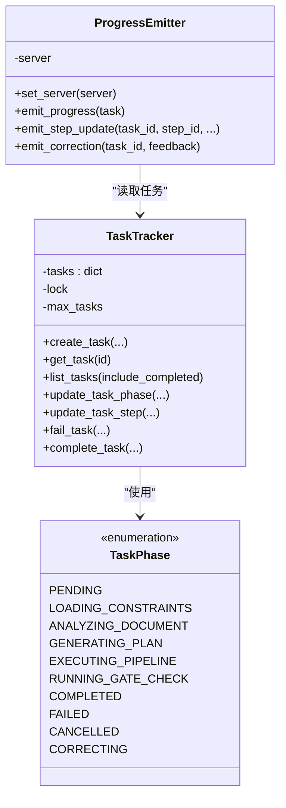
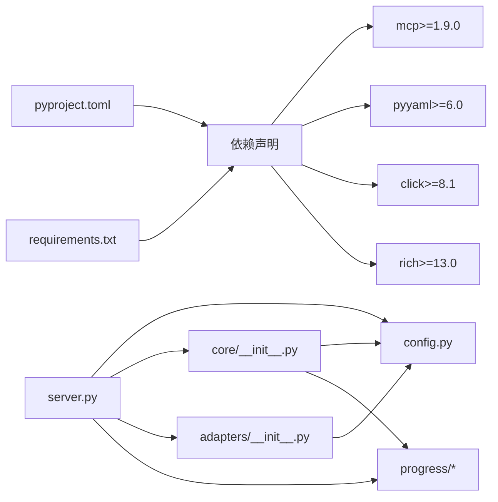

# 服务器架构设计

<cite>
**本文引用的文件**
- [server.py](file://tahp-mcp-server/server.py)
- [config.py](file://tahp-mcp-server/config.py)
- [core/__init__.py](file://tahp-mcp-server/core/__init__.py)
- [adapters/__init__.py](file://tahp-mcp-server/adapters/__init__.py)
- [progress/tracker.py](file://tahp-mcp-server/progress/tracker.py)
- [progress/emitter.py](file://tahp-mcp-server/progress/emitter.py)
- [test_server.py](file://tahp-mcp-server/test_server.py)
- [pyproject.toml](file://tahp-mcp-server/pyproject.toml)
- [requirements.txt](file://tahp-mcp-server/requirements.txt)
- [.mcp.json](file://.mcp.json)
- [constraints/telephony/module.yaml](file://constraints/telephony/module.yaml)
- [playbooks/bug-analysis-pipeline.yaml](file://playbooks/bug-analysis-pipeline.yaml)
- [knowledge-base/config.yaml](file://knowledge-base/config.yaml)
</cite>

## 目录
1. [简介](#简介)
2. [项目结构](#项目结构)
3. [核心组件](#核心组件)
4. [架构总览](#架构总览)
5. [详细组件分析](#详细组件分析)
6. [依赖分析](#依赖分析)
7. [性能考虑](#性能考虑)
8. [故障排查指南](#故障排查指南)
9. [结论](#结论)
10. [附录](#附录)

## 简介
本文件面向MCP服务器架构设计，围绕基于MCP Python SDK的TAHP MCP Server展开，系统阐述Server类初始化流程、工具注册机制、事件处理模型、服务器生命周期管理、异步处理机制、STDIO通信协议对接、MCP协议标准对接方式，以及如何通过MCP协议暴露TAHP工具接口。文档同时覆盖启动流程、初始化选项配置、日志系统集成等实现细节，并提供架构图与组件交互说明，帮助开发者快速理解整体设计思路。

## 项目结构
tahp-mcp-server采用“按功能域分层”的组织方式，核心目录与职责如下：
- server.py：MCP Server入口与事件处理、工具分发、STDIO启动
- config.py：配置管理（项目根、模块/领域、Playbook映射、目录结构等）
- core：核心工具实现（任务执行、状态查询、纠偏、门禁、知识库查询等）
- adapters：工具适配器（将现有tools/工具封装为统一接口）
- progress：进度追踪与事件发射（任务状态、步骤、纠偏、日志通知）
- test_server.py：功能验证脚本（演示工具调用与状态查询）
- pyproject.toml / requirements.txt：构建与依赖声明
- .mcp.json：MCP客户端配置（命令行、参数、工作目录、环境变量）

**图表来源**
- [server.py:98-485](file://tahp-mcp-server/server.py#L98-L485)
- [config.py:36-176](file://tahp-mcp-server/config.py#L36-L176)
- [core/__init__.py:110-621](file://tahp-mcp-server/core/__init__.py#L110-L621)
- [adapters/__init__.py:186-239](file://tahp-mcp-server/adapters/__init__.py#L186-L239)
- [progress/tracker.py:212-343](file://tahp-mcp-server/progress/tracker.py#L212-L343)
- [progress/emitter.py:33-194](file://tahp-mcp-server/progress/emitter.py#L33-L194)
- [.mcp.json:1-13](file://.mcp.json#L1-L13)

**章节来源**
- [server.py:1-485](file://tahp-mcp-server/server.py#L1-L485)
- [config.py:1-176](file://tahp-mcp-server/config.py#L1-L176)
- [pyproject.toml:1-19](file://tahp-mcp-server/pyproject.toml#L1-L19)
- [.mcp.json:1-13](file://.mcp.json#L1-L13)

## 核心组件
- Server实例与事件处理：基于MCP Python SDK创建Server实例，注册list_tools/call_tool事件处理器，实现工具清单与调用分发。
- 工具注册机制：通过ToolRegistry集中管理适配器工具，支持动态导入与降级回退。
- 事件处理模型：异步事件驱动，工具调用统一走分发器，异常捕获与错误响应规范化。
- 生命周期管理：初始化回调设置进度发射器与Server元信息；STDIO启动负责与客户端建立通信。
- 异步处理机制：核心工具均采用async/await，确保高并发与非阻塞。
- STDIO通信协议：通过mcp.server.stdio.stdio_server建立读写流，Server.run接入MCP协议。
- MCP协议对接：Server.run传入InitializationOptions（名称/版本），工具清单与调用遵循MCP协议标准。
- 日志系统集成：统一使用logging，结合进度发射器通过MCP会话发送日志消息。

**章节来源**
- [server.py:98-485](file://tahp-mcp-server/server.py#L98-L485)
- [adapters/__init__.py:186-239](file://tahp-mcp-server/adapters/__init__.py#L186-L239)
- [progress/emitter.py:33-194](file://tahp-mcp-server/progress/emitter.py#L33-L194)

## 架构总览
下图展示了MCP服务器与外部客户端、工具适配器、核心工具、进度追踪与事件发射之间的交互关系。

**图表来源**
- [server.py:327-448](file://tahp-mcp-server/server.py#L327-L448)
- [core/__init__.py:110-298](file://tahp-mcp-server/core/__init__.py#L110-L298)
- [adapters/__init__.py:226-234](file://tahp-mcp-server/adapters/__init__.py#L226-L234)
- [progress/tracker.py:212-343](file://tahp-mcp-server/progress/tracker.py#L212-L343)
- [progress/emitter.py:47-130](file://tahp-mcp-server/progress/emitter.py#L47-L130)

## 详细组件分析

### Server类与事件处理
- 初始化：创建Server实例，加载配置与工具注册表，设置日志。
- 工具清单：list_tools装饰器返回全部TAHP工具定义（含输入Schema）。
- 工具调用：call_tool装饰器统一接收name与arguments，内部调用分发器，捕获参数与内部错误并返回标准化文本内容。
- 分发器：按工具名路由至对应核心函数或适配器调用，参数校验与错误处理在分发层完成。
- 生命周期：_on_server_initialized在初始化完成后设置进度发射器与Server元信息。
- 启动流程：main_async通过stdio_server建立STDIO通道，Server.run传入InitializationOptions启动。

**图表来源**
- [server.py:98-485](file://tahp-mcp-server/server.py#L98-L485)
- [config.py:130-161](file://tahp-mcp-server/config.py#L130-L161)

**章节来源**
- [server.py:98-485](file://tahp-mcp-server/server.py#L98-L485)

### 工具注册机制与适配器
- ToolRegistry：集中管理工具适配器，支持动态导入tools/模块下的tool.py，若缺失则提供降级实现。
- 适配器接口：ToolAdapter封装任意工具的handle(params)->dict接口，统一输出格式。
- 已适配工具：android-log-analyzer、aosp-diff-analyzer、api-migration-db、build-verifier、code-review-checker、patch-generator、regression-test-runner。
- 调用方式：_dispatch_tool中通过_tool_registry.call转发到具体适配器。

**图表来源**
- [adapters/__init__.py:186-239](file://tahp-mcp-server/adapters/__init__.py#L186-L239)
- [adapters/__init__.py:20-40](file://tahp-mcp-server/adapters/__init__.py#L20-L40)

**章节来源**
- [adapters/__init__.py:186-239](file://tahp-mcp-server/adapters/__init__.py#L186-L239)

### 事件处理模型与工具分发
- list_tools：返回全部TAHP工具定义（含名称、描述、输入Schema）。
- call_tool：统一入口，记录日志，调用分发器，处理参数错误与内部异常，限制超长结果并返回TextContent。
- 分发器：按工具名路由到核心工具或适配器，核心工具包括tahp_execute、tahp_status、tahp_correct、tahp_gate_check、tahp_list_tasks、tahp_query_knowledge等。

**图表来源**
- [server.py:343-448](file://tahp-mcp-server/server.py#L343-L448)

**章节来源**
- [server.py:327-448](file://tahp-mcp-server/server.py#L327-L448)

### 核心工具实现（核心业务）
- execute_tahp_task：加载约束、分析文档、生成修改计划、执行Pipeline、运行门禁，全程维护任务状态与步骤，emit进度。
- get_tahp_status：查询任务详情（阶段、进度、步骤、纠偏历史、门禁结果等）。
- correct_tahp_task：记录纠偏反馈，切换到CORRECTING阶段并重入执行。
- run_gate_check/_run_gate_check_internal：对任务或模块执行门禁检查，支持P0/P1/P2级别。
- list_tahp_tasks：列出任务列表。
- query_knowledge：基于知识库配置与数据库实现跨模块/模块内检索。

**图表来源**
- [core/__init__.py:110-298](file://tahp-mcp-server/core/__init__.py#L110-L298)
- [progress/tracker.py:212-343](file://tahp-mcp-server/progress/tracker.py#L212-L343)
- [progress/emitter.py:47-130](file://tahp-mcp-server/progress/emitter.py#L47-L130)

**章节来源**
- [core/__init__.py:110-621](file://tahp-mcp-server/core/__init__.py#L110-L621)

### 进度追踪与事件发射
- 任务追踪器：TaskTracker线程安全地维护任务集合，提供创建、更新、失败、完成、清理等能力。
- 阶段与状态：TaskPhase枚举与MCP兼容的TaskStatus映射，中文标签与进度映射。
- 步骤管理：StepProgress记录步骤状态、开始/完成时间、详情。
- 进度发射器：通过MCP会话发送日志消息，同时记录本地日志；支持步骤更新与纠偏事件。

**图表来源**
- [progress/tracker.py:18-343](file://tahp-mcp-server/progress/tracker.py#L18-L343)
- [progress/emitter.py:33-194](file://tahp-mcp-server/progress/emitter.py#L33-L194)

**章节来源**
- [progress/tracker.py:18-343](file://tahp-mcp-server/progress/tracker.py#L18-L343)
- [progress/emitter.py:33-194](file://tahp-mcp-server/progress/emitter.py#L33-L194)

### 配置管理
- 默认项目根：优先环境变量TAHP_PROJECT_ROOT，否则向上查找包含constraints/的目录，兜底为当前工作目录。
- 关键属性：server_name、server_version、log_level、max_concurrent_tasks、task_timeout_sec、modules、domains、playbook_map。
- 目录派生：constraints_dir、playbooks_dir、knowledge_base_dir、tools_dir、scripts_dir、reports_dir。
- 配置加载：from_yaml支持覆盖默认配置，to_dict导出配置字典。

**章节来源**
- [config.py:18-176](file://tahp-mcp-server/config.py#L18-L176)

### STDIO通信协议与MCP协议对接
- STDIO启动：main_async通过mcp.server.stdio.stdio_server创建读写流，Server.run接入MCP协议。
- 初始化选项：InitializationOptions传入server_name与server_version。
- 日志推送：ProgressEmitter通过server.request_context.session.send_log_message发送进度与纠偏日志。
- 客户端配置：.mcp.json定义命令、参数、工作目录与环境变量（TAHP_PROJECT_ROOT）。

**章节来源**
- [server.py:461-485](file://tahp-mcp-server/server.py#L461-L485)
- [.mcp.json:1-13](file://.mcp.json#L1-L13)

### 工具Schema与输入校验
- 工具Schema：每个工具定义了名称、描述与输入Schema，用于客户端参数校验与UI渲染。
- 核心工具Schema：tahp_execute、tahp_status、tahp_correct、tahp_gate_check、tahp_list_tasks、tahp_query_knowledge等。
- 适配器工具Schema：通过ToolAdapter.to_mcp_tool_schema生成简要描述。

**章节来源**
- [server.py:103-322](file://tahp-mcp-server/server.py#L103-L322)
- [adapters/__init__.py:34-40](file://tahp-mcp-server/adapters/__init__.py#L34-L40)

### 示例与验证
- test_server.py：演示工具调用（tahp_execute/tahp_status/tahp_list_tasks/tahp_gate_check/tahp_code_review/tahp_analyze_log），便于离线验证。

**章节来源**
- [test_server.py:13-76](file://tahp-mcp-server/test_server.py#L13-L76)

## 依赖分析
- 构建与运行：pyproject.toml声明项目元数据与依赖（mcp、pyyaml、click、rich），requirements.txt声明最小依赖。
- 运行时依赖：MCP Python SDK负责协议栈与STDIO桥接；PyYAML用于配置与约束文件解析；Rich用于控制台输出；Click用于命令行工具（项目脚本）。
- 项目结构依赖：server.py依赖config、core、adapters、progress；core依赖config与progress；adapters依赖config与tools目录；progress依赖tracker与emitter。

**图表来源**
- [pyproject.toml:1-19](file://tahp-mcp-server/pyproject.toml#L1-L19)
- [requirements.txt:1-5](file://tahp-mcp-server/requirements.txt#L1-L5)
- [server.py:71-82](file://tahp-mcp-server/server.py#L71-L82)

**章节来源**
- [pyproject.toml:1-19](file://tahp-mcp-server/pyproject.toml#L1-L19)
- [requirements.txt:1-5](file://tahp-mcp-server/requirements.txt#L1-L5)

## 性能考虑
- 并发与超时：配置max_concurrent_tasks与task_timeout_sec，避免资源争用与长时间阻塞。
- 任务清理：TaskTracker在容量上限时清理旧的已完成任务，保持内存占用可控。
- 进度粒度：步骤级进度映射到阶段进度，避免频繁日志推送带来的开销。
- 结果截断：工具返回结果超过阈值时截断并提示使用tahp_status查看详细信息，降低传输与渲染成本。
- 降级策略：适配器在工具模块缺失时提供降级实现，保证服务可用性。

[本节为通用性能指导，无需特定文件引用]

## 故障排查指南
- 工具调用失败：检查分发器中的参数校验与异常捕获，确认返回的错误信息是否包含在TextContent中。
- 任务状态查询不到：确认task_id正确且任务未被清理；get_tahp_status返回not_found时需重新发起执行。
- 门禁检查异常：确认模块目录存在与playbook映射；若缺少gate_check模块，将回落到简化版检查。
- 知识库查询失败：检查knowledge-base/config.yaml与KnowledgeDB初始化；返回包含error字段以便定位。
- 进度不更新：确认ProgressEmitter已set_server并能访问server.request_context.session；检查日志推送是否抛出异常。
- 客户端无法连接：检查.mcp.json中的命令、参数、工作目录与环境变量TAHP_PROJECT_ROOT。

**章节来源**
- [server.py:343-367](file://tahp-mcp-server/server.py#L343-L367)
- [core/__init__.py:366-459](file://tahp-mcp-server/core/__init__.py#L366-L459)
- [progress/emitter.py:67-83](file://tahp-mcp-server/progress/emitter.py#L67-L83)

## 结论
该MCP服务器架构以MCP Python SDK为核心，结合配置管理、工具适配器、任务追踪与事件发射，实现了对TAHP能力的标准化暴露。通过STDIO协议与MCP协议对接，服务器能够为Claude Code等AI Agent提供实时进度与工具调用能力。整体设计强调模块解耦、异步处理、事件驱动与可扩展的工具适配机制，具备良好的可维护性与演进空间。

## 附录
- 配置示例：constraints/telephony/module.yaml展示模块配置与作用域定义。
- Pipeline示例：playbooks/bug-analysis-pipeline.yaml展示跨模块分析的步骤编排。
- 知识库配置：knowledge-base/config.yaml定义数据库类型、嵌入模型、检索参数等。

**章节来源**
- [constraints/telephony/module.yaml:1-43](file://constraints/telephony/module.yaml#L1-L43)
- [playbooks/bug-analysis-pipeline.yaml:1-43](file://playbooks/bug-analysis-pipeline.yaml#L1-L43)
- [knowledge-base/config.yaml:1-36](file://knowledge-base/config.yaml#L1-L36)