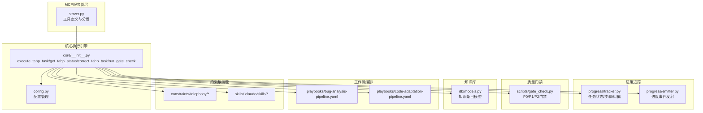
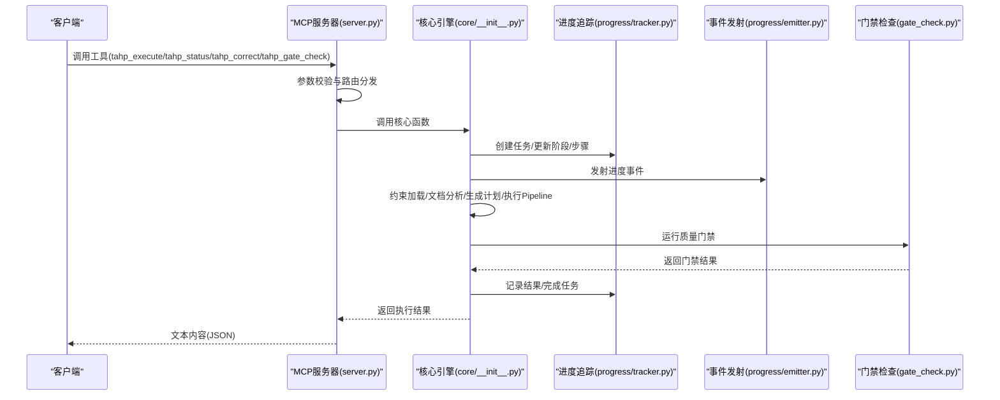
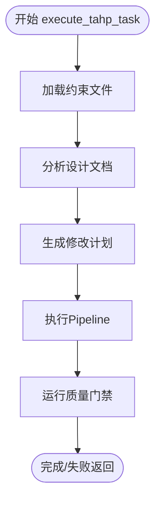
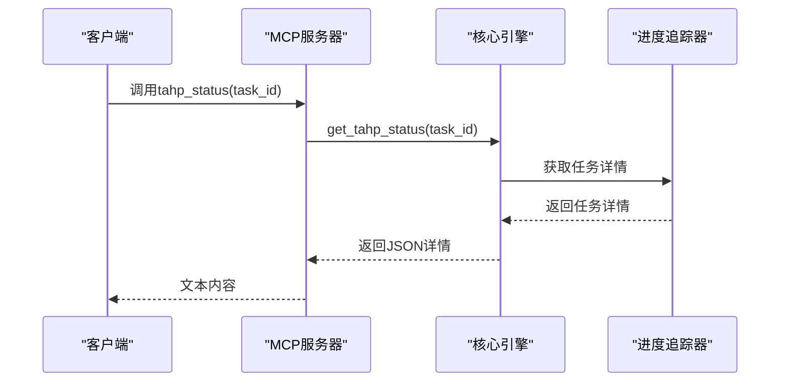
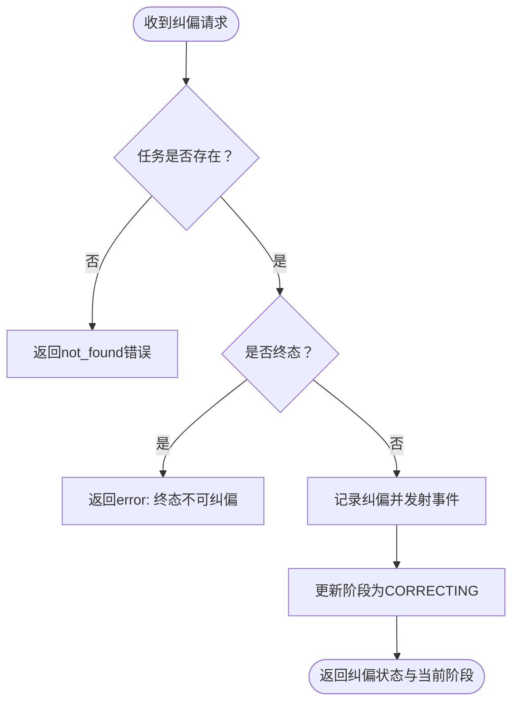
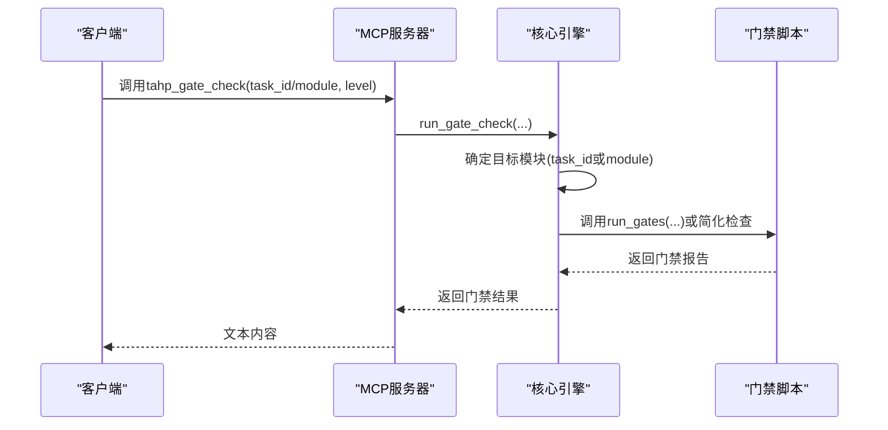
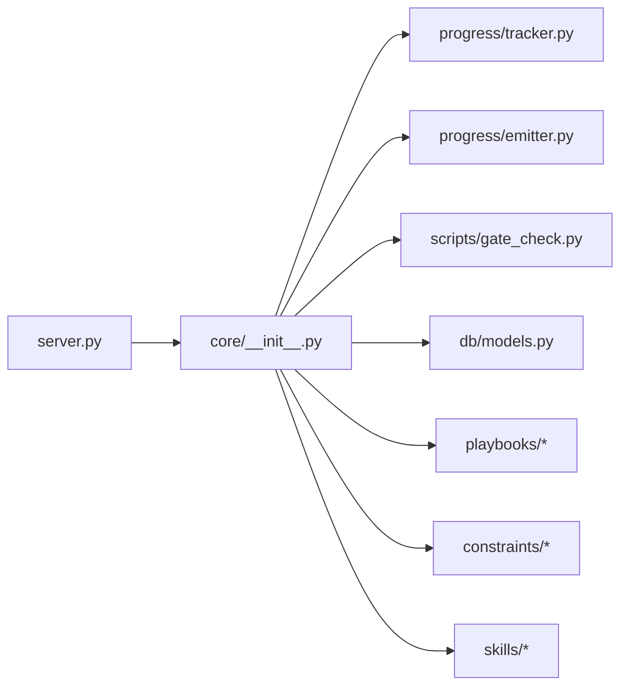

# 核心执行引擎

<cite>
**本文档引用的文件**
- [server.py](file://tahp-mcp-server/server.py)
- [core/__init__.py](file://tahp-mcp-server/core/__init__.py)
- [config.py](file://tahp-mcp-server/config.py)
- [progress/tracker.py](file://tahp-mcp-server/progress/tracker.py)
- [progress/emitter.py](file://tahp-mcp-server/progress/emitter.py)
- [gate_check.py](file://scripts/gate_check.py)
- [models.py](file://db/models.py)
- [bug-analysis-pipeline.yaml](file://playbooks/bug-analysis-pipeline.yaml)
- [code-adaptation-pipeline.yaml](file://playbooks/code-adaptation-pipeline.yaml)
- [bug-analysis.yaml](file://constraints/telephony/bug-analysis.yaml)
- [module.yaml](file://constraints/telephony/module.yaml)
- [SKILL.md](file://skills/.claude/skills/telephony-bug-analyzer/SKILL.md)
</cite>

## 目录
1. [简介](#简介)
2. [项目结构](#项目结构)
3. [核心组件](#核心组件)
4. [架构概览](#架构概览)
5. [详细组件分析](#详细组件分析)
6. [依赖关系分析](#依赖关系分析)
7. [性能考虑](#性能考虑)
8. [故障排查指南](#故障排查指南)
9. [结论](#结论)
10. [附录](#附录)

## 简介
本文件面向TAHP核心执行引擎，围绕以下核心工具函数展开：
- execute_tahp_task：任务执行主流程，涵盖约束解析、工作流编排、工具调用、结果收集与质量门禁
- get_tahp_status：任务状态查询与进度展示
- correct_tahp_task：纠偏机制，支持外部反馈驱动的策略调整与重试
- run_gate_check：质量门禁检查，支持P0/P1/P2分级与模块级/任务级检查

文档将从系统架构、数据流、处理逻辑、错误处理与异常恢复、性能监控等方面进行深入剖析，并提供扩展指南与最佳实践。

## 项目结构
TAHP采用“MCP服务器 + 核心执行引擎 + 进度追踪 + 质量门禁”的分层架构：
- MCP服务器层：对外暴露工具接口，负责参数校验、路由分发与错误包装
- 核心执行引擎：实现任务生命周期管理、约束加载、工作流编排、纠偏与门禁
- 进度追踪与事件发射：维护任务状态、步骤与进度，通过MCP日志推送实时进度
- 质量门禁：独立脚本实现P0/P1/P2门禁检查，支持模块与管道级评估
- 知识库：提供语义检索与跨模块搜索能力

**图表来源**
- [server.py:100-448](file://tahp-mcp-server/server.py#L100-L448)
- [core/__init__.py:110-298](file://tahp-mcp-server/core/__init__.py#L110-L298)
- [config.py:36-176](file://tahp-mcp-server/config.py#L36-L176)
- [progress/tracker.py:18-343](file://tahp-mcp-server/progress/tracker.py#L18-L343)
- [progress/emitter.py:33-194](file://tahp-mcp-server/progress/emitter.py#L33-L194)
- [gate_check.py:36-507](file://scripts/gate_check.py#L36-L507)
- [models.py:52-247](file://db/models.py#L52-L247)
- [bug-analysis-pipeline.yaml:1-43](file://playbooks/bug-analysis-pipeline.yaml#L1-L43)
- [code-adaptation-pipeline.yaml:1-35](file://playbooks/code-adaptation-pipeline.yaml#L1-L35)

**章节来源**
- [server.py:1-485](file://tahp-mcp-server/server.py#L1-L485)
- [core/__init__.py:1-621](file://tahp-mcp-server/core/__init__.py#L1-L621)
- [config.py:1-176](file://tahp-mcp-server/config.py#L1-L176)

## 核心组件
- MCP服务器：定义工具清单、参数校验、分发至核心执行引擎
- 核心执行引擎：封装任务生命周期、约束加载、工作流编排、纠偏与门禁
- 进度追踪器：维护任务阶段、步骤、纠偏历史与最终结果
- 事件发射器：将进度通过MCP日志消息实时推送到客户端
- 质量门禁：独立脚本实现门禁检查，支持模块与管道级评估
- 知识库：提供语义检索与跨模块搜索能力

**章节来源**
- [server.py:325-448](file://tahp-mcp-server/server.py#L325-L448)
- [core/__init__.py:110-621](file://tahp-mcp-server/core/__init__.py#L110-L621)
- [progress/tracker.py:18-343](file://tahp-mcp-server/progress/tracker.py#L18-L343)
- [progress/emitter.py:33-194](file://tahp-mcp-server/progress/emitter.py#L33-L194)
- [gate_check.py:36-507](file://scripts/gate_check.py#L36-L507)
- [models.py:52-247](file://db/models.py#L52-L247)

## 架构概览
核心执行引擎通过MCP服务器接收外部调用，内部按阶段推进任务执行，并通过事件发射器将进度推送给客户端。纠偏机制允许外部反馈驱动策略调整；质量门禁贯穿任务生命周期，确保交付质量。

**图表来源**
- [server.py:343-448](file://tahp-mcp-server/server.py#L343-L448)
- [core/__init__.py:110-298](file://tahp-mcp-server/core/__init__.py#L110-L298)
- [progress/tracker.py:212-343](file://tahp-mcp-server/progress/tracker.py#L212-L343)
- [progress/emitter.py:47-130](file://tahp-mcp-server/progress/emitter.py#L47-L130)
- [gate_check.py:368-435](file://scripts/gate_check.py#L368-L435)

## 详细组件分析

### execute_tahp_task：任务执行主流程
该函数实现完整的任务生命周期，包含五个阶段：
- 阶段1：加载约束文件（模块配置、领域约束、共享约束）
- 阶段2：分析设计文档（读取文档内容，统计安全红线）
- 阶段3：生成修改计划（构建上下文，包含Playbook步骤）
- 阶段4：执行Pipeline（遍历步骤，支持并行标记）
- 阶段5：质量门禁检查（调用内部门禁实现）

**图表来源**
- [core/__init__.py:110-298](file://tahp-mcp-server/core/__init__.py#L110-L298)

关键实现要点：
- 任务创建与阶段推进：通过进度追踪器创建任务并更新阶段，事件发射器实时推送进度
- 约束加载：支持模块级、领域级与共享约束的合并加载
- Playbook集成：读取领域对应的Pipeline文件，按步骤执行
- 门禁集成：在任务完成后运行门禁检查，记录结果

**章节来源**
- [core/__init__.py:110-298](file://tahp-mcp-server/core/__init__.py#L110-L298)
- [progress/tracker.py:212-343](file://tahp-mcp-server/progress/tracker.py#L212-L343)
- [progress/emitter.py:47-130](file://tahp-mcp-server/progress/emitter.py#L47-L130)
- [config.py:105-120](file://tahp-mcp-server/config.py#L105-L120)

### get_tahp_status：任务状态查询
该函数提供任务状态查询能力，返回任务的阶段、进度、步骤详情、纠偏历史与门禁结果等。

**图表来源**
- [server.py:397-401](file://tahp-mcp-server/server.py#L397-L401)
- [core/__init__.py:300-316](file://tahp-mcp-server/core/__init__.py#L300-L316)
- [progress/tracker.py:242-210](file://tahp-mcp-server/progress/tracker.py#L242-L210)

**章节来源**
- [core/__init__.py:300-316](file://tahp-mcp-server/core/__init__.py#L300-L316)
- [progress/tracker.py:181-210](file://tahp-mcp-server/progress/tracker.py#L181-L210)

### correct_tahp_task：纠偏机制
纠偏机制允许外部（如Claude Code）对正在执行的任务发出修正指令，核心引擎记录纠偏并调整执行状态。

**图表来源**
- [core/__init__.py:318-363](file://tahp-mcp-server/core/__init__.py#L318-L363)
- [progress/emitter.py:112-130](file://tahp-mcp-server/progress/emitter.py#L112-L130)
- [progress/tracker.py:161-168](file://tahp-mcp-server/progress/tracker.py#L161-L168)

纠偏处理要点：
- 纠偏记录：在任务纠偏历史中追加反馈与时间戳
- 阶段切换：将任务阶段切换至CORRECTING，便于后续策略调整
- 事件推送：通过事件发射器向客户端推送纠偏日志

**章节来源**
- [core/__init__.py:318-363](file://tahp-mcp-server/core/__init__.py#L318-L363)
- [progress/emitter.py:112-130](file://tahp-mcp-server/progress/emitter.py#L112-L130)
- [progress/tracker.py:161-168](file://tahp-mcp-server/progress/tracker.py#L161-L168)

### run_gate_check：质量门禁检查
质量门禁支持对指定任务或模块执行P0/P1/P2三级门禁检查。核心引擎内部复用脚本逻辑，若脚本不可用则回退到简化版检查。

**图表来源**
- [server.py:412-418](file://tahp-mcp-server/server.py#L412-L418)
- [core/__init__.py:366-389](file://tahp-mcp-server/core/__init__.py#L366-L389)
- [core/__init__.py:392-459](file://tahp-mcp-server/core/__init__.py#L392-L459)
- [gate_check.py:368-435](file://scripts/gate_check.py#L368-L435)

门禁检查要点：
- 目标确定：优先从任务ID解析模块，否则直接使用模块参数
- 级别控制：支持P0/P1/P2/all级别，映射到具体检查集合
- 结果聚合：汇总通过/失败计数，生成结果标签（PASS/BLOCK/WARNING）

**章节来源**
- [core/__init__.py:366-459](file://tahp-mcp-server/core/__init__.py#L366-L459)
- [gate_check.py:36-93](file://scripts/gate_check.py#L36-L93)

## 依赖关系分析
核心执行引擎的关键依赖关系如下：
- server.py：工具定义与分发，参数校验与错误包装
- core/__init__.py：任务生命周期、约束加载、工作流编排、纠偏与门禁
- progress/tracker.py：任务状态、步骤、纠偏历史与终态管理
- progress/emitter.py：进度事件发射与日志推送
- scripts/gate_check.py：质量门禁检查实现
- db/models.py：知识条目模型（用于知识库查询）
- playbooks/*：工作流编排定义
- constraints/*：模块与领域约束文件

**图表来源**
- [server.py:71-82](file://tahp-mcp-server/server.py#L71-L82)
- [core/__init__.py:18-22](file://tahp-mcp-server/core/__init__.py#L18-L22)
- [progress/tracker.py:13-15](file://tahp-mcp-server/progress/tracker.py#L13-L15)
- [progress/emitter.py:13-15](file://tahp-mcp-server/progress/emitter.py#L13-L15)
- [gate_check.py:24-31](file://scripts/gate_check.py#L24-L31)
- [models.py:17-18](file://db/models.py#L17-L18)

**章节来源**
- [server.py:71-82](file://tahp-mcp-server/server.py#L71-L82)
- [core/__init__.py:18-22](file://tahp-mcp-server/core/__init__.py#L18-L22)

## 性能考虑
- 并发与超时：配置支持最大并发任务数与任务超时时间，避免资源争用与长时间阻塞
- 事件推送频率：通过进度事件发射器控制日志推送频率，避免过度IO
- 任务清理：进度追踪器在达到上限时清理旧任务，保持内存占用可控
- 门禁检查优化：门禁脚本支持模块与管道级检查，可根据需求选择检查级别

[本节为通用性能讨论，无需具体文件分析]

## 故障排查指南
- 参数校验错误：MCP服务器对工具调用参数进行严格校验，错误会返回明确的错误信息
- 任务状态查询：通过get_tahp_status查看任务阶段、步骤与纠偏历史，定位执行瓶颈
- 纠偏无效：若任务已处于终态，纠偏将被拒绝；需检查任务状态与阶段
- 门禁失败：根据门禁报告中的检查项与详细信息逐项排查，重点关注P0阻断项
- 约束加载失败：检查模块目录与约束文件是否存在、格式是否正确

**章节来源**
- [server.py:361-367](file://tahp-mcp-server/server.py#L361-L367)
- [core/__init__.py:300-316](file://tahp-mcp-server/core/__init__.py#L300-L316)
- [core/__init__.py:318-363](file://tahp-mcp-server/core/__init__.py#L318-L363)
- [core/__init__.py:392-459](file://tahp-mcp-server/core/__init__.py#L392-L459)

## 结论
TAHP核心执行引擎通过清晰的阶段划分、完善的进度追踪与事件发射、灵活的纠偏机制与严格的门禁检查，实现了从约束解析到结果交付的全链路自动化。其模块化设计便于扩展与定制，适合在复杂工程场景中提供稳定可靠的AI驱动开发能力。

[本节为总结性内容，无需具体文件分析]

## 附录

### 扩展指南与自定义开发建议
- 新增领域与模块：在constraints目录下新增模块与领域约束文件，更新playbooks目录下的Pipeline定义
- 自定义门禁规则：在scripts/gate_check.py中新增门禁检查项，或扩展简化版检查逻辑
- 自定义技能：在skills目录下新增技能定义与触发条件，配合约束文件实现专业化分析
- 自定义工具：在server.py中新增工具定义与参数校验，分发至核心引擎实现自定义逻辑
- 知识库扩展：利用db/models.py提供的知识条目模型，扩展知识库检索与跨模块搜索能力

[本节为通用扩展建议，无需具体文件分析]