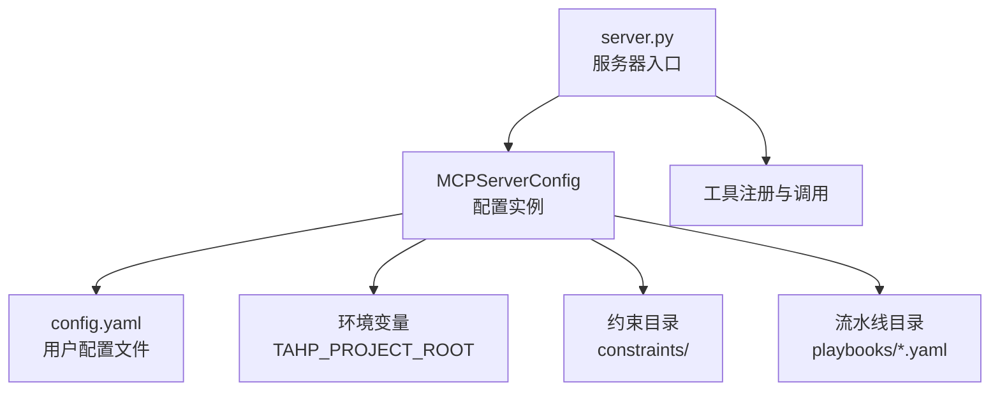
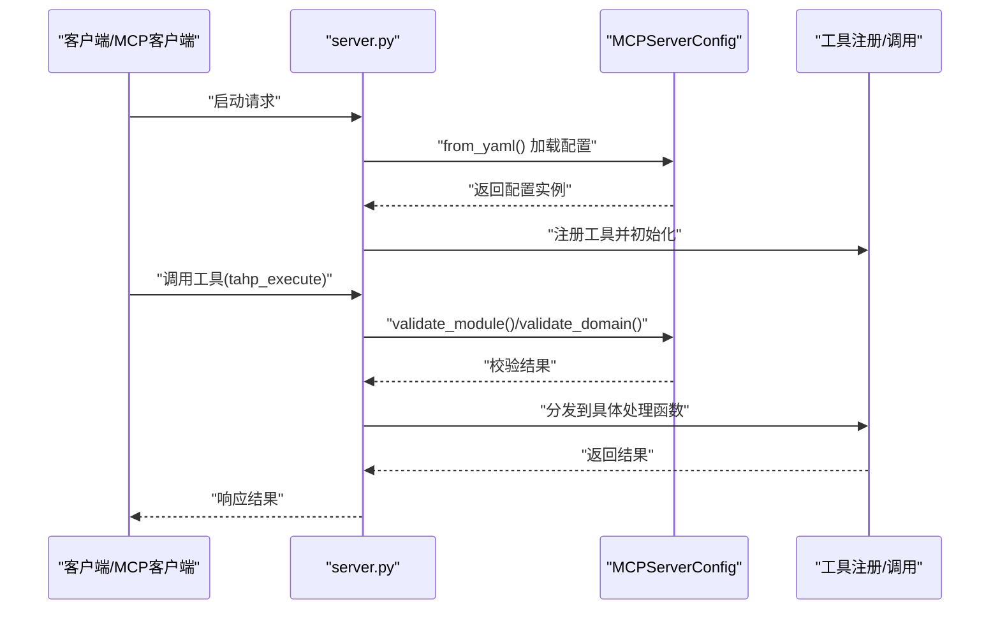
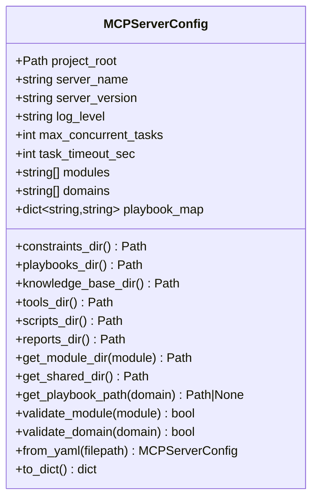
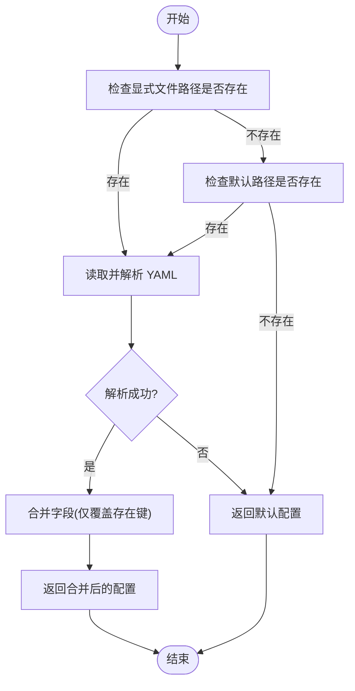
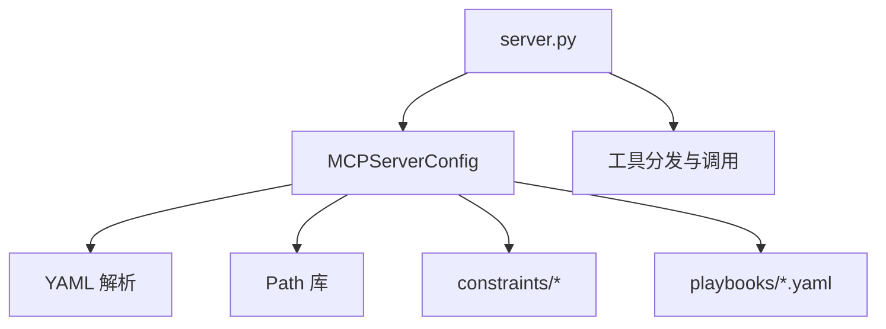

# 配置管理系统

<cite>
**本文档引用的文件**
- [config.py](file://tahp-mcp-server/config.py)
- [server.py](file://tahp-mcp-server/server.py)
- [.mcp.json](file://.mcp.json)
- [bug-analysis-pipeline.yaml](file://playbooks/bug-analysis-pipeline.yaml)
- [carrier-porting-pipeline.yaml](file://playbooks/carrier-porting-pipeline.yaml)
- [code-adaptation-pipeline.yaml](file://playbooks/code-adaptation-pipeline.yaml)
- [version-upgrade-pipeline.yaml](file://playbooks/version-upgrade-pipeline.yaml)
- [module.yaml](file://constraints/telephony/module.yaml)
- [coding-standards.yaml](file://constraints/shared/coding-standards.yaml)
- [config.yaml](file://knowledge-base/config.yaml)
- [test_server.py](file://tahp-mcp-server/test_server.py)
</cite>

## 目录
1. [简介](#简介)
2. [项目结构](#项目结构)
3. [核心组件](#核心组件)
4. [架构总览](#架构总览)
5. [详细组件分析](#详细组件分析)
6. [依赖关系分析](#依赖关系分析)
7. [性能考虑](#性能考虑)
8. [故障排除指南](#故障排除指南)
9. [结论](#结论)
10. [附录](#附录)

## 简介
本文件面向配置管理系统，重点阐述 MCPServerConfig 类的设计与实现，涵盖配置文件加载机制、默认值设定、验证规则、关键配置项的含义与作用，以及配置文件格式规范、加载优先级与环境变量支持等特性。同时提供配置最佳实践与故障排除指南，帮助读者快速理解并正确使用该配置体系。

## 项目结构
配置管理位于 tahp-mcp-server 子项目中，围绕 MCPServerConfig 类构建，配合服务器启动流程与工具注册使用。关键文件与职责如下：
- config.py：定义 MCPServerConfig 数据类及配置加载/导出逻辑
- server.py：服务器入口，初始化全局配置实例并注册工具
- .mcp.json：MCP 客户端（如 Claude Code）的启动配置，包含环境变量注入
- playbooks/*.yaml：领域对应的执行流水线配置，用于指导任务执行
- constraints/*：各模块约束文件，定义范围、依赖与规则
- knowledge-base/config.yaml：知识库配置，影响查询与检索行为

图表来源
- [server.py:94-95](file://tahp-mcp-server/server.py#L94-L95)
- [config.py:36-175](file://tahp-mcp-server/config.py#L36-L175)

章节来源
- [server.py:1-485](file://tahp-mcp-server/server.py#L1-L485)
- [config.py:1-176](file://tahp-mcp-server/config.py#L1-L176)

## 核心组件
MCPServerConfig 是配置管理的核心，采用数据类封装，提供以下能力：
- 默认值：server_name、server_version、log_level、max_concurrent_tasks、task_timeout_sec、modules、domains、playbook_map
- 推断项目根目录：优先使用环境变量，其次向上查找包含 constraints/ 的父目录，最后回退到当前工作目录
- 目录派生属性：基于 project_root 派生 constraints_dir、playbooks_dir、knowledge_base_dir、tools_dir、scripts_dir、reports_dir
- 工具辅助方法：获取模块约束目录、共享约束目录、根据领域获取 Playbook 路径；模块/领域合法性校验
- 配置加载：from_yaml 从 YAML 文件加载，支持覆盖部分字段；to_dict 导出为字典

章节来源
- [config.py:18-34](file://tahp-mcp-server/config.py#L18-L34)
- [config.py:36-175](file://tahp-mcp-server/config.py#L36-L175)

## 架构总览
下图展示配置系统在服务器启动与工具调用中的交互：

图表来源
- [server.py:94-95](file://tahp-mcp-server/server.py#L94-L95)
- [server.py:369-447](file://tahp-mcp-server/server.py#L369-L447)
- [config.py:130-161](file://tahp-mcp-server/config.py#L130-L161)

## 详细组件分析

### MCPServerConfig 类设计
- 数据结构：使用 dataclass 字段与默认工厂函数，确保可序列化与可扩展性
- 默认值策略：对字符串、整数、列表、字典分别给出合理默认值，兼顾开箱即用与安全边界
- 目录派生：通过属性方法将 project_root 与固定子路径组合，避免硬编码
- 验证逻辑：模块名支持内置模块列表或实际存在的约束目录；领域名仅允许内置枚举
- 配置加载：from_yaml 仅覆盖显式提供的键，未提供则保留默认值；异常时安全回退

图表来源
- [config.py:36-175](file://tahp-mcp-server/config.py#L36-L175)

章节来源
- [config.py:36-175](file://tahp-mcp-server/config.py#L36-L175)

### 配置文件加载机制
- 默认加载路径：project_root/tahp-mcp-server/config.yaml
- 加载优先级：
  1) 用户显式传入的 filepath（若存在）
  2) 默认路径（若存在）
  3) 回退到默认配置对象（不抛异常）
- 异常处理：读取失败或解析异常时直接返回默认配置，保证稳定性
- 字段覆盖：仅当 YAML 中存在对应键时才覆盖默认值

图表来源
- [config.py:130-161](file://tahp-mcp-server/config.py#L130-L161)

章节来源
- [config.py:130-161](file://tahp-mcp-server/config.py#L130-L161)

### 关键配置项说明
- project_root：项目根目录，决定所有相对路径的基准。可通过环境变量 TAHP_PROJECT_ROOT 指定，否则自动向上查找包含 constraints/ 的目录，最后回退到当前工作目录。
- server_name：服务器标识名，默认为固定字符串。
- server_version：服务器版本号，默认为固定字符串。
- log_level：日志级别，默认 INFO。
- max_concurrent_tasks：最大并发任务数，默认 5。
- task_timeout_sec：单个任务超时时间（秒），默认 600。
- modules：已注册模块列表，默认包含 telephony、kernel-driver、power-mgmt。
- domains：支持的领域列表，默认包含 bug_analysis、code_adaptation、version_adaptation、carrier_porting。
- playbook_map：领域到 Playbook 文件名的映射，默认映射到各领域流水线文件。

章节来源
- [config.py:40-79](file://tahp-mcp-server/config.py#L40-L79)
- [config.py:18-34](file://tahp-mcp-server/config.py#L18-L34)

### 目录派生与工具辅助方法
- 目录派生属性：constraints_dir、playbooks_dir、knowledge_base_dir、tools_dir、scripts_dir、reports_dir 基于 project_root 计算。
- 工具辅助方法：
  - get_module_dir(module)：获取模块约束目录
  - get_shared_dir()：获取共享约束目录
  - get_playbook_path(domain)：根据领域查找 Playbook 文件路径（若文件存在则返回）
  - validate_module(module)：模块名合法校验（内置模块或实际存在约束目录）
  - validate_domain(domain)：领域名合法校验

章节来源
- [config.py:81-128](file://tahp-mcp-server/config.py#L81-L128)

### 配置验证机制
- 模块验证：允许内置模块列表中的模块，或允许实际存在约束目录的模块名
- 领域验证：仅允许内置领域列表中的领域名
- 服务器工具调用处亦进行参数校验，确保调用方输入合法

章节来源
- [config.py:122-128](file://tahp-mcp-server/config.py#L122-L128)
- [server.py:372-387](file://tahp-mcp-server/server.py#L372-L387)

### 环境变量支持
- TAHP_PROJECT_ROOT：用于显式指定项目根目录，优先级最高
- .mcp.json 中通过 env 注入 TAHP_PROJECT_ROOT，确保客户端启动时能正确传递

章节来源
- [.mcp.json:7-9](file://.mcp.json#L7-L9)
- [config.py:18-23](file://tahp-mcp-server/config.py#L18-L23)

### 配置文件格式规范
- 文件位置：默认位于 project_root/tahp-mcp-server/config.yaml
- 支持字段：
  - project_root：字符串，覆盖默认根目录
  - log_level：字符串，覆盖日志级别
  - max_concurrent_tasks：整数，覆盖并发数
  - task_timeout_sec：整数，覆盖任务超时
  - modules：数组，覆盖模块列表
  - playbook_map：字典，覆盖领域到文件名映射
- 未提供字段保持默认值；非法字段被忽略；解析异常时回退默认配置

章节来源
- [config.py:130-161](file://tahp-mcp-server/config.py#L130-L161)

### 与 Playbook 和约束的关系
- Playbook 映射：playbook_map 将领域映射到 playbooks 目录下的 YAML 文件，get_playbook_path(domain) 可据此定位文件
- 约束目录：constraints_dir 下按模块划分约束文件，模块验证会检查该目录是否存在对应模块
- 示例：不同领域的流水线文件（如 bug-analysis-pipeline.yaml、code-adaptation-pipeline.yaml 等）定义了完整的执行步骤

章节来源
- [config.py:74-79](file://tahp-mcp-server/config.py#L74-L79)
- [config.py:113-120](file://tahp-mcp-server/config.py#L113-L120)
- [bug-analysis-pipeline.yaml:1-43](file://playbooks/bug-analysis-pipeline.yaml#L1-L43)
- [code-adaptation-pipeline.yaml:1-35](file://playbooks/code-adaptation-pipeline.yaml#L1-L35)
- [version-upgrade-pipeline.yaml:1-61](file://playbooks/version-upgrade-pipeline.yaml#L1-L61)
- [carrier-porting-pipeline.yaml:1-41](file://playbooks/carrier-porting-pipeline.yaml#L1-L41)

## 依赖关系分析
- server.py 在启动时创建全局配置实例，并在工具分发前进行模块/领域校验
- 配置类依赖 YAML 解析库与路径库，提供目录派生与 Playbook 查找能力
- 知识库配置（knowledge-base/config.yaml）与配置类无直接耦合，但共同服务于知识检索与约束驱动开发

图表来源
- [server.py:94-95](file://tahp-mcp-server/server.py#L94-L95)
- [config.py:130-161](file://tahp-mcp-server/config.py#L130-L161)

章节来源
- [server.py:94-95](file://tahp-mcp-server/server.py#L94-L95)
- [config.py:130-161](file://tahp-mcp-server/config.py#L130-L161)

## 性能考虑
- 并发控制：max_concurrent_tasks 控制最大并发任务数，避免资源争用
- 超时控制：task_timeout_sec 限制单任务最长执行时间，防止长时间占用
- 目录访问：get_playbook_path(domain) 会在存在性检查后返回路径，减少无效 IO
- 建议：根据硬件资源与业务负载调整并发与超时参数；在高并发场景下适当降低并发数并增加超时时间

章节来源
- [config.py:52-56](file://tahp-mcp-server/config.py#L52-L56)
- [server.py:369-447](file://tahp-mcp-server/server.py#L369-L447)

## 故障排除指南
- 无法找到配置文件
  - 现象：配置未生效或使用默认值
  - 排查：确认默认路径 project_root/tahp-mcp-server/config.yaml 是否存在；检查 TAHP_PROJECT_ROOT 环境变量是否正确设置
  - 参考
    - [config.py:135-140](file://tahp-mcp-server/config.py#L135-L140)
    - [.mcp.json:7-9](file://.mcp.json#L7-L9)
- YAML 解析失败
  - 现象：配置回退默认值
  - 排查：检查 YAML 语法与缩进；确认字段类型与默认值一致
  - 参考
    - [config.py:142-146](file://tahp-mcp-server/config.py#L142-L146)
- 模块或领域非法
  - 现象：工具调用报错，提示无效模块或领域
  - 排查：确认 modules/domains 列表是否包含目标值；确认 constraints/<module> 目录是否存在
  - 参考
    - [config.py:122-128](file://tahp-mcp-server/config.py#L122-L128)
    - [server.py:384-387](file://tahp-mcp-server/server.py#L384-L387)
- Playbook 文件缺失
  - 现象：get_playbook_path(domain) 返回 None
  - 排查：确认 playbooks 目录下存在对应文件；检查 playbook_map 映射是否正确
  - 参考
    - [config.py:113-120](file://tahp-mcp-server/config.py#L113-L120)
- 项目根目录推断错误
  - 现象：目录派生路径不正确
  - 排查：确认 constraints/ 目录层级；必要时显式设置 TAHP_PROJECT_ROOT
  - 参考
    - [config.py:18-33](file://tahp-mcp-server/config.py#L18-L33)

章节来源
- [config.py:135-146](file://tahp-mcp-server/config.py#L135-L146)
- [config.py:113-120](file://tahp-mcp-server/config.py#L113-L120)
- [config.py:18-33](file://tahp-mcp-server/config.py#L18-L33)
- [server.py:384-387](file://tahp-mcp-server/server.py#L384-L387)

## 结论
MCPServerConfig 通过合理的默认值、灵活的加载机制与严格的验证规则，为 TAHP MCP Server 提供了稳定可靠的配置基础。结合环境变量与 Playbook/约束目录，系统实现了高度可配置与可扩展的约束驱动开发能力。建议在生产环境中明确设置 TAHP_PROJECT_ROOT，审慎调整并发与超时参数，并定期校验 Playbook 与约束文件的完整性。

## 附录

### 配置文件示例与说明
- 服务器配置示例（路径：project_root/tahp-mcp-server/config.yaml）
  - 字段：project_root、log_level、max_concurrent_tasks、task_timeout_sec、modules、playbook_map
  - 说明：仅覆盖存在的键；未提供字段保持默认值
  - 参考
    - [config.py:130-161](file://tahp-mcp-server/config.py#L130-L161)
- Playbook 示例（领域到文件映射）
  - bug_analysis → bug-analysis-pipeline.yaml
  - code_adaptation → code-adaptation-pipeline.yaml
  - version_adaptation → version-upgrade-pipeline.yaml
  - carrier_porting → carrier-porting-pipeline.yaml
  - 参考
    - [config.py:74-79](file://tahp-mcp-server/config.py#L74-L79)
    - [bug-analysis-pipeline.yaml:1-43](file://playbooks/bug-analysis-pipeline.yaml#L1-L43)
    - [code-adaptation-pipeline.yaml:1-35](file://playbooks/code-adaptation-pipeline.yaml#L1-L35)
    - [version-upgrade-pipeline.yaml:1-61](file://playbooks/version-upgrade-pipeline.yaml#L1-L61)
    - [carrier-porting-pipeline.yaml:1-41](file://playbooks/carrier-porting-pipeline.yaml#L1-L41)
- 约束文件示例（模块范围与依赖）
  - telephony/module.yaml：定义模块范围、排除项与依赖关系
  - shared/coding-standards.yaml：定义代码规范与评审要求
  - 参考
    - [module.yaml:1-43](file://constraints/telephony/module.yaml#L1-L43)
    - [coding-standards.yaml:1-23](file://constraints/shared/coding-standards.yaml#L1-L23)
- 知识库配置示例
  - knowledge-base/config.yaml：数据库类型、持久化目录、嵌入模型、自动捕获策略、检索参数等
  - 参考
    - [config.yaml:1-36](file://knowledge-base/config.yaml#L1-L36)

### 使用示例与最佳实践
- 设置项目根目录
  - 通过 .mcp.json 注入 TAHP_PROJECT_ROOT，确保客户端启动时传递正确路径
  - 参考
    - [.mcp.json:7-9](file://.mcp.json#L7-L9)
- 自定义模块与领域
  - 在 modules 与 domains 中添加自定义值；确保 constraints/<module> 目录存在
  - 参考
    - [config.py:58-71](file://tahp-mcp-server/config.py#L58-L71)
    - [config.py:122-124](file://tahp-mcp-server/config.py#L122-L124)
- 调整并发与超时
  - 根据硬件与业务负载调整 max_concurrent_tasks 与 task_timeout_sec
  - 参考
    - [config.py:52-56](file://tahp-mcp-server/config.py#L52-L56)
- 验证配置
  - 使用 test_server.py 进行功能验证，确保工具调用链路正常
  - 参考
    - [test_server.py:13-71](file://tahp-mcp-server/test_server.py#L13-L71)