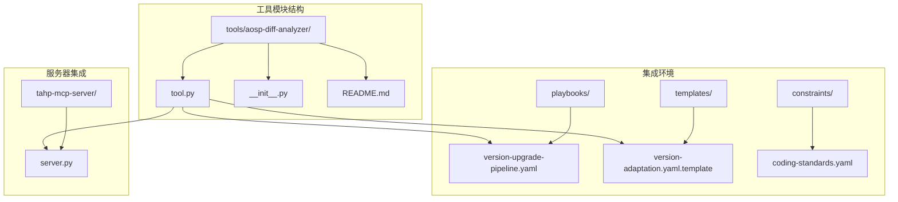
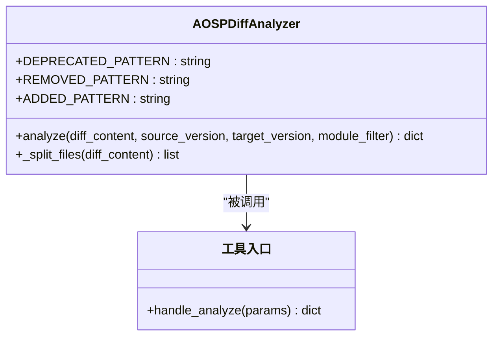
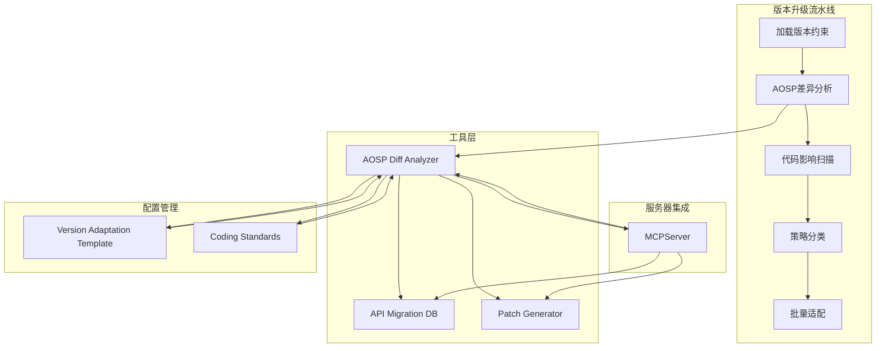
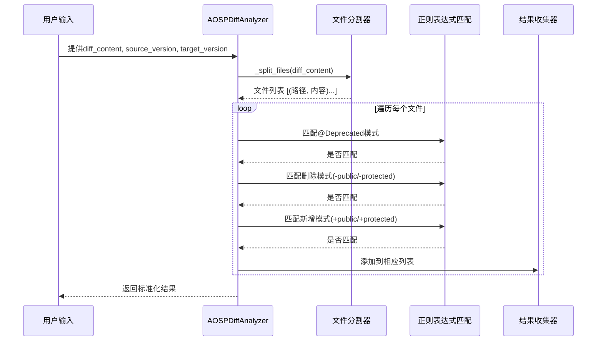
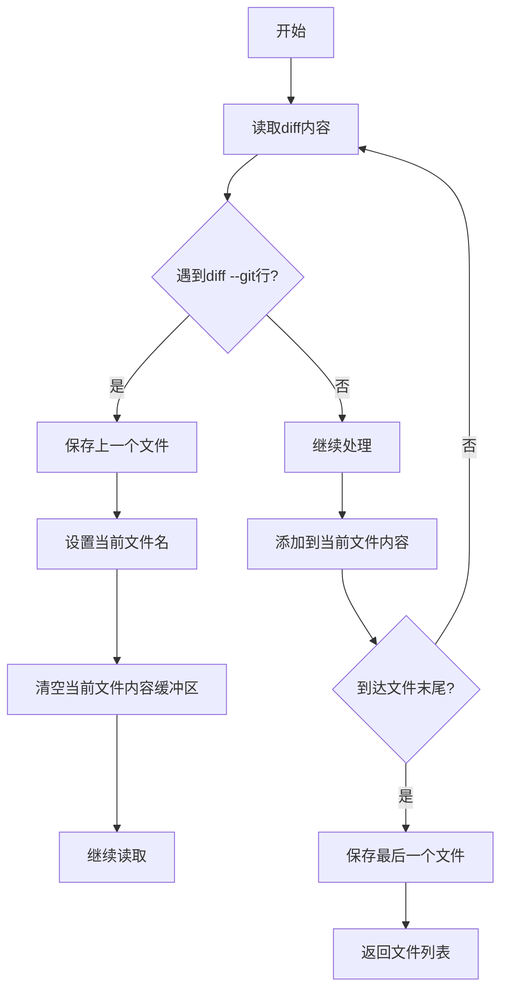
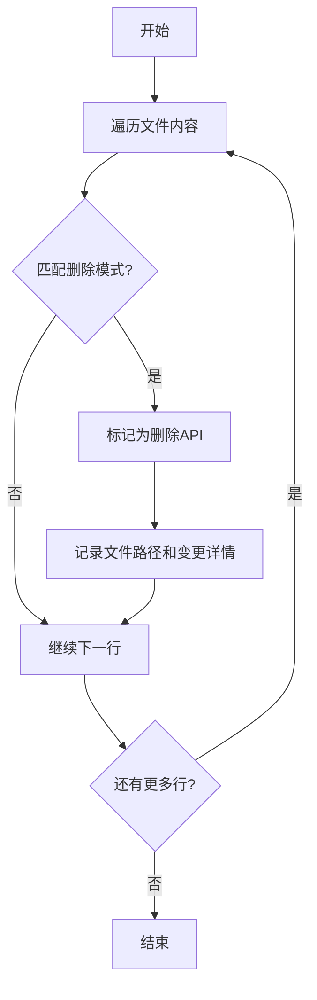
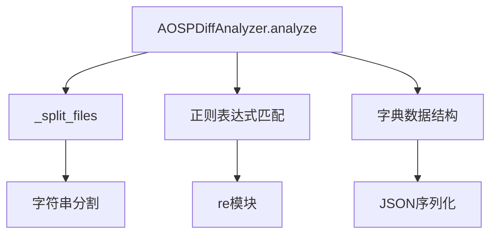
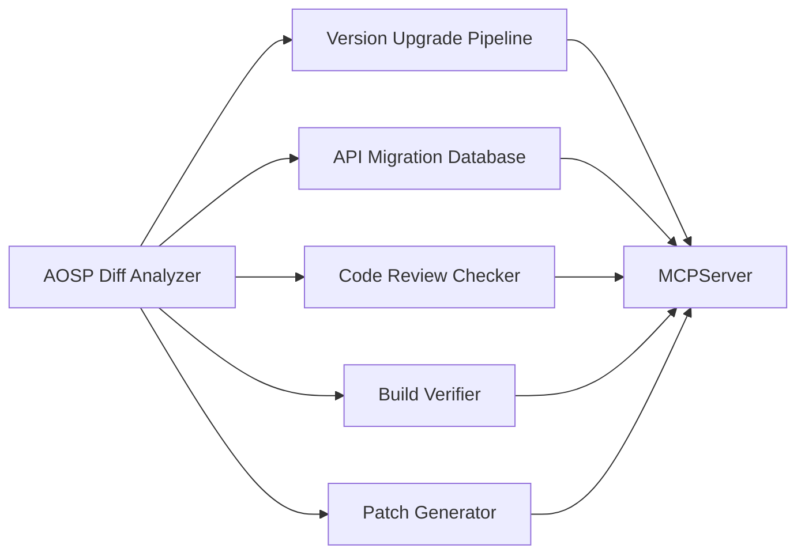

# AOSP差异分析工具

<cite>
**本文档引用的文件**
- [README.md](file://tools/aosp-diff-analyzer/README.md)
- [tool.py](file://tools/aosp-diff-analyzer/tool.py)
- [__init__.py](file://tools/aosp-diff-analyzer/__init__.py)
- [version-upgrade-pipeline.yaml](file://playbooks/version-upgrade-pipeline.yaml)
- [version-adaptation.yaml.template](file://templates/module-template/version-adaptation.yaml.template)
- [coding-standards.yaml](file://constraints/shared/coding-standards.yaml)
- [server.py](file://tahp-mcp-server/server.py)
- [README.md](file://tools/patch-generator/README.md)
</cite>

## 目录
1. [简介](#简介)
2. [项目结构](#项目结构)
3. [核心组件](#核心组件)
4. [架构概览](#架构概览)
5. [详细组件分析](#详细组件分析)
6. [依赖关系分析](#依赖关系分析)
7. [性能考虑](#性能考虑)
8. [故障排除指南](#故障排除指南)
9. [结论](#结论)
10. [附录](#附录)

## 简介

AOSP差异分析工具是一个专门用于对比两个Android版本框架差异的专业工具。该工具能够从git diff输出中提取API、接口和行为变更清单，为Android版本升级和适配提供重要的技术支撑。

该工具的核心功能包括：
- 文件级差异检测：基于git diff格式解析，准确识别文件级别的变更
- 代码级差异分析：深入分析Java源码中的API变更模式
- 多类型差异识别：支持新增、删除、修改、重命名等差异类型
- 上下文保留机制：在分析过程中保持代码上下文信息
- 冲突检测算法：识别潜在的API变更冲突和不兼容问题

## 项目结构

AOSP差异分析工具位于工具目录下的独立模块中，采用简洁的单文件架构设计：



**图表来源**
- [tool.py:1-41](file://tools/aosp-diff-analyzer/tool.py#L1-L41)
- [version-upgrade-pipeline.yaml:1-61](file://playbooks/version-upgrade-pipeline.yaml#L1-L61)

**章节来源**
- [tool.py:1-41](file://tools/aosp-diff-analyzer/tool.py#L1-L41)
- [README.md:1-14](file://tools/aosp-diff-analyzer/README.md#L1-L14)

## 核心组件

### 主要类结构

AOSP差异分析工具的核心是一个名为`AOSPDiffAnalyzer`的类，该类实现了完整的差异分析功能：



**图表来源**
- [tool.py:5-40](file://tools/aosp-diff-analyzer/tool.py#L5-L40)

### 关键数据结构

工具内部使用标准化的数据结构来表示不同类型的API变更：

| 变更类型 | 数据结构字段 | 描述 |
|---------|-------------|------|
| 已弃用API | file, content, version | 标记为@Deprecated的API，包含版本信息 |
| 已删除API | file, content, change_type | 从源代码中移除的API声明 |
| 新增API | file, content, change_type | 在目标版本中新增的API声明 |
| 摘要信息 | source_version, target_version, total_* | 分析结果的统计摘要 |

**章节来源**
- [tool.py:10-27](file://tools/aosp-diff-analyzer/tool.py#L10-L27)

## 架构概览

### 整体系统架构

AOSP差异分析工具在整个TAHP系统中扮演着关键的桥梁角色，连接版本升级流程和具体的代码适配工作：



**图表来源**
- [version-upgrade-pipeline.yaml:6-61](file://playbooks/version-upgrade-pipeline.yaml#L6-L61)
- [server.py:285-332](file://tahp-mcp-server/server.py#L285-L332)

### 数据流处理架构

工具采用分层的数据处理架构，确保差异分析的准确性和效率：



**图表来源**
- [tool.py:10-37](file://tools/aosp-diff-analyzer/tool.py#L10-L37)

**章节来源**
- [version-upgrade-pipeline.yaml:11-22](file://playbooks/version-upgrade-pipeline.yaml#L11-L22)
- [tool.py:29-37](file://tools/aosp-diff-analyzer/tool.py#L29-L37)

## 详细组件分析

### 文件分割器组件

文件分割器是工具的核心组件之一，负责将原始的git diff输出解析为可处理的文件级数据结构：



**图表来源**
- [tool.py:29-37](file://tools/aosp-diff-analyzer/tool.py#L29-L37)

该组件的关键特性包括：
- **增量处理**：逐行处理diff内容，避免内存溢出
- **边界检测**：准确识别文件边界，支持二进制文件和文本文件
- **内容保留**：完整保留每个文件的diff内容，便于后续分析

**章节来源**
- [tool.py:29-37](file://tools/aosp-diff-analyzer/tool.py#L29-L37)

### 差异检测算法

工具实现了三种核心的差异检测算法，分别对应不同的API变更类型：

#### 弃用API检测算法

```mermaid
flowchart TD
A[开始] --> B[遍历文件内容]
B --> C{行内容包含@Deprecated?}
C --> |否| D[继续下一行]
C --> |是| E{行以+开头?}
E --> |否| D
E --> |是| F[标记为新增弃用API]
F --> G[记录文件路径和版本信息]
G --> D
D --> H{还有更多行?}
H --> |是| B
H --> |否| I[结束]
```

**图表来源**
- [tool.py:18-20](file://tools/aosp-diff-analyzer/tool.py#L18-L20)

#### 删除API检测算法



**图表来源**
- [tool.py:21-22](file://tools/aosp-diff-analyzer/tool.py#L21-L22)

#### 新增API检测算法


**图表来源**
- [tool.py:23-24](file://tools/aosp-diff-analyzer/tool.py#L23-L24)

### 正则表达式模式分析

工具使用精心设计的正则表达式模式来识别不同类型的API变更：

| 模式类型 | 正则表达式 | 用途 | 示例匹配 |
|---------|-----------|------|----------|
| 弃用标记 | `@Deprecated` | 识别@Deprecated注解 | `@Deprecated` |
| 删除声明 | `-.*(?:public\|protected)\s+` | 识别删除的API声明 | `- public void method()` |
| 新增声明 | `\+.*(?:public\|protected)\s+` | 识别新增的API声明 | `+ public String getProperty()` |

这些模式的设计考虑了：
- **语言兼容性**：支持Java语言的public和protected访问修饰符
- **上下文敏感**：仅匹配API声明行，避免误匹配注释内容
- **精确度优化**：使用非贪婪匹配避免过度匹配

**章节来源**
- [tool.py:6-8](file://tools/aosp-diff-analyzer/tool.py#L6-L8)
- [tool.py:18-24](file://tools/aosp-diff-analyzer/tool.py#L18-L24)

## 依赖关系分析

### 内部依赖关系



**图表来源**
- [tool.py:10-37](file://tools/aosp-diff-analyzer/tool.py#L10-L37)

### 外部依赖关系

工具的外部依赖非常有限，主要依赖Python标准库：

| 依赖模块 | 用途 | 版本要求 |
|---------|------|----------|
| re | 正则表达式处理 | Python标准库 |
| typing | 类型提示支持 | Python标准库 |
| os | 文件系统操作 | Python标准库 |

这种最小化依赖的设计带来了以下优势：
- **部署简单**：无需额外的第三方依赖
- **维护成本低**：减少依赖更新和兼容性问题
- **执行效率高**：避免不必要的模块加载开销

**章节来源**
- [tool.py:2-3](file://tools/aosp-diff-analyzer/tool.py#L2-L3)

### 集成依赖

工具与TAHP系统的其他组件存在紧密的集成关系：



**图表来源**
- [version-upgrade-pipeline.yaml:11-22](file://playbooks/version-upgrade-pipeline.yaml#L11-L22)
- [server.py:300-322](file://tahp-mcp-server/server.py#L300-L322)

**章节来源**
- [version-upgrade-pipeline.yaml:1-61](file://playbooks/version-upgrade-pipeline.yaml#L1-L61)
- [server.py:300-322](file://tahp-mcp-server/server.py#L300-L322)

## 性能考虑

### 时间复杂度分析

工具的时间复杂度主要取决于输入diff内容的大小和文件数量：

- **文件分割阶段**：O(N)，其中N是diff内容的总行数
- **逐行分析阶段**：O(M×K)，其中M是文件数量，K是平均每文件的行数
- **总体复杂度**：O(N)

由于工具采用增量处理方式，内存使用量与输入大小呈线性关系，具有良好的扩展性。

### 内存优化策略

工具实施了多项内存优化措施：

1. **流式处理**：逐行读取和处理diff内容，避免一次性加载整个文件
2. **增量存储**：只存储必要的元数据，避免复制完整的文件内容
3. **及时释放**：在处理完每个文件后立即释放相关资源

### 并发处理能力

虽然当前版本未实现并发处理，但架构设计为未来的并发扩展预留了空间：

- **无状态设计**：分析过程不依赖共享状态
- **纯函数接口**：analyze方法不产生副作用
- **可测试性**：易于进行单元测试和性能测试

## 故障排除指南

### 常见问题诊断

#### 输入格式问题

**问题症状**：分析结果为空或部分缺失
**可能原因**：
- diff内容格式不符合预期
- 缺少必要的版本信息参数
- 文件路径过滤条件过于严格

**解决方案**：
1. 验证diff内容是否包含标准的git diff头部
2. 确认source_version和target_version参数的有效性
3. 检查module_filter参数是否正确

#### 性能问题

**问题症状**：分析过程耗时过长
**可能原因**：
- diff内容过大
- 正则表达式匹配效率低
- 系统资源不足

**解决方案**：
1. 考虑分批处理大型diff文件
2. 优化正则表达式模式
3. 增加系统内存和CPU资源

#### 结果准确性问题

**问题症状**：检测到的API变更不准确
**可能原因**：
- 正则表达式模式不够精确
- 特殊语法格式未被支持
- 注释内容被误判为API声明

**解决方案**：
1. 审核和调整正则表达式模式
2. 扩展对特殊语法格式的支持
3. 实施更严格的上下文检查

### 调试技巧

#### 日志记录

建议在开发和调试过程中添加适当的日志记录：

```python
# 建议的日志记录位置
logger.debug(f"Processing file: {fpath}")
logger.debug(f"Matched pattern: {pattern}")
logger.debug(f"Result count - Deprecated: {len(deprecated_apis)}, Removed: {len(removed_apis)}, Added: {len(added_apis)}")
```

#### 单元测试

为关键功能编写单元测试：

```python
def test_deprecated_detection():
    """测试@Deprecated标记检测"""
    diff_content = "+@Deprecated\n+public void oldMethod()"
    result = analyzer.analyze(diff_content, "13", "14")
    assert len(result["deprecated_apis"]) == 1

def test_file_filtering():
    """测试文件过滤功能"""
    diff_content = "diff --git a/frameworks/base/core/java/android/app/Activity.java\n+public void method()"
    result = analyzer.analyze(diff_content, "13", "14", "frameworks")
    assert len(result["added_apis"]) == 1
```

**章节来源**
- [tool.py:14-17](file://tools/aosp-diff-analyzer/tool.py#L14-L17)

## 结论

AOSP差异分析工具是一个设计精良、功能明确的专业工具，它在Android版本升级和适配流程中发挥着关键作用。该工具的主要优势包括：

### 技术优势

1. **算法简洁高效**：基于正则表达式的快速匹配算法，时间复杂度为线性
2. **内存使用优化**：采用流式处理方式，适合处理大型diff文件
3. **扩展性强**：模块化设计便于功能扩展和维护
4. **集成良好**：与TAHP系统的其他组件无缝集成

### 应用价值

该工具为Android开发者提供了：
- **自动化差异检测**：减少手动分析的工作量
- **标准化结果输出**：提供统一的数据格式便于后续处理
- **批量处理能力**：支持大规模代码库的差异分析
- **配置灵活性**：支持按模块过滤和自定义参数

### 改进建议

未来可以考虑的功能增强：
1. **支持更多文件类型**：扩展对Kotlin、C++等语言的支持
2. **增强正则表达式**：提高API模式识别的准确性
3. **添加上下文分析**：提供更丰富的代码变更上下文信息
4. **实现并发处理**：提升大型项目的处理性能

## 附录

### 使用示例

#### 基本使用方法

```python
# 创建分析器实例
analyzer = AOSPDiffAnalyzer()

# 准备输入参数
params = {
    "diff_content": "git diff输出内容",
    "source_version": "13",
    "target_version": "14",
    "module_filter": "frameworks/base"
}

# 执行分析
result = analyzer.analyze(**params)
print(result)
```

#### 集成到版本升级流程

```yaml
# 在版本升级流水线中使用
- id: aosp-diff-analysis
  agent: adaptation-coordinator
  tool: aosp-diff-analyzer
  action: "对比source/target版本的AOSP framework差异"
  input: [version_constraints]
  output: aosp_change_list
```

### 最佳实践

#### 差异分析最佳实践

1. **输入验证**：确保diff内容格式正确且完整
2. **参数配置**：合理设置module_filter参数以聚焦分析范围
3. **结果验证**：对分析结果进行人工复核以确保准确性
4. **性能监控**：监控分析过程的内存和CPU使用情况

#### 结果解读指南

- **弃用API**：需要优先处理，通常需要替换为新的API
- **删除API**：必须替换，否则会导致编译失败
- **新增API**：可选采用，但需要评估其稳定性和适用性
- **统计摘要**：用于评估整体影响程度和制定适配策略

#### 配置选项详解

| 参数名称 | 类型 | 必填 | 默认值 | 描述 |
|---------|------|------|--------|------|
| diff_content | string | 是 | 无 | git diff输出内容 |
| source_version | string | 是 | 无 | 源版本标识 |
| target_version | string | 是 | 无 | 目标版本标识 |
| module_filter | string | 否 | 无 | 按模块过滤的关键词 |

**章节来源**
- [README.md:4-14](file://tools/aosp-diff-analyzer/README.md#L4-L14)
- [tool.py:39-40](file://tools/aosp-diff-analyzer/tool.py#L39-L40)