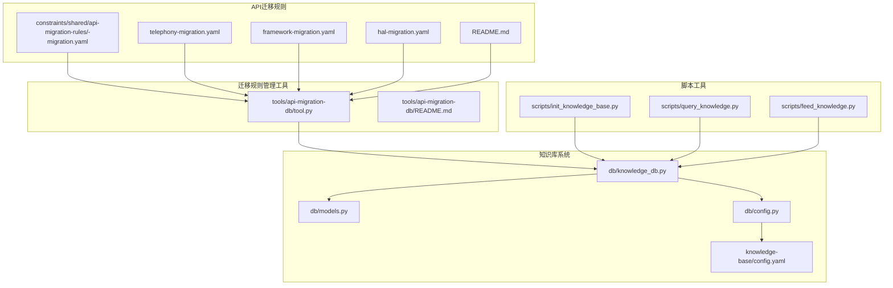
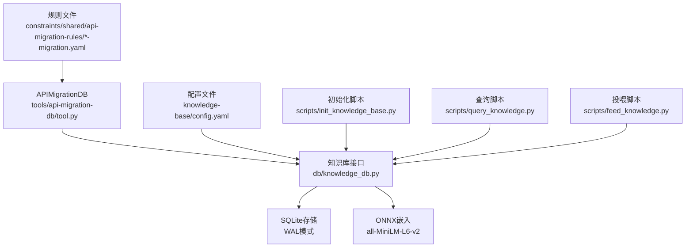
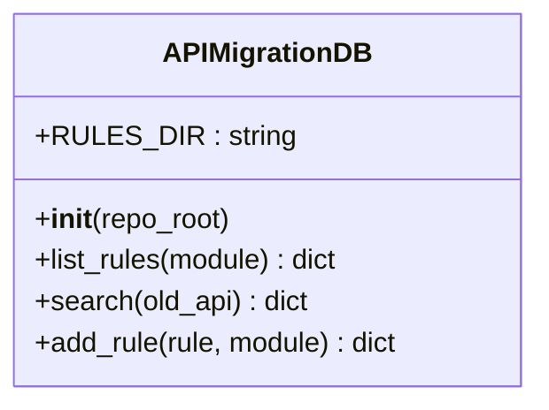
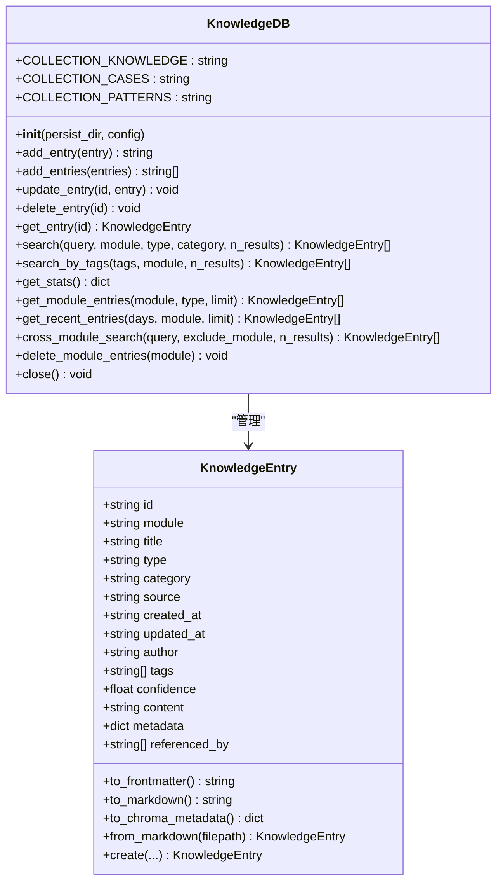
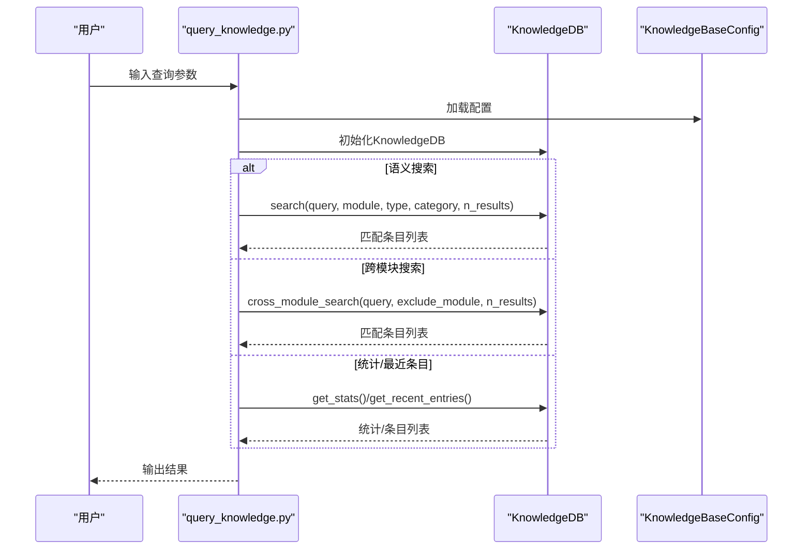
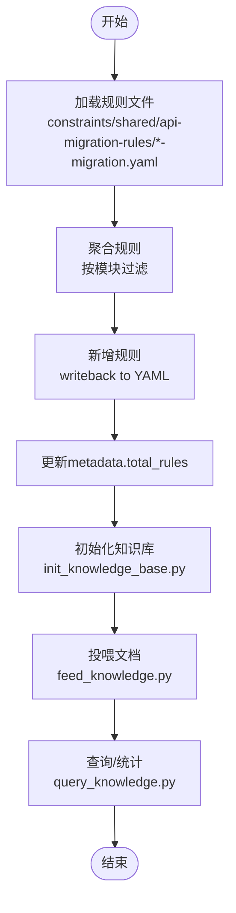
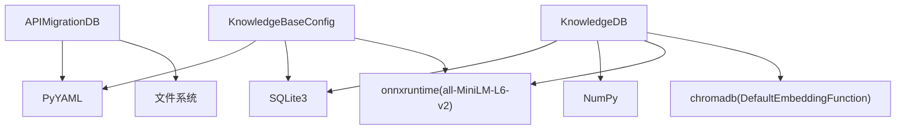

# API迁移数据库

<cite>
**本文引用的文件**
- [README.md](file://constraints/shared/api-migration-rules/README.md)
- [framework-migration.yaml](file://constraints/shared/api-migration-rules/framework-migration.yaml)
- [hal-migration.yaml](file://constraints/shared/api-migration-rules/hal-migration.yaml)
- [telephony-migration.yaml](file://constraints/shared/api-migration-rules/telephony-migration.yaml)
- [tool.py](file://tools/api-migration-db/tool.py)
- [README.md](file://tools/api-migration-db/README.md)
- [models.py](file://db/models.py)
- [knowledge_db.py](file://db/knowledge_db.py)
- [config.py](file://db/config.py)
- [config.yaml](file://knowledge-base/config.yaml)
- [init_knowledge_base.py](file://scripts/init_knowledge_base.py)
- [query_knowledge.py](file://scripts/query_knowledge.py)
- [feed_knowledge.py](file://scripts/feed_knowledge.py)
</cite>

## 目录
1. [简介](#简介)
2. [项目结构](#项目结构)
3. [核心组件](#核心组件)
4. [架构概览](#架构概览)
5. [详细组件分析](#详细组件分析)
6. [依赖分析](#依赖分析)
7. [性能考虑](#性能考虑)
8. [故障排除指南](#故障排除指南)
9. [结论](#结论)
10. [附录](#附录)

## 简介
本文件面向API迁移数据库的技术文档，聚焦于API迁移规则的存储与查询机制。系统采用轻量级SQLite+ONNX嵌入的混合方案，既支持纯文本检索，也支持语义相似度检索；同时提供专门的API迁移规则管理工具，支持框架层、HAL层与Telephony层的迁移规则维护与查询。

- API迁移规则库位于 constraints/shared/api-migration-rules/，包含框架、HAL与Telephony三类迁移规则文件。
- 迁移规则采用YAML格式，每条规则包含ID、旧API、新API、变更类型、引入版本、废弃版本、自动化程度、置信度等元信息，并提供迁移步骤与验证信息。
- 查询接口支持按模块筛选、按旧API关键字检索、新增规则写入等操作。

## 项目结构
API迁移数据库相关的关键目录与文件如下：
- constraints/shared/api-migration-rules/: 迁移规则YAML文件存放位置
  - framework-migration.yaml: Framework层迁移规则
  - hal-migration.yaml: HAL层迁移规则
  - telephony-migration.yaml: Telephony层迁移规则
  - README.md: 规则库概览与ID前缀约定
- tools/api-migration-db/: API迁移规则管理工具
  - tool.py: 提供list/search/add等操作
  - README.md: 工具功能说明
- db/: 知识库与数据模型
  - models.py: 知识条目数据模型（与API迁移规则共享的通用模型）
  - knowledge_db.py: 基于SQLite+ONNX的向量知识库实现
  - config.py: 知识库配置类
- knowledge-base/config.yaml: 知识库配置文件
- scripts/: 知识库初始化、查询与投喂脚本
  - init_knowledge_base.py: 初始化知识库与目录结构
  - query_knowledge.py: 知识库查询与统计
  - feed_knowledge.py: 文档投喂与索引更新

**图表来源**
- [tool.py:1-45](file://tools/api-migration-db/tool.py#L1-L45)
- [README.md:1-4](file://tools/api-migration-db/README.md#L1-L4)
- [models.py:1-247](file://db/models.py#L1-L247)
- [knowledge_db.py:1-589](file://db/knowledge_db.py#L1-L589)
- [config.py:1-182](file://db/config.py#L1-L182)
- [config.yaml:1-36](file://knowledge-base/config.yaml#L1-L36)
- [init_knowledge_base.py:1-246](file://scripts/init_knowledge_base.py#L1-L246)
- [query_knowledge.py:1-200](file://scripts/query_knowledge.py#L1-L200)
- [feed_knowledge.py:1-320](file://scripts/feed_knowledge.py#L1-L320)

**章节来源**
- [README.md:1-28](file://constraints/shared/api-migration-rules/README.md#L1-L28)
- [tool.py:1-45](file://tools/api-migration-db/tool.py#L1-L45)
- [models.py:1-247](file://db/models.py#L1-L247)
- [knowledge_db.py:1-589](file://db/knowledge_db.py#L1-L589)
- [config.py:1-182](file://db/config.py#L1-L182)
- [config.yaml:1-36](file://knowledge-base/config.yaml#L1-L36)
- [init_knowledge_base.py:1-246](file://scripts/init_knowledge_base.py#L1-L246)
- [query_knowledge.py:1-200](file://scripts/query_knowledge.py#L1-L200)
- [feed_knowledge.py:1-320](file://scripts/feed_knowledge.py#L1-L320)

## 核心组件
- API迁移规则管理器
  - 负责扫描规则目录、解析YAML、聚合规则、按模块或关键字检索、新增规则写回。
  - 支持的迁移类型：方法签名变更、方法重命名、常量迁移等。
- 知识库系统
  - 基于SQLite存储，支持向量嵌入（ONNX all-MiniLM-L6-v2，384维）与文本检索。
  - 提供语义搜索、跨模块搜索、按类型/分类过滤、统计与最近条目查询。
- 配置系统
  - 从knowledge-base/config.yaml加载数据库类型、持久化目录、嵌入模型、检索阈值等配置。
- 脚本工具
  - 初始化知识库、查询知识库、投喂文档到知识库。

**章节来源**
- [tool.py:1-45](file://tools/api-migration-db/tool.py#L1-L45)
- [knowledge_db.py:1-589](file://db/knowledge_db.py#L1-L589)
- [config.py:1-182](file://db/config.py#L1-L182)
- [config.yaml:1-36](file://knowledge-base/config.yaml#L1-L36)
- [init_knowledge_base.py:1-246](file://scripts/init_knowledge_base.py#L1-L246)
- [query_knowledge.py:1-200](file://scripts/query_knowledge.py#L1-L200)
- [feed_knowledge.py:1-320](file://scripts/feed_knowledge.py#L1-L320)

## 架构概览
系统采用“规则文件+管理工具+知识库”的分层架构：
- 规则层：YAML规则文件，定义API变更与迁移建议。
- 管理层：APIMigrationDB封装规则的增删改查，负责规则聚合与写回。
- 存储层：SQLite持久化，结合ONNX嵌入实现语义检索。
- 应用层：脚本工具提供初始化、查询、投喂等操作入口。

**图表来源**
- [tool.py:1-45](file://tools/api-migration-db/tool.py#L1-L45)
- [knowledge_db.py:1-589](file://db/knowledge_db.py#L1-L589)
- [config.yaml:1-36](file://knowledge-base/config.yaml#L1-L36)
- [init_knowledge_base.py:1-246](file://scripts/init_knowledge_base.py#L1-L246)
- [query_knowledge.py:1-200](file://scripts/query_knowledge.py#L1-L200)
- [feed_knowledge.py:1-320](file://scripts/feed_knowledge.py#L1-L320)

## 详细组件分析

### API迁移规则管理器（APIMigrationDB）
- 规则存储
  - 规则文件按模块命名，如 telephony-migration.yaml、framework-migration.yaml、hal-migration.yaml。
  - 每个文件包含metadata（模块、维护者、最后更新、规则总数）与rules列表。
- 规则结构
  - 关键字段：id、old_api、new_api、change_type、introduced_in、deprecated_in、auto、confidence、scope、affected_files_pattern、migration_steps、verified_in、note。
  - 示例规则涵盖方法签名变更、方法重命名、常量迁移等。
- 查询与维护
  - list_rules(module=None)：列出所有规则，可按模块过滤。
  - search(old_api)：按旧API关键字进行模糊匹配。
  - add_rule(rule, module)：新增规则并写回对应模块文件，更新metadata.total_rules。

**图表来源**
- [tool.py:1-45](file://tools/api-migration-db/tool.py#L1-L45)

**章节来源**
- [README.md:1-28](file://constraints/shared/api-migration-rules/README.md#L1-L28)
- [framework-migration.yaml:1-7](file://constraints/shared/api-migration-rules/framework-migration.yaml#L1-L7)
- [hal-migration.yaml:1-7](file://constraints/shared/api-migration-rules/hal-migration.yaml#L1-L7)
- [telephony-migration.yaml:1-57](file://constraints/shared/api-migration-rules/telephony-migration.yaml#L1-L57)
- [tool.py:1-45](file://tools/api-migration-db/tool.py#L1-L45)

### 知识库系统（KnowledgeDB）
- 数据模型（KnowledgeEntry）
  - 字段：id、module、title、type、category、source、created_at、updated_at、author、tags、confidence、content、metadata、referenced_by。
  - 支持YAML frontmatter双向转换、ChromaDB元数据格式转换。
- 数据库与索引
  - 表结构：kb_knowledge、kb_cases、kb_patterns，包含id、module、title、type、category、source、created_at、updated_at、author、confidence、tags、content、extra_metadata、referenced_by、embedding等列。
  - 索引策略：对module、type、category建立索引，提升过滤查询性能。
- 检索能力
  - 语义搜索：使用ONNX all-MiniLM-L6-v2计算向量，余弦相似度排序，支持最小置信度过滤。
  - 文本检索：降级模式下基于标题/内容包含匹配。
  - 跨模块搜索：可排除指定模块进行跨模块检索。
- 统计与维护
  - 统计信息：按模块、类型、来源、分类分布统计。
  - 最近条目：按更新时间范围查询。
  - 模块维护：删除模块全部条目、按ID获取条目、批量增删改。

**图表来源**
- [models.py:1-247](file://db/models.py#L1-L247)
- [knowledge_db.py:1-589](file://db/knowledge_db.py#L1-L589)

**章节来源**
- [models.py:1-247](file://db/models.py#L1-L247)
- [knowledge_db.py:1-589](file://db/knowledge_db.py#L1-L589)
- [config.py:1-182](file://db/config.py#L1-L182)
- [config.yaml:1-36](file://knowledge-base/config.yaml#L1-L36)

### 查询接口与使用示例
- API迁移规则查询
  - 列出规则：调用list_rules(module)可按模块过滤。
  - 搜索规则：调用search(old_api)按旧API关键字匹配。
  - 新增规则：调用add_rule(rule, module)写回对应模块文件。
- 知识库查询
  - 语义搜索：query_knowledge.py支持按模块、类型、分类过滤，返回Top-K结果。
  - 跨模块搜索：exclude_module参数控制排除模块。
  - 统计与最近条目：查看知识库统计、最近N天条目。
- 实际使用示例
  - 获取Telephony层API变更：调用list_rules(module="telephony")，或search("getDataNetworkType")。
  - 获取特定版本迁移建议：结合introduced_in/deprecated_in字段筛选。
  - 批量导入规则：通过add_rule循环写入多条规则。

**图表来源**
- [query_knowledge.py:1-200](file://scripts/query_knowledge.py#L1-L200)
- [knowledge_db.py:1-589](file://db/knowledge_db.py#L1-L589)
- [config.py:1-182](file://db/config.py#L1-L182)

**章节来源**
- [tool.py:1-45](file://tools/api-migration-db/tool.py#L1-L45)
- [query_knowledge.py:1-200](file://scripts/query_knowledge.py#L1-L200)
- [knowledge_db.py:1-589](file://db/knowledge_db.py#L1-L589)

### 数据库维护与更新策略
- 规则文件维护
  - 新增规则：通过add_rule写回对应模块文件，自动更新metadata.total_rules。
  - 规则聚合：list_rules遍历目录下所有模块规则文件，合并为统一规则列表。
  - 按模块筛选：在聚合时根据metadata.module过滤。
- 知识库维护
  - 初始化：init_knowledge_base.py创建目录结构、生成index.yaml、从constraints提取知识并同步到知识库。
  - 投喂流程：feed_knowledge.py解析Markdown/PDF/Word为KnowledgeEntry，保存至knowledge-base并入库。
  - 清理策略：delete_module_entries按模块删除全部条目，便于重新导入或迁移。

**图表来源**
- [tool.py:1-45](file://tools/api-migration-db/tool.py#L1-L45)
- [init_knowledge_base.py:1-246](file://scripts/init_knowledge_base.py#L1-L246)
- [feed_knowledge.py:1-320](file://scripts/feed_knowledge.py#L1-L320)
- [query_knowledge.py:1-200](file://scripts/query_knowledge.py#L1-L200)

**章节来源**
- [tool.py:1-45](file://tools/api-migration-db/tool.py#L1-L45)
- [init_knowledge_base.py:1-246](file://scripts/init_knowledge_base.py#L1-L246)
- [feed_knowledge.py:1-320](file://scripts/feed_knowledge.py#L1-L320)
- [query_knowledge.py:1-200](file://scripts/query_knowledge.py#L1-L200)

## 依赖分析
- 组件耦合
  - APIMigrationDB依赖文件系统与YAML解析，耦合度低，便于扩展新模块。
  - KnowledgeDB依赖SQLite与ONNX嵌入函数，检索性能受嵌入维度与索引影响。
- 外部依赖
  - onnxruntime/all-MiniLM-L6-v2：用于语义嵌入，若不可用则退化为文本检索。
  - numpy：向量计算与二进制存储。
  - chromadb：DefaultEmbeddingFunction（仅在知识库系统中使用）。
- 配置依赖
  - knowledge-base/config.yaml决定数据库类型、持久化目录、嵌入模型与检索阈值。

**图表来源**
- [tool.py:1-45](file://tools/api-migration-db/tool.py#L1-L45)
- [knowledge_db.py:1-589](file://db/knowledge_db.py#L1-L589)
- [config.py:1-182](file://db/config.py#L1-L182)
- [config.yaml:1-36](file://knowledge-base/config.yaml#L1-L36)

**章节来源**
- [knowledge_db.py:1-589](file://db/knowledge_db.py#L1-L589)
- [config.py:1-182](file://db/config.py#L1-L182)
- [config.yaml:1-36](file://knowledge-base/config.yaml#L1-L36)

## 性能考虑
- 向量检索
  - 嵌入维度：384维（all-MiniLM-L6-v2），内存占用较小，适合大规模规则检索。
  - 相似度计算：批量余弦相似度，按相似度降序排序，支持最小置信度过滤。
- 索引策略
  - SQLite对module、type、category建立索引，提升过滤查询效率。
  - 建议在高频查询字段上增加复合索引（如module+category）以进一步优化。
- 检索阈值
  - min_confidence设置较低阈值以支持跨语言检索，但可能增加候选集规模。
  - 可根据业务需求调整default_top_k与cross_module_top_k。
- 存储与I/O
  - WAL模式提升并发读写性能；二进制存储embedding节省空间。
  - 建议定期备份knowledge.db，避免数据丢失。

[本节为通用性能指导，无需具体文件分析]

## 故障排除指南
- ONNX嵌入不可用
  - 现象：日志提示降级为文本搜索模式。
  - 处理：安装onnxruntime==1.20.1以启用语义搜索。
- 数据库连接异常
  - 现象：初始化失败或查询报错。
  - 处理：检查knowledge-base/config.yaml中的persist_dir路径是否存在，确认权限与磁盘空间。
- 规则文件解析失败
  - 现象：YAML格式错误或缺少必需字段。
  - 处理：检查telephony-migration.yaml等文件的语法与字段完整性。
- 查询结果为空
  - 现象：search/search_by_tags/cross_module_search返回空列表。
  - 处理：确认query文本长度、模块过滤条件、min_confidence阈值设置是否合理。

**章节来源**
- [knowledge_db.py:132-156](file://db/knowledge_db.py#L132-L156)
- [config.yaml:1-36](file://knowledge-base/config.yaml#L1-L36)
- [telephony-migration.yaml:1-57](file://constraints/shared/api-migration-rules/telephony-migration.yaml#L1-L57)

## 结论
API迁移数据库通过“规则文件+管理工具+知识库”的架构，实现了对API迁移规则的集中管理与高效查询。规则文件采用YAML格式，易于维护与扩展；知识库系统提供语义检索与文本检索双通道，满足不同场景需求。配合脚本工具，可实现规则的初始化、查询与投喂，形成完整的迁移知识闭环。

[本节为总结性内容，无需具体文件分析]

## 附录

### API迁移类型与字段说明
- 支持的迁移类型
  - 方法签名变更：change_type为method_signature。
  - 方法重命名：change_type为method_rename。
  - 常量迁移：change_type为constant_moved。
- 关键字段
  - id：规则唯一标识（TEL/FWK/HAL等前缀约定）。
  - old_api/new_api：旧API与新API描述。
  - change_type：变更类型。
  - introduced_in/deprecated_in：引入/废弃版本。
  - auto/confidence：自动化程度与置信度。
  - scope/affected_files_pattern：影响范围与文件匹配模式。
  - migration_steps：迁移步骤清单。
  - verified_in：验证版本列表。
  - note：备注说明。

**章节来源**
- [README.md:1-28](file://constraints/shared/api-migration-rules/README.md#L1-L28)
- [telephony-migration.yaml:1-57](file://constraints/shared/api-migration-rules/telephony-migration.yaml#L1-L57)

### 查询接口定义
- APIMigrationDB
  - list_rules(module=None)：返回规则列表与总数。
  - search(old_api)：按旧API关键字匹配返回规则列表。
  - add_rule(rule, module)：新增规则并写回文件，返回状态与总数。
- KnowledgeDB
  - search/query_by_tags/get_module_entries/get_recent_entries/cross_module_search：提供多种检索方式与统计功能。

**章节来源**
- [tool.py:1-45](file://tools/api-migration-db/tool.py#L1-L45)
- [knowledge_db.py:1-589](file://db/knowledge_db.py#L1-L589)