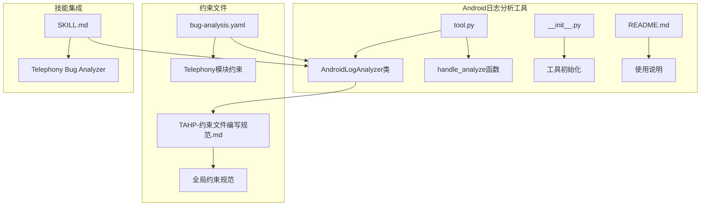
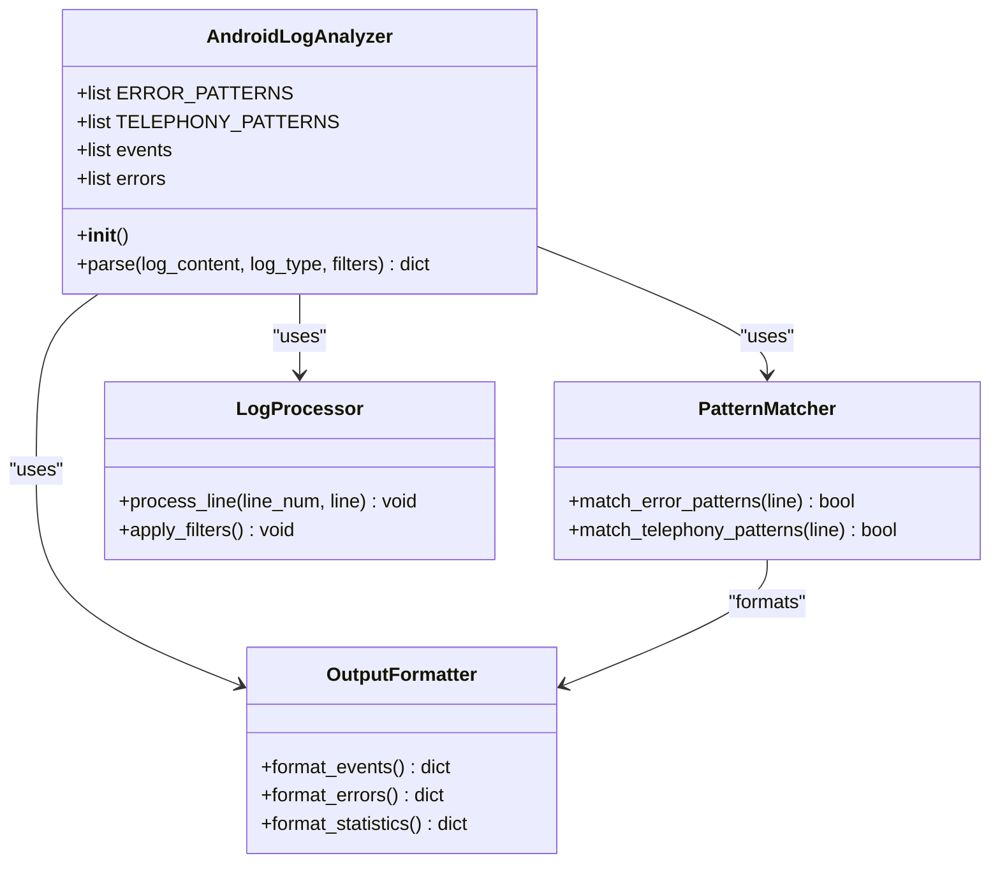
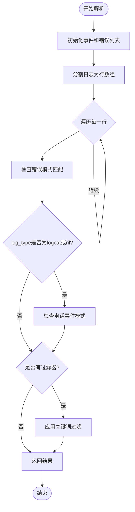
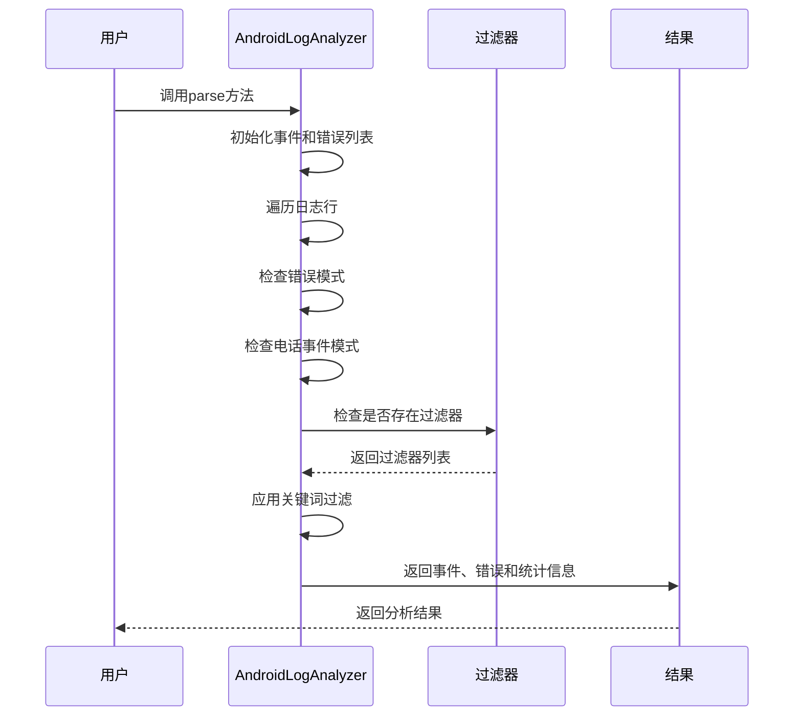
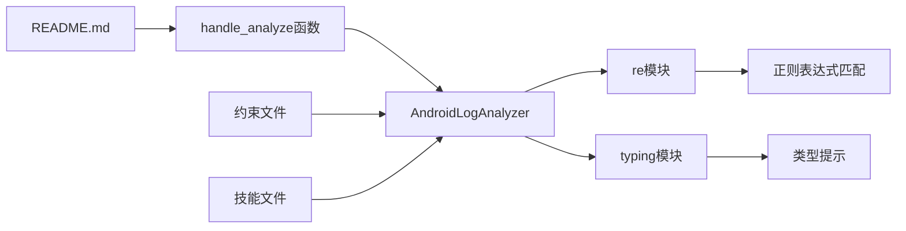

# Android日志分析工具

<cite>
**本文档引用的文件**
- [README.md](file://tools/android-log-analyzer/README.md)
- [tool.py](file://tools/android-log-analyzer/tool.py)
- [__init__.py](file://tools/android-log-analyzer/__init__.py)
- [TAHP-约束文件编写规范.md](file://TAHP-约束文件编写规范.md)
- [bug-analysis.yaml](file://constraints/telephony/bug-analysis.yaml)
- [SKILL.md](file://skills/.claude/skills/telephony-bug-analyzer/SKILL.md)
</cite>

## 目录
1. [简介](#简介)
2. [项目结构](#项目结构)
3. [核心组件](#核心组件)
4. [架构概览](#架构概览)
5. [详细组件分析](#详细组件分析)
6. [依赖关系分析](#依赖关系分析)
7. [性能考虑](#性能考虑)
8. [故障排除指南](#故障排除指南)
9. [结论](#结论)

## 简介

Android日志分析工具是一个专门用于解析和分析Android系统日志的工具，能够识别和提取关键事件、异常信息以及错误模式。该工具支持多种日志类型，包括logcat、ril、atcmd和bugreport，并提供了强大的正则表达式匹配机制来识别各种错误模式和事件类型。

该工具的核心功能包括：
- **多类型日志支持**：支持logcat、ril、atcmd、bugreport等多种Android日志格式
- **智能错误检测**：通过预定义的正则表达式模式识别Java异常、内核恐慌、致命错误等
- **事件分类**：将日志条目分类为不同的事件类型，如RIL事件、Telephony事件、AT命令等
- **过滤功能**：支持关键词过滤，帮助用户专注于特定的分析需求
- **统计输出**：提供详细的统计信息，包括事件计数、错误计数和日志类型信息

## 项目结构

Android日志分析工具位于`tools/android-log-analyzer`目录下，采用简洁的模块化设计：

**图表来源**
- [tool.py:1-50](file://tools/android-log-analyzer/tool.py#L1-L50)
- [README.md:1-13](file://tools/android-log-analyzer/README.md#L1-L13)

**章节来源**
- [tool.py:1-50](file://tools/android-log-analyzer/tool.py#L1-L50)
- [README.md:1-13](file://tools/android-log-analyzer/README.md#L1-L13)

## 核心组件

### AndroidLogAnalyzer类

AndroidLogAnalyzer是工具的核心类，负责执行日志解析和分析任务。该类包含了两个重要的模式列表和一个完整的解析方法。

#### 主要属性

- **ERROR_PATTERNS**：定义了错误检测的正则表达式模式
- **TELEPHONY_PATTERNS**：定义了电话相关事件的识别模式
- **events**：存储匹配到的事件列表
- **errors**：存储匹配到的错误列表

#### 关键方法

- **parse()**：主要的解析方法，接受原始日志内容、日志类型和过滤器参数
- **handle_analyze()**：外部调用接口，简化参数传递

**章节来源**
- [tool.py:5-49](file://tools/android-log-analyzer/tool.py#L5-L49)

## 架构概览

工具采用简单的面向对象架构，具有清晰的职责分离：

**图表来源**
- [tool.py:5-49](file://tools/android-log-analyzer/tool.py#L5-L49)

## 详细组件分析

### 错误检测机制

工具使用预定义的正则表达式模式来识别各种类型的错误和异常：

#### ERROR_PATTERNS模式列表

| 模式 | 描述 | 识别类型 |
|------|------|----------|
| `.*Exception.*` | Java异常 | Java Exception |
| `.*FATAL EXCEPTION.*` | 致命异常 | Fatal Exception |
| `.*Error.*` | 一般错误 | Error |
| `.*FAIL.*` | 失败信息 | Failure |
| `.*panic.*` | 内核恐慌 | Kernel Panic |
| `.*BUG:.*` | 内核错误 | Kernel Bug |

这些模式使用Python的re.match()函数进行匹配，确保每行日志都会被检查是否符合任何错误模式。

#### TELEPHONY_PATTERNS模式列表

当log_type为"logcat"或"ril"时，工具还会检查电话相关的事件：

| 模式 | 描述 | 识别类型 |
|------|------|----------|
| `.*RILJ.*` | RIL Java层 | RILJ Event |
| `.*RILC.*` | RIL C层 | RILC Event |
| `.*RILD.*` | RIL守护进程 | RILD Event |
| `.*TelephonyFramework.*` | Telephony框架 | Telephony Framework |
| `.*PhoneInterfaceManager.*` | 电话接口管理器 | Phone Interface |
| `.*ATCMD.*` | AT命令 | AT Command |
| `.*MODEM.*` | Modem事件 | Modem Event |
| `.*IMS.*` | IMS事件 | IMS Event |
| `.*VoLTE.*` | VoLTE事件 | VoLTE Event |
| `.*ServiceState.*` | 服务状态变化 | Service State Change |

**章节来源**
- [tool.py:6-25](file://tools/android-log-analyzer/tool.py#L6-L25)

### 日志解析流程

解析过程采用逐行扫描的方式，确保高效处理大量日志数据：

**图表来源**
- [tool.py:31-46](file://tools/android-log-analyzer/tool.py#L31-L46)

### 过滤器参数使用

工具支持关键词过滤功能，允许用户指定多个过滤关键词来缩小分析范围：

**图表来源**
- [tool.py:41-44](file://tools/android-log-analyzer/tool.py#L41-L44)

**章节来源**
- [tool.py:31-46](file://tools/android-log-analyzer/tool.py#L31-L46)

### 统计信息输出

工具提供详细的统计信息，帮助用户了解日志分析的结果：

| 统计项 | 描述 | 计算方式 |
|--------|------|----------|
| total_lines | 总行数 | 日志总行数 |
| event_count | 事件数量 | 匹配到的事件总数 |
| error_count | 错误数量 | 匹配到的错误总数 |
| log_type | 日志类型 | 输入的log_type参数 |

**章节来源**
- [tool.py:45-46](file://tools/android-log-analyzer/tool.py#L45-L46)

## 依赖关系分析

工具的依赖关系相对简单，主要依赖于Python的标准库：

**图表来源**
- [tool.py:2-3](file://tools/android-log-analyzer/tool.py#L2-L3)

### 外部约束集成

工具与TAHP系统的约束文件紧密集成：

1. **全局约束**：通过`TAHP-约束文件编写规范.md`定义的约束规范
2. **Telephony模块约束**：通过`bug-analysis.yaml`定义的通信模块分析规则
3. **技能集成**：通过`SKILL.md`定义的Telephony Bug Analyzer技能

**章节来源**
- [TAHP-约束文件编写规范.md:118-241](file://TAHP-约束文件编写规范.md#L118-L241)
- [bug-analysis.yaml:31-69](file://constraints/telephony/bug-analysis.yaml#L31-L69)

## 性能考虑

### 时间复杂度分析

- **整体复杂度**：O(N×(E+T))，其中N是日志行数，E是错误模式数量，T是电话事件模式数量
- **空间复杂度**：O(E+T)，用于存储模式列表
- **内存使用**：主要取决于日志大小和匹配到的事件数量

### 优化建议

1. **模式编译**：可以预先编译正则表达式以提高匹配效率
2. **批量处理**：对于超大日志文件，可以考虑分批处理
3. **缓存机制**：对于重复的过滤操作，可以实现结果缓存

## 故障排除指南

### 常见问题及解决方案

#### 1. 日志类型不支持
**问题**：传入不支持的日志类型参数
**解决方案**：确保log_type参数为"logcat"、"ril"、"atcmd"或"bugreport"之一

#### 2. 正则表达式匹配不准确
**问题**：某些日志行没有被正确识别
**解决方案**：检查ERROR_PATTERNS和TELEPHONY_PATTERNS中的模式是否需要调整

#### 3. 过滤器效果不佳
**问题**：过滤后的结果不符合预期
**解决方案**：检查过滤关键词是否正确，注意大小写转换逻辑

#### 4. 性能问题
**问题**：处理大型日志文件时速度较慢
**解决方案**：考虑分批处理或优化正则表达式模式

**章节来源**
- [tool.py:31-46](file://tools/android-log-analyzer/tool.py#L31-L46)

## 结论

Android日志分析工具是一个功能强大且易于使用的日志解析工具，具有以下特点：

1. **多类型支持**：支持logcat、ril、atcmd、bugreport等多种日志格式
2. **智能识别**：通过精心设计的正则表达式模式识别各种错误和事件
3. **灵活过滤**：提供关键词过滤功能，满足不同分析需求
4. **统计输出**：提供详细的统计信息，便于日志分析
5. **约束集成**：与TAHP系统的约束文件和技能系统无缝集成

该工具为Android开发和调试提供了强有力的支持，特别是在Telephony模块的故障诊断方面发挥着重要作用。通过合理的使用和适当的优化，可以显著提高日志分析的效率和准确性。