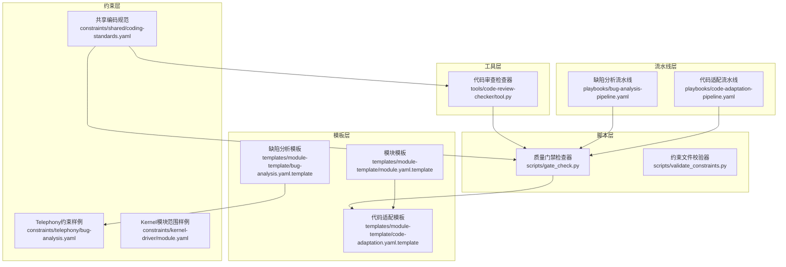
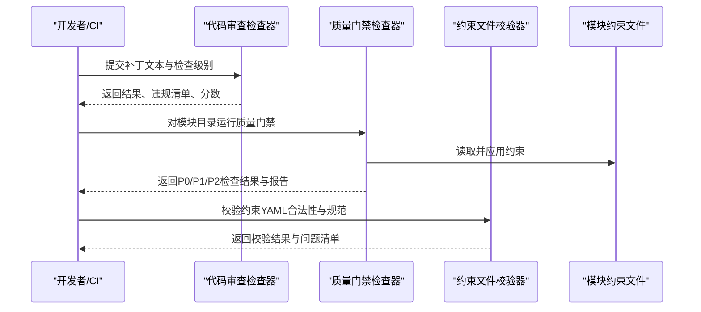
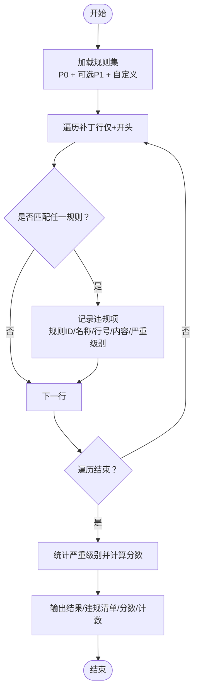
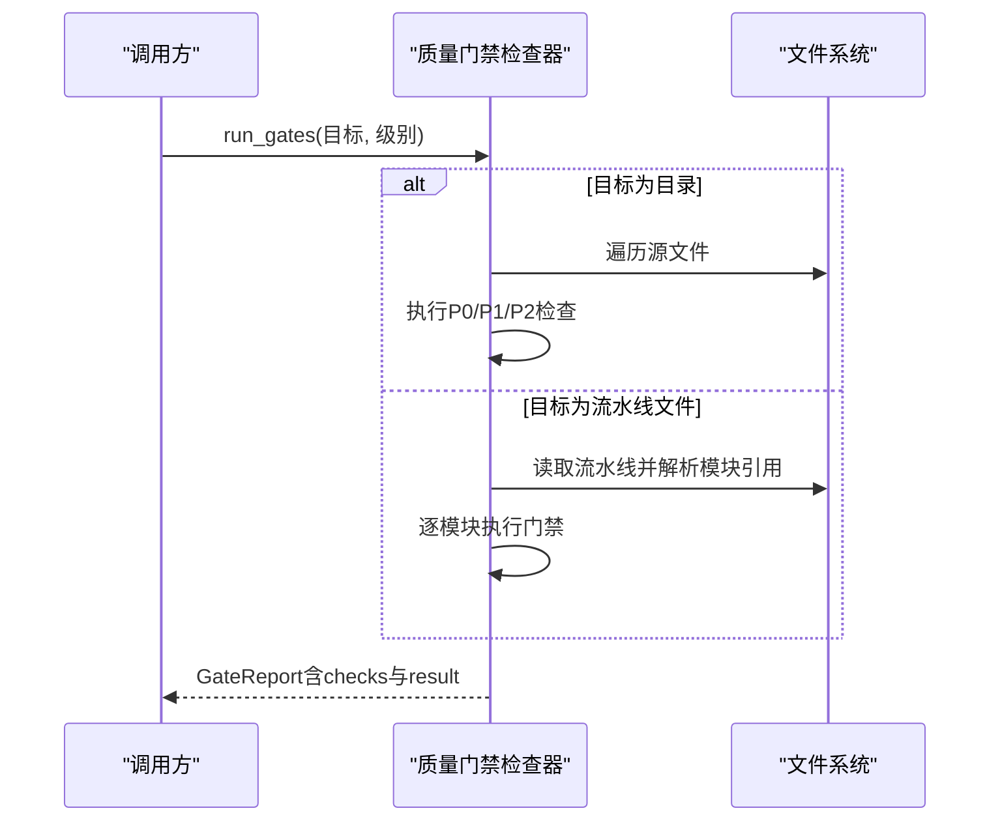
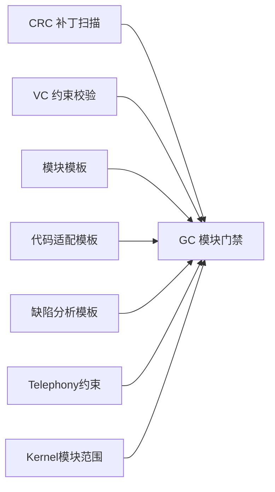

# 代码审查检查器

<cite>
**本文引用的文件**
- [工具说明](file://tools/code-review-checker/README.md)
- [核心实现](file://tools/code-review-checker/tool.py)
- [质量门禁检查器](file://scripts/gate_check.py)
- [约束文件校验器](file://scripts/validate_constraints.py)
- [共享编码规范](file://constraints/shared/coding-standards.yaml)
- [模板：模块入口](file://templates/module-template/module.yaml.template)
- [模板：代码适配质量门禁](file://templates/module-template/code-adaptation.yaml.template)
- [模板：缺陷分析约束](file://templates/module-template/bug-analysis.yaml.template)
- [Telephony缺陷分析约束样例](file://constraints/telephony/bug-analysis.yaml)
- [Kernel模块范围样例](file://constraints/kernel-driver/module.yaml)
- [跨模块缺陷分析流水线](file://playbooks/bug-analysis-pipeline.yaml)
- [代码适配流水线](file://playbooks/code-adaptation-pipeline.yaml)
- [AI代码生成约束规范](file://docs/TAHP-AI代码生成约束规范.md)
</cite>

## 目录
1. [简介](#简介)
2. [项目结构](#项目结构)
3. [核心组件](#核心组件)
4. [架构总览](#架构总览)
5. [详细组件分析](#详细组件分析)
6. [依赖分析](#依赖分析)
7. [性能考虑](#性能考虑)
8. [故障排查指南](#故障排查指南)
9. [结论](#结论)
10. [附录](#附录)

## 简介
本文件面向“代码审查检查器”的技术文档，聚焦于代码质量检查的实现算法与策略，涵盖静态分析规则、编码规范检查与安全漏洞检测；同时系统化说明支持的检查规则类型（代码风格、性能问题、安全风险等）、检查策略、配置选项、自定义规则与检查结果格式，并提供最佳实践、误报处理建议以及与CI/CD集成的自动化审查方法。

## 项目结构
围绕代码审查检查器，仓库中与之直接相关的关键文件分布如下：
- 工具层：tools/code-review-checker 提供补丁级静态规则扫描与评分
- 脚本层：scripts 下的质量门禁与约束校验工具，用于模块级与约束级质量把关
- 模板层：templates/module-template 提供模块初始化与质量门禁配置模板
- 约束层：constraints 下的各模块约束文件，定义安全红线、评估标准与质量门禁
- 流水线层：playbooks 下的跨模块分析与代码适配流水线，串联质量门禁

图表来源
- [核心实现:1-33](file://tools/code-review-checker/tool.py#L1-L33)
- [质量门禁检查器:1-507](file://scripts/gate_check.py#L1-L507)
- [模板：模块入口:1-70](file://templates/module-template/module.yaml.template#L1-L70)
- [模板：代码适配质量门禁:134-187](file://templates/module-template/code-adaptation.yaml.template#L134-L187)
- [模板：缺陷分析约束:1-272](file://templates/module-template/bug-analysis.yaml.template#L1-L272)
- [Telephony缺陷分析约束样例:1-110](file://constraints/telephony/bug-analysis.yaml#L1-L110)
- [Kernel模块范围样例:1-30](file://constraints/kernel-driver/module.yaml#L1-L30)
- [共享编码规范:1-23](file://constraints/shared/coding-standards.yaml#L1-L23)
- [跨模块缺陷分析流水线:1-43](file://playbooks/bug-analysis-pipeline.yaml#L1-L43)
- [代码适配流水线:1-35](file://playbooks/code-adaptation-pipeline.yaml#L1-L35)

章节来源
- [工具说明:1-4](file://tools/code-review-checker/README.md#L1-L4)
- [核心实现:1-33](file://tools/code-review-checker/tool.py#L1-L33)
- [质量门禁检查器:1-507](file://scripts/gate_check.py#L1-L507)
- [约束文件校验器:1-360](file://scripts/validate_constraints.py#L1-L360)
- [模板：模块入口:1-70](file://templates/module-template/module.yaml.template#L1-L70)
- [模板：代码适配质量门禁:134-187](file://templates/module-template/code-adaptation.yaml.template#L134-L187)
- [模板：缺陷分析约束:1-272](file://templates/module-template/bug-analysis.yaml.template#L1-L272)
- [Telephony缺陷分析约束样例:1-110](file://constraints/telephony/bug-analysis.yaml#L1-L110)
- [Kernel模块范围样例:1-30](file://constraints/kernel-driver/module.yaml#L1-L30)
- [共享编码规范:1-23](file://constraints/shared/coding-standards.yaml#L1-L23)
- [跨模块缺陷分析流水线:1-43](file://playbooks/bug-analysis-pipeline.yaml#L1-L43)
- [代码适配流水线:1-35](file://playbooks/code-adaptation-pipeline.yaml#L1-L35)

## 核心组件
- 代码审查检查器（CRC）
  - 输入：补丁文本、检查级别（P0/P1/P2）、自定义规则
  - 处理：逐行匹配正则规则，仅扫描新增行（以“+”开头），统计严重级别并计算分数
  - 输出：结果（通过/警告/失败）、违规清单、分数、各类计数
- 质量门禁检查器（GC）
  - 按P0/P1/P2分级执行多项静态检查（如安全红线、YAML合法性、文档完整性、命名规范、代码风格、注释密度、示例用例等）
  - 支持模块目录或流水线文件两种模式，聚合报告并返回退出码
- 约束文件校验器（VC）
  - 验证约束YAML的顶层键、元数据字段、安全红线列表等，支持严格模式与跨模块引用检查
- 模板与约束
  - 模板提供模块初始化、代码适配质量门禁与缺陷分析约束的配置骨架
  - 各模块约束文件定义安全红线、评估指标与质量门禁阈值

章节来源
- [核心实现:16-32](file://tools/code-review-checker/tool.py#L16-L32)
- [质量门禁检查器:368-435](file://scripts/gate_check.py#L368-L435)
- [约束文件校验器:239-278](file://scripts/validate_constraints.py#L239-L278)
- [模板：代码适配质量门禁:134-187](file://templates/module-template/code-adaptation.yaml.template#L134-L187)
- [模板：缺陷分析约束:221-259](file://templates/module-template/bug-analysis.yaml.template#L221-L259)

## 架构总览
代码审查检查器在整体系统中的定位与交互如下：

图表来源
- [核心实现:16-32](file://tools/code-review-checker/tool.py#L16-L32)
- [质量门禁检查器:368-435](file://scripts/gate_check.py#L368-L435)
- [约束文件校验器:239-278](file://scripts/validate_constraints.py#L239-L278)

## 详细组件分析

### 组件A：代码审查检查器（CRC）
- 规则类型与策略
  - P0规则：安全红线（如硬编码密钥/口令/令牌）、API真实性（待验证的API占位）、作用域合规（禁止路径）
  - P1规则：编码风格（checkpatch相关提示）、废弃API（@Deprecated）、TODO关联（无年份编号的TODO）
  - 策略：仅扫描新增行（以“+”开头），逐条规则匹配，统计严重级别并计算分数
- 结果格式
  - result：通过/警告/失败
  - violations：每条违规包含规则ID、名称、行号、内容片段、严重级别
  - score：综合评分（受严重级别数量影响）
  - 计数：critical_count、warning_count
- 自定义规则
  - 支持传入自定义规则列表，扩展至规则集合中
- 性能特征
  - 时间复杂度近似O(N×R)，N为新增行数，R为规则数；空间复杂度O(V)，V为违规数
- 错误处理
  - 未匹配到新增行时不会产生违规；正则匹配失败不影响整体流程

图表来源
- [核心实现:16-32](file://tools/code-review-checker/tool.py#L16-L32)

章节来源
- [核心实现:4-29](file://tools/code-review-checker/tool.py#L4-L29)
- [工具说明:1-4](file://tools/code-review-checker/README.md#L1-L4)

### 组件B：质量门禁检查器（GC）
- 规则类型与策略
  - P0（阻断）：安全红线存在性、禁止硬编码密钥、约束文件合法（YAML映射）
  - P1（警告）：测试覆盖率估算、文档完整性（module.yaml字段）、命名规范（kebab-case）
  - P2（记录）：基础代码风格（行长度、尾随空白）、注释密度、示例用例存在性
- 结果格式
  - GateCheck：包含级别、名称、描述、通过状态与详情
  - GateReport：聚合所有检查项，计算总体结果（通过/阻断/警告）与标签
- 执行模式
  - 模块目录模式：对单模块执行全部适用的门禁
  - 流水线文件模式：解析模块引用，批量执行门禁并合并结果
- 性能特征
  - 文件扫描与正则匹配为主，时间复杂度与文件数量与大小相关；P2检查通常快速短路

图表来源
- [质量门禁检查器:368-435](file://scripts/gate_check.py#L368-L435)

章节来源
- [质量门禁检查器:36-93](file://scripts/gate_check.py#L36-L93)
- [质量门禁检查器:99-187](file://scripts/gate_check.py#L99-L187)
- [质量门禁检查器:194-216](file://scripts/gate_check.py#L194-L216)
- [质量门禁检查器:219-270](file://scripts/gate_check.py#L219-L270)
- [质量门禁检查器:277-332](file://scripts/gate_check.py#L277-L332)
- [质量门禁检查器:335-349](file://scripts/gate_check.py#L335-L349)
- [质量门禁检查器:368-435](file://scripts/gate_check.py#L368-L435)

### 组件C：约束文件校验器（VC）
- 规则类型与策略
  - 顶层键校验：metadata、rules、safety_red_lines 必填
  - 元数据校验：字段非空、domain枚举、版本与日期格式（严格模式）
  - 安全红线校验：safety_red_lines为列表且非空（空列表给出警告）
  - 跨模块引用检查：module.yaml依赖模块存在性校验
- 结果格式
  - ValidationResult：包含错误、警告、信息类问题，状态与总计
- 性能特征
  - 主要为文件I/O与正则匹配，复杂度与文件数量与大小相关

章节来源
- [约束文件校验器:80-182](file://scripts/validate_constraints.py#L80-L182)
- [约束文件校验器:184-238](file://scripts/validate_constraints.py#L184-L238)
- [约束文件校验器:239-278](file://scripts/validate_constraints.py#L239-L278)

### 组件D：模板与约束（质量门禁与安全红线）
- 模块模板
  - module.yaml.template：定义模块身份、范围（includes/excludes）、依赖与覆盖域
  - code-adaptation.yaml.template：定义P0/P1/P2质量门禁阈值与动作
  - bug-analysis.yaml.template：定义缺陷分析的前置条件、分析规则、评估指标与安全红线
- 约束样例
  - Telephony缺陷分析约束：定义层检测顺序、禁止事项、所需输出与安全门禁
  - Kernel模块范围：定义包含/排除路径与依赖模块
- 共享编码规范
  - 版本控制、代码评审、文档与Android特定规范

章节来源
- [模板：模块入口:1-70](file://templates/module-template/module.yaml.template#L1-L70)
- [模板：代码适配质量门禁:134-187](file://templates/module-template/code-adaptation.yaml.template#L134-L187)
- [模板：缺陷分析约束:186-259](file://templates/module-template/bug-analysis.yaml.template#L186-L259)
- [Telephony缺陷分析约束样例:1-110](file://constraints/telephony/bug-analysis.yaml#L1-L110)
- [Kernel模块范围样例:1-30](file://constraints/kernel-driver/module.yaml#L1-L30)
- [共享编码规范:1-23](file://constraints/shared/coding-standards.yaml#L1-L23)

## 依赖分析
- CRC与GC的关系
  - CRC专注于补丁级规则扫描，GC负责模块级质量门禁；两者可并行或串行组合使用
- GC与模板/约束的关系
  - GC依据模块约束文件（如module.yaml、缺陷分析约束）进行检查；模板提供标准化配置骨架
- VC与模板/约束的关系
  - VC确保约束文件符合规范，避免后续检查出现解析错误

图表来源
- [核心实现:16-32](file://tools/code-review-checker/tool.py#L16-L32)
- [质量门禁检查器:368-435](file://scripts/gate_check.py#L368-L435)
- [约束文件校验器:239-278](file://scripts/validate_constraints.py#L239-L278)
- [模板：模块入口:1-70](file://templates/module-template/module.yaml.template#L1-L70)
- [模板：代码适配质量门禁:134-187](file://templates/module-template/code-adaptation.yaml.template#L134-L187)
- [模板：缺陷分析约束:1-272](file://templates/module-template/bug-analysis.yaml.template#L1-L272)
- [Telephony缺陷分析约束样例:1-110](file://constraints/telephony/bug-analysis.yaml#L1-L110)
- [Kernel模块范围样例:1-30](file://constraints/kernel-driver/module.yaml#L1-L30)

## 性能考虑
- CRC
  - 正则匹配数量与规则数成正比；建议将规则数量控制在合理范围，避免过多分支导致匹配开销上升
  - 仅扫描新增行有效降低处理量；对于大补丁，建议分批提交以缩短检查时间
- GC
  - 文件扫描与正则匹配为主要开销；可通过限制扫描目录（如仅源文件）减少IO
  - P2检查采用短路策略（如发现尾随空白或行长超限即记录一条），避免全量扫描
- VC
  - YAML解析与跨模块引用检查为瓶颈；建议在CI中缓存已校验文件，或仅对变更文件执行校验

## 故障排查指南
- CRC常见问题
  - 误报：规则过于宽泛或正则匹配不精确。建议细化规则或引入上下文过滤
  - 未覆盖：仅扫描新增行，旧代码问题需通过GC或其他静态工具发现
  - 自定义规则无效：确认传入参数与规则格式正确
- GC常见问题
  - P0阻断：检查是否存在硬编码密钥、约束文件非法或缺失安全红线
  - P1警告：测试用例不足、文档不完整或命名不规范，按提示补齐
  - P2记录：行长度过长或存在尾随空白，按建议调整
- VC常见问题
  - YAML语法错误：修正语法或顶层键缺失
  - 元数据字段为空：补齐必需字段
  - 安全红线为空列表：至少添加一条安全守则
  - 跨模块依赖未知：修正module.yaml中的依赖模块名或添加对应模块

章节来源
- [质量门禁检查器:99-187](file://scripts/gate_check.py#L99-L187)
- [质量门禁检查器:194-216](file://scripts/gate_check.py#L194-L216)
- [质量门禁检查器:219-270](file://scripts/gate_check.py#L219-L270)
- [质量门禁检查器:277-332](file://scripts/gate_check.py#L277-L332)
- [质量门禁检查器:335-349](file://scripts/gate_check.py#L335-L349)
- [约束文件校验器:80-182](file://scripts/validate_constraints.py#L80-L182)
- [约束文件校验器:184-238](file://scripts/validate_constraints.py#L184-L238)

## 结论
代码审查检查器通过补丁级规则扫描与模块级质量门禁相结合，形成从细粒度到宏观层面的多层次质量保障体系。配合约束文件校验与模板化配置，能够稳定地支撑CI/CD流程中的自动化审查与质量门禁。建议在实践中持续优化规则精度、完善自定义规则并结合流水线进行端到端质量治理。

## 附录

### 配置选项与自定义规则
- CRC
  - 参数：patch_content（补丁文本）、check_level（P0/P1/P2）、rules（自定义规则列表）
  - 自定义规则格式：包含id、name、pattern、severity
- GC
  - 运行模式：模块目录或流水线文件
  - 级别选择：P0/P1/P2/all
- VC
  - 严格模式：启用额外警告（如版本格式、日期格式）
  - 递归扫描：支持子目录扫描
  - 跨模块引用检查：可开启/关闭

章节来源
- [核心实现:16-32](file://tools/code-review-checker/tool.py#L16-L32)
- [质量门禁检查器:480-502](file://scripts/gate_check.py#L480-L502)
- [约束文件校验器:323-355](file://scripts/validate_constraints.py#L323-L355)

### 检查结果格式
- CRC
  - result：通过/警告/失败
  - violations：规则ID、名称、行号、内容片段、严重级别
  - score、critical_count、warning_count
- GC
  - GateCheck：level、name、description、passed、detail
  - GateReport：checks、result、result_label
- VC
  - ValidationResult：target、errors、warnings、info、status、total_issues

章节来源
- [核心实现:26-29](file://tools/code-review-checker/tool.py#L26-L29)
- [质量门禁检查器:50-93](file://scripts/gate_check.py#L50-L93)
- [约束文件校验器:49-65](file://scripts/validate_constraints.py#L49-L65)

### 最佳实践
- 规则设计
  - 将高风险规则（安全红线）置于P0，低风险规则（风格/信息）置于P1/P2
  - 自定义规则应具备明确的上下文与最小误报率
- 误报处理
  - 引入白名单或上下文过滤；定期回顾与精简规则
- CI/CD集成
  - 在构建前执行VC与GC，在代码提交阶段执行CRC
  - 将结果与退出码接入流水线，P0失败阻断、P1警告提醒、P2记录跟踪
- 文档与规范
  - 依据共享编码规范与模板完善模块文档与约束文件
  - 利用流水线模板串联缺陷分析与代码适配流程

章节来源
- [共享编码规范:1-23](file://constraints/shared/coding-standards.yaml#L1-L23)
- [模板：代码适配质量门禁:134-187](file://templates/module-template/code-adaptation.yaml.template#L134-L187)
- [跨模块缺陷分析流水线:1-43](file://playbooks/bug-analysis-pipeline.yaml#L1-L43)
- [代码适配流水线:1-35](file://playbooks/code-adaptation-pipeline.yaml#L1-L35)
- [AI代码生成约束规范:293-321](file://docs/TAHP-AI代码生成约束规范.md#L293-L321)