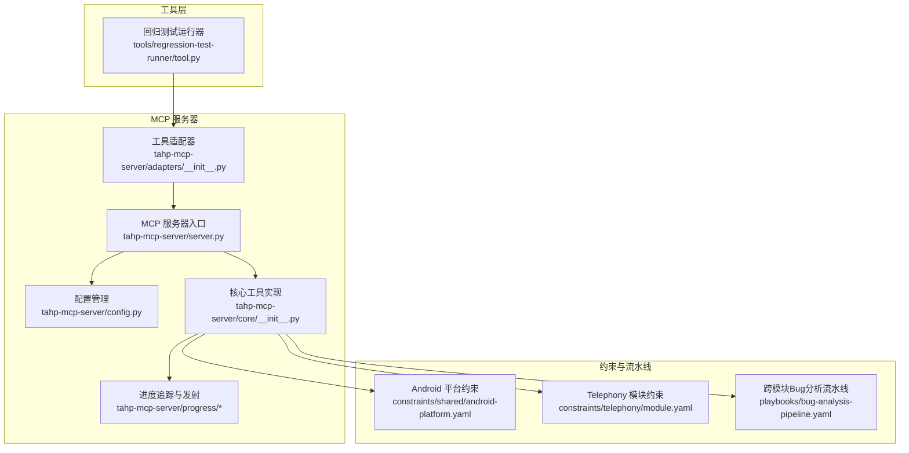
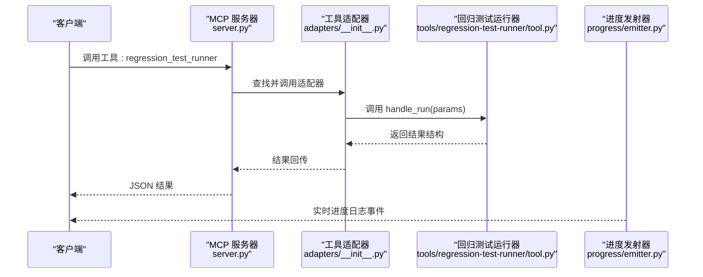
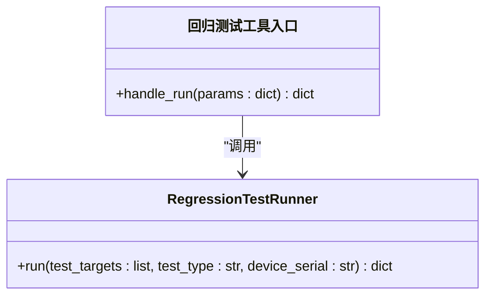
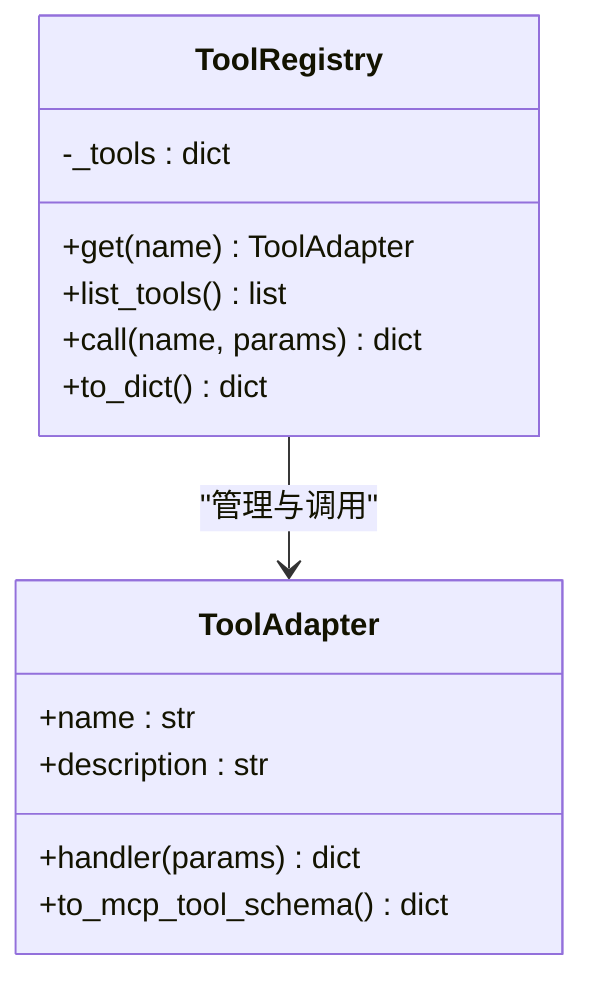
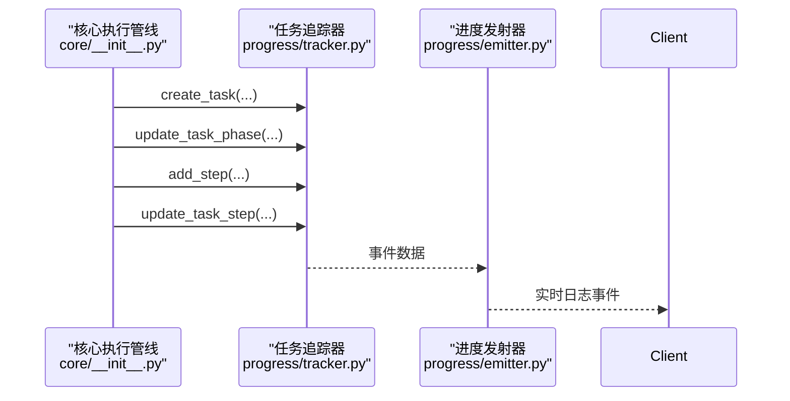
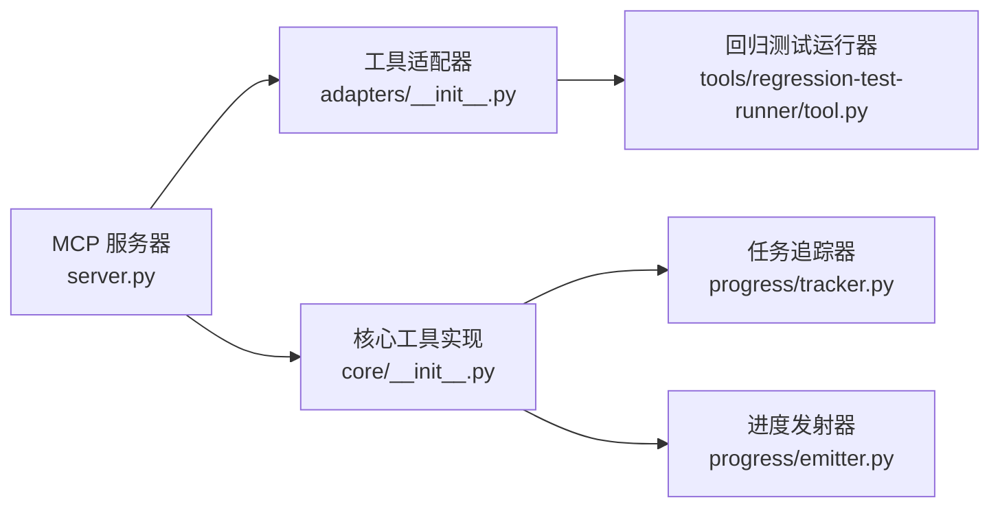
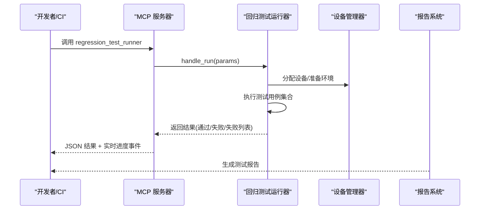

# 回归测试运行器

<cite>
**本文引用的文件**
- [README.md](file://tools/regression-test-runner/README.md)
- [tool.py](file://tools/regression-test-runner/tool.py)
- [server.py](file://tahp-mcp-server/server.py)
- [config.py](file://tahp-mcp-server/config.py)
- [core/__init__.py](file://tahp-mcp-server/core/__init__.py)
- [adapters/__init__.py](file://tahp-mcp-server/adapters/__init__.py)
- [progress/emitter.py](file://tahp-mcp-server/progress/emitter.py)
- [progress/tracker.py](file://tahp-mcp-server/progress/tracker.py)
- [test_server.py](file://tahp-mcp-server/test_server.py)
- [android-platform.yaml](file://constraints/shared/android-platform.yaml)
- [module.yaml](file://constraints/telephony/module.yaml)
- [bug-analysis-pipeline.yaml](file://playbooks/bug-analysis-pipeline.yaml)
</cite>

## 目录
1. [简介](#简介)
2. [项目结构](#项目结构)
3. [核心组件](#核心组件)
4. [架构总览](#架构总览)
5. [详细组件分析](#详细组件分析)
6. [依赖关系分析](#依赖关系分析)
7. [性能考虑](#性能考虑)
8. [故障排查指南](#故障排查指南)
9. [结论](#结论)
10. [附录](#附录)

## 简介
本文件为“回归测试运行器”的技术文档，面向自动化测试执行场景，覆盖测试用例发现、执行调度、结果收集与报告生成。文档同时阐述测试配置管理、并行执行策略以及与 TAHP MCP Server 的集成方式，并给出回归测试设计原则、实施指南与故障处理建议。

当前仓库中的回归测试运行器工具处于基础实现阶段：工具类提供占位的执行流程与返回结构，实际测试框架（如 JUnit、Espresso、Instrumentation 等）尚未在该工具中具体实现。但通过 MCP Server 的适配器与核心执行管线，可以平滑扩展对接多种测试框架与设备环境。

## 项目结构
回归测试运行器位于 tools/regression-test-runner 目录，MCP Server 位于 tahp-mcp-server 目录。二者通过工具适配器统一接入 MCP 工具体系，实现对外部调用的响应与进度事件推送。

图示来源
- [server.py:101-340](file://tahp-mcp-server/server.py#L101-L340)
- [adapters/__init__.py:186-239](file://tahp-mcp-server/adapters/__init__.py#L186-L239)
- [core/__init__.py:110-298](file://tahp-mcp-server/core/__init__.py#L110-L298)
- [config.py:36-176](file://tahp-mcp-server/config.py#L36-L176)
- [progress/tracker.py:212-343](file://tahp-mcp-server/progress/tracker.py#L212-L343)
- [progress/emitter.py:33-194](file://tahp-mcp-server/progress/emitter.py#L33-L194)
- [README.md:1-3](file://tools/regression-test-runner/README.md#L1-L3)

章节来源
- [README.md:1-3](file://tools/regression-test-runner/README.md#L1-L3)
- [tool.py:1-9](file://tools/regression-test-runner/tool.py#L1-L9)
- [server.py:1-485](file://tahp-mcp-server/server.py#L1-L485)
- [adapters/__init__.py:1-239](file://tahp-mcp-server/adapters/__init__.py#L1-L239)
- [core/__init__.py:1-621](file://tahp-mcp-server/core/__init__.py#L1-L621)
- [config.py:1-176](file://tahp-mcp-server/config.py#L1-L176)
- [progress/tracker.py:1-343](file://tahp-mcp-server/progress/tracker.py#L1-L343)
- [progress/emitter.py:1-194](file://tahp-mcp-server/progress/emitter.py#L1-L194)
- [android-platform.yaml:1-25](file://constraints/shared/android-platform.yaml#L1-L25)
- [module.yaml:1-43](file://constraints/telephony/module.yaml#L1-L43)
- [bug-analysis-pipeline.yaml:1-43](file://playbooks/bug-analysis-pipeline.yaml#L1-L43)

## 核心组件
- 回归测试运行器工具
  - 提供 run 方法接收测试目标、测试类型与设备序列号参数，返回包含结果、通过数、失败数、总数、通过率与失败列表的结构化结果。
  - 提供 handle_run 入口，便于 MCP 适配器统一调用。
- MCP 服务器与工具适配器
  - 通过 ToolRegistry 统一加载 tools/ 下的工具模块，将工具方法封装为标准 handle(params) -> dict 接口。
  - 回归测试运行器通过适配器注入 MCP 工具注册表，使其可被 server.py 的工具分发逻辑调用。
- 任务进度追踪与事件发射
  - TaskTracker 维护任务生命周期、阶段与步骤状态；ProgressEmitter 将进度与纠偏事件通过 MCP 协议通知客户端。
- 核心执行管线
  - execute_tahp_task 定义了加载约束、分析文档、生成计划、执行 Pipeline、质量门禁的完整流程，为回归测试运行器提供扩展点。

章节来源
- [tool.py:1-9](file://tools/regression-test-runner/tool.py#L1-L9)
- [adapters/__init__.py:170-183](file://tahp-mcp-server/adapters/__init__.py#L170-L183)
- [server.py:343-447](file://tahp-mcp-server/server.py#L343-L447)
- [progress/tracker.py:212-343](file://tahp-mcp-server/progress/tracker.py#L212-L343)
- [progress/emitter.py:33-194](file://tahp-mcp-server/progress/emitter.py#L33-L194)
- [core/__init__.py:110-298](file://tahp-mcp-server/core/__init__.py#L110-L298)

## 架构总览
下图展示了 MCP Server 如何将回归测试运行器工具纳入统一的工具体系，并通过进度事件向客户端推送执行状态。

图示来源
- [server.py:343-447](file://tahp-mcp-server/server.py#L343-L447)
- [adapters/__init__.py:226-234](file://tahp-mcp-server/adapters/__init__.py#L226-L234)
- [tool.py:7-9](file://tools/regression-test-runner/tool.py#L7-L9)
- [progress/emitter.py:47-83](file://tahp-mcp-server/progress/emitter.py#L47-L83)

## 详细组件分析

### 回归测试运行器类与入口
- 类职责
  - run: 接收测试目标列表、测试类型与设备序列号，返回包含统计信息与失败列表的结果对象。
- 入口函数
  - handle_run: 将参数传递给类实例并返回结果，便于 MCP 适配器统一调用。

图示来源
- [tool.py:2-9](file://tools/regression-test-runner/tool.py#L2-L9)

章节来源
- [tool.py:1-9](file://tools/regression-test-runner/tool.py#L1-L9)

### MCP 工具适配器与注册
- 适配器模式
  - ToolAdapter 将工具模块的 handle_run/handle_analyze 等函数封装为统一接口，供 ToolRegistry 管理。
- 注册与调用
  - ToolRegistry 动态加载 tools/ 下的工具模块，构建工具映射；call(name, params) 统一分发调用。
- 回归测试运行器适配
  - _load_regression_test_runner 在适配器层注入 regression_test_runner 工具，使其可被 MCP 服务器调用。

图示来源
- [adapters/__init__.py:20-40](file://tahp-mcp-server/adapters/__init__.py#L20-L40)
- [adapters/__init__.py:186-239](file://tahp-mcp-server/adapters/__init__.py#L186-L239)

章节来源
- [adapters/__init__.py:1-239](file://tahp-mcp-server/adapters/__init__.py#L1-L239)

### 任务进度追踪与事件发射
- 任务阶段与状态
  - TaskPhase 定义任务生命周期阶段；TaskProgress 维护阶段、进度、步骤与纠偏历史；TaskTracker 提供线程安全的任务管理。
- 进度事件
  - ProgressEmitter 将阶段与步骤更新转换为 MCP 日志事件，支持客户端实时展示。
- 与核心执行管线的协作
  - execute_tahp_task 在各阶段更新 TaskProgress，并通过 emitter 发射进度事件。

图示来源
- [core/__init__.py:110-298](file://tahp-mcp-server/core/__init__.py#L110-L298)
- [progress/tracker.py:212-343](file://tahp-mcp-server/progress/tracker.py#L212-L343)
- [progress/emitter.py:47-130](file://tahp-mcp-server/progress/emitter.py#L47-L130)

章节来源
- [progress/tracker.py:1-343](file://tahp-mcp-server/progress/tracker.py#L1-L343)
- [progress/emitter.py:1-194](file://tahp-mcp-server/progress/emitter.py#L1-L194)
- [core/__init__.py:110-298](file://tahp-mcp-server/core/__init__.py#L110-L298)

### 测试配置管理与平台约束
- 平台约束
  - android-platform.yaml 定义 Android 平台的最低/目标 SDK、构建系统、安全与兼容性要求等，为测试环境准备提供依据。
- 模块约束
  - telephony/module.yaml 定义模块范围、排除项、依赖关系等，有助于确定测试边界与前置条件。
- 约束加载与验证
  - 核心执行管线会加载模块与共享约束文件，作为后续生成修改计划与执行 Pipeline 的输入。

章节来源
- [android-platform.yaml:1-25](file://constraints/shared/android-platform.yaml#L1-L25)
- [module.yaml:1-43](file://constraints/telephony/module.yaml#L1-L43)
- [core/__init__.py:58-99](file://tahp-mcp-server/core/__init__.py#L58-L99)

### 并行执行策略与流水线
- 并行步骤
  - playbooks/bug-analysis-pipeline.yaml 展示了并行分析的典型模式：在 parallel 字段下定义多个子步骤，分别由不同技能或代理执行。
- 回归测试扩展点
  - 在 Pipeline 中可将回归测试作为并行步骤之一，结合设备资源与测试类型进行调度。

章节来源
- [bug-analysis-pipeline.yaml:16-32](file://playbooks/bug-analysis-pipeline.yaml#L16-L32)
- [core/__init__.py:224-241](file://tahp-mcp-server/core/__init__.py#L224-L241)

### 测试报告生成与结果收集
- 结果结构
  - 回归测试运行器返回包含 result、passed、failed、total、pass_rate、failures 等字段的标准结构，便于上层系统消费与可视化。
- 报告聚合
  - 在核心执行管线中，任务完成后将最终结果写入 TaskProgress.result，供状态查询工具获取。

章节来源
- [tool.py:3-5](file://tools/regression-test-runner/tool.py#L3-L5)
- [core/__init__.py:271-287](file://tahp-mcp-server/core/__init__.py#L271-L287)

## 依赖关系分析
- 组件耦合
  - 回归测试运行器通过适配器与 MCP 服务器解耦；核心执行管线与进度模块松耦合，便于扩展其他工具。
- 外部依赖
  - MCP Server 依赖 mcp.server.* 与本地工具模块；工具适配器通过 importlib 动态导入工具模块，避免硬编码依赖。
- 循环依赖
  - 当前结构采用单向依赖：server -> adapters -> tools；core 与 progress 相互协作但无循环。

图示来源
- [server.py:327-447](file://tahp-mcp-server/server.py#L327-L447)
- [adapters/__init__.py:186-239](file://tahp-mcp-server/adapters/__init__.py#L186-L239)
- [core/__init__.py:110-298](file://tahp-mcp-server/core/__init__.py#L110-L298)
- [progress/tracker.py:212-343](file://tahp-mcp-server/progress/tracker.py#L212-L343)
- [progress/emitter.py:33-194](file://tahp-mcp-server/progress/emitter.py#L33-L194)

章节来源
- [server.py:1-485](file://tahp-mcp-server/server.py#L1-L485)
- [adapters/__init__.py:1-239](file://tahp-mcp-server/adapters/__init__.py#L1-L239)
- [core/__init__.py:1-621](file://tahp-mcp-server/core/__init__.py#L1-L621)
- [progress/tracker.py:1-343](file://tahp-mcp-server/progress/tracker.py#L1-L343)
- [progress/emitter.py:1-194](file://tahp-mcp-server/progress/emitter.py#L1-L194)

## 性能考虑
- 并发与超时
  - 配置支持最大并发任务数与任务超时时间，避免资源争用与长时间阻塞。
- 进度粒度
  - 通过步骤级进度计算与阶段性事件发射，减少一次性大结果传输带来的延迟。
- 资源调度
  - 在 Pipeline 中合理划分并行与串行步骤，结合设备序列号参数控制执行资源分配。

章节来源
- [config.py:52-56](file://tahp-mcp-server/config.py#L52-L56)
- [progress/emitter.py:99-110](file://tahp-mcp-server/progress/emitter.py#L99-L110)
- [core/__init__.py:224-241](file://tahp-mcp-server/core/__init__.py#L224-L241)

## 故障排查指南
- 工具调用异常
  - 服务器对无效参数与内部异常进行捕获并返回结构化错误信息，便于定位问题。
- 任务状态查询
  - 使用 tahp_status 工具获取任务当前阶段、进度与步骤详情；若任务失败，可在结果中查看错误信息。
- 纠偏与重试
  - 通过 tahp_correct 工具提交纠偏反馈，系统将记录纠偏历史并进入纠正阶段；可根据需要重新执行相关步骤。
- 日志与事件
  - 进度发射器通过 MCP 日志通道推送实时事件，可用于诊断执行卡顿或异常。

章节来源
- [server.py:361-366](file://tahp-mcp-server/server.py#L361-L366)
- [core/__init__.py:300-363](file://tahp-mcp-server/core/__init__.py#L300-L363)
- [progress/emitter.py:112-129](file://tahp-mcp-server/progress/emitter.py#L112-L129)

## 结论
回归测试运行器当前以 MCP 工具形式提供基础入口，具备良好的扩展性与集成性。通过工具适配器与核心执行管线，可逐步对接多种测试框架与设备环境，并借助并行执行与进度事件实现可观测的自动化测试流程。建议在后续迭代中完善测试框架适配、失败重试与性能基准对比能力，以满足更复杂的回归测试需求。

## 附录

### 回归测试设计原则与实施指南
- 设计原则
  - 明确测试类型与范围：区分冒烟测试与功能回归，设定清晰的通过/失败判定标准。
  - 环境一致性：依据平台约束准备一致的测试环境（SDK 版本、构建系统、安全策略）。
  - 可重复性：使用设备序列号参数确保测试在指定设备上稳定执行。
- 实施步骤
  - 用例发现：基于模块约束与范围定义，筛选可执行的测试集。
  - 执行调度：在 Pipeline 中将回归测试作为并行或串行步骤，结合资源进行调度。
  - 结果收集：统一返回结构，包含通过数、失败数、失败列表与通过率。
  - 报告生成：整合任务结果与进度事件，形成可读的测试报告。
- 失败处理与重试
  - 对不稳定用例引入重试策略；结合纠偏机制对异常情况进行人工干预。
- 性能基准对比
  - 记录每次执行的耗时与通过率，建立趋势对比，辅助定位性能退化。

### 关键流程图：回归测试执行序列

图示来源
- [server.py:343-447](file://tahp-mcp-server/server.py#L343-L447)
- [adapters/__init__.py:226-234](file://tahp-mcp-server/adapters/__init__.py#L226-L234)
- [tool.py:3-5](file://tools/regression-test-runner/tool.py#L3-L5)
- [progress/emitter.py:47-83](file://tahp-mcp-server/progress/emitter.py#L47-L83)