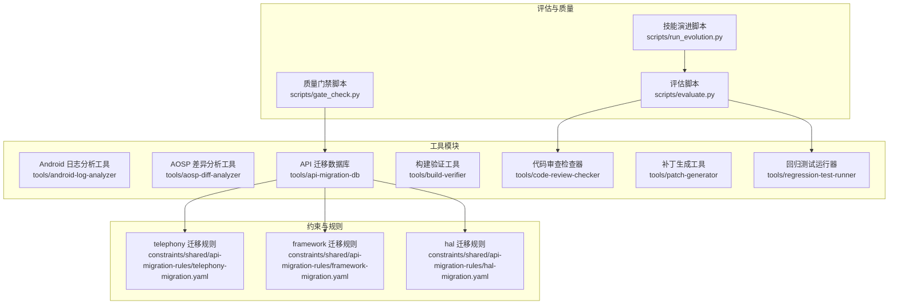
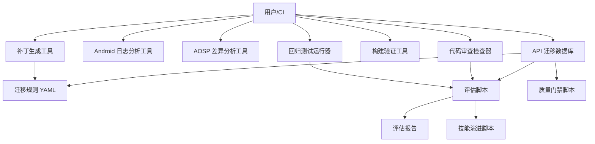
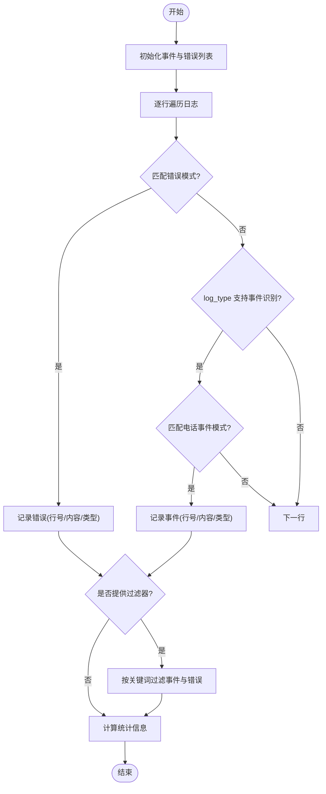
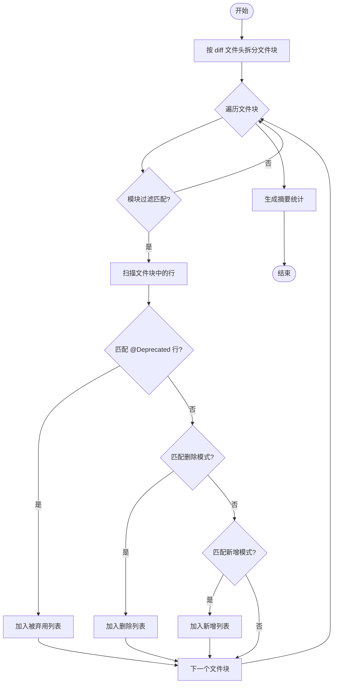
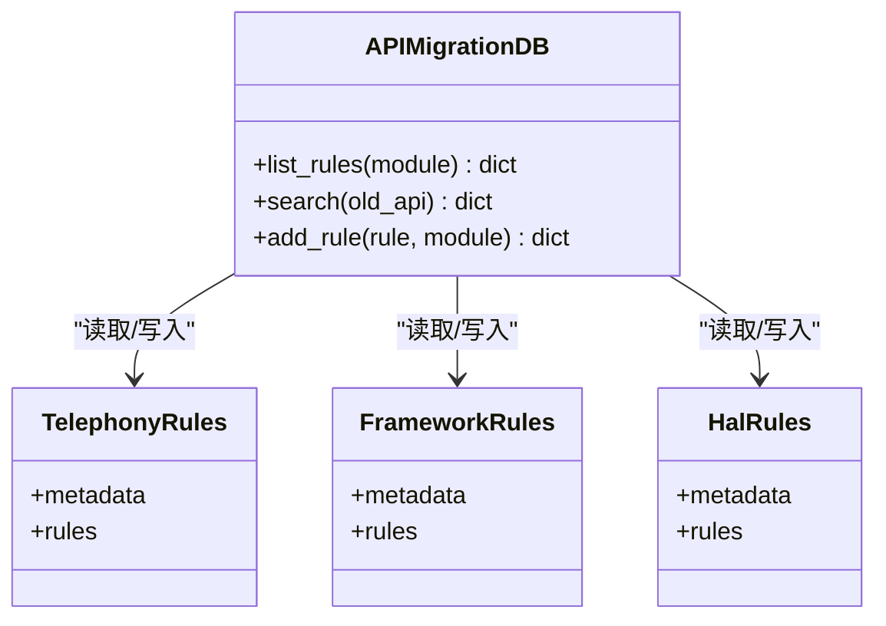
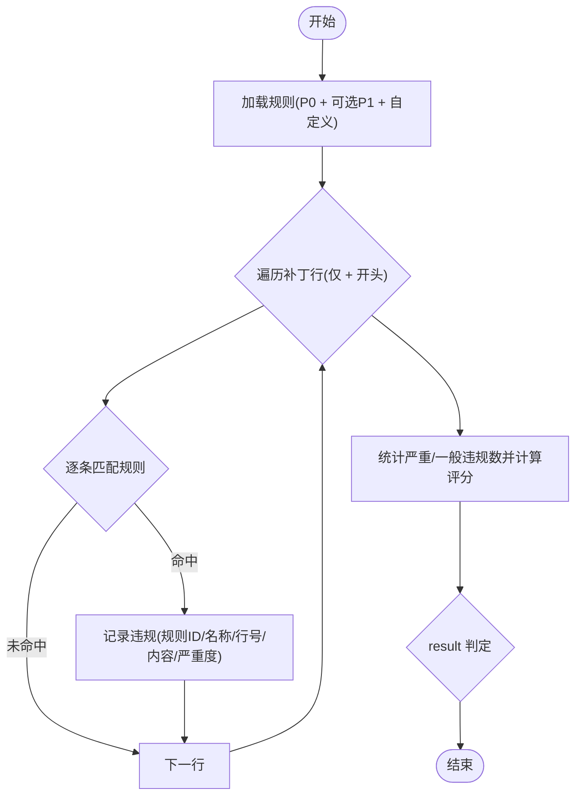
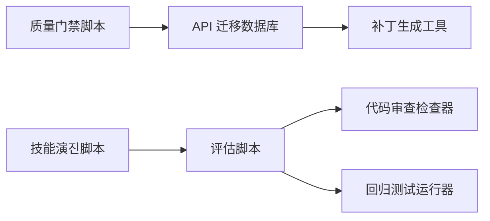

# 工具集系统

<cite>
**本文引用的文件**
- [tools/android-log-analyzer/tool.py](file://tools/android-log-analyzer/tool.py)
- [tools/android-log-analyzer/README.md](file://tools/android-log-analyzer/README.md)
- [tools/aosp-diff-analyzer/tool.py](file://tools/aosp-diff-analyzer/tool.py)
- [tools/aosp-diff-analyzer/README.md](file://tools/aosp-diff-analyzer/README.md)
- [tools/api-migration-db/tool.py](file://tools/api-migration-db/tool.py)
- [tools/api-migration-db/README.md](file://tools/api-migration-db/README.md)
- [constraints/shared/api-migration-rules/telephony-migration.yaml](file://constraints/shared/api-migration-rules/telephony-migration.yaml)
- [constraints/shared/api-migration-rules/framework-migration.yaml](file://constraints/shared/api-migration-rules/framework-migration.yaml)
- [constraints/shared/api-migration-rules/hal-migration.yaml](file://constraints/shared/api-migration-rules/hal-migration.yaml)
- [tools/build-verifier/tool.py](file://tools/build-verifier/tool.py)
- [tools/build-verifier/README.md](file://tools/build-verifier/README.md)
- [tools/code-review-checker/tool.py](file://tools/code-review-checker/tool.py)
- [tools/code-review-checker/README.md](file://tools/code-review-checker/README.md)
- [tools/patch-generator/tool.py](file://tools/patch-generator/tool.py)
- [tools/patch-generator/README.md](file://tools/patch-generator/README.md)
- [tools/regression-test-runner/tool.py](file://tools/regression-test-runner/tool.py)
- [tools/regression-test-runner/README.md](file://tools/regression-test-runner/README.md)
- [scripts/evaluate.py](file://scripts/evaluate.py)
- [scripts/gate_check.py](file://scripts/gate_check.py)
- [scripts/run_evolution.py](file://scripts/run_evolution.py)
</cite>

## 目录
1. [简介](#简介)
2. [项目结构](#项目结构)
3. [核心组件](#核心组件)
4. [架构总览](#架构总览)
5. [详细组件分析](#详细组件分析)
6. [依赖分析](#依赖分析)
7. [性能考虑](#性能考虑)
8. [故障排查指南](#故障排查指南)
9. [结论](#结论)
10. [附录](#附录)

## 简介
本文件为工具集系统的全面技术文档，覆盖以下工具模块：
- Android 日志分析工具：日志解析与异常检测
- AOSP 差异分析工具：框架 API 变更对比
- 补丁生成工具：基于迁移规则的自动化修复
- API 迁移数据库：迁移规则的查询与维护
- 构建验证工具：编译命令与目标校验
- 回归测试运行器：冒烟与功能回归测试
- 代码审查检查器：规则引擎与分级检查

文档同时提供各工具的配置项、参数说明、返回值格式、最佳实践与常见问题解决方案。

## 项目结构
工具集系统采用“按工具分目录”的组织方式，每个工具均提供独立的 Python 实现与用户说明。核心脚本位于 scripts 目录，用于评估、质量门禁与技能演进。

图表来源
- [tools/android-log-analyzer/tool.py:1-50](file://tools/android-log-analyzer/tool.py#L1-L50)
- [tools/aosp-diff-analyzer/tool.py:1-41](file://tools/aosp-diff-analyzer/tool.py#L1-L41)
- [tools/api-migration-db/tool.py:1-45](file://tools/api-migration-db/tool.py#L1-L45)
- [constraints/shared/api-migration-rules/telephony-migration.yaml:1-57](file://constraints/shared/api-migration-rules/telephony-migration.yaml#L1-L57)
- [constraints/shared/api-migration-rules/framework-migration.yaml:1-7](file://constraints/shared/api-migration-rules/framework-migration.yaml#L1-L7)
- [constraints/shared/api-migration-rules/hal-migration.yaml:1-7](file://constraints/shared/api-migration-rules/hal-migration.yaml#L1-L7)
- [tools/code-review-checker/tool.py:1-33](file://tools/code-review-checker/tool.py#L1-L33)
- [tools/regression-test-runner/tool.py:1-9](file://tools/regression-test-runner/tool.py#L1-L9)
- [scripts/evaluate.py:1-436](file://scripts/evaluate.py#L1-L436)
- [scripts/gate_check.py:1-507](file://scripts/gate_check.py#L1-L507)
- [scripts/run_evolution.py:1-567](file://scripts/run_evolution.py#L1-L567)

章节来源
- [tools/android-log-analyzer/tool.py:1-50](file://tools/android-log-analyzer/tool.py#L1-L50)
- [tools/aosp-diff-analyzer/tool.py:1-41](file://tools/aosp-diff-analyzer/tool.py#L1-L41)
- [tools/api-migration-db/tool.py:1-45](file://tools/api-migration-db/tool.py#L1-L45)
- [tools/build-verifier/tool.py:1-10](file://tools/build-verifier/tool.py#L1-L10)
- [tools/code-review-checker/tool.py:1-33](file://tools/code-review-checker/tool.py#L1-L33)
- [tools/patch-generator/tool.py:1-24](file://tools/patch-generator/tool.py#L1-L24)
- [tools/regression-test-runner/tool.py:1-9](file://tools/regression-test-runner/tool.py#L1-L9)
- [scripts/evaluate.py:1-436](file://scripts/evaluate.py#L1-L436)
- [scripts/gate_check.py:1-507](file://scripts/gate_check.py#L1-L507)
- [scripts/run_evolution.py:1-567](file://scripts/run_evolution.py#L1-L567)

## 核心组件
- Android 日志分析工具：基于正则匹配识别错误与电话事件，支持过滤与统计输出。
- AOSP 差异分析工具：解析 diff 内容，提取被弃用、删除与新增的 API，并按文件与模块聚合。
- API 迁移数据库：提供迁移规则的列表、搜索与新增能力，规则来源于约束目录的 YAML 文件。
- 构建验证工具：对编译命令进行基础校验，返回通过/失败状态及错误列表。
- 回归测试运行器：对测试目标执行冒烟或功能回归，输出通过数、失败数与通过率。
- 代码审查检查器：基于规则集合进行 P0/P1/P2 分级检查，支持自定义规则，输出违规与评分。
- 补丁生成工具：根据迁移规则与受影响文件模式生成补丁描述，统计生成/跳过/错误数量。

章节来源
- [tools/android-log-analyzer/tool.py:5-46](file://tools/android-log-analyzer/tool.py#L5-L46)
- [tools/aosp-diff-analyzer/tool.py:5-27](file://tools/aosp-diff-analyzer/tool.py#L5-L27)
- [tools/api-migration-db/tool.py:4-36](file://tools/api-migration-db/tool.py#L4-L36)
- [tools/build-verifier/tool.py:2-6](file://tools/build-verifier/tool.py#L2-L6)
- [tools/regression-test-runner/tool.py:2-5](file://tools/regression-test-runner/tool.py#L2-L5)
- [tools/code-review-checker/tool.py:4-29](file://tools/code-review-checker/tool.py#L4-L29)
- [tools/patch-generator/tool.py:2-20](file://tools/patch-generator/tool.py#L2-L20)

## 架构总览
工具集系统采用“工具类 + 规则库 + 评估/质量脚本”的分层架构：
- 工具类：每个工具封装独立的解析/分析/生成逻辑，提供统一的处理入口函数。
- 规则库：通过 YAML 文件维护 API 迁移规则，供迁移数据库与补丁生成工具使用。
- 评估与质量：提供自动化评估、质量门禁与技能演进流程，贯穿工具链的持续改进。

图表来源
- [tools/api-migration-db/tool.py:1-45](file://tools/api-migration-db/tool.py#L1-L45)
- [constraints/shared/api-migration-rules/telephony-migration.yaml:1-57](file://constraints/shared/api-migration-rules/telephony-migration.yaml#L1-L57)
- [scripts/evaluate.py:1-436](file://scripts/evaluate.py#L1-L436)
- [scripts/gate_check.py:1-507](file://scripts/gate_check.py#L1-L507)
- [scripts/run_evolution.py:1-567](file://scripts/run_evolution.py#L1-L567)

## 详细组件分析

### Android 日志分析工具
- 功能特性
  - 错误模式识别：通过预设正则匹配 Java 异常、致命异常、内核恐慌等。
  - 电话事件识别：针对 RIL/RILC/RILD、Telephony Framework、IMS/VoLTE 等事件进行标记。
  - 过滤与统计：支持关键词过滤与行号标注，输出事件计数、错误计数与日志类型统计。
- 处理逻辑
  - 遍历日志逐行匹配错误与事件模式，记录行号与内容。
  - 可选过滤器对事件与错误进行二次筛选。
  - 统计总行数、事件数、错误数与日志类型。
- 返回值
  - events: 匹配到的事件列表（含行号、内容、类型）
  - errors: 匹配到的错误列表（含行号、内容、类型）
  - statistics: 总行数、事件数、错误数、日志类型
- 使用建议
  - 指定合适的 log_type 以启用电话事件识别。
  - 使用 filters 精确缩小关注范围。
  - 结合日志类型与统计信息进行异常定位与趋势分析。

图表来源
- [tools/android-log-analyzer/tool.py:31-46](file://tools/android-log-analyzer/tool.py#L31-L46)

章节来源
- [tools/android-log-analyzer/tool.py:5-46](file://tools/android-log-analyzer/tool.py#L5-L46)
- [tools/android-log-analyzer/README.md:1-13](file://tools/android-log-analyzer/README.md#L1-L13)

### AOSP 差异分析工具
- 功能特性
  - 解析 diff 内容，按文件切分。
  - 识别被弃用、删除与新增的 API，标注文件路径与变更类型。
  - 支持模块过滤，仅处理特定路径下的 Java 文件。
- 处理逻辑
  - 以 diff 文件头为界拆分文件块。
  - 在每个文件块中扫描行，匹配弃用、删除与新增模式。
  - 聚合结果并生成摘要统计。
- 返回值
  - deprecated_apis: 被标记为弃用的 API 列表
  - removed_apis: 删除的 API 列表
  - added_apis: 新增的 API 列表
  - summary: 源版本、目标版本与各类统计计数
- 使用建议
  - 使用 module_filter 精确限定模块范围。
  - 结合版本信息与变更类型进行影响面评估。

图表来源
- [tools/aosp-diff-analyzer/tool.py:10-37](file://tools/aosp-diff-analyzer/tool.py#L10-L37)

章节来源
- [tools/aosp-diff-analyzer/tool.py:5-37](file://tools/aosp-diff-analyzer/tool.py#L5-L37)
- [tools/aosp-diff-analyzer/README.md:1-14](file://tools/aosp-diff-analyzer/README.md#L1-L14)

### API 迁移数据库
- 功能特性
  - 列出规则：可按模块过滤列出迁移规则。
  - 搜索规则：按旧 API 名称模糊搜索。
  - 新增规则：向指定模块的规则文件追加新规则。
- 数据模型
  - 规则文件位于 constraints/shared/api-migration-rules/，命名形如 {module}-migration.yaml。
  - 每个文件包含 metadata 与 rules 数组。
- 返回值
  - list: { rules: [...], total: N }
  - search: { rules: [...], total: N }
  - add: { status: "ok", rule_id: "...", total: N }
- 使用建议
  - 为 telephony、framework、hal 等模块分别维护规则文件。
  - 新增规则时确保字段完整（如 change_type、confidence、affected_files_pattern）。

图表来源
- [tools/api-migration-db/tool.py:4-36](file://tools/api-migration-db/tool.py#L4-L36)
- [constraints/shared/api-migration-rules/telephony-migration.yaml:1-57](file://constraints/shared/api-migration-rules/telephony-migration.yaml#L1-L57)
- [constraints/shared/api-migration-rules/framework-migration.yaml:1-7](file://constraints/shared/api-migration-rules/framework-migration.yaml#L1-L7)
- [constraints/shared/api-migration-rules/hal-migration.yaml:1-7](file://constraints/shared/api-migration-rules/hal-migration.yaml#L1-L7)

章节来源
- [tools/api-migration-db/tool.py:4-36](file://tools/api-migration-db/tool.py#L4-L36)
- [tools/api-migration-db/README.md:1-4](file://tools/api-migration-db/README.md#L1-L4)
- [constraints/shared/api-migration-rules/telephony-migration.yaml:1-57](file://constraints/shared/api-migration-rules/telephony-migration.yaml#L1-L57)
- [constraints/shared/api-migration-rules/framework-migration.yaml:1-7](file://constraints/shared/api-migration-rules/framework-migration.yaml#L1-L7)
- [constraints/shared/api-migration-rules/hal-migration.yaml:1-7](file://constraints/shared/api-migration-rules/hal-migration.yaml#L1-L7)

### 构建验证工具
- 功能特性
  - 校验构建命令是否为空，支持传入目标与补丁文件列表。
- 返回值
  - result: "pass" 或 "fail"
  - errors: 错误列表
  - warnings: 警告列表
- 使用建议
  - 在 Android 源码环境下实际执行编译，该工具仅做基础校验。

章节来源
- [tools/build-verifier/tool.py:2-6](file://tools/build-verifier/tool.py#L2-L6)
- [tools/build-verifier/README.md:1-4](file://tools/build-verifier/README.md#L1-L4)

### 回归测试运行器
- 功能特性
  - 执行冒烟或功能回归测试，支持设备序列号。
- 返回值
  - result: "pass"
  - passed/failed/total/pass_rate/failures/test_type
- 使用建议
  - 明确 test_type 并准备对应测试目标。
  - 关注 pass_rate 与 failures 以评估稳定性。

章节来源
- [tools/regression-test-runner/tool.py:2-5](file://tools/regression-test-runner/tool.py#L2-L5)
- [tools/regression-test-runner/README.md:1-3](file://tools/regression-test-runner/README.md#L1-L3)

### 代码审查检查器
- 功能特性
  - P0 规则（阻断级）：路径限制、硬编码密钥、API 真实性等。
  - P1 规则（警告级）：编码风格、弃用 API、TODO 完整性等。
  - 支持自定义规则扩展。
- 处理逻辑
  - 仅检查新增行（以 "+" 开头），按规则匹配并记录违规。
  - 计算严重违规与一般违规数量，生成综合评分。
- 返回值
  - result: "pass" / "warning" / "fail"
  - violations: 违规列表（含规则 ID、名称、行号、内容片段、严重程度）
  - score: 综合评分
  - critical_count/warning_count: 严重/一般违规数
- 使用建议
  - 优先解决 P0 违规后再提交。
  - 通过自定义规则补充团队特有的编码规范。

图表来源
- [tools/code-review-checker/tool.py:16-29](file://tools/code-review-checker/tool.py#L16-L29)

章节来源
- [tools/code-review-checker/tool.py:4-29](file://tools/code-review-checker/tool.py#L4-L29)
- [tools/code-review-checker/README.md:1-4](file://tools/code-review-checker/README.md#L1-L4)

### 补丁生成工具
- 功能特性
  - 根据迁移规则与受影响文件模式生成补丁描述。
  - 统计生成、跳过与错误数量。
- 处理逻辑
  - 遍历迁移规则，校验旧/新 API 是否存在。
  - 若提供 source_code_paths，则按模式筛选受影响文件。
  - 生成补丁描述并更新统计。
- 返回值
  - patches: 补丁列表（含规则 ID、旧/新 API、变更类型、置信度、是否自动、受影响文件）
  - statistics: { generated, skipped, errors }
- 使用建议
  - 确保 affected_files_pattern 能准确匹配目标文件。
  - 对非自动规则谨慎应用，结合人工复核。

章节来源
- [tools/patch-generator/tool.py:2-20](file://tools/patch-generator/tool.py#L2-L20)
- [tools/patch-generator/README.md:1-5](file://tools/patch-generator/README.md#L1-L5)

## 依赖分析
- 工具间耦合
  - API 迁移数据库为补丁生成工具提供规则来源。
  - 评估脚本对代码审查检查器与回归测试运行器进行统一评估。
  - 质量门禁脚本依赖约束文件中的安全红线等元数据。
- 外部依赖
  - 评估与质量脚本使用 rich 控制台渲染与进度条。
  - 技能演进脚本依赖 Claude Code CLI 进行 AI 变体生成。

图表来源
- [tools/api-migration-db/tool.py:1-45](file://tools/api-migration-db/tool.py#L1-L45)
- [tools/patch-generator/tool.py:1-24](file://tools/patch-generator/tool.py#L1-L24)
- [scripts/evaluate.py:1-436](file://scripts/evaluate.py#L1-L436)
- [scripts/gate_check.py:1-507](file://scripts/gate_check.py#L1-L507)
- [scripts/run_evolution.py:1-567](file://scripts/run_evolution.py#L1-L567)

章节来源
- [scripts/evaluate.py:1-436](file://scripts/evaluate.py#L1-L436)
- [scripts/gate_check.py:1-507](file://scripts/gate_check.py#L1-L507)
- [scripts/run_evolution.py:1-567](file://scripts/run_evolution.py#L1-L567)

## 性能考虑
- 正则匹配复杂度
  - 日志分析与差异分析的正则匹配为线性扫描，整体复杂度 O(N)（N 为行数）。
  - 建议合理设置过滤器与模块过滤，减少无效匹配。
- 文件拆分与内存占用
  - 差异分析按文件块拆分，避免一次性加载整个 diff。
- 规则检索
  - API 迁移数据库的搜索为线性扫描，规则量较大时可考虑索引优化。
- 评估与质量门禁
  - 评估脚本支持并发评估变体，但受外部工具（如 Claude Code CLI）与 I/O 限制。
  - 质量门禁脚本对源文件进行全量扫描，建议在 CI 中按模块分批执行。

## 故障排查指南
- Android 日志分析
  - 症状：未识别到任何事件或错误
  - 排查：确认 log_type 是否正确；检查过滤器是否过于严格；核对日志格式。
- AOSP 差异分析
  - 症状：模块过滤无效
  - 排查：确认 module_filter 与文件路径一致；确保文件后缀为 .java。
- API 迁移数据库
  - 症状：规则未生效
  - 排查：确认规则文件命名与模块一致；检查 metadata.module 字段；验证 rules 数组格式。
- 构建验证工具
  - 症状：始终返回 fail
  - 排查：确认传入了有效的 build_command；targets 与 patch_files 格式正确。
- 回归测试运行器
  - 症状：pass_rate 低
  - 排查：检查 test_targets 与 test_type；确认设备连接与权限。
- 代码审查检查器
  - 症状：自定义规则不生效
  - 排查：确认规则格式与 pattern 正确；检查 check_level 是否包含自定义规则。
- 补丁生成工具
  - 症状：生成数量为 0
  - 排查：确认 migration_rules 字段完整；检查 affected_files_pattern 是否匹配目标文件。

章节来源
- [tools/android-log-analyzer/tool.py:31-46](file://tools/android-log-analyzer/tool.py#L31-L46)
- [tools/aosp-diff-analyzer/tool.py:10-27](file://tools/aosp-diff-analyzer/tool.py#L10-L27)
- [tools/api-migration-db/tool.py:10-36](file://tools/api-migration-db/tool.py#L10-L36)
- [tools/build-verifier/tool.py:3-6](file://tools/build-verifier/tool.py#L3-L6)
- [tools/regression-test-runner/tool.py:3-5](file://tools/regression-test-runner/tool.py#L3-L5)
- [tools/code-review-checker/tool.py:16-29](file://tools/code-review-checker/tool.py#L16-L29)
- [tools/patch-generator/tool.py:3-20](file://tools/patch-generator/tool.py#L3-L20)

## 结论
工具集系统提供了从日志分析、差异对比、规则管理到自动化评估与质量门禁的完整能力。通过清晰的工具边界与统一的评估/质量脚本，能够支撑持续集成与技能演进流程。建议在实际使用中结合模块化约束与规则文件，配合评估与质量门禁脚本，实现稳定可靠的自动化工作流。

## 附录

### 工具参数与返回值一览
- Android 日志分析工具
  - 输入：log_content（字符串，必填）、log_type（字符串，可选，默认 logcat）、filters（数组，可选）
  - 输出：events、errors、statistics
- AOSP 差异分析工具
  - 输入：source_version（字符串，必填）、target_version（字符串，必填）、diff_content（字符串，必填）、module_filter（字符串，可选）
  - 输出：deprecated_apis、removed_apis、added_apis、summary
- API 迁移数据库
  - 输入：action（list/search/add，必填）、module（可选）、old_api（可选）、rule（可选）
  - 输出：list/search 返回 rules 与 total；add 返回 status、rule_id、total
- 构建验证工具
  - 输入：build_command（字符串，必填）、targets（数组，可选）、patch_files（数组，可选）
  - 输出：result、errors、warnings
- 回归测试运行器
  - 输入：test_targets（数组，必填）、test_type（字符串，可选，默认 smoke）、device_serial（字符串，可选）
  - 输出：result、passed、failed、total、pass_rate、failures、test_type
- 代码审查检查器
  - 输入：patch_content（字符串，必填）、check_level（字符串，可选，默认 P0）、rules（数组，可选）
  - 输出：result、violations、score、critical_count、warning_count
- 补丁生成工具
  - 输入：migration_rules（数组，必填）、target_files（数组，必填）、source_code_paths（数组，可选）
  - 输出：patches、statistics

章节来源
- [tools/android-log-analyzer/README.md:4-12](file://tools/android-log-analyzer/README.md#L4-L12)
- [tools/aosp-diff-analyzer/README.md:4-13](file://tools/aosp-diff-analyzer/README.md#L4-L13)
- [tools/api-migration-db/README.md:1-4](file://tools/api-migration-db/README.md#L1-L4)
- [tools/build-verifier/README.md:1-4](file://tools/build-verifier/README.md#L1-L4)
- [tools/regression-test-runner/README.md:1-3](file://tools/regression-test-runner/README.md#L1-L3)
- [tools/code-review-checker/README.md:1-4](file://tools/code-review-checker/README.md#L1-L4)
- [tools/patch-generator/README.md:1-5](file://tools/patch-generator/README.md#L1-L5)