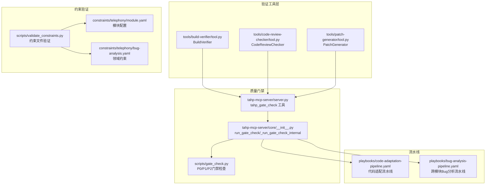
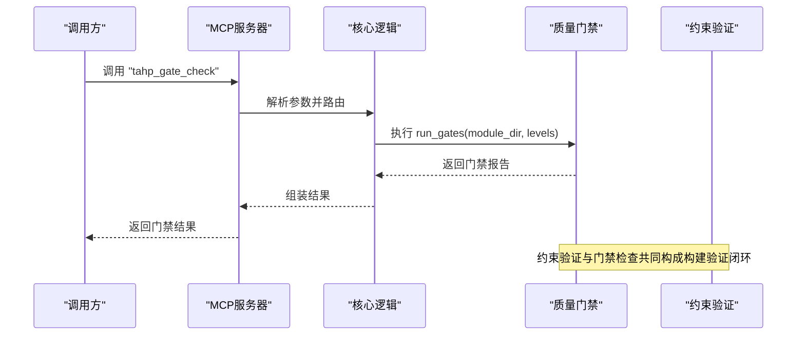
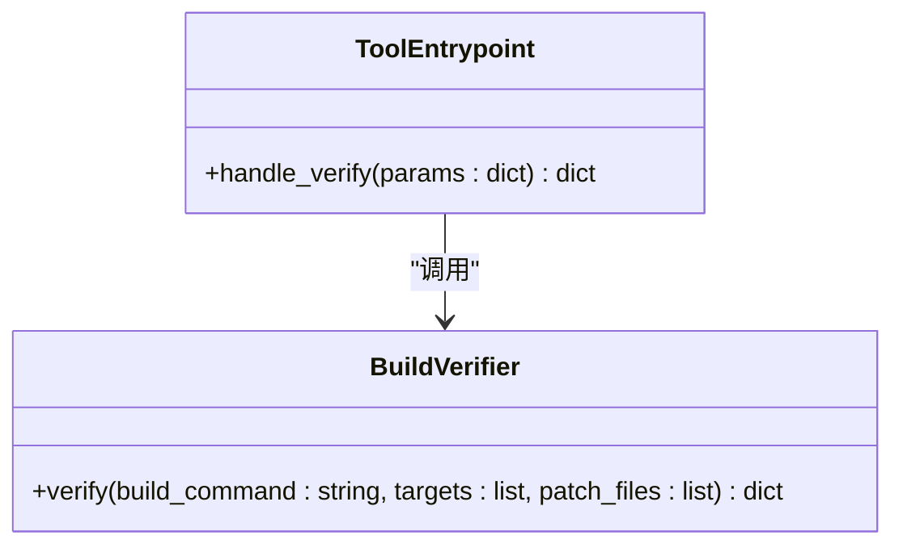
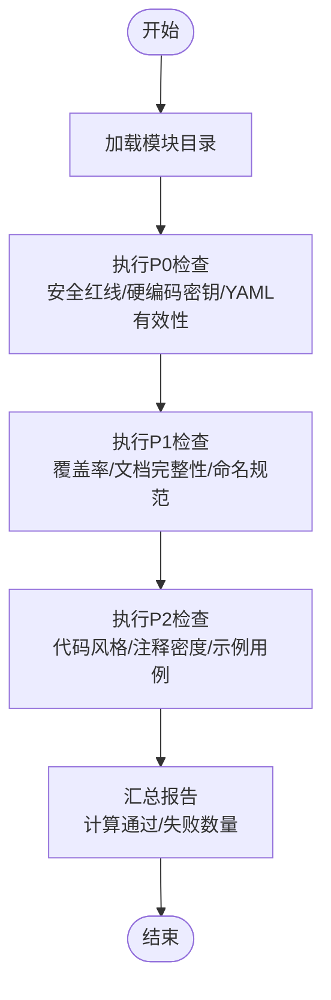
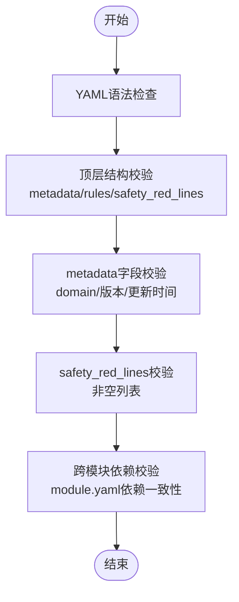
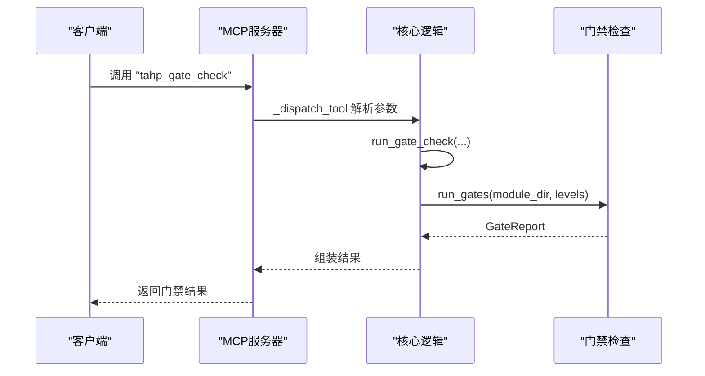
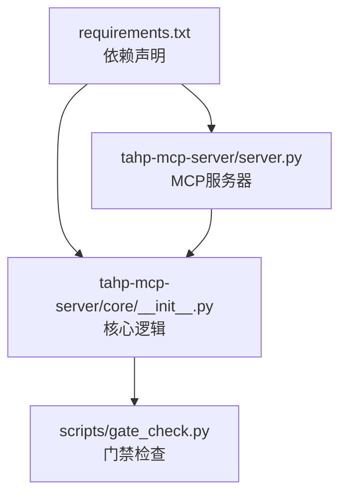
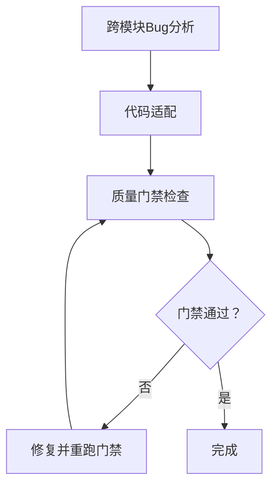

# 构建验证工具

<cite>
**本文档引用的文件**
- [tools/build-verifier/tool.py](file://tools/build-verifier/tool.py)
- [tools/build-verifier/README.md](file://tools/build-verifier/README.md)
- [scripts/gate_check.py](file://scripts/gate_check.py)
- [scripts/validate_constraints.py](file://scripts/validate_constraints.py)
- [tahp-mcp-server/server.py](file://tahp-mcp-server/server.py)
- [tahp-mcp-server/core/__init__.py](file://tahp-mcp-server/core/__init__.py)
- [tahp-mcp-server/config.py](file://tahp-mcp-server/config.py)
- [requirements.txt](file://requirements.txt)
- [playbooks/code-adaptation-pipeline.yaml](file://playbooks/code-adaptation-pipeline.yaml)
- [playbooks/bug-analysis-pipeline.yaml](file://playbooks/bug-analysis-pipeline.yaml)
- [constraints/telephony/module.yaml](file://constraints/telephony/module.yaml)
- [constraints/telephony/bug-analysis.yaml](file://constraints/telephony/bug-analysis.yaml)
- [tools/code-review-checker/tool.py](file://tools/code-review-checker/tool.py)
- [tools/patch-generator/tool.py](file://tools/patch-generator/tool.py)
- [templates/module-template/module.yaml.template](file://templates/module-template/module.yaml.template)
</cite>

## 目录
1. [简介](#简介)
2. [项目结构](#项目结构)
3. [核心组件](#核心组件)
4. [架构概览](#架构概览)
5. [详细组件分析](#详细组件分析)
6. [依赖分析](#依赖分析)
7. [性能考虑](#性能考虑)
8. [故障排查指南](#故障排查指南)
9. [结论](#结论)
10. [附录](#附录)

## 简介
本文件面向构建验证工具的使用者与维护者，系统化阐述 TAHP 项目中的构建验证能力与实现机制。重点涵盖：
- 构建脚本检查、依赖关系验证与构建产物完整性检测的策略与落地
- 支持的构建系统与验证策略（如 Make、Gradle、Bazel 的适配思路）
- 构建配置检查、编译错误检测与性能指标监控
- 构建验证最佳实践、常见问题诊断与自动修复建议

当前仓库中，构建验证主要通过“质量门禁”和“约束文件验证”两大维度实现，并在 MCP 服务器中以工具形式提供统一调用入口。

## 项目结构
构建验证相关能力分布于以下模块：
- 质量门禁检查：scripts/gate_check.py 提供 P0/P1/P2 三级门禁检查逻辑
- 约束文件验证：scripts/validate_constraints.py 提供约束 YAML 的结构与语义校验
- 构建验证工具封装：tools/build-verifier/tool.py 提供 BuildVerifier 类用于构建验证
- MCP 服务器：tahp-mcp-server/server.py 暴露 tahp_gate_check 等工具，核心逻辑在 core/__init__.py
- 构建流水线：playbooks 下的 YAML 描述了跨模块与代码适配的执行步骤
- 约束文件样例：constraints/telephony/ 下包含模块配置与领域约束示例
- 辅助工具：tools/code-review-checker、tools/patch-generator 等提供代码审查与补丁生成能力

**图表来源**
- [tools/build-verifier/tool.py:1-10](file://tools/build-verifier/tool.py#L1-L10)
- [tools/code-review-checker/tool.py:1-33](file://tools/code-review-checker/tool.py#L1-L33)
- [tools/patch-generator/tool.py:1-24](file://tools/patch-generator/tool.py#L1-L24)
- [scripts/gate_check.py:1-507](file://scripts/gate_check.py#L1-L507)
- [tahp-mcp-server/core/__init__.py:366-460](file://tahp-mcp-server/core/__init__.py#L366-L460)
- [tahp-mcp-server/server.py:178-204](file://tahp-mcp-server/server.py#L178-L204)
- [scripts/validate_constraints.py:1-360](file://scripts/validate_constraints.py#L1-L360)
- [constraints/telephony/module.yaml:1-43](file://constraints/telephony/module.yaml#L1-L43)
- [constraints/telephony/bug-analysis.yaml:1-110](file://constraints/telephony/bug-analysis.yaml#L1-L110)
- [playbooks/code-adaptation-pipeline.yaml:1-35](file://playbooks/code-adaptation-pipeline.yaml#L1-L35)
- [playbooks/bug-analysis-pipeline.yaml:1-43](file://playbooks/bug-analysis-pipeline.yaml#L1-L43)

**章节来源**
- [tools/build-verifier/tool.py:1-10](file://tools/build-verifier/tool.py#L1-L10)
- [scripts/gate_check.py:1-507](file://scripts/gate_check.py#L1-L507)
- [scripts/validate_constraints.py:1-360](file://scripts/validate_constraints.py#L1-L360)
- [tahp-mcp-server/server.py:1-485](file://tahp-mcp-server/server.py#L1-L485)
- [tahp-mcp-server/core/__init__.py:1-621](file://tahp-mcp-server/core/__init__.py#L1-L621)

## 核心组件
- BuildVerifier：提供构建验证入口，接收构建命令、目标与补丁文件参数，返回验证结果、错误与告警。当前实现为占位，实际编译需在 Android 源码环境中执行。
- 质量门禁检查（GateCheck）：实现 P0（阻塞）、P1（警告）、P2（记录）三级检查，覆盖约束文件完整性、安全红线、文档规范、命名约定、代码风格等。
- 约束文件验证（ConstraintValidator）：对约束 YAML 的顶层结构、metadata 字段、safety_red_lines、跨模块依赖一致性进行校验。
- MCP 服务器工具：通过 tahp_gate_check 工具对外提供门禁检查能力；核心逻辑在 core/__init__.py 中复用 gate_check 的实现。
- 流水线：代码适配与跨模块 Bug 分析流水线在 YAML 中定义，门禁检查作为关键步骤嵌入执行流程。

**章节来源**
- [tools/build-verifier/tool.py:1-10](file://tools/build-verifier/tool.py#L1-L10)
- [scripts/gate_check.py:36-93](file://scripts/gate_check.py#L36-L93)
- [scripts/validate_constraints.py:40-65](file://scripts/validate_constraints.py#L40-L65)
- [tahp-mcp-server/core/__init__.py:366-460](file://tahp-mcp-server/core/__init__.py#L366-L460)

## 架构概览
下图展示了构建验证在 TAHP 生态中的位置与交互关系：

**图表来源**
- [tahp-mcp-server/server.py:343-447](file://tahp-mcp-server/server.py#L343-L447)
- [tahp-mcp-server/core/__init__.py:366-460](file://tahp-mcp-server/core/__init__.py#L366-L460)
- [scripts/gate_check.py:368-435](file://scripts/gate_check.py#L368-L435)

## 详细组件分析

### 构建验证器（BuildVerifier）
- 功能定位：提供构建验证入口，接收构建命令、目标与补丁文件参数，返回验证结果、错误与告警。
- 当前实现：占位实现，若未提供构建命令则返回错误；实际编译需在 Android 源码环境中执行。
- 适用场景：作为统一的构建验证接口，便于集成到 CI/CD 或 MCP 工具链中。

**图表来源**
- [tools/build-verifier/tool.py:2-9](file://tools/build-verifier/tool.py#L2-L9)

**章节来源**
- [tools/build-verifier/tool.py:1-10](file://tools/build-verifier/tool.py#L1-L10)
- [tools/build-verifier/README.md:1-4](file://tools/build-verifier/README.md#L1-L4)

### 质量门禁检查（GateCheck）
- 门禁等级：
  - P0（阻塞）：安全红线、硬编码密钥、约束文件有效性等
  - P1（警告）：测试覆盖率、文档完整性、命名规范等
  - P2（记录）：代码风格、注释密度、示例用例等
- 关键检查点：
  - safety_red_lines 存在性与非空性
  - 硬编码密钥检测（正则匹配）
  - YAML 文件语法与根映射校验
  - 测试用例数量与覆盖率估算
  - module.yaml 必填字段与命名规范
  - 代码风格与注释密度统计
- 报告聚合：支持按等级汇总，计算通过/失败数量，输出控制台表格与退出码。

**图表来源**
- [scripts/gate_check.py:395-435](file://scripts/gate_check.py#L395-L435)

**章节来源**
- [scripts/gate_check.py:99-128](file://scripts/gate_check.py#L99-L128)
- [scripts/gate_check.py:131-156](file://scripts/gate_check.py#L131-L156)
- [scripts/gate_check.py:159-187](file://scripts/gate_check.py#L159-L187)
- [scripts/gate_check.py:194-216](file://scripts/gate_check.py#L194-L216)
- [scripts/gate_check.py:219-249](file://scripts/gate_check.py#L219-L249)
- [scripts/gate_check.py:252-270](file://scripts/gate_check.py#L252-L270)
- [scripts/gate_check.py:277-302](file://scripts/gate_check.py#L277-L302)
- [scripts/gate_check.py:305-332](file://scripts/gate_check.py#L305-L332)
- [scripts/gate_check.py:335-349](file://scripts/gate_check.py#L335-L349)

### 约束文件验证（ConstraintValidator）
- 校验范围：
  - 顶层结构：metadata、rules、safety_red_lines 是否存在
  - metadata 字段：module、domain、version、author、last_updated 等
  - safety_red_lines：必须为非空列表（空列表给出警告）
  - 跨模块依赖：module.yaml 中的 scope.dependencies 引用模块是否存在于已知模块集合
- 输出格式：按文件聚合错误/警告/信息，支持严格模式下的额外校验（如版本格式、日期格式）。

**图表来源**
- [scripts/validate_constraints.py:80-182](file://scripts/validate_constraints.py#L80-L182)
- [scripts/validate_constraints.py:184-238](file://scripts/validate_constraints.py#L184-L238)

**章节来源**
- [scripts/validate_constraints.py:80-182](file://scripts/validate_constraints.py#L80-L182)
- [scripts/validate_constraints.py:184-238](file://scripts/validate_constraints.py#L184-L238)

### MCP 服务器中的门禁检查
- 工具定义：tahp_gate_check 接收 task_id 或 module 参数，以及门禁级别（P0/P1/P2/all），返回门禁结果与明细。
- 核心实现：run_gate_check 内部通过 _run_gate_check_internal 复用 gate_check 的逻辑；若 gate_check 模块不可用，则退化为简化版检查。
- 集成方式：MCP 服务器在 handle_call_tool 中分发到 _dispatch_tool，再调用 run_gate_check。

**图表来源**
- [tahp-mcp-server/server.py:412-418](file://tahp-mcp-server/server.py#L412-L418)
- [tahp-mcp-server/core/__init__.py:366-460](file://tahp-mcp-server/core/__init__.py#L366-L460)

**章节来源**
- [tahp-mcp-server/server.py:178-204](file://tahp-mcp-server/server.py#L178-L204)
- [tahp-mcp-server/core/__init__.py:366-460](file://tahp-mcp-server/core/__init__.py#L366-L460)

### 构建系统支持与验证策略
- 当前实现：仓库中的构建验证以“质量门禁”和“约束文件验证”为主，未直接集成具体构建系统的编译执行（如 Make、Gradle、Bazel）。构建验证器 BuildVerifier 为占位实现，明确指出实际编译需在 Android 源码环境中执行。
- 适配建议：
  - Make：通过构建命令参数传入 make 目标，结合产物完整性检查（如关键产物是否存在、符号表/日志文件）进行验证。
  - Gradle：通过 gradlew assemble 或具体变体，结合构建日志解析错误与警告，统计编译耗时与产物大小。
  - Bazel：通过 bazel build 指令，解析 blaze-out 目录产物与构建日志，进行一致性与完整性校验。
- 与门禁检查结合：在代码适配流水线中，将门禁检查作为关键步骤，确保每次修改均满足安全与质量要求。

**章节来源**
- [tools/build-verifier/README.md:1-4](file://tools/build-verifier/README.md#L1-L4)
- [playbooks/code-adaptation-pipeline.yaml:25-29](file://playbooks/code-adaptation-pipeline.yaml#L25-L29)

### 构建配置检查、编译错误检测与性能指标监控
- 构建配置检查：结合约束文件中的 scope.includes/excludes 与 dependencies，确保修改范围符合模块边界与依赖关系。
- 编译错误检测：在构建系统适配后，解析构建日志中的错误与警告，统计失败任务数与告警密度。
- 性能指标监控：记录构建耗时、产物体积、增量编译命中率等指标，作为持续改进依据。

**章节来源**
- [constraints/telephony/module.yaml:11-43](file://constraints/telephony/module.yaml#L11-L43)
- [playbooks/code-adaptation-pipeline.yaml:25-29](file://playbooks/code-adaptation-pipeline.yaml#L25-L29)

### 最佳实践
- 配置验证规则：
  - 在 module.yaml 中明确 scope.includes/excludes 与 dependencies，避免越界修改。
  - 在约束文件中设置 safety_red_lines，形成安全红线。
- 处理常见构建问题：
  - 约束文件缺失：确保每个模块至少包含一个领域约束文件（除 module.yaml 外）。
  - 硬编码密钥：使用配置注入而非硬编码，定期扫描并清理遗留密钥。
  - YAML 语法错误：使用 validate_constraints 工具在提交前进行本地校验。
- 优化构建流程：
  - 将门禁检查前置到流水线，尽早发现违规与潜在问题。
  - 结合代码审查工具（如 code-review-checker）进行自动化审查，降低人工成本。

**章节来源**
- [scripts/validate_constraints.py:239-278](file://scripts/validate_constraints.py#L239-L278)
- [scripts/gate_check.py:395-435](file://scripts/gate_check.py#L395-L435)
- [tools/code-review-checker/tool.py:1-33](file://tools/code-review-checker/tool.py#L1-L33)

### 构建失败诊断与自动修复建议
- 失败诊断：
  - 门禁失败：根据 GateReport 中的检查项与详情定位问题来源（如缺少安全红线、硬编码密钥、YAML 语法错误等）。
  - 约束文件问题：使用 validate_constraints 工具查看具体错误与警告，逐项修复。
- 自动修复建议：
  - 自动生成 module.yaml 模板：参考模块模板文件，快速填充模块基本信息与边界。
  - 补丁生成：在通过门禁后，使用 patch-generator 生成标准化补丁，减少手工修改误差。

**章节来源**
- [templates/module-template/module.yaml.template:1-70](file://templates/module-template/module.yaml.template#L1-L70)
- [tools/patch-generator/tool.py:1-24](file://tools/patch-generator/tool.py#L1-L24)

## 依赖分析
- 外部依赖：项目使用 PyYAML、Click、Rich 等库进行 YAML 解析、命令行与终端渲染。
- 内部依赖：MCP 服务器通过 sys.path 注入 scripts 目录，动态导入 gate_check 模块；核心逻辑在 core/__init__.py 中复用门禁检查。

**图表来源**
- [requirements.txt:1-9](file://requirements.txt#L1-L9)
- [tahp-mcp-server/server.py:1-485](file://tahp-mcp-server/server.py#L1-L485)
- [tahp-mcp-server/core/__init__.py:1-621](file://tahp-mcp-server/core/__init__.py#L1-L621)

**章节来源**
- [requirements.txt:1-9](file://requirements.txt#L1-L9)
- [tahp-mcp-server/core/__init__.py:410-420](file://tahp-mcp-server/core/__init__.py#L410-L420)

## 性能考虑
- 门禁检查复杂度：主要为文件遍历与正则匹配，整体复杂度与模块规模线性相关；建议在 CI 中缓存检查结果，减少重复扫描。
- 约束验证复杂度：YAML 解析与字段校验开销较小；跨模块依赖检查需维护模块索引，建议在大型项目中引入索引缓存。
- 渲染与输出：Rich 控制台渲染在大量检查项时可能增加输出时间，建议在批处理模式下减少详细输出。

## 故障排查指南
- 门禁检查失败：
  - P0 失败：优先解决安全红线与硬编码密钥问题；确保约束文件有效且存在。
  - P1 失败：补齐文档字段、规范命名、提升测试用例数量。
  - P2 信息：关注代码风格与注释密度，逐步改善。
- 约束验证失败：
  - YAML 语法错误：使用 validate_constraints 工具定位并修复。
  - metadata 字段缺失：按模板补齐必填字段。
  - 跨模块依赖未知：检查 module.yaml 中的依赖模块是否存在于 constraints 目录。
- MCP 服务器问题：
  - gate_check 模块不可用：系统会退化为简化版检查；建议安装依赖或修复导入路径。

**章节来源**
- [scripts/gate_check.py:437-477](file://scripts/gate_check.py#L437-L477)
- [scripts/validate_constraints.py:281-321](file://scripts/validate_constraints.py#L281-L321)
- [tahp-mcp-server/core/__init__.py:450-459](file://tahp-mcp-server/core/__init__.py#L450-L459)

## 结论
本构建验证工具通过“质量门禁”与“约束文件验证”双轮驱动，形成从配置到产物的全链路质量保障体系。当前实现以占位与简化检查为主，建议后续扩展对主流构建系统（Make/Gradle/Bazel）的直接集成，并将门禁检查深度嵌入到 CI/CD 与流水线中，以实现自动化、可追溯、可度量的构建验证。

## 附录
- 流程图：跨模块 Bug 分析与代码适配流水线的关键步骤与门禁检查节点。

**图表来源**
- [playbooks/bug-analysis-pipeline.yaml:6-43](file://playbooks/bug-analysis-pipeline.yaml#L6-L43)
- [playbooks/code-adaptation-pipeline.yaml:25-29](file://playbooks/code-adaptation-pipeline.yaml#L25-L29)