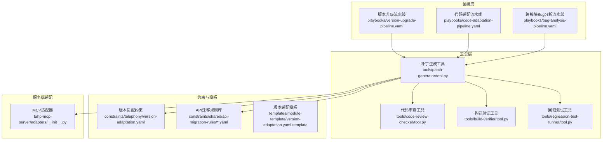
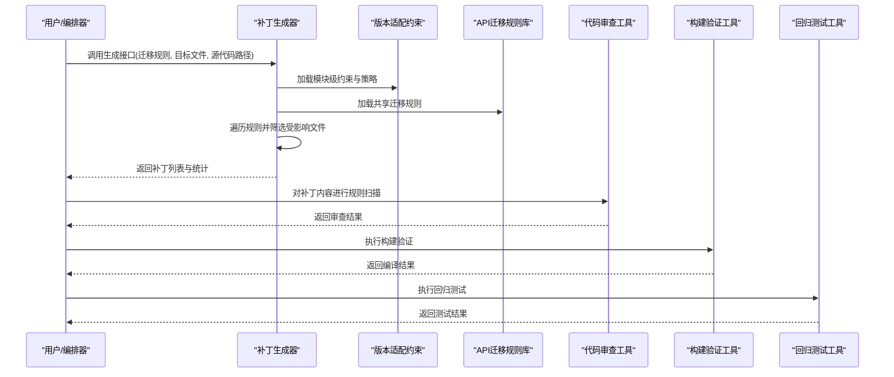
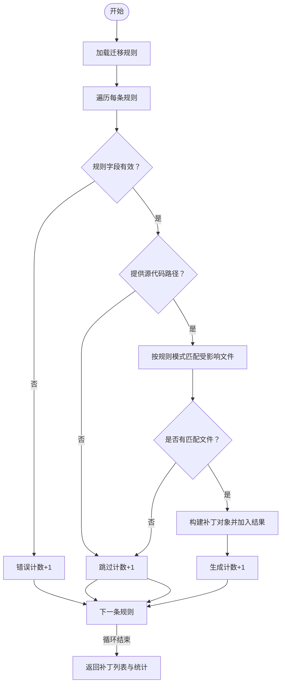
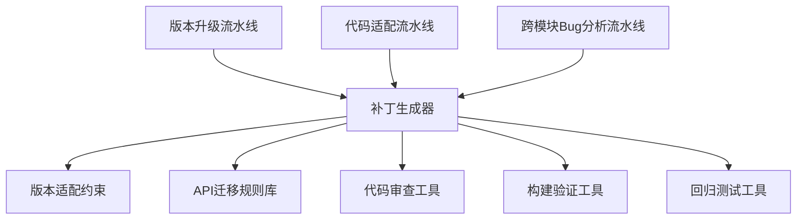

# 补丁生成工具

<cite>
**本文引用的文件**
- [tools/patch-generator/tool.py](file://tools/patch-generator/tool.py)
- [tools/patch-generator/README.md](file://tools/patch-generator/README.md)
- [tahp-mcp-server/adapters/__init__.py](file://tahp-mcp-server/adapters/__init__.py)
- [playbooks/version-upgrade-pipeline.yaml](file://playbooks/version-upgrade-pipeline.yaml)
- [playbooks/code-adaptation-pipeline.yaml](file://playbooks/code-adaptation-pipeline.yaml)
- [playbooks/bug-analysis-pipeline.yaml](file://playbooks/bug-analysis-pipeline.yaml)
- [constraints/telephony/version-adaptation.yaml](file://constraints/telephony/version-adaptation.yaml)
- [constraints/shared/api-migration-rules/framework-migration.yaml](file://constraints/shared/api-migration-rules/framework-migration.yaml)
- [templates/module-template/version-adaptation.yaml.template](file://templates/module-template/version-adaptation.yaml.template)
- [tools/code-review-checker/tool.py](file://tools/code-review-checker/tool.py)
- [tools/build-verifier/README.md](file://tools/build-verifier/README.md)
- [tools/build-verifier/tool.py](file://tools/build-verifier/tool.py)
- [tools/regression-test-runner/tool.py](file://tools/regression-test-runner/tool.py)
- [scripts/gate_check.py](file://scripts/gate_check.py)
- [docs/architecture/system-overview.md](file://docs/architecture/system-overview.md)
- [docs/TAHP-工程完整解析.md](file://docs/TAHP-工程完整解析.md)
- [TAHP-约束文件编写规范.md](file://TAHP-约束文件编写规范.md)
</cite>

## 目录
1. [简介](#简介)
2. [项目结构](#项目结构)
3. [核心组件](#核心组件)
4. [架构总览](#架构总览)
5. [详细组件分析](#详细组件分析)
6. [依赖分析](#依赖分析)
7. [性能考虑](#性能考虑)
8. [故障排除指南](#故障排除指南)
9. [结论](#结论)
10. [附录](#附录)

## 简介
本文件为“补丁生成工具”的技术文档，聚焦于自动化补丁生成的算法逻辑与实现机制，涵盖变更检测、补丁计算与格式化输出流程；说明支持的补丁格式与生成策略；文档化补丁模板系统、冲突解决机制与质量检查流程；并提供实际应用场景（自动修复、版本升级、回归测试）及补丁验证、应用与回滚操作指南。

该工具在 TAHP 框架中承担“根据适配规则批量生成 patch”的职责，配合版本升级流水线、代码审查工具、构建验证与回归测试工具，形成从规则到补丁再到验证闭环的自动化能力。

## 项目结构
补丁生成工具位于 tools/patch-generator 目录，核心入口为工具类与处理函数，配合 MCP 服务端适配器暴露为可调用工具。其在多个 Playbook 中作为关键步骤出现，尤其在版本升级与代码适配流程中承担“全自动/半自动项批量生成 patch”的角色。

图表来源
- [tools/patch-generator/tool.py:1-24](file://tools/patch-generator/tool.py#L1-L24)
- [tahp-mcp-server/adapters/__init__.py:154-167](file://tahp-mcp-server/adapters/__init__.py#L154-L167)
- [playbooks/version-upgrade-pipeline.yaml:28-43](file://playbooks/version-upgrade-pipeline.yaml#L28-L43)
- [playbooks/code-adaptation-pipeline.yaml:6-24](file://playbooks/code-adaptation-pipeline.yaml#L6-L24)
- [playbooks/bug-analysis-pipeline.yaml:6-37](file://playbooks/bug-analysis-pipeline.yaml#L6-L37)
- [constraints/telephony/version-adaptation.yaml:40-92](file://constraints/telephony/version-adaptation.yaml#L40-L92)
- [constraints/shared/api-migration-rules/framework-migration.yaml:1-7](file://constraints/shared/api-migration-rules/framework-migration.yaml#L1-L7)
- [templates/module-template/version-adaptation.yaml.template:116-134](file://templates/module-template/version-adaptation.yaml.template#L116-L134)

章节来源
- [docs/architecture/system-overview.md:316-379](file://docs/architecture/system-overview.md#L316-L379)
- [tools/patch-generator/README.md:1-5](file://tools/patch-generator/README.md#L1-L5)

## 核心组件
- 补丁生成器（PatchGenerator）
  - 输入：迁移规则列表、目标文件列表、源代码路径集合（可选）
  - 输出：补丁列表与统计信息（生成数、跳过数、错误数）
  - 关键逻辑：遍历迁移规则，校验旧/新 API 字段，按规则中的文件模式筛选受影响文件，组装补丁元数据并统计
- MCP 适配器
  - 将补丁生成工具注册为可调用工具，提供降级模式以确保系统稳定性
- 约束与规则
  - 版本适配约束文件定义 API 迁移规则、范围、优先级与策略偏好
  - API 迁移规则库提供跨版本复用的迁移规则
- 质量检查与验证
  - 代码审查工具对补丁内容进行规则扫描
  - 构建验证工具执行编译验证
  - 回归测试工具执行冒烟与功能回归测试

章节来源
- [tools/patch-generator/tool.py:2-23](file://tools/patch-generator/tool.py#L2-L23)
- [tahp-mcp-server/adapters/__init__.py:154-167](file://tahp-mcp-server/adapters/__init__.py#L154-L167)
- [constraints/telephony/version-adaptation.yaml:40-92](file://constraints/telephony/version-adaptation.yaml#L40-L92)
- [constraints/shared/api-migration-rules/framework-migration.yaml:1-7](file://constraints/shared/api-migration-rules/framework-migration.yaml#L1-L7)
- [tools/code-review-checker/tool.py:16-32](file://tools/code-review-checker/tool.py#L16-L32)
- [tools/build-verifier/tool.py:1-10](file://tools/build-verifier/tool.py#L1-L10)
- [tools/regression-test-runner/tool.py:1-9](file://tools/regression-test-runner/tool.py#L1-L9)

## 架构总览
补丁生成工具在 TAHP 框架中的定位是“规则驱动的自动化补丁生成器”，贯穿版本升级与代码适配流程。其工作流如下：

图表来源
- [tools/patch-generator/tool.py:2-23](file://tools/patch-generator/tool.py#L2-L23)
- [playbooks/version-upgrade-pipeline.yaml:28-59](file://playbooks/version-upgrade-pipeline.yaml#L28-L59)
- [playbooks/code-adaptation-pipeline.yaml:6-35](file://playbooks/code-adaptation-pipeline.yaml#L6-L35)
- [tools/code-review-checker/tool.py:16-32](file://tools/code-review-checker/tool.py#L16-L32)
- [tools/build-verifier/tool.py:1-10](file://tools/build-verifier/tool.py#L1-L10)
- [tools/regression-test-runner/tool.py:1-9](file://tools/regression-test-runner/tool.py#L1-L9)

## 详细组件分析

### 补丁生成器（PatchGenerator）
- 数据结构与算法
  - 输入参数：迁移规则列表（每条规则包含旧 API、新 API、变更类型、置信度、是否自动、规则 ID 等）、目标文件列表、源代码路径集合
  - 筛选策略：若提供源代码路径，则按规则中的“受影响文件模式”进行字符串匹配筛选，匹配成功则加入受影响文件列表
  - 输出：补丁对象列表（包含规则 ID、旧/新 API、变更类型、置信度、是否自动、受影响文件列表）与统计信息
- 复杂度分析
  - 时间复杂度：O(R×F)，其中 R 为规则数量，F 为源代码路径数量（每次规则遍历对路径集合进行线性筛选）
  - 空间复杂度：O(P)，其中 P 为生成的补丁数量（存储补丁对象与统计信息）
- 错误处理
  - 若规则缺少旧/新 API 字段，计入错误统计并跳过该规则
  - 若未提供源代码路径或无匹配文件，计入跳过统计
- 优化建议
  - 对源代码路径集合建立索引（如按目录分组）可降低筛选成本
  - 并行化规则遍历与文件匹配可提升吞吐

图表来源
- [tools/patch-generator/tool.py:3-20](file://tools/patch-generator/tool.py#L3-L20)

章节来源
- [tools/patch-generator/tool.py:2-23](file://tools/patch-generator/tool.py#L2-L23)

### MCP 服务端适配器
- 作用：将补丁生成工具注册为 MCP 工具，提供降级模式（当工具模块不可用时返回空结果与统计）
- 集成点：在服务端启动时动态导入工具模块并创建适配器实例

章节来源
- [tahp-mcp-server/adapters/__init__.py:154-167](file://tahp-mcp-server/adapters/__init__.py#L154-L167)

### 约束与模板系统
- 版本适配约束
  - 定义 API 迁移规则、范围、优先级与策略偏好（如自动置信度阈值、并行代理数等）
  - 示例：telephony 模块的 version-adaptation.yaml 包含共享规则文件引用与内联规则
- API 迁移规则库
  - framework-migration.yaml 提供共享规则基础
- 模板系统
  - version-adaptation.yaml.template 提供标准化模板，便于模块快速初始化

章节来源
- [constraints/telephony/version-adaptation.yaml:40-92](file://constraints/telephony/version-adaptation.yaml#L40-L92)
- [constraints/shared/api-migration-rules/framework-migration.yaml:1-7](file://constraints/shared/api-migration-rules/framework-migration.yaml#L1-L7)
- [templates/module-template/version-adaptation.yaml.template:116-134](file://templates/module-template/version-adaptation.yaml.template#L116-L134)

### 质量检查与验证
- 代码审查
  - 对补丁内容进行规则扫描，统计严重违规与警告数量，给出审查结果与分数
- 构建验证
  - 执行构建命令，收集错误与警告，判定构建结果
- 回归测试
  - 执行冒烟与功能回归测试，统计通过/失败数量与通过率

章节来源
- [tools/code-review-checker/tool.py:16-32](file://tools/code-review-checker/tool.py#L16-L32)
- [tools/build-verifier/tool.py:1-10](file://tools/build-verifier/tool.py#L1-L10)
- [tools/regression-test-runner/tool.py:1-9](file://tools/regression-test-runner/tool.py#L1-L9)

### 补丁格式与生成策略
- 支持的补丁格式
  - Unified Diff：用于展示文件差异的标准格式
  - Git Patch：与 Git 工作流兼容的补丁格式
- 生成策略
  - 自动策略：基于规则置信度与自动标记，自动批量生成补丁
  - 半自动策略：对置信度较低或需要人工确认的规则生成补丁，等待审核
  - 人工策略：对无法自动处理的规则生成任务清单，交由人工处理

章节来源
- [playbooks/version-upgrade-pipeline.yaml:28-43](file://playbooks/version-upgrade-pipeline.yaml#L28-L43)
- [constraints/telephony/version-adaptation.yaml:88-92](file://constraints/telephony/version-adaptation.yaml#L88-L92)

### 冲突解决机制
- 文件模式匹配冲突
  - 当规则影响的文件模式与源代码路径集合存在多重匹配时，补丁生成器将全部纳入受影响文件列表
- 置信度与策略偏好
  - 通过策略偏好（如自动置信度阈值）区分自动/半自动/人工项，减少冲突与误判
- 审查与验证阶段的冲突消解
  - 代码审查发现的违规与构建/测试失败作为冲突信号，指导人工介入与修正

章节来源
- [tools/patch-generator/tool.py:9-13](file://tools/patch-generator/tool.py#L9-L13)
- [constraints/telephony/version-adaptation.yaml:88-92](file://constraints/telephony/version-adaptation.yaml#L88-L92)
- [tools/code-review-checker/tool.py:16-32](file://tools/code-review-checker/tool.py#L16-L32)
- [tools/build-verifier/tool.py:1-10](file://tools/build-verifier/tool.py#L1-L10)
- [tools/regression-test-runner/tool.py:1-9](file://tools/regression-test-runner/tool.py#L1-L9)

### 质量门禁与评估
- 质量门禁检查
  - 通过 gate_check.py 对模块约束文件进行 P0/P1/P2 三级检查，确保安全红线、文档完整性与命名规范等
- 评估指标
  - 版本适配评估指标包括 API 迁移完整性、编译通过率、权限迁移正确性、文件覆盖率、行为缓解与构建配置更新等

章节来源
- [scripts/gate_check.py:96-188](file://scripts/gate_check.py#L96-L188)
- [scripts/gate_check.py:194-333](file://scripts/gate_check.py#L194-L333)
- [constraints/telephony/version-adaptation.yaml:273-311](file://constraints/telephony/version-adaptation.yaml#L273-L311)

## 依赖分析
补丁生成工具与编排层、约束层、工具层之间的依赖关系如下：

图表来源
- [tools/patch-generator/tool.py:2-23](file://tools/patch-generator/tool.py#L2-L23)
- [playbooks/version-upgrade-pipeline.yaml:28-59](file://playbooks/version-upgrade-pipeline.yaml#L28-L59)
- [playbooks/code-adaptation-pipeline.yaml:6-35](file://playbooks/code-adaptation-pipeline.yaml#L6-L35)
- [playbooks/bug-analysis-pipeline.yaml:6-37](file://playbooks/bug-analysis-pipeline.yaml#L6-L37)
- [constraints/telephony/version-adaptation.yaml:40-92](file://constraints/telephony/version-adaptation.yaml#L40-L92)
- [constraints/shared/api-migration-rules/framework-migration.yaml:1-7](file://constraints/shared/api-migration-rules/framework-migration.yaml#L1-L7)
- [tools/code-review-checker/tool.py:16-32](file://tools/code-review-checker/tool.py#L16-L32)
- [tools/build-verifier/tool.py:1-10](file://tools/build-verifier/tool.py#L1-L10)
- [tools/regression-test-runner/tool.py:1-9](file://tools/regression-test-runner/tool.py#L1-L9)

章节来源
- [tools/patch-generator/tool.py:2-23](file://tools/patch-generator/tool.py#L2-L23)
- [tahp-mcp-server/adapters/__init__.py:154-167](file://tahp-mcp-server/adapters/__init__.py#L154-L167)

## 性能考虑
- 规则遍历与文件匹配
  - 当前实现为线性匹配，建议对源代码路径集合建立索引（如按目录分组）以降低时间复杂度
- 并行化
  - 规则遍历与文件匹配可并行执行，提高吞吐
- 缓存与增量
  - 对已生成补丁与受影响文件集合进行缓存，避免重复计算
- I/O 优化
  - 在大规模文件扫描场景中，采用流式读取与批处理策略

## 故障排除指南
- 补丁生成为空
  - 检查迁移规则是否包含旧/新 API 字段
  - 确认源代码路径集合与规则文件模式匹配
- 审查失败
  - 查看代码审查工具返回的违规详情，逐条修正
- 构建失败
  - 使用构建验证工具查看错误与警告，定位编译问题
- 回归测试异常
  - 根据回归测试工具输出的失败用例进行修复与回归

章节来源
- [tools/patch-generator/tool.py:6-7](file://tools/patch-generator/tool.py#L6-L7)
- [tools/patch-generator/tool.py:9-13](file://tools/patch-generator/tool.py#L9-L13)
- [tools/code-review-checker/tool.py:16-32](file://tools/code-review-checker/tool.py#L16-L32)
- [tools/build-verifier/tool.py:1-10](file://tools/build-verifier/tool.py#L1-L10)
- [tools/regression-test-runner/tool.py:1-9](file://tools/regression-test-runner/tool.py#L1-L9)

## 结论
补丁生成工具以“规则驱动 + 流水线集成”的方式，实现了从 API 迁移规则到补丁的自动化生成，并与代码审查、构建验证、回归测试形成闭环。通过约束与模板系统保障规则的可维护性与可复用性，结合质量门禁与评估指标，确保生成补丁的准确性与安全性。在版本升级与代码适配场景中，该工具显著提升了效率与一致性。

## 附录

### 实际应用场景
- 自动修复
  - 基于 Bug 分析结果与代码适配约束，自动生成修复补丁并通过代码审查与构建验证
- 版本升级
  - 基于 API 迁移规则库与版本适配约束，批量生成升级补丁，经构建验证与回归测试后交付
- 回归测试
  - 利用回归测试工具对补丁应用后的系统进行冒烟与功能测试，确保无回归

章节来源
- [playbooks/bug-analysis-pipeline.yaml:6-37](file://playbooks/bug-analysis-pipeline.yaml#L6-L37)
- [playbooks/code-adaptation-pipeline.yaml:6-35](file://playbooks/code-adaptation-pipeline.yaml#L6-L35)
- [playbooks/version-upgrade-pipeline.yaml:28-59](file://playbooks/version-upgrade-pipeline.yaml#L28-L59)

### 补丁验证、应用与回滚操作指南
- 验证
  - 代码审查：使用代码审查工具扫描补丁内容，确保符合质量门禁
  - 构建验证：使用构建验证工具执行编译，确保通过
  - 回归测试：使用回归测试工具执行冒烟与功能测试，确保无回归
- 应用
  - 将生成的补丁应用于目标分支，结合版本控制规范进行提交
- 回滚
  - 若构建或测试失败，依据版本适配约束中的回滚条件与流程进行回滚操作

章节来源
- [tools/code-review-checker/tool.py:16-32](file://tools/code-review-checker/tool.py#L16-L32)
- [tools/build-verifier/tool.py:1-10](file://tools/build-verifier/tool.py#L1-L10)
- [tools/regression-test-runner/tool.py:1-9](file://tools/regression-test-runner/tool.py#L1-L9)
- [constraints/telephony/version-adaptation.yaml:200-240](file://constraints/telephony/version-adaptation.yaml#L200-L240)