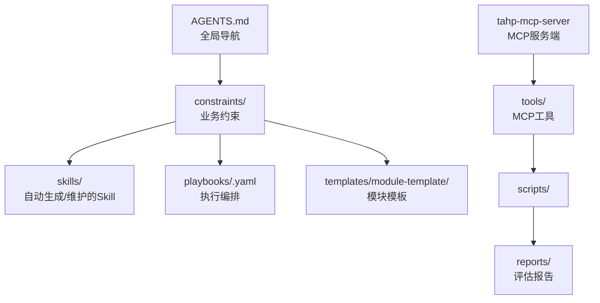
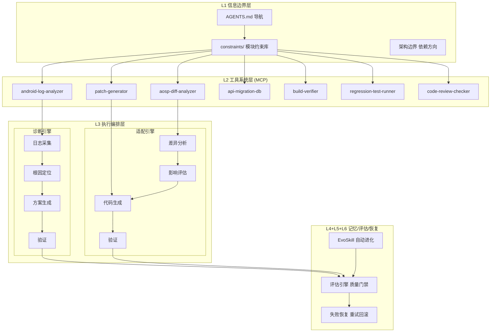
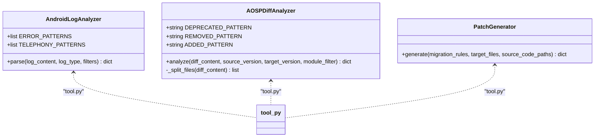
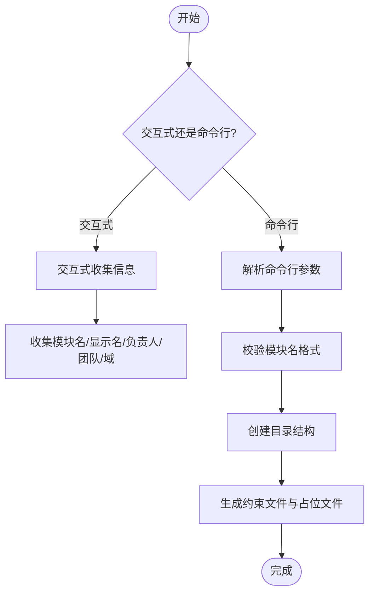
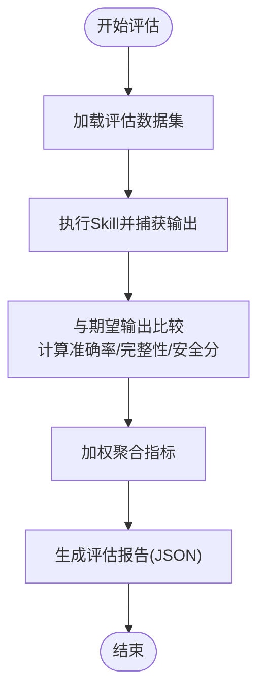
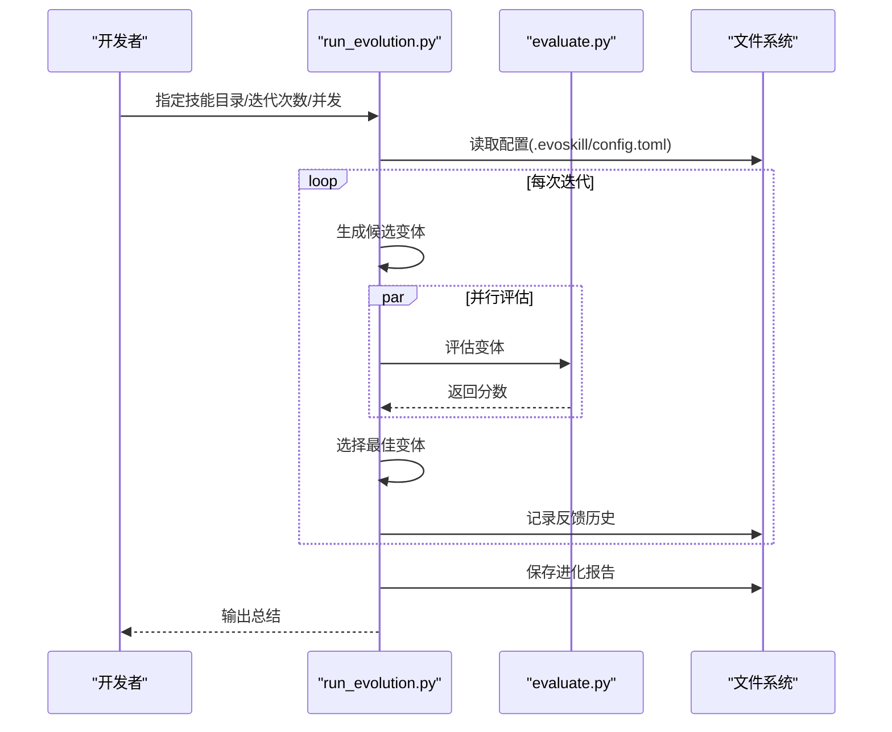
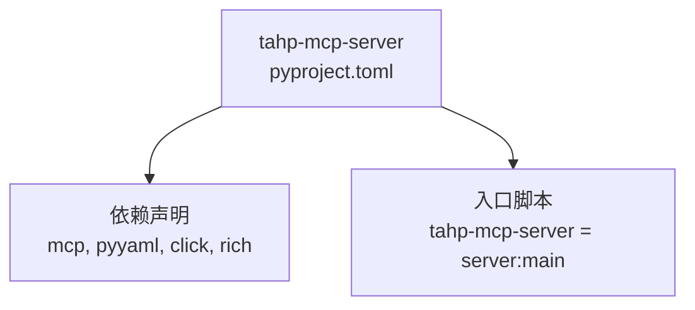
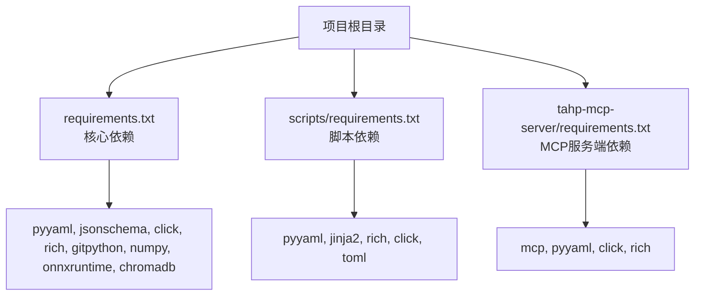

# 开发者指南

<cite>
**本文档引用的文件**
- [requirements.txt](file://requirements.txt)
- [pyproject.toml](file://tahp-mcp-server/pyproject.toml)
- [requirements.txt](file://tahp-mcp-server/requirements.txt)
- [requirements.txt](file://scripts/requirements.txt)
- [system-overview.md](file://docs/architecture/system-overview.md)
- [coding-standards.yaml](file://constraints/shared/coding-standards.yaml)
- [AGENTS.md](file://AGENTS.md)
- [tool.py](file://tools/android-log-analyzer/tool.py)
- [tool.py](file://tools/aosp-diff-analyzer/tool.py)
- [tool.py](file://tools/patch-generator/tool.py)
- [init_module.py](file://scripts/init_module.py)
- [evaluate.py](file://scripts/evaluate.py)
- [run_evolution.py](file://scripts/run_evolution.py)
- [gate_check.py](file://scripts/gate_check.py)
- [SKILL.md](file://skills/.claude/skills/carrier-porting-assistant/SKILL.md)
</cite>

## 目录
1. [引言](#引言)
2. [项目结构](#项目结构)
3. [核心组件](#核心组件)
4. [架构总览](#架构总览)
5. [详细组件分析](#详细组件分析)
6. [依赖分析](#依赖分析)
7. [性能考虑](#性能考虑)
8. [故障排查指南](#故障排查指南)
9. [结论](#结论)
10. [附录](#附录)

## 引言
本指南面向TAHP（TECNO AI Harness Platform）开发者，提供从环境搭建到代码贡献、测试策略与调试技巧的全流程说明。TAHP采用“约束驱动 + EvoSkill自动进化”的范式，围绕诊断引擎与适配引擎两大核心能力，结合MCP工具协议与Python脚本编排，形成可复用、可评估、可自动进化的AI辅助开发体系。

## 项目结构
仓库采用按领域与职责分层的组织方式：
- constraints/: 业务约束（Owner唯一输入端），按模块组织，包含各域约束文件与评估数据集
- skills/: 自动生成的Skills（EvoSkill产出），支持Claude与Codex格式
- tools/: MCP工具接口定义，标准化日志分析、差异分析、补丁生成等能力
- scripts/: 自动化脚本，涵盖模块初始化、评估、进化、质量门禁等
- docs/: 深度文档，包含架构总览与质量评估体系
- reports/: 评估报告输出
- templates/: 模块初始化模板
- tahp-mcp-server/: MCP服务端封装，暴露TAHP能力为MCP工具

**图表来源**
- [system-overview.md:316-396](file://docs/architecture/system-overview.md#L316-L396)
- [AGENTS.md:21-34](file://AGENTS.md#L21-L34)

**章节来源**
- [system-overview.md:316-396](file://docs/architecture/system-overview.md#L316-L396)
- [AGENTS.md:21-34](file://AGENTS.md#L21-L34)

## 核心组件
- 约束驱动Harness：通过YAML约束文件定义输入、输出、前置条件与安全红线，确保AI生成的Skill可被自动评估与持续进化
- MCP工具系统：统一的工具协议与接口标准，支持日志分析、差异分析、补丁生成、编译验证、回归测试、代码审查等
- 质量门禁体系：P0/P1/P2三级门禁，覆盖编译、合规、风格、复杂度等多个维度
- EvoSkill进化机制：基于反馈的历史记录进行自动变异与选择，保留最优变体并输出进化报告

**章节来源**
- [system-overview.md:268-289](file://docs/architecture/system-overview.md#L268-L289)
- [coding-standards.yaml:1-23](file://constraints/shared/coding-standards.yaml#L1-L23)

## 架构总览
TAHP采用六层Harness架构：
- L1 信息边界层：明确Agent可访问的信息范围
- L2 工具系统层：通过MCP标准化接入各类工具
- L3 执行编排层：双引擎（诊断/适配）串联多步骤任务
- L4/L5/L6 记忆/评估/恢复层：EvoSkill自动进化、质量门禁、失败恢复

**图表来源**
- [system-overview.md:87-127](file://docs/architecture/system-overview.md#L87-L127)

**章节来源**
- [system-overview.md:87-127](file://docs/architecture/system-overview.md#L87-L127)

## 详细组件分析

### MCP工具组件
MCP工具通过统一接口定义：name、description、inputSchema、handler，并支持前置验证（validate）。典型工具包括：
- Android日志分析器：解析logcat/ril/atcmd日志，识别错误与事件
- AOSP Diff分析器：对比两个Android版本的framework差异，统计废弃/删除/新增API
- 补丁生成器：根据迁移规则批量生成patch，支持影响文件过滤与统计

**图表来源**
- [tool.py:5-49](file://tools/android-log-analyzer/tool.py#L5-L49)
- [tool.py:5-40](file://tools/aosp-diff-analyzer/tool.py#L5-L40)
- [tool.py:2-23](file://tools/patch-generator/tool.py#L2-L23)

**章节来源**
- [tool.py:1-50](file://tools/android-log-analyzer/tool.py#L1-L50)
- [tool.py:1-41](file://tools/aosp-diff-analyzer/tool.py#L1-L41)
- [tool.py:1-24](file://tools/patch-generator/tool.py#L1-L24)

### 模块初始化与约束模板
模块初始化脚本支持交互式与命令行两种模式，自动生成标准目录与初始约束文件，包含module.yaml、各域约束文件与评估数据占位。模板系统允许从module-template复制并进行变量替换。

**图表来源**
- [init_module.py:252-293](file://scripts/init_module.py#L252-L293)
- [init_module.py:154-249](file://scripts/init_module.py#L154-L249)

**章节来源**
- [init_module.py:1-365](file://scripts/init_module.py#L1-L365)

### 质量门禁与评估
质量门禁分为P0/P1/P2三个级别，分别对应阻断式、警告式与记录式检查；评估脚本支持对Skill进行准确性、完整性、安全性与时间效率的打分，并输出结构化报告。

**图表来源**
- [evaluate.py:78-133](file://scripts/evaluate.py#L78-L133)
- [evaluate.py:135-198](file://scripts/evaluate.py#L135-L198)
- [evaluate.py:200-288](file://scripts/evaluate.py#L200-L288)
- [evaluate.py:290-384](file://scripts/evaluate.py#L290-L384)

**章节来源**
- [evaluate.py:1-436](file://scripts/evaluate.py#L1-L436)
- [gate_check.py:1-507](file://scripts/gate_check.py#L1-L507)

### EvoSkill进化流程
EvoSkill通过迭代生成候选变体、并行评估、选择最优、记录反馈与保存报告，形成闭环。支持干跑预览、并发控制与停滞阈值终止。

**图表来源**
- [run_evolution.py:126-159](file://scripts/run_evolution.py#L126-L159)
- [run_evolution.py:225-282](file://scripts/run_evolution.py#L225-L282)
- [run_evolution.py:409-527](file://scripts/run_evolution.py#L409-L527)

**章节来源**
- [run_evolution.py:1-567](file://scripts/run_evolution.py#L1-L567)

### MCP服务端封装
tahp-mcp-server提供MCP服务端封装，将TAHP能力作为MCP工具暴露，便于AI Agent编排与调用。

**图表来源**
- [pyproject.toml:1-19](file://tahp-mcp-server/pyproject.toml#L1-L19)
- [requirements.txt:1-5](file://tahp-mcp-server/requirements.txt#L1-L5)

**章节来源**
- [pyproject.toml:1-19](file://tahp-mcp-server/pyproject.toml#L1-L19)
- [requirements.txt:1-5](file://tahp-mcp-server/requirements.txt#L1-L5)

## 依赖分析
- Python运行时：Python 3.12+（纯本地运行，零服务器成本）
- 核心依赖：pyyaml、jsonschema、click、rich、gitpython、numpy、onnxruntime、chromadb
- MCP服务端：mcp、pyyaml、click、rich
- 脚本依赖：jinja2、toml等

**图表来源**
- [requirements.txt:1-9](file://requirements.txt#L1-L9)
- [requirements.txt:1-6](file://scripts/requirements.txt#L1-L6)
- [requirements.txt:1-5](file://tahp-mcp-server/requirements.txt#L1-L5)

**章节来源**
- [requirements.txt:1-9](file://requirements.txt#L1-L9)
- [requirements.txt:1-6](file://scripts/requirements.txt#L1-L6)
- [requirements.txt:1-5](file://tahp-mcp-server/requirements.txt#L1-L5)

## 性能考虑
- 并行评估：run_evolution.py支持并发控制，合理设置concurrency可缩短整体评估时间
- 干跑预览：dry-run模式可在不执行实际变异的情况下预览计划，节省资源
- 指标权重：评估时可调整权重以平衡准确率、完整性、安全性与效率
- 超时控制：evaluate.py对单个用例设置超时，避免长时间阻塞

**章节来源**
- [run_evolution.py:45-65](file://scripts/run_evolution.py#L45-L65)
- [run_evolution.py:543-562](file://scripts/run_evolution.py#L543-L562)
- [evaluate.py:410-431](file://scripts/evaluate.py#L410-L431)

## 故障排查指南
- 约束文件校验：使用质量门禁脚本检查安全红线、硬编码密钥、YAML有效性等
- 评估失败定位：查看评估报告中的错误信息与用例详情，确认输入/期望是否匹配
- 进化停滞：关注停滞阈值与选择策略，必要时调整配置或引入更多反馈历史
- 工具异常：检查MCP工具的输入Schema与前置验证，确保参数完整且格式正确

**章节来源**
- [gate_check.py:368-415](file://scripts/gate_check.py#L368-L415)
- [evaluate.py:135-198](file://scripts/evaluate.py#L135-L198)
- [run_evolution.py:409-527](file://scripts/run_evolution.py#L409-L527)

## 结论
TAHP通过约束驱动与工具标准化，实现了从诊断到适配的全链路自动化与可评估化。开发者可通过模块初始化模板快速接入新模块，利用评估与门禁保障质量，借助EvoSkill实现Skill的持续进化。MCP服务端进一步降低了工具集成与Agent编排的门槛。

## 附录

### 开发环境搭建
- 安装Python 3.12+
- 安装核心依赖：参考项目根目录requirements.txt
- 安装脚本依赖：参考scripts/requirements.txt
- 安装MCP服务端依赖：参考tahp-mcp-server/requirements.txt

**章节来源**
- [requirements.txt:1-9](file://requirements.txt#L1-L9)
- [requirements.txt:1-6](file://scripts/requirements.txt#L1-L6)
- [requirements.txt:1-5](file://tahp-mcp-server/requirements.txt#L1-L5)

### 代码贡献流程
- 使用模块初始化脚本创建新模块骨架
- 编写约束文件（module.yaml与各域约束）
- 添加评估用例与期望输出
- 运行质量门禁与评估脚本
- 使用EvoSkill进行技能进化
- 提交代码并通过代码审查

**章节来源**
- [init_module.py:296-361](file://scripts/init_module.py#L296-L361)
- [gate_check.py:368-415](file://scripts/gate_check.py#L368-L415)
- [evaluate.py:290-384](file://scripts/evaluate.py#L290-L384)
- [run_evolution.py:409-527](file://scripts/run_evolution.py#L409-L527)

### 测试策略与调试技巧
- 单元测试：针对工具类（如AndroidLogAnalyzer、AOSPDiffAnalyzer、PatchGenerator）编写独立测试
- 集成测试：通过评估脚本对Skill进行端到端验证，覆盖多用例与边界场景
- 调试技巧：使用rich输出美化控制台日志；在评估脚本中增加详细错误信息；在EvoSkill中记录反馈历史以便回溯

**章节来源**
- [tool.py:1-50](file://tools/android-log-analyzer/tool.py#L1-L50)
- [tool.py:1-41](file://tools/aosp-diff-analyzer/tool.py#L1-L41)
- [tool.py:1-24](file://tools/patch-generator/tool.py#L1-L24)
- [evaluate.py:135-198](file://scripts/evaluate.py#L135-L198)

### 新模块开发指导
- 使用模板：从templates/module-template复制并填充变量
- 约束编写：遵循coding-standards.yaml中的提交与审查要求
- 质量保证：通过质量门禁脚本与评估脚本双重验证
- 技能维护：参考SKILL.md模板编写Skill说明与触发条件

**章节来源**
- [coding-standards.yaml:1-23](file://constraints/shared/coding-standards.yaml#L1-L23)
- [SKILL.md:1-34](file://skills/.claude/skills/carrier-porting-assistant/SKILL.md#L1-L34)

### 社区贡献与代码审查
- 提交规范：遵循coding-standards.yaml中的commit message格式与分支命名
- 自动检查：质量门禁脚本会自动检查编译、风格、废弃API与TODO关联
- 审查流程：至少一名审查者同意，必要时结合自动化检查结果进行讨论

**章节来源**
- [coding-standards.yaml:6-12](file://constraints/shared/coding-standards.yaml#L6-L12)
- [gate_check.py:194-250](file://scripts/gate_check.py#L194-L250)