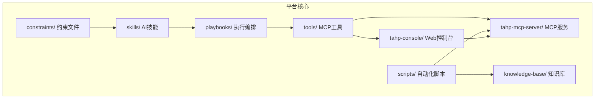
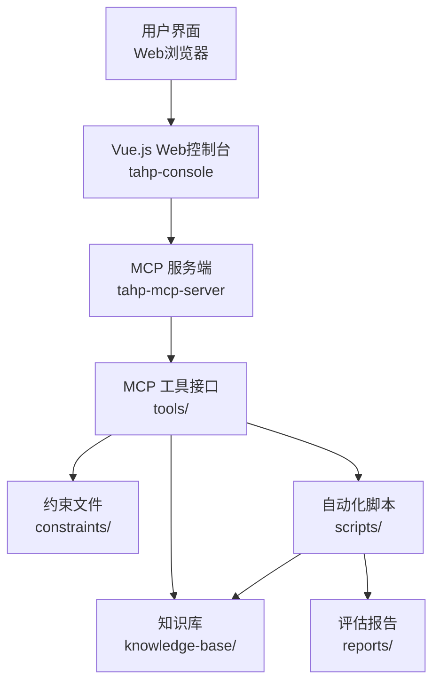
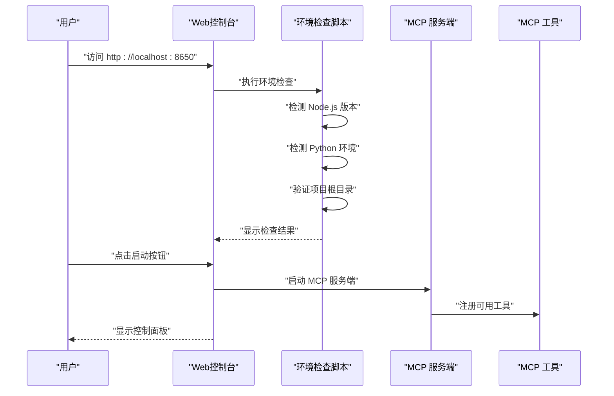
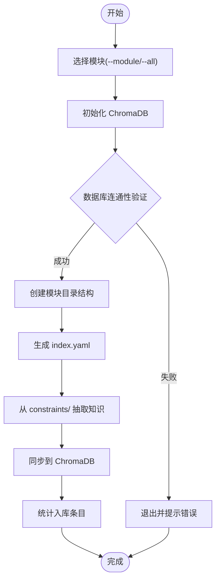
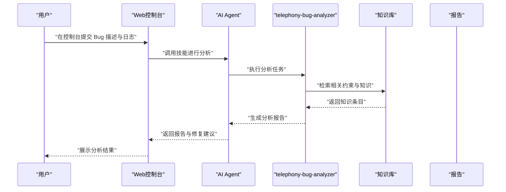
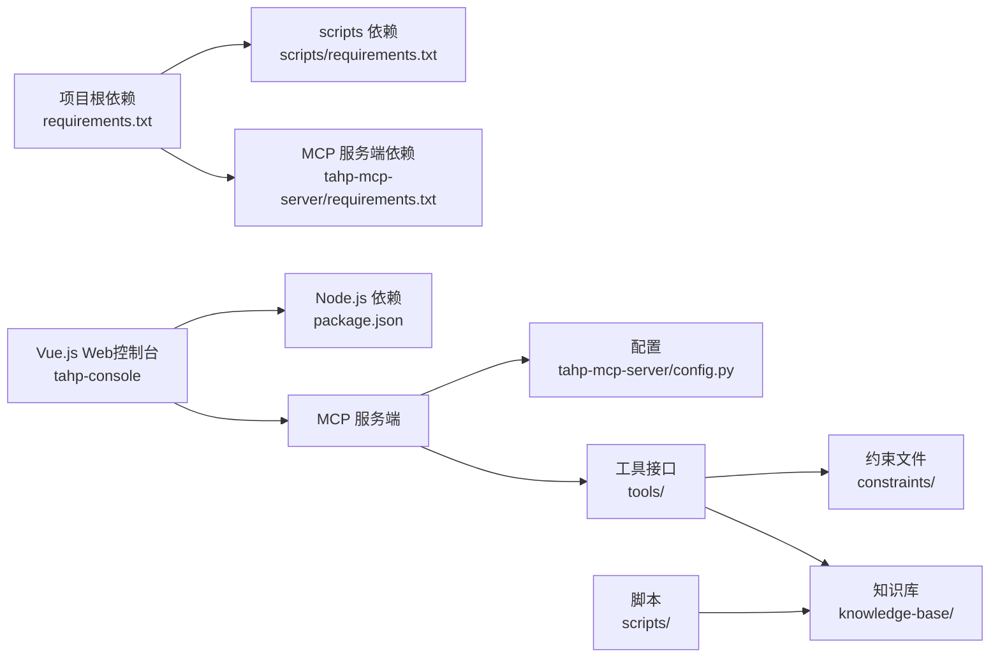

# 快速开始

<cite>
**本文档引用的文件**
- [requirements.txt](file://requirements.txt)
- [scripts/requirements.txt](file://scripts/requirements.txt)
- [tahp-mcp-server/requirements.txt](file://tahp-mcp-server/requirements.txt)
- [tahp-mcp-server/pyproject.toml](file://tahp-mcp-server/pyproject.toml)
- [.mcp.json](file://.mcp.json)
- [tahp-mcp-server/config.py](file://tahp-mcp-server/config.py)
- [scripts/init_knowledge_base.py](file://scripts/init_knowledge_base.py)
- [scripts/run_evolution.py](file://scripts/run_evolution.py)
- [AGENTS.md](file://AGENTS.md)
- [skills/.claude/skills/telephony-bug-analyzer/SKILL.md](file://skills/.claude/skills/telephony-bug-analyzer/SKILL.md)
- [playbooks/bug-analysis-pipeline.yaml](file://playbooks/bug-analysis-pipeline.yaml)
- [scripts/init_module.py](file://scripts/init_module.py)
- [tahp-console/package.json](file://tahp-console/package.json)
- [tahp-console/bin/tahp-console.mjs](file://tahp-console/bin/tahp-console.mjs)
- [tahp-console/DEVELOPMENT.md](file://tahp-console/DEVELOPMENT.md)
- [tahp-console/docker-compose.yml](file://tahp-console/docker-compose.yml)
- [tahp-console/Dockerfile](file://tahp-console/Dockerfile)
- [tahp-console/scripts/setup-tahp.mjs](file://tahp-console/scripts/setup-tahp.mjs)
- [tahp-console/scripts/setup.sh](file://tahp-console/scripts/setup.sh)
</cite>

## 更新摘要
**所做更改**
- 新增 Vue.js 控制台启动方式章节，替代原有命令行控制台
- 增加新的控制台配置说明和环境检查流程
- 更新 MCP 服务器启动方式，支持通过 Web 控制台管理
- 新增 Docker 部署和一键安装脚本说明
- 完善故障排除指南，增加控制台相关问题解决方案

## 目录
1. [简介](#简介)
2. [项目结构](#项目结构)
3. [核心组件](#核心组件)
4. [架构总览](#架构总览)
5. [详细组件分析](#详细组件分析)
6. [依赖关系分析](#依赖关系分析)
7. [性能考虑](#性能考虑)
8. [故障排除指南](#故障排除指南)
9. [结论](#结论)
10. [附录](#附录)

## 简介
本指南面向首次接触 TAHP 平台的新用户，帮助你在最短时间内完成环境搭建、启动 Vue.js Web 控制台、初始化知识库，并成功执行第一个 AI 任务。内容以实用为主，重点介绍全新的 Web 控制台界面，简化操作流程，提升用户体验。

## 项目结构
TAHP 是一个双引擎 AI 平台，包含"诊断引擎"和"适配引擎"，围绕约束驱动与 EvoSkill 自动进化实现 AI 辅助开发。主要目录与职责如下：
- constraints/: 业务约束（Owner 输入端），按模块组织，包含各领域的约束文件
- skills/: AI Skills（自动生成/手动维护）
- playbooks/: 执行编排（Pipeline 定义）
- tools/: MCP 工具接口定义
- scripts/: 自动化脚本（知识库初始化、模块初始化、演进运行等）
- knowledge-base/: ChromaDB 知识库持久化目录
- tahp-mcp-server/: MCP 服务端，暴露 TAHP 能力为 MCP 工具
- **新增** tahp-console/: Vue.js Web 控制台，提供图形化界面管理平台

**图表来源**
- [AGENTS.md:21-34](file://AGENTS.md#L21-L34)
- [tahp-console/package.json:1-108](file://tahp-console/package.json#L1-L108)

**章节来源**
- [AGENTS.md:1-83](file://AGENTS.md#L1-L83)
- [tahp-console/package.json:1-108](file://tahp-console/package.json#L1-L108)

## 核心组件
- Python 环境与依赖
  - Python 版本要求：MCP 服务端要求 Python 3.10+
  - 关键依赖：mcp、pyyaml、click、rich 等
  - 项目根目录与 scripts 子目录分别有独立的依赖清单
- **新增** Vue.js Web 控制台
  - 基于 Node.js 20+ 和 Vue 3 + TypeScript 构建
  - 提供图形化界面管理 TAHP 平台
  - 支持一键启动、停止、重启服务
  - 内置环境检查和自动配置功能
- MCP 服务端
  - 通过命令行入口启动，读取配置并注册模块与领域
  - 默认支持的模块：telephony、kernel-driver、power-mgmt
  - 默认支持的领域：bug_analysis、code_adaptation、version_adaptation、carrier_porting
- 知识库初始化
  - 使用脚本初始化 ChromaDB、创建模块目录结构、抽取约束为知识条目
- 第一个任务示例
  - 使用 telephony-bug-analyzer 技能进行通信模块 Bug 分析
  - 通过跨模块 Bug 分析 Pipeline 协调多模块并行分析

**章节来源**
- [tahp-mcp-server/pyproject.toml:9](file://tahp-mcp-server/pyproject.toml#L9)
- [tahp-mcp-server/config.py:58-71](file://tahp-mcp-server/config.py#L58-L71)
- [scripts/init_knowledge_base.py:154-158](file://scripts/init_knowledge_base.py#L154-L158)
- [skills/.claude/skills/telephony-bug-analyzer/SKILL.md:1-51](file://skills/.claude/skills/telephony-bug-analyzer/SKILL.md#L1-L51)
- [playbooks/bug-analysis-pipeline.yaml:1-43](file://playbooks/bug-analysis-pipeline.yaml#L1-L43)
- [tahp-console/package.json:1-108](file://tahp-console/package.json#L1-108)
- [tahp-console/bin/tahp-console.mjs:1-431](file://tahp-console/bin/tahp-console.mjs#L1-431)

## 架构总览
TAHP 的运行链路从 Vue.js Web 控制台开始，通过图形化界面管理 MCP 服务端；Agent（如 Claude Code）通过 MCP 协议调用 TAHP 工具；工具根据约束文件与知识库执行分析或生成任务；最终输出报告或补丁。

**图表来源**
- [AGENTS.md:21-34](file://AGENTS.md#L21-L34)
- [tahp-mcp-server/config.py:82-120](file://tahp-mcp-server/config.py#L82-L120)
- [tahp-console/package.json:1-108](file://tahp-console/package.json#L1-L108)

## 详细组件分析

### 环境准备与依赖安装
- Python 环境
  - MCP 服务端要求 Python 3.10 或更高版本
- **新增** Node.js 环境
  - Web 控制台要求 Node.js 20.0.0 或更高版本
  - 控制台内置环境检查脚本，自动验证运行环境
- 安装依赖
  - 项目根目录依赖：pyyaml、jsonschema、click、rich、gitpython、numpy、onnxruntime、chromadb
  - scripts 子目录依赖：pyyaml、jinja2、rich、click、toml
  - MCP 服务端依赖：mcp、pyyaml、click、rich
  - **新增** 控制台依赖：Vue 3、TypeScript、Socket.IO、Koa 2 等
- 建议做法
  - 使用虚拟环境隔离 Python 依赖
  - 优先在项目根目录安装一次依赖，再进入子目录安装各自依赖
  - **新增** 控制台使用 npm run setup 进行环境检查和自动配置

**章节来源**
- [requirements.txt:1-9](file://requirements.txt#L1-L9)
- [scripts/requirements.txt:1-6](file://scripts/requirements.txt#L1-L6)
- [tahp-mcp-server/requirements.txt:1-5](file://tahp-mcp-server/requirements.txt#L1-L5)
- [tahp-mcp-server/pyproject.toml:9](file://tahp-mcp-server/pyproject.toml#L9)
- [tahp-console/package.json:1-108](file://tahp-console/package.json#L1-L108)
- [tahp-console/scripts/setup-tahp.mjs:1-79](file://tahp-console/scripts/setup-tahp.mjs#L1-79)

### Vue.js Web 控制台启动
- **新增** 启动方式
  - 通过 npm 命令启动 Web 控制台，默认端口 8650
  - 支持开发模式和生产模式两种运行方式
  - 内置一键安装脚本，自动检测和配置运行环境
- **新增** 环境检查
  - 自动检测 Node.js 版本（要求 >= 20）
  - 检查 Python 3 可用性和版本
  - 验证 TAHP 项目根目录和 MCP 服务器依赖
  - 检查 node_modules 是否已安装
- **新增** 配置要点
  - 支持环境变量配置：TAHP_CONSOLE_HOME、AUTH_DISABLED、AUTH_TOKEN
  - 默认数据目录：~/.tahp-console
  - 默认鉴权：内网模式下默认关闭鉴权
- **新增** VS Code 集成
  - 通过 .mcp.json 配置 mcpServers，指向本地 MCP 服务端
  - Web 控制台提供可视化界面管理 MCP 服务器

**图表来源**
- [tahp-console/bin/tahp-console.mjs:196-312](file://tahp-console/bin/tahp-console.mjs#L196-L312)
- [tahp-console/scripts/setup-tahp.mjs:31-79](file://tahp-console/scripts/setup-tahp.mjs#L31-79)
- [.mcp.json:1-13](file://.mcp.json#L1-L13)

**章节来源**
- [tahp-console/package.json:23-35](file://tahp-console/package.json#L23-L35)
- [tahp-console/bin/tahp-console.mjs:354-424](file://tahp-console/bin/tahp-console.mjs#L354-L424)
- [tahp-console/scripts/setup-tahp.mjs:31-79](file://tahp-console/scripts/setup-tahp.mjs#L31-79)
- [.mcp.json:1-13](file://.mcp.json#L1-L13)

### Docker 部署方式
- **新增** Docker 部署
  - 提供完整的 Docker Compose 配置文件
  - 支持单容器部署，集成 MCP 服务端和 Web 控制台
  - 默认端口 6060，支持环境变量配置
  - 自动挂载数据目录和配置文件
- **新增** Dockerfile 构建
  - 基于 nousresearch/hermes-agent:latest 镜像
  - 预装 Node.js 23.11.0 和构建工具
  - 自动安装依赖并构建生产环境
  - 支持自定义镜像名称和容器名称

**章节来源**
- [tahp-console/docker-compose.yml:1-26](file://tahp-console/docker-compose.yml#L1-L26)
- [tahp-console/Dockerfile:1-44](file://tahp-console/Dockerfile#L1-L44)

### 知识库初始化
- 目标
  - 初始化 ChromaDB，创建模块目录结构，抽取约束为知识条目并入库
- 主要步骤
  - 选择模块或全部模块
  - 创建目录结构与 index.yaml
  - 从 constraints/ 抽取 Markdown 与 YAML 约束为知识条目
  - 将提取的条目同步到 ChromaDB
- 输出
  - 统计总条目数与各集合数量，便于验证初始化结果

**图表来源**
- [scripts/init_knowledge_base.py:154-241](file://scripts/init_knowledge_base.py#L154-L241)

**章节来源**
- [scripts/init_knowledge_base.py:154-241](file://scripts/init_knowledge_base.py#L154-L241)

### 第一个任务：通信模块 Bug 分析
- 触发条件
  - 包含通话异常、短信失败、数据连接、VoLTE/VoWiFi 问题等关键词
- 前置检查
  - 确认 Modem 固件版本、Android 版本、设备型号
  - 收集 logcat 日志
  - 获取复现步骤
- 分析协议
  - 层级判定：Framework 层 → RILJ 层 → RILC 层 → Modem 层
  - 根因确认需基于强或中等证据
  - 产出报告包含：复现概率、根因层级、影响范围、修复类型、严重程度、根因描述、修复建议
- 执行路径
  - 使用 telephony-bug-analyzer 技能
  - 通过跨模块 Bug 分析 Pipeline 协调并行分析

**图表来源**
- [skills/.claude/skills/telephony-bug-analyzer/SKILL.md:13-40](file://skills/.claude/skills/telephony-bug-analyzer/SKILL.md#L13-L40)
- [playbooks/bug-analysis-pipeline.yaml:6-37](file://playbooks/bug-analysis-pipeline.yaml#L6-L37)

**章节来源**
- [skills/.claude/skills/telephony-bug-analyzer/SKILL.md:1-51](file://skills/.claude/skills/telephony-bug-analyzer/SKILL.md#L1-L51)
- [playbooks/bug-analysis-pipeline.yaml:1-43](file://playbooks/bug-analysis-pipeline.yaml#L1-L43)

### 模块初始化（可选）
- 用途
  - 为新模块创建标准目录结构与初始约束文件
- 流程
  - 支持交互式与命令行两种模式
  - 可从模板复制约束文件，或生成默认内容
  - 建议后续编辑 scope 信息、添加具体规则、准备测试用例并验证

**章节来源**
- [scripts/init_module.py:252-361](file://scripts/init_module.py#L252-L361)

## 依赖关系分析
- 组件耦合
  - MCP 服务端依赖配置模块与工具目录
  - 工具接口依赖约束文件与知识库
  - **新增** Web 控制台依赖 MCP 服务端和前端框架
  - 自动化脚本负责知识库与模块初始化
- 外部依赖
  - chromadb 用于知识存储
  - mcp 用于与 Agent 通信
  - rich/jinja2/click/yaml 等用于脚本与界面
  - **新增** Vue.js、TypeScript、Socket.IO、Koa.js 等前端技术栈

**图表来源**
- [requirements.txt:1-9](file://requirements.txt#L1-L9)
- [scripts/requirements.txt:1-6](file://scripts/requirements.txt#L1-L6)
- [tahp-mcp-server/requirements.txt:1-5](file://tahp-mcp-server/requirements.txt#L1-L5)
- [tahp-mcp-server/config.py:82-120](file://tahp-mcp-server/config.py#L82-L120)
- [tahp-console/package.json:41-106](file://tahp-console/package.json#L41-L106)

**章节来源**
- [requirements.txt:1-9](file://requirements.txt#L1-L9)
- [scripts/requirements.txt:1-6](file://scripts/requirements.txt#L1-L6)
- [tahp-mcp-server/requirements.txt:1-5](file://tahp-mcp-server/requirements.txt#L1-L5)
- [tahp-mcp-server/config.py:82-120](file://tahp-mcp-server/config.py#L82-L120)
- [tahp-console/package.json:41-106](file://tahp-console/package.json#L41-L106)

## 性能考虑
- 并发与超时
  - MCP 服务端支持最大并发任务数与任务超时设置，可根据资源情况调整
- **新增** Web 控制台性能
  - Vue.js 前端组件按需加载，提升页面响应速度
  - Socket.IO 实现实时数据传输，减少轮询开销
  - 内存缓存机制，避免重复渲染和数据请求
- 知识库规模
  - 知识库条目越多，检索与嵌入计算开销越大，建议按模块分治与定期清理
- 评估与演进
  - 脚本支持并发评估与迭代控制，合理设置并发度可提升吞吐

**章节来源**
- [tahp-mcp-server/config.py:52-56](file://tahp-mcp-server/config.py#L52-L56)
- [scripts/run_evolution.py:42-65](file://scripts/run_evolution.py#L42-L65)
- [tahp-console/package.json:41-106](file://tahp-console/package.json#L41-L106)

## 故障排除指南
- **新增** Node.js 版本不满足要求
  - 症状：控制台启动失败或功能异常
  - 解决：确保使用 Node.js 20.0.0 或更高版本
  - 验证：使用 `node --version` 检查版本
- **新增** Python 环境问题
  - 症状：MCP 服务端无法启动或功能受限
  - 解决：确保 Python 3.10+ 可用，安装 mcp 和 pyyaml 依赖
  - 验证：使用 `python --version` 和 `pip list` 检查依赖
- **新增** Web 控制台启动失败
  - 症状：浏览器无法访问控制台或页面空白
  - 解决：检查端口占用（默认 8650），查看控制台日志
  - 验证：使用 `npm run setup` 进行环境检查
- **新增** 环境检查失败
  - 症状：控制台显示环境问题警告
  - 解决：根据检查脚本提示修复相应问题
  - 验证：重新运行 `npm run setup` 确认修复
- Python 版本不满足要求
  - 症状：安装或启动时报错
  - 解决：确保使用 Python 3.10 或更高版本
- 依赖安装失败
  - 症状：pip 安装报错或找不到包
  - 解决：先在项目根目录安装依赖，再分别安装 scripts 与 MCP 服务端子目录依赖
- MCP 服务端无法启动
  - 症状：命令行无响应或报错
  - 解决：检查 .mcp.json 中的命令与参数，确认 TAHP_PROJECT_ROOT 环境变量正确
- 知识库初始化失败
  - 症状：ChromaDB 初始化失败或数据库连通性验证失败
  - 解决：确认 chromadb 版本与磁盘权限，查看脚本输出的错误信息
- 任务执行无结果
  - 症状：调用工具后无返回
  - 解决：检查约束文件是否存在、知识库是否包含相关条目、工具是否正确注册

**章节来源**
- [tahp-console/scripts/setup-tahp.mjs:33-79](file://tahp-console/scripts/setup-tahp.mjs#L33-79)
- [tahp-console/bin/tahp-console.mjs:35-62](file://tahp-console/bin/tahp-console.mjs#L35-62)
- [tahp-mcp-server/pyproject.toml:9](file://tahp-mcp-server/pyproject.toml#L9)
- [scripts/init_knowledge_base.py:171-185](file://scripts/init_knowledge_base.py#L171-L185)
- [.mcp.json:1-13](file://.mcp.json#L1-L13)

## 结论
通过本指南，你已经完成了 TAHP 平台的环境准备、Vue.js Web 控制台启动与知识库初始化，并成功执行了第一个通信模块 Bug 分析任务。Web 控制台提供了更加友好的图形化界面，简化了操作流程，建议在实际使用中逐步完善约束文件、扩展知识库，并结合 EvoSkill 进行技能迭代优化。

## 附录
- **新增** 常用命令参考
  - 启动 Web 控制台：`npm run start` 或 `tahp-console start`
  - 开发模式：`npm run dev` 同时启动前端和后端
  - 环境检查：`npm run setup` 自动检测和配置运行环境
  - 构建生产包：`npm run build` 生成 dist 目录
  - Docker 部署：`docker-compose up -d` 启动完整服务
- **新增** Web 控制台特性
  - 图形化界面管理 MCP 服务端
  - 实时状态监控和日志查看
  - 用户友好的配置界面
  - 支持多语言界面
- 常用命令参考
  - 启动 MCP 服务端：使用命令行入口启动
  - 初始化知识库：选择模块或全部模块进行初始化
  - 运行演进：对技能进行迭代优化与评估
- 相关文档
  - 约束编写规范、评估与质量门禁规范等

**章节来源**
- [tahp-console/package.json:23-35](file://tahp-console/package.json#L23-L35)
- [tahp-console/bin/tahp-console.mjs:354-424](file://tahp-console/bin/tahp-console.mjs#L354-L424)
- [tahp-console/DEVELOPMENT.md:5-20](file://tahp-console/DEVELOPMENT.md#L5-L20)
- [tahp-mcp-server/pyproject.toml:17-18](file://tahp-mcp-server/pyproject.toml#L17-L18)
- [scripts/init_knowledge_base.py:154-158](file://scripts/init_knowledge_base.py#L154-L158)
- [scripts/run_evolution.py:543-562](file://scripts/run_evolution.py#L543-L562)