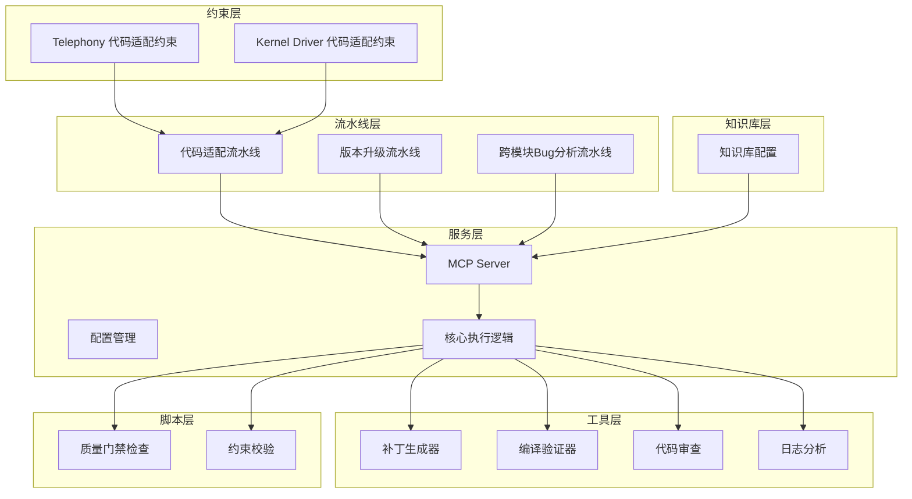
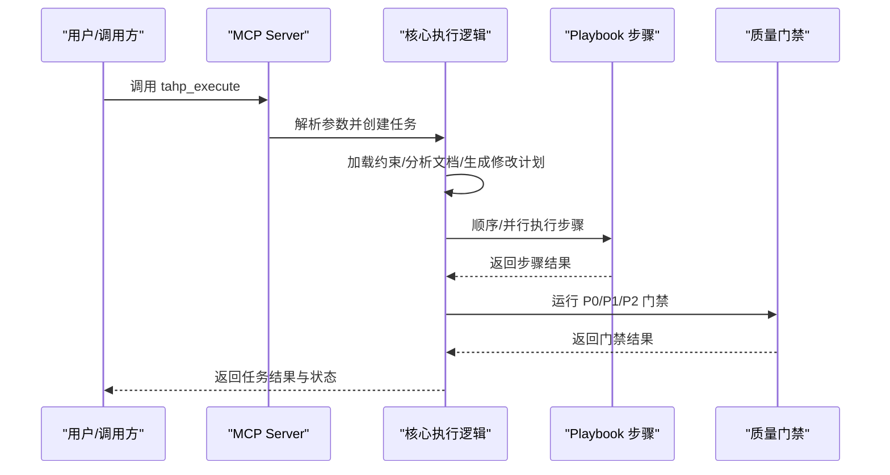
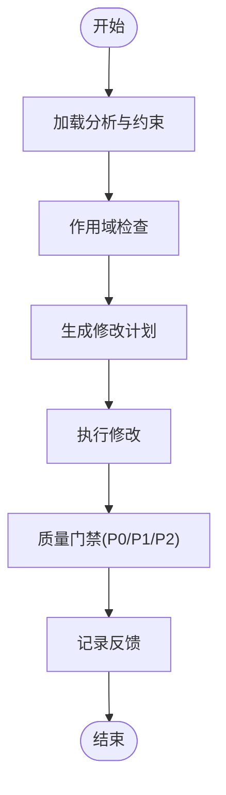
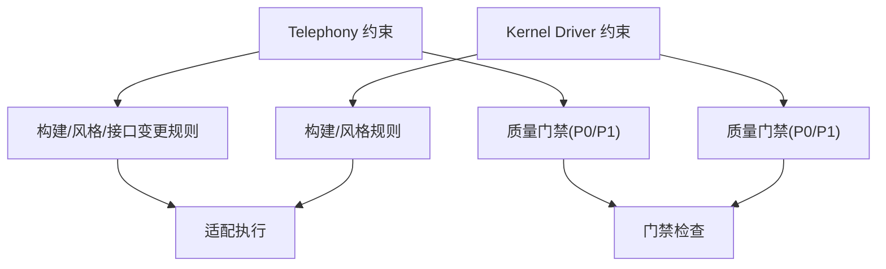
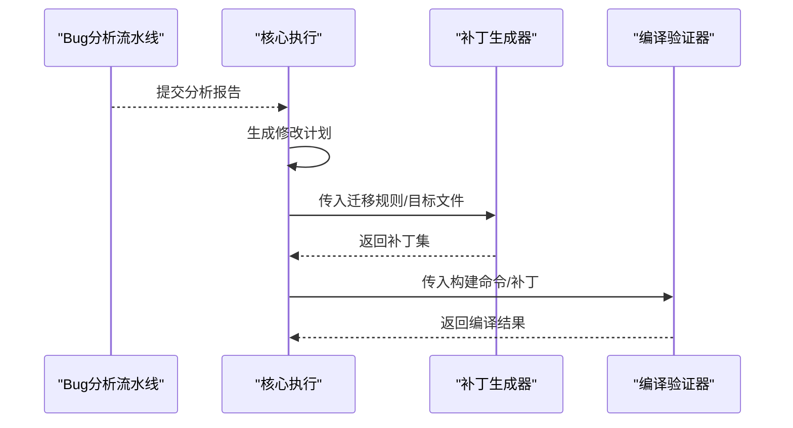
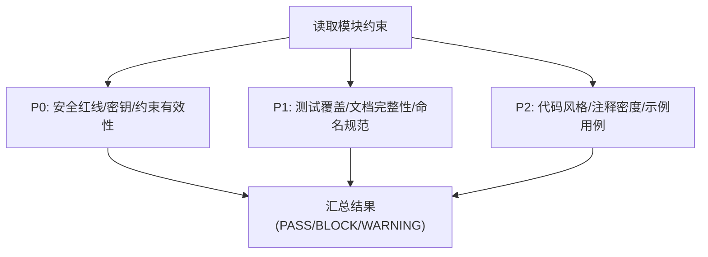
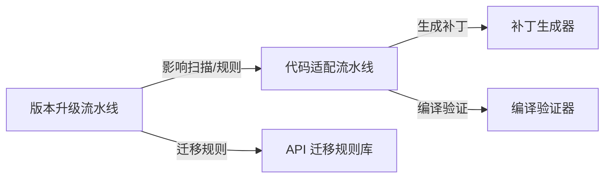
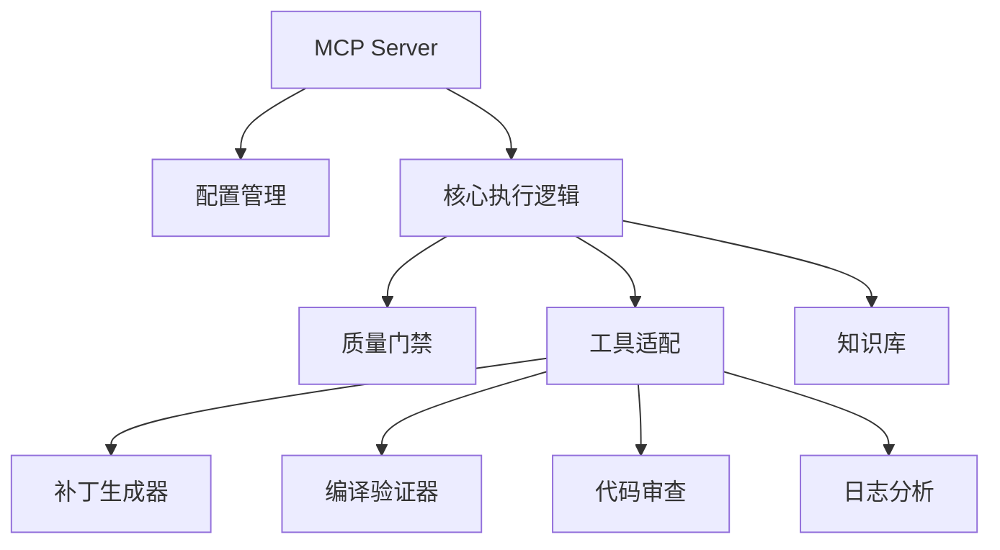

# 代码适配管道

<cite>
**本文引用的文件**
- [playbooks/code-adaptation-pipeline.yaml](file://playbooks/code-adaptation-pipeline.yaml)
- [tahp-mcp-server/server.py](file://tahp-mcp-server/server.py)
- [tahp-mcp-server/config.py](file://tahp-mcp-server/config.py)
- [tahp-mcp-server/core/__init__.py](file://tahp-mcp-server/core/__init__.py)
- [scripts/gate_check.py](file://scripts/gate_check.py)
- [scripts/validate_constraints.py](file://scripts/validate_constraints.py)
- [knowledge-base/config.yaml](file://knowledge-base/config.yaml)
- [tools/patch-generator/tool.py](file://tools/patch-generator/tool.py)
- [tools/build-verifier/tool.py](file://tools/build-verifier/tool.py)
- [playbooks/version-upgrade-pipeline.yaml](file://playbooks/version-upgrade-pipeline.yaml)
- [playbooks/bug-analysis-pipeline.yaml](file://playbooks/bug-analysis-pipeline.yaml)
- [constraints/telephony/code-adaptation.yaml](file://constraints/telephony/code-adaptation.yaml)
- [constraints/kernel-driver/code-adaptation.yaml](file://constraints/kernel-driver/code-adaptation.yaml)
</cite>

## 目录
1. [引言](#引言)
2. [项目结构](#项目结构)
3. [核心组件](#核心组件)
4. [架构总览](#架构总览)
5. [详细组件分析](#详细组件分析)
6. [依赖分析](#依赖分析)
7. [性能考虑](#性能考虑)
8. [故障排除指南](#故障排除指南)
9. [结论](#结论)
10. [附录](#附录)

## 引言
本文件系统化阐述“代码适配管道”的设计理念、执行机制与工程落地方式。该管道以约束驱动为核心，围绕 Telephony、Kernel Driver、Power Management 三大模块，提供从变更检测、适配方案生成到验证测试的闭环流程。管道强调可追溯、可纠偏、可扩展，并与 API 迁移、版本升级等其他管道协同工作，形成统一的质量门禁与知识沉淀体系。

## 项目结构
仓库采用“约束驱动 + 工具适配 + 知识库 + 流水线”的分层组织方式：
- 约束层：各模块的约束文件（如 Telephony、Kernel Driver 的 code-adaptation.yaml）定义构建规则、修改范围、风格与质量门禁。
- 流水线层：Playbook 描述步骤与触发条件，驱动适配执行。
- 服务层：MCP Server 暴露工具接口，协调任务生命周期与进度。
- 工具层：Patch 生成器、编译验证器、代码审查、日志分析等工具。
- 脚本层：质量门禁检查、约束校验、评估与质量门禁规范等脚本。
- 知识库层：SQLite + ONNX 嵌入的知识库，支持跨模块检索与自动捕获。

图表来源
- [playbooks/code-adaptation-pipeline.yaml:1-35](file://playbooks/code-adaptation-pipeline.yaml#L1-L35)
- [playbooks/version-upgrade-pipeline.yaml:1-61](file://playbooks/version-upgrade-pipeline.yaml#L1-L61)
- [playbooks/bug-analysis-pipeline.yaml:1-43](file://playbooks/bug-analysis-pipeline.yaml#L1-L43)
- [tahp-mcp-server/server.py:103-340](file://tahp-mcp-server/server.py#L103-L340)
- [tahp-mcp-server/config.py:36-129](file://tahp-mcp-server/config.py#L36-L129)
- [tahp-mcp-server/core/__init__.py:110-298](file://tahp-mcp-server/core/__init__.py#L110-L298)
- [scripts/gate_check.py:36-93](file://scripts/gate_check.py#L36-L93)
- [scripts/validate_constraints.py:30-113](file://scripts/validate_constraints.py#L30-L113)
- [knowledge-base/config.yaml:1-36](file://knowledge-base/config.yaml#L1-L36)

章节来源
- [playbooks/code-adaptation-pipeline.yaml:1-35](file://playbooks/code-adaptation-pipeline.yaml#L1-L35)
- [tahp-mcp-server/server.py:1-485](file://tahp-mcp-server/server.py#L1-L485)
- [tahp-mcp-server/config.py:1-176](file://tahp-mcp-server/config.py#L1-L176)
- [tahp-mcp-server/core/__init__.py:1-621](file://tahp-mcp-server/core/__init__.py#L1-L621)
- [scripts/gate_check.py:1-507](file://scripts/gate_check.py#L1-L507)
- [scripts/validate_constraints.py:1-360](file://scripts/validate_constraints.py#L1-L360)
- [knowledge-base/config.yaml:1-36](file://knowledge-base/config.yaml#L1-L36)

## 核心组件
- MCP Server：提供 tahp_execute、tahp_status、tahp_correct、tahp_gate_check 等工具，承载任务生命周期与进度事件。
- 配置管理：统一管理项目根目录、模块与领域映射、Playbook 路径等。
- 核心执行逻辑：加载约束、解析文档、生成修改计划、执行流水线、运行质量门禁。
- 质量门禁检查：实现 P0/P1/P2 三级门禁，支持模块与流水线两种模式。
- 约束校验：对约束文件进行语法、元数据、跨引用一致性等校验。
- 工具适配：补丁生成器、编译验证器、代码审查、日志分析等。

章节来源
- [tahp-mcp-server/server.py:103-340](file://tahp-mcp-server/server.py#L103-L340)
- [tahp-mcp-server/config.py:36-129](file://tahp-mcp-server/config.py#L36-L129)
- [tahp-mcp-server/core/__init__.py:110-298](file://tahp-mcp-server/core/__init__.py#L110-L298)
- [scripts/gate_check.py:36-93](file://scripts/gate_check.py#L36-L93)
- [scripts/validate_constraints.py:184-248](file://scripts/validate_constraints.py#L184-L248)

## 架构总览
代码适配管道以“约束驱动 + 流水线执行 + 质量门禁”为核心，结合知识库与工具链，形成可追溯、可纠偏、可扩展的自动化适配体系。

图表来源
- [tahp-mcp-server/server.py:372-418](file://tahp-mcp-server/server.py#L372-L418)
- [tahp-mcp-server/core/__init__.py:110-298](file://tahp-mcp-server/core/__init__.py#L110-L298)
- [scripts/gate_check.py:368-435](file://scripts/gate_check.py#L368-L435)

## 详细组件分析

### 触发条件与步骤流程
- 触发条件：Bug分析完成且 fix_type 为 code_change。
- 步骤：
  1) 加载分析与约束：读取 Bug 分析报告与模块约束文件。
  2) 作用域检查：确认修改文件在 scope.includes 范围内，不涉及 scope.excludes。
  3) 生成修改计划：输出文件列表、修改类型、位置、原因与风险。
  4) 执行修改：严格按修改计划执行代码修改。
  5) 质量门禁：执行 P0/P1/P2 门禁检查。
  6) 记录反馈：记录执行轨迹与门禁结果。

图表来源
- [playbooks/code-adaptation-pipeline.yaml:6-34](file://playbooks/code-adaptation-pipeline.yaml#L6-L34)

章节来源
- [playbooks/code-adaptation-pipeline.yaml:1-35](file://playbooks/code-adaptation-pipeline.yaml#L1-L35)

### 约束应用与质量门禁
- Telephony 模块：
  - 构建系统：Android Soong/Make；预检使用 checkpatch；后检禁止遗留 getDataNetworkType() 调用。
  - 修改范围：允许在 frameworks/opt/telephony/ 等路径；禁止 core/system 等路径。
  - 风格要求：Google Java Style；缩进与命名规范。
  - 接口变更规则：涉及 HIDL/AIDL 必须同步更新定义与实现；public API 不得变更；版本号递增。
  - 质量门禁：不允许引入编译错误、硬编码设备型号/IMEI、移除错误处理逻辑、修改安全权限检查；新增 unused import/Todo/Fixme 需关联 Bug ID；禁止使用已废弃 API。
- Kernel Driver 模块：
  - 构建系统：Kernel Make；预检 checkpatch；后检设备树编译。
  - 修改范围：允许 kernel/drivers/、kernel/arch/arm64/、kernel/include/；禁止 kernel/drivers/gpu/、staging/、mm/。
  - 风格要求：遵循 Coding Style；checkpatch 零 warning；Tab 缩进。
  - 质量门禁：不允许引入编译错误、修改无关平台公共代码、影响其他平台配置的设备树修改、移除错误处理逻辑；新增 Kconfig 必须有默认值。

图表来源
- [constraints/telephony/code-adaptation.yaml:1-48](file://constraints/telephony/code-adaptation.yaml#L1-L48)
- [constraints/kernel-driver/code-adaptation.yaml:1-37](file://constraints/kernel-driver/code-adaptation.yaml#L1-L37)

章节来源
- [constraints/telephony/code-adaptation.yaml:1-48](file://constraints/telephony/code-adaptation.yaml#L1-L48)
- [constraints/kernel-driver/code-adaptation.yaml:1-37](file://constraints/kernel-driver/code-adaptation.yaml#L1-L37)

### 代码变更检测与适配方案生成
- 变更检测：由上游 Bug 分析流水线产出分析报告，明确涉及模块与修改类型。
- 方案生成：核心执行逻辑根据 Playbook 与约束生成修改计划，包含文件、类型、位置、原因与风险。
- 工具适配：补丁生成器依据 API 迁移规则批量生成 patch；编译验证器执行构建命令；代码审查工具检查 P0/P1/P2 规则。

图表来源
- [playbooks/bug-analysis-pipeline.yaml:1-43](file://playbooks/bug-analysis-pipeline.yaml#L1-L43)
- [tahp-mcp-server/core/__init__.py:186-216](file://tahp-mcp-server/core/__init__.py#L186-L216)
- [tools/patch-generator/tool.py:1-24](file://tools/patch-generator/tool.py#L1-L24)
- [tools/build-verifier/tool.py:1-10](file://tools/build-verifier/tool.py#L1-L10)

章节来源
- [playbooks/bug-analysis-pipeline.yaml:1-43](file://playbooks/bug-analysis-pipeline.yaml#L1-L43)
- [tahp-mcp-server/core/__init__.py:186-216](file://tahp-mcp-server/core/__init__.py#L186-L216)
- [tools/patch-generator/tool.py:1-24](file://tools/patch-generator/tool.py#L1-L24)
- [tools/build-verifier/tool.py:1-10](file://tools/build-verifier/tool.py#L1-L10)

### 验证测试与质量门禁
- 门禁级别：
  - P0：阻塞性，如安全红线缺失、硬编码密钥、约束文件无效、编译错误等。
  - P1：警告级，如测试覆盖不足、module.yaml 不完整、命名不规范等。
  - P2：记录级，如行长度、尾随空白、注释密度等。
- 执行方式：核心执行逻辑调用门禁检查模块，支持对模块目录或流水线文件进行检查；简化模式下进行基础校验。

图表来源
- [scripts/gate_check.py:395-435](file://scripts/gate_check.py#L395-L435)
- [tahp-mcp-server/core/__init__.py:392-460](file://tahp-mcp-server/core/__init__.py#L392-L460)

章节来源
- [scripts/gate_check.py:36-93](file://scripts/gate_check.py#L36-L93)
- [tahp-mcp-server/core/__init__.py:392-460](file://tahp-mcp-server/core/__init__.py#L392-L460)

### 与 API 迁移、版本升级的关系
- API 迁移：知识库提供 API 迁移规则，补丁生成器据此批量生成 patch，减少人工成本。
- 版本升级：版本升级流水线先做 AOSP 差异分析与影响扫描，再分类为全自动/半自动/人工项，最后编译验证与回归测试；代码适配可作为其子步骤之一参与批量适配。

图表来源
- [playbooks/version-upgrade-pipeline.yaml:1-61](file://playbooks/version-upgrade-pipeline.yaml#L1-L61)
- [knowledge-base/config.yaml:1-36](file://knowledge-base/config.yaml#L1-L36)

章节来源
- [playbooks/version-upgrade-pipeline.yaml:1-61](file://playbooks/version-upgrade-pipeline.yaml#L1-L61)
- [knowledge-base/config.yaml:1-36](file://knowledge-base/config.yaml#L1-L36)

## 依赖分析
- 组件耦合：
  - MCP Server 通过工具注册表分发工具调用，核心执行逻辑与工具层松耦合。
  - 配置管理集中管理模块/领域映射与 Playbook 路径，降低硬编码。
  - 质量门禁独立于核心执行，便于替换与扩展。
- 外部依赖：
  - 知识库：SQLite + ONNX 嵌入，支持跨模块检索与自动捕获。
  - 工具：补丁生成器、编译验证器、代码审查、日志分析等。

图表来源
- [tahp-mcp-server/server.py:327-447](file://tahp-mcp-server/server.py#L327-L447)
- [tahp-mcp-server/config.py:105-129](file://tahp-mcp-server/config.py#L105-L129)
- [tahp-mcp-server/core/__init__.py:110-298](file://tahp-mcp-server/core/__init__.py#L110-L298)
- [knowledge-base/config.yaml:1-36](file://knowledge-base/config.yaml#L1-L36)

章节来源
- [tahp-mcp-server/server.py:327-447](file://tahp-mcp-server/server.py#L327-L447)
- [tahp-mcp-server/config.py:105-129](file://tahp-mcp-server/config.py#L105-L129)
- [tahp-mcp-server/core/__init__.py:110-298](file://tahp-mcp-server/core/__init__.py#L110-L298)
- [knowledge-base/config.yaml:1-36](file://knowledge-base/config.yaml#L1-L36)

## 性能考虑
- 并行执行：Playbook 支持并行步骤（如版本升级中的全自动/半自动/人工项），提升吞吐。
- 任务超时与并发限制：配置最大并发任务数与超时时间，避免资源争用。
- 知识库检索：默认 top_k 与置信度阈值平衡召回与性能；跨模块检索可按需开启。
- 构建验证：优先使用增量构建命令与最小化目标，缩短验证周期。

## 故障排除指南
- 任务执行失败：
  - 检查任务状态与纠偏反馈，确认是否处于终端态；通过 tahp_correct 输入纠偏建议。
  - 查看门禁结果，定位 P0/P1 失败项并逐项修复。
- 约束文件问题：
  - 使用约束校验脚本检查 YAML 语法、元数据完整性与跨模块引用一致性。
  - 确认安全红线存在、模块配置完整、命名规范符合要求。
- 工具调用异常：
  - 确认 MCP Server 已正确初始化，工具参数齐全（如 task_id、module、domain）。
  - 检查工具适配器是否存在与可用。

章节来源
- [tahp-mcp-server/core/__init__.py:318-363](file://tahp-mcp-server/core/__init__.py#L318-L363)
- [scripts/validate_constraints.py:184-248](file://scripts/validate_constraints.py#L184-L248)
- [scripts/gate_check.py:450-459](file://scripts/gate_check.py#L450-L459)

## 结论
代码适配管道通过“约束驱动 + 流水线执行 + 质量门禁 + 知识库”的组合，实现了从变更检测到适配执行再到验证测试的全链路自动化。针对 Telephony、Kernel Driver、Power Management 三大模块，管道提供了可配置的作用域、风格与门禁策略，并与 API 迁移、版本升级等管道协同，确保在复杂系统演进中保持高质量与可追溯性。

## 附录

### 配置示例与最佳实践
- 模块约束文件示例：
  - Telephony：定义构建命令、预/后检规则、允许/禁止路径、风格与接口变更规则、质量门禁。
  - Kernel Driver：定义构建命令、checkpatch 预检、设备树后检、允许/禁止路径、风格与门禁。
- Playbook 配置：
  - 明确触发条件（如 Bug 分析完成且 fix_type 为 code_change）。
  - 步骤顺序与并行策略清晰，输入输出明确。
- 工具集成：
  - 补丁生成器：基于 API 迁移规则批量生成 patch。
  - 编译验证器：传入构建命令与补丁文件，快速验证编译结果。
  - 代码审查：对 Patch 内容进行 P0/P1/P2 规则检查。
- 约束校验：
  - 使用 validate_constraints.py 对约束文件进行语法、元数据与跨引用检查。
- 知识库：
  - 启用自动捕获与跨模块同步，设置合适的 top_k 与置信度阈值。

章节来源
- [constraints/telephony/code-adaptation.yaml:1-48](file://constraints/telephony/code-adaptation.yaml#L1-L48)
- [constraints/kernel-driver/code-adaptation.yaml:1-37](file://constraints/kernel-driver/code-adaptation.yaml#L1-L37)
- [playbooks/code-adaptation-pipeline.yaml:1-35](file://playbooks/code-adaptation-pipeline.yaml#L1-L35)
- [tools/patch-generator/tool.py:1-24](file://tools/patch-generator/tool.py#L1-L24)
- [tools/build-verifier/tool.py:1-10](file://tools/build-verifier/tool.py#L1-L10)
- [scripts/validate_constraints.py:239-278](file://scripts/validate_constraints.py#L239-L278)
- [knowledge-base/config.yaml:1-36](file://knowledge-base/config.yaml#L1-L36)