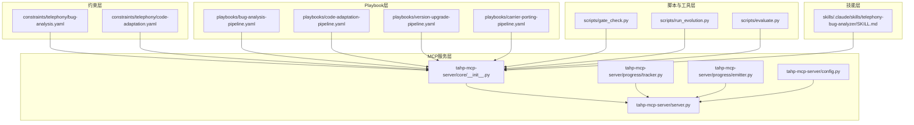
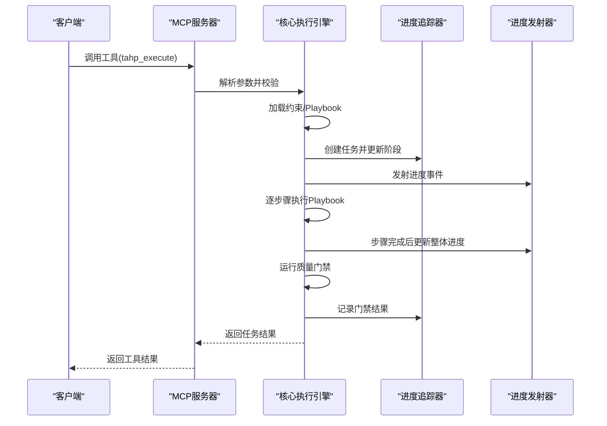
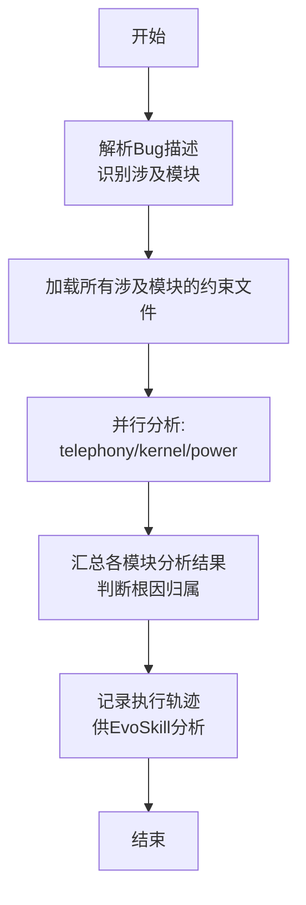
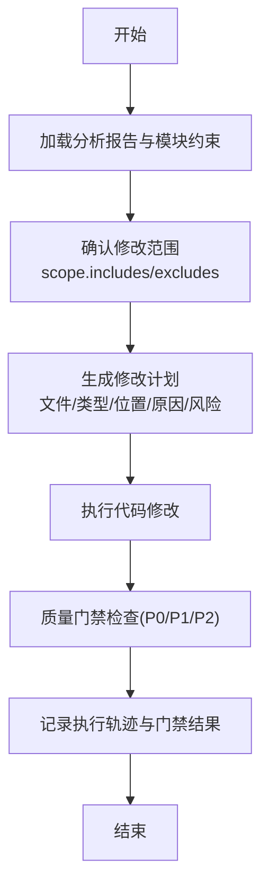
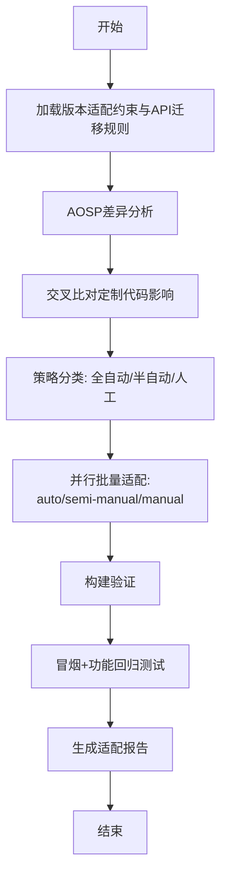
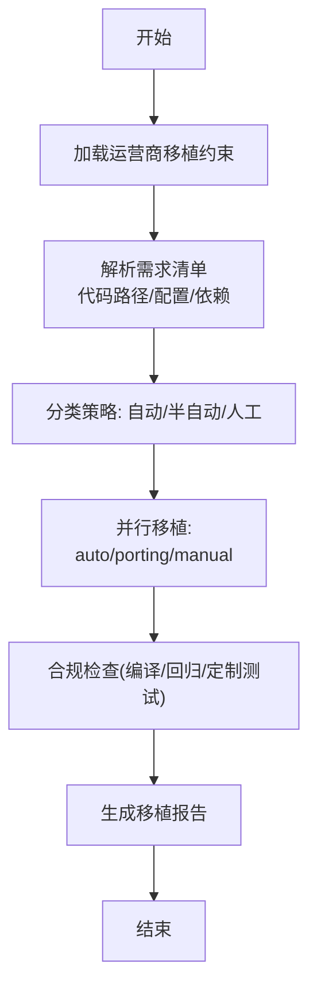
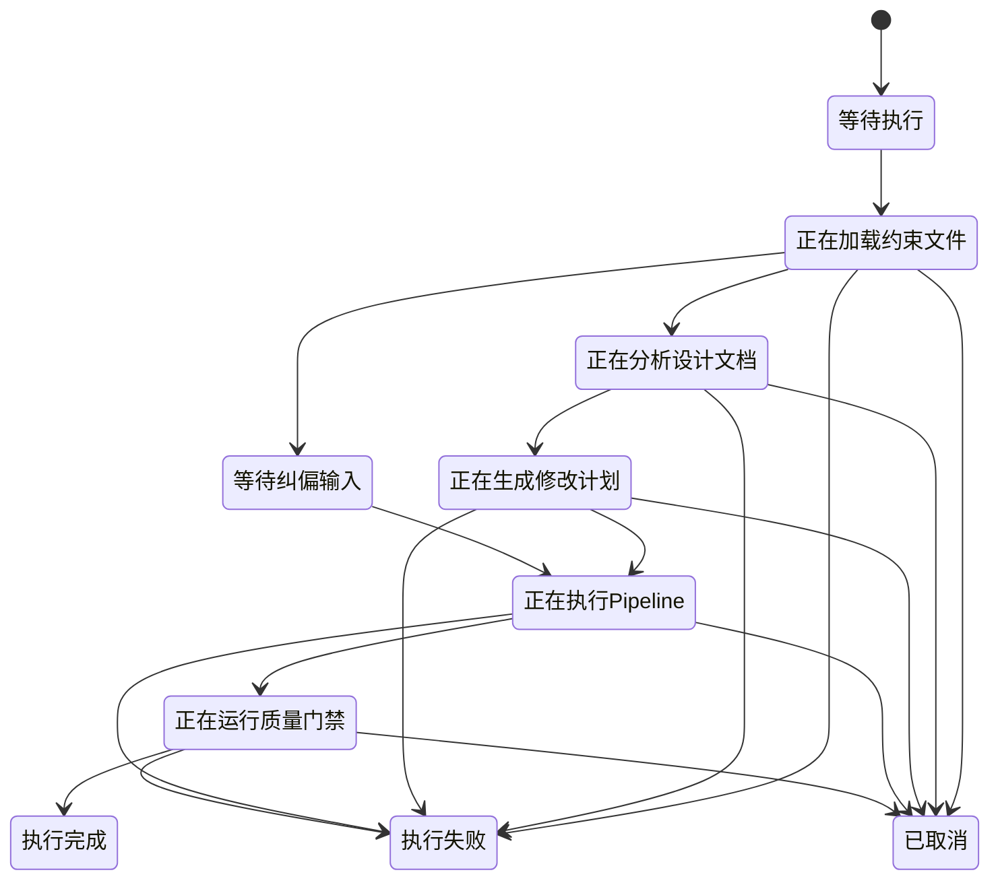
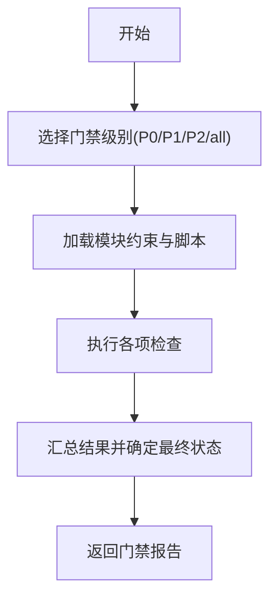
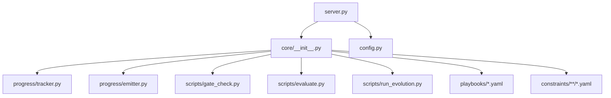

# 执行编排系统

<cite>
**本文档引用的文件**
- [server.py](file://tahp-mcp-server/server.py)
- [core/__init__.py](file://tahp-mcp-server/core/__init__.py)
- [progress/tracker.py](file://tahp-mcp-server/progress/tracker.py)
- [progress/emitter.py](file://tahp-mcp-server/progress/emitter.py)
- [config.py](file://tahp-mcp-server/config.py)
- [bug-analysis-pipeline.yaml](file://playbooks/bug-analysis-pipeline.yaml)
- [code-adaptation-pipeline.yaml](file://playbooks/code-adaptation-pipeline.yaml)
- [version-upgrade-pipeline.yaml](file://playbooks/version-upgrade-pipeline.yaml)
- [carrier-porting-pipeline.yaml](file://playbooks/carrier-porting-pipeline.yaml)
- [bug-analysis.yaml](file://constraints/telephony/bug-analysis.yaml)
- [code-adaptation.yaml](file://constraints/telephony/code-adaptation.yaml)
- [SKILL.md](file://skills/.claude/skills/telephony-bug-analyzer/SKILL.md)
- [gate_check.py](file://scripts/gate_check.py)
- [run_evolution.py](file://scripts/run_evolution.py)
- [evaluate.py](file://scripts/evaluate.py)
</cite>

## 目录
1. [简介](#简介)
2. [项目结构](#项目结构)
3. [核心组件](#核心组件)
4. [架构总览](#架构总览)
5. [详细组件分析](#详细组件分析)
6. [依赖分析](#依赖分析)
7. [性能考虑](#性能考虑)
8. [故障排除指南](#故障排除指南)
9. [结论](#结论)
10. [附录](#附录)

## 简介
本文件面向执行编排系统的技术文档，聚焦于Playbook管道设计、工作流执行机制与并行处理策略。系统围绕约束驱动的模块化能力，通过MCP（Model Context Protocol）服务器对外提供工具化服务，支持缺陷分析、代码适配、版本升级、运营商移植等多场景的自动化执行与质量门禁。文档同时涵盖状态管理、错误恢复、性能监控、最佳实践、调试技巧与故障排除，并提供自定义执行管道的开发指南与扩展机制，以及与约束系统的集成方式与数据流转过程。

## 项目结构
系统采用“约束驱动 + Playbook编排 + MCP工具服务”的分层架构：
- 约束层：位于 constraints/ 下，按模块组织，定义预条件、分析规则、修改规则、质量门禁等。
- Playbook层：位于 playbooks/ 下，定义不同领域的执行管道步骤与并行策略。
- MCP服务层：位于 tahp-mcp-server/ 下，提供统一的工具接口与进度事件推送。
- 脚本与工具层：位于 scripts/ 与 tools/ 下，提供质量门禁、评估、日志分析等辅助能力。
- 技能层：位于 skills/ 下，封装具体AI技能的触发条件、前置检查与约束引用。

**图表来源**
- [server.py:103-340](file://tahp-mcp-server/server.py#L103-L340)
- [core/__init__.py:110-298](file://tahp-mcp-server/core/__init__.py#L110-L298)
- [progress/tracker.py:82-210](file://tahp-mcp-server/progress/tracker.py#L82-L210)
- [progress/emitter.py:47-130](file://tahp-mcp-server/progress/emitter.py#L47-L130)
- [config.py:36-129](file://tahp-mcp-server/config.py#L36-L129)

**章节来源**
- [server.py:1-485](file://tahp-mcp-server/server.py#L1-L485)
- [core/__init__.py:1-621](file://tahp-mcp-server/core/__init__.py#L1-L621)
- [progress/tracker.py:1-343](file://tahp-mcp-server/progress/tracker.py#L1-L343)
- [progress/emitter.py:1-194](file://tahp-mcp-server/progress/emitter.py#L1-L194)
- [config.py:1-176](file://tahp-mcp-server/config.py#L1-L176)

## 核心组件
- MCP工具服务：提供统一的工具接口（执行、状态查询、纠偏、门禁、知识查询、日志分析、API迁移、代码审查、补丁生成等），通过MCP协议与客户端交互。
- 核心执行引擎：负责加载约束、解析设计文档、生成修改计划、执行Playbook步骤、运行质量门禁，并维护任务状态与进度事件。
- 进度追踪与事件发射：管理任务生命周期、阶段转换、步骤状态，并通过MCP日志通知机制实时推送进度。
- 配置管理：集中管理项目根目录、模块与领域、Playbook映射、工具目录等。
- 质量门禁与评估：提供P0/P1/P2三级门禁检查与技能评估工具，支撑自动化质量控制与迭代优化。

**章节来源**
- [server.py:103-448](file://tahp-mcp-server/server.py#L103-L448)
- [core/__init__.py:110-459](file://tahp-mcp-server/core/__init__.py#L110-L459)
- [progress/tracker.py:82-312](file://tahp-mcp-server/progress/tracker.py#L82-L312)
- [progress/emitter.py:47-130](file://tahp-mcp-server/progress/emitter.py#L47-L130)
- [config.py:36-129](file://tahp-mcp-server/config.py#L36-L129)
- [gate_check.py:36-93](file://scripts/gate_check.py#L36-L93)

## 架构总览
系统通过MCP服务器暴露工具，客户端（如Claude Code）调用工具执行任务；核心引擎按领域加载Playbook，逐步骤执行并更新进度；质量门禁贯穿执行流程，最终形成可追溯的执行轨迹与报告。

**图表来源**
- [server.py:369-448](file://tahp-mcp-server/server.py#L369-L448)
- [core/__init__.py:110-298](file://tahp-mcp-server/core/__init__.py#L110-L298)
- [progress/tracker.py:255-312](file://tahp-mcp-server/progress/tracker.py#L255-L312)
- [progress/emitter.py:47-111](file://tahp-mcp-server/progress/emitter.py#L47-L111)

## 详细组件分析

### 缺陷分析管道（跨模块）
该管道用于涉及多个子系统的复杂Bug分析，支持并行分析各模块结果并统一汇总。

**图表来源**
- [bug-analysis-pipeline.yaml:6-42](file://playbooks/bug-analysis-pipeline.yaml#L6-L42)

**章节来源**
- [bug-analysis-pipeline.yaml:1-43](file://playbooks/bug-analysis-pipeline.yaml#L1-L43)
- [bug-analysis.yaml:1-110](file://constraints/telephony/bug-analysis.yaml#L1-L110)
- [SKILL.md:1-51](file://skills/.claude/skills/telephony-bug-analyzer/SKILL.md#L1-L51)

### 代码适配管道
基于缺陷分析结果执行代码适配，严格遵循质量门禁与修改范围约束。

**图表来源**
- [code-adaptation-pipeline.yaml:6-34](file://playbooks/code-adaptation-pipeline.yaml#L6-L34)

**章节来源**
- [code-adaptation-pipeline.yaml:1-35](file://playbooks/code-adaptation-pipeline.yaml#L1-L35)
- [code-adaptation.yaml:1-48](file://constraints/telephony/code-adaptation.yaml#L1-L48)

### 版本升级适配管道（Android大版本）
覆盖AOSP差异分析、影响扫描、策略分类、批量适配、构建验证与回归测试。

**图表来源**
- [version-upgrade-pipeline.yaml:6-60](file://playbooks/version-upgrade-pipeline.yaml#L6-L60)

**章节来源**
- [version-upgrade-pipeline.yaml:1-61](file://playbooks/version-upgrade-pipeline.yaml#L1-L61)

### 运营商移植管道
支持运营商定制需求的跨项目移植，自动/半自动/人工策略并行执行。

**图表来源**
- [carrier-porting-pipeline.yaml:6-40](file://playbooks/carrier-porting-pipeline.yaml#L6-L40)

**章节来源**
- [carrier-porting-pipeline.yaml:1-41](file://playbooks/carrier-porting-pipeline.yaml#L1-L41)

### 工作流状态管理与并行处理
- 阶段管理：任务在多个阶段间流转（加载约束、分析文档、生成计划、执行Pipeline、运行门禁），每个阶段有明确的进度占比。
- 步骤管理：每个任务包含若干步骤，步骤状态（pending/running/completed/failed/skipped）实时更新。
- 并行处理：Playbook支持step内并行执行（如多模块分析、多策略适配），并行完成后汇总结果。
- 纠偏机制：支持在执行过程中接收纠偏反馈，进入CORRECTING阶段并重新进入执行状态。

**图表来源**
- [progress/tracker.py:18-68](file://tahp-mcp-server/progress/tracker.py#L18-L68)
- [progress/emitter.py:166-176](file://tahp-mcp-server/progress/emitter.py#L166-L176)

**章节来源**
- [progress/tracker.py:18-129](file://tahp-mcp-server/progress/tracker.py#L18-L129)
- [progress/emitter.py:18-31](file://tahp-mcp-server/progress/emitter.py#L18-L31)

### 质量门禁与性能监控
- 门禁级别：P0（阻塞）、P1（警告）、P2（记录）。核心引擎支持按级别运行门禁检查，并汇总结果。
- 性能监控：通过进度事件推送整体与步骤进度，支持客户端轮询与事件驱动两种方式。
- 知识查询：支持跨模块检索与按模块过滤的知识库查询，辅助决策与回溯。

**图表来源**
- [core/__init__.py:366-459](file://tahp-mcp-server/core/__init__.py#L366-L459)
- [gate_check.py:368-435](file://scripts/gate_check.py#L368-L435)

**章节来源**
- [core/__init__.py:366-459](file://tahp-mcp-server/core/__init__.py#L366-L459)
- [gate_check.py:36-93](file://scripts/gate_check.py#L36-L93)

### 自定义执行管道开发指南
- Playbook设计：在 playbooks/ 下新增领域YAML，定义steps与并行策略；在 config.py 中注册领域到Playbook的映射。
- 约束集成：在 constraints/<module>/ 下完善模块约束，确保安全红线、修改范围、质量门禁等配置齐全。
- 工具适配：在 server.py 的工具注册处增加新工具，或复用现有工具（如tahp_execute、tahp_gate_check）。
- 进度与纠偏：利用进度追踪器与事件发射器，确保步骤状态与整体进度正确更新；支持纠偏反馈的接入与处理。
- 评估与迭代：使用 scripts/evaluate.py 与 scripts/run_evolution.py 对技能进行评估与迭代优化。

**章节来源**
- [config.py:73-129](file://tahp-mcp-server/config.py#L73-L129)
- [server.py:327-448](file://tahp-mcp-server/server.py#L327-L448)
- [run_evolution.py:409-527](file://scripts/run_evolution.py#L409-L527)
- [evaluate.py:290-384](file://scripts/evaluate.py#L290-L384)

## 依赖分析
- 组件耦合：MCP服务器与核心执行引擎松耦合，通过工具分发与配置管理解耦；进度追踪与事件发射器独立于业务逻辑。
- 外部依赖：依赖MCP SDK进行工具注册与调用；依赖YAML解析加载约束与Playbook；依赖脚本模块（门禁、评估）实现质量控制。
- 循环依赖：未发现循环依赖迹象，模块职责清晰。

**图表来源**
- [server.py:71-82](file://tahp-mcp-server/server.py#L71-L82)
- [core/__init__.py:18-21](file://tahp-mcp-server/core/__init__.py#L18-L21)

**章节来源**
- [server.py:71-82](file://tahp-mcp-server/server.py#L71-L82)
- [core/__init__.py:18-21](file://tahp-mcp-server/core/__init__.py#L18-L21)

## 性能考虑
- 并行策略：在Playbook中合理使用并行步骤，缩短整体执行时间；注意资源竞争与并发度上限。
- 任务超时：配置合理的任务超时时间，避免长时间阻塞；对耗时步骤提供阶段性进度。
- 事件推送：通过MCP日志事件推送进度，减少轮询开销；控制事件频率避免过度推送。
- 门禁检查：门禁检查可按级别选择性执行，降低非关键检查对性能的影响。

## 故障排除指南
- 任务状态查询：使用工具查询任务状态，确认当前阶段与步骤详情；若状态为FAILED，查看错误信息。
- 纠偏处理：在CORRECTING阶段接收纠偏反馈，系统会根据反馈调整执行策略并重新进入执行状态。
- 门禁失败：根据门禁报告定位失败项，修复后重新运行门禁；P0失败会导致阻塞，需优先解决。
- 日志分析：使用日志分析工具提取关键事件，辅助根因定位与修复建议。
- 知识库查询：跨模块检索相关知识条目，辅助决策与回溯。

**章节来源**
- [core/__init__.py:300-363](file://tahp-mcp-server/core/__init__.py#L300-L363)
- [progress/emitter.py:112-129](file://tahp-mcp-server/progress/emitter.py#L112-L129)
- [gate_check.py:437-478](file://scripts/gate_check.py#L437-L478)

## 结论
执行编排系统通过约束驱动与Playbook编排实现了多场景的自动化执行，配合MCP工具服务与进度事件推送，提供了可观测、可纠偏、可评估的执行体验。质量门禁贯穿始终，保障交付质量；EvoSkill与评估工具支持持续优化。系统具备良好的扩展性，便于新增领域与技能，满足复杂工程场景的需求。

## 附录
- 最佳实践
  - 在Playbook中明确并行边界，避免资源争用。
  - 在约束中完善安全红线与质量门禁，确保执行合规。
  - 使用进度事件与纠偏机制，提升可运维性。
  - 定期运行门禁检查与技能评估，保持质量稳定。
- 调试技巧
  - 通过工具查询任务状态，关注步骤详情与错误信息。
  - 使用日志分析工具提取关键事件，辅助根因定位。
  - 在CORRECTING阶段提供明确的纠偏反馈，指导系统调整。
- 故障排除
  - P0失败：优先修复阻塞性问题，确保安全与合规。
  - P1失败：关注警告项，提升测试覆盖率与文档完整性。
  - P2失败：作为参考项，逐步改进代码风格与注释密度。