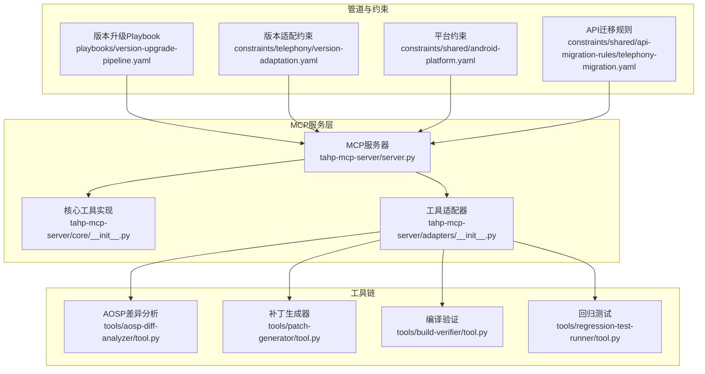
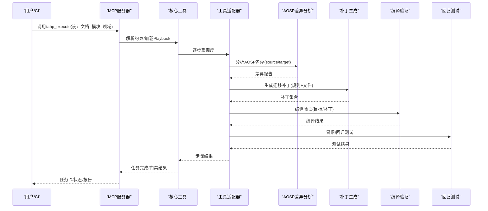
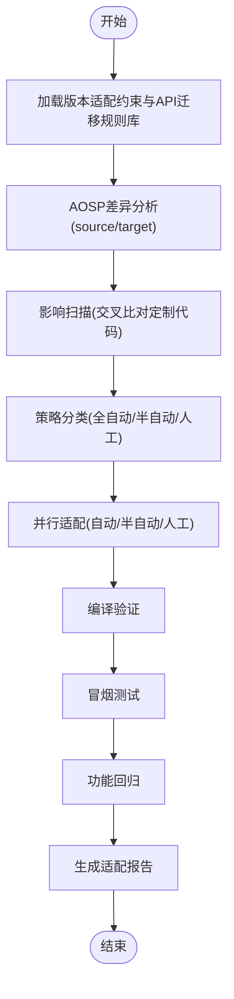
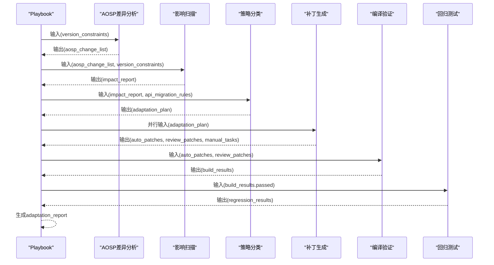
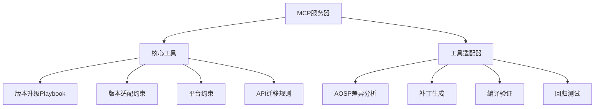

# 版本升级管道

<cite>
**本文档引用的文件**
- [version-upgrade-pipeline.yaml](file://playbooks/version-upgrade-pipeline.yaml)
- [version-adaptation.yaml](file://constraints/telephony/version-adaptation.yaml)
- [android-platform.yaml](file://constraints/shared/android-platform.yaml)
- [telephony-migration.yaml](file://constraints/shared/api-migration-rules/telephony-migration.yaml)
- [server.py](file://tahp-mcp-server/server.py)
- [core/__init__.py](file://tahp-mcp-server/core/__init__.py)
- [adapters/__init__.py](file://tahp-mcp-server/adapters/__init__.py)
- [tool.py（AOSP Diff Analyzer）](file://tools/aosp-diff-analyzer/tool.py)
- [tool.py（Patch Generator）](file://tools/patch-generator/tool.py)
- [tool.py（Build Verifier）](file://tools/build-verifier/tool.py)
- [tool.py（Regression Test Runner）](file://tools/regression-test-runner/tool.py)
- [SKILL.md（Telephony Version Adapter）](file://skills/.claude/skills/telephony-version-adapter/ SKILL.md)
- [code-adaptation-pipeline.yaml](file://playbooks/code-adaptation-pipeline.yaml)
- [carrier-porting-pipeline.yaml](file://playbooks/carrier-porting-pipeline.yaml)
- [run_evolution.py](file://scripts/run_evolution.py)
</cite>

## 目录
1. [引言](#引言)
2. [项目结构](#项目结构)
3. [核心组件](#核心组件)
4. [架构概览](#架构概览)
5. [详细组件分析](#详细组件分析)
6. [依赖分析](#依赖分析)
7. [性能考虑](#性能考虑)
8. [故障排除指南](#故障排除指南)
9. [结论](#结论)
10. [附录](#附录)

## 引言
本文件系统性阐述 TAHP 版本升级管道的设计原理、执行策略与工程实践，覆盖触发机制、步骤分解、兼容性检查、模块适配策略、API 变更处理、依赖关系管理、版本对比分析、变更影响评估、升级风险控制、配置示例、迁移策略与回滚机制，并说明与代码适配、运营商移植等其他管道的协同关系。

## 项目结构
版本升级管道围绕 Playbook、约束文件、MCP 服务器与工具适配器协同工作，形成“约束驱动 + 工具链集成 + 质量门禁”的闭环。

**图表来源**
- [version-upgrade-pipeline.yaml:1-61](file://playbooks/version-upgrade-pipeline.yaml#L1-L61)
- [version-adaptation.yaml:1-117](file://constraints/telephony/version-adaptation.yaml#L1-L117)
- [server.py:1-485](file://tahp-mcp-server/server.py#L1-L485)
- [core/__init__.py:1-621](file://tahp-mcp-server/core/__init__.py#L1-L621)
- [adapters/__init__.py:1-239](file://tahp-mcp-server/adapters/__init__.py#L1-L239)
- [tool.py（AOSP Diff Analyzer）:1-41](file://tools/aosp-diff-analyzer/tool.py#L1-L41)
- [tool.py（Patch Generator）:1-24](file://tools/patch-generator/tool.py#L1-L24)
- [tool.py（Build Verifier）:1-10](file://tools/build-verifier/tool.py#L1-L10)
- [tool.py（Regression Test Runner）:1-9](file://tools/regression-test-runner/tool.py#L1-L9)

**章节来源**
- [version-upgrade-pipeline.yaml:1-61](file://playbooks/version-upgrade-pipeline.yaml#L1-L61)
- [server.py:1-485](file://tahp-mcp-server/server.py#L1-L485)

## 核心组件
- 版本升级 Playbook：定义从“加载约束 → AOSP 差异分析 → 影响扫描 → 策略分类 → 并行适配 → 编译验证 → 回归测试 → 报告生成”的完整步骤序列。
- 约束与规则：
  - 版本适配约束：定义源/目标版本、代码范围、构建与测试目标、依赖模块、排除路径、迁移规则、策略偏好、验收标准等。
  - 平台约束：定义 API 级别、构建系统、安全与兼容性要求、日志规范等。
  - API 迁移规则：针对通信模块的 API 变更清单，含变更类型、置信度、影响文件模式、迁移步骤等。
- MCP 服务器与核心工具：提供任务执行、状态查询、纠偏、门禁检查、知识库查询等能力；通过工具适配器桥接现有工具链。
- 工具链：AOSP 差异分析、补丁生成、编译验证、回归测试等。

**章节来源**
- [version-upgrade-pipeline.yaml:6-61](file://playbooks/version-upgrade-pipeline.yaml#L6-L61)
- [version-adaptation.yaml:14-117](file://constraints/telephony/version-adaptation.yaml#L14-L117)
- [android-platform.yaml:1-25](file://constraints/shared/android-platform.yaml#L1-L25)
- [telephony-migration.yaml:1-57](file://constraints/shared/api-migration-rules/telephony-migration.yaml#L1-L57)
- [core/__init__.py:110-298](file://tahp-mcp-server/core/__init__.py#L110-L298)

## 架构概览
版本升级管道采用“约束驱动 + 工具链集成”的架构，MCP 服务器作为统一入口，Playbook 驱动步骤执行，工具适配器将现有工具封装为标准化接口，质量门禁贯穿始终。

**图表来源**
- [server.py:343-448](file://tahp-mcp-server/server.py#L343-L448)
- [core/__init__.py:110-298](file://tahp-mcp-server/core/__init__.py#L110-L298)
- [adapters/__init__.py:186-239](file://tahp-mcp-server/adapters/__init__.py#L186-L239)
- [tool.py（AOSP Diff Analyzer）:39-41](file://tools/aosp-diff-analyzer/tool.py#L39-L41)
- [tool.py（Patch Generator）:22-24](file://tools/patch-generator/tool.py#L22-L24)
- [tool.py（Build Verifier）:8-10](file://tools/build-verifier/tool.py#L8-L10)
- [tool.py（Regression Test Runner）:7-9](file://tools/regression-test-runner/tool.py#L7-L9)

## 详细组件分析

### 触发机制与执行策略
- 触发条件：
  - 新 Android 版本发布
  - Owner 更新版本适配约束文件
- 执行策略：
  - 串行步骤：加载约束 → AOSP 差异分析 → 影响扫描 → 策略分类
  - 并行分支：全自动、半自动、人工项并行生成
  - 质量门禁：编译 100% 通过 + 回归通过率 ≥ 95%

**图表来源**
- [version-upgrade-pipeline.yaml:6-61](file://playbooks/version-upgrade-pipeline.yaml#L6-L61)

**章节来源**
- [version-upgrade-pipeline.yaml:4](file://playbooks/version-upgrade-pipeline.yaml#L4)
- [version-upgrade-pipeline.yaml:6-61](file://playbooks/version-upgrade-pipeline.yaml#L6-L61)

### 步骤分解与数据流
- 加载版本约束与规则库：读取模块版本适配约束、共享 API 迁移规则、平台约束。
- AOSP 差异分析：对比源/目标版本框架差异，识别废弃/新增/移除 API。
- 影响扫描：将差异与定制代码交叉比对，定位受影响文件。
- 策略分类：依据置信度阈值（如 95%）将迁移项分为全自动/半自动/人工。
- 并行适配：自动/半自动项批量生成补丁；人工项生成任务清单。
- 编译验证：验证补丁集编译通过。
- 回归测试：冒烟测试 + 功能回归，设定通过率门槛。
- 报告生成：汇总完成/审核/人工/失败统计。

**图表来源**
- [version-upgrade-pipeline.yaml:6-61](file://playbooks/version-upgrade-pipeline.yaml#L6-L61)
- [tool.py（AOSP Diff Analyzer）:10-27](file://tools/aosp-diff-analyzer/tool.py#L10-L27)
- [tool.py（Patch Generator）:3-20](file://tools/patch-generator/tool.py#L3-L20)
- [tool.py（Build Verifier）:3-6](file://tools/build-verifier/tool.py#L3-L6)
- [tool.py（Regression Test Runner）:3-5](file://tools/regression-test-runner/tool.py#L3-L5)

**章节来源**
- [version-upgrade-pipeline.yaml:6-61](file://playbooks/version-upgrade-pipeline.yaml#L6-L61)

### 兼容性检查流程
- 平台约束检查：API 级别、构建系统、安全与兼容性要求、日志规范。
- 版本适配约束检查：禁止删除自研业务逻辑、新增 API 必须标注 @RequiresApi、废弃 API 零残留、无新增编译警告。
- 验收标准：编译 100% 通过；冒烟测试覆盖通话/短信/数据/SIM 热插拔；功能回归测试覆盖通话/短信/数据/SIM/VOLTE/VoNR；回归通过率 ≥ 95%。

**章节来源**
- [android-platform.yaml:15-25](file://constraints/shared/android-platform.yaml#L15-L25)
- [version-adaptation.yaml:70-113](file://constraints/telephony/version-adaptation.yaml#L70-L113)
- [version-adaptation.yaml:94-108](file://constraints/telephony/version-adaptation.yaml#L94-L108)

### 不同模块的版本适配策略
- 通信模块（telephony）：
  - 源/目标版本：android-15.0.0_r1 → android-16.0.0_r1
  - 代码范围：frameworks/opt/telephony、frameworks/base/telephony、packages/services/Telephony 等
  - 依赖模块：framework/connectivity/media
  - 排除路径：vendor/mediatek/proprietary、device/*/ril/**
  - API 迁移规则：包含方法签名变更、方法重命名、常量迁移等，置信度与自动化程度各异
- 其他模块（kernel-driver/power-mgmt）：
  - 采用各自模块的 version-adaptation.yaml 与共享规则，遵循相同约束与验收标准

**章节来源**
- [version-adaptation.yaml:14-117](file://constraints/telephony/version-adaptation.yaml#L14-L117)
- [telephony-migration.yaml:7-57](file://constraints/shared/api-migration-rules/telephony-migration.yaml#L7-L57)

### API 变更处理与依赖关系管理
- API 变更处理：
  - 通过 AOSP 差异分析识别废弃/新增/移除 API
  - 结合 API 迁移规则库进行匹配与分类
  - 自动生成补丁并进行代码审查
- 依赖关系管理：
  - 明确依赖模块（如 framework/connectivity/media）
  - 排除第三方专有代码（避免重复适配）
  - 保持接口定义文件与实现类同步更新

**章节来源**
- [tool.py（AOSP Diff Analyzer）:10-27](file://tools/aosp-diff-analyzer/tool.py#L10-L27)
- [tool.py（Patch Generator）:3-20](file://tools/patch-generator/tool.py#L3-L20)
- [version-adaptation.yaml:32-38](file://constraints/telephony/version-adaptation.yaml#L32-L38)

### 版本对比分析与变更影响评估
- 版本对比分析：基于 AOSP 差异分析工具，提取废弃/新增/移除 API 的文件与内容，生成摘要统计。
- 变更影响评估：结合 API 迁移规则与影响扫描，定位受影响文件，计算影响范围与风险等级。

**章节来源**
- [tool.py（AOSP Diff Analyzer）:10-27](file://tools/aosp-diff-analyzer/tool.py#L10-L27)
- [version-adaptation.yaml:24-31](file://constraints/telephony/version-adaptation.yaml#L24-L31)

### 升级风险控制
- 风险控制措施：
  - 策略阈值：全自动阈值 95%，半自动 70%
  - 质量门禁：编译 100% 通过 + 回归通过率 ≥ 95%
  - 安全红线：禁止删除自研业务逻辑、新增 API 必须标注 @RequiresApi、废弃 API 零残留、无新增编译警告
  - 人工复核：半自动与人工项需人工审核与验证

**章节来源**
- [version-adaptation.yaml:88-113](file://constraints/telephony/version-adaptation.yaml#L88-L113)
- [version-upgrade-pipeline.yaml:28-60](file://playbooks/version-upgrade-pipeline.yaml#L28-L60)

### 配置示例与迁移策略
- 配置示例：
  - 版本适配约束：定义源/目标版本、代码范围、构建与测试目标、依赖模块、排除路径、迁移规则、策略偏好、验收标准
  - 平台约束：定义 API 级别、构建系统、安全与兼容性要求、日志规范
  - API 迁移规则：定义变更类型、置信度、影响文件模式、迁移步骤
- 迁移策略：
  - 全自动：高置信度 API 变更自动迁移
  - 半自动：中低置信度 API 变更生成补丁并人工审核
  - 人工：复杂或语义变化需人工评估与修改

**章节来源**
- [version-adaptation.yaml:14-117](file://constraints/telephony/version-adaptation.yaml#L14-L117)
- [android-platform.yaml:1-25](file://constraints/shared/android-platform.yaml#L1-25)
- [telephony-migration.yaml:1-57](file://constraints/shared/api-migration-rules/telephony-migration.yaml#L1-L57)

### 回滚机制
- 回滚策略：
  - 以补丁为粒度进行回滚：对编译失败或回归测试不通过的补丁单独回滚
  - 以变更集为单位回滚：若某批补丁导致整体失败，回滚该批次补丁并重新生成
  - 以版本为单位回滚：若升级整体失败，回滚至源版本并修复问题后重试

**章节来源**
- [version-upgrade-pipeline.yaml:28-60](file://playbooks/version-upgrade-pipeline.yaml#L28-L60)

### 与代码适配、运营商移植的协同关系
- 与代码适配管道协同：
  - 代码适配管道基于 Bug 分析结果执行，遵循质量门禁
  - 版本升级管道先于代码适配管道进行大规模 API 迁移，降低后续代码适配的工作量
- 与运营商移植管道协同：
  - 运营商移植管道面向定制需求跨项目移植
  - 版本升级管道确保基础平台稳定，为运营商移植提供稳定的基线

**章节来源**
- [code-adaptation-pipeline.yaml:1-35](file://playbooks/code-adaptation-pipeline.yaml#L1-L35)
- [carrier-porting-pipeline.yaml:1-41](file://playbooks/carrier-porting-pipeline.yaml#L1-L41)

## 依赖分析
MCP 服务器通过工具适配器统一调度各工具，Playbook 驱动步骤执行，约束文件与规则库提供策略依据。

**图表来源**
- [server.py:343-448](file://tahp-mcp-server/server.py#L343-L448)
- [core/__init__.py:110-298](file://tahp-mcp-server/core/__init__.py#L110-L298)
- [adapters/__init__.py:186-239](file://tahp-mcp-server/adapters/__init__.py#L186-L239)

**章节来源**
- [server.py:1-485](file://tahp-mcp-server/server.py#L1-L485)
- [core/__init__.py:1-621](file://tahp-mcp-server/core/__init__.py#L1-L621)
- [adapters/__init__.py:1-239](file://tahp-mcp-server/adapters/__init__.py#L1-L239)

## 性能考虑
- 并行化：并行适配分支（自动/半自动/人工）提升整体吞吐
- 置信度阈值：通过阈值筛选减少人工干预，提高自动化程度
- 工具降级：当工具模块缺失时，适配器提供降级实现，保证流程可用性
- 门禁前置：编译与回归测试前置，尽早发现风险，减少无效迭代

**章节来源**
- [version-upgrade-pipeline.yaml:28-60](file://playbooks/version-upgrade-pipeline.yaml#L28-L60)
- [adapters/__init__.py:68-183](file://tahp-mcp-server/adapters/__init__.py#L68-L183)

## 故障排除指南
- 任务执行失败：
  - 检查设计文档是否存在与可读
  - 查看任务状态与纠偏反馈
- 工具调用异常：
  - 确认工具模块存在且具备 handle_* 函数
  - 检查参数格式与必填字段
- 编译失败：
  - 检查补丁生成是否正确
  - 确认新增 API 是否标注 @RequiresApi
  - 排查废弃 API 是否仍有残留引用
- 回归测试不通过：
  - 核对冒烟测试与功能回归目标
  - 检查通过率是否达到阈值

**章节来源**
- [core/__init__.py:289-298](file://tahp-mcp-server/core/__init__.py#L289-L298)
- [adapters/__init__.py:226-234](file://tahp-mcp-server/adapters/__init__.py#L226-L234)
- [version-upgrade-pipeline.yaml:44-55](file://playbooks/version-upgrade-pipeline.yaml#L44-L55)

## 结论
版本升级管道通过约束驱动与工具链集成，实现了从 AOSP 差异分析到补丁生成、编译验证与回归测试的全链路自动化，配合质量门禁与人工复核，有效控制升级风险。与代码适配、运营商移植等管道协同，形成完整的工程化适配体系。

## 附录
- 与 EvoSkill 协同：通过 run_evolution.py 支持技能的迭代优化，持续改进版本适配能力与效果评估。

**章节来源**
- [run_evolution.py:409-527](file://scripts/run_evolution.py#L409-L527)
- [SKILL.md（Telephony Version Adapter）:13-35](file://skills/.claude/skills/telephony-version-adapter/SKILL.md#L13-L35)