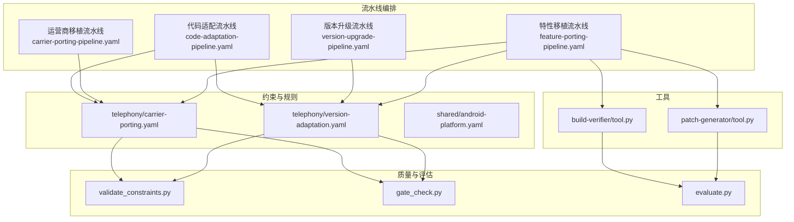
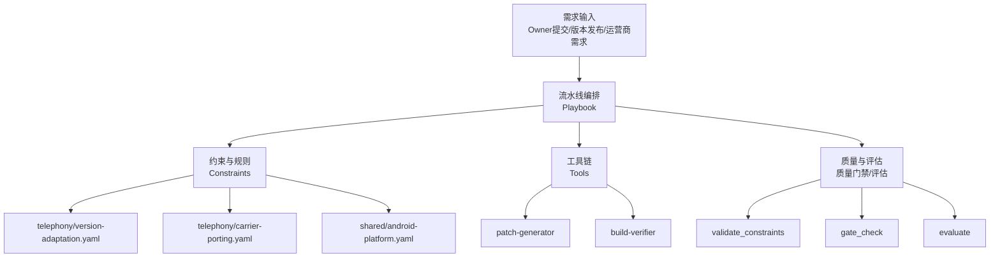
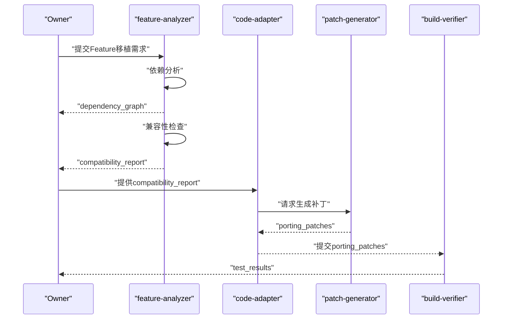
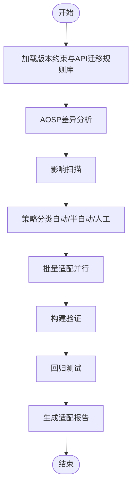
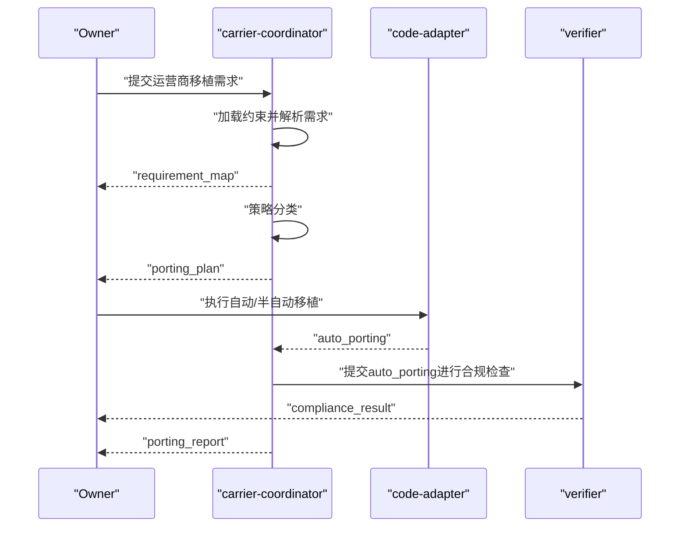
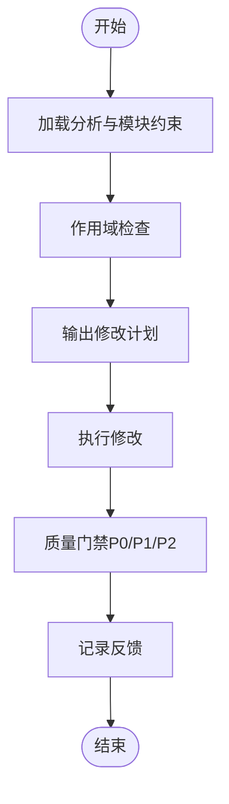
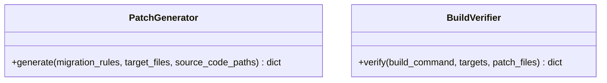
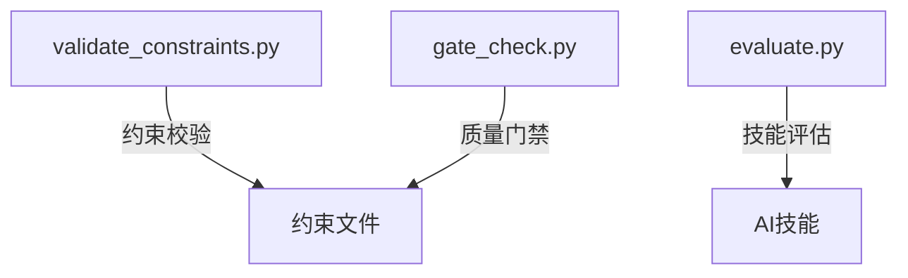
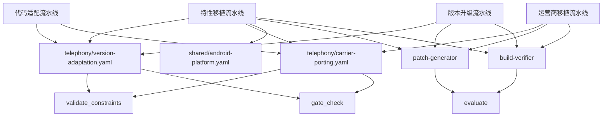

# 特性移植管道

<cite>
**本文档引用的文件**
- [feature-porting-pipeline.yaml](file://playbooks/feature-porting-pipeline.yaml)
- [version-upgrade-pipeline.yaml](file://playbooks/version-upgrade-pipeline.yaml)
- [carrier-porting-pipeline.yaml](file://playbooks/carrier-porting-pipeline.yaml)
- [code-adaptation-pipeline.yaml](file://playbooks/code-adaptation-pipeline.yaml)
- [version-adaptation.yaml](file://constraints/telephony/version-adaptation.yaml)
- [carrier-porting.yaml](file://constraints/telephony/carrier-porting.yaml)
- [android-platform.yaml](file://constraints/shared/android-platform.yaml)
- [telephony-version-adapter SKILL.md](file://skills/.claude/skills/telephony-version-adapter/SKILL.md)
- [carrier-porting-assistant SKILL.md](file://skills/.claude/skills/carrier-porting-assistant/SKILL.md)
- [patch-generator tool.py](file://tools/patch-generator/tool.py)
- [build-verifier tool.py](file://tools/build-verifier/tool.py)
- [validate_constraints.py](file://scripts/validate_constraints.py)
- [gate_check.py](file://scripts/gate_check.py)
- [evaluate.py](file://scripts/evaluate.py)
</cite>

## 目录
1. [引言](#引言)
2. [项目结构](#项目结构)
3. [核心组件](#核心组件)
4. [架构总览](#架构总览)
5. [详细组件分析](#详细组件分析)
6. [依赖关系分析](#依赖关系分析)
7. [性能考虑](#性能考虑)
8. [故障排查指南](#故障排查指南)
9. [结论](#结论)
10. [附录](#附录)

## 引言
本文件系统化阐述“特性移植管道”的设计理念、执行机制与质量保障体系，覆盖以下关键主题：
- 触发条件：需求驱动（如版本升级、运营商移植、自研特性移植）
- 步骤分解：依赖分析、兼容性检查、代码转换、集成验证
- 特性识别流程：需求解析、影响范围评估、策略分类（自动/半自动/人工）
- 适配策略制定：基于约束文件与迁移规则的自动化与半自动化结合
- 验证测试：编译验证、功能测试、回归测试与质量门禁
- 兼容性检查与依赖关系分析：跨模块一致性校验
- 影响范围评估：变更定位、风险量化与回退预案
- 配置示例与质量保证：约束文件、质量门禁、评估脚本
- 协作关系：与版本升级、运营商移植等其他管道的协同

## 项目结构
特性移植管道依托统一的流水线编排框架与模块化约束文件，形成“约束驱动 + 工具链 + 质量门禁”的闭环。关键目录与文件如下：
- playbooks：流水线编排（特性移植、版本升级、运营商移植、代码适配）
- constraints：模块级约束与迁移规则（telephony、shared）
- skills：AI助手技能说明（telephony-version-adapter、carrier-porting-assistant）
- tools：可复用工具（patch-generator、build-verifier 等）
- scripts：质量与评估工具（validate_constraints、gate_check、evaluate）



图表来源
- [feature-porting-pipeline.yaml:1-27](file://playbooks/feature-porting-pipeline.yaml#L1-L27)
- [version-upgrade-pipeline.yaml:1-61](file://playbooks/version-upgrade-pipeline.yaml#L1-L61)
- [carrier-porting-pipeline.yaml:1-41](file://playbooks/carrier-porting-pipeline.yaml#L1-L41)
- [code-adaptation-pipeline.yaml:1-35](file://playbooks/code-adaptation-pipeline.yaml#L1-L35)
- [version-adaptation.yaml:1-117](file://constraints/telephony/version-adaptation.yaml#L1-L117)
- [carrier-porting.yaml:1-106](file://constraints/telephony/carrier-porting.yaml#L1-L106)
- [android-platform.yaml:1-25](file://constraints/shared/android-platform.yaml#L1-L25)
- [patch-generator tool.py:1-24](file://tools/patch-generator/tool.py#L1-L24)
- [build-verifier tool.py:1-10](file://tools/build-verifier/tool.py#L1-L10)
- [validate_constraints.py:1-360](file://scripts/validate_constraints.py#L1-L360)
- [gate_check.py:1-507](file://scripts/gate_check.py#L1-L507)
- [evaluate.py:1-436](file://scripts/evaluate.py#L1-L436)

章节来源
- [feature-porting-pipeline.yaml:1-27](file://playbooks/feature-porting-pipeline.yaml#L1-L27)
- [version-upgrade-pipeline.yaml:1-61](file://playbooks/version-upgrade-pipeline.yaml#L1-L61)
- [carrier-porting-pipeline.yaml:1-41](file://playbooks/carrier-porting-pipeline.yaml#L1-L41)
- [code-adaptation-pipeline.yaml:1-35](file://playbooks/code-adaptation-pipeline.yaml#L1-L35)

## 核心组件
- 流水线编排（Playbook）
  - 特性移植：依赖分析 → 兼容性检查 → 代码转换 → 集成验证
  - 版本升级：加载约束 → AOSP差异分析 → 影响扫描 → 策略分类 → 批量适配 → 构建验证 → 回归测试
  - 运营商移植：加载约束 → 解析需求 → 策略分类 → 批量移植 → 合规检查
  - 代码适配：加载分析 → 作用域检查 → 修改计划 → 执行修改 → 质量门禁
- 约束与规则（Constraints）
  - telephony/version-adaptation.yaml：版本升级类型、版本信息、上下文路径、API迁移规则、适配约束、接受标准
  - telephony/carrier-porting.yaml：运营商信息、上下文路径、运营商特定需求、合规标准、适配约束、接受标准
  - shared/android-platform.yaml：平台级约束（API级别、构建系统、安全、兼容性、日志）
- 工具（Tools）
  - patch-generator：根据迁移规则批量生成补丁
  - build-verifier：构建验证（编译、目标、补丁输入）
- 质量与评估（Scripts）
  - validate_constraints：约束文件合法性与完整性校验
  - gate_check：P0/P1/P2质量门禁检查
  - evaluate：技能评估与指标计算

章节来源
- [feature-porting-pipeline.yaml:6-26](file://playbooks/feature-porting-pipeline.yaml#L6-L26)
- [version-upgrade-pipeline.yaml:6-60](file://playbooks/version-upgrade-pipeline.yaml#L6-L60)
- [carrier-porting-pipeline.yaml:6-40](file://playbooks/carrier-porting-pipeline.yaml#L6-L40)
- [code-adaptation-pipeline.yaml:6-34](file://playbooks/code-adaptation-pipeline.yaml#L6-L34)
- [version-adaptation.yaml:11-117](file://constraints/telephony/version-adaptation.yaml#L11-L117)
- [carrier-porting.yaml:11-106](file://constraints/telephony/carrier-porting.yaml#L11-L106)
- [android-platform.yaml:1-25](file://constraints/shared/android-platform.yaml#L1-L25)
- [patch-generator tool.py:1-24](file://tools/patch-generator/tool.py#L1-L24)
- [build-verifier tool.py:1-10](file://tools/build-verifier/tool.py#L1-L10)
- [validate_constraints.py:1-360](file://scripts/validate_constraints.py#L1-L360)
- [gate_check.py:1-507](file://scripts/gate_check.py#L1-L507)
- [evaluate.py:1-436](file://scripts/evaluate.py#L1-L436)

## 架构总览
特性移植管道采用“约束驱动 + 工具链 + 质量门禁”的分层架构：
- 上层：流水线编排（Playbook）定义步骤与Agent分工
- 中层：约束与规则（Constraints）定义领域知识与策略边界
- 下层：工具（Tools）提供自动化能力（补丁生成、构建验证）
- 质量层：约束校验（validate_constraints）、质量门禁（gate_check）、评估（evaluate）



图表来源
- [feature-porting-pipeline.yaml:1-27](file://playbooks/feature-porting-pipeline.yaml#L1-L27)
- [version-upgrade-pipeline.yaml:1-61](file://playbooks/version-upgrade-pipeline.yaml#L1-L61)
- [carrier-porting-pipeline.yaml:1-41](file://playbooks/carrier-porting-pipeline.yaml#L1-L41)
- [code-adaptation-pipeline.yaml:1-35](file://playbooks/code-adaptation-pipeline.yaml#L1-L35)
- [version-adaptation.yaml:1-117](file://constraints/telephony/version-adaptation.yaml#L1-L117)
- [carrier-porting.yaml:1-106](file://constraints/telephony/carrier-porting.yaml#L1-L106)
- [android-platform.yaml:1-25](file://constraints/shared/android-platform.yaml#L1-L25)
- [patch-generator tool.py:1-24](file://tools/patch-generator/tool.py#L1-L24)
- [build-verifier tool.py:1-10](file://tools/build-verifier/tool.py#L1-L10)
- [validate_constraints.py:1-360](file://scripts/validate_constraints.py#L1-L360)
- [gate_check.py:1-507](file://scripts/gate_check.py#L1-L507)
- [evaluate.py:1-436](file://scripts/evaluate.py#L1-L436)

## 详细组件分析

### 组件A：特性移植流水线（Feature Porting Pipeline）
- 设计理念
  - 以“自研Feature跨平台/跨版本移植”为目标，强调依赖链分析与兼容性检查，确保移植后功能正确与构建稳定。
- 触发条件
  - Owner提交Feature移植需求
- 步骤分解
  1) 依赖分析：分析Feature源码依赖链（API/HAL/资源/进程间）
  2) 兼容性检查：依赖链与目标版本兼容性检查
  3) 代码转换：自动执行代码转换（API替换/Import更新/Manifest更新）
  4) 集成验证：编译验证 + 功能测试 + 回归
- 关键Agent与工具
  - feature-analyzer：负责依赖分析与兼容性检查
  - code-adapter + patch-generator：负责自动代码转换
  - build-verifier：负责构建与测试验证
- 输出产物
  - dependency_graph、compatibility_report、porting_patches、test_results



图表来源
- [feature-porting-pipeline.yaml:6-26](file://playbooks/feature-porting-pipeline.yaml#L6-L26)
- [patch-generator tool.py:1-24](file://tools/patch-generator/tool.py#L1-L24)
- [build-verifier tool.py:1-10](file://tools/build-verifier/tool.py#L1-L10)

章节来源
- [feature-porting-pipeline.yaml:1-27](file://playbooks/feature-porting-pipeline.yaml#L1-L27)

### 组件B：版本升级适配流水线（Version Upgrade Pipeline）
- 设计理念
  - 面向Android大版本升级的批量适配，强调AOSP差异分析与自动化/半自动化的策略分类。
- 触发条件
  - 新Android版本发布 / Owner更新version-adaptation.yaml
- 步骤分解
  1) 加载版本约束与API迁移规则库
  2) AOSP差异分析（对比source/target版本的framework差异）
  3) 影响扫描（将AOSP变更与定制代码交叉比对）
  4) 策略分类（全自动/半自动/人工）
  5) 批量适配（并行执行自动/半自动项，生成人工任务）
  6) 构建验证（编译验证）
  7) 回归测试（冒烟测试 + 功能回归）
  8) 生成适配报告
- 关键Agent与工具
  - adaptation-coordinator：协调加载约束、差异分析、影响扫描与策略分类
  - aosp-diff-analyzer：差异分析与影响扫描
  - code-adapter + patch-generator：批量生成patch
  - build-verifier：构建验证
  - regression-test-runner：回归测试
- 输出产物
  - version_constraints、aosp_change_list、impact_report、adaptation_plan、auto_patches、review_patches、manual_tasks、build_results、regression_results、adaptation_report



图表来源
- [version-upgrade-pipeline.yaml:6-60](file://playbooks/version-upgrade-pipeline.yaml#L6-L60)

章节来源
- [version-upgrade-pipeline.yaml:1-61](file://playbooks/version-upgrade-pipeline.yaml#L1-L61)
- [version-adaptation.yaml:11-117](file://constraints/telephony/version-adaptation.yaml#L11-L117)

### 组件C：运营商移植流水线（Carrier Porting Pipeline）
- 设计理念
  - 针对运营商定制需求的跨项目移植，强调需求解析、策略分类与合规检查。
- 触发条件
  - Owner提交运营商移植需求
- 步骤分解
  1) 加载运营商约束文件
  2) 解析需求（代码路径/配置/依赖）
  3) 策略分类（自动/半自动/人工）
  4) 批量移植（自动生成运营商定制代码与配置）
  5) 合规检查（编译/generic回归/定制测试/合规标准）
  6) 生成移植报告
- 关键Agent与工具
  - carrier-coordinator：需求解析与策略分类
  - code-adapter：自动生成运营商定制代码与配置
  - verifier：合规检查
- 输出产物
  - carrier_constraints、requirement_map、porting_plan、auto_porting、manual_tasks、compliance_result、porting_report



图表来源
- [carrier-porting-pipeline.yaml:6-40](file://playbooks/carrier-porting-pipeline.yaml#L6-L40)

章节来源
- [carrier-porting-pipeline.yaml:1-41](file://playbooks/carrier-porting-pipeline.yaml#L1-L41)
- [carrier-porting.yaml:11-106](file://constraints/telephony/carrier-porting.yaml#L11-L106)

### 组件D：代码适配流水线（Code Adaptation Pipeline）
- 设计理念
  - 基于Bug分析结果执行代码适配，严格遵循质量门禁，确保修改可控、可追溯。
- 触发条件
  - Bug分析完成且fix_type为code_change
- 步骤分解
  1) 加载分析与模块约束
  2) 作用域检查（确认修改文件在scope.includes范围内，不涉及scope.excludes）
  3) 输出修改计划（文件列表/修改类型/位置/原因/风险）
  4) 严格按修改计划执行代码修改
  5) 质量门禁（P0/P1/P2）
  6) 记录执行轨迹与门禁结果
- 关键Agent与工具
  - adapter：加载分析、作用域检查、修改计划与执行
  - verifier：质量门禁检查
  - gate_check：质量门禁
- 输出产物
  - analysis_and_constraints、scope_validation、modification_plan、changes、gate_result、feedback_record



图表来源
- [code-adaptation-pipeline.yaml:6-34](file://playbooks/code-adaptation-pipeline.yaml#L6-L34)

章节来源
- [code-adaptation-pipeline.yaml:1-35](file://playbooks/code-adaptation-pipeline.yaml#L1-L35)
- [gate_check.py:1-507](file://scripts/gate_check.py#L1-L507)

### 组件E：约束与规则（Constraints）
- telephony/version-adaptation.yaml
  - 定义版本升级类型、版本信息、上下文路径、API迁移规则、适配约束、接受标准与评估数据集路径
- telephony/carrier-porting.yaml
  - 定义运营商信息、上下文路径、运营商特定需求、合规标准、适配约束、接受标准
- shared/android-platform.yaml
  - 定义平台级约束（API级别、构建系统、安全、兼容性、日志）
- validate_constraints.py
  - 校验约束文件的顶层结构、元数据字段、安全红线、跨模块引用一致性等

```mermaid
erDiagram
TELEPHONY_VERSION_ADAPTATION {
string module.name
string module.domain
string version_info.source_version
string version_info.target_version
array context.codebase_paths
array context.build_targets
array context.test_targets
array api_migration_rules
array adaptation_constraints
object acceptance_criteria
}
TELEPHONY_CARRIER_PORTING {
string module.name
string module.domain
string carrier_info.source_project
string carrier_info.target_carrier
array context.codebase_paths
array context.build_targets
array carrier_specifics
array compliance_standards
array adaptation_constraints
object acceptance_criteria
}
SHARED_ANDROID_PLATFORM {
object platform_constraints.api_level
string platform_constraints.build_system
array platform_constraints.security
array platform_constraints.compatibility
array platform_constraints.logging
}
```

图表来源
- [version-adaptation.yaml:1-117](file://constraints/telephony/version-adaptation.yaml#L1-L117)
- [carrier-porting.yaml:1-106](file://constraints/telephony/carrier-porting.yaml#L1-L106)
- [android-platform.yaml:1-25](file://constraints/shared/android-platform.yaml#L1-L25)

章节来源
- [version-adaptation.yaml:1-117](file://constraints/telephony/version-adaptation.yaml#L1-L117)
- [carrier-porting.yaml:1-106](file://constraints/telephony/carrier-porting.yaml#L1-L106)
- [android-platform.yaml:1-25](file://constraints/shared/android-platform.yaml#L1-L25)
- [validate_constraints.py:1-360](file://scripts/validate_constraints.py#L1-L360)

### 组件F：工具链（Tools）
- patch-generator
  - 根据迁移规则批量生成补丁，统计生成/跳过/错误数量
- build-verifier
  - 执行构建验证，返回结果与错误/警告列表



图表来源
- [patch-generator tool.py:1-24](file://tools/patch-generator/tool.py#L1-L24)
- [build-verifier tool.py:1-10](file://tools/build-verifier/tool.py#L1-L10)

章节来源
- [patch-generator tool.py:1-24](file://tools/patch-generator/tool.py#L1-L24)
- [build-verifier tool.py:1-10](file://tools/build-verifier/tool.py#L1-L10)

### 组件G：质量与评估（Scripts）
- validate_constraints.py
  - 约束文件合法性与完整性校验（YAML语法、顶层键、元数据、安全红线、跨模块引用）
- gate_check.py
  - P0/P1/P2质量门禁检查（安全红线、硬编码密钥、约束文件有效性、测试覆盖率、文档完整性、命名规范、代码风格、注释密度、示例用例）
- evaluate.py
  - 技能评估工具，计算准确率、完整性、安全合规度、时间效率等指标，输出结构化报告



图表来源
- [validate_constraints.py:1-360](file://scripts/validate_constraints.py#L1-L360)
- [gate_check.py:1-507](file://scripts/gate_check.py#L1-L507)
- [evaluate.py:1-436](file://scripts/evaluate.py#L1-L436)

章节来源
- [validate_constraints.py:1-360](file://scripts/validate_constraints.py#L1-L360)
- [gate_check.py:1-507](file://scripts/gate_check.py#L1-L507)
- [evaluate.py:1-436](file://scripts/evaluate.py#L1-L436)

## 依赖关系分析
- 流水线与约束
  - 特性移植流水线依赖telephony与shared约束文件，用于确定目标环境与平台约束
  - 版本升级与运营商移植流水线分别依赖对应的约束文件，形成模块化适配
- 工具与流水线
  - patch-generator与build-verifier作为通用工具被多条流水线复用
- 质量与评估
  - validate_constraints与gate_check贯穿各模块，确保约束与质量标准一致
  - evaluate用于技能评估，支撑持续改进



图表来源
- [feature-porting-pipeline.yaml:1-27](file://playbooks/feature-porting-pipeline.yaml#L1-L27)
- [version-upgrade-pipeline.yaml:1-61](file://playbooks/version-upgrade-pipeline.yaml#L1-L61)
- [carrier-porting-pipeline.yaml:1-41](file://playbooks/carrier-porting-pipeline.yaml#L1-L41)
- [code-adaptation-pipeline.yaml:1-35](file://playbooks/code-adaptation-pipeline.yaml#L1-L35)
- [version-adaptation.yaml:1-117](file://constraints/telephony/version-adaptation.yaml#L1-L117)
- [carrier-porting.yaml:1-106](file://constraints/telephony/carrier-porting.yaml#L1-L106)
- [android-platform.yaml:1-25](file://constraints/shared/android-platform.yaml#L1-L25)
- [patch-generator tool.py:1-24](file://tools/patch-generator/tool.py#L1-L24)
- [build-verifier tool.py:1-10](file://tools/build-verifier/tool.py#L1-L10)
- [validate_constraints.py:1-360](file://scripts/validate_constraints.py#L1-L360)
- [gate_check.py:1-507](file://scripts/gate_check.py#L1-L507)
- [evaluate.py:1-436](file://scripts/evaluate.py#L1-L436)

## 性能考虑
- 并行化执行
  - 版本升级流水线在批量适配阶段采用并行执行（auto-adapt、semi-auto-adapt、manual-queue），提升吞吐
- 批量大小与并发
  - 版本升级约束中定义了batch_size与parallel_agents，便于根据硬件资源调整并行度
- 工具链优化
  - patch-generator与build-verifier应尽量减少无效扫描与重复构建，提高整体效率
- 评估与监控
  - evaluate提供时间效率指标，可用于持续优化工具链性能

## 故障排查指南
- 约束文件问题
  - 使用validate_constraints.py检查YAML语法、顶层键、元数据、安全红线与跨模块引用
- 质量门禁阻塞
  - 使用gate_check.py定位P0/P1/P2问题，重点关注安全红线、硬编码密钥、约束文件有效性与文档完整性
- 构建失败
  - 使用build-verifier检查构建命令、目标与补丁输入，核对错误/警告信息
- 技能评估异常
  - 使用evaluate.py检查输入/期望输出、超时与执行错误，关注准确率、完整性与安全合规度

章节来源
- [validate_constraints.py:1-360](file://scripts/validate_constraints.py#L1-L360)
- [gate_check.py:1-507](file://scripts/gate_check.py#L1-L507)
- [build-verifier tool.py:1-10](file://tools/build-verifier/tool.py#L1-L10)
- [evaluate.py:1-436](file://scripts/evaluate.py#L1-L436)

## 结论
特性移植管道通过“约束驱动 + 工具链 + 质量门禁”的架构，实现了从需求到落地的一体化流程。其核心优势在于：
- 明确的触发条件与步骤分解，确保移植过程可追踪
- 基于约束文件的策略化适配，兼顾自动化与人工干预
- 多层次质量保障，包括约束校验、质量门禁与评估
- 与其他管道（版本升级、运营商移植、代码适配）协同，形成完整的工程化体系

## 附录
- 配置示例与模板
  - telephony/version-adaptation.yaml：版本升级类型、版本信息、API迁移规则、适配约束、接受标准
  - telephony/carrier-porting.yaml：运营商信息、上下文路径、运营商特定需求、合规标准、适配约束、接受标准
  - shared/android-platform.yaml：平台级约束（API级别、构建系统、安全、兼容性、日志）
- 移植策略与质量保证
  - 策略：自动（高置信度）、半自动（中等置信度）、人工（低置信度）
  - 质量保证：约束校验、质量门禁（P0/P1/P2）、评估指标（准确率、完整性、安全合规度、时间效率）
- 协作关系
  - 版本升级与运营商移植流水线共享约束与工具，特性移植流水线在依赖分析与兼容性检查环节与二者互补