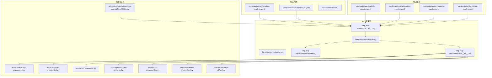
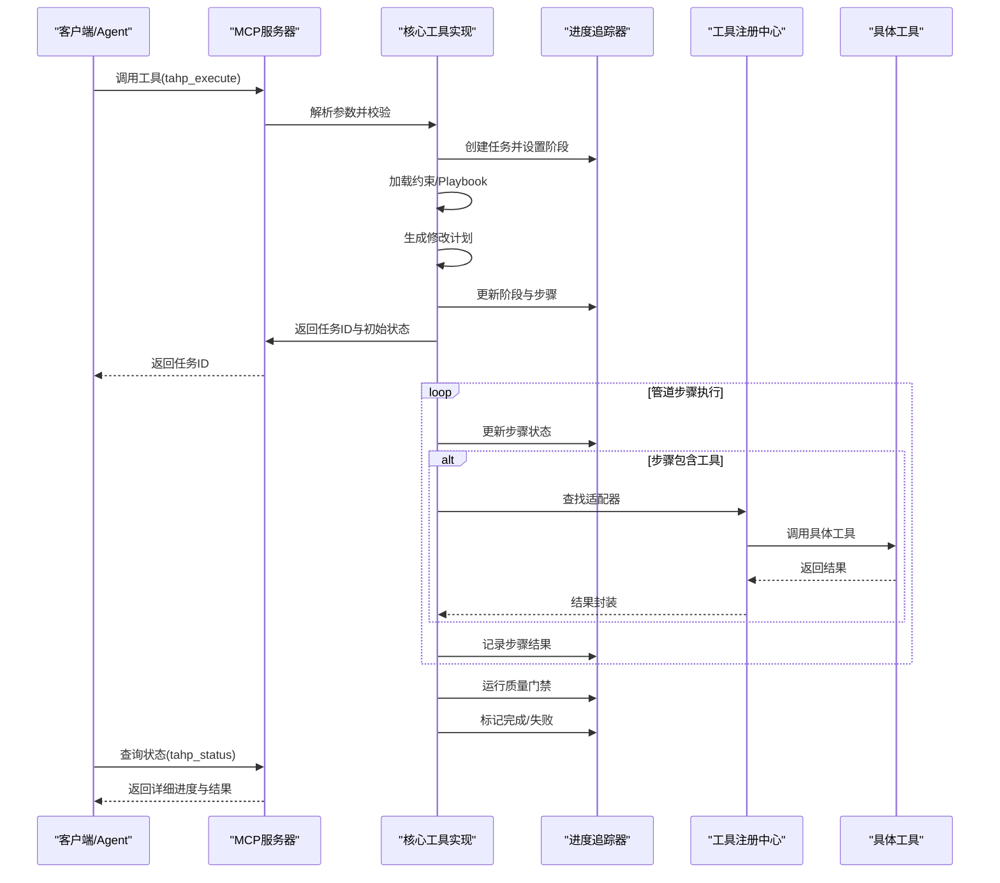
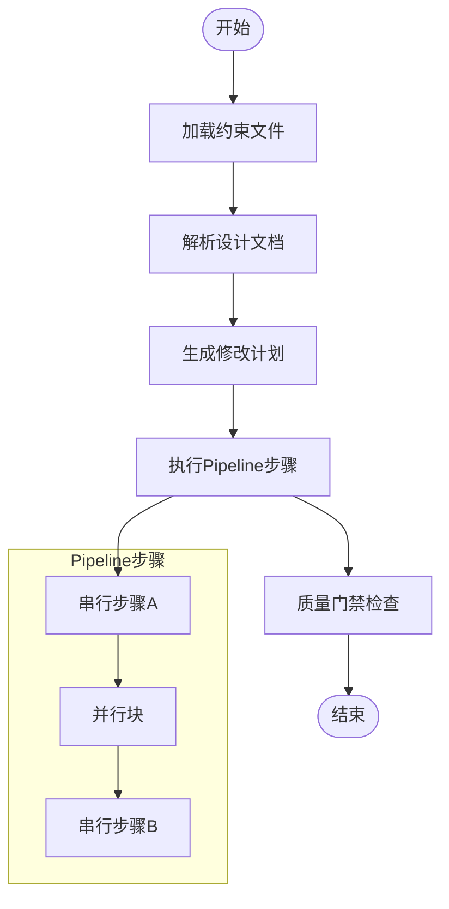
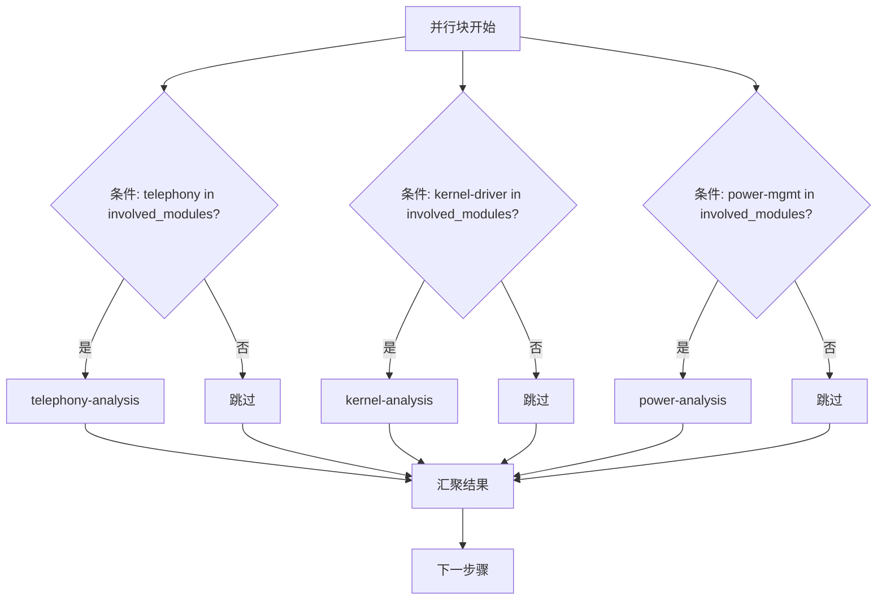
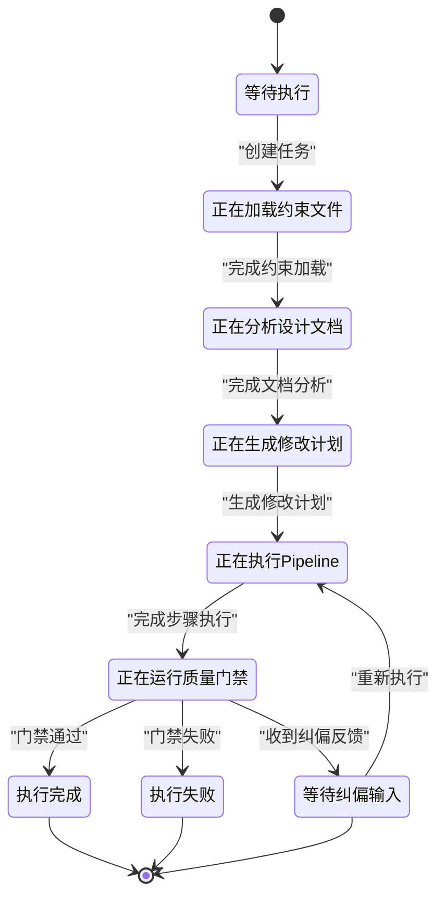
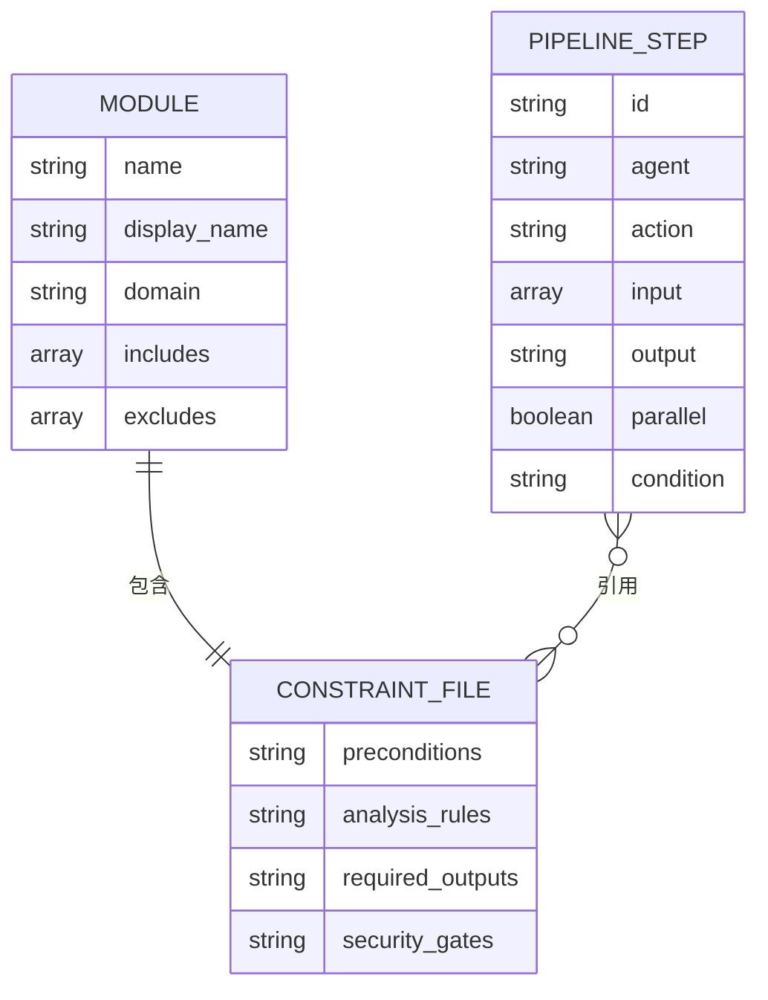
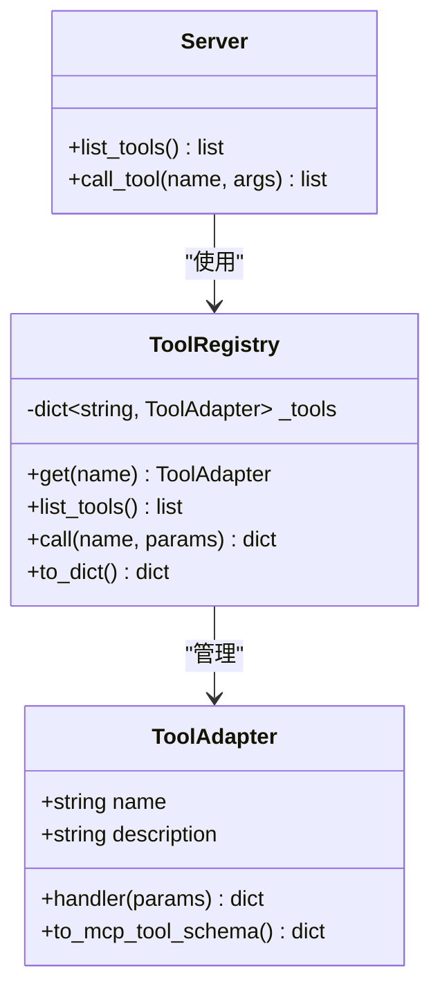
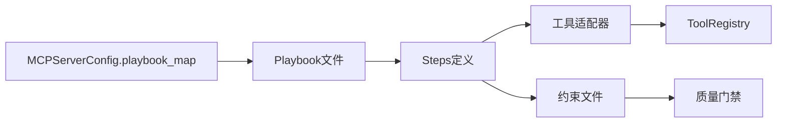

# 管道设计架构

<cite>
**本文档引用的文件**
- [server.py](file://tahp-mcp-server/server.py)
- [config.py](file://tahp-mcp-server/config.py)
- [core/__init__.py](file://tahp-mcp-server/core/__init__.py)
- [progress/tracker.py](file://tahp-mcp-server/progress/tracker.py)
- [adapters/__init__.py](file://tahp-mcp-server/adapters/__init__.py)
- [bug-analysis-pipeline.yaml](file://playbooks/bug-analysis-pipeline.yaml)
- [code-adaptation-pipeline.yaml](file://playbooks/code-adaptation-pipeline.yaml)
- [version-upgrade-pipeline.yaml](file://playbooks/version-upgrade-pipeline.yaml)
- [carrier-porting-pipeline.yaml](file://playbooks/carrier-porting-pipeline.yaml)
- [AGENTS.md](file://AGENTS.md)
- [telephony-bug-analyzer/SKILL.md](file://skills/.claude/skills/telephony-bug-analyzer/SKILL.md)
- [constraints/telephony/bug-analysis.yaml](file://constraints/telephony/bug-analysis.yaml)
- [constraints/telephony/module.yaml](file://constraints/telephony/module.yaml)
- [scripts/gate_check.py](file://scripts/gate_check.py)
</cite>

## 目录
1. [引言](#引言)
2. [项目结构](#项目结构)
3. [核心组件](#核心组件)
4. [架构总览](#架构总览)
5. [详细组件分析](#详细组件分析)
6. [依赖分析](#依赖分析)
7. [性能考虑](#性能考虑)
8. [故障排查指南](#故障排查指南)
9. [结论](#结论)
10. [附录](#附录)

## 引言
本文件面向TAHP（TECNO AI Harness Platform）的管道设计架构，系统阐述Playbook管道的整体设计理念、配置结构与执行流程。文档聚焦于管道的基本组成元素（steps、agents、skills、conditions等）及其相互关系，解释并行执行机制、条件分支处理与状态管理策略，并提供最佳实践、性能优化技巧、调试方法以及自定义管道的设计指南与扩展机制。同时，说明管道与约束系统的集成方式与数据传递过程。

## 项目结构
TAHP采用“约束驱动 + 管道编排”的双引擎架构：约束文件定义业务域规则与质量门禁，Playbook定义执行步骤与并行策略，MCP Server对外提供统一工具接口，支撑AI Agent调用与状态追踪。

图示来源
- [server.py:1-485](file://tahp-mcp-server/server.py#L1-L485)
- [core/__init__.py:1-621](file://tahp-mcp-server/core/__init__.py#L1-L621)
- [config.py:1-176](file://tahp-mcp-server/config.py#L1-L176)
- [progress/tracker.py:1-343](file://tahp-mcp-server/progress/tracker.py#L1-L343)
- [adapters/__init__.py:1-239](file://tahp-mcp-server/adapters/__init__.py#L1-L239)

章节来源
- [AGENTS.md:1-83](file://AGENTS.md#L1-L83)

## 核心组件
- 管道编排（Playbook）：以YAML定义的steps序列，支持并行块与条件分支，描述跨模块协作流程。
- 约束系统（Constraints）：定义前置条件、分析规则、安全红线、质量门禁与评估指标，确保执行合规与可验证。
- MCP Server：提供统一工具接口（tahp_execute、tahp_status、tahp_correct、tahp_gate_check等），承载任务状态追踪与工具适配。
- 工具适配器（Adapters）：将现有tools封装为MCP工具，支持动态导入与降级回退。
- 状态追踪（Progress Tracker）：维护任务生命周期、阶段进度、步骤明细与纠偏历史。

章节来源
- [server.py:103-340](file://tahp-mcp-server/server.py#L103-L340)
- [core/__init__.py:110-298](file://tahp-mcp-server/core/__init__.py#L110-L298)
- [config.py:74-129](file://tahp-mcp-server/config.py#L74-L129)
- [progress/tracker.py:18-139](file://tahp-mcp-server/progress/tracker.py#L18-L139)
- [adapters/__init__.py:186-239](file://tahp-mcp-server/adapters/__init__.py#L186-L239)

## 架构总览
下图展示从MCP工具调用到任务执行、状态追踪与工具适配的整体流程。

图示来源
- [server.py:343-448](file://tahp-mcp-server/server.py#L343-L448)
- [core/__init__.py:110-298](file://tahp-mcp-server/core/__init__.py#L110-L298)
- [progress/tracker.py:212-312](file://tahp-mcp-server/progress/tracker.py#L212-L312)
- [adapters/__init__.py:218-234](file://tahp-mcp-server/adapters/__init__.py#L218-L234)

## 详细组件分析

### 管道配置结构与执行模型
- Playbook由steps数组构成，每一步包含id、agent、action、input/output等元数据；支持parallel块定义并行子步骤。
- 并行块内部可嵌套condition字段，用于按条件启用/跳过子步骤。
- 输出键（output）作为后续步骤的输入键（input）引用，形成数据流。
- 触发条件（trigger）用于决定何时启动管道。

图示来源
- [bug-analysis-pipeline.yaml:6-43](file://playbooks/bug-analysis-pipeline.yaml#L6-L43)
- [code-adaptation-pipeline.yaml:6-35](file://playbooks/code-adaptation-pipeline.yaml#L6-L35)
- [version-upgrade-pipeline.yaml:6-61](file://playbooks/version-upgrade-pipeline.yaml#L6-L61)
- [carrier-porting-pipeline.yaml:6-41](file://playbooks/carrier-porting-pipeline.yaml#L6-L41)

章节来源
- [bug-analysis-pipeline.yaml:1-43](file://playbooks/bug-analysis-pipeline.yaml#L1-L43)
- [code-adaptation-pipeline.yaml:1-35](file://playbooks/code-adaptation-pipeline.yaml#L1-L35)
- [version-upgrade-pipeline.yaml:1-61](file://playbooks/version-upgrade-pipeline.yaml#L1-L61)
- [carrier-porting-pipeline.yaml:1-41](file://playbooks/carrier-porting-pipeline.yaml#L1-L41)

### 并行执行机制与条件分支
- 并行块通过parallel关键字定义一组子步骤，这些子步骤在同一阶段并行调度。
- 子步骤可设置condition表达式，表达式基于上游输出键值进行布尔判断，满足条件时执行，否则跳过。
- 并行完成后，后续步骤通过合并多个并行输出键（如telephony_result、kernel_result、power_result）进行聚合处理。

图示来源
- [bug-analysis-pipeline.yaml:16-32](file://playbooks/bug-analysis-pipeline.yaml#L16-L32)

章节来源
- [bug-analysis-pipeline.yaml:16-32](file://playbooks/bug-analysis-pipeline.yaml#L16-L32)

### 状态管理策略
- 任务阶段（TaskPhase）涵盖：pending、loading_constraints、analyzing_document、generating_plan、executing_pipeline、running_gate_check、completed、failed、cancelled、correcting。
- 步骤（StepProgress）包含step_id、step_name、status、detail、时间戳等，支持逐步追踪。
- 纠偏（Correction）记录外部反馈，允许在correcting阶段重入执行。
- MCP兼容状态（TaskStatus）映射，便于外部系统轮询。

图示来源
- [progress/tracker.py:18-68](file://tahp-mcp-server/progress/tracker.py#L18-L68)
- [progress/tracker.py:212-312](file://tahp-mcp-server/progress/tracker.py#L212-L312)

章节来源
- [progress/tracker.py:18-139](file://tahp-mcp-server/progress/tracker.py#L18-L139)
- [core/__init__.py:318-363](file://tahp-mcp-server/core/__init__.py#L318-L363)

### 约束系统与数据传递
- 约束文件（如telephony/bug-analysis.yaml）定义preconditions、analysis_rules、required_outputs、security_gates等，作为执行依据与质量门禁。
- module.yaml定义scope/includes/excludes与依赖关系，限定修改范围与跨模块依赖。
- 管道通过output键将中间结果传递给后续步骤的input键，形成端到端的数据流。

图示来源
- [constraints/telephony/module.yaml:1-43](file://constraints/telephony/module.yaml#L1-L43)
- [constraints/telephony/bug-analysis.yaml:1-110](file://constraints/telephony/bug-analysis.yaml#L1-L110)
- [bug-analysis-pipeline.yaml:6-43](file://playbooks/bug-analysis-pipeline.yaml#L6-L43)

章节来源
- [constraints/telephony/bug-analysis.yaml:1-110](file://constraints/telephony/bug-analysis.yaml#L1-L110)
- [constraints/telephony/module.yaml:1-43](file://constraints/telephony/module.yaml#L1-L43)
- [bug-analysis-pipeline.yaml:6-43](file://playbooks/bug-analysis-pipeline.yaml#L6-L43)

### 技能与工具集成
- 技能（Skill）定义分析协议、前置检查与产出规范，例如telephony-bug-analyzer。
- 工具（Tool）通过适配器统一接入MCP，支持动态导入与降级回退，如android-log-analyzer、aosp-diff-analyzer、build-verifier等。
- MCP工具调用经由server.py路由至core实现，再由adapters分发到具体工具。

图示来源
- [adapters/__init__.py:20-40](file://tahp-mcp-server/adapters/__init__.py#L20-L40)
- [adapters/__init__.py:186-239](file://tahp-mcp-server/adapters/__init__.py#L186-L239)
- [server.py:327-340](file://tahp-mcp-server/server.py#L327-L340)

章节来源
- [telephony-bug-analyzer/SKILL.md:1-51](file://skills/.claude/skills/telephony-bug-analyzer/SKILL.md#L1-L51)
- [adapters/__init__.py:68-183](file://tahp-mcp-server/adapters/__init__.py#L68-L183)
- [server.py:437-444](file://tahp-mcp-server/server.py#L437-L444)

## 依赖分析
- 配置映射：MCPServerConfig将domain映射到具体Playbook文件，确保工具调用与编排一致。
- 工具依赖：不同管道步骤依赖不同工具（如aosp-diff-analyzer、build-verifier、regression-test-runner等），通过ToolRegistry集中管理。
- 约束依赖：管道执行受模块约束与共享约束共同约束，质量门禁贯穿始终。

图示来源
- [config.py:74-79](file://tahp-mcp-server/config.py#L74-L79)
- [core/__init__.py:102-107](file://tahp-mcp-server/core/__init__.py#L102-L107)
- [adapters/__init__.py:186-239](file://tahp-mcp-server/adapters/__init__.py#L186-L239)

章节来源
- [config.py:74-129](file://tahp-mcp-server/config.py#L74-L129)
- [core/__init__.py:102-107](file://tahp-mcp-server/core/__init__.py#L102-L107)

## 性能考虑
- 并行优化：合理拆分并行块，避免过度并发导致资源争用；确保条件分支精准，减少无效执行。
- I/O与工具调用：对工具调用结果进行缓存与去重，避免重复分析；控制日志与中间产物大小。
- 状态追踪：定期持久化任务状态，降低内存压力；限制最大任务数，及时清理旧任务。
- 超时与并发：合理设置task_timeout_sec与max_concurrent_tasks，平衡吞吐与稳定性。

## 故障排查指南
- 任务状态查询：使用tahp_status工具获取任务阶段、进度、步骤详情与纠偏历史。
- 纠偏反馈：通过tahp_correct提交反馈，系统进入correcting阶段并重新执行。
- 质量门禁：使用tahp_gate_check对模块或任务执行门禁检查，查看P0/P1/P2结果与详细项。
- 简化诊断：若依赖模块不可用，核心工具提供降级实现（如日志分析、差异分析、编译验证等）。

章节来源
- [server.py:397-418](file://tahp-mcp-server/server.py#L397-L418)
- [core/__init__.py:300-363](file://tahp-mcp-server/core/__init__.py#L300-L363)
- [scripts/gate_check.py:368-435](file://scripts/gate_check.py#L368-L435)

## 结论
TAHP的管道设计以约束驱动为核心，通过Playbook编排实现跨模块协同与并行执行，配合MCP Server提供统一工具接口与状态追踪，确保执行过程可观测、可纠偏、可验证。约束系统与质量门禁贯穿始终，保障安全性与合规性。该架构既适合复杂场景的自动化执行，也为扩展与定制提供了清晰的边界与接口。

## 附录

### 管道设计最佳实践
- 明确触发条件与前置条件，确保输入完备后再进入分析阶段。
- 合理划分并行块，使用condition精确控制子步骤启用，避免无效计算。
- 以output键为纽带串联步骤，保持数据流清晰可追溯。
- 在约束文件中明确required_outputs与security_gates，减少歧义与返工。

### 自定义管道设计指南
- 选择合适的domain与模块，参考现有Playbook结构（steps、parallel、condition、input/output）。
- 在constraints中完善模块约束与共享约束，确保质量门禁覆盖全面。
- 如需新增工具，按adapters模式封装为ToolAdapter并注册到ToolRegistry。
- 通过tahp_execute发起任务，使用tahp_status持续监控，必要时使用tahp_correct进行纠偏。

### 管道与约束系统的集成要点
- 约束文件作为执行依据，必须包含safety_red_lines与必要的required_outputs。
- module.yaml的scope.includes/excludes直接决定修改范围，避免误改。
- 质量门禁（scripts/gate_check.py）提供P0/P1/P2分级检查，作为集成门禁。

章节来源
- [AGENTS.md:53-68](file://AGENTS.md#L53-L68)
- [scripts/gate_check.py:99-187](file://scripts/gate_check.py#L99-L187)
- [constraints/telephony/module.yaml:11-43](file://constraints/telephony/module.yaml#L11-L43)