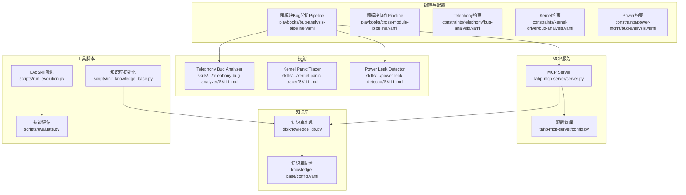
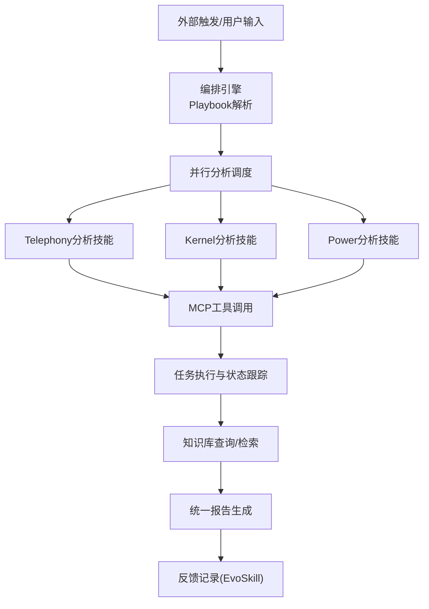
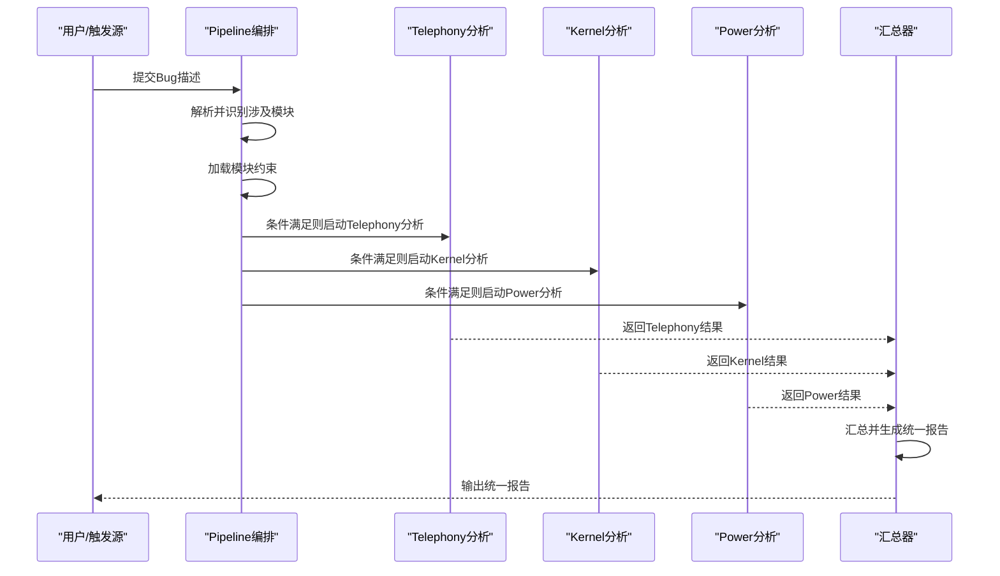
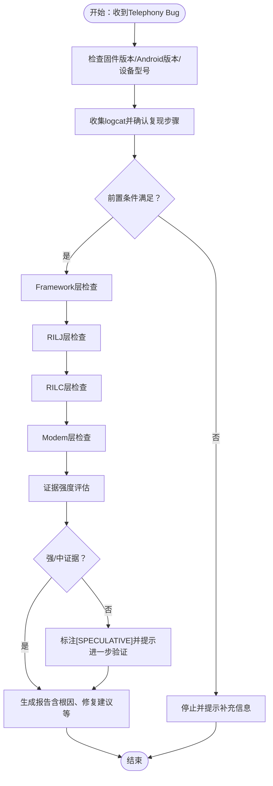
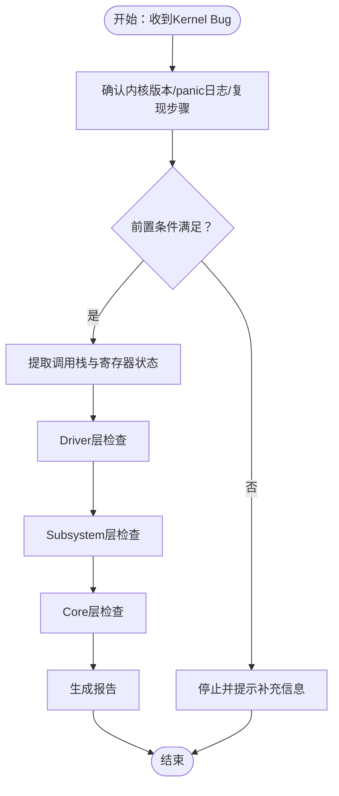
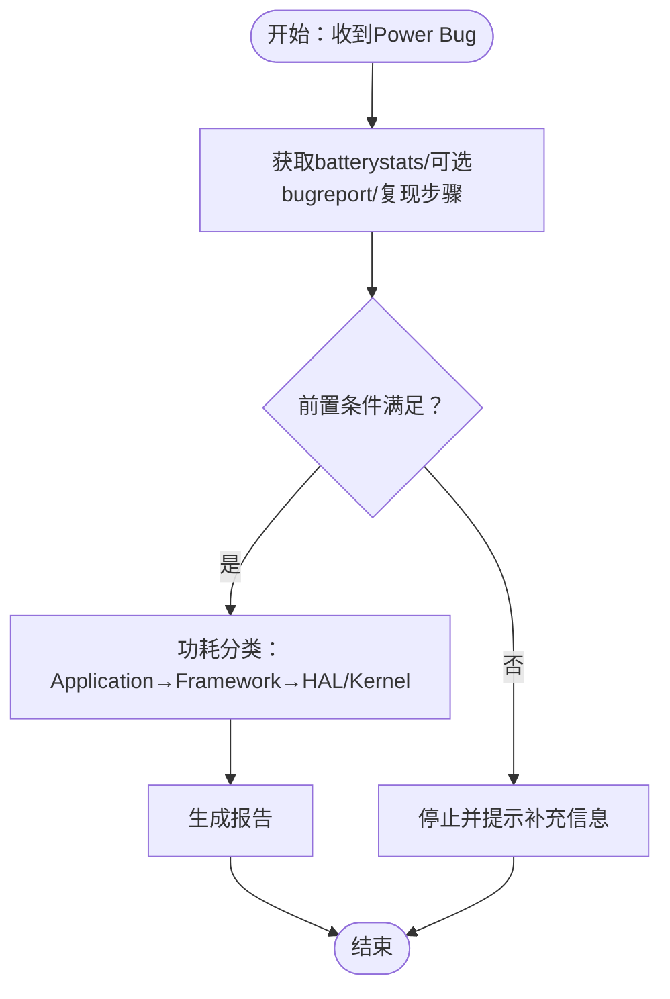
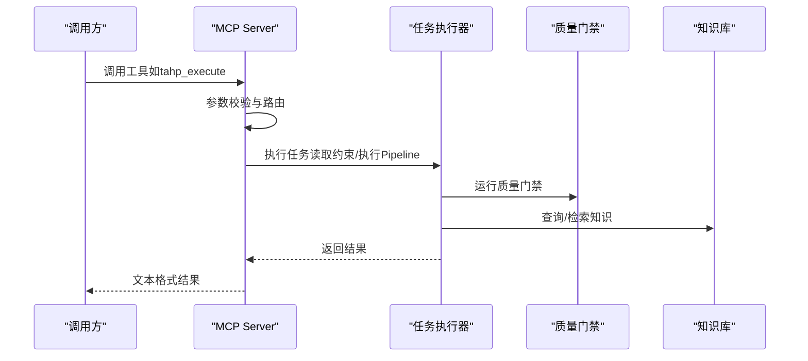
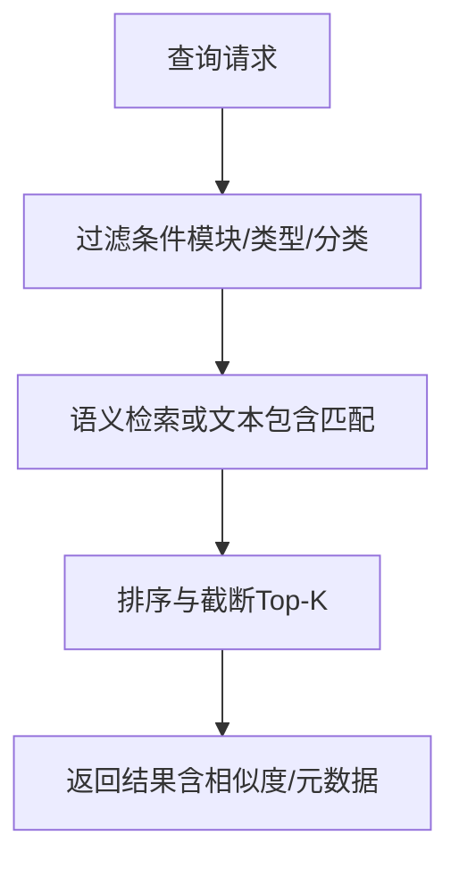
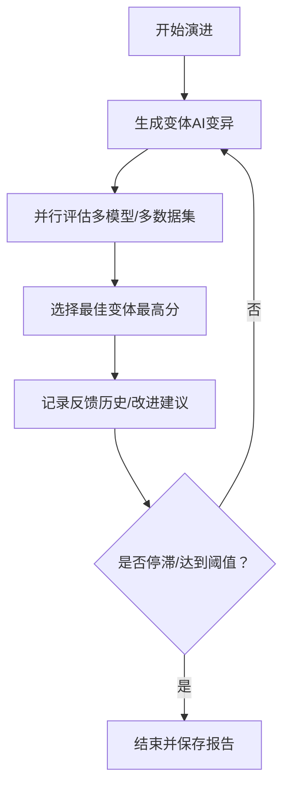
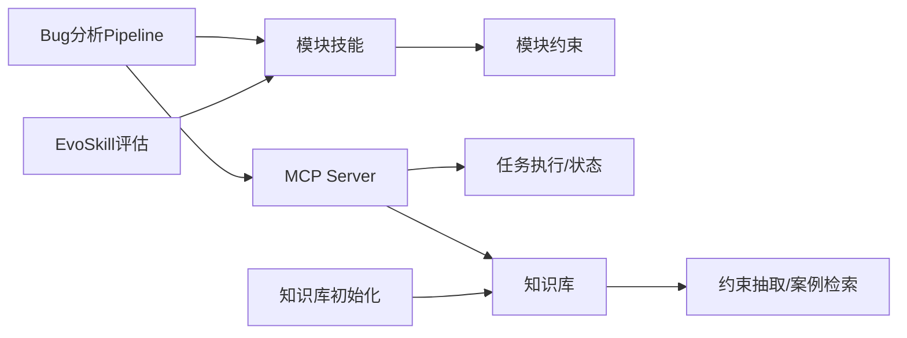

# 缺陷分析管道

<cite>
**本文档引用的文件**
- [bug-analysis-pipeline.yaml](file://playbooks/bug-analysis-pipeline.yaml)
- [cross-module-pipeline.yaml](file://playbooks/cross-module-pipeline.yaml)
- [telephony-bug-analysis.yaml](file://constraints/telephony/bug-analysis.yaml)
- [kernel-driver-bug-analysis.yaml](file://constraints/kernel-driver/bug-analysis.yaml)
- [power-mgmt-bug-analysis.yaml](file://constraints/power-mgmt/bug-analysis.yaml)
- [telephony-bug-analyzer-SKILL.md](file://skills/.claude/skills/telephony-bug-analyzer/SKILL.md)
- [kernel-panic-tracer-SKILL.md](file://skills/.claude/skills/kernel-panic-tracer/SKILL.md)
- [power-leak-detector-SKILL.md](file://skills/.claude/skills/power-leak-detector/SKILL.md)
- [tahp-mcp-server.py](file://tahp-mcp-server/server.py)
- [tahp-mcp-config.py](file://tahp-mcp-server/config.py)
- [knowledge-db.py](file://db/knowledge_db.py)
- [knowledge-base-config.yaml](file://knowledge-base/config.yaml)
- [run-evolution.py](file://scripts/run_evolution.py)
- [evaluate.py](file://scripts/evaluate.py)
- [init-knowledge-base.py](file://scripts/init_knowledge_base.py)
</cite>

## 目录
1. [简介](#简介)
2. [项目结构](#项目结构)
3. [核心组件](#核心组件)
4. [架构总览](#架构总览)
5. [详细组件分析](#详细组件分析)
6. [依赖关系分析](#依赖关系分析)
7. [性能考虑](#性能考虑)
8. [故障排查指南](#故障排查指南)
9. [结论](#结论)
10. [附录](#附录)

## 简介
本文件面向缺陷分析管道的跨模块Bug分析场景，系统化阐述触发条件、执行步骤、并行策略、模块技能配置与调用方式、缺陷分类与根因定位流程、报告生成机制，以及与知识库、EvoSkill演进、质量门禁等子系统的协作关系。目标是帮助读者快速理解并高效使用该管道，同时提供配置示例、调试技巧与性能优化建议。

## 项目结构
缺陷分析管道围绕以下关键要素组织：
- Playbook编排：定义跨模块Bug分析的触发条件、步骤与并行策略
- 模块约束：为Telephony、Kernel Driver、Power Management分别定义前置条件、分析规则、输出规范与评估指标
- 技能（Skill）：封装各模块的诊断能力与调用约定
- MCP服务器：对外暴露工具接口，调度任务、查询状态、执行质量门禁
- 知识库：提供语义检索、跨模块查询与反馈记录能力
- 脚本工具：支持EvoSkill演进、评估与知识库初始化

**图表来源**
- [bug-analysis-pipeline.yaml:1-43](file://playbooks/bug-analysis-pipeline.yaml#L1-L43)
- [telephony-bug-analysis.yaml:1-110](file://constraints/telephony/bug-analysis.yaml#L1-L110)
- [kernel-driver-bug-analysis.yaml:1-65](file://constraints/kernel-driver/bug-analysis.yaml#L1-L65)
- [power-mgmt-bug-analysis.yaml:1-61](file://constraints/power-mgmt/bug-analysis.yaml#L1-L61)
- [telephony-bug-analyzer-SKILL.md:1-51](file://skills/.claude/skills/telephony-bug-analyzer/SKILL.md#L1-L51)
- [kernel-panic-tracer-SKILL.md:1-33](file://skills/.claude/skills/kernel-panic-tracer/SKILL.md#L1-L33)
- [power-leak-detector-SKILL.md:1-28](file://skills/.claude/skills/power-leak-detector/SKILL.md#L1-L28)
- [tahp-mcp-server.py:1-485](file://tahp-mcp-server/server.py#L1-L485)
- [tahp-mcp-config.py:1-176](file://tahp-mcp-server/config.py#L1-L176)
- [knowledge-db.py:1-589](file://db/knowledge_db.py#L1-L589)
- [knowledge-base-config.yaml:1-36](file://knowledge-base/config.yaml#L1-L36)
- [run-evolution.py:1-567](file://scripts/run-evolution.py#L1-L567)
- [evaluate.py:1-436](file://scripts/evaluate.py#L1-L436)
- [init-knowledge-base.py:1-246](file://scripts/init_knowledge_base.py#L1-L246)

**章节来源**
- [bug-analysis-pipeline.yaml:1-43](file://playbooks/bug-analysis-pipeline.yaml#L1-L43)
- [cross-module-pipeline.yaml:1-28](file://playbooks/cross-module-pipeline.yaml#L1-L28)

## 核心组件
- 跨模块Bug分析Pipeline：定义触发条件、步骤分解与并行执行策略；在并行分支中按模块条件选择性调用Telephony、Kernel、Power分析技能；最后汇总生成统一报告并记录反馈。
- 模块约束文件：为每个模块定义前置条件（所需信息）、分析规则（层级判定顺序与指示器）、禁止事项、必需输出字段及评估指标，确保分析过程标准化与可评估。
- 技能（Skill）：封装模块化的诊断能力，明确触发条件、前置检查、分析协议与约束引用，保证不同模块的分析流程一致且可追溯。
- MCP服务器：提供统一工具接口（如执行任务、查询状态、纠偏、质量门禁、知识库查询、日志分析等），并负责任务编排与状态跟踪。
- 知识库：支持语义检索、跨模块查询、按模块/类型/分类过滤，支撑约束抽取、案例检索与跨模块关联分析。
- 脚本工具：EvoSkill演进用于迭代改进技能表现；评估脚本用于客观评测技能；知识库初始化脚本用于构建与同步知识条目。

**章节来源**
- [bug-analysis-pipeline.yaml:6-43](file://playbooks/bug-analysis-pipeline.yaml#L6-L43)
- [telephony-bug-analysis.yaml:1-110](file://constraints/telephony/bug-analysis.yaml#L1-L110)
- [kernel-driver-bug-analysis.yaml:1-65](file://constraints/kernel-driver/bug-analysis.yaml#L1-L65)
- [power-mgmt-bug-analysis.yaml:1-61](file://constraints/power-mgmt/bug-analysis.yaml#L1-L61)
- [telephony-bug-analyzer-SKILL.md:1-51](file://skills/.claude/skills/telephony-bug-analyzer/SKILL.md#L1-L51)
- [kernel-panic-tracer-SKILL.md:1-33](file://skills/.claude/skills/kernel-panic-tracer/SKILL.md#L1-L33)
- [power-leak-detector-SKILL.md:1-28](file://skills/.claude/skills/power-leak-detector/SKILL.md#L1-L28)
- [tahp-mcp-server.py:103-340](file://tahp-mcp-server/server.py#L103-L340)
- [knowledge-db.py:93-589](file://db/knowledge_db.py#L93-L589)
- [run-evolution.py:409-527](file://scripts/run-evolution.py#L409-L527)
- [evaluate.py:290-384](file://scripts/evaluate.py#L290-L384)
- [init-knowledge-base.py:154-242](file://scripts/init_knowledge-base.py#L154-L242)

## 架构总览
缺陷分析管道采用“编排-技能-服务-知识库”的分层架构：
- 编排层：通过Playbook定义跨模块任务的触发条件、步骤与并行策略
- 技能层：各模块的诊断技能封装了分析协议与输出规范
- 服务层：MCP Server统一暴露工具接口，负责任务执行、状态查询与纠偏
- 知识层：知识库提供约束与案例的语义检索与跨模块关联
- 工具层：EvoSkill演进与评估脚本保障技能持续优化

**图表来源**
- [bug-analysis-pipeline.yaml:6-43](file://playbooks/bug-analysis-pipeline.yaml#L6-L43)
- [tahp-mcp-server.py:343-447](file://tahp-mcp-server/server.py#L343-L447)
- [knowledge-db.py:375-431](file://db/knowledge_db.py#L375-L431)

## 详细组件分析

### 跨模块Bug分析Pipeline
- 触发条件：Bug描述涉及多个子系统
- 步骤分解：
  - 解析Bug描述，识别涉及模块
  - 加载所有涉及模块的约束文件
  - 并行分析：按模块条件选择性调用Telephony、Kernel、Power分析技能
  - 汇总分析结果，判断根因归属，生成统一报告
  - 记录执行轨迹，供EvoSkill分析
- 并行策略：并行分支中通过条件表达式控制是否执行对应模块的分析，避免无关模块消耗资源

**图表来源**
- [bug-analysis-pipeline.yaml:6-43](file://playbooks/bug-analysis-pipeline.yaml#L6-L43)

**章节来源**
- [bug-analysis-pipeline.yaml:1-43](file://playbooks/bug-analysis-pipeline.yaml#L1-L43)

### Telephony模块缺陷分析技能
- 触发条件：通话异常、短信失败、数据连接、VoLTE/VoWiFi问题、SIM卡异常等
- 前置检查：确认Modem固件版本、Android版本、设备型号、收集logcat、确认复现步骤
- 分析协议：
  - 层级判定：Framework层 → RILJ层 → RILC层 → Modem层
  - 根因确认：依据证据强度（强/中/弱）进行判定
  - 产出报告：包含复现概率、根因层级、影响范围、修复类型、严重程度、根因描述、修复建议
- 安全红线：涉及通话窃听、SIM卡密钥/鉴权数据、可能导致网络拥塞/DoS等情形需特殊处理

**图表来源**
- [telephony-bug-analyzer-SKILL.md:13-44](file://skills/.claude/skills/telephony-bug-analyzer/SKILL.md#L13-L44)
- [telephony-bug-analysis.yaml:31-93](file://constraints/telephony/bug-analysis.yaml#L31-L93)

**章节来源**
- [telephony-bug-analyzer-SKILL.md:1-51](file://skills/.claude/skills/telephony-bug-analyzer/SKILL.md#L1-L51)
- [telephony-bug-analysis.yaml:1-110](file://constraints/telephony/bug-analysis.yaml#L1-L110)

### Kernel Driver模块缺陷分析技能
- 触发条件：内核panic、oops、驱动crash、driver probe failed、空指针解引用等
- 前置检查：确认内核版本、获取panic日志、确认复现步骤、可选defconfig
- 分析协议：
  - 提取PC/LR/调用栈/寄存器状态
  - 层级判定：Driver → Subsystem → Core
  - 产出报告：根因层级、修复类型、严重程度、根因描述、修复建议

**图表来源**
- [kernel-panic-tracer-SKILL.md:13-28](file://skills/.claude/skills/kernel-panic-tracer/SKILL.md#L13-L28)
- [kernel-driver-bug-analysis.yaml:21-60](file://constraints/kernel-driver/bug-analysis.yaml#L21-L60)

**章节来源**
- [kernel-panic-tracer-SKILL.md:1-33](file://skills/.claude/skills/kernel-panic-tracer/SKILL.md#L1-L33)
- [kernel-driver-bug-analysis.yaml:1-65](file://constraints/kernel-driver/bug-analysis.yaml#L1-L65)

### Power Management模块缺陷分析技能
- 触发条件：功耗异常、耗电快、WakeLock泄漏、续航问题、休眠唤醒异常、待机电流高
- 前置检查：Battery Historian数据、可选Bugreport、复现步骤
- 分析协议：
  - 功耗分类：Application → Framework → HAL/Kernel
  - 产出报告：根因层级、修复类型、严重程度、根因描述、修复建议

**图表来源**
- [power-leak-detector-SKILL.md:13-23](file://skills/.claude/skills/power-leak-detector/SKILL.md#L13-L23)
- [power-mgmt-bug-analysis.yaml:17-56](file://constraints/power-mgmt/bug-analysis.yaml#L17-L56)

**章节来源**
- [power-leak-detector-SKILL.md:1-28](file://skills/.claude/skills/power-leak-detector/SKILL.md#L1-L28)
- [power-mgmt-bug-analysis.yaml:1-61](file://constraints/power-mgmt/bug-analysis.yaml#L1-L61)

### MCP服务器与工具接口
- 工具清单：执行任务、查询状态、纠偏、质量门禁、列出任务、知识库查询、日志分析、代码审查、API迁移等
- 请求分发：根据工具名分派到对应处理函数，参数校验后执行
- 任务管理：支持并发限制、超时控制、状态跟踪与进度发射

**图表来源**
- [tahp-mcp-server.py:343-447](file://tahp-mcp-server/server.py#L343-L447)
- [tahp-mcp-server.py:103-340](file://tahp-mcp-server/server.py#L103-L340)

**章节来源**
- [tahp-mcp-server.py:103-447](file://tahp-mcp-server/server.py#L103-L447)
- [tahp-mcp-config.py:36-176](file://tahp-mcp-server/config.py#L36-L176)

### 知识库与跨模块检索
- 知识库实现：基于SQLite + numpy向量嵌入，支持语义检索、过滤检索、跨模块查询
- 检索能力：按模块/类型/分类过滤；跨模块检索；标签检索；最近条目检索
- 配置要点：嵌入模型、最小置信度、默认返回数量、跨模块返回数量等

**图表来源**
- [knowledge-db.py:375-431](file://db/knowledge_db.py#L375-L431)
- [knowledge-base-config.yaml:26-30](file://knowledge-base/config.yaml#L26-L30)

**章节来源**
- [knowledge-db.py:93-589](file://db/knowledge_db.py#L93-L589)
- [knowledge-base-config.yaml:1-36](file://knowledge-base/config.yaml#L1-L36)

### EvoSkill演进与评估
- 演进流程：生成变体 → 并行评估 → 选择最佳 → 记录反馈 → 早停/迭代
- 评估指标：准确率、完整性、安全合规、时间效率；加权综合评分
- 并行策略：并发限制与干跑预览；支持干跑模式模拟评估结果

**图表来源**
- [run-evolution.py:409-527](file://scripts/run-evolution.py#L409-L527)
- [evaluate.py:290-384](file://scripts/evaluate.py#L290-L384)

**章节来源**
- [run-evolution.py:1-567](file://scripts/run-evolution.py#L1-L567)
- [evaluate.py:1-436](file://scripts/evaluate.py#L1-L436)

## 依赖关系分析
- 编排与技能：Pipeline通过条件表达式选择性调用各模块技能，技能内部遵循约束文件的前置条件与分析规则
- 服务与工具：MCP Server统一暴露工具接口，任务执行过程中可调用知识库查询、日志分析、代码审查等工具
- 知识库与评估：知识库为约束抽取与案例检索提供支撑；EvoSkill评估脚本用于客观评测技能表现
- 脚本与知识库：知识库初始化脚本负责将约束文件转换为知识条目并同步至知识库

**图表来源**
- [bug-analysis-pipeline.yaml:6-43](file://playbooks/bug-analysis-pipeline.yaml#L6-L43)
- [tahp-mcp-server.py:343-447](file://tahp-mcp-server/server.py#L343-L447)
- [knowledge-db.py:375-431](file://db/knowledge_db.py#L375-L431)
- [init-knowledge-base.py:154-242](file://scripts/init_knowledge-base.py#L154-L242)
- [run-evolution.py:409-527](file://scripts/run-evolution.py#L409-L527)

**章节来源**
- [bug-analysis-pipeline.yaml:1-43](file://playbooks/bug-analysis-pipeline.yaml#L1-L43)
- [tahp-mcp-server.py:343-447](file://tahp-mcp-server/server.py#L343-L447)
- [knowledge-db.py:375-431](file://db/knowledge_db.py#L375-L431)
- [init-knowledge-base.py:154-242](file://scripts/init_knowledge-base.py#L154-L242)
- [run-evolution.py:409-527](file://scripts/run-evolution.py#L409-L527)

## 性能考虑
- 并行执行：Pipeline的并行分支应根据硬件资源合理设置并发度，避免IO瓶颈与内存占用过高
- 评估开销：EvoSkill评估与知识库语义检索会带来额外开销，建议在干跑模式下预估成本
- 超时与重试：MCP Server提供任务超时配置，建议针对长耗时分析（如内核panic）适当提高超时阈值
- 结果截断：当工具返回结果过大时，MCP Server会进行截断并提示使用状态查询查看详细信息

**章节来源**
- [tahp-mcp-server.py:355-358](file://tahp-mcp-server/server.py#L355-L358)
- [tahp-mcp-config.py:52-56](file://tahp-mcp-server/config.py#L52-L56)
- [run-evolution.py:225-282](file://scripts/run-evolution.py#L225-L282)

## 故障排查指南
- 常见问题
  - 缺少前置信息：Telephony需logcat与复现步骤；Kernel需panic日志与内核版本；Power需batterystats
  - 技能未触发：检查Pipeline中模块条件表达式与涉及模块识别结果
  - 知识库不可用：确认嵌入模型可用性与数据库连通性
  - 评估失败：检查测试数据集结构与模型可用性
- 调试技巧
  - 使用状态查询工具查看任务执行阶段与进度
  - 通过纠偏工具向Agent发送修正指令，观察后续执行变化
  - 在干跑模式下预览EvoSkill演进计划，降低试错成本
- 建议
  - 为每个模块准备最小可复现样例，便于快速验证
  - 对关键技能建立回归测试集，配合评估脚本持续监控

**章节来源**
- [telephony-bug-analyzer-SKILL.md:16-24](file://skills/.claude/skills/telephony-bug-analyzer/SKILL.md#L16-L24)
- [kernel-panic-tracer-SKILL.md:16-22](file://skills/.claude/skills/kernel-panic-tracer/SKILL.md#L16-L22)
- [power-leak-detector-SKILL.md:16-19](file://skills/.claude/skills/power-leak-detector/SKILL.md#L16-L19)
- [tahp-mcp-server.py:397-410](file://tahp-mcp-server/server.py#L397-L410)
- [run-evolution.py:543-562](file://scripts/run-evolution.py#L543-L562)

## 结论
缺陷分析管道通过标准化的约束文件、模块化的技能与统一的MCP服务，实现了跨模块Bug分析的自动化与可评估化。结合知识库的语义检索与EvoSkill的持续演进，系统能够在保证安全合规的前提下，持续提升分析准确性与时效性。建议在实际落地中重点关注前置条件完备性、并行执行的资源控制与评估数据的质量，以获得稳定可靠的分析效果。

## 附录

### 配置示例与最佳实践
- Pipeline配置要点
  - 触发条件：明确Bug描述中涉及的模块集合
  - 并行分支：为每个模块设置条件表达式，避免无效执行
  - 输出规范：统一报告字段与根因层级枚举值
- 技能配置要点
  - 前置检查清单：确保关键信息（logcat、panic日志、batterystats等）齐全
  - 分析规则：严格按层级顺序检查，避免跳跃式判断
  - 安全红线：对敏感场景（通话窃听、SIM密钥、网络DoS）设定强制处理策略
- 知识库配置要点
  - 嵌入模型与最小置信度：平衡跨语言检索与召回质量
  - 默认返回数量：根据UI展示与性能需求调整
- EvoSkill配置要点
  - 迭代次数与并发：结合资源与SLA设定上限
  - 早停阈值：防止无效迭代，提升效率

**章节来源**
- [bug-analysis-pipeline.yaml:1-43](file://playbooks/bug-analysis-pipeline.yaml#L1-L43)
- [telephony-bug-analysis.yaml:31-109](file://constraints/telephony/bug-analysis.yaml#L31-L109)
- [kernel-driver-bug-analysis.yaml:21-64](file://constraints/kernel-driver/bug-analysis.yaml#L21-L64)
- [power-mgmt-bug-analysis.yaml:17-60](file://constraints/power-mgmt/bug-analysis.yaml#L17-L60)
- [knowledge-base-config.yaml:26-30](file://knowledge-base/config.yaml#L26-L30)
- [run-evolution.py:409-527](file://scripts/run-evolution.py#L409-L527)