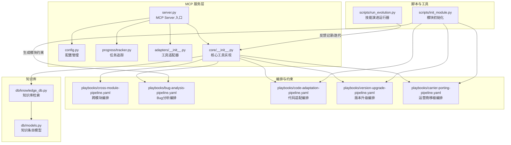
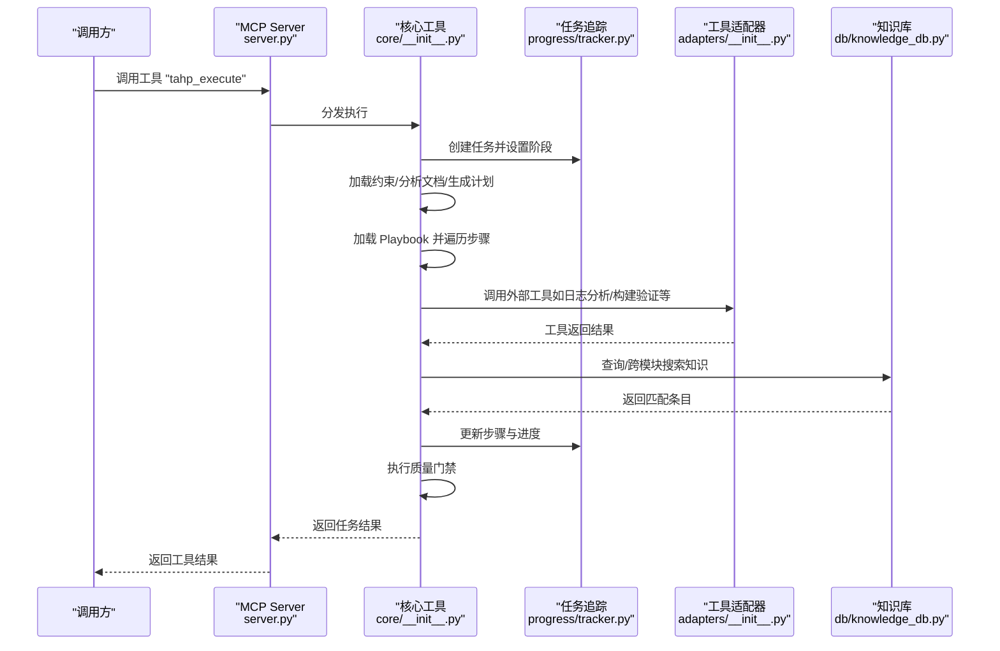
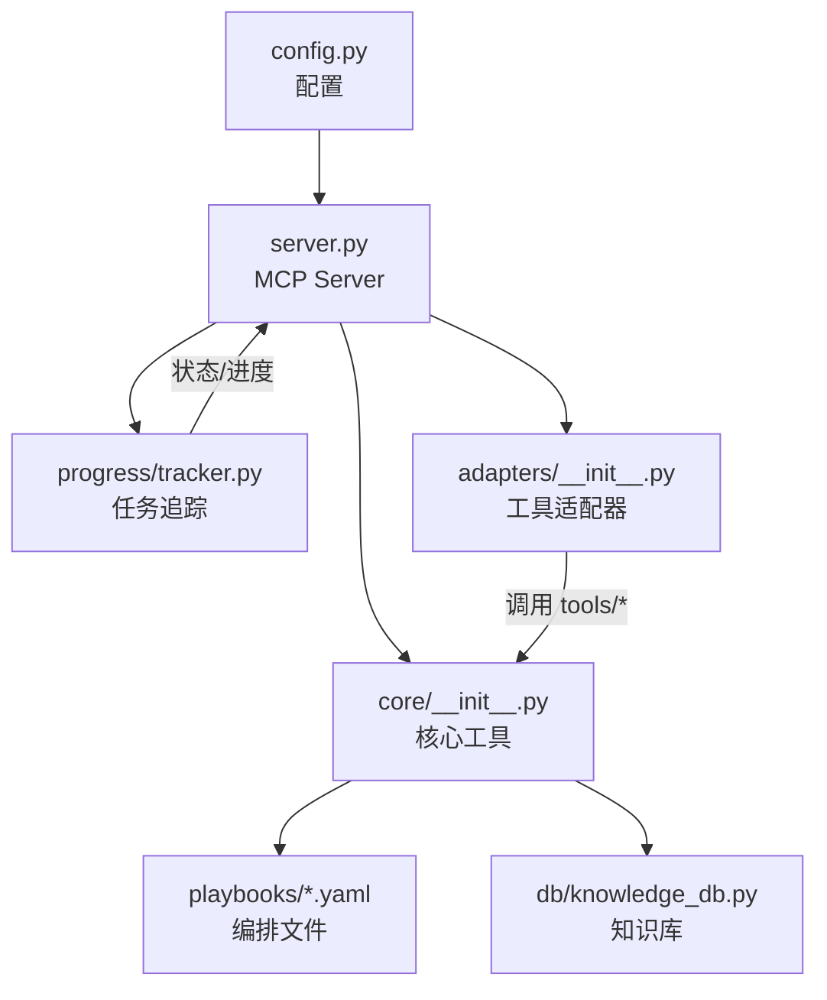

# 跨模块管道

<cite>
**本文引用的文件**
- [cross-module-pipeline.yaml](file://playbooks/cross-module-pipeline.yaml)
- [bug-analysis-pipeline.yaml](file://playbooks/bug-analysis-pipeline.yaml)
- [code-adaptation-pipeline.yaml](file://playbooks/code-adaptation-pipeline.yaml)
- [version-upgrade-pipeline.yaml](file://playbooks/version-upgrade-pipeline.yaml)
- [carrier-porting-pipeline.yaml](file://playbooks/carrier-porting-pipeline.yaml)
- [server.py](file://tahp-mcp-server/server.py)
- [config.py](file://tahp-mcp-server/config.py)
- [tracker.py](file://tahp-mcp-server/progress/tracker.py)
- [adapters/__init__.py](file://tahp-mcp-server/adapters/__init__.py)
- [core/__init__.py](file://tahp-mcp-server/core/__init__.py)
- [knowledge_db.py](file://db/knowledge_db.py)
- [models.py](file://db/models.py)
- [init_module.py](file://scripts/init_module.py)
- [run_evolution.py](file://scripts/run_evolution.py)
</cite>

## 目录
1. [引言](#引言)
2. [项目结构](#项目结构)
3. [核心组件](#核心组件)
4. [架构总览](#架构总览)
5. [详细组件分析](#详细组件分析)
6. [依赖分析](#依赖分析)
7. [性能考虑](#性能考虑)
8. [故障排查指南](#故障排查指南)
9. [结论](#结论)
10. [附录](#附录)

## 引言
本文件面向“跨模块管道”的设计与实现，系统阐述其在 TAHP 体系中的角色定位、触发机制、模块识别与协调策略、并行执行与结果整合、依赖与一致性保障、以及与各具体模块管道的协作关系。文档同时提供配置示例、性能优化建议与故障处理方法，帮助读者在实际工程中高效落地跨模块协同。

## 项目结构
跨模块管道依托 Playbook 驱动，结合 MCP Server 的工具接口与进度追踪、工具适配器、知识库检索等基础设施，形成“约束驱动 + 知识增强 + 并行执行 + 门禁校验”的闭环。

图示来源
- [server.py:1-485](file://tahp-mcp-server/server.py#L1-L485)
- [config.py:1-176](file://tahp-mcp-server/config.py#L1-L176)
- [tracker.py:1-343](file://tahp-mcp-server/progress/tracker.py#L1-L343)
- [adapters/__init__.py:1-239](file://tahp-mcp-server/adapters/__init__.py#L1-L239)
- [core/__init__.py:1-621](file://tahp-mcp-server/core/__init__.py#L1-L621)
- [cross-module-pipeline.yaml:1-28](file://playbooks/cross-module-pipeline.yaml#L1-L28)
- [bug-analysis-pipeline.yaml:1-43](file://playbooks/bug-analysis-pipeline.yaml#L1-L43)
- [code-adaptation-pipeline.yaml:1-35](file://playbooks/code-adaptation-pipeline.yaml#L1-L35)
- [version-upgrade-pipeline.yaml:1-61](file://playbooks/version-upgrade-pipeline.yaml#L1-L61)
- [carrier-porting-pipeline.yaml:1-41](file://playbooks/carrier-porting-pipeline.yaml#L1-L41)
- [knowledge_db.py:1-589](file://db/knowledge_db.py#L1-L589)
- [models.py:1-247](file://db/models.py#L1-L247)
- [init_module.py:1-365](file://scripts/init_module.py#L1-L365)
- [run_evolution.py:1-567](file://scripts/run_evolution.py#L1-L567)

章节来源
- [server.py:1-485](file://tahp-mcp-server/server.py#L1-L485)
- [config.py:1-176](file://tahp-mcp-server/config.py#L1-L176)
- [cross-module-pipeline.yaml:1-28](file://playbooks/cross-module-pipeline.yaml#L1-L28)

## 核心组件
- MCP Server：对外暴露工具接口（执行、状态、纠偏、门禁、知识查询等），统一调度与协议适配。
- 配置管理：解析项目根目录、模块与领域映射、Playbook 路径、并发与超时等参数。
- 任务追踪：维护任务生命周期、阶段、步骤、进度、纠偏历史与门禁结果。
- 工具适配器：将 tools/ 目录下的工具封装为统一调用接口，支持降级模式。
- 核心工具实现：执行任务、查询状态、纠偏、门禁、知识检索等。
- 知识库：基于 SQLite + 向量嵌入的语义检索，支持跨模块搜索与过滤。
- Playbook 编排：定义跨模块与各领域管道的步骤、并行组、条件与输入输出。

章节来源
- [server.py:103-448](file://tahp-mcp-server/server.py#L103-L448)
- [config.py:36-176](file://tahp-mcp-server/config.py#L36-L176)
- [tracker.py:18-343](file://tahp-mcp-server/progress/tracker.py#L18-L343)
- [adapters/__init__.py:186-239](file://tahp-mcp-server/adapters/__init__.py#L186-L239)
- [core/__init__.py:110-621](file://tahp-mcp-server/core/__init__.py#L110-L621)
- [knowledge_db.py:93-589](file://db/knowledge_db.py#L93-L589)
- [models.py:52-247](file://db/models.py#L52-L247)

## 架构总览
跨模块管道以“约束驱动 + 知识增强 + 并行执行 + 门禁校验”为核心路径，围绕 MCP Server 的工具接口组织模块间协作。下图展示一次典型跨模块任务的端到端流程。

图示来源
- [server.py:343-448](file://tahp-mcp-server/server.py#L343-L448)
- [core/__init__.py:110-298](file://tahp-mcp-server/core/__init__.py#L110-L298)
- [tracker.py:212-343](file://tahp-mcp-server/progress/tracker.py#L212-L343)
- [adapters/__init__.py:186-239](file://tahp-mcp-server/adapters/__init__.py#L186-L239)
- [knowledge_db.py:375-402](file://db/knowledge_db.py#L375-L402)

## 详细组件分析

### 跨模块编排与触发机制
- 触发条件：跨模块任务通常由“涉及多个模块协作”的场景触发；例如 Bug 分析涉及多个子系统、版本升级影响多模块、运营商移植需跨项目适配等。
- 步骤设计：跨模块编排通过 Playbook 定义，包含任务分解、并行执行与结果整合三阶段；并行组允许不同模块的子任务并行推进，提升整体吞吐。
- 输出与输入：中间产物通过 output/input 关联，确保模块间数据传递与依赖满足。

章节来源
- [cross-module-pipeline.yaml:1-28](file://playbooks/cross-module-pipeline.yaml#L1-L28)

### 模块识别与协调处理流程
- 模块识别：在跨模块场景中，先识别涉及的模块集合（如 telephony、kernel-driver、power-mgmt），再加载对应约束与技能。
- 协调处理：通过并行组对各模块子任务进行调度；协调器负责整合各模块结果、进行一致性检查与统一报告生成。
- 条件执行：部分步骤支持条件表达式（如仅当某模块在涉及列表中才执行），避免无关模块参与。

章节来源
- [bug-analysis-pipeline.yaml:16-37](file://playbooks/bug-analysis-pipeline.yaml#L16-L37)
- [version-upgrade-pipeline.yaml:28-60](file://playbooks/version-upgrade-pipeline.yaml#L28-L60)

### 多模块依赖关系管理、数据共享与状态同步
- 依赖管理：Playbook 步骤明确输入输出，通过 output/input 关联形成依赖链；并行组内部模块间无强耦合，仅通过共享输入输出进行弱耦合。
- 数据共享：中间产物（如子任务结果、分析报告）通过步骤输出汇聚到整合步骤，避免重复计算与状态分散。
- 状态同步：任务追踪器集中维护任务阶段、步骤状态、纠偏历史与门禁结果，确保跨模块执行状态一致可见。

章节来源
- [tracker.py:82-210](file://tahp-mcp-server/progress/tracker.py#L82-L210)
- [cross-module-pipeline.yaml:10-26](file://playbooks/cross-module-pipeline.yaml#L10-L26)

### 模块间通信协议、冲突解决与一致性保证
- 通信协议：MCP Server 通过统一工具接口暴露能力，工具参数与返回值采用 JSON Schema 描述，确保跨模块调用契约清晰。
- 冲突解决：通过 Playbook 的条件与并行组控制，避免同一资源的竞态访问；门禁检查作为一致性保障的最后一道防线。
- 一致性保证：在整合步骤中进行跨模块一致性校验（如根因归属判定、影响范围汇总），并在门禁阶段进行强制性检查。

章节来源
- [server.py:103-322](file://tahp-mcp-server/server.py#L103-L322)
- [core/__init__.py:366-460](file://tahp-mcp-server/core/__init__.py#L366-L460)

### 跨模块管道与具体模块管道的协作关系
- Bug 分析：跨模块编排在“解析 Bug 描述”后，加载各模块约束并并行执行模块级分析，最终合成统一报告。
- 代码适配：在模块分析完成后，按 scope 与约束生成修改计划并执行，期间穿插门禁检查。
- 版本升级：跨模块编排侧重于跨模块影响面扫描与批量适配策略制定，模块管道聚焦具体代码修改与验证。
- 运营商移植：跨模块编排负责需求解析与策略分类，模块管道负责生成与合规检查。

章节来源
- [bug-analysis-pipeline.yaml:1-43](file://playbooks/bug-analysis-pipeline.yaml#L1-L43)
- [code-adaptation-pipeline.yaml:1-35](file://playbooks/code-adaptation-pipeline.yaml#L1-L35)
- [version-upgrade-pipeline.yaml:1-61](file://playbooks/version-upgrade-pipeline.yaml#L1-L61)
- [carrier-porting-pipeline.yaml:1-41](file://playbooks/carrier-porting-pipeline.yaml#L1-L41)

### 知识库在跨模块管道中的作用
- 知识查询：在任务执行过程中，通过知识库检索与跨模块搜索，辅助决策与一致性校验。
- 结果增强：将检索到的知识条目纳入报告与纠偏依据，提升执行质量与可追溯性。
- 跨模块检索：支持排除特定模块的跨模块搜索，避免自我引用与噪声干扰。

章节来源
- [core/__init__.py:558-621](file://tahp-mcp-server/core/__init__.py#L558-L621)
- [knowledge_db.py:519-571](file://db/knowledge_db.py#L519-L571)
- [models.py:52-140](file://db/models.py#L52-L140)

### 工具适配器与外部工具集成
- 统一接口：将 tools/ 目录下的工具封装为适配器，提供统一的调用接口与降级实现，降低模块间集成成本。
- 动态加载：按需动态导入工具模块，支持扩展与热插拔。
- 错误处理：捕获工具执行异常并返回结构化错误信息，便于上层统一处理。

章节来源
- [adapters/__init__.py:42-239](file://tahp-mcp-server/adapters/__init__.py#L42-L239)

### 任务追踪与纠偏机制
- 阶段化追踪：任务分为加载约束、分析文档、生成计划、执行 Pipeline、运行门禁等阶段，阶段到状态映射清晰。
- 步骤级追踪：每个步骤具备状态、开始/完成时间与细节，便于可视化与审计。
- 纠偏流程：支持在执行中接收纠偏反馈，进入“等待纠偏输入”状态，并在纠偏后恢复执行。

章节来源
- [tracker.py:18-343](file://tahp-mcp-server/progress/tracker.py#L18-L343)
- [core/__init__.py:318-364](file://tahp-mcp-server/core/__init__.py#L318-L364)

### 配置与 Playbook 映射
- 配置映射：配置文件定义模块集合、领域映射与 Playbook 文件名映射，确保工具调用与编排文件的一致性。
- Playbook 路径解析：根据领域动态定位 Playbook 文件，支持跨模块与模块级编排的灵活切换。

章节来源
- [config.py:73-121](file://tahp-mcp-server/config.py#L73-L121)
- [core/__init__.py:102-108](file://tahp-mcp-server/core/__init__.py#L102-L108)

## 依赖分析
跨模块管道的关键依赖关系如下：

图示来源
- [config.py:36-176](file://tahp-mcp-server/config.py#L36-L176)
- [server.py:94-96](file://tahp-mcp-server/server.py#L94-L96)
- [core/__init__.py:110-298](file://tahp-mcp-server/core/__init__.py#L110-L298)
- [tracker.py:212-343](file://tahp-mcp-server/progress/tracker.py#L212-L343)
- [adapters/__init__.py:186-239](file://tahp-mcp-server/adapters/__init__.py#L186-L239)
- [knowledge_db.py:93-164](file://db/knowledge_db.py#L93-L164)
- [cross-module-pipeline.yaml:6-27](file://playbooks/cross-module-pipeline.yaml#L6-L27)

章节来源
- [server.py:327-448](file://tahp-mcp-server/server.py#L327-L448)
- [core/__init__.py:110-298](file://tahp-mcp-server/core/__init__.py#L110-L298)

## 性能考虑
- 并行执行：跨模块编排通过并行组提升吞吐，但需注意资源竞争与锁争用；建议在工具适配器层面引入队列与限流。
- 任务并发与超时：合理设置最大并发与任务超时，避免资源耗尽；对长时间运行的步骤增加阶段性持久化。
- 知识库检索：语义检索依赖嵌入模型，建议在可用时启用 ONNX 嵌入，降级时采用文本匹配；控制返回条目数量与最小置信度阈值。
- I/O 与缓存：对频繁访问的约束与知识库结果进行缓存，减少重复加载与计算。

## 故障排查指南
- 工具调用失败：检查工具是否存在、参数是否正确、返回结构是否符合预期；查看工具适配器的降级实现与错误返回。
- 任务状态异常：通过状态查询工具核对任务阶段与步骤状态，定位卡顿或失败步骤；关注纠偏历史与门禁结果。
- 知识库检索异常：确认嵌入模型可用性、数据库连接与索引状态；检查查询参数与最小置信度阈值。
- 模块初始化问题：使用模块初始化脚本生成标准目录与约束文件，确保 module.yaml 与领域约束文件齐全。

章节来源
- [adapters/__init__.py:226-239](file://tahp-mcp-server/adapters/__init__.py#L226-L239)
- [tracker.py:242-313](file://tahp-mcp-server/progress/tracker.py#L242-L313)
- [knowledge_db.py:132-157](file://db/knowledge_db.py#L132-L157)
- [init_module.py:154-249](file://scripts/init_module.py#L154-L249)

## 结论
跨模块管道以 Playbook 为骨架，结合 MCP Server 的工具接口与任务追踪、知识库检索、工具适配器等能力，实现了多模块间的协调与一致性保障。通过并行执行、条件控制与门禁检查，系统在保证质量的同时提升了执行效率。建议在实际落地中重视配置治理、资源隔离与可观测性建设，持续优化跨模块协作体验。

## 附录

### 配置示例与最佳实践
- Playbook 映射：确保领域到 Playbook 的映射正确，跨模块与模块级编排文件分别维护。
- 工具适配器：为新增工具提供适配器封装，必要时提供降级实现，确保系统稳定性。
- 纠偏与反馈：在跨模块执行中预留纠偏通道，结合 EvoSkill 的反馈历史持续改进。

章节来源
- [config.py:73-121](file://tahp-mcp-server/config.py#L73-L121)
- [adapters/__init__.py:186-239](file://tahp-mcp-server/adapters/__init__.py#L186-L239)
- [run_evolution.py:409-527](file://scripts/run_evolution.py#L409-L527)