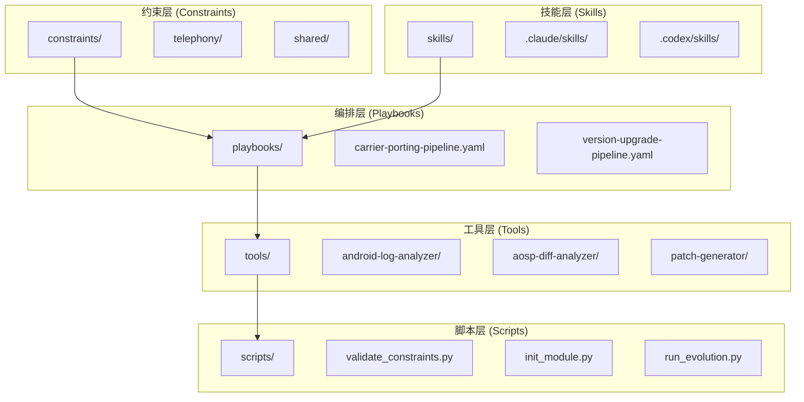
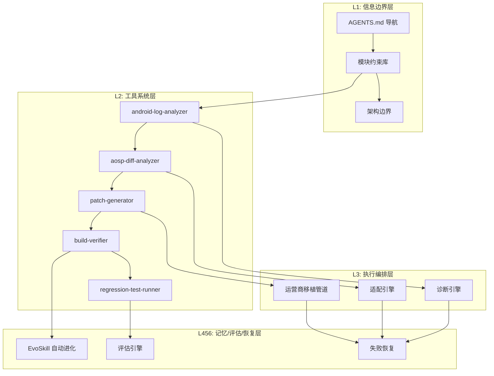
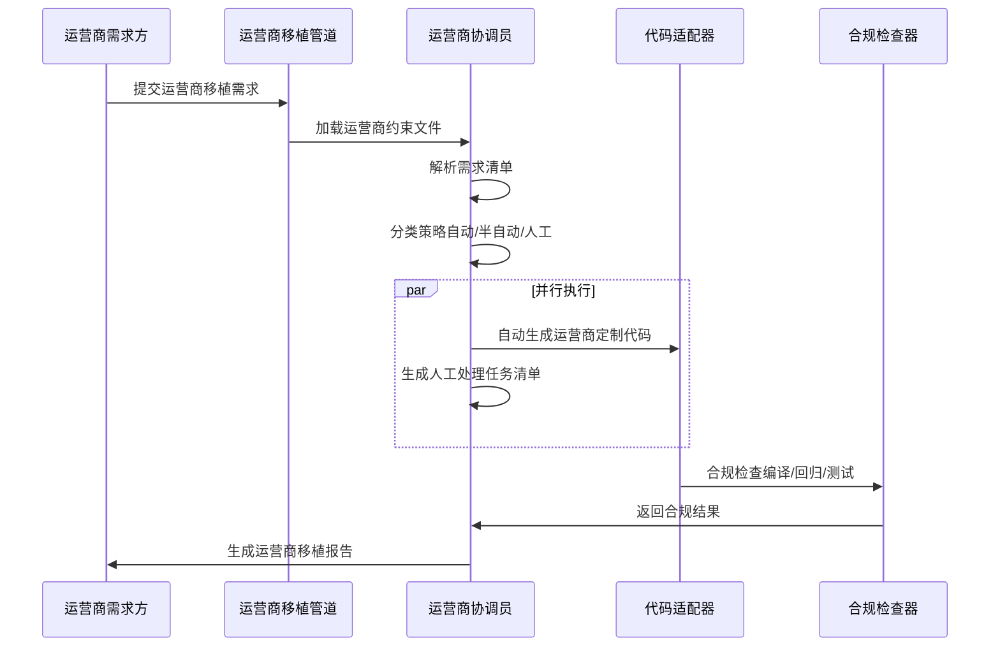
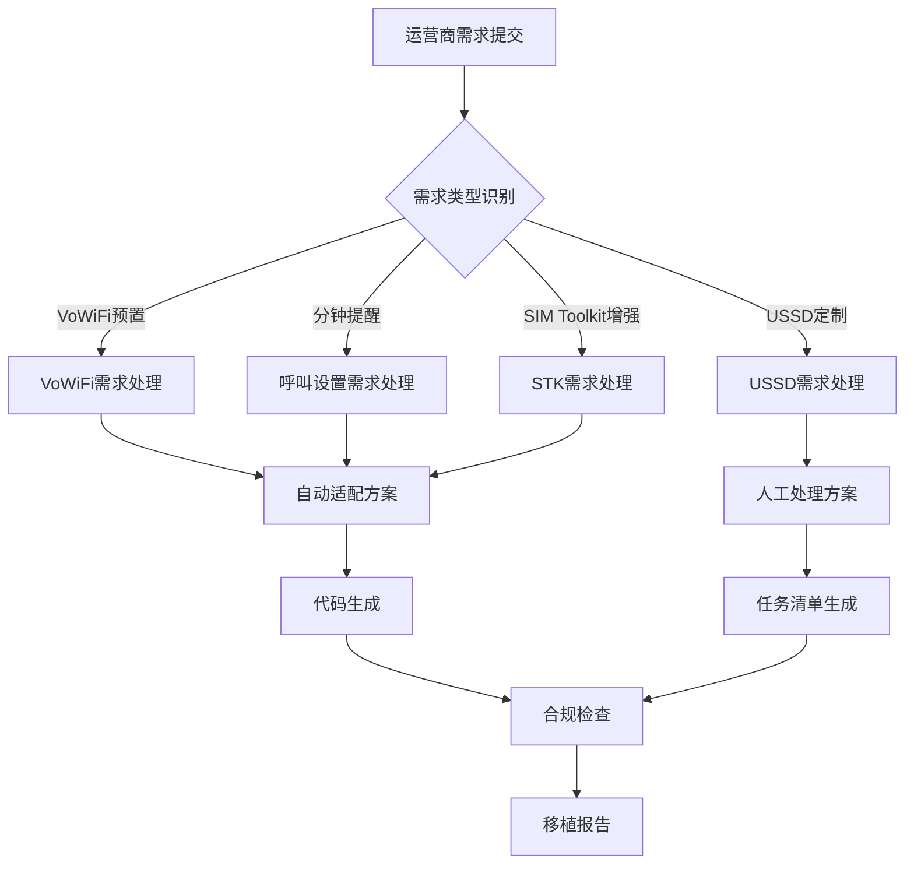
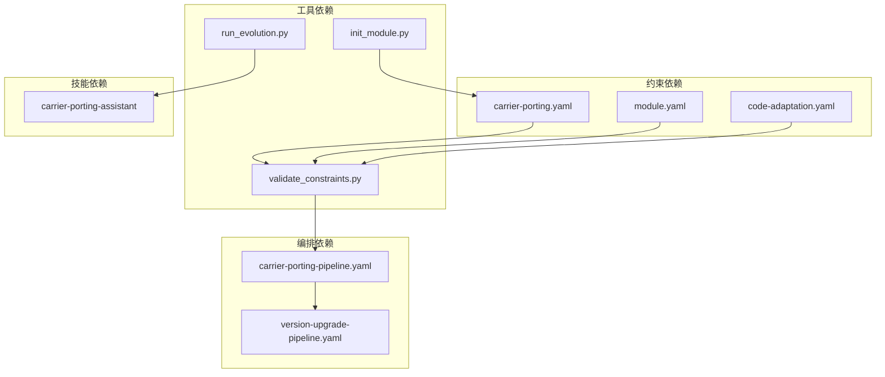

# 运营商移植管道

<cite>
**本文档引用的文件**
- [carrier-porting-pipeline.yaml](file://playbooks/carrier-porting-pipeline.yaml)
- [carrier-porting.yaml](file://constraints/telephony/carrier-porting.yaml)
- [code-adaptation.yaml](file://constraints/telephony/code-adaptation.yaml)
- [module.yaml](file://constraints/telephony/module.yaml)
- [SKILL.md](file://skills/.claude/skills/carrier-porting-assistant/SKILL.md)
- [carrier-porting.yaml.template](file://templates/module-template/carrier-porting.yaml.template)
- [validate_constraints.py](file://scripts/validate_constraints.py)
- [init_module.py](file://scripts/init_module.py)
- [system-overview.md](file://docs/architecture/system-overview.md)
- [version-upgrade-pipeline.yaml](file://playbooks/version-upgrade-pipeline.yaml)
- [run_evolution.py](file://scripts/run_evolution.py)
</cite>

## 目录
1. [引言](#引言)
2. [项目结构](#项目结构)
3. [核心组件](#核心组件)
4. [架构概览](#架构概览)
5. [详细组件分析](#详细组件分析)
6. [依赖关系分析](#依赖关系分析)
7. [性能考虑](#性能考虑)
8. [故障排除指南](#故障排除指南)
9. [结论](#结论)
10. [附录](#附录)

## 引言

运营商移植管道是TAHP（TECNO AI Harness Platform）双引擎架构中的重要组成部分，专门用于处理运营商定制需求的跨项目移植。该管道基于约束驱动的Harness范式，通过标准化的工作流程确保运营商需求能够被准确识别、适配和验证。

本文档深入解释运营商移植工作流的设计思路和执行机制，涵盖触发条件、步骤流程、配置管理和验证测试等关键方面。特别关注运营商特定需求的识别、适配方案生成和验证测试流程，以及网络制式适配、频段配置和功能定制的完整处理过程。

## 项目结构

TAHP系统采用分层架构设计，运营商移植管道位于执行编排层，与诊断引擎并列构成双引擎架构。系统的核心目录结构如下：



**图表来源**
- [system-overview.md: 316-379:316-379](file://docs/architecture/system-overview.md#L316-L379)

**章节来源**
- [system-overview.md: 316-379:316-379](file://docs/architecture/system-overview.md#L316-L379)

## 核心组件

运营商移植管道由多个核心组件协同工作，形成完整的自动化工作流程：

### 1. 约束文件系统
运营商移植的核心是约束文件，它定义了运营商需求的具体要求、配置规则和验证标准。主要约束文件包括：

- **运营商移植约束文件**：定义具体的运营商需求和适配规则
- **代码适配约束文件**：规定代码修改的限制和规范
- **模块元数据文件**：描述模块的基本信息和作用域

### 2. 执行编排引擎
基于YAML的编排系统，定义了运营商移植的标准化流程步骤，支持并行执行和条件判断。

### 3. 质量门禁系统
多层次的质量检查机制，确保移植结果符合预设的标准和规范。

**章节来源**
- [carrier-porting.yaml: 1-106:1-106](file://constraints/telephony/carrier-porting.yaml#L1-L106)
- [code-adaptation.yaml: 1-48:1-48](file://constraints/telephony/code-adaptation.yaml#L1-L48)
- [module.yaml: 1-43:1-43](file://constraints/telephony/module.yaml#L1-L43)

## 架构概览

运营商移植管道在TAHP双引擎架构中的位置和作用如下：



**图表来源**
- [system-overview.md: 87-127:87-127](file://docs/architecture/system-overview.md#L87-L127)

### 双引擎工作流程对比

运营商移植管道与版本升级管道在工作流程上存在显著差异：



**图表来源**
- [carrier-porting-pipeline.yaml: 6-40:6-40](file://playbooks/carrier-porting-pipeline.yaml#L6-L40)

**章节来源**
- [system-overview.md: 181-203:181-203](file://docs/architecture/system-overview.md#L181-L203)
- [carrier-porting-pipeline.yaml: 1-41:1-41](file://playbooks/carrier-porting-pipeline.yaml#L1-L41)

## 详细组件分析

### 运营商移植管道工作流程

运营商移植管道采用标准化的五步工作流程：

#### 步骤1：加载运营商约束
系统首先加载运营商移植约束文件，这些文件包含了运营商的具体需求、配置规则和验证标准。

#### 步骤2：解析需求清单
系统分析运营商需求，识别相关的代码路径、配置文件和依赖关系。

#### 步骤3：策略分类
根据需求的复杂性和可自动化程度进行分类：
- **自动（置信度>0.85）**：完全自动化生成解决方案
- **半自动（置信度0.70-0.85）**：AI生成部分解决方案，需要人工审核
- **人工（置信度<0.70）**：完全人工处理，生成任务清单

#### 步骤4：批量移植
并行执行自动移植和人工任务处理，提高整体效率。

#### 步骤5：合规检查和报告生成
进行全面的合规检查，包括编译验证、通用回归测试和运营商定制测试。

**章节来源**
- [carrier-porting-pipeline.yaml: 6-40:6-40](file://playbooks/carrier-porting-pipeline.yaml#L6-L40)

### 运营商特定需求识别机制

系统通过以下机制识别和处理运营商特定需求：



**图表来源**
- [carrier-porting.yaml: 32-78:32-78](file://constraints/telephony/carrier-porting.yaml#L32-L78)

### 配置管理策略

运营商移植管道采用严格的配置管理策略：

#### 1. 网络制式适配
- **VoLTE配置**：IMS注册、紧急呼叫、视频通话、Wi-Fi Calling、SMS over IP
- **网络模式配置**：网络模式选择、PLMN偏好、频段偏好、漫游设置
- **APN配置**：APN参数、代理设置、认证方式、协议配置

#### 2. 功能定制配置
- **SIM Toolkit配置**：菜单显示格式、主动命令支持
- **品牌配置**：运营商名称显示、图标、启动动画
- **测试配置**：连接性测试、VoLTE测试、漫游测试、STK测试

#### 3. 安全红线管理
- **紧急呼叫保护**：绝不修改影响紧急呼叫的功能
- **基带修改限制**：未经批准不得修改基带配置
- **跨运营商隔离**：各运营商配置相互独立
- **生产环境安全**：测试配置不得进入生产构建

**章节来源**
- [carrier-porting.yaml.template: 49-375:49-375](file://templates/module-template/carrier-porting.yaml.template#L49-L375)
- [carrier-porting.yaml: 80-92:80-92](file://constraints/telephony/carrier-porting.yaml#L80-L92)

### Telephony模块约束集成

运营商移植管道与Telephony模块的约束集成体现在多个层面：

#### 1. 作用域定义
Telephony模块的作用域明确界定了可修改的代码范围：
- Telephony Framework
- RIL Java接口层
- Telephony Service
- Telecom Framework
- RIL C/HIDL层

#### 2. 依赖关系管理
模块间依赖关系清晰定义，确保移植不会影响其他模块：
- 内核驱动依赖（运行时）
- 功耗管理依赖（分析时）
- Android Framework依赖（编译时）

#### 3. 代码适配规则
严格限制代码修改范围，防止破坏现有功能：
- 允许路径：Telephony相关目录
- 禁止路径：核心系统和其他模块
- 风格规范：遵循Google Java Style Guide

**章节来源**
- [module.yaml: 11-43:11-43](file://constraints/telephony/module.yaml#L11-L43)
- [code-adaptation.yaml: 13-48:13-48](file://constraints/telephony/code-adaptation.yaml#L13-L48)

## 依赖关系分析

运营商移植管道的依赖关系呈现复杂的多层嵌套结构：



**图表来源**
- [validate_constraints.py: 184-238:184-238](file://scripts/validate_constraints.py#L184-L238)

### 质量门禁依赖

系统建立了多层次的质量门禁体系：

| 级别 | 门禁项 | 失败处理 |
|------|--------|---------|
| **P0 (BLOCK)** | 编译通过 + Scope 合规 + 安全红线 + API 真实性 | 任一失败即阻止 |
| **P1 (WARNING)** | 编码风格 + Lint + 废弃 API + TODO 关联 | 累计超过阈值则警告 |
| **P2 (RECORD)** | 代码复杂度 + 重复率 + 注释覆盖 | 记录但不阻止 |

**章节来源**
- [system-overview.md: 268-289:268-289](file://docs/architecture/system-overview.md#L268-L289)

## 性能考虑

运营商移植管道在设计时充分考虑了性能优化：

### 1. 并行执行优化
- **批量处理**：自动移植和人工任务并行执行
- **资源分配**：根据任务复杂度动态分配计算资源
- **缓存机制**：复用已验证的配置和代码片段

### 2. 约束验证优化
- **快速语法检查**：YAML文件的即时语法验证
- **交叉引用检查**：模块间依赖关系的批量验证
- **严格模式**：可选的额外验证规则

### 3. 进化算法优化
- **并发评估**：支持多实例并行评估
- **智能选择**：基于复合评分的最佳变体选择
- **早停机制**：停滞阈值触发的自动停止

**章节来源**
- [run_evolution.py: 409-527:409-527](file://scripts/run_evolution.py#L409-L527)
- [validate_constraints.py: 251-278:251-278](file://scripts/validate_constraints.py#L251-L278)

## 故障排除指南

### 常见问题及解决方案

#### 1. 约束文件验证失败
**症状**：约束文件验证工具报错
**原因**：YAML语法错误、缺少必需字段、域枚举值无效
**解决**：使用验证工具获取详细错误信息，按照提示修正

#### 2. 运营商移植失败
**症状**：移植后的代码无法编译或运行
**原因**：违反安全红线、Scope限制、API变更
**解决**：检查移植日志，确认是否违反约束规则

#### 3. 质量门禁触发
**症状**：移植被质量门禁阻止
**原因**：编译错误、安全违规、代码风格问题
**解决**：修复问题后重新执行，必要时调整移植策略

### 调试工具和技巧

#### 1. 约束验证工具
提供详细的YAML文件验证功能，包括：
- 语法检查
- 结构验证
- 交叉引用检查
- 严格模式验证

#### 2. 模块初始化工具
支持从模板创建新的模块约束结构，提供：
- 交互式和命令行两种模式
- 模板变量替换
- 自动目录结构创建

#### 3. EvoSkill进化工具
支持技能的自动进化和评估：
- 多变体并行生成
- 智能选择最佳变体
- 反馈历史记录

**章节来源**
- [validate_constraints.py: 1-360:1-360](file://scripts/validate_constraints.py#L1-L360)
- [init_module.py: 1-365:1-365](file://scripts/init_module.py#L1-L365)
- [run_evolution.py: 1-567:1-567](file://scripts/run_evolution.py#L1-L567)

## 结论

运营商移植管道作为TAHP双引擎架构的重要组成部分，通过约束驱动的方法实现了运营商定制需求的高效、标准化处理。该管道具有以下特点：

1. **标准化流程**：五步工作流程确保移植过程的可控性和可重复性
2. **智能分类**：基于置信度的需求分类，实现最优的人机协作
3. **严格约束**：多层次的安全红线和质量门禁保障移植质量
4. **并行执行**：自动和人工任务的并行处理提高整体效率
5. **持续改进**：EvoSkill机制支持技能的自动进化和优化

通过这套完整的解决方案，运营商移植管道能够有效应对复杂的定制需求，确保移植结果既满足业务要求又符合技术规范。

## 附录

### 配置示例

#### 运营商移植约束文件示例
```yaml
# 运营商信息
carrier_info:
  name: "Airtel"
  region: "India"
  country: "India"
  mcc_mnc: "404xx"

# 配置规则
configuration_rules:
  apn_config:
    enabled: true
    file_path: "etc/apns-conf.xml"
    rules:
      - name: "Airtel Internet"
        apn: "airtelgprs.com"
        proxy: ""
        port: ""
        user: ""
        password: ""
        server: ""
        mmsc: ""
        mms_proxy: ""
        auth_type: "none"
        apn_type: "default,supl,mms"
        protocol: "IPV4V6"
        roaming_protocol: "IPV4V6"
        carrier_enabled: "true"
        editable: "false"
```

#### 最佳实践建议
1. **需求分析**：详细分析运营商需求，明确自动化程度
2. **约束编写**：严格按照模板编写约束文件，确保完整性
3. **质量控制**：严格执行质量门禁，避免违规修改
4. **测试验证**：全面的测试覆盖，确保功能正确性
5. **文档记录**：详细记录移植过程和决策依据

### 风险控制方法

#### 1. 安全风险控制
- 紧急呼叫功能绝不修改
- 基带配置未经批准不得修改
- 生产环境严格隔离测试配置

#### 2. 质量风险控制
- 编译门禁必须通过
- 回归测试覆盖率≥95%
- 代码审查强制执行

#### 3. 业务风险控制
- 跨运营商配置隔离
- 现有功能保持不变
- 变更影响最小化