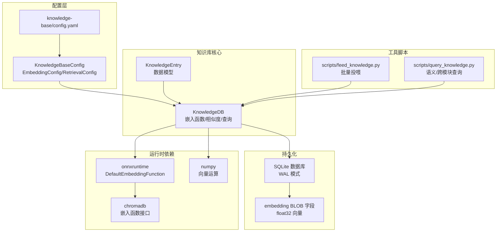
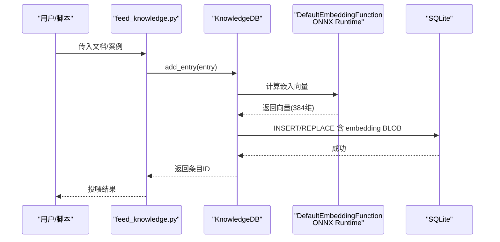
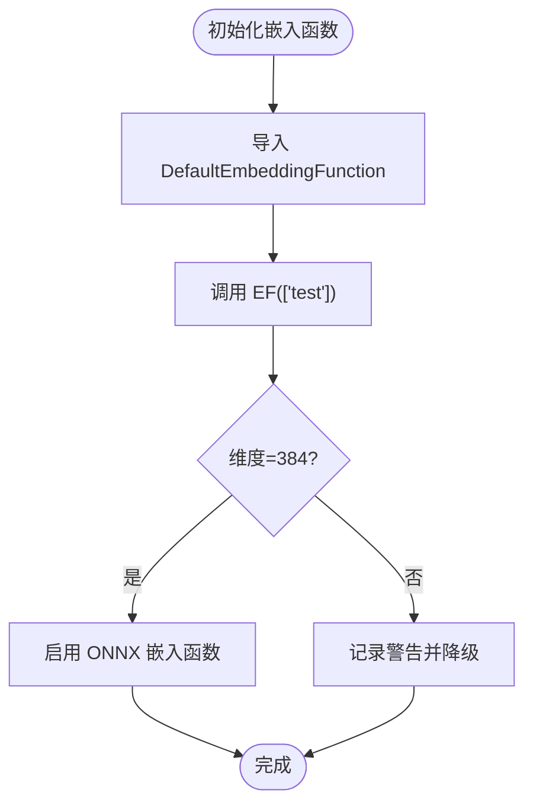
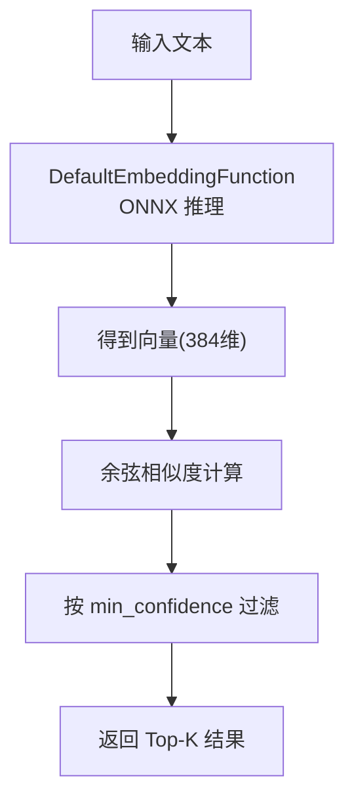
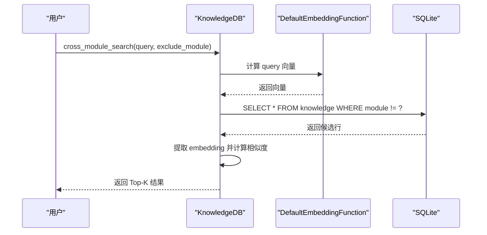
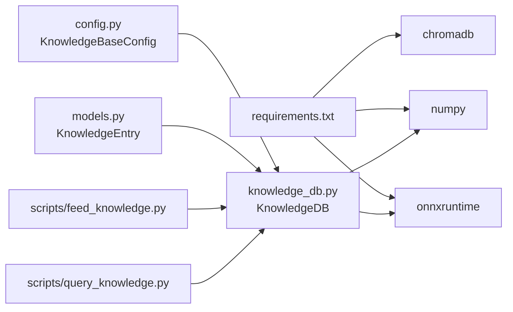

# 向量嵌入系统

<cite>
**本文引用的文件**
- [knowledge_db.py](file://db/knowledge_db.py)
- [config.py](file://db/config.py)
- [config.yaml](file://knowledge-base/config.yaml)
- [requirements.txt](file://requirements.txt)
- [feed_knowledge.py](file://scripts/feed_knowledge.py)
- [query_knowledge.py](file://scripts/query_knowledge.py)
- [models.py](file://db/models.py)
</cite>

## 目录
1. [简介](#简介)
2. [项目结构](#项目结构)
3. [核心组件](#核心组件)
4. [架构总览](#架构总览)
5. [详细组件分析](#详细组件分析)
6. [依赖分析](#依赖分析)
7. [性能考虑](#性能考虑)
8. [故障排查指南](#故障排查指南)
9. [结论](#结论)
10. [附录](#附录)

## 简介
本文件面向“向量嵌入系统”，聚焦于 ONNX Runtime 与 all-MiniLM-L6-v2 模型的集成方式与配置，详解 EmbeddingConfig 参数、嵌入生成流程、维度管理与性能优化策略，并提供模型替换与自定义配置方法、嵌入质量评估、批量处理优化与内存管理最佳实践，以及跨语言检索的实现原理与参数调优建议。

## 项目结构
本系统围绕知识库模块（db）构建，采用 SQLite 持久化 + ONNX Runtime 语义嵌入（all-MiniLM-L6-v2，384维）。配置通过 YAML 文件与 Python 数据类协同管理；脚本工具提供知识投喂与查询能力。

图表来源
- [knowledge_db.py:101-127](file://db/knowledge_db.py#L101-L127)
- [config.py:65-86](file://db/config.py#L65-L86)
- [config.yaml:1-36](file://knowledge-base/config.yaml#L1-L36)
- [requirements.txt:7-8](file://requirements.txt#L7-L8)

章节来源
- [knowledge_db.py:1-127](file://db/knowledge_db.py#L1-L127)
- [config.py:1-182](file://db/config.py#L1-L182)
- [config.yaml:1-36](file://knowledge-base/config.yaml#L1-L36)
- [requirements.txt:1-9](file://requirements.txt#L1-L9)

## 核心组件
- KnowledgeBaseConfig：全局配置入口，负责从 YAML 加载数据库类型、嵌入与检索配置，并提供 to_dict 导出。
- EmbeddingConfig：嵌入模型与设备配置，当前默认使用 chromadb 内置 DefaultEmbeddingFunction（即 ONNX Runtime + all-MiniLM-L6-v2）。
- RetrievalConfig：检索参数，如 top_k、最小置信度、跨模块检索 top_k、重排开关等。
- KnowledgeDB：核心知识库类，负责嵌入函数初始化、向量计算、相似度排序、SQL 查询与写入、跨模块检索等。
- KnowledgeEntry：知识条目数据模型，支持 Markdown/YAML frontmatter 转换与 ChromaDB 元数据转换。
- 脚本工具：feed_knowledge.py 批量投喂，query_knowledge.py 语义/跨模块查询与统计。

章节来源
- [config.py:24-86](file://db/config.py#L24-L86)
- [knowledge_db.py:93-131](file://db/knowledge_db.py#L93-L131)
- [models.py:52-70](file://db/models.py#L52-L70)
- [feed_knowledge.py:196-320](file://scripts/feed_knowledge.py#L196-L320)
- [query_knowledge.py:116-200](file://scripts/query_knowledge.py#L116-L200)

## 架构总览
系统采用“配置驱动 + ONNX Runtime 嵌入 + SQLite 持久化”的轻量架构。嵌入函数由 chromadb.DefaultEmbeddingFunction 提供，内部使用 onnxruntime 推理 all-MiniLM-L6-v2，输出固定维度（384）向量。知识条目内容经嵌入后以二进制形式存储于 SQLite 的 embedding 字段，查询时对候选集合计算余弦相似度并按检索配置过滤与排序。

图表来源
- [feed_knowledge.py:268-278](file://scripts/feed_knowledge.py#L268-L278)
- [knowledge_db.py:174-183](file://db/knowledge_db.py#L174-L183)
- [knowledge_db.py:201-222](file://db/knowledge_db.py#L201-L222)

章节来源
- [knowledge_db.py:174-183](file://db/knowledge_db.py#L174-L183)
- [knowledge_db.py:201-222](file://db/knowledge_db.py#L201-L222)
- [feed_knowledge.py:268-278](file://scripts/feed_knowledge.py#L268-L278)

## 详细组件分析

### 嵌入函数与模型集成
- 默认嵌入函数：使用 chromadb.utils.embedding_functions.DefaultEmbeddingFunction，内部基于 onnxruntime 推理 all-MiniLM-L6-v2，输出维度为 384。
- 初始化验证：系统会尝试对测试文本进行嵌入，确认输出维度正确后启用；若异常则降级为文本包含匹配模式。
- 设备配置：EmbeddingConfig.device 当前为字符串字段，但实际 onnxruntime 设备选择由底层运行环境决定；建议在部署环境中通过 ONNX Runtime 环境变量或安装 GPU 版本 onnxruntime 以启用 GPU 推理。

图表来源
- [knowledge_db.py:141-156](file://db/knowledge_db.py#L141-L156)

章节来源
- [knowledge_db.py:132-156](file://db/knowledge_db.py#L132-L156)
- [config.py:24-30](file://db/config.py#L24-L30)

### EmbeddingConfig 参数详解
- model：字符串，当前默认 "default"，指向 chromadb 内置 DefaultEmbeddingFunction。
- model_name：字符串，当 model 不为 "default" 时使用外部模型名称（当前系统未直接消费该字段，保留以备扩展）。
- device：字符串，当前为 "cpu"，实际设备由 onnxruntime 运行环境决定；GPU 推理需安装相应版本的 onnxruntime。

章节来源
- [config.py:24-30](file://db/config.py#L24-L30)

### 检索配置与跨语言检索
- default_top_k：默认返回结果数量。
- min_confidence：最小相似度阈值，用于过滤低相关结果；系统注释指出 all-MiniLM-L6-v2 中英跨语言相似度较低，可通过降低阈值提升召回。
- cross_module_top_k：跨模块检索返回数量。
- rerank：是否启用重排（当前为 False）。

章节来源
- [config.py:33-39](file://db/config.py#L33-L39)
- [config.yaml:26-31](file://knowledge-base/config.yaml#L26-L31)

### 向量生成与维度管理
- 维度：all-MiniLM-L6-v2 输出 384 维向量，系统在初始化时硬编码该维度。
- 存储：向量以 numpy float32 二进制形式存储于 SQLite 的 embedding 字段，读取时还原为 numpy 数组。
- 相似度：使用余弦相似度，对查询向量与候选向量矩阵进行归一化后矩阵乘法，避免显式循环。

图表来源
- [knowledge_db.py:174-199](file://db/knowledge_db.py#L174-L199)
- [knowledge_db.py:264-294](file://db/knowledge_db.py#L264-L294)

章节来源
- [knowledge_db.py:122-123](file://db/knowledge_db.py#L122-L123)
- [knowledge_db.py:174-199](file://db/knowledge_db.py#L174-L199)
- [knowledge_db.py:264-294](file://db/knowledge_db.py#L264-L294)

### 跨模块检索实现原理
- 在全库范围内执行语义搜索，排除指定模块（exclude_module），对候选集合计算相似度并按阈值过滤。
- 该机制通过降低 min_confidence 支持跨语言检索（英文模型查询中文内容）。

图表来源
- [knowledge_db.py:519-570](file://db/knowledge_db.py#L519-L570)

章节来源
- [knowledge_db.py:519-570](file://db/knowledge_db.py#L519-L570)
- [config.yaml:28-29](file://knowledge-base/config.yaml#L28-L29)

### 批量处理与内存管理
- 批量投喂：feed_knowledge.py 支持多文件批量解析与入库，逐条调用 KnowledgeDB.add_entry，内部对每条内容计算嵌入并写入 SQLite。
- 内存优化：相似度计算使用 numpy 矩阵运算，先提取有效嵌入形成矩阵，再一次性计算相似度，避免逐条循环；同时对向量进行归一化，减少数值不稳定。
- 存储优化：embedding 以二进制存储，读取时复制为独立 numpy 数组，避免共享引用导致的潜在问题。

章节来源
- [feed_knowledge.py:249-304](file://scripts/feed_knowledge.py#L249-L304)
- [knowledge_db.py:333-345](file://db/knowledge_db.py#L333-L345)
- [knowledge_db.py:264-294](file://db/knowledge_db.py#L264-L294)
- [knowledge_db.py:64-66](file://db/knowledge_db.py#L64-L66)

### 模型替换与自定义配置
- 替换方案：将 EmbeddingConfig.model 设置为 "default"（保持现状）或扩展为外部模型名称（需在 DefaultEmbeddingFunction 支持范围内）。当前代码未直接使用 model_name 字段，建议后续扩展以支持自定义模型路径或名称。
- 设备配置：通过安装不同版本的 onnxruntime（CPU/GPU）实现设备切换；device 字段可作为未来扩展点。
- 配置入口：通过 knowledge-base/config.yaml 的 database.embedding_model 与 retrieval.* 参数控制行为。

章节来源
- [config.py:24-30](file://db/config.py#L24-L30)
- [config.yaml:5-7](file://knowledge-base/config.yaml#L5-L7)
- [config.py:94-161](file://db/config.py#L94-L161)

## 依赖分析
- 运行时依赖：onnxruntime（1.20.x）、chromadb（>=1.5.0）、numpy（>=1.24.0）。
- 项目内依赖：KnowledgeDB 依赖 KnowledgeBaseConfig 与 KnowledgeEntry；脚本工具依赖 KnowledgeDB 与 KnowledgeBaseConfig。

图表来源
- [requirements.txt:7-8](file://requirements.txt#L7-L8)
- [config.py:65-86](file://db/config.py#L65-L86)
- [knowledge_db.py:21-22](file://db/knowledge_db.py#L21-L22)
- [feed_knowledge.py:29-31](file://scripts/feed_knowledge.py#L29-L31)
- [query_knowledge.py:27-29](file://scripts/query_knowledge.py#L27-L29)

章节来源
- [requirements.txt:1-9](file://requirements.txt#L1-L9)
- [config.py:65-86](file://db/config.py#L65-L86)
- [knowledge_db.py:21-22](file://db/knowledge_db.py#L21-L22)

## 性能考虑
- 嵌入推理：优先使用 GPU 版本 onnxruntime 以加速推理；确保模型缓存与线程池合理配置。
- 相似度计算：使用 numpy 矩阵乘法替代循环，注意控制候选集规模；必要时对候选集先做粗过滤（如按模块/类型）。
- 存储与IO：SQLite WAL 模式提升并发写入性能；embedding 二进制存储减少序列化开销。
- 批量投喂：feed_knowledge.py 已按条处理，建议在上游对大文件分批或异步处理，避免单次内存峰值过高。
- 跨语言检索：适当降低 min_confidence 可提升召回，但会增加排序与过滤成本；建议结合业务阈值动态调整。

## 故障排查指南
- ONNX 嵌入不可用：系统会记录警告并降级为文本包含匹配。请检查 onnxruntime 安装版本与 chromadb 是否正常导入。
- 嵌入维度不符：若 DefaultEmbeddingFunction 输出维度非 384，系统将降级；请确认所用模型版本与 chromadb 默认实现一致。
- 查询无结果：检查 min_confidence 是否过高；确认知识库中是否存在带 embedding 的条目；跨模块查询时确认 exclude_module 设置。
- 存储异常：确认 SQLite 数据库文件存在且可写；WAL 模式下并发写入冲突较少，但仍需避免多进程同时写入同一数据库。

章节来源
- [knowledge_db.py:141-156](file://db/knowledge_db.py#L141-L156)
- [knowledge_db.py:280-294](file://db/knowledge_db.py#L280-L294)
- [knowledge_db.py:555-568](file://db/knowledge_db.py#L555-L568)

## 结论
本系统以轻量、纯 Python 的方式实现了基于 ONNX Runtime 的语义检索：通过 chromadb.DefaultEmbeddingFunction 使用 all-MiniLM-L6-v2（384维），结合 SQLite 存储与 numpy 相似度计算，提供稳定的语义搜索与跨模块检索能力。配置层与脚本工具清晰分离职责，便于扩展与维护。建议在生产环境中启用 GPU 推理、合理设置检索阈值，并结合业务场景优化批量处理与内存占用。

## 附录

### 配置项速查
- knowledge-base/config.yaml
  - database.embedding_model：默认 "default"（即 ONNX Runtime + all-MiniLM-L6-v2）
  - retrieval.default_top_k / min_confidence / cross_module_top_k / rerank
- db/config.py
  - EmbeddingConfig.model / model_name / device
  - RetrievalConfig.default_top_k / min_confidence / cross_module_top_k / rerank

章节来源
- [config.yaml:5-7](file://knowledge-base/config.yaml#L5-L7)
- [config.yaml:26-31](file://knowledge-base/config.yaml#L26-L31)
- [config.py:24-39](file://db/config.py#L24-L39)