# 数据库架构设计

<cite>
**本文档引用的文件**
- [knowledge_db.py](file://db/knowledge_db.py)
- [config.py](file://db/config.py)
- [models.py](file://db/models.py)
- [__init__.py](file://db/__init__.py)
- [init_knowledge_base.py](file://scripts/init_knowledge_base.py)
- [query_knowledge.py](file://scripts/query_knowledge.py)
- [config.yaml](file://knowledge-base/config.yaml)
- [kb-kernel-driver-20260519-2509.md](file://knowledge-base/kernel-driver/docs/kb-kernel-driver-20260519-2509.md)
- [index.yaml](file://knowledge-base/kernel-driver/index.yaml)
</cite>

## 目录
1. [简介](#简介)
2. [项目结构](#项目结构)
3. [核心组件](#核心组件)
4. [架构概览](#架构概览)
5. [详细组件分析](#详细组件分析)
6. [依赖关系分析](#依赖关系分析)
7. [性能考虑](#性能考虑)
8. [故障排除指南](#故障排除指南)
9. [结论](#结论)
10. [附录](#附录)

## 简介

本文档详细阐述了基于 SQLite 的知识库数据库架构设计，重点解释了 ChromaDB 向量数据库的集成方式和 SQLite 持久化存储的设计理念。系统采用纯 Python 实现，避免了 C++ 依赖，实现了跨平台兼容性（Windows/Linux/macOS）。架构的核心在于将语义搜索能力与传统的关系型数据库相结合，通过 ONNX Runtime 提供的嵌入模型实现高效的向量相似度计算。

## 项目结构

项目采用模块化的文件组织方式，主要分为以下几个层次：

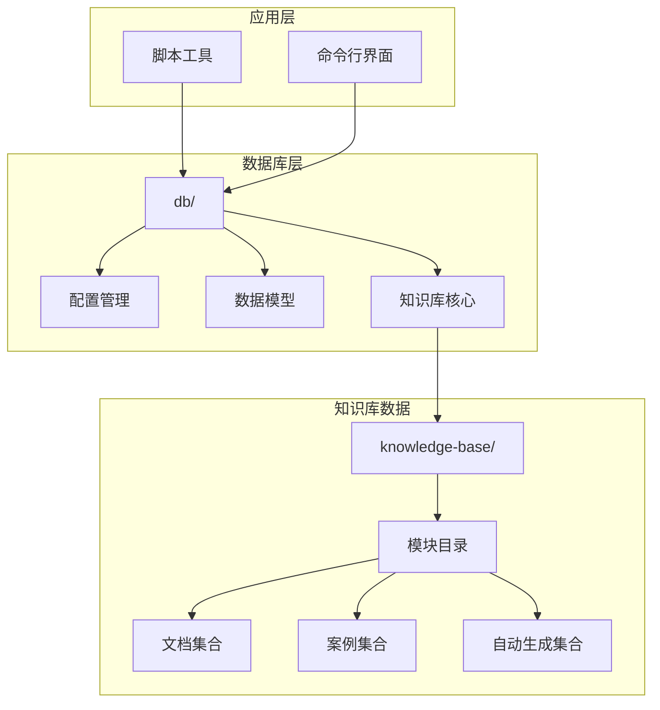

**图表来源**
- [__init__.py:1-9](file://db/__init__.py#L1-L9)
- [knowledge_db.py:1-589](file://db/knowledge_db.py#L1-L589)
- [config.py:1-182](file://db/config.py#L1-L182)

**章节来源**
- [__init__.py:1-9](file://db/__init__.py#L1-L9)
- [knowledge_db.py:1-50](file://db/knowledge_db.py#L1-L50)
- [config.py:1-30](file://db/config.py#L1-L30)

## 核心组件

### 知识库配置类 KnowledgeBaseConfig

KnowledgeBaseConfig 是整个知识库系统的核心配置管理类，采用 dataclass 设计模式，提供了完整的配置加载、解析和导出功能。

#### 配置结构

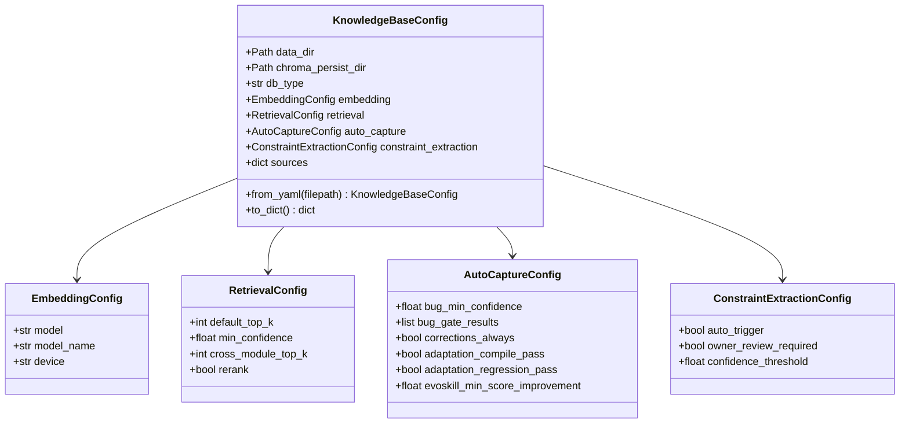

**图表来源**
- [config.py:24-86](file://db/config.py#L24-L86)

#### 关键配置项说明

| 配置项 | 类型 | 默认值 | 作用 |
|--------|------|--------|------|
| data_dir | Path | 项目根目录/knowledge-base | 知识库数据目录 |
| chroma_persist_dir | Path | 项目根目录/.chroma_db | 持久化存储目录 |
| db_type | str | "chromadb" | 数据库类型标识 |
| embedding.model | str | "default" | 嵌入模型类型 |
| retrieval.default_top_k | int | 5 | 默认返回结果数量 |
| retrieval.min_confidence | float | 0.05 | 最小置信度阈值 |

**章节来源**
- [config.py:64-93](file://db/config.py#L64-L93)
- [config.py:94-161](file://db/config.py#L94-L161)

### 知识条目数据模型

KnowledgeEntry 是知识库的核心数据结构，采用 dataclass 设计，支持多种格式的双向转换。

#### 数据模型设计

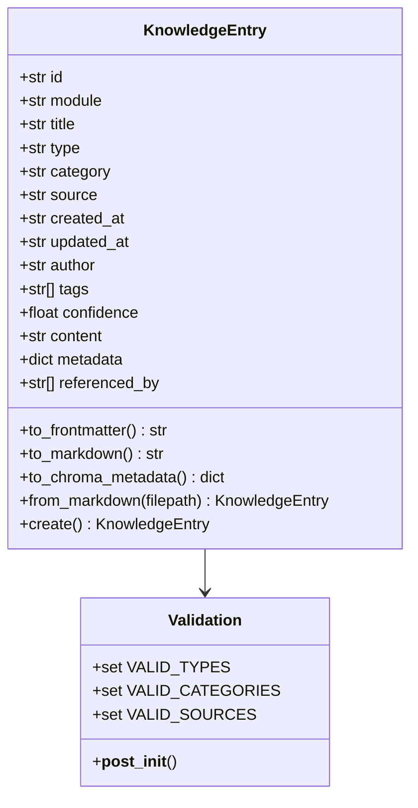

**图表来源**
- [models.py:52-70](file://db/models.py#L52-L70)

#### 字段验证机制

系统内置了严格的字段验证机制，确保数据的完整性和一致性：

- **类型验证**：仅允许预定义的有效类型
- **分类验证**：限制知识条目的分类范围
- **来源验证**：控制知识条目的来源渠道
- **置信度验证**：确保置信度值在有效范围内

**章节来源**
- [models.py:20-37](file://db/models.py#L20-L37)
- [models.py:71-81](file://db/models.py#L71-L81)

## 架构概览

系统采用分层架构设计，实现了向量数据库与关系型数据库的有机结合：

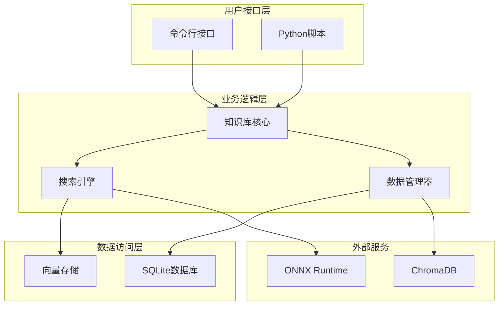

**图表来源**
- [knowledge_db.py:93-131](file://db/knowledge_db.py#L93-L131)
- [config.py:132-156](file://db/config.py#L132-L156)

### 数据库类型切换机制

系统实现了灵活的数据库类型切换机制，支持多种存储后端：

| 数据库类型 | 特点 | 适用场景 |
|------------|------|----------|
| sqlite-onnx | SQLite + ONNX嵌入 | 本地开发、测试环境 |
| chromadb | ChromaDB向量数据库 | 生产环境、高并发场景 |
| hybrid | 混合模式 | 过渡期、多环境部署 |

**章节来源**
- [config.py:72-74](file://db/config.py#L72-L74)
- [knowledge_db.py:132-156](file://db/knowledge_db.py#L132-L156)

## 详细组件分析

### KnowledgeDB 核心类

KnowledgeDB 是知识库系统的核心组件，负责管理数据库连接、执行查询操作和维护数据完整性。

#### 核心功能模块

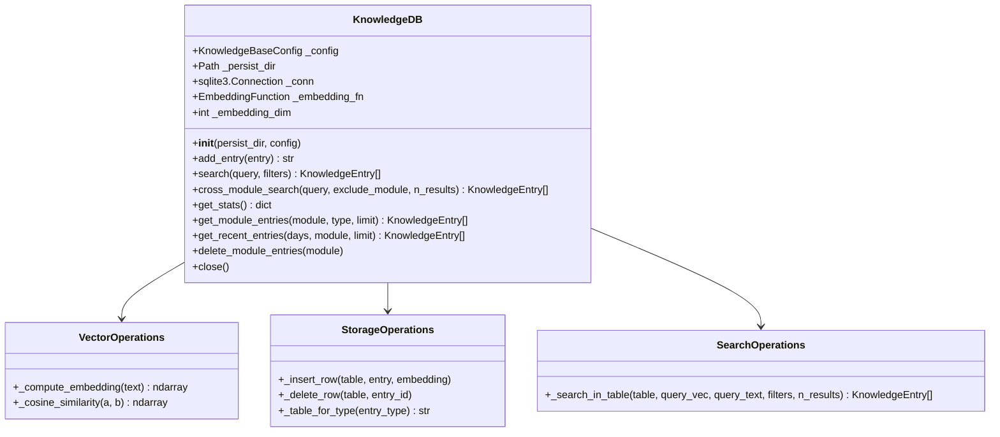

**图表来源**
- [knowledge_db.py:93-131](file://db/knowledge_db.py#L93-L131)
- [knowledge_db.py:174-200](file://db/knowledge_db.py#L174-L200)

#### 向量搜索算法

系统实现了高效的向量相似度计算算法：

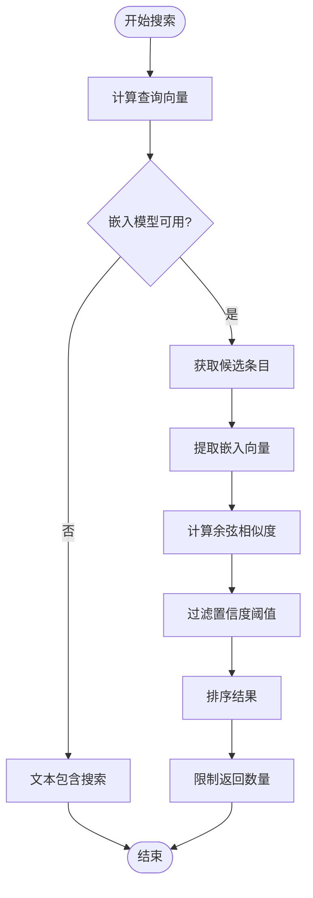

**图表来源**
- [knowledge_db.py:228-307](file://db/knowledge_db.py#L228-L307)

**章节来源**
- [knowledge_db.py:174-200](file://db/knowledge_db.py#L174-L200)
- [knowledge_db.py:228-307](file://db/knowledge_db.py#L228-L307)

### 数据持久化设计

系统采用 SQLite 作为主要的数据存储引擎，结合二进制向量存储实现高效的数据管理。

#### 数据表结构设计

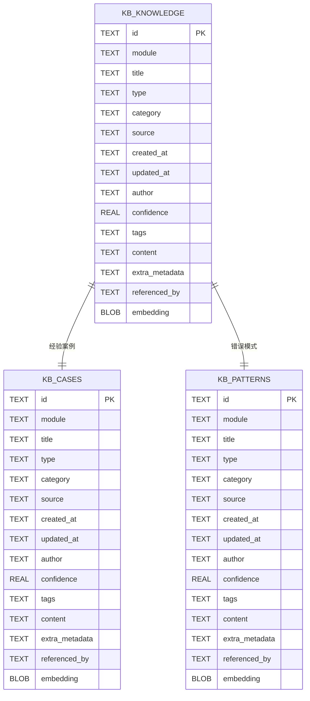

**图表来源**
- [knowledge_db.py:34-56](file://db/knowledge_db.py#L34-L56)

#### 索引优化策略

系统为关键查询字段建立了复合索引：

| 索引类型 | 字段组合 | 查询场景 |
|----------|----------|----------|
| 模块索引 | module | 模块过滤查询 |
| 类型索引 | type | 类型过滤查询 |
| 分类索引 | category | 分类过滤查询 |

**章节来源**
- [knowledge_db.py:53-56](file://db/knowledge_db.py#L53-L56)
- [knowledge_db.py:158-164](file://db/knowledge_db.py#L158-L164)

### 配置文件加载流程

系统实现了灵活的配置文件加载机制，支持从多个位置加载配置：

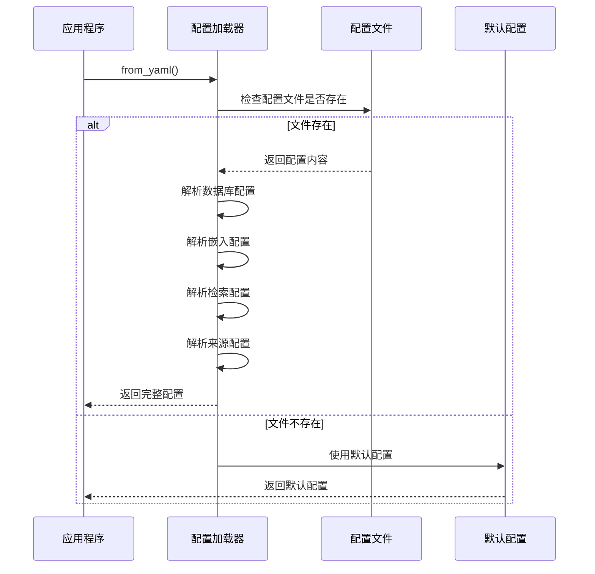

**图表来源**
- [config.py:94-161](file://db/config.py#L94-L161)

**章节来源**
- [config.py:94-161](file://db/config.py#L94-L161)
- [config.yaml:1-36](file://knowledge-base/config.yaml#L1-L36)

## 依赖关系分析

系统采用了清晰的依赖层次结构，确保了模块间的松耦合和高内聚。

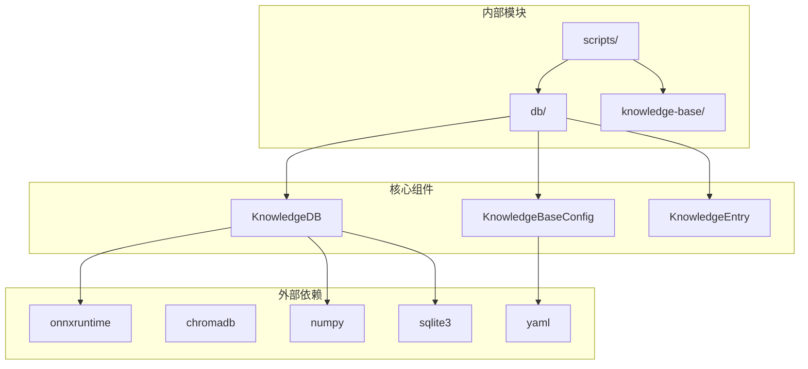

**图表来源**
- [knowledge_db.py:1-25](file://db/knowledge_db.py#L1-L25)
- [config.py:1-17](file://db/config.py#L1-L17)

### 外部依赖管理

系统对外部依赖进行了精心选择和管理：

| 依赖库 | 版本要求 | 用途 | 替代方案 |
|--------|----------|------|----------|
| onnxruntime | 1.20.1 | 语义嵌入计算 | 无（必需） |
| chromadb | 最新版本 | 向量数据库 | 无（必需） |
| numpy | 最新版本 | 数值计算 | 无（必需） |
| pyyaml | 最新版本 | 配置文件解析 | 无（必需） |

**章节来源**
- [knowledge_db.py:141-148](file://db/knowledge_db.py#L141-L148)
- [config.py:110-114](file://db/config.py#L110-L114)

## 性能考虑

### 向量搜索性能优化

系统在向量搜索方面采用了多项优化策略：

#### 批量相似度计算
- 使用 NumPy 向量化操作提升计算效率
- 实现批量余弦相似度计算减少循环开销
- 采用数值稳定性技术避免除零错误

#### 内存管理优化
- 向量数据采用二进制格式存储
- 实现内存池管理避免频繁分配
- 支持大向量数据的分页处理

### 数据库性能调优

#### SQLite 配置优化
- 启用 WAL 模式提升并发性能
- 开启外键约束保证数据完整性
- 预编译 SQL 语句减少解析开销

#### 索引策略优化
- 为高频查询字段建立复合索引
- 实现覆盖索引减少回表操作
- 定期分析统计信息优化查询计划

### 容量规划指导

#### 存储容量估算
- 每个知识条目约占用 1-2KB 存储空间
- 向量数据每条约占用 1.5KB（384维 float32）
- 建议预留 20% 的增长空间

#### 并发访问建议
- 单机环境下建议不超过 50 个并发连接
- 生产环境建议使用连接池管理
- 避免长时间持有数据库锁

## 故障排除指南

### 常见问题诊断

#### 嵌入模型不可用
**症状**：系统提示嵌入模型不可用，降级为文本搜索模式

**解决方案**：
1. 检查 onnxruntime 是否正确安装
2. 验证 Python 版本兼容性
3. 确认网络连接正常（首次下载模型）

#### 数据库连接失败
**症状**：初始化数据库时出现连接异常

**排查步骤**：
1. 检查持久化目录权限
2. 验证磁盘空间充足
3. 确认 SQLite 版本兼容

#### 查询性能问题
**症状**：搜索响应时间过长

**优化建议**：
1. 添加适当的索引
2. 优化查询条件
3. 调整返回结果数量

### 错误处理策略

系统实现了多层次的错误处理机制：

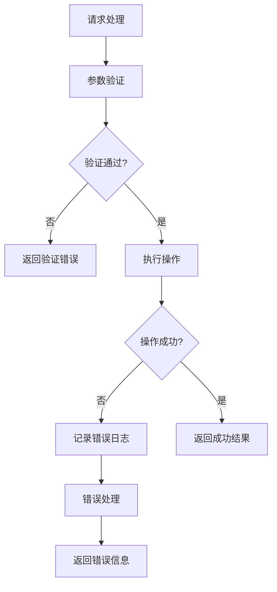

**图表来源**
- [knowledge_db.py:149-156](file://db/knowledge_db.py#L149-L156)

**章节来源**
- [knowledge_db.py:149-156](file://db/knowledge_db.py#L149-L156)
- [knowledge_db.py:317-331](file://db/knowledge_db.py#L317-L331)

## 结论

本数据库架构设计成功地将 ChromaDB 的向量搜索能力与 SQLite 的可靠存储相结合，实现了高性能、易维护的知识库系统。通过纯 Python 实现和灵活的配置管理，系统具备了良好的跨平台兼容性和扩展性。

### 主要优势

1. **技术栈简洁**：仅依赖必要的 Python 库，降低部署复杂度
2. **性能优异**：向量化操作和索引优化确保快速查询响应
3. **可靠性强**：SQLite 提供事务安全和数据完整性保障
4. **可扩展性好**：模块化设计便于功能扩展和维护

### 发展方向

未来可以在以下方面进一步优化：
- 支持更多向量数据库后端
- 实现分布式部署架构
- 增强监控和运维能力
- 优化大规模数据处理性能

## 附录

### 配置文件示例

系统支持丰富的配置选项，以下是最常用的配置示例：

```yaml
version: "1.0"
database:
  type: sqlite-onnx
  persist_dir: .knowledge_db/
  embedding_model: default

sources:
  manual_feed: true
  auto_capture: true
  cross_module_sync: true

retrieval:
  default_top_k: 5
  min_confidence: 0.05
  cross_module_top_k: 3
  rerank: false

auto_capture:
  bug_analysis:
    min_confidence: 0.80
    gate_result: [PASS, WARNING]
```

### 数据导入流程

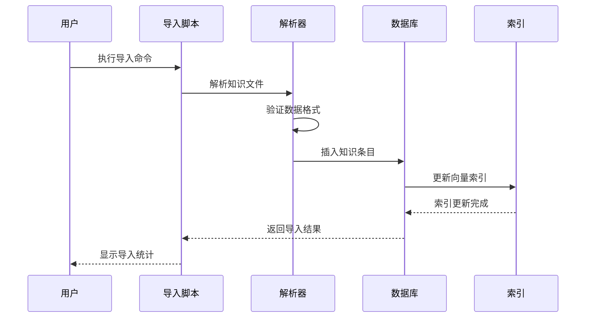

**图表来源**
- [init_knowledge_base.py:214-224](file://scripts/init_knowledge_base.py#L214-L224)