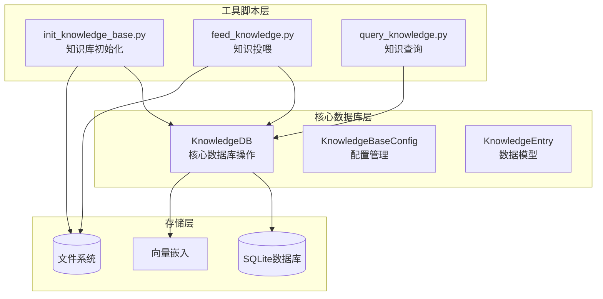
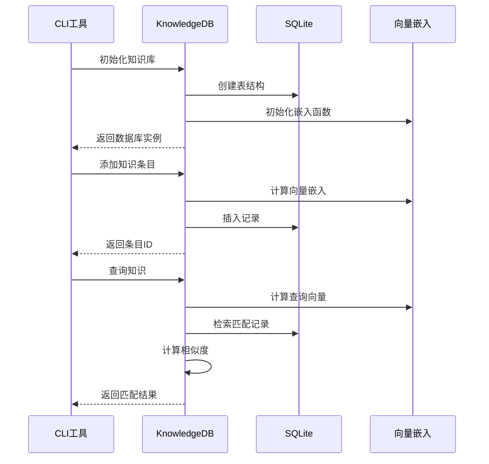
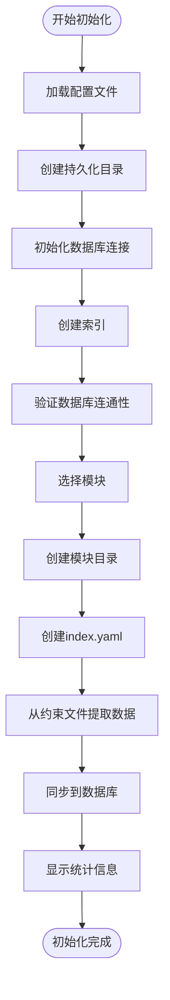
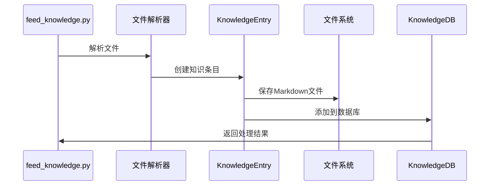
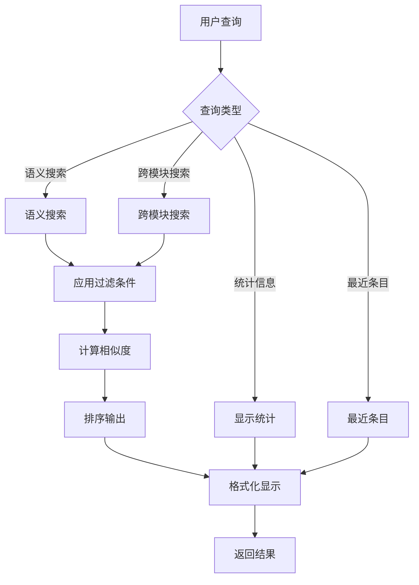
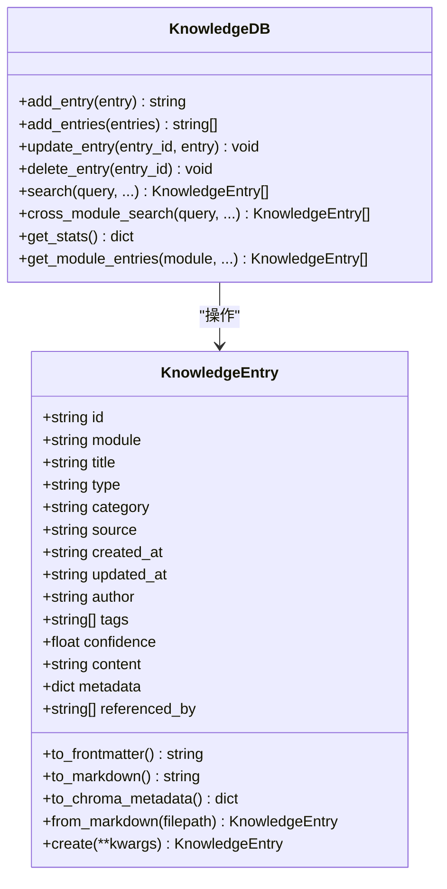
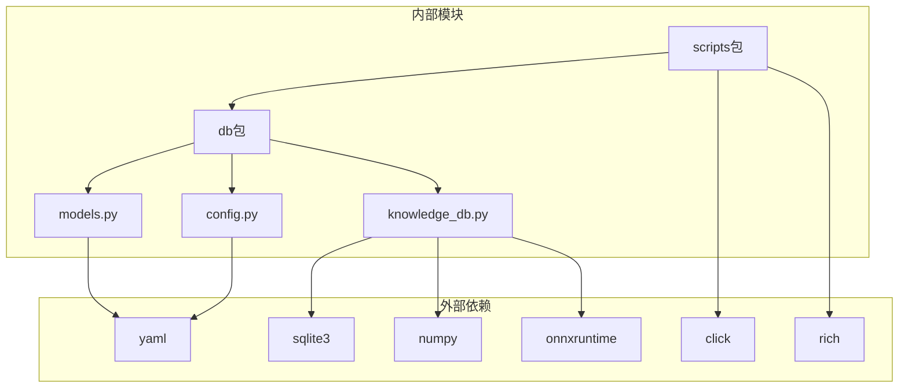

# 知识库操作接口

<cite>
**本文档引用的文件**
- [knowledge_db.py](file://db/knowledge_db.py)
- [models.py](file://db/models.py)
- [config.py](file://db/config.py)
- [init_knowledge_base.py](file://scripts/init_knowledge_base.py)
- [feed_knowledge.py](file://scripts/feed_knowledge.py)
- [query_knowledge.py](file://scripts/query_knowledge.py)
- [config.yaml](file://knowledge-base/config.yaml)
- [index.yaml](file://knowledge-base/kernel-driver/index.yaml)
- [kb-kernel-driver-20260519-2509.md](file://knowledge-base/kernel-driver/docs/kb-kernel-driver-20260519-2509.md)
</cite>

## 目录
1. [简介](#简介)
2. [项目结构](#项目结构)
3. [核心组件](#核心组件)
4. [架构概览](#架构概览)
5. [详细组件分析](#详细组件分析)
6. [依赖关系分析](#依赖关系分析)
7. [性能考虑](#性能考虑)
8. [故障排除指南](#故障排除指南)
9. [结论](#结论)

## 简介

知识库操作接口是一个基于SQLite + numpy的向量知识库系统，支持语义搜索、过滤检索和跨模块查询。该系统提供了完整的知识库生命周期管理功能，包括初始化、数据导入、查询检索和管理维护等操作。

系统采用纯Python实现，零C++依赖，兼容Windows/Linux/macOS操作系统。通过onnxruntime的DefaultEmbeddingFunction计算向量，支持中文和英文的混合检索。

## 项目结构

知识库系统主要由以下组件构成：

**图表来源**
- [knowledge_db.py:1-589](file://db/knowledge_db.py#L1-L589)
- [init_knowledge_base.py:1-246](file://scripts/init_knowledge_base.py#L1-L246)
- [feed_knowledge.py:1-320](file://scripts/feed_knowledge.py#L1-L320)

**章节来源**
- [knowledge_db.py:1-589](file://db/knowledge_db.py#L1-L589)
- [config.py:1-182](file://db/config.py#L1-L182)

## 核心组件

### KnowledgeDB类

KnowledgeDB是知识库的核心操作类，提供完整的CRUD操作和高级检索功能：

- **初始化**: 支持从配置文件加载和自定义持久化目录
- **数据操作**: 添加、更新、删除、查询知识条目
- **检索功能**: 语义搜索、跨模块搜索、标签搜索
- **统计分析**: 知识库统计、模块分布、类型分布

### KnowledgeEntry数据模型

KnowledgeEntry是知识条目的数据模型，支持多种字段类型和验证机制：

- **基础字段**: id、module、title、type、category、source
- **元数据**: created_at、updated_at、author、tags、confidence
- **内容字段**: content、metadata、referenced_by
- **验证机制**: 类型验证、范围检查、格式校验

### 配置管理系统

配置系统支持灵活的配置管理和环境适配：

- **数据库配置**: 持久化目录、数据库类型、嵌入模型
- **检索配置**: 默认返回数量、置信度阈值、重排序设置
- **来源控制**: 手动输入、自动捕获、跨模块同步

**章节来源**
- [knowledge_db.py:93-589](file://db/knowledge_db.py#L93-L589)
- [models.py:52-247](file://db/models.py#L52-L247)
- [config.py:64-182](file://db/config.py#L64-L182)

## 架构概览

系统采用分层架构设计，确保各层职责清晰、耦合度低：

**图表来源**
- [knowledge_db.py:101-127](file://db/knowledge_db.py#L101-L127)
- [knowledge_db.py:309-331](file://db/knowledge_db.py#L309-L331)
- [knowledge_db.py:375-401](file://db/knowledge_db.py#L375-L401)

## 详细组件分析

### 初始化流程

知识库初始化过程包含多个步骤，确保系统正确配置：

**图表来源**
- [init_knowledge_base.py:158-242](file://scripts/init_knowledge_base.py#L158-L242)

#### 初始化参数说明

| 参数 | 类型 | 必需 | 默认值 | 描述 |
|------|------|------|--------|------|
| --module/-m | string | 否 | None | 指定要初始化的模块名称 |
| --all | flag | 否 | False | 初始化所有已注册模块 |
| --skip-extract | flag | 否 | False | 跳过从约束文件提取知识 |

**章节来源**
- [init_knowledge_base.py:154-242](file://scripts/init_knowledge_base.py#L154-L242)

### 数据导入流程

知识投喂脚本支持多种文件格式的批量导入：

**图表来源**
- [feed_knowledge.py:210-317](file://scripts/feed_knowledge.py#L210-L317)

#### 投喂参数说明

| 参数 | 类型 | 必需 | 默认值 | 描述 |
|------|------|------|--------|------|
| --module/-m | string | 是 | None | 目标模块名称 |
| --docs | string[] | 否 | [] | 技术文档文件路径 |
| --cases | string[] | 否 | [] | 经验案例文件路径 |
| --dir | string | 否 | None | 整个目录的文件 |
| --incremental | flag | 否 | False | 增量模式 |
| --type | string | 否 | tech_doc | 条目类型 |
| --category | string | 否 | api_reference | 条目分类 |

**章节来源**
- [feed_knowledge.py:196-317](file://scripts/feed_knowledge.py#L196-L317)

### 查询检索功能

查询脚本提供多种检索方式和结果显示：

**图表来源**
- [query_knowledge.py:125-196](file://scripts/query_knowledge.py#L125-L196)

#### 查询参数说明

| 参数 | 类型 | 必需 | 默认值 | 描述 |
|------|------|------|--------|------|
| --module/-m | string | 否 | None | 指定模块过滤 |
| --query/-q | string | 否 | None | 搜索查询文本 |
| --cross-module | flag | 否 | False | 启用跨模块搜索 |
| --type | string | 否 | None | 按类型过滤 |
| --category | string | 否 | None | 按分类过滤 |
| --top-k | int | 否 | 5 | 返回结果数量 |
| --stats | flag | 否 | False | 显示统计信息 |
| --recent | int | 否 | None | 显示最近N天条目 |

**章节来源**
- [query_knowledge.py:116-196](file://scripts/query_knowledge.py#L116-L196)

### 数据模型设计

KnowledgeEntry数据模型采用严格的数据验证和灵活的序列化机制：

**图表来源**
- [models.py:52-247](file://db/models.py#L52-L247)
- [knowledge_db.py:93-589](file://db/knowledge_db.py#L93-L589)

#### 字段验证规则

| 字段 | 验证规则 | 有效值示例 |
|------|----------|------------|
| type | 必须在预定义集合中 | tech_doc, experience_case, analysis_log, correction, error_pattern |
| category | 必须在预定义集合中 | bug_analysis, code_adaptation, version_adaptation, carrier_porting, architecture, api_reference, protocol, vendor_guide |
| source | 必须在预定义集合中 | manual_feed, auto_captured, evoskill_extracted, source_analyzed |
| confidence | 必须在0.0-1.0范围内 | 0.0-1.0之间的浮点数 |

**章节来源**
- [models.py:20-81](file://db/models.py#L20-L81)
- [models.py:52-247](file://db/models.py#L52-L247)

## 依赖关系分析

系统采用松耦合的设计，各组件间依赖关系清晰：

**图表来源**
- [knowledge_db.py:101-127](file://db/knowledge_db.py#L101-L127)
- [init_knowledge_base.py:27-28](file://scripts/init_knowledge_base.py#L27-L28)

### 数据库表结构

系统使用三个核心表存储不同类型的知识条目：

| 表名 | 用途 | 主要字段 |
|------|------|----------|
| kb_knowledge | 主知识库表 | id, module, title, type, category, content, embedding |
| kb_cases | 经验案例表 | id, module, title, type, category, content, embedding |
| kb_patterns | 错误模式表 | id, module, title, type, category, content, embedding |

**章节来源**
- [knowledge_db.py:26-56](file://db/knowledge_db.py#L26-L56)
- [knowledge_db.py:158-164](file://db/knowledge_db.py#L158-L164)

## 性能考虑

### 向量检索优化

系统采用高效的向量相似度计算和索引优化策略：

- **批量相似度计算**: 使用numpy向量化操作提高计算效率
- **索引优化**: 在module、type、category字段建立复合索引
- **内存管理**: 采用WAL模式提升并发性能
- **缓存策略**: 嵌入向量二进制存储减少序列化开销

### 并发控制

系统支持多线程安全的操作：

- **连接池**: 单例数据库连接确保线程安全
- **事务管理**: 自动提交机制保证数据一致性
- **锁机制**: SQLite内置锁机制防止并发冲突

### 性能调优建议

1. **嵌入模型选择**: 根据业务需求选择合适的嵌入模型
2. **索引策略**: 为常用查询字段建立适当索引
3. **批量操作**: 使用批量插入和更新提升性能
4. **内存管理**: 定期清理不需要的中间结果

## 故障排除指南

### 常见问题及解决方案

#### 嵌入模型不可用

**问题**: onnxruntime不可用导致语义搜索降级

**解决方案**:
1. 安装推荐版本的onnxruntime
2. 验证模型文件完整性
3. 检查Python环境兼容性

#### 数据库连接失败

**问题**: 初始化时数据库连接异常

**解决方案**:
1. 检查持久化目录权限
2. 验证SQLite安装完整性
3. 确认磁盘空间充足

#### 文件解析错误

**问题**: Markdown或PDF文件解析失败

**解决方案**:
1. 检查文件编码格式
2. 验证文件完整性
3. 安装相应的解析库

### 调试技巧

1. **日志分析**: 查看系统日志定位问题根源
2. **单元测试**: 编写针对性的单元测试验证功能
3. **性能监控**: 使用性能分析工具识别瓶颈
4. **配置验证**: 定期检查配置文件的有效性

**章节来源**
- [knowledge_db.py:141-156](file://db/knowledge_db.py#L141-L156)
- [init_knowledge_base.py:144-152](file://scripts/init_knowledge_base.py#L144-L152)

## 结论

知识库操作接口提供了一个完整、高效、易用的知识管理解决方案。系统具有以下特点：

- **功能完整**: 支持知识库的全生命周期管理
- **性能优秀**: 采用向量化计算和索引优化
- **易于使用**: 提供简洁的API和丰富的工具脚本
- **扩展性强**: 模块化设计便于功能扩展

通过合理使用这些接口和工具，可以构建高效的知识管理系统，支持团队协作和知识传承。