# 知识库管理系统

<cite>
**本文引用的文件**
- [knowledge_db.py](file://db/knowledge_db.py)
- [models.py](file://db/models.py)
- [config.py](file://db/config.py)
- [config.yaml](file://knowledge-base/config.yaml)
- [init_knowledge_base.py](file://scripts/init_knowledge_base.py)
- [feed_knowledge.py](file://scripts/feed_knowledge.py)
- [query_knowledge.py](file://scripts/query_knowledge.py)
- [gate_check.py](file://scripts/gate_check.py)
- [validate_constraints.py](file://scripts/validate_constraints.py)
- [TAHP-评估与质量门禁规范.md](file://docs/TAHP-评估与质量门禁规范.md)
- [TECNO-AI-Harness-Platform-方案设计.md](file://docs/TECNO-AI-Harness-Platform-方案设计.md)
- [rilj-common-errors.yaml](file://knowledge-base/telephony/docs/rilj-common-errors.yaml)
- [index.yaml](file://knowledge-base/kernel-driver/index.yaml)
- [module.yaml](file://constraints/kernel-driver/module.yaml)
- [AGENTS.md](file://AGENTS.md)
- [优化任务.md](file://优化任务.md)
- [system-overview.md](file://docs/architecture/system-overview.md)
- [knowledge.ts](file://tahp-console/packages/client/src/api/tahp/knowledge.ts)
- [KnowledgeBaseView.vue](file://tahp-console/packages/client/src/views/tahp/KnowledgeBaseView.vue)
- [tahp-console.mjs](file://tahp-console/bin/tahp-console.mjs)
- [package.json](file://tahp-console/package.json)
- [README.md](file://tahp-console/README.md)
- [skills.ts](file://tahp-console/packages/client/src/api/hermes/skills.ts)
- [SkillsView.vue](file://tahp-console/packages/client/src/views/hermes/SkillsView.vue)
- [SkillImportModal.vue](file://tahp-console/packages/client/src/components/hermes/skills/SkillImportModal.vue)
- [context-injector.ts](file://tahp-console/packages/server/src/services/tahp/context-injector.ts)
- [query_knowledge_handler.py](file://tahp-mcp-server/handlers/query_knowledge_handler.py)
</cite>

## 更新摘要
**所做更改**
- 新增Web控制台界面，提供图形化知识库管理体验
- 增加批量导入功能，支持JSON格式批量知识条目导入
- 完善知识条目管理功能，包括新增、编辑、删除和列表管理
- 新增统计面板，实时显示知识库条目分布和更新情况
- 增强用户交互体验，提供Tab页式操作界面
- 新增tahp-console控制台服务，提供独立的Web管理界面
- **新增技能导入功能与知识库管理的深度集成**，支持从本地路径、ZIP文件等多种方式导入技能，实现知识库与技能系统的协同管理

## 目录
1. [简介](#简介)
2. [项目结构](#项目结构)
3. [核心组件](#核心组件)
4. [架构总览](#架构总览)
5. [详细组件分析](#详细组件分析)
6. [Web控制台界面](#web控制台界面)
7. [批量导入功能](#批量导入功能)
8. [知识条目管理](#知识条目管理)
9. [统计面板](#统计面板)
10. [知识库激活功能](#知识库激活功能)
11. [知识库健康度评估](#知识库健康度评估)
12. [经验沉淀与质量门禁](#经验沉淀与质量门禁)
13. [技能导入与知识库集成](#技能导入与知识库集成)
14. [依赖分析](#依赖分析)
15. [性能考虑](#性能考虑)
16. [故障排查指南](#故障排查指南)
17. [结论](#结论)
18. [附录](#附录)

## 简介
本文件面向知识库管理系统，提供从架构设计、向量嵌入配置、语义检索机制到自动捕获功能的全面技术文档。系统采用 SQLite 持久化 + ONNX 语义嵌入（默认 all-MiniLM-L6-v2，384维）实现，支持语义搜索、跨模块检索、标签过滤、模块化目录结构与Git管理的Markdown知识条目。同时，系统提供初始化、数据导入导出、统计查询与增量更新等能力，并与AI Agent交互，作为其信息来源与决策依据。

**更新** 本版本新增了Web控制台界面，提供图形化的知识库管理体验，包括语义检索、条目管理、批量导入和统计面板等功能。系统采用"配置驱动 + 数据模型 + 知识库操作 + Web控制台 + 技能导入"的分层架构，增强了用户体验和管理效率。特别地，新增的技能导入功能与知识库管理深度集成，实现了知识库与技能系统的协同管理。

## 项目结构
知识库相关的核心目录与文件如下：
- 数据模型与配置：db/models.py、db/config.py、knowledge-base/config.yaml
- 核心数据库操作：db/knowledge_db.py
- 初始化与数据导入导出脚本：scripts/init_knowledge_base.py、scripts/feed_knowledge.py、scripts/query_knowledge.py
- 质量门禁检查：scripts/gate_check.py、scripts/validate_constraints.py
- 约束验证与管理：scripts/validate_constraints.py
- 知识库健康度评估：docs/TAHP-评估与质量门禁规范.md（v3.0 新增）
- 知识库激活与追踪：优化任务.md（v3.0 新增）
- Web控制台界面：tahp-console/packages/client/src/views/tahp/KnowledgeBaseView.vue
- API接口定义：tahp-console/packages/client/src/api/tahp/knowledge.ts
- 控制台服务：tahp-console/bin/tahp-console.mjs
- 示例知识条目与索引：knowledge-base/telephony/docs/rilj-common-errors.yaml、knowledge-base/kernel-driver/index.yaml
- 约束与模块元数据：constraints/kernel-driver/module.yaml
- 平台与Agent说明：AGENTS.md
- 系统架构总览：docs/architecture/system-overview.md（v3.0 新增）
- **技能导入系统**：tahp-console/packages/client/src/views/hermes/SkillsView.vue、tahp-console/packages/client/src/components/hermes/skills/SkillImportModal.vue
- **上下文注入服务**：tahp-console/packages/server/src/services/tahp/context-injector.ts

```mermaid
graph TB
subgraph "知识库核心"
CFG["配置<br/>db/config.py"]
MODELS["数据模型<br/>db/models.py"]
KDB["知识库操作<br/>db/knowledge_db.py"]
end
subgraph "Web控制台"
WEB["控制台界面<br/>KnowledgeBaseView.vue"]
API["API接口<br/>knowledge.ts"]
CLI["控制台服务<br/>tahp-console.mjs"]
SKILLS_WEB["技能管理界面<br/>SkillsView.vue"]
SKILL_MODAL["技能导入模态框<br/>SkillImportModal.vue"]
END
subgraph "脚本工具"
INIT["初始化脚本<br/>scripts/init_knowledge_base.py"]
FEED["投喂脚本<br/>scripts/feed_knowledge.py"]
QUERY["查询脚本<br/>scripts/query_knowledge.py"]
GATE["质量门禁<br/>scripts/gate_check.py"]
VALIDATE["约束验证<br/>scripts/validate_constraints.py"]
end
subgraph "知识资产管理"
KB_DIR["知识库目录<br/>knowledge-base/"]
IDX["模块索引<br/>index.yaml"]
DOC["知识条目<br/>*.md / *.yaml"]
CONS["约束与模块元数据<br/>constraints/*"]
SKILLS_DIR["技能目录<br/>skills/"]
END
subgraph "质量保障体系"
HEALTH["健康度评估<br/>docs/TAHP-评估与质量门禁规范.md"]
TRACE["交互追踪<br/>tahp-mcp-server/tracing.py"]
HOOK["变更追溯<br/>githooks/pre-commit"]
CONTEXT["上下文注入<br/>context-injector.ts"]
END
CFG --> KDB
MODELS --> KDB
INIT --> KDB
FEED --> KDB
QUERY --> KDB
GATE --> KDB
VALIDATE --> CONS
KDB --> KB_DIR
KB_DIR --> IDX
KB_DIR --> DOC
CONS --> INIT
HEALTH --> KDB
TRACE --> QUERY
HOOK --> CONS
CONTEXT --> SKILLS_DIR
CONTEXT --> KB_DIR
WEB --> API
API --> KDB
CLI --> WEB
SKILLS_WEB --> SKILL_MODAL
SKILL_MODAL --> SKILLS_DIR
```

**图表来源**
- [config.py:1-182](file://db/config.py#L1-L182)
- [models.py:1-247](file://db/models.py#L1-L247)
- [knowledge_db.py:1-589](file://db/knowledge_db.py#L1-L589)
- [KnowledgeBaseView.vue:1-383](file://tahp-console/packages/client/src/views/tahp/KnowledgeBaseView.vue#L1-L383)
- [knowledge.ts:1-69](file://tahp-console/packages/client/src/api/tahp/knowledge.ts#L1-L69)
- [tahp-console.mjs:1-431](file://tahp-console/bin/tahp-console.mjs#L1-L431)
- [SkillsView.vue:1-31](file://tahp-console/packages/client/src/views/hermes/SkillsView.vue#L1-L31)
- [SkillImportModal.vue:1-255](file://tahp-console/packages/client/src/components/hermes/skills/SkillImportModal.vue#L1-L255)
- [context-injector.ts:270-363](file://tahp-console/packages/server/src/services/tahp/context-injector.ts#L270-L363)

**章节来源**
- [config.py:1-182](file://db/config.py#L1-L182)
- [models.py:1-247](file://db/models.py#L1-L247)
- [knowledge_db.py:1-589](file://db/knowledge_db.py#L1-L589)
- [KnowledgeBaseView.vue:1-383](file://tahp-console/packages/client/src/views/tahp/KnowledgeBaseView.vue#L1-L383)
- [knowledge.ts:1-69](file://tahp-console/packages/client/src/api/tahp/knowledge.ts#L1-L69)
- [tahp-console.mjs:1-431](file://tahp-console/bin/tahp-console.mjs#L1-L431)
- [SkillsView.vue:1-31](file://tahp-console/packages/client/src/views/hermes/SkillsView.vue#L1-L31)
- [SkillImportModal.vue:1-255](file://tahp-console/packages/client/src/components/hermes/skills/SkillImportModal.vue#L1-L255)
- [context-injector.ts:270-363](file://tahp-console/packages/server/src/services/tahp/context-injector.ts#L270-L363)

## 核心组件
- 配置管理：集中管理数据库类型、嵌入模型、检索阈值、来源开关、自动捕获策略等。
- 数据模型：统一的知识条目结构，支持Frontmatter/YAML双向转换、ChromaDB元数据兼容。
- 知识库操作：封装SQLite表结构、向量嵌入计算、语义检索、跨模块检索、统计与模块管理。
- Web控制台：提供图形化界面，支持知识库查询、条目管理、批量导入和统计查看。
- API接口：定义RESTful API，支持知识库查询、条目CRUD操作和批量导入。
- 脚本工具：初始化模块目录与索引、批量投喂知识条目、语义查询与统计展示。
- 质量门禁检查：实现P0/P1/P2三级门禁检查，确保约束文件质量和系统安全性。
- 健康度评估：提供知识库六大维度的健康度评估，支持定期检查和手动触发。
- 交互追踪：记录LLM工具调用的详细信息，支持调试和性能分析。
- 约束验证：验证约束文件的语法正确性和完整性，确保知识库质量。
- **技能导入系统**：提供多种技能导入方式，包括本地路径扫描、ZIP文件导入等，支持批量技能管理。
- **上下文注入服务**：实现知识库与技能系统的深度集成，为AI Agent提供统一的上下文信息。

**更新** 新增Web控制台界面和API接口组件，提供图形化管理和RESTful API支持，完善知识库的可视化管理能力。新增技能导入功能与知识库管理的深度集成，实现知识库与技能系统的协同管理。

**章节来源**
- [config.py:64-182](file://db/config.py#L64-L182)
- [models.py:52-247](file://db/models.py#L52-L247)
- [knowledge_db.py:93-589](file://db/knowledge_db.py#L93-L589)
- [KnowledgeBaseView.vue:1-383](file://tahp-console/packages/client/src/views/tahp/KnowledgeBaseView.vue#L1-L383)
- [knowledge.ts:1-69](file://tahp-console/packages/client/src/api/tahp/knowledge.ts#L1-L69)
- [SkillsView.vue:125-161](file://tahp-console/packages/client/src/views/hermes/SkillsView.vue#L125-L161)
- [SkillImportModal.vue:1-255](file://tahp-console/packages/client/src/components/hermes/skills/SkillImportModal.vue#L1-L255)
- [context-injector.ts:270-363](file://tahp-console/packages/server/src/services/tahp/context-injector.ts#L270-L363)

## 架构总览
系统采用"配置驱动 + 数据模型 + 知识库操作 + Web控制台 + 脚本工具 + 技能导入"的分层架构。配置文件决定嵌入模型与检索策略；数据模型负责条目结构与序列化；知识库操作负责持久化与检索；Web控制台提供图形化界面和RESTful API；脚本工具提供初始化、投喂与查询能力。知识条目以Markdown+Frontmatter形式存储于Git管理的知识库目录，同时写入SQLite数据库以支持快速检索。

**更新** 新增Web控制台和API接口层，形成完整的前后端分离架构，提供更好的用户体验和管理效率。新增技能导入功能与知识库管理的深度集成，实现知识库与技能系统的协同管理。

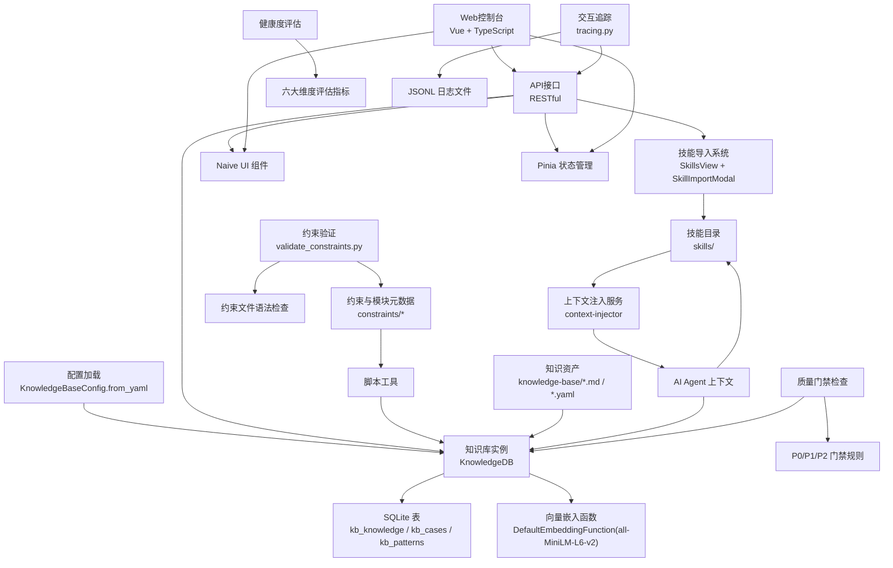

**图表来源**
- [config.py:94-162](file://db/config.py#L94-L162)
- [knowledge_db.py:101-127](file://db/knowledge_db.py#L101-L127)
- [KnowledgeBaseView.vue:1-383](file://tahp-console/packages/client/src/views/tahp/KnowledgeBaseView.vue#L1-L383)
- [knowledge.ts:1-69](file://tahp-console/packages/client/src/api/tahp/knowledge.ts#L1-L69)
- [SkillsView.vue:125-161](file://tahp-console/packages/client/src/views/hermes/SkillsView.vue#L125-L161)
- [SkillImportModal.vue:1-255](file://tahp-console/packages/client/src/components/hermes/skills/SkillImportModal.vue#L1-L255)
- [context-injector.ts:270-363](file://tahp-console/packages/server/src/services/tahp/context-injector.ts#L270-L363)

## 详细组件分析

### 组件A：知识库配置与嵌入策略
- 配置项包括数据库类型、持久化目录、嵌入模型、检索阈值、来源开关、自动捕获策略、约束提取策略等。
- 默认嵌入模型为 all-MiniLM-L6-v2（384维），通过 onnxruntime 提供；若不可用则降级为文本包含匹配。
- 检索阈值较低以支持跨语言检索，跨模块检索Top-K可单独配置。

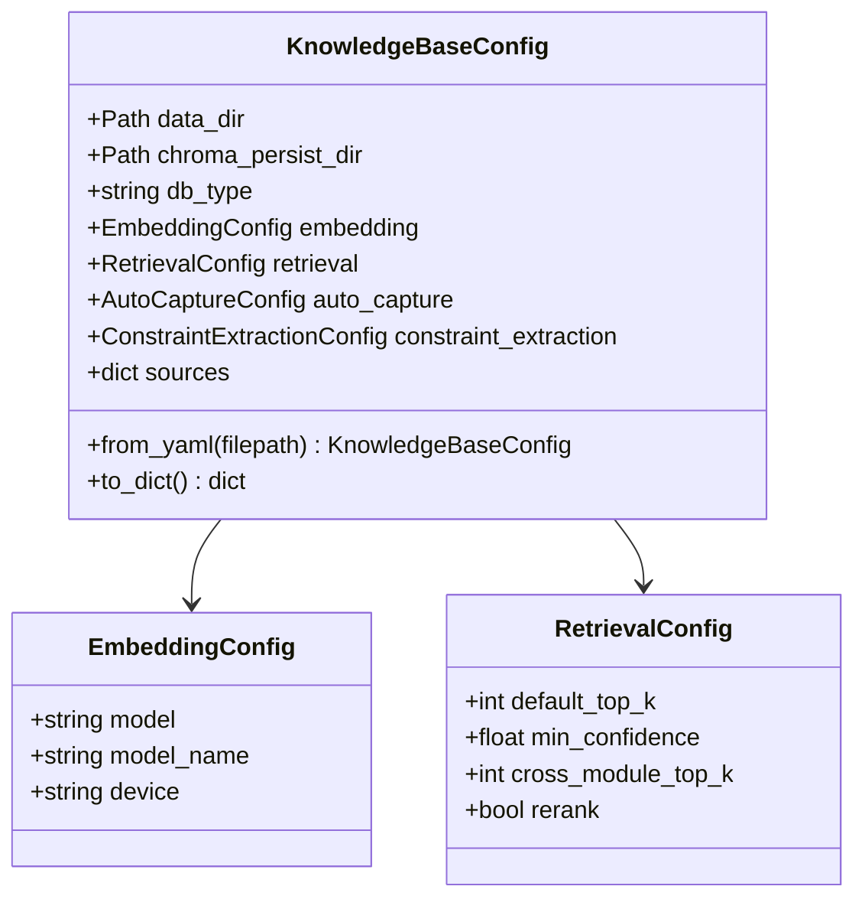

**图表来源**
- [config.py:24-86](file://db/config.py#L24-L86)
- [config.py:94-162](file://db/config.py#L94-L162)

**章节来源**
- [config.py:24-86](file://db/config.py#L24-L86)
- [config.py:94-162](file://db/config.py#L94-L162)
- [config.yaml:1-36](file://knowledge-base/config.yaml#L1-L36)

### 组件B：知识条目数据模型与序列化
- 支持 Frontmatter/YAML 双向转换，兼容 ChromaDB 元数据格式（列表/字典序列化为JSON字符串）。
- 校验字段合法性（type、category、source、confidence范围）。
- 提供从Markdown解析与导出为Markdown的能力，便于Git管理与人工审阅。

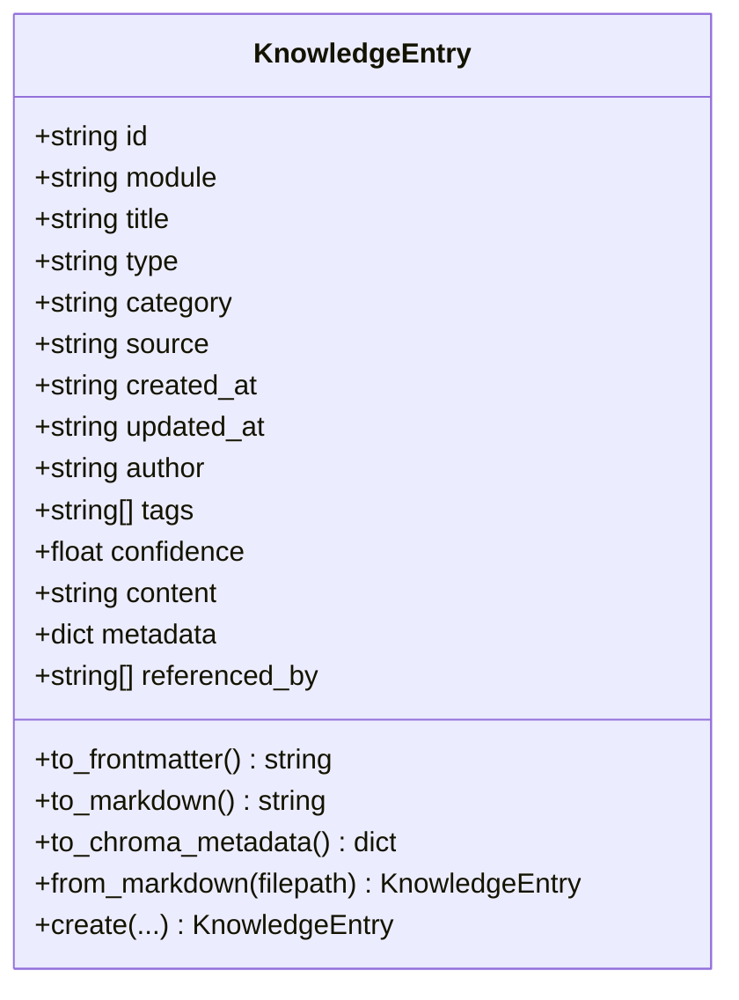

**图表来源**
- [models.py:52-247](file://db/models.py#L52-L247)

**章节来源**
- [models.py:52-247](file://db/models.py#L52-L247)

### 组件C：知识库操作与检索机制
- SQLite表结构：三张主表（kb_knowledge、kb_cases、kb_patterns），包含模块、类型、分类、来源、作者、置信度、标签、内容、额外元数据、引用关系、向量嵌入等字段；建立模块、类型、分类索引。
- 向量嵌入：使用 onnxruntime 的 DefaultEmbeddingFunction；降级模式下进行文本包含匹配。
- 检索策略：
  - 语义检索：计算查询向量，对候选条目计算余弦相似度，按置信度阈值过滤与Top-K截断。
  - 跨模块检索：排除目标模块后进行相似度排序。
  - 标签检索：先语义召回再按标签交集过滤。
  - 模块/类型/分类过滤：构建SQL WHERE条件。
- 统计与模块管理：提供按模块、类型、来源、分类的统计分布，支持删除模块全部条目。

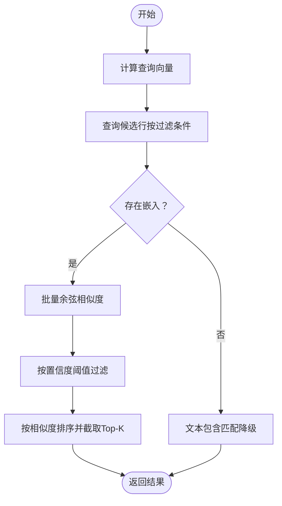

**图表来源**
- [knowledge_db.py:228-308](file://db/knowledge_db.py#L228-L308)
- [knowledge_db.py:375-401](file://db/knowledge_db.py#L375-L401)
- [knowledge_db.py:519-571](file://db/knowledge_db.py#L519-L571)

**章节来源**
- [knowledge_db.py:34-56](file://db/knowledge_db.py#L34-L56)
- [knowledge_db.py:158-164](file://db/knowledge_db.py#L158-L164)
- [knowledge_db.py:174-184](file://db/knowledge_db.py#L174-L184)
- [knowledge_db.py:228-308](file://db/knowledge_db.py#L228-L308)
- [knowledge_db.py:375-401](file://db/knowledge_db.py#L375-L401)
- [knowledge_db.py:403-432](file://db/knowledge_db.py#L403-L432)
- [knowledge_db.py:519-571](file://db/knowledge_db.py#L519-L571)

### 组件D：Web控制台界面与API
- **控制台界面**：基于Vue 3 + TypeScript + Naive UI构建，提供语义检索、条目管理、批量导入和统计面板四个主要功能区域。
- **API接口**：定义RESTful API，包括知识库查询、条目CRUD操作、批量导入和统计查询等接口。
- **用户交互**：支持Tab页式操作，提供直观的图形化界面，降低使用门槛。
- **响应式设计**：适配不同屏幕尺寸，提供良好的移动端体验。

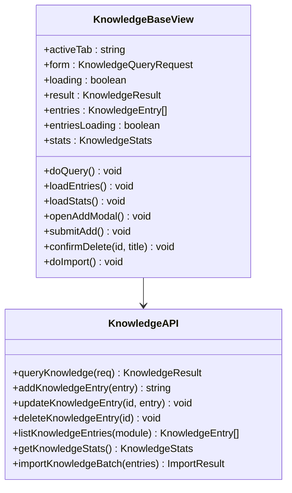

**图表来源**
- [KnowledgeBaseView.vue:1-383](file://tahp-console/packages/client/src/views/tahp/KnowledgeBaseView.vue#L1-L383)
- [knowledge.ts:1-69](file://tahp-console/packages/client/src/api/tahp/knowledge.ts#L1-L69)

**章节来源**
- [KnowledgeBaseView.vue:1-383](file://tahp-console/packages/client/src/views/tahp/KnowledgeBaseView.vue#L1-L383)
- [knowledge.ts:1-69](file://tahp-console/packages/client/src/api/tahp/knowledge.ts#L1-L69)

### 组件E：初始化流程与数据导入导出
- 初始化脚本：
  - 读取配置，创建模块目录结构与 index.yaml。
  - 从 constraints/ 提取现有约束为知识条目，写入 knowledge-base/ 并同步到知识库。
  - 验证数据库连通性，输出统计。
- 投喂脚本：
  - 支持 Markdown、PDF、Word 文档解析，生成知识条目并保存至 knowledge-base/。
  - 可指定类型与分类，支持增量模式（基于ID存在性）。
  - 更新模块 index.yaml，记录条目ID与更新时间。
- 查询脚本：
  - 支持语义搜索、跨模块搜索、按类型/分类过滤、最近条目、统计展示。

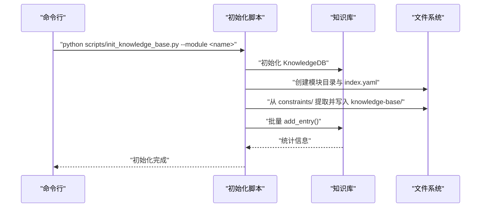

**图表来源**
- [init_knowledge_base.py:154-246](file://scripts/init_knowledge_base.py#L154-L246)
- [knowledge_db.py:309-346](file://db/knowledge_db.py#L309-L346)

**章节来源**
- [init_knowledge_base.py:33-84](file://scripts/init_knowledge_base.py#L33-L84)
- [init_knowledge_base.py:86-142](file://scripts/init_knowledge_base.py#L86-L142)
- [init_knowledge_base.py:154-246](file://scripts/init_knowledge_base.py#L154-L246)
- [feed_knowledge.py:196-320](file://scripts/feed_knowledge.py#L196-L320)
- [query_knowledge.py:116-200](file://scripts/query_knowledge.py#L116-L200)

### 组件F：自动捕获与知识更新机制
- 自动捕获配置：针对Bug分析、纠正记录、代码适配、EvoSkill提取设置最低置信度与触发条件。
- 约束提取配置：控制是否自动触发、是否需要Owner审核、置信度阈值。
- 源开关：控制 manual_feed、auto_capture、cross_module_sync 是否启用。
- 知识条目来源：manual_feed（手动）、auto_captured（自动）、evoskill_extracted、source_analyzed 等。

**更新** 新增Web控制台界面，提供图形化管理体验，支持知识库的可视化操作和监控。

**章节来源**
- [config.py:42-62](file://db/config.py#L42-L62)
- [config.py:87-93](file://db/config.py#L87-L93)
- [config.yaml:14-36](file://knowledge-base/config.yaml#L14-L36)

### 组件G：知识库与AI Agent的交互
- Agent通过MCP服务器或直接调用知识库接口进行查询，返回条目ID、标题、模块、类型、分类、置信度、相似度与内容预览。
- 置信度处理建议：高置信度（≥0.8）直接参考，中置信度（0.6-0.8）需结合约束验证，低置信度（<0.6）仅作参考。
- 平台说明：平台包含四种约束域（Bug分析、代码适配、版本适配、运营商移植），Agent基于约束与技能协作完成任务。

**更新** 新增Web控制台API接口，支持通过RESTful API与AI Agent进行集成，提供更灵活的交互方式。新增上下文注入服务，实现知识库与技能系统的深度集成。

**章节来源**
- [query_knowledge.py:116-200](file://scripts/query_knowledge.py#L116-L200)
- [knowledge_db.py:375-401](file://db/knowledge_db.py#L375-L401)
- [AGENTS.md:1-83](file://AGENTS.md#L1-L83)
- [context-injector.ts:270-363](file://tahp-console/packages/server/src/services/tahp/context-injector.ts#L270-L363)
- [query_knowledge_handler.py:1-34](file://tahp-mcp-server/handlers/query_knowledge_handler.py#L1-L34)

## Web控制台界面

### 控制台概述
tahp-console是一个基于Vue 3 + TypeScript + Naive UI构建的Web控制台，提供完整的知识库管理界面。控制台采用独立的服务进程运行，默认端口8650，支持内网团队工具的免鉴权模式。

### 主要功能区域
控制台界面采用Tab页式布局，包含以下四个主要功能区域：

#### 1. 语义检索区域
- **查询表单**：支持模块筛选、Top-K设置、跨模块检索等参数配置
- **搜索结果**：以卡片形式展示检索结果，包含标题、模块、相似度分数和内容预览
- **实时反馈**：显示匹配条数和置信度信息

#### 2. 条目管理区域
- **条目列表**：表格形式展示所有知识条目，支持模块筛选和分页显示
- **操作功能**：支持删除操作，提供确认对话框防止误删
- **刷新机制**：支持手动刷新和自动更新

#### 3. 批量导入区域
- **JSON格式**：支持粘贴符合特定格式的JSON数组
- **格式要求**：每条条目包含title、content（必填），以及可选的module、source、tags
- **导入反馈**：显示成功导入数量和失败数量

#### 4. 统计面板区域
- **总数统计**：显示知识库条目总数
- **模块分布**：按模块显示条目数量分布
- **实时更新**：自动刷新最新统计信息

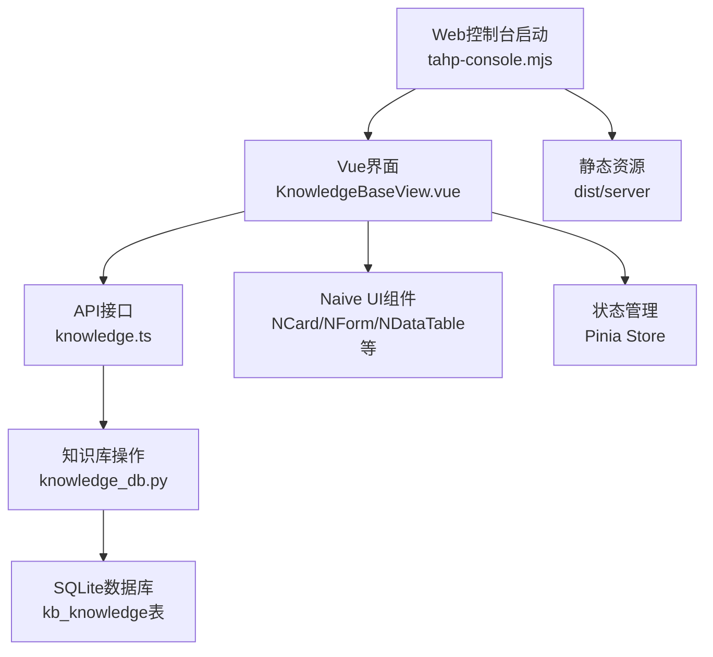

**图表来源**
- [tahp-console.mjs:1-431](file://tahp-console/bin/tahp-console.mjs#L1-L431)
- [KnowledgeBaseView.vue:1-383](file://tahp-console/packages/client/src/views/tahp/KnowledgeBaseView.vue#L1-L383)
- [knowledge.ts:1-69](file://tahp-console/packages/client/src/api/tahp/knowledge.ts#L1-L69)

**章节来源**
- [tahp-console.mjs:1-431](file://tahp-console/bin/tahp-console.mjs#L1-L431)
- [KnowledgeBaseView.vue:1-383](file://tahp-console/packages/client/src/views/tahp/KnowledgeBaseView.vue#L1-L383)
- [knowledge.ts:1-69](file://tahp-console/packages/client/src/api/tahp/knowledge.ts#L1-L69)

## 批量导入功能

### 功能概述
批量导入功能允许用户通过JSON格式一次性导入多个知识条目，提高知识库维护效率。该功能通过RESTful API实现，支持大批次的数据导入。

### JSON格式规范
批量导入支持的标准JSON格式如下：

```json
[
  {
    "title": "示例标题",
    "content": "示例内容",
    "module": "telephony",
    "source": "来源信息",
    "tags": ["标签1", "标签2"]
  },
  {
    "title": "另一个示例",
    "content": "另一段内容",
    "module": "kernel-driver"
  }
]
```

### 导入流程
1. **格式验证**：检查JSON格式是否正确，确保是数组格式
2. **字段校验**：验证必需字段（title、content）是否存在
3. **批量处理**：逐条处理知识条目，支持事务性操作
4. **结果反馈**：返回成功导入数量和失败数量

### 错误处理
- **格式错误**：JSON解析失败时返回详细错误信息
- **字段缺失**：缺少必需字段时标记为失败
- **导入失败**：数据库操作失败时记录错误并继续处理其他条目

**章节来源**
- [KnowledgeBaseView.vue:171-193](file://tahp-console/packages/client/src/views/tahp/KnowledgeBaseView.vue#L171-L193)
- [knowledge.ts:66-68](file://tahp-console/packages/client/src/api/tahp/knowledge.ts#L66-L68)

## 知识条目管理

### 管理功能
知识条目管理功能提供完整的CRUD操作，支持知识库条目的日常维护工作。

#### 新增条目
- **表单界面**：提供标题、模块、来源、内容等字段的输入界面
- **模块选择**：从模块列表中选择或清空模块
- **内容编辑**：支持Markdown格式的内容编辑
- **即时验证**：标题和内容不能为空的验证

#### 编辑条目
- **模态框编辑**：通过弹窗界面进行条目编辑
- **字段更新**：支持模块、来源、内容等字段的修改
- **状态同步**：编辑完成后自动刷新列表和统计信息

#### 删除条目
- **确认对话**：删除操作前提供确认对话框
- **不可恢复**：删除操作不可撤销，需谨慎操作
- **数据清理**：删除后自动更新统计信息

### 列表展示
条目列表采用表格形式展示，包含以下列：
- **标题**：知识条目的标题，支持省略显示
- **模块**：所属模块名称
- **来源**：知识条目来源信息
- **创建时间**：条目创建时间的本地化显示
- **操作按钮**：删除按钮，支持条目删除

### 筛选与搜索
- **模块筛选**：通过下拉菜单筛选特定模块的条目
- **分页显示**：支持每页15条记录的分页显示
- **实时刷新**：支持手动刷新和自动更新

**章节来源**
- [KnowledgeBaseView.vue:128-169](file://tahp-console/packages/client/src/views/tahp/KnowledgeBaseView.vue#L128-L169)
- [KnowledgeBaseView.vue:57-82](file://tahp-console/packages/client/src/views/tahp/KnowledgeBaseView.vue#L57-L82)
- [knowledge.ts:45-60](file://tahp-console/packages/client/src/api/tahp/knowledge.ts#L45-L60)

## 统计面板

### 统计指标
统计面板提供知识库的实时统计信息，帮助管理员了解知识库的使用状况和发展趋势。

#### 基础统计
- **知识条目总数**：显示当前知识库中知识条目的总数量
- **模块分布统计**：按模块显示条目数量分布，便于了解各模块的知识丰富程度

#### 时间信息
- **最后更新时间**：显示知识库最后更新的时间戳
- **实时刷新**：支持手动刷新获取最新的统计信息

### 展示方式
统计信息采用卡片式布局，每个模块对应一个统计卡片，提供直观的数量展示。总数卡片显示整体统计，模块卡片显示各模块的详细分布。

### 更新机制
统计信息支持手动刷新和自动更新，确保管理员能够及时了解知识库的最新状态。统计信息的更新不会影响知识库的正常查询功能。

**章节来源**
- [KnowledgeBaseView.vue:217-229](file://tahp-console/packages/client/src/views/tahp/KnowledgeBaseView.vue#L217-L229)
- [KnowledgeBaseView.vue:117-126](file://tahp-console/packages/client/src/views/tahp/KnowledgeBaseView.vue#L117-L126)
- [knowledge.ts:62](file://tahp-console/packages/client/src/api/tahp/knowledge.ts#L62)

## 知识库激活功能

### 激活目标与对标系统
知识库激活功能的目标是将知识库从"空壳"状态转变为"可用系统"，对标LogInsight的Wiki知识模块和LLM交互追踪能力。通过基准数据填充、约束文件变更追溯、LLM交互追踪等机制，实现知识库的完整激活。

### 基准数据填充流程
系统通过Step 3-1实现知识库的基准数据填充：

1. **创建示例知识条目**：为telephony模块创建包含常见错误模式、API使用和流程分析的知识条目
2. **使用投喂脚本导入**：通过`scripts/feed_knowledge.py`将示例条目导入知识库
3. **验证查询功能**：通过`scripts/query_knowledge.py`验证知识库查询功能正常

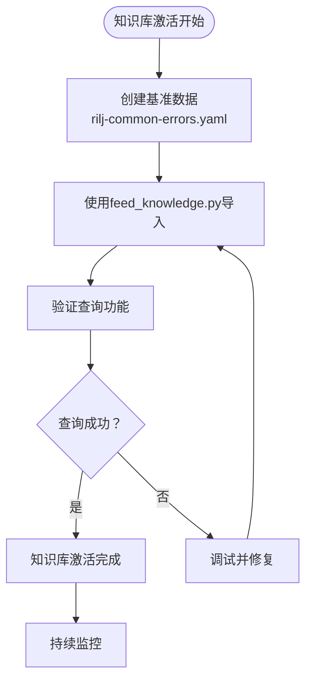

**图表来源**
- [优化任务.md:600-644](file://优化任务.md#L600-L644)
- [rilj-common-errors.yaml:1-36](file://knowledge-base/telephony/docs/rilj-common-errors.yaml#L1-L36)

### 约束文件变更追溯机制
通过Step 3-2建立约束文件变更的完整追溯机制：

1. **changelog字段**：在每个约束YAML的metadata段增加changelog字段
2. **Git Hook集成**：实现pre-commit hook，在提交时强制要求更新changelog
3. **自动化验证**：确保每次约束文件变更都有对应的变更记录

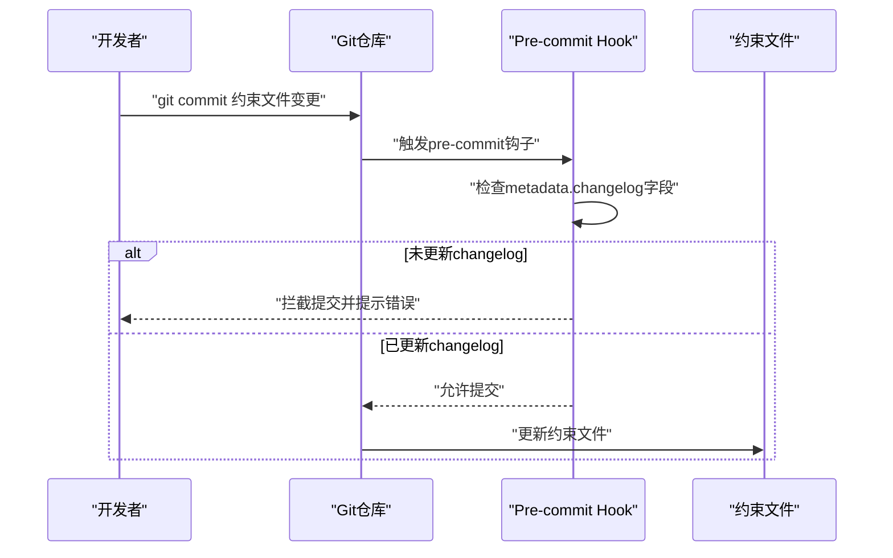

**图表来源**
- [优化任务.md:648-682](file://优化任务.md#L648-L682)

### LLM交互追踪日志
通过Step 3-3实现LLM工具调用的完整追踪：

1. **追踪模块设计**：新增`tahp-mcp-server/tracing.py`模块
2. **日志格式规范**：记录工具名称、参数摘要、耗时、结果状态
3. **存储结构**：输出为JSONL格式到`reports/traces/`目录
4. **文件命名**：每个分析任务生成独立的日志文件

**章节来源**
- [优化任务.md:600-694](file://优化任务.md#L600-L694)
- [rilj-common-errors.yaml:1-36](file://knowledge-base/telephony/docs/rilj-common-errors.yaml#L1-L36)

## 知识库健康度评估

### 评估维度与指标
知识库健康度评估是v3.0版本新增的重要功能，旨在定期检查知识库的质量和有效性。评估体系包含六大核心维度：

| 维度 | 指标 | 目标值 | 检查方式 |
|------|------|--------|---------|
| **覆盖率** | 已接入模块的知识条目数 | ≥20条/模块 | 知识库统计报告 |
| **增长性** | 本周新增知识条目 vs 上周 | 正增长 | Git log + SQLite KB |
| **利用率** | 知识条目被引用(检索命中)的比例 | ≥60% | SQLite KB query log |
| **质量** | 高置信度(≥0.8)条目占比 | ≥70% | 置信度统计 |
| **时效性** | 最近30天有更新的条目占比 | ≥30% | updated_at 字段 |
| **沉淀率** | 执行任务后自动沉淀成功率 | ≥80% | 沉淀触发日志 |

### 健康度评估命令
系统提供了专门的健康度评估命令，支持多种检查模式：

```bash
# 查看模块知识库统计报告
python scripts/knowledge_stats.py --module {module}

# 查看全量统计报告
python scripts/knowledge_stats.py --all

# 触发知识库健康检查
python scripts/knowledge_stats.py --health-check
```

### 评估流程
健康度评估采用自动化流程，定期检查知识库的各项指标，确保知识库的持续健康发展：


**章节来源**
- [TAHP-评估与质量门禁规范.md:32-44](file://docs/TAHP-评估与质量门禁规范.md#L32-L44)
- [TAHP-评估与质量门禁规范.md:410-424](file://docs/TAHP-评估与质量门禁规范.md#L410-L424)

## 经验沉淀与质量门禁

### 经验沉淀质量门禁
每次执行任务后，系统会自动检查知识沉淀状态，确保沉淀的知识质量：

| 检查项 | 级别 | 条件 | 处理方式 |
|--------|------|------|---------|
| 沉淀完整性 | P1 | Bug分析后必须生成案例 | 自动补充缺失字段 |
| 置信度校验 | P2 | 新沉淀条目置信度 ≥0.6 | 低于阈值标记为 draft |
| 去重检查 | P2 | 与已有条目相似度 <0.9 | 相似条目合并提示 |
| 标签完整性 | P2 | 至少有 2 个标签 | 自动补充标签 |

### 知识提取门禁
从知识库自动提取约束时的质量检查：

| 检查项 | 级别 | 条件 | 处理方式 |
|--------|------|------|---------|
| 约束完整性 | P0 | 覆盖4种domain的必填字段 | 不完整则不生成Skill |
| 约束一致性 | P1 | 规则之间无矛盾 | 标记矛盾并要求Owner处理 |
| 约束具体性 | P1 | 无模糊描述 | 标记模糊规则 |
| 提取置信度 | P0 | 整体置信度 ≥0.75 | 低于阈值不自动生效 |

### 质量门禁检查
系统还提供通用的质量门禁检查功能，确保约束文件的质量：

```bash
# 检查门禁
python scripts/gate-check.py --module telephony --level P0
```

质量门禁分为三个级别：
- **P0 - 必须通过**：任一失败即BLOCK，如编译检查、Scope合规、安全红线、API真实性
- **P1 - 应当通过**：累计超过阈值则WARNING，如编码风格、新增Lint错误、废弃API使用
- **P2 - 建议通过**：记录但不阻塞，如代码复杂度、重复代码、注释覆盖率

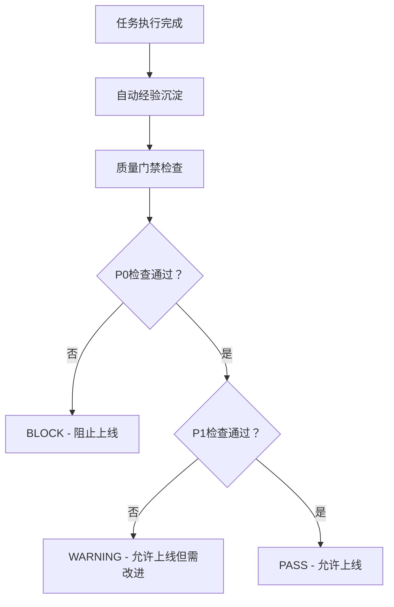

**章节来源**
- [TAHP-评估与质量门禁规范.md:386-424](file://docs/TAHP-评估与质量门禁规范.md#L386-L424)
- [gate_check.py:1-507](file://scripts/gate_check.py#L1-L507)
- [TECNO-AI-Harness-Platform-方案设计.md:790](file://docs/TECNO-AI-Harness-Platform-方案设计.md#L790)

## 技能导入与知识库集成

### 技能导入系统概述
技能导入系统是v3.0版本新增的重要功能，旨在实现知识库与技能管理的深度集成。系统提供多种导入方式，支持批量技能管理，为AI Agent提供丰富的上下文信息。

### 主要功能特性
- **多源导入**：支持本地路径扫描、ZIP文件导入、单个技能导入等多种方式
- **智能分类**：自动识别技能目录结构，按父目录名称进行分类
- **冲突处理**：支持覆盖导入，自动处理已存在技能的冲突
- **批量管理**：提供预览功能，支持批量导入和跳过操作
- **状态跟踪**：详细记录导入过程中的成功、跳过和失败情况

### 技能导入流程
1. **模式选择**：用户选择导入方式（本地路径或ZIP文件）
2. **路径扫描**：系统扫描指定目录，识别包含SKILL.md的技能目录
3. **预览确认**：显示待导入技能列表，支持批量选择
4. **执行导入**：根据用户选择执行导入操作
5. **结果反馈**：显示导入统计和错误详情

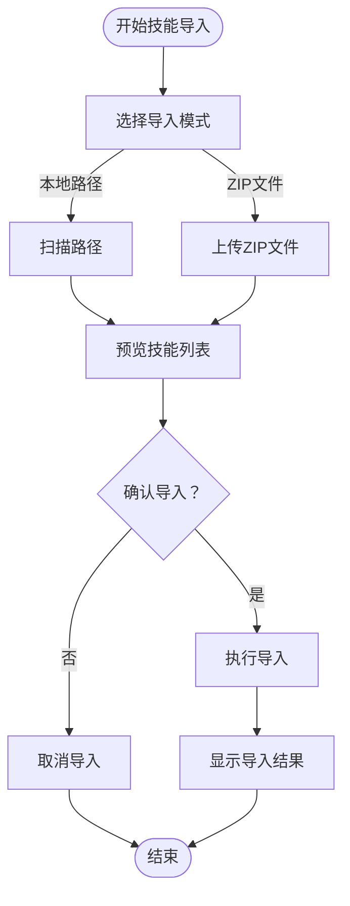

**图表来源**
- [SkillImportModal.vue:217-255](file://tahp-console/packages/client/src/components/hermes/skills/SkillImportModal.vue#L217-L255)
- [skills.ts:145-184](file://tahp-console/packages/client/src/api/hermes/skills.ts#L145-L184)

### 技能导入API接口
系统提供完整的技能导入API接口，支持前端组件调用：

- **POST /api/hermes/skills/preview-import** - 预览ZIP文件中的技能列表
- **POST /api/hermes/skills/import** - 执行技能导入操作
- **POST /api/hermes/skills/import-from-path** - 从本地路径导入技能

### 上下文注入与集成
技能导入功能与知识库管理的深度集成体现在：

1. **统一上下文**：上下文注入服务同时扫描技能目录和知识库，为AI Agent提供统一的上下文信息
2. **协同检索**：AI Agent可以同时检索技能和知识库内容，实现更丰富的问答能力
3. **状态同步**：技能导入状态与知识库统计信息同步更新

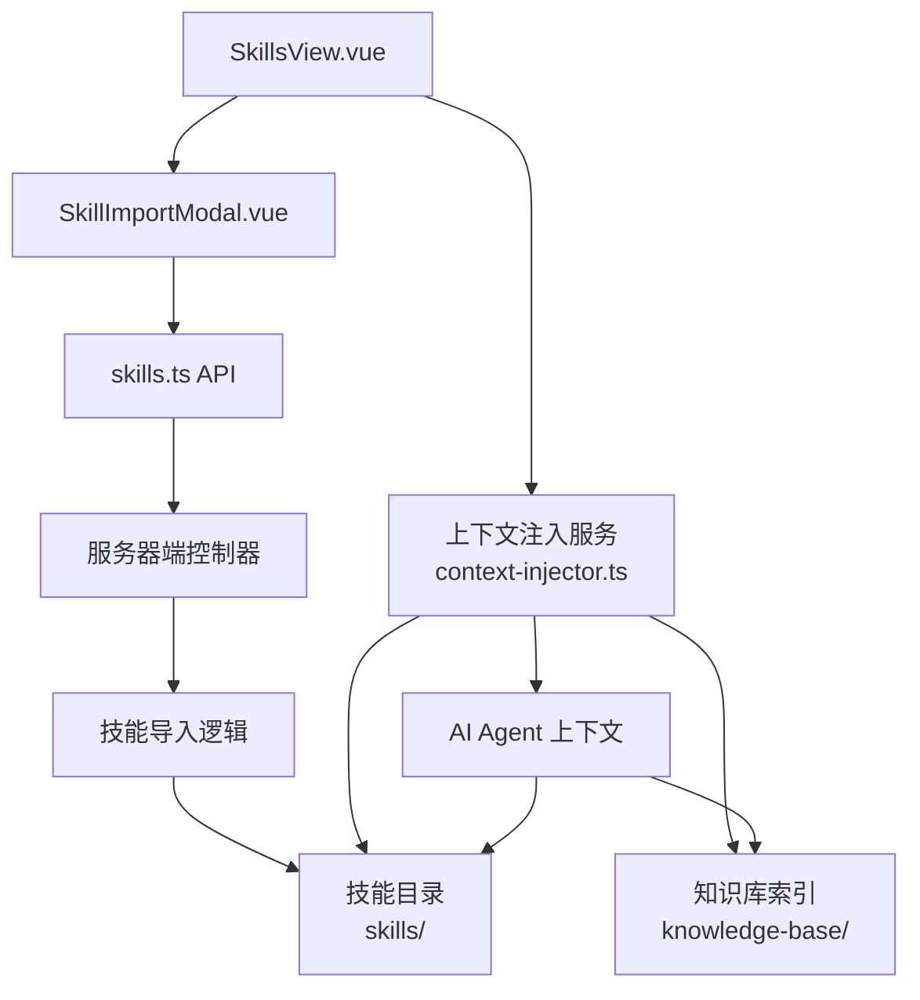

**图表来源**
- [SkillsView.vue:125-161](file://tahp-console/packages/client/src/views/hermes/SkillsView.vue#L125-L161)
- [SkillImportModal.vue:1-255](file://tahp-console/packages/client/src/components/hermes/skills/SkillImportModal.vue#L1-L255)
- [skills.ts:145-184](file://tahp-console/packages/client/src/api/hermes/skills.ts#L145-L184)
- [context-injector.ts:270-363](file://tahp-console/packages/server/src/services/tahp/context-injector.ts#L270-L363)

**章节来源**
- [SkillsView.vue:125-161](file://tahp-console/packages/client/src/views/hermes/SkillsView.vue#L125-L161)
- [SkillImportModal.vue:1-255](file://tahp-console/packages/client/src/components/hermes/skills/SkillImportModal.vue#L1-L255)
- [skills.ts:145-184](file://tahp-console/packages/client/src/api/hermes/skills.ts#L145-L184)
- [context-injector.ts:270-363](file://tahp-console/packages/server/src/services/tahp/context-injector.ts#L270-L363)

## 依赖分析
- 组件耦合：
  - KnowledgeDB 依赖 KnowledgeBaseConfig 与 KnowledgeEntry。
  - Web控制台依赖API接口和知识库操作。
  - API接口依赖知识库操作和数据模型。
  - 脚本工具依赖 KnowledgeDB 与 KnowledgeEntry。
  - 知识条目依赖 YAML/JSON 序列化。
  - 质量门禁检查依赖约束文件和配置文件。
  - 健康度评估依赖知识库统计数据和Git日志。
  - 交互追踪依赖MCP服务器和日志文件系统。
  - 约束验证依赖YAML解析和正则表达式。
  - **技能导入系统**依赖前端组件和服务器端控制器。
  - **上下文注入服务**依赖技能目录和知识库索引。
- 外部依赖：
  - onnxruntime（用于 DefaultEmbeddingFunction）。
  - chromadb（仅用于嵌入函数，不直接依赖其存储层）。
  - Vue 3 + TypeScript + Naive UI（用于Web控制台）。
  - Koa（用于API服务）。
  - rich/click/yaml/toml 等运行时依赖。

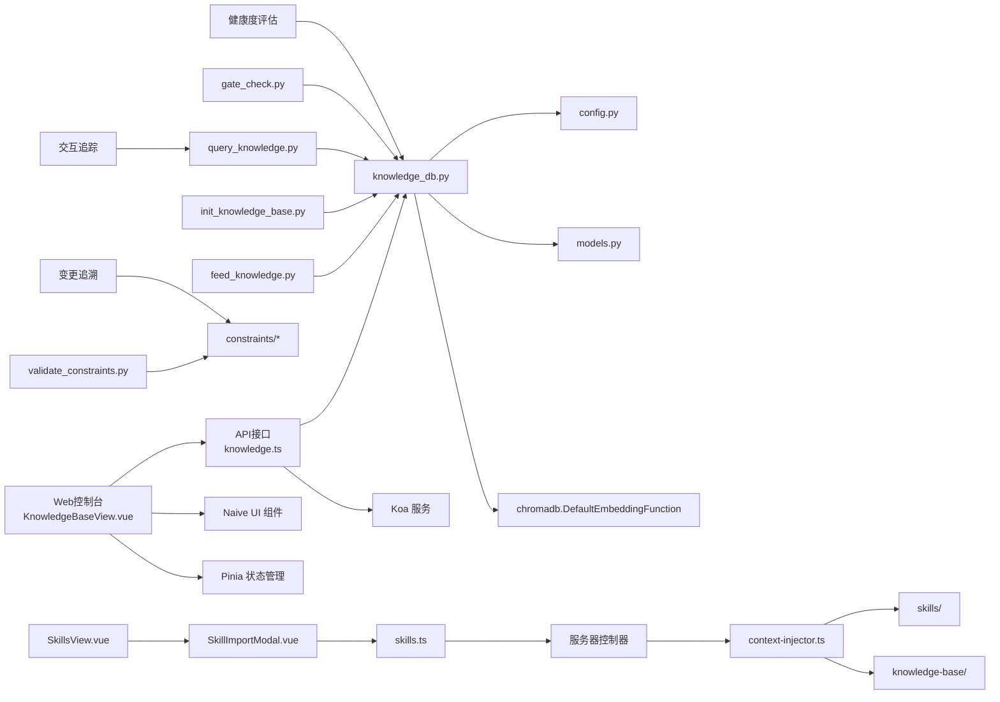

**图表来源**
- [KnowledgeBaseView.vue:1-383](file://tahp-console/packages/client/src/views/tahp/KnowledgeBaseView.vue#L1-L383)
- [knowledge.ts:1-69](file://tahp-console/packages/client/src/api/tahp/knowledge.ts#L1-L69)
- [knowledge_db.py:101-127](file://db/knowledge_db.py#L101-L127)
- [SkillsView.vue:125-161](file://tahp-console/packages/client/src/views/hermes/SkillsView.vue#L125-L161)
- [SkillImportModal.vue:1-255](file://tahp-console/packages/client/src/components/hermes/skills/SkillImportModal.vue#L1-L255)
- [skills.ts:145-184](file://tahp-console/packages/client/src/api/hermes/skills.ts#L145-L184)
- [context-injector.ts:270-363](file://tahp-console/packages/server/src/services/tahp/context-injector.ts#L270-L363)

**章节来源**
- [KnowledgeBaseView.vue:1-383](file://tahp-console/packages/client/src/views/tahp/KnowledgeBaseView.vue#L1-L383)
- [knowledge.ts:1-69](file://tahp-console/packages/client/src/api/tahp/knowledge.ts#L1-L69)
- [knowledge_db.py:101-127](file://db/knowledge_db.py#L101-L127)
- [SkillsView.vue:125-161](file://tahp-console/packages/client/src/views/hermes/SkillsView.vue#L125-L161)
- [SkillImportModal.vue:1-255](file://tahp-console/packages/client/src/components/hermes/skills/SkillImportModal.vue#L1-L255)
- [skills.ts:145-184](file://tahp-console/packages/client/src/api/hermes/skills.ts#L145-L184)
- [context-injector.ts:270-363](file://tahp-console/packages/server/src/services/tahp/context-injector.ts#L270-L363)

## 性能考虑
- 向量计算：默认模型为 all-MiniLM-L6-v2（384维），适合CPU环境；若部署在GPU资源充足场景，可考虑更高维度模型以提升精度。
- 检索效率：SQLite建立模块/类型/分类索引；相似度计算采用批量矩阵运算，注意内存占用与Top-K截断。
- 降级策略：嵌入不可用时自动切换文本包含匹配，保证基本检索能力。
- I/O优化：知识条目以Markdown文件存储，便于Git版本管理与增量更新；批量导入时建议分批提交以减少事务开销。
- Web控制台性能：Vue组件采用懒加载和虚拟滚动，支持大数据量的表格展示；API请求采用防抖和节流机制。
- API服务优化：Koa中间件采用异步处理，支持并发请求；数据库连接池优化查询性能。
- 健康度评估：定期评估可能增加系统负载，建议合理设置评估频率和并发度。
- 交互追踪：JSONL日志写入可能影响I/O性能，建议异步写入和合理的日志轮转策略。
- 约束验证：大规模约束文件验证可能消耗较多CPU资源，建议并行处理和缓存机制。
- **技能导入性能**：大量技能文件的扫描和导入可能消耗较多I/O资源，建议合理设置扫描深度和并发度。
- **上下文注入优化**：技能和知识库的索引扫描可能影响系统性能，建议异步处理和缓存机制。

**更新** 新增Web控制台和API服务的性能考虑，确保图形化界面和RESTful API的高效运行。新增技能导入和上下文注入的性能优化建议。

## 故障排查指南
- 嵌入不可用：
  - 现象：日志提示嵌入不可用并降级。
  - 处理：安装 onnxruntime==1.20.1 后重启服务。
- 数据库连通性失败：
  - 现象：初始化或查询时报错。
  - 处理：检查持久化目录权限与磁盘空间，确认SQLite WAL模式与外键开启。
- 查询结果为空：
  - 现象：语义检索无结果。
  - 处理：降低 min_confidence 阈值或使用跨模块检索；检查索引与过滤条件。
- 投喂失败：
  - 现象：部分文件解析失败或被跳过。
  - 处理：确认文件格式支持（PDF/Word需相应库），检查内容是否为空；查看控制台输出的失败原因。
- Web控制台启动失败：
  - 现象：控制台无法启动或页面无法访问。
  - 处理：检查端口占用情况，确认Node.js版本要求，查看控制台日志文件。
- API接口调用失败：
  - 现象：RESTful API返回错误或超时。
  - 处理：检查网络连接，确认API路径正确，查看服务器端错误日志。
- 批量导入失败：
  - 现象：JSON格式错误或部分条目导入失败。
  - 处理：检查JSON格式规范，验证必需字段完整性，查看错误详情。
- 健康度评估异常：
  - 现象：健康度评估结果不准确或超时。
  - 处理：检查Git日志访问权限，确认数据库连接正常，适当调整评估频率。
- 质量门禁检查失败：
  - 现象：P0门禁检查失败阻止系统上线。
  - 处理：根据门禁检查结果逐项修复，确保所有P0检查项通过。
- 交互追踪失败：
  - 现象：LLM工具调用日志未生成或格式异常。
  - 处理：检查tracing.py模块的文件权限，确认reports/traces/目录可写，验证JSONL格式正确性。
- 约束文件变更被拦截：
  - 现象：git commit被pre-commit hook拦截。
  - 处理：在metadata段添加changelog字段，记录变更原因和详细说明。
- **技能导入失败**：
  - 现象：技能导入过程中出现错误或部分技能导入失败。
  - 处理：检查技能目录权限，确认ZIP文件格式正确，验证SKILL.md文件完整性，查看导入错误详情。
- **上下文注入异常**：
  - 现象：AI Agent无法获取技能或知识库上下文信息。
  - 处理：检查上下文注入服务日志，确认技能目录和知识库目录可访问，验证索引文件完整性。

**更新** 新增Web控制台和API接口相关的故障排查指导，帮助用户解决图形化界面使用中的问题。新增技能导入和上下文注入相关的故障排查指导。

**章节来源**
- [knowledge_db.py:141-156](file://db/knowledge_db.py#L141-L156)
- [tahp-console.mjs:196-312](file://tahp-console/bin/tahp-console.mjs#L196-L312)
- [KnowledgeBaseView.vue:171-193](file://tahp-console/packages/client/src/views/tahp/KnowledgeBaseView.vue#L171-L193)
- [SkillImportModal.vue:1-255](file://tahp-console/packages/client/src/components/hermes/skills/SkillImportModal.vue#L1-L255)
- [context-injector.ts:270-363](file://tahp-console/packages/server/src/services/tahp/context-injector.ts#L270-L363)

## 结论
本知识库管理系统以配置驱动为核心，结合SQLite与ONNX嵌入实现轻量、可移植且具备语义检索能力的知识管理方案。通过标准化的数据模型与脚本工具链，实现了从初始化、投喂、查询到统计的完整闭环；同时为AI Agent提供可靠的信息来源与交互接口，支撑多引擎（诊断/适配）的自动化工作流。

**更新** v3.0版本通过知识库激活功能，实现了从空壳到可用系统的完整转变，新增的Web控制台界面、批量导入功能、知识条目管理等特性，进一步完善了知识库的可视化管理和操作体验。新增的健康度评估体系、经验沉淀质量门禁机制、交互追踪和约束验证功能，形成了从知识获取、质量控制到经验沉淀的完整闭环。特别地，新增的技能导入功能与知识库管理深度集成，实现了知识库与技能系统的协同管理，为AI系统的持续优化和知识积累提供了坚实基础。

## 附录

### A. 知识条目存储结构与索引
- 表结构字段：id、module、title、type、category、source、created_at、updated_at、author、confidence、tags、content、extra_metadata、referenced_by、embedding。
- 索引：idx_kb_knowledge_module、idx_kb_knowledge_type、idx_kb_knowledge_category。
- 向量存储：二进制浮点32位数组，按384维存储。

**章节来源**
- [knowledge_db.py:34-56](file://db/knowledge_db.py#L34-L56)
- [knowledge_db.py:59-67](file://db/knowledge_db.py#L59-L67)

### B. Web控制台技术栈
- **前端框架**：Vue 3 + TypeScript + Vite
- **UI组件库**：Naive UI（基于Vue 3的桌面端组件库）
- **状态管理**：Pinia（Vue官方推荐的状态管理库）
- **路由管理**：Vue Router
- **HTTP客户端**：Axios
- **构建工具**：Vite + Vue CLI插件
- **样式处理**：SCSS + CSS Modules
- **开发工具**：TypeScript + ESLint + Prettier

**章节来源**
- [package.json:23-106](file://tahp-console/package.json#L23-L106)

### C. API接口规范
Web控制台提供完整的RESTful API接口，支持知识库的完整操作：

- **GET /api/tahp/knowledge/query** - 知识库查询接口
- **POST /api/tahp/knowledge/entries** - 新增知识条目接口  
- **PUT /api/tahp/knowledge/entries/:id** - 更新知识条目接口
- **DELETE /api/tahp/knowledge/entries/:id** - 删除知识条目接口
- **GET /api/tahp/knowledge/entries** - 获取知识条目列表接口
- **GET /api/tahp/knowledge/stats** - 获取统计信息接口
- **POST /api/tahp/knowledge/import** - 批量导入接口

**章节来源**
- [knowledge.ts:41-68](file://tahp-console/packages/client/src/api/tahp/knowledge.ts#L41-L68)

### D. 示例知识条目与索引
- 示例条目：包含模块元数据、标签、来源、内容等字段。
- 模块索引：记录模块版本、更新时间与各子目录（docs/cases/auto）的条目ID列表。

**章节来源**
- [rilj-common-errors.yaml:1-36](file://knowledge-base/telephony/docs/rilj-common-errors.yaml#L1-L36)
- [index.yaml:1-8](file://knowledge-base/kernel-driver/index.yaml#L1-L8)
- [module.yaml:1-30](file://constraints/kernel-driver/module.yaml#L1-L30)

### E. 查询接口使用方法与最佳实践
- 基本查询：指定模块、类型、分类与Top-K，返回带相似度与置信度的结果。
- 跨模块查询：排除目标模块，扩大知识覆盖面。
- Web控制台查询：通过图形化界面进行查询，支持实时结果展示。
- 最佳实践：
  - 合理设置 min_confidence 以平衡召回与精度。
  - 使用标签检索进行细粒度筛选。
  - 定期清理旧条目与冗余内容，保持索引有效性。

**章节来源**
- [query_knowledge.py:116-200](file://scripts/query_knowledge.py#L116-L200)
- [knowledge_db.py:375-401](file://db/knowledge_db.py#L375-L401)
- [knowledge_db.py:519-571](file://db/knowledge_db.py#L519-L571)

### F. Web控制台使用指南
- **启动控制台**：执行 `tahp-console start` 命令启动服务
- **访问界面**：打开浏览器访问 `http://localhost:8650`
- **基本操作**：
  - 语义检索：在查询框输入关键词，选择模块和Top-K参数
  - 条目管理：在管理标签页查看和管理知识条目
  - 批量导入：在导入标签页粘贴JSON格式数据
  - 统计查看：在统计标签页查看知识库分布

**章节来源**
- [tahp-console.mjs:354-424](file://tahp-console/bin/tahp-console.mjs#L354-L424)
- [README.md:154-204](file://tahp-console/README.md#L154-L204)

### G. 健康度评估最佳实践
- 定期评估：建议每周进行一次全面健康度评估，每日进行基础指标检查。
- 指标监控：重点关注覆盖率和沉淀率的变化趋势，及时发现知识库建设问题。
- 持续改进：根据评估结果制定改进计划，优先解决P0级别的健康度问题。
- 自动化集成：将健康度评估集成到CI/CD流程中，确保知识库质量的持续提升。

**更新** 新增Web控制台使用指南和健康度评估最佳实践指导。

**章节来源**
- [TAHP-评估与质量门禁规范.md:32-44](file://docs/TAHP-评估与质量门禁规范.md#L32-L44)
- [TAHP-评估与质量门禁规范.md:410-424](file://docs/TAHP-评估与质量门禁规范.md#L410-L424)

### H. 知识库激活最佳实践
- 基准数据选择：优先选择具有代表性的示例数据，确保覆盖主要使用场景。
- 变更追溯实施：确保团队成员理解并遵守changelog记录要求。
- 交互追踪配置：合理设置日志级别和存储位置，避免影响系统性能。
- 质量门禁执行：建立定期的质量门禁检查机制，确保知识库持续保持高质量。
- Web控制台部署：建议在内网环境中部署，充分利用免鉴权模式的优势。

**更新** 新增知识库激活的最佳实践指导，包括Web控制台部署建议。

**章节来源**
- [优化任务.md:600-694](file://优化任务.md#L600-L694)

### I. 技能导入系统最佳实践
- **导入策略**：建议定期批量导入技能，避免频繁的小规模导入操作。
- **路径扫描**：合理设置扫描深度，避免扫描过多无关文件影响性能。
- **冲突处理**：启用覆盖导入前先进行备份，确保重要数据不丢失。
- **监控告警**：建立导入失败的监控告警机制，及时发现和处理导入问题。
- **版本管理**：对导入的技能进行版本管理，支持回滚和升级操作。

**更新** 新增技能导入系统的最佳实践指导。

**章节来源**
- [SkillImportModal.vue:1-255](file://tahp-console/packages/client/src/components/hermes/skills/SkillImportModal.vue#L1-L255)
- [skills.ts:145-184](file://tahp-console/packages/client/src/api/hermes/skills.ts#L145-L184)
- [context-injector.ts:270-363](file://tahp-console/packages/server/src/services/tahp/context-injector.ts#L270-L363)