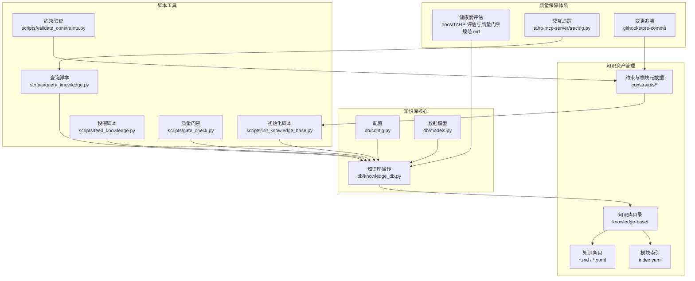
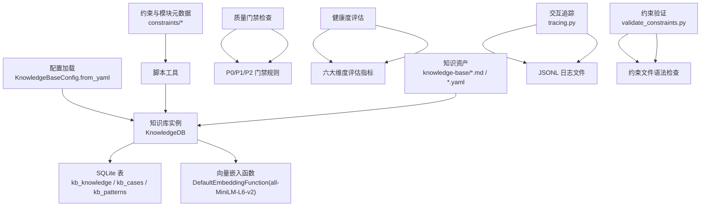
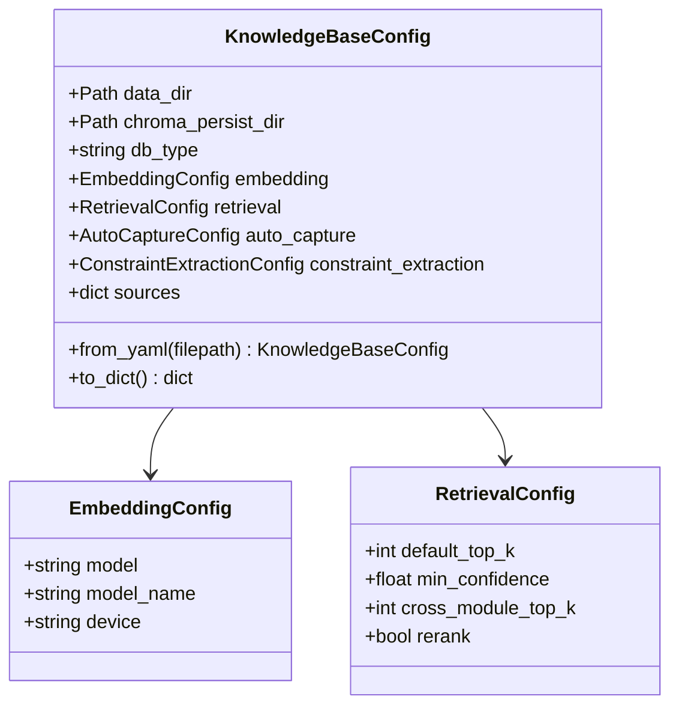
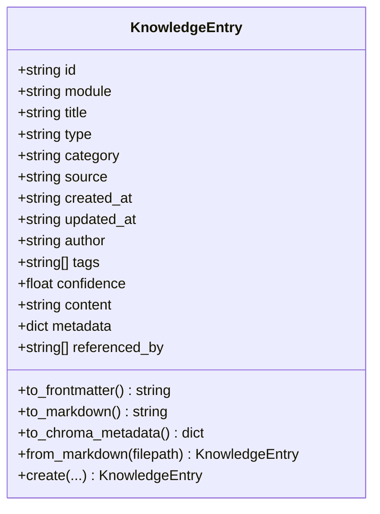
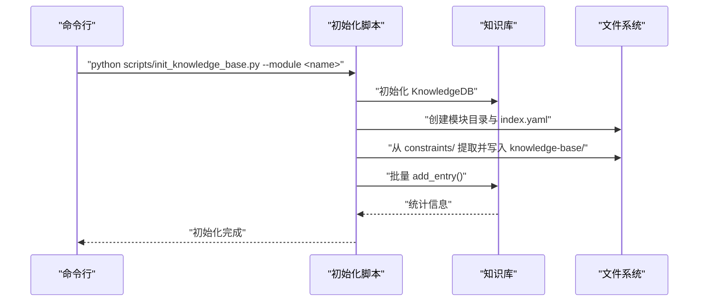
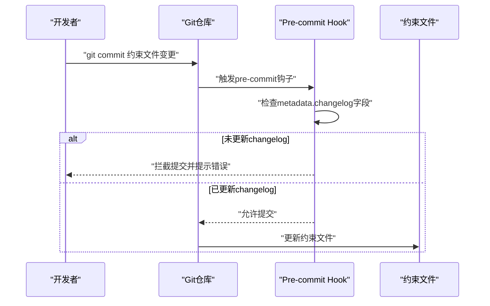
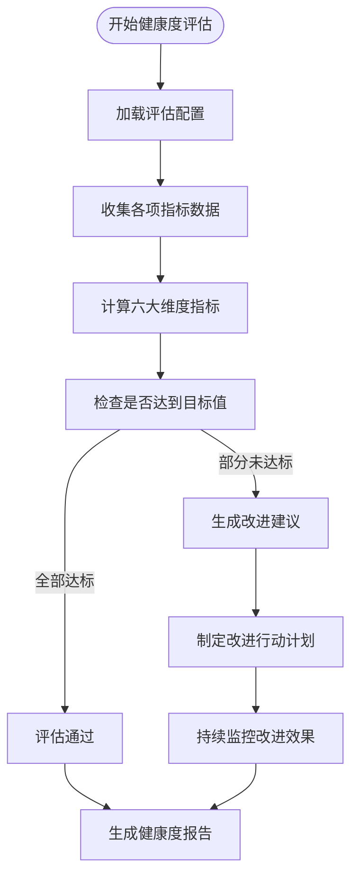
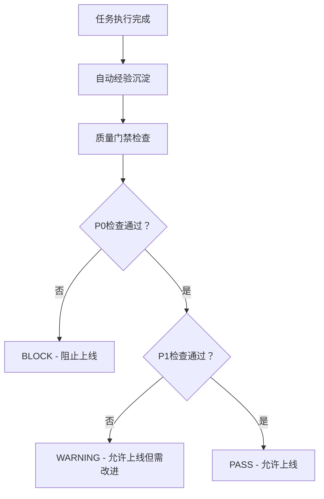
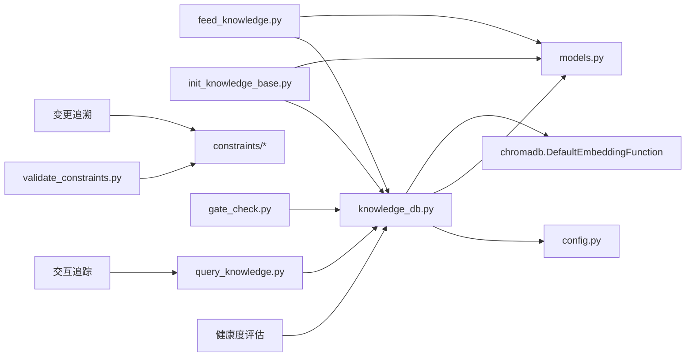

# 知识库管理系统

<cite>
**本文引用的文件**
- [knowledge_db.py](file://db/knowledge_db.py)
- [models.py](file://db/models.py)
- [config.py](file://db/config.py)
- [config.yaml](file://knowledge-base/config.yaml)
- [init_knowledge_base.py](file://scripts/init_knowledge_base.py)
- [feed_knowledge.py](file://scripts/feed_knowledge.py)
- [query_knowledge.py](file://scripts/query_knowledge.py)
- [gate_check.py](file://scripts/gate_check.py)
- [validate_constraints.py](file://scripts/validate_constraints.py)
- [TAHP-评估与质量门禁规范.md](file://docs/TAHP-评估与质量门禁规范.md)
- [TECNO-AI-Harness-Platform-方案设计.md](file://docs/TECNO-AI-Harness-Platform-方案设计.md)
- [rilj-common-errors.yaml](file://knowledge-base/telephony/docs/rilj-common-errors.yaml)
- [index.yaml](file://knowledge-base/kernel-driver/index.yaml)
- [module.yaml](file://constraints/kernel-driver/module.yaml)
- [AGENTS.md](file://AGENTS.md)
- [优化任务.md](file://优化任务.md)
</cite>

## 更新摘要
**所做更改**
- 新增知识库激活功能章节，详细描述知识库从空壳到可用系统的转变过程
- 完善知识库健康度评估体系，包含六大评估维度和自动化检查流程
- 新增经验沉淀质量门禁机制，涵盖沉淀门禁和提取门禁的详细规则
- 更新知识库初始化流程，增加基准数据填充和约束文件变更追溯机制
- 新增LLM交互追踪日志功能，增强系统的可观测性
- 完善知识库与AI Agent的交互方式，支持更丰富的查询和反馈机制

## 目录
1. [简介](#简介)
2. [项目结构](#项目结构)
3. [核心组件](#核心组件)
4. [架构总览](#架构总览)
5. [详细组件分析](#详细组件分析)
6. [知识库激活功能](#知识库激活功能)
7. [知识库健康度评估](#知识库健康度评估)
8. [经验沉淀与质量门禁](#经验沉淀与质量门禁)
9. [依赖分析](#依赖分析)
10. [性能考虑](#性能考虑)
11. [故障排查指南](#故障排查指南)
12. [结论](#结论)
13. [附录](#附录)

## 简介
本文件面向知识库管理系统，提供从架构设计、向量嵌入配置、语义检索机制到自动捕获功能的全面技术文档。系统采用 SQLite 持久化 + ONNX 语义嵌入（默认 all-MiniLM-L6-v2，384维）实现，支持语义搜索、跨模块检索、标签过滤、模块化目录结构与Git管理的Markdown知识条目。同时，系统提供初始化、数据导入导出、统计查询与增量更新等能力，并与AI Agent交互，作为其信息来源与决策依据。

**更新** 本版本新增了知识库激活功能，实现了从空壳到可用系统的完整转变，包括基准数据填充、约束文件变更追溯、LLM交互追踪等核心功能，形成了完整的知识库激活和质量保障体系。

## 项目结构
知识库相关的核心目录与文件如下：
- 数据模型与配置：db/models.py、db/config.py、knowledge-base/config.yaml
- 核心数据库操作：db/knowledge_db.py
- 初始化与数据导入导出脚本：scripts/init_knowledge_base.py、scripts/feed_knowledge.py、scripts/query_knowledge.py
- 质量门禁检查：scripts/gate_check.py、scripts/validate_constraints.py
- 约束验证与管理：scripts/validate_constraints.py
- 知识库健康度评估：docs/TAHP-评估与质量门禁规范.md（v3.0 新增）
- 知识库激活与追踪：优化任务.md（v3.0 新增）
- 示例知识条目与索引：knowledge-base/telephony/docs/rilj-common-errors.yaml、knowledge-base/kernel-driver/index.yaml
- 约束与模块元数据：constraints/kernel-driver/module.yaml
- 平台与Agent说明：AGENTS.md



**图表来源**
- [config.py:1-182](file://db/config.py#L1-L182)
- [models.py:1-247](file://db/models.py#L1-L247)
- [knowledge_db.py:1-589](file://db/knowledge_db.py#L1-L589)
- [init_knowledge_base.py:1-246](file://scripts/init_knowledge_base.py#L1-L246)
- [feed_knowledge.py:1-320](file://scripts/feed_knowledge.py#L1-L320)
- [query_knowledge.py:1-200](file://scripts/query_knowledge.py#L1-L200)
- [gate_check.py:1-507](file://scripts/gate_check.py#L1-L507)
- [validate_constraints.py:1-365](file://scripts/validate_constraints.py#L1-L365)
- [TAHP-评估与质量门禁规范.md:32-439](file://docs/TAHP-评估与质量门禁规范.md#L32-L439)

**章节来源**
- [config.py:1-182](file://db/config.py#L1-L182)
- [models.py:1-247](file://db/models.py#L1-L247)
- [knowledge_db.py:1-589](file://db/knowledge_db.py#L1-L589)
- [init_knowledge_base.py:1-246](file://scripts/init_knowledge_base.py#L1-L246)
- [feed_knowledge.py:1-320](file://scripts/feed_knowledge.py#L1-L320)
- [query_knowledge.py:1-200](file://scripts/query_knowledge.py#L1-L200)
- [gate_check.py:1-507](file://scripts/gate_check.py#L1-L507)
- [validate_constraints.py:1-365](file://scripts/validate_constraints.py#L1-L365)

## 核心组件
- 配置管理：集中管理数据库类型、嵌入模型、检索阈值、来源开关、自动捕获策略等。
- 数据模型：统一的知识条目结构，支持Frontmatter/YAML双向转换、ChromaDB元数据兼容。
- 知识库操作：封装SQLite表结构、向量嵌入计算、语义检索、跨模块检索、统计与模块管理。
- 脚本工具：初始化模块目录与索引、批量投喂知识条目、语义查询与统计展示。
- 质量门禁检查：实现P0/P1/P2三级门禁检查，确保约束文件质量和系统安全性。
- 健康度评估：提供知识库六大维度的健康度评估，支持定期检查和手动触发。
- 交互追踪：记录LLM工具调用的详细信息，支持调试和性能分析。
- 约束验证：验证约束文件的语法正确性和完整性，确保知识库质量。

**更新** 新增交互追踪和约束验证组件，完善知识库的可观测性和质量保障能力。

**章节来源**
- [config.py:64-182](file://db/config.py#L64-L182)
- [models.py:52-247](file://db/models.py#L52-L247)
- [knowledge_db.py:93-589](file://db/knowledge_db.py#L93-L589)
- [init_knowledge_base.py:154-246](file://scripts/init_knowledge_base.py#L154-L246)
- [feed_knowledge.py:196-320](file://scripts/feed_knowledge.py#L196-L320)
- [query_knowledge.py:116-200](file://scripts/query_knowledge.py#L116-L200)
- [gate_check.py:1-507](file://scripts/gate_check.py#L1-L507)
- [validate_constraints.py:1-365](file://scripts/validate_constraints.py#L1-L365)

## 架构总览
系统采用"配置驱动 + 数据模型 + 知识库操作 + 脚本工具"的分层架构。配置文件决定嵌入模型与检索策略；数据模型负责条目结构与序列化；知识库操作负责持久化与检索；脚本工具提供初始化、投喂与查询能力。知识条目以Markdown+Frontmatter形式存储于Git管理的知识库目录，同时写入SQLite数据库以支持快速检索。

**更新** 新增交互追踪和约束验证功能，形成完整的知识库激活和质量保障体系。



**图表来源**
- [config.py:94-162](file://db/config.py#L94-L162)
- [knowledge_db.py:101-127](file://db/knowledge_db.py#L101-L127)
- [knowledge_db.py:132-156](file://db/knowledge_db.py#L132-L156)
- [init_knowledge_base.py:167-179](file://scripts/init_knowledge_base.py#L167-L179)
- [gate_check.py:368-435](file://scripts/gate_check.py#L368-L435)
- [TAHP-评估与质量门禁规范.md:32-44](file://docs/TAHP-评估与质量门禁规范.md#L32-L44)

## 详细组件分析

### 组件A：知识库配置与嵌入策略
- 配置项包括数据库类型、持久化目录、嵌入模型、检索阈值、来源开关、自动捕获策略、约束提取策略等。
- 默认嵌入模型为 all-MiniLM-L6-v2（384维），通过 onnxruntime 提供；若不可用则降级为文本包含匹配。
- 检索阈值较低以支持跨语言检索，跨模块检索Top-K可单独配置。



**图表来源**
- [config.py:24-86](file://db/config.py#L24-L86)
- [config.py:94-162](file://db/config.py#L94-L162)

**章节来源**
- [config.py:24-86](file://db/config.py#L24-L86)
- [config.py:94-162](file://db/config.py#L94-L162)
- [config.yaml:1-36](file://knowledge-base/config.yaml#L1-L36)

### 组件B：知识条目数据模型与序列化
- 支持 Frontmatter/YAML 双向转换，兼容 ChromaDB 元数据格式（列表/字典序列化为JSON字符串）。
- 校验字段合法性（type、category、source、confidence范围）。
- 提供从Markdown解析与导出为Markdown的能力，便于Git管理与人工审阅。



**图表来源**
- [models.py:52-247](file://db/models.py#L52-L247)

**章节来源**
- [models.py:52-247](file://db/models.py#L52-L247)

### 组件C：知识库操作与检索机制
- SQLite表结构：三张主表（kb_knowledge、kb_cases、kb_patterns），包含模块、类型、分类、来源、作者、置信度、标签、内容、额外元数据、引用关系、向量嵌入等字段；建立模块、类型、分类索引。
- 向量嵌入：使用 onnxruntime 的 DefaultEmbeddingFunction；降级模式下进行文本包含匹配。
- 检索策略：
  - 语义检索：计算查询向量，对候选条目计算余弦相似度，按置信度阈值过滤与Top-K截断。
  - 跨模块检索：排除目标模块后进行相似度排序。
  - 标签检索：先语义召回再按标签交集过滤。
  - 模块/类型/分类过滤：构建SQL WHERE条件。
- 统计与模块管理：提供按模块、类型、来源、分类的统计分布，支持删除模块全部条目。


**图表来源**
- [knowledge_db.py:228-308](file://db/knowledge_db.py#L228-L308)
- [knowledge_db.py:375-401](file://db/knowledge_db.py#L375-L401)
- [knowledge_db.py:519-571](file://db/knowledge_db.py#L519-L571)

**章节来源**
- [knowledge_db.py:34-56](file://db/knowledge_db.py#L34-L56)
- [knowledge_db.py:158-164](file://db/knowledge_db.py#L158-L164)
- [knowledge_db.py:174-184](file://db/knowledge_db.py#L174-L184)
- [knowledge_db.py:228-308](file://db/knowledge_db.py#L228-L308)
- [knowledge_db.py:375-401](file://db/knowledge_db.py#L375-L401)
- [knowledge_db.py:403-432](file://db/knowledge_db.py#L403-L432)
- [knowledge_db.py:519-571](file://db/knowledge_db.py#L519-L571)

### 组件D：初始化流程与数据导入导出
- 初始化脚本：
  - 读取配置，创建模块目录结构与 index.yaml。
  - 从 constraints/ 提取现有约束为知识条目，写入 knowledge-base/ 并同步到知识库。
  - 验证数据库连通性，输出统计。
- 投喂脚本：
  - 支持 Markdown、PDF、Word 文档解析，生成知识条目并保存至 knowledge-base/。
  - 可指定类型与分类，支持增量模式（基于ID存在性）。
  - 更新模块 index.yaml，记录条目ID与更新时间。
- 查询脚本：
  - 支持语义搜索、跨模块搜索、按类型/分类过滤、最近条目、统计展示。



**图表来源**
- [init_knowledge_base.py:154-246](file://scripts/init_knowledge_base.py#L154-L246)
- [knowledge_db.py:309-346](file://db/knowledge_db.py#L309-L346)

**章节来源**
- [init_knowledge_base.py:33-84](file://scripts/init_knowledge_base.py#L33-L84)
- [init_knowledge_base.py:86-142](file://scripts/init_knowledge_base.py#L86-L142)
- [init_knowledge_base.py:154-246](file://scripts/init_knowledge_base.py#L154-L246)
- [feed_knowledge.py:196-320](file://scripts/feed_knowledge.py#L196-L320)
- [query_knowledge.py:116-200](file://scripts/query_knowledge.py#L116-L200)

### 组件E：自动捕获与知识更新机制
- 自动捕获配置：针对Bug分析、纠正记录、代码适配、EvoSkill提取设置最低置信度与触发条件。
- 约束提取配置：控制是否自动触发、是否需要Owner审核、置信度阈值。
- 源开关：控制 manual_feed、auto_capture、cross_module_sync 是否启用。
- 知识条目来源：manual_feed（手动）、auto_captured（自动）、evoskill_extracted、source_analyzed 等。

**更新** 新增知识库激活功能，支持从空壳到可用系统的完整转变。

**章节来源**
- [config.py:42-62](file://db/config.py#L42-L62)
- [config.py:87-93](file://db/config.py#L87-L93)
- [config.yaml:14-36](file://knowledge-base/config.yaml#L14-L36)

### 组件F：知识库与AI Agent的交互
- Agent通过MCP服务器或直接调用知识库接口进行查询，返回条目ID、标题、模块、类型、分类、置信度、相似度与内容预览。
- 置信度处理建议：高置信度（≥0.8）直接参考，中置信度（0.6-0.8）需结合约束验证，低置信度（<0.6）仅作参考。
- 平台说明：平台包含四种约束域（Bug分析、代码适配、版本适配、运营商移植），Agent基于约束与技能协作完成任务。

**更新** 新增交互追踪功能，支持LLM工具调用的详细记录和分析。

**章节来源**
- [query_knowledge.py:116-200](file://scripts/query_knowledge.py#L116-L200)
- [knowledge_db.py:375-401](file://db/knowledge_db.py#L375-L401)
- [AGENTS.md:1-83](file://AGENTS.md#L1-L83)

## 知识库激活功能

### 激活目标与对标系统
知识库激活功能的目标是将知识库从"空壳"状态转变为"可用系统"，对标LogInsight的Wiki知识模块和LLM交互追踪能力。通过基准数据填充、约束文件变更追溯、LLM交互追踪等机制，实现知识库的完整激活。

### 基准数据填充流程
系统通过Step 3-1实现知识库的基准数据填充：

1. **创建示例知识条目**：为telephony模块创建包含常见错误模式、API使用和流程分析的知识条目
2. **使用投喂脚本导入**：通过`scripts/feed_knowledge.py`将示例条目导入知识库
3. **验证查询功能**：通过`scripts/query_knowledge.py`验证知识库查询功能正常


**图表来源**
- [优化任务.md:600-644](file://优化任务.md#L600-L644)
- [rilj-common-errors.yaml:1-36](file://knowledge-base/telephony/docs/rilj-common-errors.yaml#L1-L36)

### 约束文件变更追溯机制
通过Step 3-2建立约束文件变更的完整追溯机制：

1. **changelog字段**：在每个约束YAML的metadata段增加changelog字段
2. **Git Hook集成**：实现pre-commit hook，在提交时强制要求更新changelog
3. **自动化验证**：确保每次约束文件变更都有对应的变更记录



**图表来源**
- [优化任务.md:648-682](file://优化任务.md#L648-L682)

### LLM交互追踪日志
通过Step 3-3实现LLM工具调用的完整追踪：

1. **追踪模块设计**：新增`tahp-mcp-server/tracing.py`模块
2. **日志格式规范**：记录工具名称、参数摘要、耗时、结果状态
3. **存储结构**：输出为JSONL格式到`reports/traces/`目录
4. **文件命名**：每个分析任务生成独立的日志文件

**章节来源**
- [优化任务.md:600-694](file://优化任务.md#L600-L694)
- [rilj-common-errors.yaml:1-36](file://knowledge-base/telephony/docs/rilj-common-errors.yaml#L1-L36)

## 知识库健康度评估

### 评估维度与指标
知识库健康度评估是v3.0版本新增的重要功能，旨在定期检查知识库的质量和有效性。评估体系包含六大核心维度：

| 维度 | 指标 | 目标值 | 检查方式 |
|------|------|--------|---------|
| **覆盖率** | 已接入模块的知识条目数 | ≥20条/模块 | 知识库统计报告 |
| **增长性** | 本周新增知识条目 vs 上周 | 正增长 | Git log + SQLite KB |
| **利用率** | 知识条目被引用(检索命中)的比例 | ≥60% | SQLite KB query log |
| **质量** | 高置信度(≥0.8)条目占比 | ≥70% | 置信度统计 |
| **时效性** | 最近30天有更新的条目占比 | ≥30% | updated_at 字段 |
| **沉淀率** | 执行任务后自动沉淀成功率 | ≥80% | 沉淀触发日志 |

### 健康度评估命令
系统提供了专门的健康度评估命令，支持多种检查模式：

```bash
# 查看模块知识库统计报告
python scripts/knowledge_stats.py --module {module}

# 查看全量统计报告
python scripts/knowledge_stats.py --all

# 触发知识库健康检查
python scripts/knowledge_stats.py --health-check
```

### 评估流程
健康度评估采用自动化流程，定期检查知识库的各项指标，确保知识库的持续健康发展：



**章节来源**
- [TAHP-评估与质量门禁规范.md:32-44](file://docs/TAHP-评估与质量门禁规范.md#L32-L44)
- [TAHP-评估与质量门禁规范.md:410-424](file://docs/TAHP-评估与质量门禁规范.md#L410-L424)

## 经验沉淀与质量门禁

### 经验沉淀质量门禁
每次执行任务后，系统会自动检查知识沉淀状态，确保沉淀的知识质量：

| 检查项 | 级别 | 条件 | 处理方式 |
|--------|------|------|---------|
| 沉淀完整性 | P1 | Bug分析后必须生成案例 | 自动补充缺失字段 |
| 置信度校验 | P2 | 新沉淀条目置信度 ≥0.6 | 低于阈值标记为 draft |
| 去重检查 | P2 | 与已有条目相似度 <0.9 | 相似条目合并提示 |
| 标签完整性 | P2 | 至少有 2 个标签 | 自动补充标签 |

### 知识提取门禁
从知识库自动提取约束时的质量检查：

| 检查项 | 级别 | 条件 | 处理方式 |
|--------|------|------|---------|
| 约束完整性 | P0 | 覆盖4种domain的必填字段 | 不完整则不生成Skill |
| 约束一致性 | P1 | 规则之间无矛盾 | 标记矛盾并要求Owner处理 |
| 约束具体性 | P1 | 无模糊描述 | 标记模糊规则 |
| 提取置信度 | P0 | 整体置信度 ≥0.75 | 低于阈值不自动生效 |

### 质量门禁检查
系统还提供通用的质量门禁检查功能，确保约束文件的质量：

```bash
# 检查门禁
python scripts/gate-check.py --module telephony --level P0
```

质量门禁分为三个级别：
- **P0 - 必须通过**：任一失败即BLOCK，如编译检查、Scope合规、安全红线、API真实性
- **P1 - 应当通过**：累计超过阈值则WARNING，如编码风格、新增Lint错误、废弃API使用
- **P2 - 建议通过**：记录但不阻塞，如代码复杂度、重复代码、注释覆盖率



**章节来源**
- [TAHP-评估与质量门禁规范.md:386-424](file://docs/TAHP-评估与质量门禁规范.md#L386-L424)
- [gate_check.py:1-507](file://scripts/gate_check.py#L1-L507)
- [TECNO-AI-Harness-Platform-方案设计.md:790](file://docs/TECNO-AI-Harness-Platform-方案设计.md#L790)

## 依赖分析
- 组件耦合：
  - KnowledgeDB 依赖 KnowledgeBaseConfig 与 KnowledgeEntry。
  - 脚本工具依赖 KnowledgeDB 与 KnowledgeEntry。
  - 知识条目依赖 YAML/JSON 序列化。
  - 质量门禁检查依赖约束文件和配置文件。
  - 健康度评估依赖知识库统计数据和Git日志。
  - 交互追踪依赖MCP服务器和日志文件系统。
  - 约束验证依赖YAML解析和正则表达式。
- 外部依赖：
  - onnxruntime（用于 DefaultEmbeddingFunction）。
  - chromadb（仅用于嵌入函数，不直接依赖其存储层）。
  - rich/click/yaml/toml 等运行时依赖。



**图表来源**
- [knowledge_db.py:101-127](file://db/knowledge_db.py#L101-L127)
- [feed_knowledge.py:29-32](file://scripts/feed_knowledge.py#L29-L32)
- [init_knowledge_base.py:27-29](file://scripts/init_knowledge_base.py#L27-L29)
- [query_knowledge.py:27-30](file://scripts/query_knowledge.py#L27-L30)
- [gate_check.py:368-435](file://scripts/gate_check.py#L368-L435)

**章节来源**
- [knowledge_db.py:101-127](file://db/knowledge_db.py#L101-L127)
- [feed_knowledge.py:29-32](file://scripts/feed_knowledge.py#L29-L32)
- [init_knowledge_base.py:27-29](file://scripts/init_knowledge_base.py#L27-L29)
- [query_knowledge.py:27-30](file://scripts/query_knowledge.py#L27-L30)
- [gate_check.py:1-507](file://scripts/gate_check.py#L1-L507)

## 性能考虑
- 向量计算：默认模型为 all-MiniLM-L6-v2（384维），适合CPU环境；若部署在GPU资源充足场景，可考虑更高维度模型以提升精度。
- 检索效率：SQLite建立模块/类型/分类索引；相似度计算采用批量矩阵运算，注意内存占用与Top-K截断。
- 降级策略：嵌入不可用时自动切换文本包含匹配，保证基本检索能力。
- I/O优化：知识条目以Markdown文件存储，便于Git版本管理与增量更新；批量导入时建议分批提交以减少事务开销。
- 健康度评估：定期评估可能增加系统负载，建议合理设置评估频率和并发度。
- 交互追踪：JSONL日志写入可能影响I/O性能，建议异步写入和合理的日志轮转策略。
- 约束验证：大规模约束文件验证可能消耗较多CPU资源，建议并行处理和缓存机制。

**更新** 新增交互追踪和约束验证的性能考虑，确保系统在保证质量的同时维持良好性能。

## 故障排查指南
- 嵌入不可用：
  - 现象：日志提示嵌入不可用并降级。
  - 处理：安装 onnxruntime==1.20.1 后重启服务。
- 数据库连通性失败：
  - 现象：初始化或查询时报错。
  - 处理：检查持久化目录权限与磁盘空间，确认SQLite WAL模式与外键开启。
- 查询结果为空：
  - 现象：语义检索无结果。
  - 处理：降低 min_confidence 阈值或使用跨模块检索；检查索引与过滤条件。
- 投喂失败：
  - 现象：部分文件解析失败或被跳过。
  - 处理：确认文件格式支持（PDF/Word需相应库），检查内容是否为空；查看控制台输出的失败原因。
- 健康度评估异常：
  - 现象：健康度评估结果不准确或超时。
  - 处理：检查Git日志访问权限，确认数据库连接正常，适当调整评估频率。
- 质量门禁检查失败：
  - 现象：P0门禁检查失败阻止系统上线。
  - 处理：根据门禁检查结果逐项修复，确保所有P0检查项通过。
- 交互追踪失败：
  - 现象：LLM工具调用日志未生成或格式异常。
  - 处理：检查tracing.py模块的文件权限，确认reports/traces/目录可写，验证JSONL格式正确性。
- 约束文件变更被拦截：
  - 现象：git commit被pre-commit hook拦截。
  - 处理：在metadata段添加changelog字段，记录变更原因和详细说明。

**更新** 新增交互追踪和约束验证相关的故障排查指导。

**章节来源**
- [knowledge_db.py:141-156](file://db/knowledge_db.py#L141-L156)
- [init_knowledge_base.py:144-152](file://scripts/init_knowledge_base.py#L144-L152)
- [feed_knowledge.py:91-147](file://scripts/feed_knowledge.py#L91-L147)
- [TAHP-评估与质量门禁规范.md:386-424](file://docs/TAHP-评估与质量门禁规范.md#L386-L424)

## 结论
本知识库管理系统以配置驱动为核心，结合SQLite与ONNX嵌入实现轻量、可移植且具备语义检索能力的知识管理方案。通过标准化的数据模型与脚本工具链，实现了从初始化、投喂、查询到统计的完整闭环；同时为AI Agent提供可靠的信息来源与交互接口，支撑多引擎（诊断/适配）的自动化工作流。

**更新** v3.0版本通过知识库激活功能，实现了从空壳到可用系统的完整转变，新增的健康度评估体系、经验沉淀质量门禁机制、交互追踪和约束验证功能，进一步完善了知识库的自动化管理和质量保障能力，形成了从知识获取、质量控制到经验沉淀的完整闭环，为AI系统的持续优化和知识积累提供了坚实基础。

## 附录

### A. 知识条目存储结构与索引
- 表结构字段：id、module、title、type、category、source、created_at、updated_at、author、confidence、tags、content、extra_metadata、referenced_by、embedding。
- 索引：idx_kb_knowledge_module、idx_kb_knowledge_type、idx_kb_knowledge_category。
- 向量存储：二进制浮点32位数组，按384维存储。

**章节来源**
- [knowledge_db.py:34-56](file://db/knowledge_db.py#L34-L56)
- [knowledge_db.py:59-67](file://db/knowledge_db.py#L59-L67)

### B. 示例知识条目与索引
- 示例条目：包含模块元数据、标签、来源、内容等字段。
- 模块索引：记录模块版本、更新时间与各子目录（docs/cases/auto）的条目ID列表。

**章节来源**
- [rilj-common-errors.yaml:1-36](file://knowledge-base/telephony/docs/rilj-common-errors.yaml#L1-L36)
- [index.yaml:1-8](file://knowledge-base/kernel-driver/index.yaml#L1-L8)
- [module.yaml:1-30](file://constraints/kernel-driver/module.yaml#L1-L30)

### C. 查询接口使用方法与最佳实践
- 基本查询：指定模块、类型、分类与Top-K，返回带相似度与置信度的结果。
- 跨模块查询：排除目标模块，扩大知识覆盖面。
- 最佳实践：
  - 合理设置 min_confidence 以平衡召回与精度。
  - 使用标签检索进行细粒度筛选。
  - 定期清理旧条目与冗余内容，保持索引有效性。

**章节来源**
- [query_knowledge.py:116-200](file://scripts/query_knowledge.py#L116-L200)
- [knowledge_db.py:375-401](file://db/knowledge_db.py#L375-L401)
- [knowledge_db.py:519-571](file://db/knowledge_db.py#L519-L571)

### D. 健康度评估最佳实践
- 定期评估：建议每周进行一次全面健康度评估，每日进行基础指标检查。
- 指标监控：重点关注覆盖率和沉淀率的变化趋势，及时发现知识库建设问题。
- 持续改进：根据评估结果制定改进计划，优先解决P0级别的健康度问题。
- 自动化集成：将健康度评估集成到CI/CD流程中，确保知识库质量的持续提升。

**更新** 新增健康度评估的最佳实践指导。

**章节来源**
- [TAHP-评估与质量门禁规范.md:32-44](file://docs/TAHP-评估与质量门禁规范.md#L32-L44)
- [TAHP-评估与质量门禁规范.md:410-424](file://docs/TAHP-评估与质量门禁规范.md#L410-L424)

### E. 知识库激活最佳实践
- 基准数据选择：优先选择具有代表性的示例数据，确保覆盖主要使用场景。
- 变更追溯实施：确保团队成员理解并遵守changelog记录要求。
- 交互追踪配置：合理设置日志级别和存储位置，避免影响系统性能。
- 质量门禁执行：建立定期的质量门禁检查机制，确保知识库持续保持高质量。

**更新** 新增知识库激活的最佳实践指导。

**章节来源**
- [优化任务.md:600-694](file://优化任务.md#L600-L694)