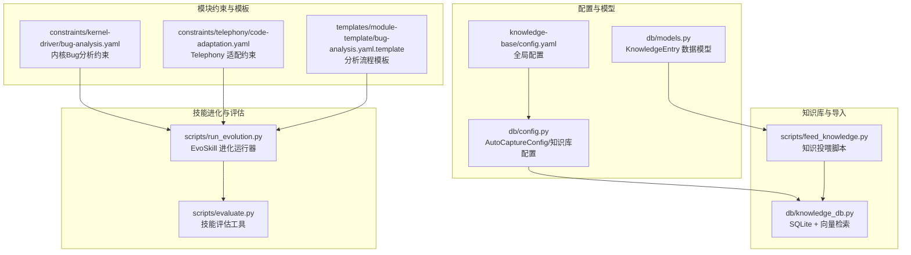
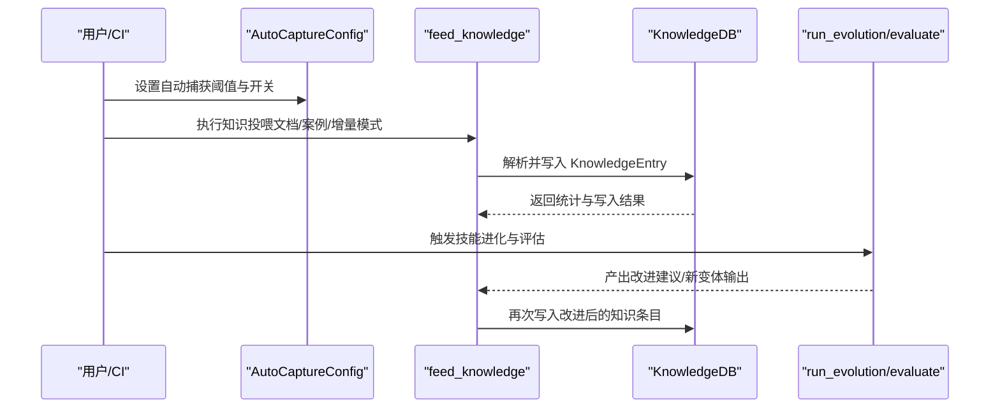
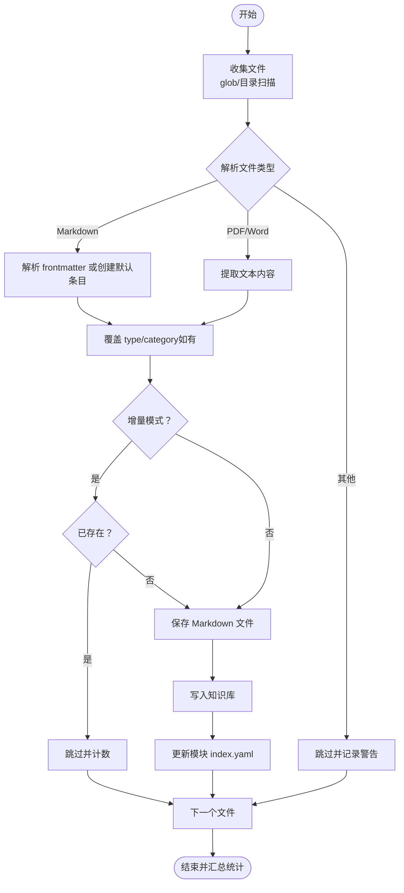
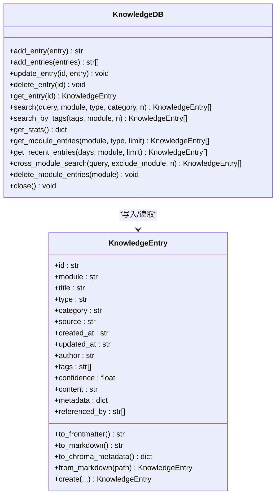
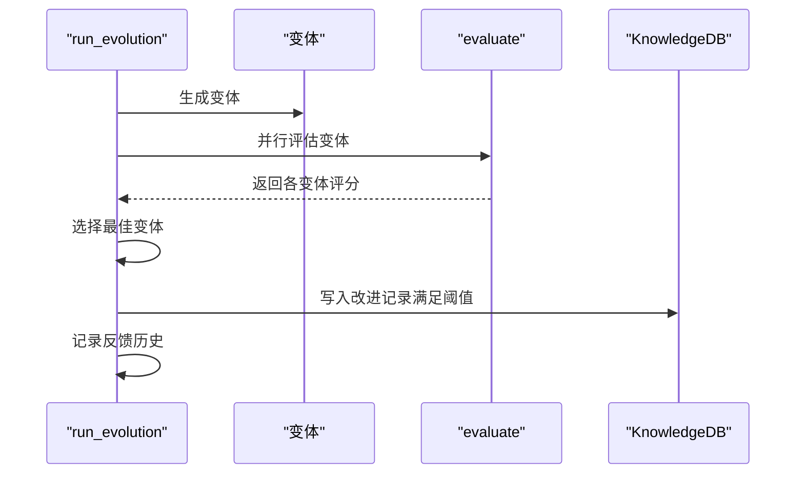
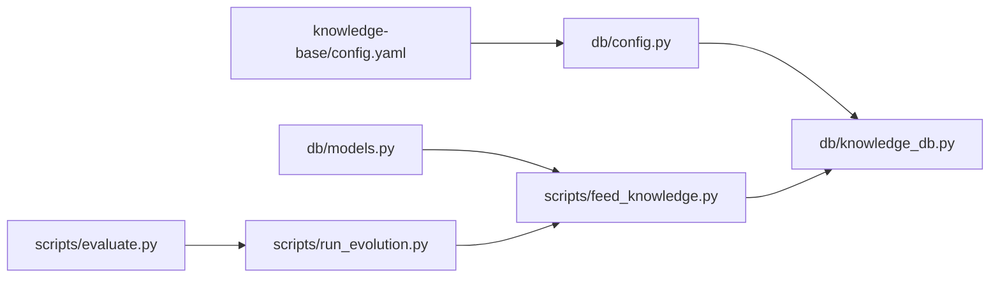

# 自动捕获机制

<cite>
**本文引用的文件**
- [scripts/feed_knowledge.py](file://scripts/feed_knowledge.py)
- [db/knowledge_db.py](file://db/knowledge_db.py)
- [db/models.py](file://db/models.py)
- [db/config.py](file://db/config.py)
- [knowledge-base/config.yaml](file://knowledge-base/config.yaml)
- [scripts/run_evolution.py](file://scripts/run_evolution.py)
- [scripts/evaluate.py](file://scripts/evaluate.py)
- [constraints/kernel-driver/bug-analysis.yaml](file://constraints/kernel-driver/bug-analysis.yaml)
- [constraints/telephony/code-adaptation.yaml](file://constraints/telephony/code-adaptation.yaml)
- [templates/module-template/bug-analysis.yaml.template](file://templates/module-template/bug-analysis.yaml.template)
</cite>

## 目录
1. [简介](#简介)
2. [项目结构](#项目结构)
3. [核心组件](#核心组件)
4. [架构总览](#架构总览)
5. [详细组件分析](#详细组件分析)
6. [依赖分析](#依赖分析)
7. [性能考虑](#性能考虑)
8. [故障排查指南](#故障排查指南)
9. [结论](#结论)
10. [附录](#附录)

## 简介
本文件面向“自动捕获机制”的全面技术文档，围绕以下目标展开：
- 解释 AutoCaptureConfig 配置项及其触发条件：Bug 分析捕获、纠正记录、适配记录、EvoSkill 提取
- 讲解自动捕获的触发时机、数据筛选逻辑与质量控制机制
- 解释 feed_knowledge 脚本的实现原理与数据导入流程
- 提供配置定制方法、异常处理策略与监控告警建议
- 给出捕获数据的去重处理、格式标准化与批量处理优化方案

## 项目结构
自动捕获机制涉及知识库配置、知识条目模型、知识库持久化与检索、EvoSkill 进化评估工具，以及模块级约束规则模板。

**图表来源**
- [db/config.py:1-182](file://db/config.py#L1-L182)
- [knowledge-base/config.yaml:1-36](file://knowledge-base/config.yaml#L1-L36)
- [db/models.py:1-247](file://db/models.py#L1-L247)
- [scripts/feed_knowledge.py:1-320](file://scripts/feed_knowledge.py#L1-L320)
- [db/knowledge_db.py:1-589](file://db/knowledge_db.py#L1-L589)
- [scripts/run_evolution.py:1-567](file://scripts/run_evolution.py#L1-L567)
- [scripts/evaluate.py:1-436](file://scripts/evaluate.py#L1-L436)
- [constraints/kernel-driver/bug-analysis.yaml:1-65](file://constraints/kernel-driver/bug-analysis.yaml#L1-L65)
- [constraints/telephony/code-adaptation.yaml:1-48](file://constraints/telephony/code-adaptation.yaml#L1-L48)
- [templates/module-template/bug-analysis.yaml.template:94-121](file://templates/module-template/bug-analysis.yaml.template#L94-L121)

**章节来源**
- [db/config.py:1-182](file://db/config.py#L1-L182)
- [knowledge-base/config.yaml:1-36](file://knowledge-base/config.yaml#L1-L36)
- [db/models.py:1-247](file://db/models.py#L1-L247)
- [scripts/feed_knowledge.py:1-320](file://scripts/feed_knowledge.py#L1-L320)
- [db/knowledge_db.py:1-589](file://db/knowledge_db.py#L1-L589)
- [scripts/run_evolution.py:1-567](file://scripts/run_evolution.py#L1-L567)
- [scripts/evaluate.py:1-436](file://scripts/evaluate.py#L1-L436)
- [constraints/kernel-driver/bug-analysis.yaml:1-65](file://constraints/kernel-driver/bug-analysis.yaml#L1-L65)
- [constraints/telephony/code-adaptation.yaml:1-48](file://constraints/telephony/code-adaptation.yaml#L1-L48)
- [templates/module-template/bug-analysis.yaml.template:94-121](file://templates/module-template/bug-analysis.yaml.template#L94-L121)

## 核心组件
- AutoCaptureConfig：定义自动捕获的触发条件与阈值，包括 Bug 分析最小置信度、质量门禁结果集合、纠正记录总是捕获、适配记录编译/回归通过要求、EvoSkill 最小分数提升等。
- KnowledgeEntry：知识条目数据模型，统一字段与校验，支持 Markdown/YAML 双向转换与 Chroma 元数据格式转换。
- KnowledgeDB：SQLite + 向量嵌入的知识库，支持语义检索、跨模块检索、统计与批量写入。
- feed_knowledge：知识投喂脚本，负责解析多种文档格式为 KnowledgeEntry，并写入知识库与本地 Markdown 文件，支持增量模式。
- run_evolution / evaluate：EvoSkill 技能迭代与评估工具链，用于从输出中提取约束与改进点，形成闭环反馈。

**章节来源**
- [db/config.py:41-54](file://db/config.py#L41-L54)
- [db/models.py:52-70](file://db/models.py#L52-L70)
- [db/knowledge_db.py:93-127](file://db/knowledge_db.py#L93-L127)
- [scripts/feed_knowledge.py:196-320](file://scripts/feed_knowledge.py#L196-L320)
- [scripts/run_evolution.py:1-567](file://scripts/run_evolution.py#L1-L567)
- [scripts/evaluate.py:1-436](file://scripts/evaluate.py#L1-L436)

## 架构总览
自动捕获机制的总体流程如下：
- 配置加载：从 knowledge-base/config.yaml 读取 AutoCaptureConfig 与检索阈值
- 数据采集：通过 feed_knowledge 导入外部文档或内部产出（如 EvoSkill 输出）
- 质量筛选：依据 AutoCaptureConfig 中的阈值与门禁结果进行过滤
- 写入与检索：将条目写入知识库，支持按模块/类型/分类检索与跨模块检索
- 进化与反馈：EvoSkill 迭代评估，输出改进建议，再次进入自动捕获循环

**图表来源**
- [db/config.py:140-152](file://db/config.py#L140-L152)
- [scripts/feed_knowledge.py:210-320](file://scripts/feed_knowledge.py#L210-L320)
- [db/knowledge_db.py:309-331](file://db/knowledge_db.py#L309-L331)
- [scripts/run_evolution.py:409-527](file://scripts/run_evolution.py#L409-L527)
- [scripts/evaluate.py:290-384](file://scripts/evaluate.py#L290-L384)

## 详细组件分析

### AutoCaptureConfig 配置详解
- Bug 分析捕获
  - 最小置信度：低于阈值的条目不会被自动捕获
  - 质量门禁结果：仅当门禁结果属于允许集合时才捕获
- 纠正记录捕获
  - 总是捕获：无论质量如何，均写入知识库
- 适配记录捕获
  - 编译通过：仅当编译通过时捕获
  - 回归通过：仅当回归测试通过时捕获
- EvoSkill 提取
  - 最小分数提升：仅当新变体得分超过阈值时才捕获

上述配置项均来自 knowledge-base/config.yaml，并在启动时由 KnowledgeBaseConfig.from_yaml 解析注入到 AutoCaptureConfig。

**章节来源**
- [knowledge-base/config.yaml:14-25](file://knowledge-base/config.yaml#L14-L25)
- [db/config.py:140-152](file://db/config.py#L140-L152)

### feed_knowledge 脚本实现与数据导入流程
- 文件收集：支持 glob 模式与目录扫描，自动过滤非文件
- 文档解析：
  - Markdown：优先解析 YAML frontmatter；若无 frontmatter，则创建默认条目
  - PDF/Word：按可用库尝试解析文本内容
- 条目创建与覆盖：根据命令行参数覆盖 type 与 category
- 增量模式：基于条目 ID 检查是否已存在，避免重复写入
- 写入与索引：
  - 保存为 Markdown 文件至 knowledge-base/{module}/docs 或 cases
  - 写入知识库（SQLite + 向量）
  - 更新模块 index.yaml
- 报告与统计：输出投喂报告与知识库统计

**图表来源**
- [scripts/feed_knowledge.py:36-147](file://scripts/feed_knowledge.py#L36-L147)
- [scripts/feed_knowledge.py:210-320](file://scripts/feed_knowledge.py#L210-L320)

**章节来源**
- [scripts/feed_knowledge.py:36-147](file://scripts/feed_knowledge.py#L36-L147)
- [scripts/feed_knowledge.py:210-320](file://scripts/feed_knowledge.py#L210-L320)

### 知识库检索与质量控制
- 检索配置：默认 Top-K、最小置信度、跨模块 Top-K、重排开关
- 语义检索：计算向量并使用余弦相似度排序，结合最小置信度过滤
- 文本降级：当嵌入不可用时，采用文本包含匹配
- 跨模块检索：排除目标模块后进行相似度排序
- 统计与近期条目：支持按模块/类型/来源/分类统计，以及按时间窗口获取近期条目

**图表来源**
- [db/knowledge_db.py:93-589](file://db/knowledge_db.py#L93-L589)
- [db/models.py:52-247](file://db/models.py#L52-L247)

**章节来源**
- [db/knowledge_db.py:26-571](file://db/knowledge_db.py#L26-L571)
- [db/models.py:20-81](file://db/models.py#L20-L81)

### EvoSkill 提取与质量门禁
- 进化运行器：生成变体、并行评估、选择最佳、记录反馈历史、生成报告
- 评估工具：加载测试集、执行技能、对比期望输出、计算准确率/完整性/安全合规/时间效率
- 自动捕获联动：当 EvoSkill 变体得分满足最小提升阈值时，将其作为“改进记录”写入知识库

**图表来源**
- [scripts/run_evolution.py:409-527](file://scripts/run_evolution.py#L409-L527)
- [scripts/evaluate.py:290-384](file://scripts/evaluate.py#L290-L384)
- [db/knowledge_db.py:309-331](file://db/knowledge_db.py#L309-L331)

**章节来源**
- [scripts/run_evolution.py:1-567](file://scripts/run_evolution.py#L1-L567)
- [scripts/evaluate.py:1-436](file://scripts/evaluate.py#L1-L436)
- [db/knowledge_db.py:309-331](file://db/knowledge_db.py#L309-L331)

### 模块约束与触发时机
- 内核 Bug 分析约束：定义输入要求、分析规则、禁止事项与输出项，指导自动捕获的条目类型与质量
- Telephony 适配约束：构建规则、修改规则、质量门禁，确保适配记录符合模块规范
- 分析流程模板：提供通用的堆栈分析、根因定位步骤，辅助自动生成分析日志与经验案例

**章节来源**
- [constraints/kernel-driver/bug-analysis.yaml:1-65](file://constraints/kernel-driver/bug-analysis.yaml#L1-L65)
- [constraints/telephony/code-adaptation.yaml:1-48](file://constraints/telephony/code-adaptation.yaml#L1-L48)
- [templates/module-template/bug-analysis.yaml.template:94-121](file://templates/module-template/bug-analysis.yaml.template#L94-L121)

## 依赖分析
- 配置依赖：KnowledgeBaseConfig.from_yaml 从 YAML 加载配置，解析 auto_capture、retrieval、sources 等段落
- 模型依赖：KnowledgeEntry 作为统一数据载体，贯穿 feed_knowledge 与 KnowledgeDB
- 检索依赖：KnowledgeDB 基于 SQLite 与向量嵌入实现检索，受检索配置影响
- 进化依赖：run_evolution 依赖 evaluate 产出评分，再决定是否写入知识库

**图表来源**
- [knowledge-base/config.yaml:1-36](file://knowledge-base/config.yaml#L1-L36)
- [db/config.py:94-161](file://db/config.py#L94-L161)
- [db/knowledge_db.py:93-127](file://db/knowledge_db.py#L93-L127)
- [db/models.py:52-70](file://db/models.py#L52-L70)
- [scripts/feed_knowledge.py:210-320](file://scripts/feed_knowledge.py#L210-L320)
- [scripts/evaluate.py:290-384](file://scripts/evaluate.py#L290-L384)
- [scripts/run_evolution.py:409-527](file://scripts/run_evolution.py#L409-L527)

**章节来源**
- [knowledge-base/config.yaml:1-36](file://knowledge-base/config.yaml#L1-L36)
- [db/config.py:94-161](file://db/config.py#L94-L161)
- [db/knowledge_db.py:93-127](file://db/knowledge_db.py#L93-L127)
- [db/models.py:52-70](file://db/models.py#L52-L70)
- [scripts/feed_knowledge.py:210-320](file://scripts/feed_knowledge.py#L210-L320)
- [scripts/evaluate.py:290-384](file://scripts/evaluate.py#L290-L384)
- [scripts/run_evolution.py:409-527](file://scripts/run_evolution.py#L409-L527)

## 性能考虑
- 向量计算降级：当 ONNX 嵌入不可用时，自动切换为文本包含匹配，保证检索可用性但精度下降
- 批量写入：KnowledgeDB.add_entries 支持批量写入，减少事务开销
- 索引与查询：SQLite WAL 模式与多索引（module/type/category）提升查询性能
- 并行评估：run_evolution 支持并发评估多个变体，缩短迭代周期
- 增量导入：feed_knowledge 的增量模式避免重复写入，降低 I/O 压力

**章节来源**
- [db/knowledge_db.py:132-156](file://db/knowledge_db.py#L132-L156)
- [db/knowledge_db.py:333-345](file://db/knowledge_db.py#L333-L345)
- [scripts/run_evolution.py:225-282](file://scripts/run_evolution.py#L225-L282)
- [scripts/feed_knowledge.py:260-267](file://scripts/feed_knowledge.py#L260-L267)

## 故障排查指南
- 嵌入模型不可用：日志会提示降级为文本搜索，检查 onnxruntime 安装与版本
- PDF/Word 解析失败：确认已安装 pdfplumber/PyPDF2 或 python-docx，或跳过不支持格式
- 增量模式误判：当前增量检查基于文件名匹配标题，建议在条目 ID 稳定后再启用
- 评估超时：调整 evaluate 的超时参数，或优化技能执行逻辑
- 跨模块检索无结果：检查 exclude_module 参数与最小置信度设置

**章节来源**
- [db/knowledge_db.py:141-156](file://db/knowledge_db.py#L141-L156)
- [scripts/feed_knowledge.py:91-146](file://scripts/feed_knowledge.py#L91-L146)
- [scripts/evaluate.py:164-197](file://scripts/evaluate.py#L164-L197)
- [db/knowledge_db.py:524-570](file://db/knowledge_db.py#L524-L570)

## 结论
自动捕获机制通过配置驱动的阈值与门禁，结合 feed_knowledge 的标准化导入与 KnowledgeDB 的检索能力，实现了从外部文档与 EvoSkill 输出中高质量地抽取知识。配合模块约束与模板，确保捕获内容符合领域规范。建议在生产环境中启用增量模式、合理设置阈值，并持续优化评估指标以提升闭环质量。

## 附录

### 自动捕获配置定制方法
- 修改 knowledge-base/config.yaml 中的 auto_capture 段落，调整各阈值与开关
- 在 feed_knowledge 命令中覆盖 type 与 category，以适配不同场景
- 在 run_evolution 中调整 pass_threshold 与权重，引导技能向更易捕获的方向演进

**章节来源**
- [knowledge-base/config.yaml:14-25](file://knowledge-base/config.yaml#L14-L25)
- [scripts/feed_knowledge.py:202-209](file://scripts/feed_knowledge.py#L202-L209)
- [scripts/run_evolution.py:50-65](file://scripts/run_evolution.py#L50-L65)

### 异常处理策略
- 解析失败：记录失败原因并跳过，不影响整体流程
- 增量模式：已存在条目直接跳过，避免重复写入
- 嵌入失败：降级为文本检索，保证功能可用

**章节来源**
- [scripts/feed_knowledge.py:86-88](file://scripts/feed_knowledge.py#L86-L88)
- [scripts/feed_knowledge.py:260-267](file://scripts/feed_knowledge.py#L260-L267)
- [db/knowledge_db.py:141-156](file://db/knowledge_db.py#L141-L156)

### 监控告警机制建议
- 建议在 CI 中监控 feed_knowledge 的失败计数与增量跳过比例
- 对 EvoSkill 评估结果设置阈值告警，如复合分数低于阈值或稳定性停滞
- 定期巡检知识库统计，关注模块/类型分布异常

**章节来源**
- [scripts/feed_knowledge.py:307-316](file://scripts/feed_knowledge.py#L307-L316)
- [scripts/run_evolution.py:470-513](file://scripts/run_evolution.py#L470-L513)
- [db/knowledge_db.py:433-461](file://db/knowledge_db.py#L433-L461)

### 数据去重、格式标准化与批量优化
- 去重：基于条目 ID 的增量模式；建议在生成 ID 时加入稳定特征
- 格式标准化：统一使用 KnowledgeEntry 的 frontmatter 与 Markdown 导出
- 批量优化：使用 KnowledgeDB.add_entries 批量写入；feed_knowledge 中按模块分批处理

**章节来源**
- [scripts/feed_knowledge.py:260-267](file://scripts/feed_knowledge.py#L260-L267)
- [db/models.py:82-114](file://db/models.py#L82-L114)
- [db/knowledge_db.py:333-345](file://db/knowledge_db.py#L333-L345)