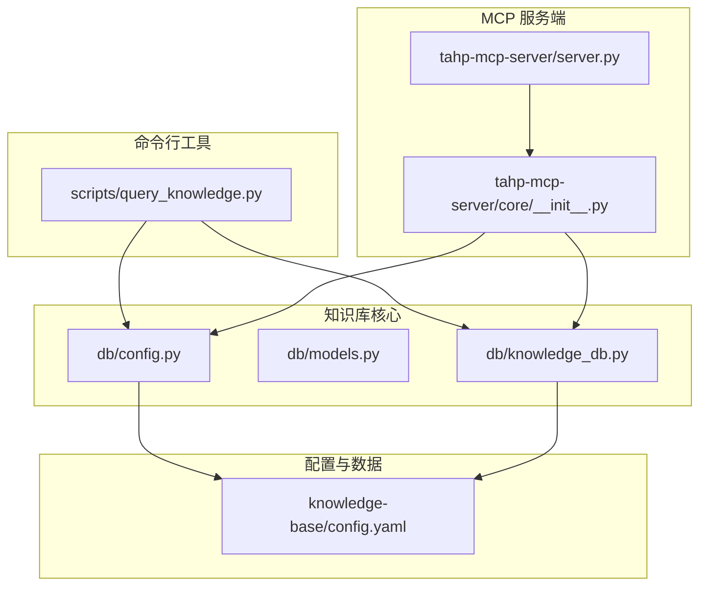
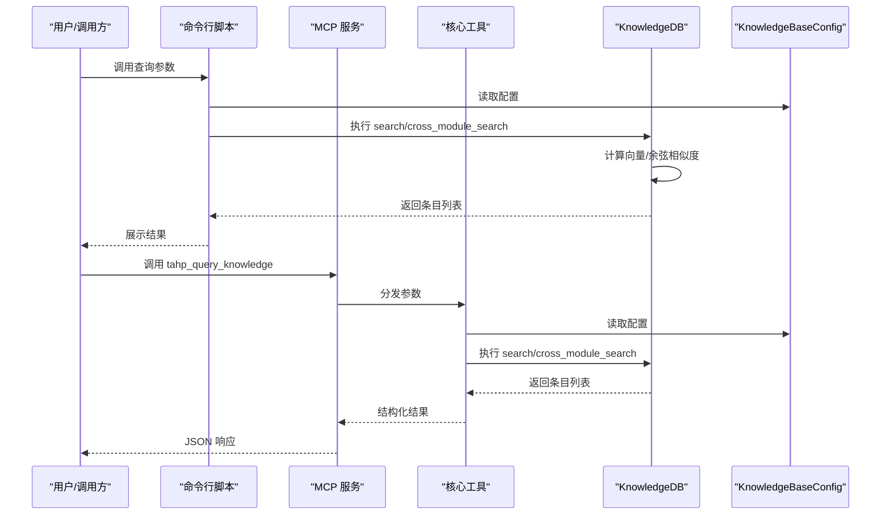
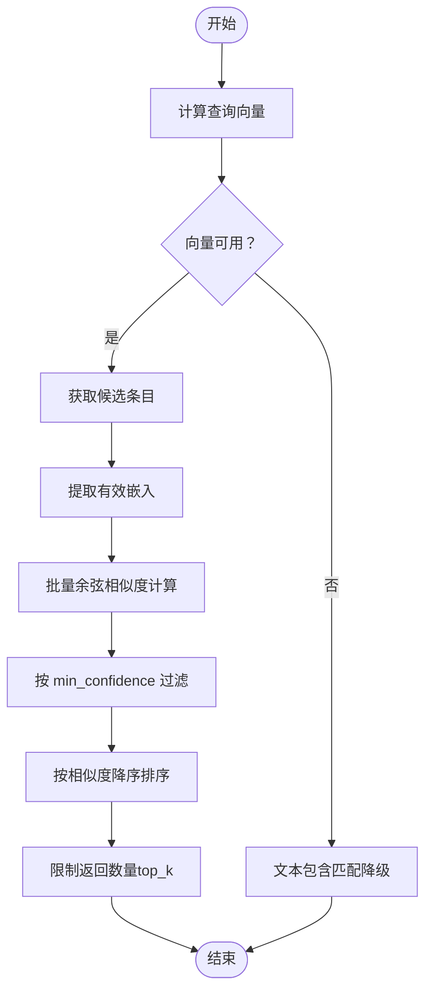
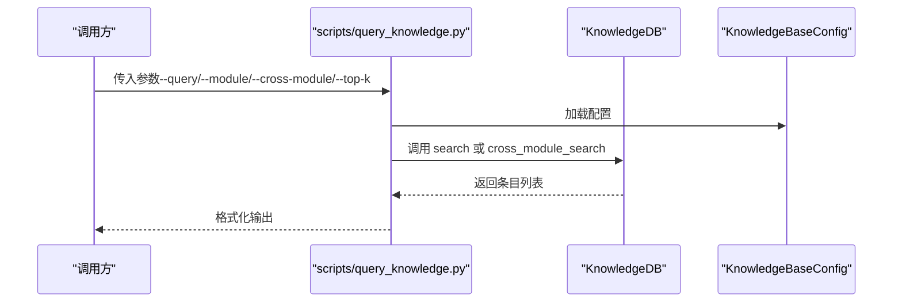
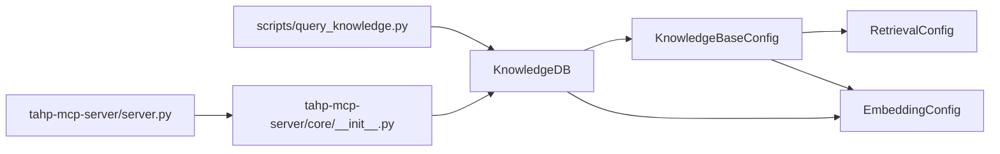

# 语义检索引擎

<cite>
**本文引用的文件**
- [scripts/query_knowledge.py](file://scripts/query_knowledge.py)
- [db/knowledge_db.py](file://db/knowledge_db.py)
- [db/config.py](file://db/config.py)
- [db/models.py](file://db/models.py)
- [knowledge-base/config.yaml](file://knowledge-base/config.yaml)
- [tahp-mcp-server/server.py](file://tahp-mcp-server/server.py)
- [tahp-mcp-server/core/__init__.py](file://tahp-mcp-server/core/__init__.py)
- [playbooks/cross-module-pipeline.yaml](file://playbooks/cross-module-pipeline.yaml)
</cite>

## 目录
1. [简介](#简介)
2. [项目结构](#项目结构)
3. [核心组件](#核心组件)
4. [架构总览](#架构总览)
5. [详细组件分析](#详细组件分析)
6. [依赖关系分析](#依赖关系分析)
7. [性能考量](#性能考量)
8. [故障排查指南](#故障排查指南)
9. [结论](#结论)
10. [附录](#附录)

## 简介
本技术文档面向“语义检索引擎”，聚焦以下目标：
- 深入解释 RetrievalConfig 配置参数的作用与调优策略（默认检索数量、置信度阈值、跨模块检索等）
- 详述检索算法实现原理（向量相似度计算、重排序机制、跨语言检索支持）
- 说明 query_knowledge 接口的使用方法与参数配置
- 提供检索性能优化策略、缓存机制与并发处理方案
- 给出检索结果的质量评估、置信度计算与结果过滤逻辑

## 项目结构
本仓库采用“多模块+脚本驱动”的组织方式：
- db：知识库核心实现（SQLite + numpy 向量、ChromaDB 嵌入函数）
- scripts：命令行工具（如知识查询、知识库初始化）
- knowledge-base：知识库配置与数据目录
- tahp-mcp-server：MCP 服务端，提供 query_knowledge 工具
- playbooks：跨模块协作流水线编排示例

图表来源
- [scripts/query_knowledge.py:116-196](file://scripts/query_knowledge.py#L116-L196)
- [tahp-mcp-server/server.py:221-251](file://tahp-mcp-server/server.py#L221-L251)
- [tahp-mcp-server/core/__init__.py:558-620](file://tahp-mcp-server/core/__init__.py#L558-L620)
- [db/config.py:65-93](file://db/config.py#L65-L93)
- [db/knowledge_db.py:93-127](file://db/knowledge_db.py#L93-L127)
- [knowledge-base/config.yaml:26-31](file://knowledge-base/config.yaml#L26-L31)

章节来源
- [scripts/query_knowledge.py:116-196](file://scripts/query_knowledge.py#L116-L196)
- [tahp-mcp-server/server.py:221-251](file://tahp-mcp-server/server.py#L221-L251)
- [tahp-mcp-server/core/__init__.py:558-620](file://tahp-mcp-server/core/__init__.py#L558-L620)
- [db/config.py:65-93](file://db/config.py#L65-L93)
- [db/knowledge_db.py:93-127](file://db/knowledge_db.py#L93-L127)
- [knowledge-base/config.yaml:26-31](file://knowledge-base/config.yaml#L26-L31)

## 核心组件
- KnowledgeBaseConfig：集中式配置对象，负责从 YAML 加载数据库、检索、自动捕获、约束提取等配置，并提供 to_dict 导出
- RetrievalConfig：检索相关配置，包含 default_top_k、min_confidence、cross_module_top_k、rerank
- KnowledgeDB：知识库核心类，封装 SQLite 存储、向量嵌入、搜索、跨模块检索、统计与最近条目查询
- KnowledgeEntry：知识条目数据模型，支持 Markdown/YAML frontmatter 转换、置信度与元数据管理
- query_knowledge 工具：MCP 工具，接收查询参数，调用 KnowledgeDB 执行搜索并返回结构化结果

章节来源
- [db/config.py:32-39](file://db/config.py#L32-L39)
- [db/config.py:65-93](file://db/config.py#L65-L93)
- [db/knowledge_db.py:93-127](file://db/knowledge_db.py#L93-L127)
- [db/models.py:52-70](file://db/models.py#L52-L70)
- [tahp-mcp-server/core/__init__.py:558-620](file://tahp-mcp-server/core/__init__.py#L558-L620)

## 架构总览
检索引擎由三层组成：
- 配置层：从 YAML 读取检索参数（default_top_k、min_confidence、cross_module_top_k、rerank）
- 检索层：KnowledgeDB 负责向量化、相似度计算、过滤与排序
- 接口层：CLI 与 MCP 工具对外提供查询能力

图表来源
- [scripts/query_knowledge.py:125-180](file://scripts/query_knowledge.py#L125-L180)
- [tahp-mcp-server/server.py:425-435](file://tahp-mcp-server/server.py#L425-L435)
- [tahp-mcp-server/core/__init__.py:558-620](file://tahp-mcp-server/core/__init__.py#L558-L620)
- [db/knowledge_db.py:375-401](file://db/knowledge_db.py#L375-L401)
- [db/knowledge_db.py:519-570](file://db/knowledge_db.py#L519-L570)

## 详细组件分析

### RetrievalConfig 配置参数详解与调优策略
- default_top_k：默认返回结果数量，用于常规搜索
- min_confidence：最小相似度阈值，过滤低相关度结果；配置中给出较低阈值以支持跨语言检索
- cross_module_top_k：跨模块搜索返回数量
- rerank：是否启用二次重排序（当前配置为关闭）

调优建议
- 默认检索数量：根据下游展示空间与吞吐压力设置 default_top_k，避免过多候选导致后续处理开销
- 置信度阈值：min_confidence 需结合语料与模型效果动态调整；英文模型对中文跨语言检索建议适当降低阈值，但需关注误召回
- 跨模块检索：cross_module_top_k 控制跨模块结果规模，建议与模块内搜索分开控制
- 重排序：rerank 若开启，需评估额外计算成本与收益；当前默认关闭

章节来源
- [db/config.py:32-39](file://db/config.py#L32-L39)
- [knowledge-base/config.yaml:26-31](file://knowledge-base/config.yaml#L26-L31)

### 检索算法实现原理
- 向量嵌入：使用 ChromaDB 内置 DefaultEmbeddingFunction（基于 onnxruntime + all-MiniLM-L6-v2，384维），若不可用则降级为文本包含匹配
- 余弦相似度：批量计算查询向量与候选向量矩阵的余弦相似度，归一化后点积
- 过滤与排序：先按相似度降序排序，再按 min_confidence 过滤，最后限制返回数量
- 跨语言支持：配置中明确指出 all-MiniLM-L6-v2 以英文为主，跨语言相似度偏低，建议通过较低阈值提升召回，但需注意误报

图表来源
- [db/knowledge_db.py:174-183](file://db/knowledge_db.py#L174-L183)
- [db/knowledge_db.py:264-307](file://db/knowledge_db.py#L264-L307)
- [db/knowledge_db.py:185-199](file://db/knowledge_db.py#L185-L199)
- [knowledge-base/config.yaml:6-7](file://knowledge-base/config.yaml#L6-L7)

章节来源
- [db/knowledge_db.py:174-183](file://db/knowledge_db.py#L174-L183)
- [db/knowledge_db.py:264-307](file://db/knowledge_db.py#L264-L307)
- [db/knowledge_db.py:185-199](file://db/knowledge_db.py#L185-L199)
- [knowledge-base/config.yaml:6-7](file://knowledge-base/config.yaml#L6-L7)

### query_knowledge 接口使用方法与参数配置
- CLI 使用
  - 支持 --module、--query、--cross-module、--type、--category、--top-k、--stats、--recent 等参数
  - 默认 top_k 为 5；跨模块搜索通过 --cross-module 开启
- MCP 工具
  - 输入 schema 定义了 query、module、cross_module、top_k 四个关键参数
  - 返回结构包含查询参数、模块、跨模块标记、结果列表与总数

图表来源
- [scripts/query_knowledge.py:116-196](file://scripts/query_knowledge.py#L116-L196)
- [tahp-mcp-server/server.py:221-251](file://tahp-mcp-server/server.py#L221-L251)
- [tahp-mcp-server/core/__init__.py:558-620](file://tahp-mcp-server/core/__init__.py#L558-L620)

章节来源
- [scripts/query_knowledge.py:116-196](file://scripts/query_knowledge.py#L116-L196)
- [tahp-mcp-server/server.py:221-251](file://tahp-mcp-server/server.py#L221-L251)
- [tahp-mcp-server/core/__init__.py:558-620](file://tahp-mcp-server/core/__init__.py#L558-L620)

### 检索结果的质量评估、置信度计算与过滤逻辑
- 置信度字段：KnowledgeEntry.confidence 为 0~1 的数值，用于衡量条目可信程度
- 相似度字段：KnowledgeDB 在匹配成功时会将相似度写入 entry.metadata["_similarity"]，便于前端展示
- 过滤逻辑：先按 min_confidence 过滤，再按 top_k 限制数量；跨模块搜索可排除特定模块
- 质量评估建议：结合置信度与相似度综合判断；对跨语言检索，建议同时参考标签与类别进行二次筛选

章节来源
- [db/models.py:66](file://db/models.py#L66)
- [db/knowledge_db.py:280-294](file://db/knowledge_db.py#L280-L294)
- [db/knowledge_db.py:555-568](file://db/knowledge_db.py#L555-L568)

### 跨模块检索支持与流水线编排
- 跨模块搜索：KnowledgeDB.cross_module_search 支持排除指定模块，适用于需要跨模块知识协同的场景
- 流水线编排：playbooks/cross-module-pipeline.yaml 展示了跨模块任务的并行执行与整合流程，检索结果可作为上游输入参与后续分析

章节来源
- [db/knowledge_db.py:519-570](file://db/knowledge_db.py#L519-L570)
- [playbooks/cross-module-pipeline.yaml:6-27](file://playbooks/cross-module-pipeline.yaml#L6-L27)

## 依赖关系分析
- 配置依赖：KnowledgeDB 依赖 KnowledgeBaseConfig.retrieval 获取检索参数
- 检索依赖：KnowledgeDB 依赖 onnxruntime 的 DefaultEmbeddingFunction 进行向量化；若不可用则降级为文本匹配
- 接口依赖：CLI 与 MCP 工具均依赖 KnowledgeDB 的 search/cross_module_search 方法

图表来源
- [db/config.py:65-93](file://db/config.py#L65-L93)
- [db/knowledge_db.py:93-127](file://db/knowledge_db.py#L93-L127)
- [scripts/query_knowledge.py:129-132](file://scripts/query_knowledge.py#L129-L132)
- [tahp-mcp-server/server.py:425-435](file://tahp-mcp-server/server.py#L425-L435)

章节来源
- [db/config.py:65-93](file://db/config.py#L65-L93)
- [db/knowledge_db.py:93-127](file://db/knowledge_db.py#L93-L127)
- [scripts/query_knowledge.py:129-132](file://scripts/query_knowledge.py#L129-L132)
- [tahp-mcp-server/server.py:425-435](file://tahp-mcp-server/server.py#L425-L435)

## 性能考量
- 向量计算与相似度
  - 使用 numpy 批量计算余弦相似度，减少循环开销
  - 嵌入维度固定为 384，内存占用可控
- 过滤与排序
  - 先过滤后排序，避免对低质量候选进行昂贵的排序
  - 仅对存在嵌入的候选进行相似度计算
- 降级策略
  - 当嵌入函数不可用时，回退到文本包含匹配，保证基本检索能力
- 并发与缓存
  - 当前实现未见显式缓存与并发池；可在外部引入连接池与结果缓存（例如基于查询文本+过滤条件的键）以降低重复查询成本
  - 对高频查询可考虑异步并发（注意 SQLite 的并发限制，必要时使用 WAL 模式与连接池）

[本节为通用性能建议，不直接分析具体文件，故无章节来源]

## 故障排查指南
- 嵌入函数不可用
  - 现象：日志提示 ONNX 嵌入不可用，使用降级文本搜索
  - 处理：安装 onnxruntime==1.20.1 或确保环境满足依赖
- 查询无结果
  - 检查 min_confidence 是否过高导致全部被过滤
  - 检查过滤条件（module/type/category/tags）是否过于严格
- 跨语言检索效果差
  - 调整 min_confidence 以提升召回
  - 结合标签与类别进行二次筛选
- MCP 工具报错
  - 确认输入参数（query/module/cross_module/top_k）正确
  - 检查知识库连接与权限

章节来源
- [db/knowledge_db.py:141-156](file://db/knowledge_db.py#L141-L156)
- [db/knowledge_db.py:280-294](file://db/knowledge_db.py#L280-L294)
- [tahp-mcp-server/server.py:425-435](file://tahp-mcp-server/server.py#L425-L435)

## 结论
本检索引擎以 SQLite + numpy 为核心，结合 onnxruntime 的嵌入函数，实现了轻量、跨平台、可降级的语义检索能力。通过 RetrievalConfig 的参数化配置，用户可以灵活控制默认返回数量、置信度阈值与跨模块检索规模。当前未内置缓存与并发池，建议在生产环境中引入连接池与结果缓存以提升性能与稳定性。

## 附录
- 常用命令
  - CLI 查询：python scripts/query_knowledge.py --module telephony --query "问题描述" --cross-module --top-k 5
  - 显示统计：python scripts/query_knowledge.py --stats
  - 最近条目：python scripts/query_knowledge.py --recent 7 --module telephony --top-k 5

[本节为使用说明，不直接分析具体文件，故无章节来源]