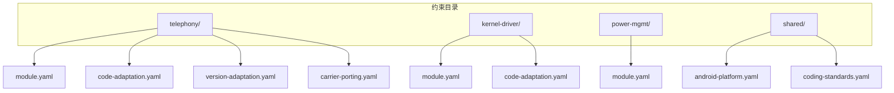
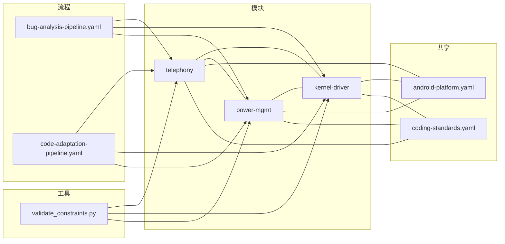
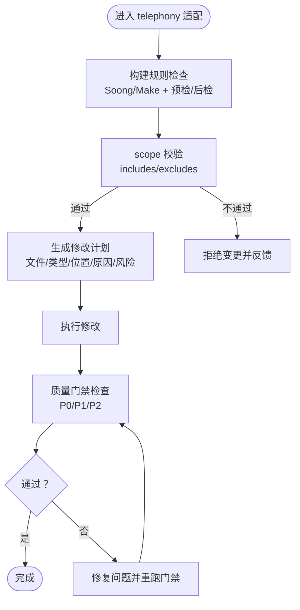
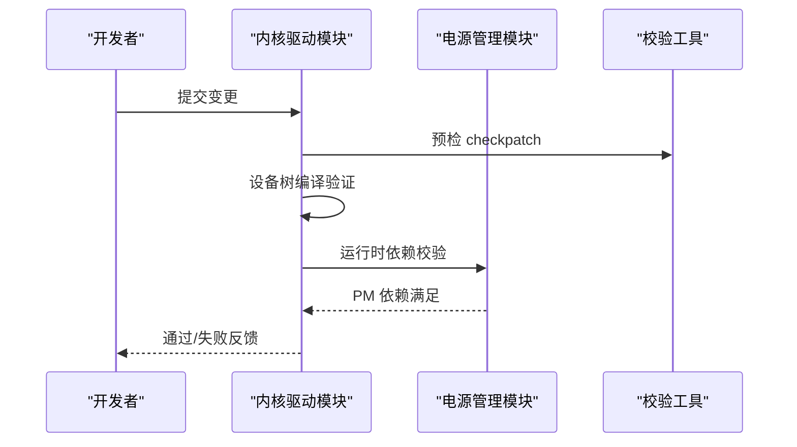
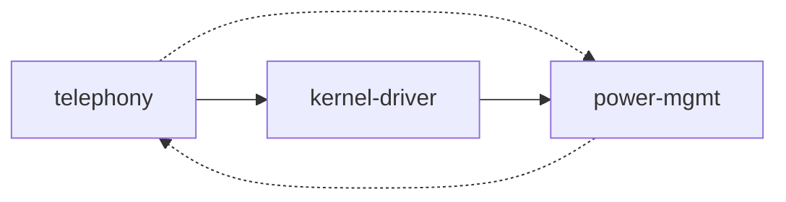

# 模块约束管理

<cite>
**本文引用的文件**
- [constraints/telephony/module.yaml](file://constraints/telephony/module.yaml)
- [constraints/telephony/code-adaptation.yaml](file://constraints/telephony/code-adaptation.yaml)
- [constraints/telephony/carrier-porting.yaml](file://constraints/telephony/carrier-porting.yaml)
- [constraints/telephony/version-adaptation.yaml](file://constraints/telephony/version-adaptation.yaml)
- [constraints/kernel-driver/module.yaml](file://constraints/kernel-driver/module.yaml)
- [constraints/kernel-driver/code-adaptation.yaml](file://constraints/kernel-driver/code-adaptation.yaml)
- [constraints/power-mgmt/module.yaml](file://constraints/power-mgmt/module.yaml)
- [constraints/shared/android-platform.yaml](file://constraints/shared/android-platform.yaml)
- [constraints/shared/coding-standards.yaml](file://constraints/shared/coding-standards.yaml)
- [playbooks/bug-analysis-pipeline.yaml](file://playbooks/bug-analysis-pipeline.yaml)
- [playbooks/code-adaptation-pipeline.yaml](file://playbooks/code-adaptation-pipeline.yaml)
- [scripts/validate_constraints.py](file://scripts/validate_constraints.py)
</cite>

## 目录
1. [引言](#引言)
2. [项目结构](#项目结构)
3. [核心组件](#核心组件)
4. [架构总览](#架构总览)
5. [详细组件分析](#详细组件分析)
6. [依赖分析](#依赖分析)
7. [性能考虑](#性能考虑)
8. [故障排查指南](#故障排查指南)
9. [结论](#结论)
10. [附录](#附录)

## 引言
本文件系统化阐述 TAHP 项目中“模块约束管理”的设计与实践，聚焦四大模块：telephony 通信模块、kernel-driver 内核驱动模块、power-mgmt 电源管理模块与 shared 共享模块。文档覆盖各模块的 scope 范围定义、include/exclude 路径规则、依赖关系配置；解释模块间依赖传递机制与冲突处理策略；总结生命周期管理、版本兼容性与升级策略的最佳实践与常见配置模式。

## 项目结构
约束文件采用“按模块分目录”的组织方式，telephony、kernel-driver、power-mgmt 各自拥有 module.yaml 作为模块元数据与范围定义，辅以 code-adaptation.yaml、carrier-porting.yaml、version-adaptation.yaml 等领域约束文件。shared 目录下提供平台级通用约束（android-platform.yaml、coding-standards.yaml）与 API 迁移规则模板。

图表来源
- [constraints/telephony/module.yaml:1-43](file://constraints/telephony/module.yaml#L1-L43)
- [constraints/telephony/code-adaptation.yaml:1-48](file://constraints/telephony/code-adaptation.yaml#L1-L48)
- [constraints/telephony/version-adaptation.yaml:1-117](file://constraints/telephony/version-adaptation.yaml#L1-L117)
- [constraints/telephony/carrier-porting.yaml:1-106](file://constraints/telephony/carrier-porting.yaml#L1-L106)
- [constraints/kernel-driver/module.yaml:1-30](file://constraints/kernel-driver/module.yaml#L1-L30)
- [constraints/kernel-driver/code-adaptation.yaml:1-37](file://constraints/kernel-driver/code-adaptation.yaml#L1-L37)
- [constraints/power-mgmt/module.yaml:1-32](file://constraints/power-mgmt/module.yaml#L1-L32)
- [constraints/shared/android-platform.yaml:1-25](file://constraints/shared/android-platform.yaml#L1-L25)
- [constraints/shared/coding-standards.yaml:1-23](file://constraints/shared/coding-standards.yaml#L1-L23)

章节来源
- [constraints/telephony/module.yaml:1-43](file://constraints/telephony/module.yaml#L1-L43)
- [constraints/kernel-driver/module.yaml:1-30](file://constraints/kernel-driver/module.yaml#L1-L30)
- [constraints/power-mgmt/module.yaml:1-32](file://constraints/power-mgmt/module.yaml#L1-L32)
- [constraints/shared/android-platform.yaml:1-25](file://constraints/shared/android-platform.yaml#L1-L25)
- [constraints/shared/coding-standards.yaml:1-23](file://constraints/shared/coding-standards.yaml#L1-L23)

## 核心组件
- telephony 通信模块
  - 范围：包含 Telephony Framework、RILJ、Telephony Service、Telecom Framework、RILC/HIDL 层等路径；排除 core/java/android/app、system/core/init、vendor/google/tools、vendor/mediatek/proprietary 等路径。
  - 依赖：kernel-driver（runtime）、power-mgmt（analysis）、framework（compile-time）。
- kernel-driver 内核驱动模块
  - 范围：kernel/drivers、kernel/arch/arm64、kernel/arch/arm64/boot/dts；排除 kernel/drivers/gpu、kernel/drivers/staging、vendor/mediatek。
  - 依赖：power-mgmt（runtime）。
- power-mgmt 电源管理模块
  - 范围：Android 电源管理服务、Power HAL、Battery Service；排除 vendor/mediatek/proprietary、kernel/drivers/power。
  - 依赖：kernel-driver（runtime）、telephony（analysis）。
- shared 共享模块
  - 平台约束：API 级别、构建系统、安全、兼容性、日志规范。
  - 编码规范：提交信息格式、分支命名、代码评审要求、文档与注释规范、Android 特定约束。

章节来源
- [constraints/telephony/module.yaml:11-43](file://constraints/telephony/module.yaml#L11-L43)
- [constraints/kernel-driver/module.yaml:11-30](file://constraints/kernel-driver/module.yaml#L11-L30)
- [constraints/power-mgmt/module.yaml:11-32](file://constraints/power-mgmt/module.yaml#L11-L32)
- [constraints/shared/android-platform.yaml:1-25](file://constraints/shared/android-platform.yaml#L1-L25)
- [constraints/shared/coding-standards.yaml:1-23](file://constraints/shared/coding-standards.yaml#L1-L23)

## 架构总览
模块约束管理通过“模块元数据 + 领域约束 + 流水线 + 校验工具”协同工作：模块元数据定义 scope 与依赖；领域约束定义构建规则、修改规则、质量门禁；流水线驱动跨模块 Bug 分析与代码适配；校验工具保障约束文件自身结构与跨引用一致性。

图表来源
- [playbooks/bug-analysis-pipeline.yaml:1-43](file://playbooks/bug-analysis-pipeline.yaml#L1-L43)
- [playbooks/code-adaptation-pipeline.yaml:1-35](file://playbooks/code-adaptation-pipeline.yaml#L1-L35)
- [scripts/validate_constraints.py:1-360](file://scripts/validate_constraints.py#L1-L360)
- [constraints/telephony/module.yaml:11-43](file://constraints/telephony/module.yaml#L11-L43)
- [constraints/kernel-driver/module.yaml:11-30](file://constraints/kernel-driver/module.yaml#L11-L30)
- [constraints/power-mgmt/module.yaml:11-32](file://constraints/power-mgmt/module.yaml#L11-L32)
- [constraints/shared/android-platform.yaml:1-25](file://constraints/shared/android-platform.yaml#L1-L25)
- [constraints/shared/coding-standards.yaml:1-23](file://constraints/shared/coding-standards.yaml#L1-L23)

## 详细组件分析

### telephony 通信模块
- 范围与路径
  - includes：Telephony Framework、RILJ、Telephony Service、Telecom Framework、RILC/HIDL。
  - excludes：frameworks/base/core/java/android/app、system/core/init、vendor/google/tools、vendor/mediatek/proprietary。
- 依赖关系
  - runtime：kernel-driver（RILC 依赖字符设备节点）
  - analysis：power-mgmt（通话功耗与基带电源管理）
  - compile-time：framework（依赖 Android Framework 核心 API）
- 领域约束
  - 构建规则：Android Soong/Make，预检/后检命令，禁止废弃 API 使用。
  - 修改规则：允许/禁止路径清单，Java 风格规则，接口变更与版本控制。
  - 质量门禁：禁止引入新编译错误、禁止修改无关公共代码、禁止移除错误处理、禁止修改安全权限检查等。
- 升级与适配
  - 版本升级：A15→A16 的 API 迁移规则、排除 MTK 专有代码、策略偏好与验收标准。
  - 运营商移植：Airtel 印度定制需求、overlay 机制、合规标准与回归目标。

图表来源
- [constraints/telephony/code-adaptation.yaml:1-48](file://constraints/telephony/code-adaptation.yaml#L1-L48)
- [playbooks/code-adaptation-pipeline.yaml:1-35](file://playbooks/code-adaptation-pipeline.yaml#L1-L35)

章节来源
- [constraints/telephony/module.yaml:11-43](file://constraints/telephony/module.yaml#L11-L43)
- [constraints/telephony/code-adaptation.yaml:1-48](file://constraints/telephony/code-adaptation.yaml#L1-L48)
- [constraints/telephony/version-adaptation.yaml:1-117](file://constraints/telephony/version-adaptation.yaml#L1-L117)
- [constraints/telephony/carrier-porting.yaml:1-106](file://constraints/telephony/carrier-porting.yaml#L1-L106)

### kernel-driver 内核驱动模块
- 范围与路径
  - includes：kernel/drivers、kernel/arch/arm64、kernel/arch/arm64/boot/dts。
  - excludes：kernel/drivers/gpu、kernel/drivers/staging、kernel/mm。
- 依赖关系
  - runtime：power-mgmt（驱动功耗管理依赖 PM 框架）。
- 领域约束
  - 构建规则：Kernel Make，checkpatch 预检，设备树编译后检。
  - 修改规则：允许/禁止路径清单，内核编码风格与 Tab 缩进。
  - 质量门禁：禁止引入编译错误、禁止修改无关公共代码、设备树影响范围控制、禁止移除错误处理、新增 Kconfig 选项默认值。

图表来源
- [constraints/kernel-driver/code-adaptation.yaml:1-37](file://constraints/kernel-driver/code-adaptation.yaml#L1-L37)
- [constraints/kernel-driver/module.yaml:11-30](file://constraints/kernel-driver/module.yaml#L11-L30)
- [scripts/validate_constraints.py:184-238](file://scripts/validate_constraints.py#L184-L238)

章节来源
- [constraints/kernel-driver/module.yaml:11-30](file://constraints/kernel-driver/module.yaml#L11-L30)
- [constraints/kernel-driver/code-adaptation.yaml:1-37](file://constraints/kernel-driver/code-adaptation.yaml#L1-L37)

### power-mgmt 电源管理模块
- 范围与路径
  - includes：Android 电源管理服务、Power HAL、Battery Service。
  - excludes：vendor/mediatek/proprietary、kernel/drivers/power。
- 依赖关系
  - runtime：kernel-driver（功耗策略依赖内核 PM 驱动）
  - analysis：telephony（通话功耗分析需了解 RIL 状态）
- 领域约束
  - 构建规则：Android Soong/Make，预检/后检。
  - 修改规则：允许/禁止路径清单，风格与注释要求。
  - 质量门禁：禁止引入编译错误、禁止修改无关公共代码、禁止移除错误处理、禁止修改安全权限检查。

章节来源
- [constraints/power-mgmt/module.yaml:11-32](file://constraints/power-mgmt/module.yaml#L11-L32)
- [constraints/power-mgmt/code-adaptation.yaml:1-37](file://constraints/power-mgmt/code-adaptation.yaml#L1-L37)

### shared 共享模块
- 平台约束
  - API 级别：min/target/compile SDK。
  - 构建系统：优先 Soong，遗留模块使用 Make。
  - 安全：HTTPS、加密算法、Content Provider 权限、Broadcast exported 默认值、禁用 Runtime.exec。
  - 兼容性：CTS/GTS/VTS 基础测试要求。
  - 日志：标准级别、Release 不输出 Debug/Verbose、日志 Tag 规范、敏感信息脱敏。
- 编码规范
  - 提交信息格式与类型、分支命名。
  - 代码评审：最少评审人数、自动化检查项。
  - 文档：Javadoc/Doxygen、复杂算法注释、Bug 修复与适配变更的提交规范。
  - Android 特定：@hide/@SystemApi、@RequiresApi、资源命名与布局 ID 命名。

章节来源
- [constraints/shared/android-platform.yaml:1-25](file://constraints/shared/android-platform.yaml#L1-L25)
- [constraints/shared/coding-standards.yaml:1-23](file://constraints/shared/coding-standards.yaml#L1-L23)

## 依赖分析
- 直接依赖
  - telephony → kernel-driver（runtime）、power-mgmt（analysis）、framework（compile-time）
  - kernel-driver → power-mgmt（runtime）
  - power-mgmt → kernel-driver（runtime）、telephony（analysis）
- 依赖传递
  - telephony 间接影响 power-mgmt（通话功耗分析）与 kernel-driver（RILC 字符设备依赖）。
  - kernel-driver 间接影响 power-mgmt（PM 依赖）。
- 冲突处理策略
  - 通过 scope.excludes 明确边界，避免跨模块误改。
  - 通过质量门禁与预检/后检强制执行平台与风格约束。
  - 通过跨模块流水线（Bug 分析）定位根因，避免重复修复与冲突扩散。

图表来源
- [constraints/telephony/module.yaml:33-42](file://constraints/telephony/module.yaml#L33-L42)
- [constraints/kernel-driver/module.yaml:26-29](file://constraints/kernel-driver/module.yaml#L26-L29)
- [constraints/power-mgmt/module.yaml:25-31](file://constraints/power-mgmt/module.yaml#L25-L31)

章节来源
- [constraints/telephony/module.yaml:33-42](file://constraints/telephony/module.yaml#L33-L42)
- [constraints/kernel-driver/module.yaml:26-29](file://constraints/kernel-driver/module.yaml#L26-L29)
- [constraints/power-mgmt/module.yaml:25-31](file://constraints/power-mgmt/module.yaml#L25-L31)

## 性能考虑
- 构建效率
  - 优先使用 Soong（Android.bp）提升增量构建速度，减少 Make 的全局扫描开销。
  - 设备树编译与内核构建并行化，缩短整体构建时间。
- 适配效率
  - 自动化策略偏好：高置信度迁移自动执行，低置信度半自动或人工介入。
  - 批量大小与并行代理数量可调，平衡吞吐与稳定性。
- 质量门禁前置
  - 预检/后检在本地快速发现风格与兼容性问题，降低 CI 失败率与回滚成本。

## 故障排查指南
- 约束文件校验
  - 使用校验脚本对单文件或目录进行语法、顶层键、元数据、跨引用检查。
  - 严格模式下额外校验版本格式与日期格式，识别潜在配置问题。
- 常见问题定位
  - 依赖未知模块：校验器会提示 module.yaml 中依赖引用了未知模块，需修正或补充模块定义。
  - 质量门禁失败：根据门禁规则逐项检查，确保无新增编译错误、无废弃 API 残留、无安全权限逻辑变更。
  - 跨模块冲突：通过流水线并行分析 telephony/kernle-driver/power-mgmt 的结果，定位根因并生成统一报告。
- 工具链建议
  - 在本地先运行校验脚本，再执行构建与测试，减少远端 CI 失败概率。
  - 对于 kernel-driver，确保设备树编译通过后再进行后续验证。

章节来源
- [scripts/validate_constraints.py:184-238](file://scripts/validate_constraints.py#L184-L238)
- [playbooks/bug-analysis-pipeline.yaml:1-43](file://playbooks/bug-analysis-pipeline.yaml#L1-L43)
- [constraints/telephony/code-adaptation.yaml:37-48](file://constraints/telephony/code-adaptation.yaml#L37-L48)
- [constraints/kernel-driver/code-adaptation.yaml:8-11](file://constraints/kernel-driver/code-adaptation.yaml#L8-L11)
- [constraints/power-mgmt/code-adaptation.yaml:1-37](file://constraints/power-mgmt/code-adaptation.yaml#L1-L37)

## 结论
模块约束管理通过清晰的 scope 边界、严格的依赖与质量门禁、完善的跨模块流水线与校验工具，实现了多模块协同开发的可控性与一致性。telephony、kernel-driver、power-mgmt 三者形成“通信-驱动-电源”的闭环依赖，shared 提供平台与规范支撑。遵循本文最佳实践与配置模式，可在保证质量的前提下高效推进版本升级与运营商移植。

## 附录
- 生命周期管理
  - 创建：在 templates/module-template 下生成新模块模板，填充 module.yaml 与领域约束文件。
  - 维护：定期更新依赖关系、scope 路径与质量门禁，保持与平台版本一致。
  - 升级：基于 version-adaptation.yaml 的迁移规则与验收标准，分批推进。
- 版本兼容性与升级策略
  - 严格遵循 shared/android-platform.yaml 的 API 级别与构建系统要求。
  - 使用 version-adaptation.yaml 的迁移规则与排除策略，避免 MTK 专有代码干扰。
  - 通过 smoke/test 目标与回归目标确保功能稳定。