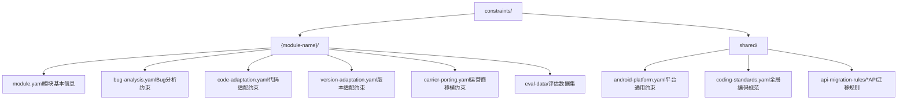
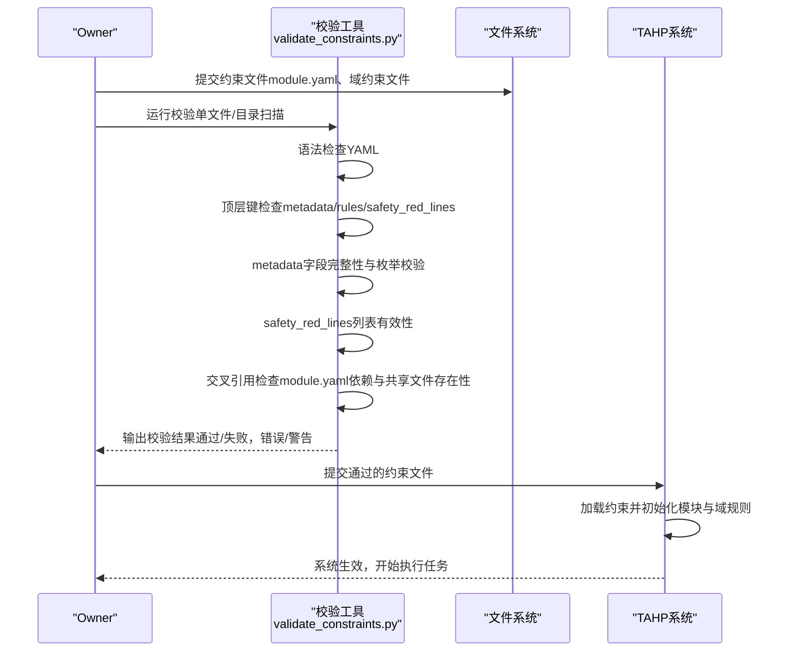
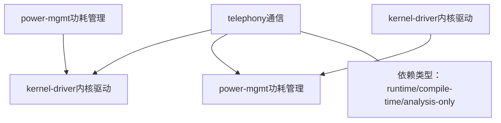

# 约束文件格式规范

<cite>
**本文引用的文件**
- [TAHP-约束文件编写规范.md](file://TAHP-约束文件编写规范.md)
- [validate_constraints.py](file://scripts/validate_constraints.py)
- [module.yaml.template](file://templates/module-template/module.yaml.template)
- [bug-analysis.yaml.template](file://templates/module-template/bug-analysis.yaml.template)
- [code-adaptation.yaml.template](file://templates/module-template/code-adaptation.yaml.template)
- [version-adaptation.yaml.template](file://templates/module-template/version-adaptation.yaml.template)
- [module.yaml（内核驱动）](file://constraints/kernel-driver/module.yaml)
- [module.yaml（功耗管理）](file://constraints/power-mgmt/module.yaml)
- [module.yaml（通信）](file://constraints/telephony/module.yaml)
- [bug-analysis.yaml（内核驱动）](file://constraints/kernel-driver/bug-analysis.yaml)
- [bug-analysis.yaml（功耗管理）](file://constraints/power-mgmt/bug-analysis.yaml)
- [bug-analysis.yaml（通信）](file://constraints/telephony/bug-analysis.yaml)
- [code-adaptation.yaml（内核驱动）](file://constraints/kernel-driver/code-adaptation.yaml)
- [code-adaptation.yaml（通信）](file://constraints/telephony/code-adaptation.yaml)
- [android-platform.yaml（共享）](file://constraints/shared/android-platform.yaml)
- [coding-standards.yaml（共享）](file://constraints/shared/coding-standards.yaml)
</cite>

## 目录
1. [引言](#引言)
2. [项目结构](#项目结构)
3. [核心组件](#核心组件)
4. [架构总览](#架构总览)
5. [详细组件分析](#详细组件分析)
6. [依赖分析](#依赖分析)
7. [性能考量](#性能考量)
8. [故障排查指南](#故障排查指南)
9. [结论](#结论)
10. [附录](#附录)

## 引言
本规范面向业务Owner与系统使用者，定义了TAHP约束文件的完整语法规则、字段定义、配置选项与校验机制。通过标准化的YAML约束文件，系统能够以声明式方式表达模块边界、代码规则、质量标准与历史知识，从而确保AI代理在Bug分析与代码适配任务中严格遵循既定规则，并具备可验证性与可追溯性。

## 项目结构
约束文件采用“模块化+域划分”的组织方式，每个模块在constraints/{module-name}/下维护独立的约束文件，辅以共享规则与评估数据集。

图表来源
- [TAHP-约束文件编写规范.md:34-46](file://TAHP-约束文件编写规范.md#L34-L46)

章节来源
- [TAHP-约束文件编写规范.md:30-46](file://TAHP-约束文件编写规范.md#L30-L46)

## 核心组件
本节聚焦约束文件的关键组成部分及其职责边界，包括模块元信息、作用域与依赖、以及各域约束文件的结构与字段。

- 模块元信息（module.yaml）
  - 用于声明模块身份、归属与版本信息，是系统识别与初始化的基础。
  - 关键字段：模块名称、显示名、技术域、负责人、团队、版本、创建/更新时间等。
  - 必填字段清单：模块名称、负责人、作用域包含列表、作用域排除列表、跨模块依赖列表。
  
- 作用域与依赖（scope与dependencies）
  - includes/excludes定义模块边界与排除范围，确保分析与适配仅在受控范围内进行。
  - dependencies描述跨模块依赖关系，支持运行时、编译期与仅分析三类类型，便于系统进行一致性检查与流水线编排。

- 域约束文件
  - Bug分析约束（bug-analysis.yaml）：定义前置条件、分析流程顺序、禁止行为、必须输出指标与安全红线。
  - 代码适配约束（code-adaptation.yaml）：定义构建规则、修改范围、代码风格与质量红线。
  - 版本适配约束（version-adaptation.yaml）：定义源/目标版本信息、API变更迁移规则、测试要求与回滚条件。
  - 运营商移植约束（carrier-porting.yaml）：定义跨厂商适配的规则与测试要求（模板中提供）。

章节来源
- [TAHP-约束文件编写规范.md:59-115](file://TAHP-约束文件编写规范.md#L59-L115)
- [module.yaml（通信）:1-43](file://constraints/telephony/module.yaml#L1-L43)
- [module.yaml（内核驱动）:1-30](file://constraints/kernel-driver/module.yaml#L1-L30)
- [module.yaml（功耗管理）:1-32](file://constraints/power-mgmt/module.yaml#L1-L32)

## 架构总览
约束文件在系统中的工作流如下：Owner编写约束文件 → CLI校验工具进行语法与结构校验 → 交叉引用检查模块间依赖一致性 → 系统加载约束并驱动AI代理执行任务。

图表来源
- [validate_constraints.py:87-182](file://scripts/validate_constraints.py#L87-L182)
- [validate_constraints.py:184-238](file://scripts/validate_constraints.py#L184-L238)
- [validate_constraints.py:239-278](file://scripts/validate_constraints.py#L239-L278)

章节来源
- [validate_constraints.py:1-360](file://scripts/validate_constraints.py#L1-L360)

## 详细组件分析

### 模块基本信息（module.yaml）
- 字段类型与含义
  - module.name：模块唯一标识符（kebab-case），必填。
  - module.display_name：模块中文显示名。
  - module.domain：技术域枚举，如android-telephony、android-kernel-driver、android-power-management等。
  - module.owner/team：负责人与团队。
  - module.version/created/updated：版本与时间戳。
  - scope.includes：至少一项，每项包含component、path、description。
  - scope.excludes：至少一项，明确排除的代码路径。
  - scope.dependencies：跨模块依赖列表，每项包含module/type/description，type取值为runtime/compile-time/analysis-only。
- 默认值与校验
  - 未在仓库中发现显式默认值；校验工具要求metadata字段非空且domain在允许集合内。
- 必填字段检查清单
  - module.name、module.owner、scope.includes、scope.excludes、scope.dependencies。

章节来源
- [TAHP-约束文件编写规范.md:59-115](file://TAHP-约束文件编写规范.md#L59-L115)
- [validate_constraints.py:115-155](file://scripts/validate_constraints.py#L115-L155)
- [module.yaml（通信）:1-43](file://constraints/telephony/module.yaml#L1-L43)
- [module.yaml（内核驱动）:1-30](file://constraints/kernel-driver/module.yaml#L1-L30)
- [module.yaml（功耗管理）:1-32](file://constraints/power-mgmt/module.yaml#L1-L32)

### Bug分析约束（bug-analysis.yaml）
- 结构要点
  - prerequisites.required_info：定义分析前必需的信息项，支持required与error_msg。
  - analysis_rules.layer_detection_order：按序执行的层级判定，每层包含layer与indicators（pattern列表）。
  - analysis_rules.prohibited：禁止行为清单。
  - analysis_rules.required_outputs：必须产出的分析维度（枚举/文本，部分字段支持min_length）。
  - security_gates：安全红线条件与动作。
  - evaluation：评估指标（如准确率阈值）、测试数据集路径。
- 字段类型与校验
  - required_outputs中的枚举values与文本min_length用于输出质量控制。
  - required_info中的required与error_msg用于前置条件强制。
- 评估数据集
  - 每个模块至少准备若干历史案例，建议train/val/test划分，最低不少于5个。

章节来源
- [TAHP-约束文件编写规范.md:118-281](file://TAHP-约束文件编写规范.md#L118-L281)
- [bug-analysis.yaml（通信）:1-110](file://constraints/telephony/bug-analysis.yaml#L1-L110)
- [bug-analysis.yaml（功耗管理）:1-61](file://constraints/power-mgmt/bug-analysis.yaml#L1-L61)
- [bug-analysis.yaml（内核驱动）:1-65](file://constraints/kernel-driver/bug-analysis.yaml#L1-L65)

### 代码适配约束（code-adaptation.yaml）
- 结构要点
  - build_rules：构建系统类型、构建命令与前后置检查。
  - modification_rules.allowed_paths/forbidden_paths/style_rules：允许/禁止修改的路径与风格规则。
  - modification_rules.interface_change_rules：接口变更规则（如HIDL/AIDL、API级别、版本号）。
  - quality_gates.critical/warning：质量红线（零容忍与警告级别）。
- 字段类型与校验
  - 通过构建命令与检查项确保修改符合编码规范与质量门禁。
  - forbidden_paths与style_rules用于限定修改范围与风格一致性。

章节来源
- [TAHP-约束文件编写规范.md:282-362](file://TAHP-约束文件编写规范.md#L282-L362)
- [code-adaptation.yaml（内核驱动）:1-37](file://constraints/kernel-driver/code-adaptation.yaml#L1-L37)
- [code-adaptation.yaml（通信）:1-48](file://constraints/telephony/code-adaptation.yaml#L1-L48)

### 版本适配约束（version-adaptation.yaml）
- 结构要点
  - version_info：源/目标Android版本、API级别、代号与指纹。
  - migration_rules：废弃API替换、新增API采纳、行为变化、签名变化、权限变化与构建系统变化。
  - migration_scope：扫描路径、包含/排除模式。
  - testing_requirements：迁移前后测试要求与回归测试。
  - rollback_criteria：自动回滚与人工复核条件及回滚流程。
  - safety_red_lines：版本迁移不可触碰的安全底线。
- 字段类型与校验
  - 通过阈值与权重定义迁移质量评估指标，确保迁移的准确性与安全性。

章节来源
- [version-adaptation.yaml.template:18-323](file://templates/module-template/version-adaptation.yaml.template#L18-L323)

### 运营商移植约束（carrier-porting.yaml）
- 结构要点
  - 模板提供运营商移植域的约束结构，包括metadata、域规则、测试要求与安全红线。
- 字段类型与校验
  - 通过模板与共享规则协同，确保跨厂商适配的一致性与可验证性。

章节来源
- [carrier-porting.yaml（通信）](file://constraints/telephony/carrier-porting.yaml)
- [bug-analysis.yaml.template:1-272](file://templates/module-template/bug-analysis.yaml.template#L1-L272)
- [code-adaptation.yaml.template:1-297](file://templates/module-template/code-adaptation.yaml.template#L1-L297)

### 共享约束（shared/）
- android-platform.yaml：平台通用约束，涵盖API级别、构建系统、安全、兼容性与日志规范。
- coding-standards.yaml：全局编码规范，包括版本控制、代码评审与文档要求。

章节来源
- [android-platform.yaml（共享）:1-25](file://constraints/shared/android-platform.yaml#L1-L25)
- [coding-standards.yaml（共享）:1-23](file://constraints/shared/coding-standards.yaml#L1-L23)

## 依赖分析
模块间的依赖关系通过module.yaml中的dependencies字段声明，validate_constraints.py提供交叉引用检查，确保依赖模块存在且合法。

图表来源
- [module.yaml（通信）:33-43](file://constraints/telephony/module.yaml#L33-L43)
- [module.yaml（功耗管理）:25-32](file://constraints/power-mgmt/module.yaml#L25-L32)
- [module.yaml（内核驱动）:26-30](file://constraints/kernel-driver/module.yaml#L26-L30)
- [validate_constraints.py:184-238](file://scripts/validate_constraints.py#L184-L238)

章节来源
- [validate_constraints.py:184-238](file://scripts/validate_constraints.py#L184-L238)

## 性能考量
- 校验工具的性能特性
  - 支持单文件与目录扫描，递归扫描子目录；去重处理避免重复校验。
  - 严格模式下增加额外警告（如版本格式、日期格式），有助于提前发现潜在问题。
- 评估数据集规模
  - 建议每个模块准备至少15个历史案例，最低不少于5个，以保证评估稳定性与泛化能力。

章节来源
- [validate_constraints.py:251-278](file://scripts/validate_constraints.py#L251-L278)
- [TAHP-约束文件编写规范.md:243-281](file://TAHP-约束文件编写规范.md#L243-L281)

## 故障排查指南
- 常见错误与定位
  - YAML语法错误：校验工具会报告YAML解析错误位置与原因。
  - 顶层键缺失：若缺少metadata、rules或safety_red_lines，将被标记为错误。
  - metadata字段为空：domain不在允许集合内、version格式不符合语义化版本建议、last_updated不是有效ISO日期等，将在严格模式下产生警告。
  - safety_red_lines为空：提示考虑添加至少一条安全红线。
  - 依赖模块未知：当module.yaml中依赖的模块不存在于constraints目录时，将产生警告。
- 调试建议
  - 使用严格模式运行校验工具，以便捕获潜在问题。
  - 逐项对照必填字段清单，确保module.yaml与域约束文件均满足要求。
  - 在共享规则与模块规则之间保持一致性，避免冲突与冗余。

章节来源
- [validate_constraints.py:80-182](file://scripts/validate_constraints.py#L80-L182)
- [validate_constraints.py:184-238](file://scripts/validate_constraints.py#L184-L238)
- [TAHP-约束文件编写规范.md:108-115](file://TAHP-约束文件编写规范.md#L108-L115)

## 结论
通过标准化的约束文件格式与严格的校验机制，TAHP系统能够将业务Owner的领域知识转化为可执行、可验证、可追溯的规则集。建议Owner在编写约束文件时遵循声明式、可验证、具体、最小必要与版本化的五大原则，并充分利用模板与共享规则，以提升约束质量与系统整体效能。

## 附录

### 字段类型与校验规则速览
- 必填字段
  - module.name、module.owner、scope.includes、scope.excludes、scope.dependencies
- 枚举与集合
  - metadata.domain：必须属于允许集合（如bug_analysis、code_adaptation、version_adaptation、carrier_porting）
  - required_outputs.type：枚举或文本；枚举values为预定义集合
- 文本长度约束
  - required_outputs中某些字段支持min_length
- 日期与版本
  - last_updated：ISO日期格式
  - version：建议遵循语义化版本格式

章节来源
- [validate_constraints.py:30-37](file://scripts/validate_constraints.py#L30-L37)
- [validate_constraints.py:115-155](file://scripts/validate_constraints.py#L115-L155)
- [bug-analysis.yaml（通信）:65-93](file://constraints/telephony/bug-analysis.yaml#L65-L93)

### 约束文件结构示例（路径索引）
- 模块基本信息
  - [module.yaml（通信）](file://constraints/telephony/module.yaml)
  - [module.yaml（内核驱动）](file://constraints/kernel-driver/module.yaml)
  - [module.yaml（功耗管理）](file://constraints/power-mgmt/module.yaml)
- Bug分析约束
  - [bug-analysis.yaml（通信）](file://constraints/telephony/bug-analysis.yaml)
  - [bug-analysis.yaml（功耗管理）](file://constraints/power-mgmt/bug-analysis.yaml)
  - [bug-analysis.yaml（内核驱动）](file://constraints/kernel-driver/bug-analysis.yaml)
- 代码适配约束
  - [code-adaptation.yaml（通信）](file://constraints/telephony/code-adaptation.yaml)
  - [code-adaptation.yaml（内核驱动）](file://constraints/kernel-driver/code-adaptation.yaml)
- 版本适配约束
  - [version-adaptation.yaml（模板）](file://templates/module-template/version-adaptation.yaml.template)
- 运营商移植约束
  - [carrier-porting.yaml（通信）](file://constraints/telephony/carrier-porting.yaml)
- 共享约束
  - [android-platform.yaml（共享）](file://constraints/shared/android-platform.yaml)
  - [coding-standards.yaml（共享）](file://constraints/shared/coding-standards.yaml)