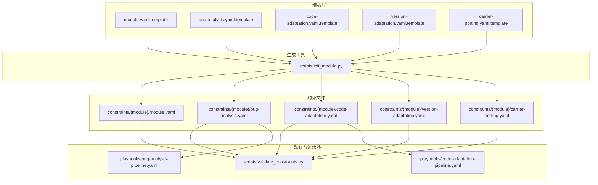
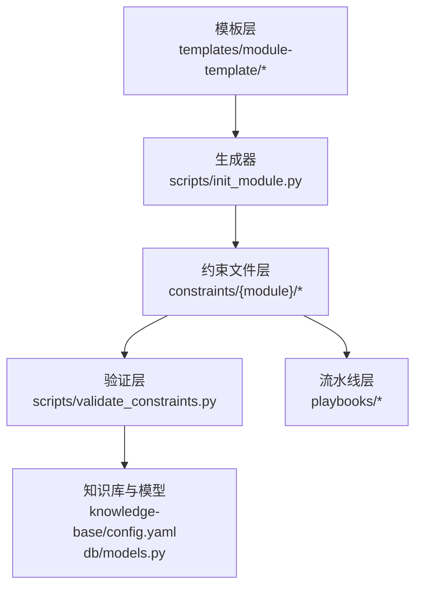
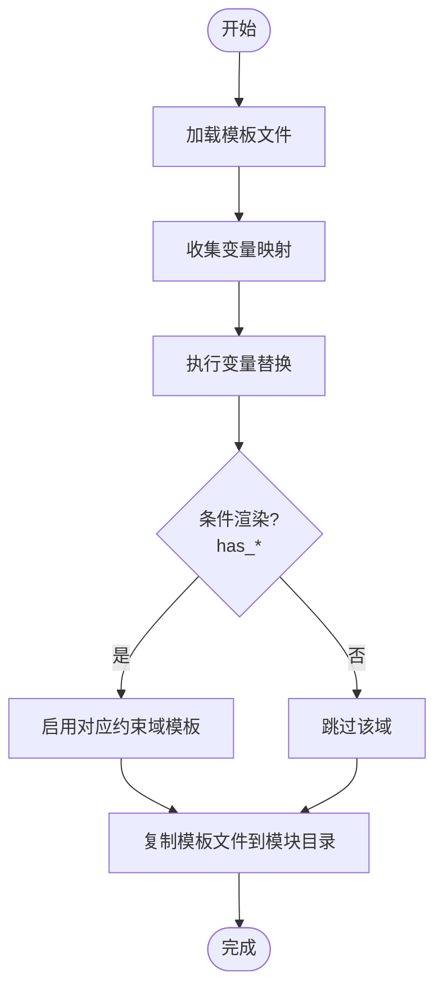
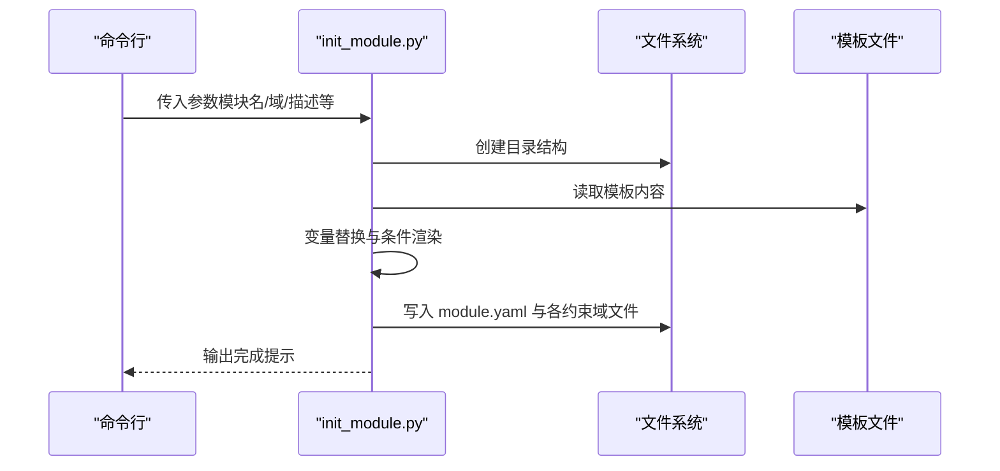
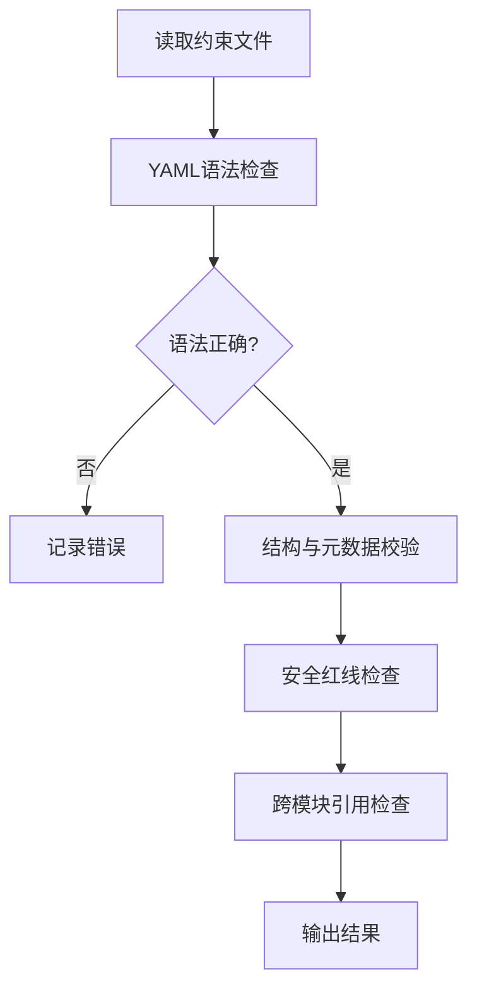
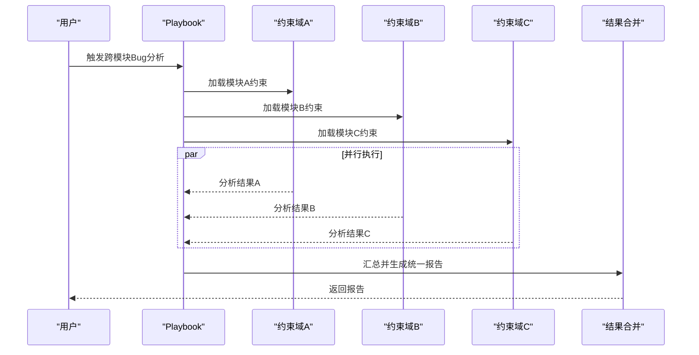
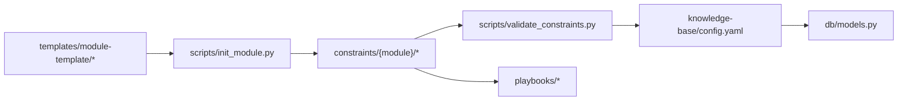

# 约束模板系统

<cite>
**本文档引用的文件**
- [module.yaml.template](file://templates/module-template/module.yaml.template)
- [bug-analysis.yaml.template](file://templates/module-template/bug-analysis.yaml.template)
- [code-adaptation.yaml.template](file://templates/module-template/code-adaptation.yaml.template)
- [version-adaptation.yaml.template](file://templates/module-template/version-adaptation.yaml.template)
- [carrier-porting.yaml.template](file://templates/module-template/carrier-porting.yaml.template)
- [init_module.py](file://scripts/init_module.py)
- [validate_constraints.py](file://scripts/validate_constraints.py)
- [TAHP-约束文件编写规范.md](file://TAHP-约束文件编写规范.md)
- [bug-analysis-pipeline.yaml](file://playbooks/bug-analysis-pipeline.yaml)
- [code-adaptation-pipeline.yaml](file://playbooks/code-adaptation-pipeline.yaml)
- [module.yaml](file://constraints/telephony/module.yaml)
- [bug-analysis.yaml](file://constraints/telephony/bug-analysis.yaml)
- [code-adaptation.yaml](file://constraints/telephony/code-adaptation.yaml)
- [version-adaptation.yaml](file://constraints/telephony/version-adaptation.yaml)
- [carrier-porting.yaml](file://constraints/telephony/carrier-porting.yaml)
- [config.yaml](file://knowledge-base/config.yaml)
- [models.py](file://db/models.py)
</cite>

## 目录
1. [简介](#简介)
2. [项目结构](#项目结构)
3. [核心组件](#核心组件)
4. [架构总览](#架构总览)
5. [详细组件分析](#详细组件分析)
6. [依赖分析](#依赖分析)
7. [性能考虑](#性能考虑)
8. [故障排查指南](#故障排查指南)
9. [结论](#结论)
10. [附录](#附录)

## 简介
本文件系统性阐述约束模板系统的设计与实现，涵盖模板生成机制、变量替换、条件渲染与继承策略，以及版本管理、更新与向后兼容性保障。系统通过标准化模板与脚本化初始化，确保模块约束文件的一致性与可验证性，并配套验证工具与流水线配置，支撑跨域（Bug分析、代码适配、版本升级、运营商移植）的自动化与质量门禁。

## 项目结构
模板系统围绕 templates/module-template 提供标准化模板，配合 scripts/init_module.py 实现模板到约束文件的生成与填充；同时通过 scripts/validate_constraints.py 提供约束文件的格式与语义校验；playbooks 提供跨模块工作流编排；constraints 下的模块约束文件体现模板的实际落地与定制化。

**图表来源**
- [module.yaml.template:1-70](file://templates/module-template/module.yaml.template#L1-L70)
- [bug-analysis.yaml.template:1-272](file://templates/module-template/bug-analysis.yaml.template#L1-L272)
- [code-adaptation.yaml.template:1-297](file://templates/module-template/code-adaptation.yaml.template#L1-L297)
- [version-adaptation.yaml.template:1-323](file://templates/module-template/version-adaptation.yaml.template#L1-L323)
- [carrier-porting.yaml.template:1-375](file://templates/module-template/carrier-porting.yaml.template#L1-L375)
- [init_module.py:154-249](file://scripts/init_module.py#L154-L249)
- [validate_constraints.py:239-278](file://scripts/validate_constraints.py#L239-L278)
- [bug-analysis-pipeline.yaml:1-43](file://playbooks/bug-analysis-pipeline.yaml#L1-L43)
- [code-adaptation-pipeline.yaml:1-35](file://playbooks/code-adaptation-pipeline.yaml#L1-L35)

**章节来源**
- [module.yaml.template:1-70](file://templates/module-template/module.yaml.template#L1-L70)
- [init_module.py:154-249](file://scripts/init_module.py#L154-L249)

## 核心组件
- 模板文件：提供标准化的约束文件骨架，包含占位符与条件渲染片段，覆盖模块基本信息、各约束域规则、安全红线与评估指标。
- 初始化脚本：负责将模板复制到目标模块目录，执行变量替换与条件渲染，生成初始约束文件。
- 验证工具：对约束文件进行语法、结构与语义校验，支持严格模式与跨模块引用检查。
- 流水线配置：定义跨模块工作流，协调不同约束域的分析与适配任务。

**章节来源**
- [module.yaml.template:1-70](file://templates/module-template/module.yaml.template#L1-L70)
- [bug-analysis.yaml.template:1-272](file://templates/module-template/bug-analysis.yaml.template#L1-L272)
- [code-adaptation.yaml.template:1-297](file://templates/module-template/code-adaptation.yaml.template#L1-L297)
- [version-adaptation.yaml.template:1-323](file://templates/module-template/version-adaptation.yaml.template#L1-L323)
- [carrier-porting.yaml.template:1-375](file://templates/module-template/carrier-porting.yaml.template#L1-L375)
- [init_module.py:154-249](file://scripts/init_module.py#L154-L249)
- [validate_constraints.py:239-278](file://scripts/validate_constraints.py#L239-L278)

## 架构总览
模板系统采用“模板 + 生成器 + 验证 + 流水线”的分层架构。模板层提供标准化结构；生成器负责变量注入与条件渲染；验证工具保证约束文件质量；流水线将多模块约束整合为端到端工作流。

**图表来源**
- [init_module.py:154-249](file://scripts/init_module.py#L154-L249)
- [validate_constraints.py:239-278](file://scripts/validate_constraints.py#L239-L278)
- [config.yaml:1-36](file://knowledge-base/config.yaml#L1-L36)
- [models.py:52-140](file://db/models.py#L52-L140)

## 详细组件分析

### 模板系统设计与生成机制
- 模板文件组织：templates/module-template 下包含 module.yaml.template 与各约束域模板，分别用于模块基础信息与具体约束域规则的生成。
- 变量替换：生成器在创建模块时，将模板中的占位符替换为实际值，如模块名、路径、描述等。
- 条件渲染：模板中使用 Jinja 风格的条件语法（如 has_code_adaptation），根据模块特性动态启用相应域。
- 继承机制：模板通过 domains 字段声明启用的约束域，生成器据此复制对应模板文件。

**图表来源**
- [module.yaml.template:54-58](file://templates/module-template/module.yaml.template#L54-L58)
- [init_module.py:215-242](file://scripts/init_module.py#L215-L242)

**章节来源**
- [module.yaml.template:1-70](file://templates/module-template/module.yaml.template#L1-L70)
- [init_module.py:215-242](file://scripts/init_module.py#L215-L242)

### 模块初始化流程（init_module.py）
- 输入参数：模块名、显示名、负责人、描述、团队、Android版本、启用域等。
- 目录创建：自动创建 constraints/{module}/ 以及 eval-data/cases、eval-data/expected 的占位文件。
- 模板应用：根据 domains 选择对应的模板文件进行复制或变量替换。
- 输出：生成 module.yaml 与各约束域文件，提示后续编辑与验证步骤。

**图表来源**
- [init_module.py:154-249](file://scripts/init_module.py#L154-L249)
- [module.yaml.template:1-70](file://templates/module-template/module.yaml.template#L1-L70)

**章节来源**
- [init_module.py:296-361](file://scripts/init_module.py#L296-L361)

### 约束文件验证机制（validate_constraints.py）
- 语法校验：确保 YAML 可解析，避免拼写与格式错误。
- 结构校验：检查顶层必需键是否存在，如 metadata、rules、safety_red_lines。
- 元数据校验：校验 domain 枚举、版本格式、更新时间等。
- 安全红线校验：确保 safety_red_lines 存在且非空。
- 跨模块引用：扫描 module.yaml 的依赖声明与其它域文件的存在性。

**图表来源**
- [validate_constraints.py:80-182](file://scripts/validate_constraints.py#L80-L182)
- [validate_constraints.py:184-238](file://scripts/validate_constraints.py#L184-L238)

**章节来源**
- [validate_constraints.py:80-182](file://scripts/validate_constraints.py#L80-L182)
- [validate_constraints.py:184-238](file://scripts/validate_constraints.py#L184-L238)

### 约束域模板详解

#### 模块基础模板（module.yaml.template）
- 作用：定义模块身份、归属、边界与域覆盖范围，作为各约束域的入口。
- 关键点：支持条件渲染 domains 字段，按需启用 code-adaptation、version-adaptation、carrier-porting。

**章节来源**
- [module.yaml.template:1-70](file://templates/module-template/module.yaml.template#L1-L70)

#### Bug分析模板（bug-analysis.yaml.template）
- 作用：定义Bug分析的前置条件、分析规则、安全红线与评估指标。
- 关键点：包含 prerequisites、analysis_rules、common_android_patterns、safety_red_lines、evaluation_criteria、tool_access 等结构。

**章节来源**
- [bug-analysis.yaml.template:1-272](file://templates/module-template/bug-analysis.yaml.template#L1-L272)

#### 代码适配模板（code-adaptation.yaml.template）
- 作用：定义代码风格、修改规则、质量门禁与测试要求。
- 关键点：包含 compilation_rules、modification_rules、quality_gates、testing_requirements、safety_red_lines、evaluation_criteria、tool_access 等。

**章节来源**
- [code-adaptation.yaml.template:1-297](file://templates/module-template/code-adaptation.yaml.template#L1-L297)

#### 版本适配模板（version-adaptation.yaml.template）
- 作用：定义版本升级迁移规则、API变更处理、测试与回滚策略。
- 关键点：包含 version_info、migration_rules、migration_scope、testing_requirements、rollback_criteria、safety_red_lines、evaluation_criteria、tool_access 等。

**章节来源**
- [version-adaptation.yaml.template:1-323](file://templates/module-template/version-adaptation.yaml.template#L1-L323)

#### 运营商移植模板（carrier-porting.yaml.template）
- 作用：定义运营商特定配置、测试与认证要求。
- 关键点：包含 carrier_info、configuration_rules、testing_requirements、certification_requirements、safety_red_lines、evaluation_criteria、tool_access 等。

**章节来源**
- [carrier-porting.yaml.template:1-375](file://templates/module-template/carrier-porting.yaml.template#L1-L375)

### 工作流与跨模块协作
- Bug分析流水线：跨模块触发，加载约束文件并行分析，汇总结果。
- 代码适配流水线：基于分析结果执行适配，严格按质量门禁检查。

**图表来源**
- [bug-analysis-pipeline.yaml:6-37](file://playbooks/bug-analysis-pipeline.yaml#L6-L37)

**章节来源**
- [bug-analysis-pipeline.yaml:1-43](file://playbooks/bug-analysis-pipeline.yaml#L1-L43)
- [code-adaptation-pipeline.yaml:6-35](file://playbooks/code-adaptation-pipeline.yaml#L6-L35)

### 知识库与模型集成
- 知识库配置：定义数据库类型、持久化目录、嵌入模型与检索策略。
- 数据模型：知识条目支持 Markdown + YAML frontmatter 双向转换，便于与约束文件协同。

**章节来源**
- [config.yaml:1-36](file://knowledge-base/config.yaml#L1-L36)
- [models.py:52-140](file://db/models.py#L52-L140)

## 依赖分析
- 模板到生成器：init_module.py 依赖 templates/module-template 下的模板文件，按需复制与替换。
- 生成器到约束文件：生成的约束文件遵循约束文件编写规范，供验证工具与流水线使用。
- 验证工具：validate_constraints.py 依赖约束文件结构与元数据规范，提供严格校验。
- 流水线：playbooks 依赖约束文件中的域文件存在性与一致性。

**图表来源**
- [init_module.py:200-249](file://scripts/init_module.py#L200-L249)
- [validate_constraints.py:239-278](file://scripts/validate_constraints.py#L239-L278)
- [config.yaml:1-36](file://knowledge-base/config.yaml#L1-L36)
- [models.py:52-140](file://db/models.py#L52-L140)

**章节来源**
- [init_module.py:200-249](file://scripts/init_module.py#L200-L249)
- [validate_constraints.py:239-278](file://scripts/validate_constraints.py#L239-L278)

## 性能考虑
- 模板生成：批量复制与简单字符串替换，性能开销极低。
- 验证工具：对大型目录递归扫描时，建议使用 --recursive 选项谨慎控制范围。
- 知识库检索：嵌入模型与检索阈值可调，平衡召回与性能。

[本节为通用指导，无需特定文件来源]

## 故障排查指南
- 模板生成失败：检查 templates/module-template 是否存在，模块名是否符合 kebab-case 规范。
- 约束文件校验失败：根据 validate_constraints.py 的错误/警告信息逐项修正，重点关注顶层键缺失、元数据格式与安全红线为空。
- 跨模块引用问题：确认 module.yaml 中的依赖模块存在于 constraints 目录，且对应域文件存在。
- 流水线执行异常：检查 playbooks 中的模块引用与约束文件一致性。

**章节来源**
- [validate_constraints.py:281-321](file://scripts/validate_constraints.py#L281-L321)
- [validate_constraints.py:184-238](file://scripts/validate_constraints.py#L184-L238)

## 结论
约束模板系统通过标准化模板、自动化生成与严格验证，实现了模块约束文件的高质量与一致性。结合工作流编排与知识库集成，系统能够支撑跨域自动化与持续优化，确保约束文件的可维护性与可演进性。

[本节为总结性内容，无需特定文件来源]

## 附录

### 模板变量与占位符参考
- 模块基础：模块名、显示名、领域、描述、范围、所有者、团队、创建/更新时间等。
- Bug分析：日志路径、崩溃报告路径、模块日志标签、异常/错误模式、分析窗口、已知问题库等。
- 代码适配：源路径、测试路径、配置路径、证书/安全文件模式、接口/清单模式、测试命令等。
- 版本适配：源/目标Android版本、API级别、代号、构建指纹、废弃API、新API、行为变更、权限变更、构建系统变更等。
- 运营商移植：运营商名称/地区/国家/MCCMNC、平台基线、设备系列、移植类型、APN/VoLTE/STK/品牌配置、测试项、认证要求等。

**章节来源**
- [module.yaml.template:13-23](file://templates/module-template/module.yaml.template#L13-L23)
- [bug-analysis.yaml.template:34-61](file://templates/module-template/bug-analysis.yaml.template#L34-L61)
- [code-adaptation.yaml.template:83-111](file://templates/module-template/code-adaptation.yaml.template#L83-L111)
- [version-adaptation.yaml.template:31-40](file://templates/module-template/version-adaptation.yaml.template#L31-L40)
- [carrier-porting.yaml.template:31-44](file://templates/module-template/carrier-porting.yaml.template#L31-L44)

### 最佳实践与扩展方法
- 模板定制：在 templates/module-template 下新增或修改模板，保持与约束文件编写规范一致。
- 版本管理：每次修改约束文件均通过 Git 提交，附带清晰的变更说明。
- 向后兼容：新增字段时提供默认值或条件渲染，避免破坏既有模块。
- 验证先行：生成后立即运行 validate_constraints.py，确保通过所有检查。
- 工作流集成：在 playbooks 中明确模块引用与触发条件，确保跨模块协作顺畅。

**章节来源**
- [TAHP-约束文件编写规范.md:1-432](file://TAHP-约束文件编写规范.md#L1-L432)
- [validate_constraints.py:239-278](file://scripts/validate_constraints.py#L239-L278)