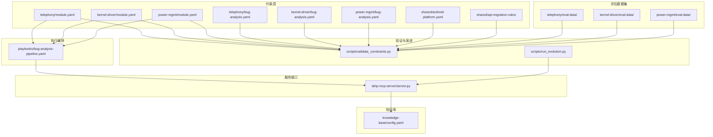
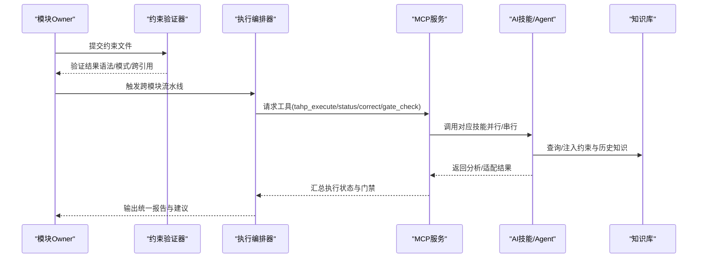
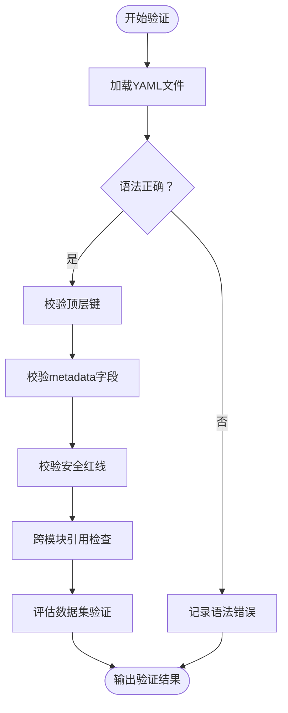
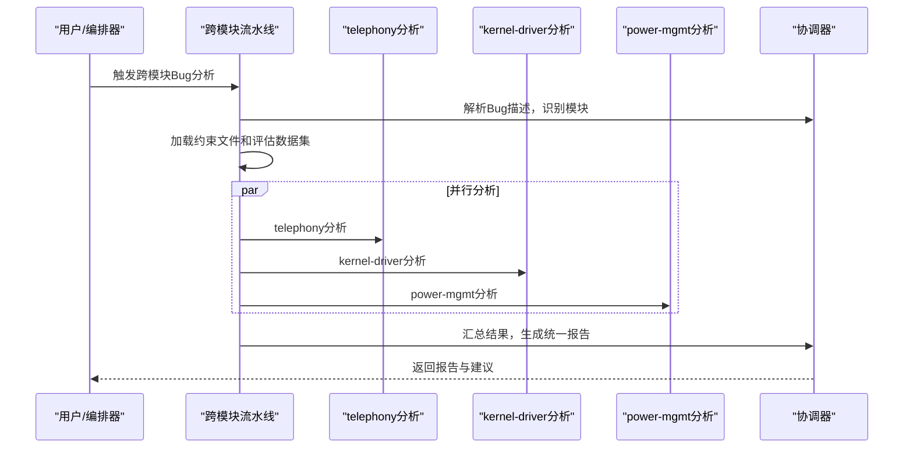
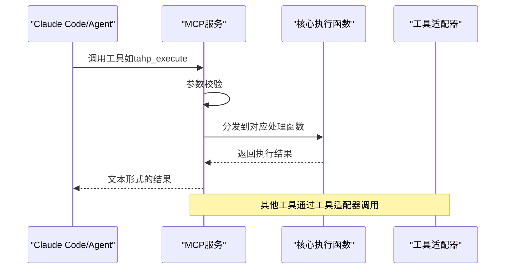
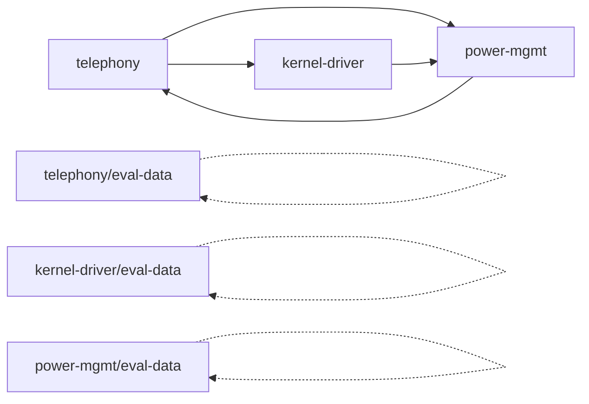

# 约束驱动系统

<cite>
**本文引用的文件**
- [constraints/telephony/module.yaml](file://constraints/telephony/module.yaml)
- [constraints/telephony/bug-analysis.yaml](file://constraints/telephony/bug-analysis.yaml)
- [constraints/telephony/eval-data/cases/case_001_rilj_error.yaml](file://constraints/telephony/eval-data/cases/case_001_rilj_error.yaml)
- [constraints/telephony/eval-data/cases/case_002_framework_exception.yaml](file://constraints/telephony/eval-data/cases/case_002_framework_exception.yaml)
- [constraints/telephony/eval-data/cases/case_003_modem_atcmd.yaml](file://constraints/telephony/eval-data/cases/case_003_modem_atcmd.yaml)
- [constraints/telephony/eval-data/expected/case_001_rilj_error.yaml](file://constraints/telephony/eval-data/expected/case_001_rilj_error.yaml)
- [constraints/telephony/eval-data/expected/case_002_framework_exception.yaml](file://constraints/telephony/eval-data/expected/case_002_framework_exception.yaml)
- [constraints/telephony/eval-data/expected/case_003_modem_atcmd.yaml](file://constraints/telephony/eval-data/expected/case_003_modem_atcmd.yaml)
- [constraints/kernel-driver/module.yaml](file://constraints/kernel-driver/module.yaml)
- [constraints/power-mgmt/module.yaml](file://constraints/power-mgmt/module.yaml)
- [constraints/shared/android-platform.yaml](file://constraints/shared/android-platform.yaml)
- [constraints/shared/api-migration-rules/framework-migration.yaml](file://constraints/shared/api-migration-rules/framework-migration.yaml)
- [playbooks/bug-analysis-pipeline.yaml](file://playbooks/bug-analysis-pipeline.yaml)
- [scripts/validate_constraints.py](file://scripts/validate_constraints.py)
- [scripts/run_evolution.py](file://scripts/run_evolution.py)
- [tahp-mcp-server/server.py](file://tahp-mcp-server/server.py)
- [TAHP-约束文件编写规范.md](file://TAHP-约束文件编写规范.md)
- [knowledge-base/config.yaml](file://knowledge-base/config.yaml)
- [templates/module-template/module.yaml.template](file://templates/module-template/module.yaml.template)
</cite>

## 更新摘要
**所做更改**
- 新增Android telephony评估数据集章节，详细介绍三类典型问题的案例和期望输出
- 扩展约束管理系统的领域特定适应性，增加telephony模块的四层检测规则
- 增强质量基础设施，完善评估数据集的结构化管理和验证机制
- 更新模块约束管理章节，反映telephony模块的完整依赖关系

## 目录
1. [简介](#简介)
2. [项目结构](#项目结构)
3. [核心组件](#核心组件)
4. [架构总览](#架构总览)
5. [详细组件分析](#详细组件分析)
6. [依赖分析](#依赖分析)
7. [性能考量](#性能考量)
8. [故障排查指南](#故障排查指南)
9. [结论](#结论)
10. [附录](#附录)

## 简介
本文件系统性阐述约束驱动系统的架构与实现，聚焦于约束文件格式、模块约束管理、领域约束配置与约束模板系统的设计理念与工作机制。文档深入解释YAML约束文件的语法规则、字段含义与配置选项，覆盖约束验证机制、动态加载流程与错误处理策略，并提供完整的约束文件编写指南，包含telephony、kernel-driver、power-mgmt等模块的具体示例。最后说明约束系统如何与执行编排系统协作，实现自动化工作流生成与执行。

**更新** 本次更新重点反映了新增的Android telephony评估数据集、扩展的领域特定适应性和增强的质量基础设施。

## 项目结构
约束驱动系统围绕"约束文件 + 验证器 + 执行编排 + MCP服务 + 知识库"展开，采用模块化与领域化的组织方式：
- constraints/{module}/：模块级约束文件，包含module.yaml与各领域约束文件（如bug-analysis.yaml、code-adaptation.yaml）
- constraints/shared/：共享约束（如平台通用约束、编码规范、API迁移规则）
- playbooks/：跨模块执行流水线定义
- scripts/：约束验证与技能演进工具
- tahp-mcp-server/：对外暴露MCP工具的服务端
- knowledge-base/：知识库配置与检索策略
- templates/module-template/：模块约束模板

**图表来源**
- [constraints/telephony/module.yaml:1-43](file://constraints/telephony/module.yaml#L1-L43)
- [constraints/kernel-driver/module.yaml:1-30](file://constraints/kernel-driver/module.yaml#L1-L30)
- [constraints/power-mgmt/module.yaml:1-32](file://constraints/power-mgmt/module.yaml#L1-L32)
- [constraints/shared/android-platform.yaml:1-43](file://constraints/shared/android-platform.yaml#L1-L43)
- [constraints/shared/api-migration-rules/framework-migration.yaml:1-18](file://constraints/shared/api-migration-rules/framework-migration.yaml#L1-L18)
- [constraints/telephony/eval-data/cases/case_001_rilj_error.yaml:1-25](file://constraints/telephony/eval-data/cases/case_001_rilj_error.yaml#L1-L25)

**章节来源**
- [TAHP-约束文件编写规范.md:30-116](file://TAHP-约束文件编写规范.md#L30-L116)
- [constraints/telephony/module.yaml:1-43](file://constraints/telephony/module.yaml#L1-L43)
- [constraints/kernel-driver/module.yaml:1-30](file://constraints/kernel-driver/module.yaml#L1-L30)
- [constraints/power-mgmt/module.yaml:1-32](file://constraints/power-mgmt/module.yaml#L1-L32)

## 核心组件
- 约束文件与模板：模块元信息、作用域、依赖、领域规则、评估数据集等
- 约束验证器：语法、模式、跨引用一致性检查
- 执行编排：跨模块流水线定义与并行执行
- MCP服务：将约束驱动能力封装为可被AI调用的工具
- 知识库：约束抽取、检索与反馈闭环
- 技能演进：基于评估指标的迭代优化

**更新** 新增评估数据集管理系统，提供结构化的案例和期望输出验证机制。

**章节来源**
- [scripts/validate_constraints.py:30-182](file://scripts/validate_constraints.py#L30-L182)
- [playbooks/bug-analysis-pipeline.yaml:1-43](file://playbooks/bug-analysis-pipeline.yaml#L1-L43)
- [tahp-mcp-server/server.py:103-322](file://tahp-mcp-server/server.py#L103-L322)
- [knowledge-base/config.yaml:1-36](file://knowledge-base/config.yaml#L1-L36)
- [scripts/run_evolution.py:42-89](file://scripts/run_evolution.py#L42-L89)

## 架构总览
约束驱动系统通过"约束文件 + 验证器 + 编排引擎 + MCP服务 + 知识库"的协同，形成从"规则定义"到"自动化执行"的闭环。

**图表来源**
- [scripts/validate_constraints.py:239-278](file://scripts/validate_constraints.py#L239-L278)
- [playbooks/bug-analysis-pipeline.yaml:6-37](file://playbooks/bug-analysis-pipeline.yaml#L6-L37)
- [tahp-mcp-server/server.py:343-447](file://tahp-mcp-server/server.py#L343-L447)
- [knowledge-base/config.yaml:32-35](file://knowledge-base/config.yaml#L32-L35)

## 详细组件分析

### 约束文件格式与语法规则
- 目录结构与命名规范：模块目录采用短横线命名，领域文件采用domain.yaml命名，评估数据集包含cases与expected两部分
- 模块基本信息（module.yaml）：包含模块元信息、作用域includes/excludes、跨模块依赖
- 领域约束文件（如bug-analysis.yaml）：前置条件、分析规则、禁止行为、必须输出、安全门禁、评估配置
- 共享约束：平台通用约束、编码规范、API迁移规则等

**更新** 新增评估数据集的标准化格式，包括案例文件和期望输出文件的结构规范。

**章节来源**
- [TAHP-约束文件编写规范.md:30-116](file://TAHP-约束文件编写规范.md#L30-L116)
- [constraints/telephony/module.yaml:64-106](file://constraints/telephony/module.yaml#L64-L106)
- [constraints/telephony/bug-analysis.yaml:122-241](file://constraints/telephony/bug-analysis.yaml#L122-L241)
- [constraints/shared/android-platform.yaml:1-43](file://constraints/shared/android-platform.yaml#L1-L43)

### 模块约束管理
- telephony模块：涵盖Telephony Framework、RILJ/RILC、Telecom Framework及Modem接口，明确与kernel-driver、power-mgmt、framework的依赖关系
- kernel-driver模块：内核驱动、ARM64架构、设备树，与power-mgmt存在运行时依赖
- power-mgmt模块：电源管理服务、Power HAL、电池服务，与telephony、kernel-driver存在相互依赖

**更新** telephony模块现在包含完整的四层检测体系：Framework、RILJ、RILC、Modem，以及与kernel-driver和power-mgmt的复杂依赖关系。

**章节来源**
- [constraints/telephony/module.yaml:11-43](file://constraints/telephony/module.yaml#L11-L43)
- [constraints/kernel-driver/module.yaml:11-30](file://constraints/kernel-driver/module.yaml#L11-L30)
- [constraints/power-mgmt/module.yaml:11-32](file://constraints/power-mgmt/module.yaml#L11-L32)

### 领域约束配置
- Bug分析约束：定义前置条件（如logcat、复现步骤）、层级检测顺序（Framework/RILJ/RILC/Modem）、禁止行为、必须输出维度（根因层级、复现概率、影响范围、修复类型、严重程度、根因描述、修复建议）、安全门禁与评估目标
- 评估数据集：要求每个模块至少准备一定数量的历史案例，包含输入与期望输出，用于训练与评估

**更新** telephony模块的Bug分析约束现在包含四层检测规则，支持从Framework到Modem的逐层深入分析。

**章节来源**
- [constraints/telephony/bug-analysis.yaml:1-130](file://constraints/telephony/bug-analysis.yaml#L1-L130)
- [constraints/kernel-driver/bug-analysis.yaml:1-65](file://constraints/kernel-driver/bug-analysis.yaml#L1-L65)
- [constraints/power-mgmt/bug-analysis.yaml:1-61](file://constraints/power-mgmt/bug-analysis.yaml#L1-L61)
- [TAHP-约束文件编写规范.md:243-278](file://TAHP-约束文件编写规范.md#L243-L278)

### 评估数据集系统
- 数据集结构：每个模块的eval-data目录包含cases和expected两个子目录
- 案例格式：包含case_id、description、input（prompt、log_content、metadata）和expected_output
- 期望输出：包含根因层级、复现概率、影响范围、修复类型、严重程度等关键指标
- 质量控制：支持权重设置、难度标注、关键词匹配验证

**新增** telephony模块建立了完整的评估数据集，包含三个典型问题案例：
- RILJ错误案例：展示GENERIC_FAILURE错误的分析方法
- Framework异常案例：演示TelephonyFramework崩溃的根本原因定位
- Modem AT命令案例：分析Modem侧通信问题的诊断流程

**章节来源**
- [constraints/telephony/eval-data/cases/case_001_rilj_error.yaml:1-25](file://constraints/telephony/eval-data/cases/case_001_rilj_error.yaml#L1-L25)
- [constraints/telephony/eval-data/cases/case_002_framework_exception.yaml:1-25](file://constraints/telephony/eval-data/cases/case_002_framework_exception.yaml#L1-L25)
- [constraints/telephony/eval-data/cases/case_003_modem_atcmd.yaml:1-25](file://constraints/telephony/eval-data/cases/case_003_modem_atcmd.yaml#L1-L25)
- [constraints/telephony/eval-data/expected/case_001_rilj_error.yaml:1-10](file://constraints/telephony/eval-data/expected/case_001_rilj_error.yaml#L1-L10)
- [constraints/telephony/eval-data/expected/case_002_framework_exception.yaml:1-10](file://constraints/telephony/eval-data/expected/case_002_framework_exception.yaml#L1-L10)
- [constraints/telephony/eval-data/expected/case_003_modem_atcmd.yaml:1-10](file://constraints/telephony/eval-data/expected/case_003_modem_atcmd.yaml#L1-L10)

### 约束模板系统
- 模板文件：提供标准化的module.yaml.template，帮助Owner快速初始化模块约束
- 使用流程：复制模板 → 编辑模块基本信息 → 补充领域约束 → 准备评估数据集

**更新** 模板系统现已支持评估数据集的标准化生成，确保新模块能够快速建立完整的测试数据集。

**章节来源**
- [templates/module-template/module.yaml.template](file://templates/module-template/module.yaml.template)
- [TAHP-约束文件编写规范.md:413-427](file://TAHP-约束文件编写规范.md#L413-L427)

### 约束验证机制
- 语法验证：确保YAML可解析
- 模式验证：顶层键、metadata字段、安全红线列表
- 严格模式：版本格式、日期格式等额外校验
- 跨引用检查：模块间依赖一致性、同域文件存在性
- 评估数据集验证：案例文件完整性、期望输出格式正确性

**更新** 新增评估数据集的专门验证机制，确保案例和期望输出的一致性和完整性。

**图表来源**
- [scripts/validate_constraints.py:67-182](file://scripts/validate_constraints.py#L67-L182)
- [scripts/validate_constraints.py:184-238](file://scripts/validate_constraints.py#L184-L238)

**章节来源**
- [scripts/validate_constraints.py:80-182](file://scripts/validate_constraints.py#L80-L182)
- [scripts/validate_constraints.py:184-238](file://scripts/validate_constraints.py#L184-L238)

### 动态加载流程与错误处理
- 动态加载：编排器按需加载涉及模块的约束文件，支持并行分析
- 错误处理：对缺失文件、无效键、跨引用未知模块等情况给出明确错误信息与建议
- 评估数据集加载：支持cases和expected目录的自动发现与验证

**更新** 动态加载流程现已包含评估数据集的自动发现和验证功能。

**章节来源**
- [playbooks/bug-analysis-pipeline.yaml:6-37](file://playbooks/bug-analysis-pipeline.yaml#L6-L37)
- [scripts/validate_constraints.py:184-238](file://scripts/validate_constraints.py#L184-L238)

### 与执行编排系统的协作
- 跨模块流水线：根据Bug描述识别涉及模块，加载约束，启动并行分析，汇总结果并记录反馈
- 并行执行：telephony、kernel-driver、power-mgmt分析可并行进行，提升效率
- 评估数据集集成：在分析过程中自动加载和验证评估数据集

**更新** 执行编排系统现已集成评估数据集的自动加载和验证功能。

**图表来源**
- [playbooks/bug-analysis-pipeline.yaml:6-37](file://playbooks/bug-analysis-pipeline.yaml#L6-L37)

**章节来源**
- [playbooks/bug-analysis-pipeline.yaml:1-43](file://playbooks/bug-analysis-pipeline.yaml#L1-L43)

### MCP服务与工具集成
- 工具清单：tahp_execute、tahp_status、tahp_correct、tahp_gate_check、tahp_list_tasks、tahp_query_knowledge、tahp_analyze_log、tahp_code_review、tahp_api_migration
- 参数校验：对模块、领域、任务ID等进行合法性检查
- 结果处理：统一序列化为文本内容，支持结果截断与错误回传

**更新** MCP服务现已支持评估数据集的查询和验证功能。

**图表来源**
- [tahp-mcp-server/server.py:103-322](file://tahp-mcp-server/server.py#L103-L322)
- [tahp-mcp-server/server.py:343-447](file://tahp-mcp-server/server.py#L343-L447)

**章节来源**
- [tahp-mcp-server/server.py:343-447](file://tahp-mcp-server/server.py#L343-L447)

### 知识库与反馈闭环
- 知识库配置：SQLite持久化 + ONNX语义嵌入，支持跨模块检索与重排序策略
- 自动捕获：根据门禁结果、修正记录、编译/回归通过情况自动注入知识
- 约束抽取：从执行过程中抽取约束规则，纳入知识库

**更新** 知识库系统现已支持评估数据集的结构化存储和查询。

**章节来源**
- [knowledge-base/config.yaml:1-36](file://knowledge-base/config.yaml#L1-L36)

### 技能演进与评估
- 配置：最大迭代次数、并发度、选择策略、变异率、停滞阈值
- 评估：准确率、完整性、安全合规、时间效率加权合成
- 反馈：记录每次迭代最佳变体、分数与动作，保存进化报告

**更新** 技能演进系统现已集成评估数据集的质量评估功能。

**章节来源**
- [scripts/run_evolution.py:42-89](file://scripts/run_evolution.py#L42-L89)
- [scripts/run_evolution.py:225-313](file://scripts/run_evolution.py#L225-L313)
- [scripts/run_evolution.py:341-386](file://scripts/run_evolution.py#L341-L386)

## 依赖分析
- 模块间依赖：telephony依赖kernel-driver与power-mgmt（运行时/分析），kernel-driver依赖power-mgmt（运行时），power-mgmt依赖telephony（分析）
- 领域文件依赖：各模块的领域约束文件与module.yaml共同构成完整约束定义
- 工具依赖：MCP服务依赖核心执行函数与工具适配器
- 评估数据集依赖：各模块的评估数据集相互独立，支持模块化测试

**更新** 依赖关系现已扩展到评估数据集层面，每个模块都有独立的评估数据集。

**图表来源**
- [constraints/telephony/module.yaml:33-42](file://constraints/telephony/module.yaml#L33-L42)
- [constraints/kernel-driver/module.yaml:26-29](file://constraints/kernel-driver/module.yaml#L26-L29)
- [constraints/power-mgmt/module.yaml:25-31](file://constraints/power-mgmt/module.yaml#L25-L31)

**章节来源**
- [constraints/telephony/module.yaml:33-42](file://constraints/telephony/module.yaml#L33-L42)
- [constraints/kernel-driver/module.yaml:26-29](file://constraints/kernel-driver/module.yaml#L26-L29)
- [constraints/power-mgmt/module.yaml:25-31](file://constraints/power-mgmt/module.yaml#L25-L31)

## 性能考量
- 验证器：支持递归扫描与去重，避免重复验证同一文件
- 编排：并行分析减少总体时延，合理设置并发度
- MCP：结果过大时截断，避免传输与渲染开销
- 知识库：检索阈值与默认TopK平衡召回与性能
- 评估数据集：支持增量加载和缓存机制，提升验证效率

**更新** 性能考量现已包含评估数据集的加载优化策略。

## 故障排查指南
- 约束文件报错：使用验证器定位语法错误、缺失键、跨引用问题
- 编排执行失败：检查模块/领域枚举、任务ID、工具参数
- 知识库检索异常：检查embedding模型与持久化目录配置
- 技能演进停滞：关注停滞阈值与选择策略，适当提高变异率或放宽阈值
- 评估数据集问题：检查cases和expected目录结构、文件格式、权重配置

**更新** 新增评估数据集相关的故障排查指导。

**章节来源**
- [scripts/validate_constraints.py:281-321](file://scripts/validate_constraints.py#L281-L321)
- [tahp-mcp-server/server.py:361-367](file://tahp-mcp-server/server.py#L361-L367)
- [knowledge-base/config.yaml:1-36](file://knowledge-base/config.yaml#L1-L36)
- [scripts/run_evolution.py:509-514](file://scripts/run_evolution.py#L509-L514)

## 结论
约束驱动系统通过标准化的YAML约束文件、严格的验证机制、灵活的执行编排与MCP工具集成，实现了从规则定义到自动化执行的闭环。模块化与领域化的约束设计使得不同子系统可以独立演进，同时通过跨模块流水线实现协同分析与统一报告。配合知识库与技能演进机制，系统能够持续优化AI技能质量，支撑高质量的自动化工作流生成与执行。

**更新** 本次更新显著增强了系统的领域特定适应性和质量基础设施，特别是telephony模块的完整评估数据集和四层检测体系，为AI驱动的软件适配和问题分析提供了坚实基础。

## 附录

### 约束文件编写指南（要点）
- 目录与命名：模块目录、领域文件、评估数据集命名规范
- module.yaml：模块元信息、作用域、依赖
- 领域约束：前置条件、分析规则、禁止行为、必须输出、安全门禁、评估目标
- 评估数据集：案例数量与质量要求，支持cases和expected目录结构
- 模板使用：复制模板并按指引填写

**更新** 新增评估数据集编写的详细指导，包括案例格式、期望输出规范和质量控制要求。

**章节来源**
- [TAHP-约束文件编写规范.md:30-116](file://TAHP-约束文件编写规范.md#L30-L116)
- [TAHP-约束文件编写规范.md:243-278](file://TAHP-约束文件编写规范.md#L243-L278)
- [templates/module-template/module.yaml.template](file://templates/module-template/module.yaml.template)