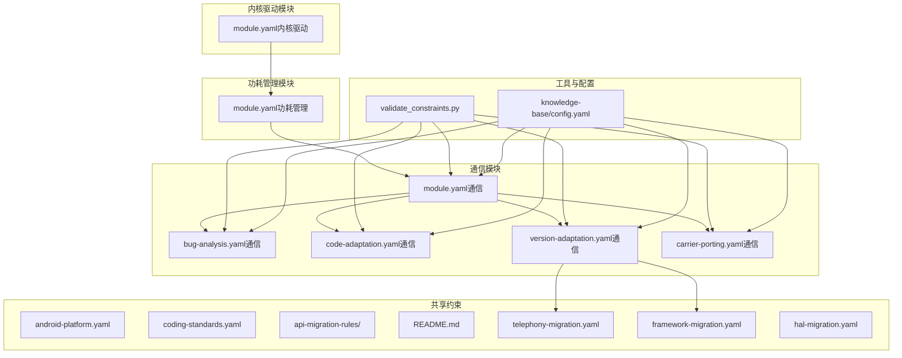
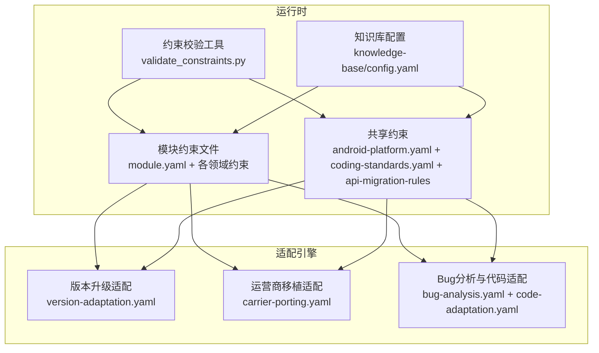
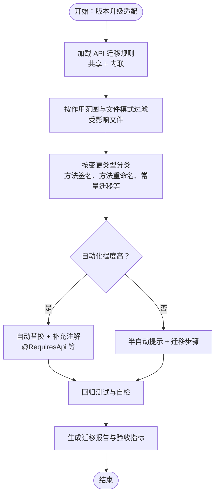
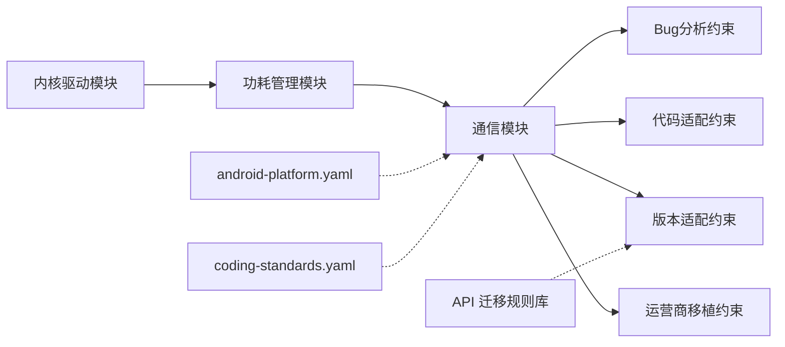

# 领域约束配置

<cite>
**本文引用的文件**
- [android-platform.yaml](file://constraints/shared/android-platform.yaml)
- [coding-standards.yaml](file://constraints/shared/coding-standards.yaml)
- [README.md](file://constraints/shared/api-migration-rules/README.md)
- [framework-migration.yaml](file://constraints/shared/api-migration-rules/framework-migration.yaml)
- [hal-migration.yaml](file://constraints/shared/api-migration-rules/hal-migration.yaml)
- [telephony-migration.yaml](file://constraints/shared/api-migration-rules/telephony-migration.yaml)
- [module.yaml（内核驱动）](file://constraints/kernel-driver/module.yaml)
- [module.yaml（功耗管理）](file://constraints/power-mgmt/module.yaml)
- [module.yaml（通信）](file://constraints/telephony/module.yaml)
- [bug-analysis.yaml（通信）](file://constraints/telephony/bug-analysis.yaml)
- [code-adaptation.yaml（通信）](file://constraints/telephony/code-adaptation.yaml)
- [version-adaptation.yaml（通信）](file://constraints/telephony/version-adaptation.yaml)
- [carrier-porting.yaml（通信）](file://constraints/telephony/carrier-porting.yaml)
- [validate_constraints.py](file://scripts/validate_constraints.py)
- [TAHP-约束文件编写规范.md](file://TAHP-约束文件编写规范.md)
- [config.yaml（知识库）](file://knowledge-base/config.yaml)
</cite>

## 目录
1. [简介](#简介)
2. [项目结构](#项目结构)
3. [核心组件](#核心组件)
4. [架构总览](#架构总览)
5. [详细组件分析](#详细组件分析)
6. [依赖分析](#依赖分析)
7. [性能考量](#性能考量)
8. [故障排查指南](#故障排查指南)
9. [结论](#结论)
10. [附录](#附录)

## 简介
本文件系统化阐述 TAHP 领域约束配置的设计理念、实现机制与最佳实践，重点覆盖：
- 共享约束：android-platform 平台约束、coding-standards 编码规范、api-migration-rules API 迁移规则
- 领域约束分类体系、优先级机制与冲突解决策略
- API 迁移规则的版本兼容性处理、向后兼容保证与迁移路径规划
- 领域约束的动态加载与热更新机制
- 扩展接口、自定义规则定义与社区贡献指南

## 项目结构
约束配置采用“模块化 + 共享化”的组织方式：
- 每个业务模块在 constraints/{module}/ 下维护自身约束文件（module.yaml、各领域约束文件）
- 共享约束位于 constraints/shared/，供多模块复用
- scripts/validate_constraints.py 提供约束文件校验工具
- knowledge-base/config.yaml 定义知识库与约束抽取策略，支撑约束的动态加载与检索

**图表来源**
- [android-platform.yaml:1-25](file://constraints/shared/android-platform.yaml#L1-L25)
- [coding-standards.yaml:1-23](file://constraints/shared/coding-standards.yaml#L1-L23)
- [README.md:1-28](file://constraints/shared/api-migration-rules/README.md#L1-L28)
- [telephony-migration.yaml:1-57](file://constraints/shared/api-migration-rules/telephony-migration.yaml#L1-L57)
- [framework-migration.yaml:1-7](file://constraints/shared/api-migration-rules/framework-migration.yaml#L1-L7)
- [hal-migration.yaml:1-7](file://constraints/shared/api-migration-rules/hal-migration.yaml#L1-L7)
- [module.yaml（通信）:1-43](file://constraints/telephony/module.yaml#L1-L43)
- [bug-analysis.yaml（通信）:1-110](file://constraints/telephony/bug-analysis.yaml#L1-L110)
- [code-adaptation.yaml（通信）:1-48](file://constraints/telephony/code-adaptation.yaml#L1-L48)
- [version-adaptation.yaml（通信）:1-117](file://constraints/telephony/version-adaptation.yaml#L1-L117)
- [carrier-porting.yaml（通信）:1-106](file://constraints/telephony/carrier-porting.yaml#L1-L106)
- [module.yaml（内核驱动）:1-30](file://constraints/kernel-driver/module.yaml#L1-L30)
- [module.yaml（功耗管理）:1-32](file://constraints/power-mgmt/module.yaml#L1-L32)
- [validate_constraints.py:1-360](file://scripts/validate_constraints.py#L1-L360)
- [config.yaml（知识库）:1-36](file://knowledge-base/config.yaml#L1-L36)

**章节来源**
- [TAHP-约束文件编写规范.md:30-116](file://TAHP-约束文件编写规范.md#L30-L116)
- [validate_constraints.py:30-360](file://scripts/validate_constraints.py#L30-L360)
- [config.yaml（知识库）:1-36](file://knowledge-base/config.yaml#L1-L36)

## 核心组件
- 共享平台约束（android-platform.yaml）
  - 定义 SDK 版本范围、构建系统偏好、安全基线、兼容性要求与日志规范
  - 作为全局默认约束，被各模块继承与覆盖
- 共享编码规范（coding-standards.yaml）
  - 规定版本控制、代码评审、文档与 Android 特定规范
  - 保障代码一致性与可审计性
- API 迁移规则库（api-migration-rules）
  - 通信模块迁移规则示例：telephony-migration.yaml
  - 框架与 HAL 层迁移规则占位：framework-migration.yaml、hal-migration.yaml
  - README.md 提供规则文件索引、ID 前缀约定与预期效果

**章节来源**
- [android-platform.yaml:1-25](file://constraints/shared/android-platform.yaml#L1-L25)
- [coding-standards.yaml:1-23](file://constraints/shared/coding-standards.yaml#L1-L23)
- [README.md:1-28](file://constraints/shared/api-migration-rules/README.md#L1-L28)
- [telephony-migration.yaml:1-57](file://constraints/shared/api-migration-rules/telephony-migration.yaml#L1-L57)
- [framework-migration.yaml:1-7](file://constraints/shared/api-migration-rules/framework-migration.yaml#L1-L7)
- [hal-migration.yaml:1-7](file://constraints/shared/api-migration-rules/hal-migration.yaml#L1-L7)

## 架构总览
约束配置的运行时架构围绕“模块约束 + 共享约束 + 工具链 + 知识库”协同工作：
- 模块约束：模块化的领域约束文件（bug-analysis、code-adaptation、version-adaptation、carrier-porting）
- 共享约束：平台与编码规范，以及 API 迁移规则库
- 工具链：约束校验脚本确保格式与语义正确
- 知识库：约束抽取与检索，支撑动态加载与跨模块同步

**图表来源**
- [version-adaptation.yaml（通信）:1-117](file://constraints/telephony/version-adaptation.yaml#L1-L117)
- [carrier-porting.yaml（通信）:1-106](file://constraints/telephony/carrier-porting.yaml#L1-L106)
- [bug-analysis.yaml（通信）:1-110](file://constraints/telephony/bug-analysis.yaml#L1-L110)
- [code-adaptation.yaml（通信）:1-48](file://constraints/telephony/code-adaptation.yaml#L1-L48)
- [validate_constraints.py:1-360](file://scripts/validate_constraints.py#L1-L360)
- [config.yaml（知识库）:1-36](file://knowledge-base/config.yaml#L1-L36)

## 详细组件分析

### 共享平台约束（android-platform.yaml）
- 设计理念
  - 以“平台一致性”为核心，统一 SDK 版本、构建系统与安全基线
  - 将日志与兼容性要求纳入强制性约束，降低跨模块风险
- 实现要点
  - SDK 版本：最小/目标/编译 SDK 的三段式配置
  - 构建系统：优先 Soong，保留 Make 的兼容说明
  - 安全基线：HTTPS、加密算法、Provider/Receiver 权限、命令执行限制
  - 兼容性：CTS/GTS/VTS 基础测试要求
  - 日志规范：级别、发布版过滤、Tag 规范与敏感信息脱敏
- 与模块约束的关系
  - 作为模块默认约束的“下限”，模块可在自身约束中提升标准或细化规则

**章节来源**
- [android-platform.yaml:1-25](file://constraints/shared/android-platform.yaml#L1-L25)

### 共享编码规范（coding-standards.yaml）
- 设计理念
  - 通过“声明式、可验证、具体、最小必要、版本化”的原则，确保约束可落地
- 实现要点
  - 版本控制：提交信息格式、分支命名规范
  - 代码评审：评审人数与自动化检查项
  - 文档：注释与复杂算法说明、Bug 关联与适配标注
  - Android 特定：隐藏 API 注解、版本依赖注解、命名规范
- 与模块约束的关系
  - 作为模块编码规范的“模板”，模块可叠加自身特定要求

**章节来源**
- [coding-standards.yaml:1-23](file://constraints/shared/coding-standards.yaml#L1-L23)
- [TAHP-约束文件编写规范.md:18-27](file://TAHP-约束文件编写规范.md#L18-L27)

### API 迁移规则库（api-migration-rules）
- 设计理念
  - 将每次大版本升级的迁移经验沉淀为可复用规则，形成“规则资产”
  - 通过 ID 前缀与模块映射，实现跨模块复用与追踪
- 实现要点
  - telephony-migration.yaml：包含规则元数据（模块、维护者、最后更新、规则总数）、规则列表
  - 规则字段：ID、旧 API、新 API、变更类型、引入/弃用版本、自动化标记、置信度、作用范围、文件模式、迁移步骤、验证记录与备注
  - README.md：规则文件索引、ID 前缀约定、预期效果（自动化率逐步提升）
  - 占位文件：framework-migration.yaml、hal-migration.yaml 为后续扩展预留
- 与版本适配的关系
  - version-adaptation.yaml 通过“共享规则文件”与“内联规则”组合，指导从源版本到目标版本的迁移

**图表来源**
- [version-adaptation.yaml（通信）:40-78](file://constraints/telephony/version-adaptation.yaml#L40-L78)
- [telephony-migration.yaml:1-57](file://constraints/shared/api-migration-rules/telephony-migration.yaml#L1-L57)
- [README.md:1-28](file://constraints/shared/api-migration-rules/README.md#L1-L28)

**章节来源**
- [README.md:1-28](file://constraints/shared/api-migration-rules/README.md#L1-L28)
- [telephony-migration.yaml:1-57](file://constraints/shared/api-migration-rules/telephony-migration.yaml#L1-L57)
- [framework-migration.yaml:1-7](file://constraints/shared/api-migration-rules/framework-migration.yaml#L1-L7)
- [hal-migration.yaml:1-7](file://constraints/shared/api-migration-rules/hal-migration.yaml#L1-L7)
- [version-adaptation.yaml（通信）:40-78](file://constraints/telephony/version-adaptation.yaml#L40-L78)

### 模块约束：通信模块（telephony）
- 模块边界与依赖
  - includes/excludes/dependencies 明确通信模块的职责边界与跨模块依赖
- Bug 分析约束（bug-analysis.yaml）
  - 前置条件：设备信息、日志等
  - 分析流程：按层级（Framework/RILJ/RILC/Modem）的指示器与禁止行为
  - 输出：根因层级、复现概率、影响范围、修复类型、严重程度、根因描述与修复建议
  - 安全红线：针对敏感场景的处理策略
- 代码适配约束（code-adaptation.yaml）
  - 构建与预/后置检查
  - 修改范围：允许/禁止路径、代码风格、接口变更规则
  - 质量红线：编译错误、公共代码修改、硬编码、废弃 API 使用等
- 版本适配约束（version-adaptation.yaml）
  - 适配类型：版本升级
  - 版本信息：源版本与目标版本
  - 上下文：代码路径、构建目标、测试目标、依赖模块、排除路径
  - API 迁移规则：共享规则 + 内联规则
  - 适配约束：业务逻辑保留、注解、接口同步、废弃 API 清理、编译警告、回调签名、Modem 兼容性
  - 排除规则：特定路径与 API 模式及原因
  - 策略偏好：自动化置信度阈值、半自动阈值、批大小、并行代理数
  - 验收标准：编译通过、冒烟测试、回归测试、自定义检查
- 运营商移植约束（carrier-porting.yaml）
  - 运营商信息：源项目、目标运营商、地区
  - 上下文：代码路径、构建目标、测试目标、依赖模块
  - 运营商特性：VoWiFi、分钟提醒、USSD 定制、SIM Toolkit 增强等需求项
  - 合规标准：GCF、RFI、TRAI 等
  - 适配约束：不影响 generic 功能、标准 overlay 机制、AT 命令验证、参数管理、扩展框架使用、注释标记
  - 验收标准：认证测试、需求覆盖、合规检查

**章节来源**
- [module.yaml（通信）:1-43](file://constraints/telephony/module.yaml#L1-L43)
- [bug-analysis.yaml（通信）:1-110](file://constraints/telephony/bug-analysis.yaml#L1-L110)
- [code-adaptation.yaml（通信）:1-48](file://constraints/telephony/code-adaptation.yaml#L1-L48)
- [version-adaptation.yaml（通信）:1-117](file://constraints/telephony/version-adaptation.yaml#L1-L117)
- [carrier-porting.yaml（通信）:1-106](file://constraints/telephony/carrier-porting.yaml#L1-L106)

### 模块约束：内核驱动与功耗管理
- 内核驱动模块（kernel-driver/module.yaml）
  - 边界：内核驱动、架构、设备树
  - 依赖：与功耗管理模块的运行时依赖
- 功耗管理模块（power-mgmt/module.yaml）
  - 边界：电源管理服务、Power HAL、电池服务
  - 依赖：内核驱动（运行时）与通信模块（分析）

**章节来源**
- [module.yaml（内核驱动）:1-30](file://constraints/kernel-driver/module.yaml#L1-L30)
- [module.yaml（功耗管理）:1-32](file://constraints/power-mgmt/module.yaml#L1-L32)

### 约束校验与质量门禁
- validate_constraints.py
  - 顶层键校验：metadata、rules、safety_red_lines
  - 元数据校验：模块、领域、版本、作者、更新时间
  - 安全红线校验：非空列表检查
  - 交叉引用检查：模块依赖一致性、领域文件存在性
  - 严格模式：版本格式、日期格式等额外告警
- 质量评分与审核流程
  - 完整性、可验证性、具体性、最小性、评估集质量
  - 审核流程：Owner 编写 → 自动格式检查 → AI 辅助审核 → Owner 确认 → Git 提交 → 系统生效

**章节来源**
- [validate_constraints.py:30-360](file://scripts/validate_constraints.py#L30-L360)
- [TAHP-约束文件编写规范.md:392-432](file://TAHP-约束文件编写规范.md#L392-L432)

### 约束抽取与知识库集成
- 知识库配置（knowledge-base/config.yaml）
  - 数据库类型：SQLite + ONNX 嵌入
  - 自动捕获：Bug 分析、修正、适配、Evoskill 的触发策略
  - 检索：默认 Top-K、置信度阈值、跨模块检索
  - 约束抽取：自动触发、Owner 审核、置信度阈值
- 与约束文件的关系
  - 约束文件作为知识库的输入源，通过抽取与检索实现动态加载与跨模块同步

**章节来源**
- [config.yaml（知识库）:1-36](file://knowledge-base/config.yaml#L1-L36)

## 依赖分析
- 模块间依赖
  - 内核驱动 → 功耗管理（运行时）
  - 功耗管理 → 通信（分析）
  - 通信模块自身包含多个领域约束文件，彼此相互引用（如版本适配引用 API 迁移规则）
- 共享约束依赖
  - android-platform.yaml 与 coding-standards.yaml 作为全局默认约束，被各模块继承
- 工具与配置依赖
  - validate_constraints.py 依赖 rich、PyYAML、click 等库
  - 知识库配置影响约束的抽取与检索策略

**图表来源**
- [module.yaml（内核驱动）:26-29](file://constraints/kernel-driver/module.yaml#L26-L29)
- [module.yaml（功耗管理）:25-32](file://constraints/power-mgmt/module.yaml#L25-L32)
- [module.yaml（通信）:33-43](file://constraints/telephony/module.yaml#L33-L43)
- [android-platform.yaml:1-25](file://constraints/shared/android-platform.yaml#L1-L25)
- [coding-standards.yaml:1-23](file://constraints/shared/coding-standards.yaml#L1-L23)
- [version-adaptation.yaml（通信）:40-44](file://constraints/telephony/version-adaptation.yaml#L40-L44)

**章节来源**
- [module.yaml（内核驱动）:1-30](file://constraints/kernel-driver/module.yaml#L1-L30)
- [module.yaml（功耗管理）:1-32](file://constraints/power-mgmt/module.yaml#L1-L32)
- [module.yaml（通信）:1-43](file://constraints/telephony/module.yaml#L1-L43)

## 性能考量
- 约束校验性能
  - 严格模式下增加额外正则与日期解析，建议在 CI 中按需启用
  - 交叉引用检查对大型仓库可能带来扫描成本，建议按模块粒度执行
- 知识库检索性能
  - 默认 Top-K 与跨模块 Top-K 控制召回规模
  - 低置信度阈值支持跨语言检索，但可能增加候选集数量
- 迁移规则应用性能
  - 自动化规则优先，半自动规则通过迁移步骤与验证减少人工干预
  - 批量大小与并行代理数可调，平衡吞吐与稳定性

[本节为通用性能讨论，无需特定文件分析]

## 故障排查指南
- 约束文件格式错误
  - 症状：YAML 解析失败、键缺失
  - 排查：使用 validate_constraints.py 单文件校验，关注顶层键与元数据字段
- 元数据不合法
  - 症状：领域枚举非法、版本/日期格式不符
  - 排查：严格模式下会输出额外告警，修正后重试
- 安全红线为空或不规范
  - 症状：空列表告警
  - 排查：至少提供一条安全红线，并确保其可验证
- 交叉引用不一致
  - 症状：未知模块依赖告警
  - 排查：检查 module.yaml 中的依赖模块名称与实际存在的模块目录一致
- 知识库抽取与检索异常
  - 症状：约束抽取失败或检索命中不足
  - 排查：检查知识库配置、约束文件质量与抽取阈值

**章节来源**
- [validate_constraints.py:67-182](file://scripts/validate_constraints.py#L67-L182)
- [validate_constraints.py:184-238](file://scripts/validate_constraints.py#L184-L238)
- [config.yaml（知识库）:1-36](file://knowledge-base/config.yaml#L1-L36)

## 结论
TAHP 的领域约束配置通过“模块化 + 共享化 + 工具链 + 知识库”的协同，实现了：
- 可复用的 API 迁移规则资产，显著降低版本升级成本
- 明确的分类体系与优先级策略，确保关键约束优先执行
- 严格的校验与质量门禁，保障约束的可验证性与一致性
- 动态加载与跨模块同步能力，支撑持续演进与规模化应用

## 附录

### 领域约束分类体系与优先级机制
- 分类体系
  - 平台约束：android-platform.yaml
  - 编码规范：coding-standards.yaml
  - API 迁移规则：api-migration-rules/*
  - 模块领域约束：bug-analysis.yaml、code-adaptation.yaml、version-adaptation.yaml、carrier-porting.yaml
- 优先级机制
  - 共享约束作为默认“下限”，模块约束可提升标准
  - 版本适配与运营商移植等关键领域约束具有更高的执行优先级
  - 安全红线与质量门禁为最高优先级，不可绕过

**章节来源**
- [android-platform.yaml:1-25](file://constraints/shared/android-platform.yaml#L1-L25)
- [coding-standards.yaml:1-23](file://constraints/shared/coding-standards.yaml#L1-L23)
- [version-adaptation.yaml（通信）:88-92](file://constraints/telephony/version-adaptation.yaml#L88-L92)
- [carrier-porting.yaml（通信）:85-91](file://constraints/telephony/carrier-porting.yaml#L85-L91)

### 冲突解决策略
- 同一文件冲突：模块约束覆盖共享约束；同一模块内按领域约束优先级执行
- 不同模块冲突：通过模块间依赖与 scope/excludes 明确边界，必要时在更高层约束中协调
- 与工具链冲突：使用 validate_constraints.py 在提交前发现并修正

**章节来源**
- [validate_constraints.py:184-238](file://scripts/validate_constraints.py#L184-L238)

### API 迁移规则的版本兼容性与迁移路径
- 版本兼容性
  - 通过“引入版本”“弃用版本”“验证版本”明确生命周期
  - 自动化规则优先，半自动规则提供迁移步骤与注意事项
- 迁移路径规划
  - 使用 affected_files_pattern 精确定位受影响文件
  - 结合回归测试与自定义检查，确保迁移质量

**章节来源**
- [telephony-migration.yaml:11-25](file://constraints/shared/api-migration-rules/telephony-migration.yaml#L11-L25)
- [version-adaptation.yaml（通信）:14-38](file://constraints/telephony/version-adaptation.yaml#L14-L38)
- [version-adaptation.yaml（通信）:110-113](file://constraints/telephony/version-adaptation.yaml#L110-L113)

### 动态加载与热更新机制
- 动态加载
  - 约束文件作为知识库输入源，通过抽取与检索实现按需加载
- 热更新
  - 约束文件变更后，通过校验工具与知识库重建实现增量更新
  - 建议在 CI 中集成校验与抽取流程，确保变更及时生效

**章节来源**
- [validate_constraints.py:323-356](file://scripts/validate_constraints.py#L323-L356)
- [config.yaml（知识库）:32-36](file://knowledge-base/config.yaml#L32-L36)

### 扩展接口与自定义规则定义
- 扩展接口
  - 新增模块：参考模板与规范，提供 module.yaml 与各领域约束文件
  - 新增共享规则：在 constraints/shared/api-migration-rules/ 下新增规则文件，并在 README.md 更新索引
- 自定义规则定义
  - 遵循声明式、可验证、具体、最小必要、版本化原则
  - 使用 ID 前缀约定，确保跨模块可追踪

**章节来源**
- [TAHP-约束文件编写规范.md:413-432](file://TAHP-约束文件编写规范.md#L413-L432)
- [README.md:13-23](file://constraints/shared/api-migration-rules/README.md#L13-L23)

### 社区贡献指南
- 贡献流程
  - 编写约束文件 → 自动格式检查 → AI 辅助审核 → Owner 确认 → Git 提交 → 系统生效
- 质量要求
  - 完整性、可验证性、具体性、最小性、评估集质量
- 模板与规范
  - 使用模板快速初始化模块约束文件
  - 严格遵循编写规范，确保约束可落地

**章节来源**
- [TAHP-约束文件编写规范.md:404-432](file://TAHP-约束文件编写规范.md#L404-L432)