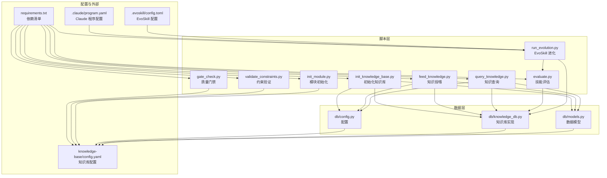
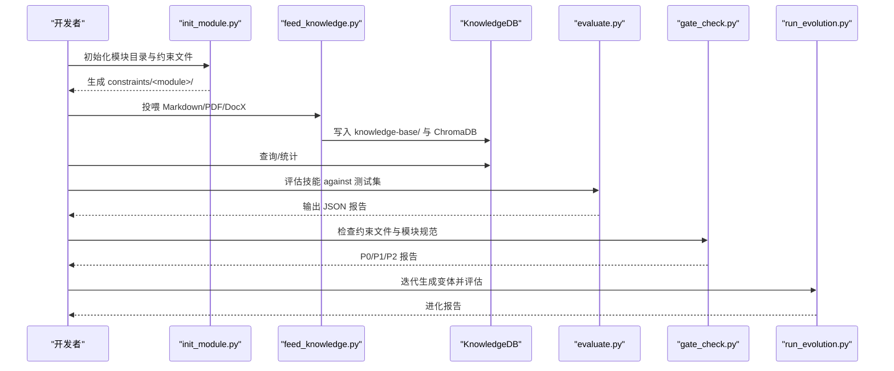
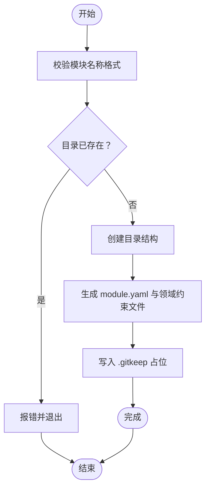
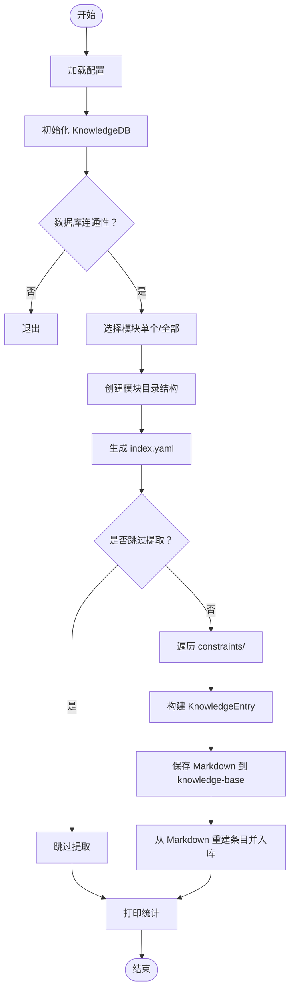
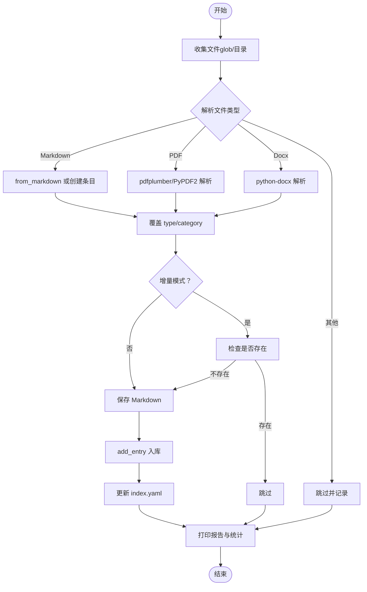
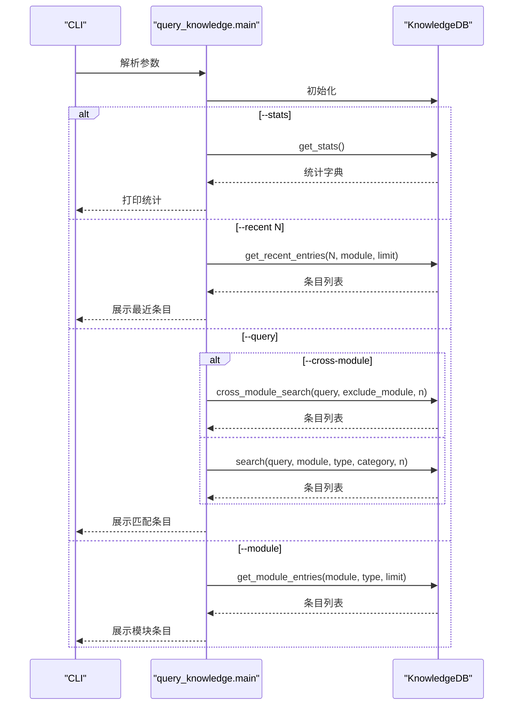
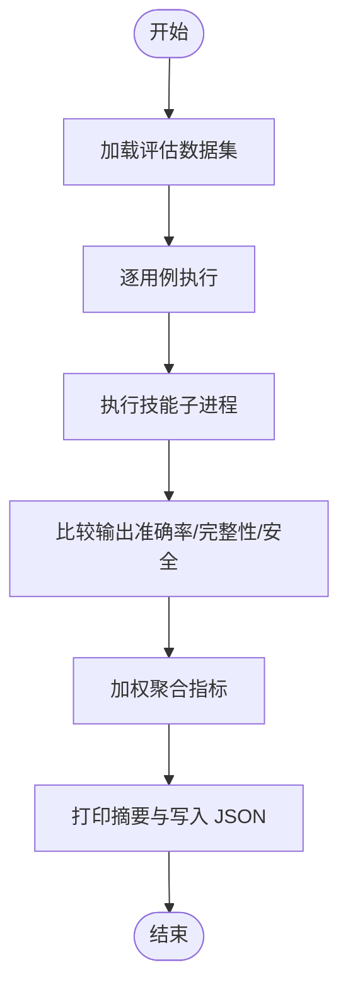
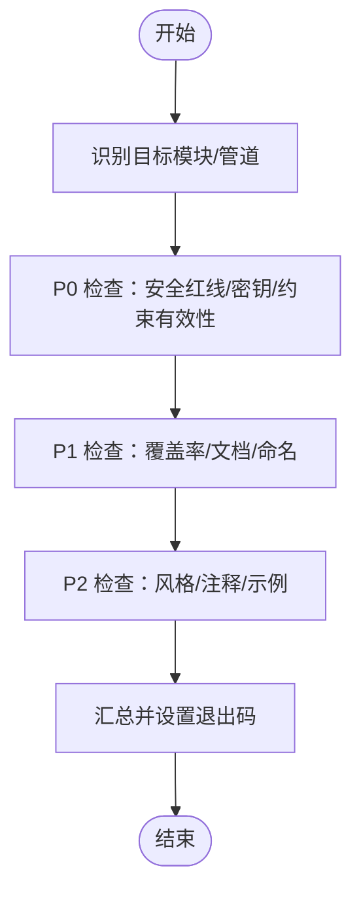
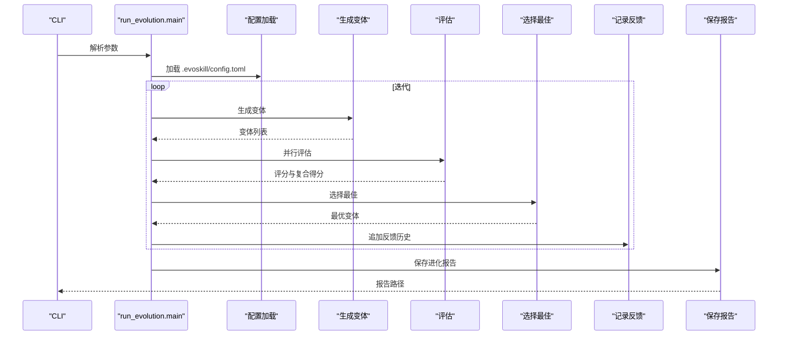
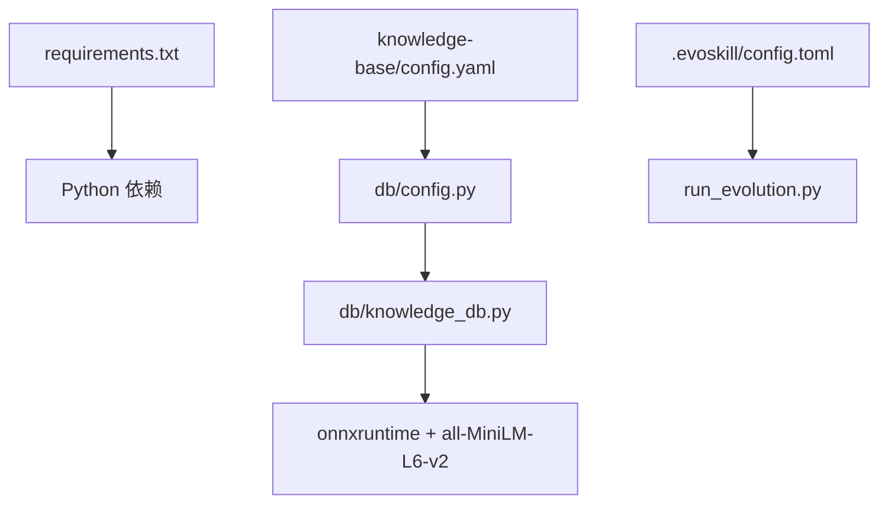

# 脚本工具集

<cite>
**本文引用的文件**
- [scripts/init_knowledge_base.py](file://scripts/init_knowledge_base.py)
- [scripts/feed_knowledge.py](file://scripts/feed_knowledge.py)
- [scripts/query_knowledge.py](file://scripts/query_knowledge.py)
- [scripts/evaluate.py](file://scripts/evaluate.py)
- [scripts/gate_check.py](file://scripts/gate_check.py)
- [scripts/validate_constraints.py](file://scripts/validate_constraints.py)
- [scripts/run_evolution.py](file://scripts/run_evolution.py)
- [scripts/init_module.py](file://scripts/init_module.py)
- [db/config.py](file://db/config.py)
- [db/knowledge_db.py](file://db/knowledge_db.py)
- [db/models.py](file://db/models.py)
- [knowledge-base/config.yaml](file://knowledge-base/config.yaml)
- [requirements.txt](file://requirements.txt)
- [.claude/program.yaml](file://.claude/program.yaml)
- [.evoskill/config.toml](file://.evoskill/config.toml)
</cite>

## 目录
1. [简介](#简介)
2. [项目结构](#项目结构)
3. [核心组件](#核心组件)
4. [架构总览](#架构总览)
5. [详细组件分析](#详细组件分析)
6. [依赖分析](#依赖分析)
7. [性能考虑](#性能考虑)
8. [故障排查指南](#故障排查指南)
9. [结论](#结论)
10. [附录](#附录)

## 简介
本文件为 TAHP 脚本工具集的实用技术文档，覆盖以下方面：
- 各辅助脚本的功能用途、使用方法与配置选项
- 模块初始化脚本的执行流程
- 知识库管理脚本的数据处理逻辑
- 评估执行脚本的计算方法
- 约束验证脚本的检查机制
- 命令行参数、环境要求与输出格式
- 最佳实践、批量处理技巧与错误处理方法
- 脚本间的协作关系与工作流程

## 项目结构
脚本工具集位于 scripts/ 目录，配合 db/ 数据层与知识库配置 knowledge-base/config.yaml，形成“采集-入库-检索-评估-门禁”的闭环。

图表来源
- [scripts/init_knowledge_base.py:154-242](file://scripts/init_knowledge_base.py#L154-L242)
- [scripts/feed_knowledge.py:196-318](file://scripts/feed_knowledge.py#L196-L318)
- [scripts/query_knowledge.py:116-196](file://scripts/query_knowledge.py#L116-L196)
- [scripts/evaluate.py:410-436](file://scripts/evaluate.py#L410-L436)
- [scripts/gate_check.py:480-503](file://scripts/gate_check.py#L480-L503)
- [scripts/validate_constraints.py:323-356](file://scripts/validate_constraints.py#L323-L356)
- [scripts/run_evolution.py:543-563](file://scripts/run_evolution.py#L543-L563)
- [scripts/init_module.py:296-361](file://scripts/init_module.py#L296-L361)
- [db/config.py:94-162](file://db/config.py#L94-L162)
- [db/knowledge_db.py:93-127](file://db/knowledge_db.py#L93-L127)
- [db/models.py:52-81](file://db/models.py#L52-L81)
- [knowledge-base/config.yaml:1-36](file://knowledge-base/config.yaml#L1-L36)
- [requirements.txt:1-9](file://requirements.txt#L1-L9)
- [.claude/program.yaml:1-18](file://.claude/program.yaml#L1-L18)
- [.evoskill/config.toml:1-58](file://.evoskill/config.toml#L1-L58)

章节来源
- [scripts/init_knowledge_base.py:1-246](file://scripts/init_knowledge_base.py#L1-L246)
- [scripts/feed_knowledge.py:1-320](file://scripts/feed_knowledge.py#L1-L320)
- [scripts/query_knowledge.py:1-200](file://scripts/query_knowledge.py#L1-L200)
- [scripts/evaluate.py:1-436](file://scripts/evaluate.py#L1-L436)
- [scripts/gate_check.py:1-507](file://scripts/gate_check.py#L1-L507)
- [scripts/validate_constraints.py:1-360](file://scripts/validate_constraints.py#L1-L360)
- [scripts/run_evolution.py:1-567](file://scripts/run_evolution.py#L1-L567)
- [scripts/init_module.py:1-365](file://scripts/init_module.py#L1-L365)
- [db/config.py:1-182](file://db/config.py#L1-L182)
- [db/knowledge_db.py:1-589](file://db/knowledge_db.py#L1-L589)
- [db/models.py:1-247](file://db/models.py#L1-L247)
- [knowledge-base/config.yaml:1-36](file://knowledge-base/config.yaml#L1-L36)
- [requirements.txt:1-9](file://requirements.txt#L1-L9)
- [.claude/program.yaml:1-18](file://.claude/program.yaml#L1-L18)
- [.evoskill/config.toml:1-58](file://.evoskill/config.toml#L1-L58)

## 核心组件
- 知识库配置与模型
  - 配置来源：db/config.py 与 knowledge-base/config.yaml
  - 数据模型：db/models.py 的 KnowledgeEntry
  - 存储与检索：db/knowledge_db.py 基于 SQLite + ONNX 嵌入
- 脚本工具
  - 初始化与投喂：scripts/init_knowledge_base.py、scripts/feed_knowledge.py
  - 查询与统计：scripts/query_knowledge.py
  - 评估与门禁：scripts/evaluate.py、scripts/gate_check.py
  - 约束验证：scripts/validate_constraints.py
  - 模块初始化：scripts/init_module.py
  - 技能进化：scripts/run_evolution.py

章节来源
- [db/config.py:64-162](file://db/config.py#L64-L162)
- [db/models.py:52-81](file://db/models.py#L52-L81)
- [db/knowledge_db.py:93-127](file://db/knowledge_db.py#L93-L127)
- [knowledge-base/config.yaml:1-36](file://knowledge-base/config.yaml#L1-L36)

## 架构总览
整体工作流从“模块初始化”开始，生成约束与评估数据；随后通过“知识投喂”将文档与案例入库；使用“知识查询”进行检索与统计；“技能评估”对 AI 技能进行指标打分；“质量门禁”对模块约束进行合规检查；最后“技能进化”迭代优化。

图表来源
- [scripts/init_module.py:154-249](file://scripts/init_module.py#L154-L249)
- [scripts/feed_knowledge.py:210-318](file://scripts/feed_knowledge.py#L210-L318)
- [db/knowledge_db.py:309-331](file://db/knowledge_db.py#L309-L331)
- [scripts/evaluate.py:290-384](file://scripts/evaluate.py#L290-L384)
- [scripts/gate_check.py:368-435](file://scripts/gate_check.py#L368-L435)
- [scripts/run_evolution.py:409-527](file://scripts/run_evolution.py#L409-L527)

## 详细组件分析

### 模块初始化脚本（init_module.py）
- 功能
  - 从模板创建新模块的约束结构，生成 module.yaml、各领域约束文件与评估数据目录
  - 支持交互式与命令行两种模式
- 关键流程
  - 校验模块名称格式（kebab-case）
  - 创建目录结构 constraints/<module>/eval-data/{cases,expected}
  - 生成 module.yaml 与各领域约束文件（优先模板，否则自动生成）
  - 写入 .gitkeep 占位文件
- 命令行参数
  - --name/--display-name/--owner/--description/--team/--android-version/--domains/--non-interactive/--project-root
- 输出
  - 成功后提示下一步：编辑 module.yaml、添加测试用例、运行约束验证脚本

图表来源
- [scripts/init_module.py:28-31](file://scripts/init_module.py#L28-L31)
- [scripts/init_module.py:154-249](file://scripts/init_module.py#L154-L249)

章节来源
- [scripts/init_module.py:1-365](file://scripts/init_module.py#L1-L365)

### 知识库初始化脚本（init_knowledge_base.py）
- 功能
  - 初始化 ChromaDB 持久化客户端、创建模块目录结构、生成 index.yaml
  - 从 constraints/ 提取现有知识为 Markdown 文档并入库
- 关键流程
  - 读取配置 knowledge-base/config.yaml，确保 data_dir 存在
  - 初始化 KnowledgeDB 并验证数据库连通性
  - 选择模块（单个或全部），创建 docs/cases/auto 目录与 index.yaml
  - 遍历 constraints/<module> 下的 Markdown 与 YAML，生成 KnowledgeEntry 并落盘
  - 将落盘的 Markdown 重新读取并添加到 ChromaDB
- 命令行参数
  - --module/-m、--all、--skip-extract
- 输出
  - 控制台表格展示模块初始化结果与最终统计

图表来源
- [scripts/init_knowledge_base.py:154-242](file://scripts/init_knowledge_base.py#L154-L242)
- [db/config.py:94-162](file://db/config.py#L94-L162)
- [db/knowledge_db.py:309-331](file://db/knowledge_db.py#L309-L331)

章节来源
- [scripts/init_knowledge_base.py:1-246](file://scripts/init_knowledge_base.py#L1-L246)

### 知识投喂脚本（feed_knowledge.py）
- 功能
  - 解析 Markdown/PDF/Word 文件为 KnowledgeEntry，写入 knowledge-base/ 并入库
  - 支持增量模式（基于条目 ID 检查重复）
- 关键流程
  - 收集文件（支持 glob 模式与目录扫描）
  - 解析文件：Markdown（含 frontmatter）、PDF（pdfplumber/PyPDF2）、Word（python-docx）
  - 生成 KnowledgeEntry，覆盖类型与分类（命令行参数）
  - 增量模式检查：若已存在则跳过
  - 保存 Markdown、入库、更新 index.yaml
- 命令行参数
  - --module/-m（必填）、--docs/--cases（支持多值）、--dir、--incremental、--type、--category
- 输出
  - 投喂报告表格与汇总统计

图表来源
- [scripts/feed_knowledge.py:196-318](file://scripts/feed_knowledge.py#L196-L318)
- [db/models.py:142-212](file://db/models.py#L142-L212)
- [db/knowledge_db.py:309-331](file://db/knowledge_db.py#L309-L331)

章节来源
- [scripts/feed_knowledge.py:1-320](file://scripts/feed_knowledge.py#L1-L320)

### 知识查询脚本（query_knowledge.py）
- 功能
  - 语义搜索、跨模块搜索、按类型/分类过滤、统计与最近条目查询
- 关键流程
  - 初始化 KnowledgeDB
  - 统计展示、最近条目、语义搜索、跨模块搜索、模块内列表
- 命令行参数
  - --module/-m、--query/-q、--cross-module、--type、--category、--top-k、--stats、--recent
- 输出
  - 结果列表（标题、元数据、摘要）与统计面板

图表来源
- [scripts/query_knowledge.py:116-196](file://scripts/query_knowledge.py#L116-L196)
- [db/knowledge_db.py:375-401](file://db/knowledge_db.py#L375-L401)
- [db/knowledge_db.py:519-570](file://db/knowledge_db.py#L519-L570)

章节来源
- [scripts/query_knowledge.py:1-200](file://scripts/query_knowledge.py#L1-L200)

### 评估执行脚本（evaluate.py）
- 功能
  - 对 TAHP 技能模块进行评估，计算准确率、完整性、安全合规与时间效率，并生成结构化 JSON 报告
- 关键流程
  - 加载评估数据集（cases/ 目录或单个 YAML）
  - 执行技能（skill.py 或 run.sh 或 Claude Code CLI）
  - 比较实际输出与期望输出，计算三类指标（准确率、完整性、安全合规）
  - 聚合加权平均，输出控制台摘要与 JSON 报告
- 命令行参数
  - 位置参数：skill_path、dataset_path
  - --output/-o、--model/-m、--timeout
- 输出
  - 控制台汇总表与 JSON 报告文件

图表来源
- [scripts/evaluate.py:78-114](file://scripts/evaluate.py#L78-L114)
- [scripts/evaluate.py:135-198](file://scripts/evaluate.py#L135-L198)
- [scripts/evaluate.py:200-288](file://scripts/evaluate.py#L200-L288)
- [scripts/evaluate.py:290-384](file://scripts/evaluate.py#L290-L384)
- [scripts/evaluate.py:410-436](file://scripts/evaluate.py#L410-L436)

章节来源
- [scripts/evaluate.py:1-436](file://scripts/evaluate.py#L1-L436)

### 质量门禁脚本（gate_check.py）
- 功能
  - 实施三级质量门禁（P0/P1/P2），对模块目录或管道文件进行检查
- 关键流程
  - 识别目标（模块目录或管道 YAML）
  - P0：安全红线、无硬编码密钥、约束文件有效
  - P1：测试覆盖率、文档完整、命名规范
  - P2：代码风格、注释密度、示例用例
  - 生成报告并设置退出码（0/1/2）
- 命令行参数
  - 位置参数：target（模块目录或管道文件）
  - --level/-l（P0/P1/P2/all）
- 输出
  - 分级报告表格与总计

图表来源
- [scripts/gate_check.py:368-435](file://scripts/gate_check.py#L368-L435)
- [scripts/gate_check.py:480-503](file://scripts/gate_check.py#L480-L503)

章节来源
- [scripts/gate_check.py:1-507](file://scripts/gate_check.py#L1-L507)

### 约束验证脚本（validate_constraints.py）
- 功能
  - 验证约束 YAML 文件的语法与结构，支持单文件/目录扫描、跨引用检查与严格模式
- 关键流程
  - 语法检查（YAML）
  - 顶层键校验（metadata/rules/safety_red_lines）
  - metadata 字段校验（枚举、必填、格式）
  - safety_red_lines 列表校验
  - 交叉引用检查（模块依赖一致性）
- 命令行参数
  - 位置参数：target（文件或目录）
  - --strict/--no-strict、--recursive/-R、--check-xref/--no-xref
- 输出
  - 结果表格与退出码（1 表示存在错误）

章节来源
- [scripts/validate_constraints.py:1-360](file://scripts/validate_constraints.py#L1-L360)

### 技能进化脚本（run_evolution.py）
- 功能
  - 迭代生成技能变体、评估、选择最优、记录反馈并生成进化报告
- 关键流程
  - 读取 .evoskill/config.toml（默认配置）并合并
  - 生成变体（复制基线技能并应用 AI 变异）
  - 并行评估（调用 evaluate.py 或模拟）
  - 选择最佳变体（复合得分）
  - 记录反馈历史与保存进化报告
- 命令行参数
  - 位置参数：skill_dir
  - --iterations/-n、--concurrency/-c、--dry-run
- 输出
  - 进度条、迭代摘要与 JSON 报告文件

图表来源
- [scripts/run_evolution.py:68-89](file://scripts/run_evolution.py#L68-L89)
- [scripts/run_evolution.py:126-159](file://scripts/run_evolution.py#L126-L159)
- [scripts/run_evolution.py:225-282](file://scripts/run_evolution.py#L225-L282)
- [scripts/run_evolution.py:330-339](file://scripts/run_evolution.py#L330-L339)
- [scripts/run_evolution.py:409-527](file://scripts/run_evolution.py#L409-L527)
- [.evoskill/config.toml:1-58](file://.evoskill/config.toml#L1-L58)

章节来源
- [scripts/run_evolution.py:1-567](file://scripts/run_evolution.py#L1-L567)

## 依赖分析
- Python 依赖
  - pyyaml、jsonschema、click、rich、gitpython、numpy、onnxruntime、chromadb
- 知识库依赖
  - ONNX 嵌入模型（all-MiniLM-L6-v2，384d）用于语义搜索；若不可用则退化为文本匹配
- 配置依赖
  - knowledge-base/config.yaml 控制数据库类型、嵌入模型、检索阈值、来源开关等
  - .evoskill/config.toml 控制 EvoSkill 进化参数

图表来源
- [requirements.txt:1-9](file://requirements.txt#L1-L9)
- [knowledge-base/config.yaml:1-36](file://knowledge-base/config.yaml#L1-L36)
- [db/config.py:94-162](file://db/config.py#L94-L162)
- [db/knowledge_db.py:132-156](file://db/knowledge_db.py#L132-L156)
- [.evoskill/config.toml:1-58](file://.evoskill/config.toml#L1-L58)

章节来源
- [requirements.txt:1-9](file://requirements.txt#L1-L9)
- [knowledge-base/config.yaml:1-36](file://knowledge-base/config.yaml#L1-L36)
- [db/config.py:94-162](file://db/config.py#L94-L162)
- [db/knowledge_db.py:132-156](file://db/knowledge_db.py#L132-L156)
- [.evoskill/config.toml:1-58](file://.evoskill/config.toml#L1-L58)

## 性能考虑
- 语义搜索
  - 使用 ONNX 嵌入模型（all-MiniLM-L6-v2，384d）进行向量化；若不可用则退化为文本匹配
  - 检索阈值 min_confidence 较低以支持跨语言检索
- 批量处理
  - feed_knowledge.py 支持 glob 与目录扫描，减少手动传参
  - run_evolution.py 支持并发评估，提升迭代速度
- I/O 与存储
  - SQLite WAL 模式提升并发写入性能
  - ChromaDB 持久化目录可配置，建议置于高速磁盘

## 故障排查指南
- 知识库初始化失败
  - 检查 ChromaDB 持久化目录权限与磁盘空间
  - 确认 knowledge-base/config.yaml 中 persist_dir 配置正确
- 投喂失败
  - 确认文件格式支持（.md/.pdf/.docx），缺失相应库会跳过
  - 增量模式下检查条目 ID 是否重复
- 查询无结果
  - 降低 min_confidence 或关闭语义搜索（依赖不可用时退化为文本匹配）
  - 检查模块名与类型/分类过滤条件
- 评估超时
  - 调整 --timeout，或检查技能实现与外部依赖
- 门禁失败
  - P0 失败直接阻断：补齐安全红线、移除硬编码密钥、修正 YAML 语法
  - P1 失败：完善测试用例、补齐 module.yaml 字段、统一命名
- 约束验证错误
  - 修复缺失的顶层键、metadata 字段与枚举值
  - 交叉引用检查：修正未知模块依赖

章节来源
- [scripts/init_knowledge_base.py:171-185](file://scripts/init_knowledge_base.py#L171-L185)
- [scripts/feed_knowledge.py:91-146](file://scripts/feed_knowledge.py#L91-L146)
- [scripts/query_knowledge.py:131-136](file://scripts/query_knowledge.py#L131-L136)
- [scripts/evaluate.py:191-197](file://scripts/evaluate.py#L191-L197)
- [scripts/gate_check.py:118-128](file://scripts/gate_check.py#L118-L128)
- [scripts/validate_constraints.py:80-113](file://scripts/validate_constraints.py#L80-L113)

## 结论
本工具集围绕“模块初始化—知识投喂—检索查询—技能评估—质量门禁—技能进化”构建了完整的工程化流水线。通过标准化的约束文件与知识库，结合自动化评估与门禁检查，能够持续提升技能质量与工程规范性。建议在团队内推广使用，配合 CI/CD 实现自动化质量门禁。

## 附录

### 命令行参数速查
- init_module.py
  - --name/--display-name/--owner/--description/--team/--android-version/--domains/--non-interactive/--project-root
- init_knowledge_base.py
  - --module/-m、--all、--skip-extract
- feed_knowledge.py
  - --module/-m（必填）、--docs/--cases（多值）、--dir、--incremental、--type、--category
- query_knowledge.py
  - --module/-m、--query/-q、--cross-module、--type、--category、--top-k、--stats、--recent
- evaluate.py
  - 位置参数：skill_path、dataset_path；--output/-o、--model/-m、--timeout
- gate_check.py
  - 位置参数：target；--level/-l（P0/P1/P2/all）
- validate_constraints.py
  - 位置参数：target；--strict/--no-strict、--recursive/-R、--check-xref/--no-xref
- run_evolution.py
  - 位置参数：skill_dir；--iterations/-n、--concurrency/-c、--dry-run

### 输出格式
- 评估报告：JSON，包含技能名、模型、时间戳、用例数、通过数、各项指标与用例明细
- 门禁报告：分级表格与总计，退出码 0/1/2
- 查询结果：Markdown 摘要与统计面板
- 进化报告：JSON，包含迭代记录、最终最优变体与改进幅度