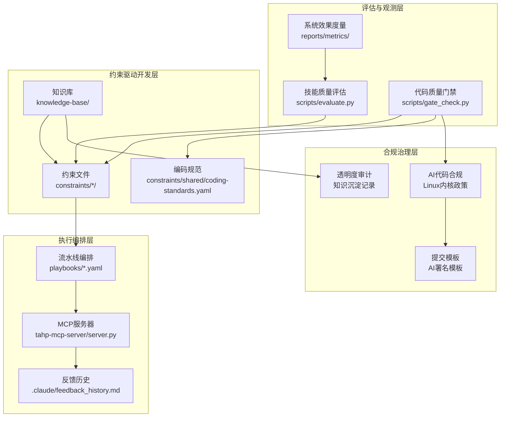
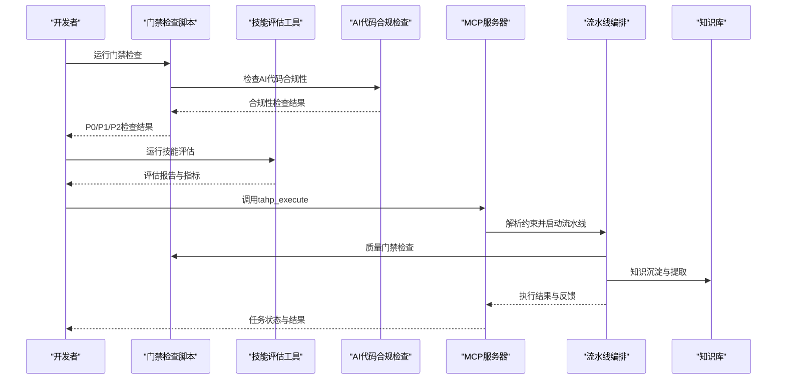
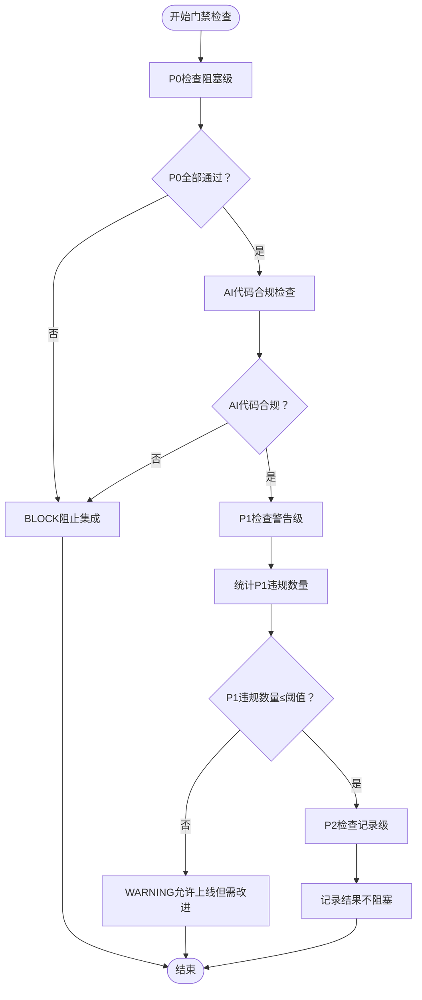
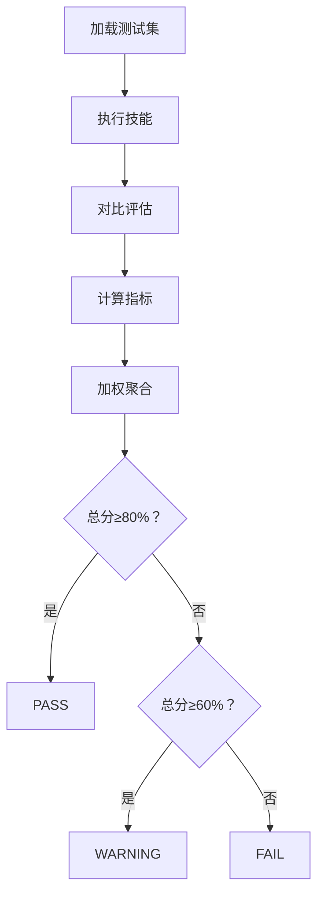
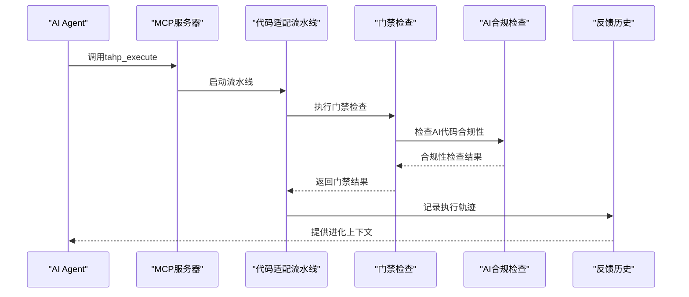
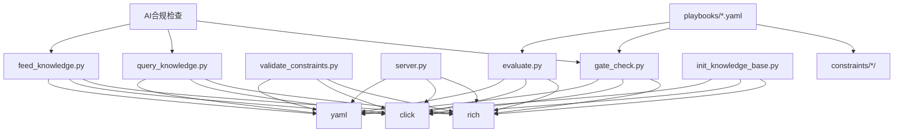

# 质量门禁体系

<cite>
**本文档引用的文件**
- [质量门禁规范](file://docs/TAHP-评估与质量门禁规范.md)
- [AI代码生成约束规范](file://docs/TAHP-AI代码生成约束规范.md)
- [门禁检查脚本](file://scripts/gate_check.py)
- [约束验证器](file://scripts/validate_constraints.py)
- [技能评估工具](file://scripts/evaluate.py)
- [EvoSkill进化运行器](file://scripts/run_evolution.py)
- [MCP服务器入口](file://tahp-mcp-server/server.py)
- [知识查询脚本](file://scripts/query_knowledge.py)
- [知识投喂脚本](file://scripts/feed_knowledge.py)
- [知识库初始化脚本](file://scripts/init_knowledge_base.py)
- [跨模块Bug分析流水线](file://playbooks/bug-analysis-pipeline.yaml)
- [代码适配流水线](file://playbooks/code-adaptation-pipeline.yaml)
- [Telephony模块约束](file://constraints/telephony/bug-analysis.yaml)
- [Telephony模块元数据](file://constraints/telephony/module.yaml)
- [内核驱动模块元数据](file://constraints/kernel-driver/module.yaml)
- [共享编码规范](file://constraints/shared/coding-standards.yaml)
</cite>

## 更新摘要
**变更内容**
- 新增Linux内核AI代码政策合规章节，包含人类作者署名、等价审查标准、Co-author标注等合规要求
- 更新质量门禁体系以支持AI代码生成的合规性检查
- 增强知识库与质量门禁的集成，支持AI参与的透明度要求
- 完善AI辅助提交模板和审查流程

## 目录
1. [简介](#简介)
2. [项目结构](#项目结构)
3. [核心组件](#核心组件)
4. [架构总览](#架构总览)
5. [详细组件分析](#详细组件分析)
6. [Linux内核AI代码政策合规](#linux内核ai代码政策合规)
7. [依赖关系分析](#依赖关系分析)
8. [性能考虑](#性能考虑)
9. [故障排查指南](#故障排查指南)
10. [结论](#结论)
11. [附录](#附录)

## 简介
本文件系统化阐述TAHP质量门禁体系的设计与实现，涵盖门禁级别定义、评估指标、自动化检查机制、权重与阈值设定、数据收集与结果分析、配置选项与自定义规则扩展、可视化展示以及与执行编排系统的集成与反馈闭环。文档面向开发者、质量工程师与技术管理者，既提供高层概览也包含代码级细节。

**更新** 本次更新重点增加了Linux内核AI代码政策合规要求，确保AI生成的代码与人工编写的代码遵循相同的审查标准，包括人类作者署名、等价审查标准、Co-author标注等合规要求。

## 项目结构
TAHP质量门禁体系围绕四个层次展开：
- 评估与观测层：技能质量评估、代码质量门禁、系统效果度量
- 约束驱动开发层：模块化约束文件、安全红线、Scope控制
- 执行编排层：流水线编排、MCP工具服务、反馈闭环
- 合规治理层：AI代码生成合规检查、透明度要求、知识库审计



**图表来源**
- [技能评估工具](file://scripts/evaluate.py)
- [门禁检查脚本](file://scripts/gate_check.py)
- [MCP服务器入口](file://tahp-mcp-server/server.py)
- [跨模块Bug分析流水线](file://playbooks/bug-analysis-pipeline.yaml)
- [AI代码生成约束规范](file://docs/TAHP-AI代码生成约束规范.md)

**章节来源**
- [质量门禁规范](file://docs/TAHP-评估与质量门禁规范.md)
- [Telephony模块约束](file://constraints/telephony/bug-analysis.yaml)
- [AI代码生成约束规范](file://docs/TAHP-AI代码生成约束规范.md)

## 核心组件
- 门禁检查引擎：实现P0/P1/P2三级门禁，支持模块级与流水线级检查，输出结构化报告与退出码
- 约束验证器：校验约束文件的语法、结构与元数据完整性，支持严格模式与跨模块引用检查
- 技能评估器：基于测试集的自动化评估，计算准确率、完整性、安全性与时间效率
- 执行编排：流水线编排与MCP工具服务，集成门禁检查与反馈闭环
- 知识库质量门禁：针对知识沉淀与提取的自动化质量检查
- **AI代码合规检查**：新增Linux内核AI代码政策合规检查，确保AI生成代码的透明度和可追溯性

**章节来源**
- [门禁检查脚本](file://scripts/gate_check.py)
- [约束验证器](file://scripts/validate_constraints.py)
- [技能评估工具](file://scripts/evaluate.py)
- [MCP服务器入口](file://tahp-mcp-server/server.py)
- [AI代码生成约束规范](file://docs/TAHP-AI代码生成约束规范.md)

## 架构总览
质量门禁体系采用"约束驱动 + 自动化检查 + 编排集成 + 反馈闭环 + 合规治理"的架构：



**图表来源**
- [门禁检查脚本](file://scripts/gate_check.py)
- [技能评估工具](file://scripts/evaluate.py)
- [MCP服务器入口](file://tahp-mcp-server/server.py)
- [跨模块Bug分析流水线](file://playbooks/bug-analysis-pipeline.yaml)
- [AI代码生成约束规范](file://docs/TAHP-AI代码生成约束规范.md)

## 详细组件分析

### 门禁级别与判定逻辑
- P0（阻塞级）：必须全通过，任一失败即BLOCK。典型检查包括安全红线、约束文件有效性、硬编码敏感信息等
- P1（警告级）：应尽量通过，累计超过阈值则WARNING。典型检查包括测试覆盖率、文档完整性、命名规范等
- P2（记录级）：建议通过，记录但不阻塞。典型检查包括代码风格、注释密度、示例用例等



**图表来源**
- [门禁检查脚本](file://scripts/gate_check.py)
- [AI代码生成约束规范](file://docs/TAHP-AI代码生成约束规范.md)

**章节来源**
- [门禁检查脚本](file://scripts/gate_check.py)
- [质量门禁规范](file://docs/TAHP-评估与质量门禁规范.md)
- [AI代码生成约束规范](file://docs/TAHP-AI代码生成约束规范.md)

### 评估指标体系与权重分配
- 技能质量评估指标（加权）：
  - 准确率（Accuracy）：40%，测试集正确率
  - 完整性（Completeness）：20%，必填字段覆盖率
  - 一致性（Consistency）：15%，相同输入稳定输出
  - 时效性（Efficiency）：15%，平均处理时间
  - 可解释性（Explainability）：10%，证据引用率
- 门禁判定阈值：
  - 总分≥80%：PASS
  - 60%≤总分<80%：WARNING
  - 总分<60%：FAIL



**图表来源**
- [技能评估工具](file://scripts/evaluate.py)
- [质量门禁规范](file://docs/TAHP-评估与质量门禁规范.md)

**章节来源**
- [技能评估工具](file://scripts/evaluate.py)
- [质量门禁规范](file://docs/TAHP-评估与质量门禁规范.md)

### 自动化检查机制与数据收集
- 门禁检查自动化：
  - 模块级检查：遍历模块目录，执行P0/P1/P2检查项
  - 流水线级检查：解析pipeline YAML，批量检查多个模块
  - 结果聚合：生成结构化报告，支持Rich控制台渲染
- 数据收集机制：
  - 约束文件：模块元数据、安全红线、分析规则、评估配置
  - 评估数据：测试集用例、期望输出、执行日志
  - 执行轨迹：任务ID、阶段、步骤详情、门禁结果
  - **AI代码合规数据**：AI参与标识、Co-author标注、知识沉淀记录
- 结果分析方法：
  - 统计通过率、失败原因分布、趋势分析
  - 与阈值对比，生成可视化报表
  - **合规性分析**：AI代码透明度、作者署名完整性、审查标准一致性

**章节来源**
- [门禁检查脚本](file://scripts/gate_check.py)
- [约束验证器](file://scripts/validate_constraints.py)
- [技能评估工具](file://scripts/evaluate.py)
- [AI代码生成约束规范](file://docs/TAHP-AI代码生成约束规范.md)

### 配置选项与自定义规则
- 门禁级别选择：支持P0、P1、P2、all四种级别
- 检查范围控制：按模块或流水线文件执行
- 严格模式：约束验证器支持严格模式，额外检查键名与格式
- 自定义规则扩展：
  - 新增门禁检查项：在门禁检查脚本中添加新函数，注册到相应级别
  - 新增约束规则：在约束文件中扩展rules/safety_red_lines/analysis_rules
  - 新增评估指标：在评估工具中扩展compare_output逻辑
  - **新增AI合规检查**：在门禁检查中添加AI代码合规性检查项

**章节来源**
- [门禁检查脚本](file://scripts/gate_check.py)
- [约束验证器](file://scripts/validate_constraints.py)
- [Telephony模块约束](file://constraints/telephony/bug-analysis.yaml)
- [AI代码生成约束规范](file://docs/TAHP-AI代码生成约束规范.md)

### 可视化展示
- 控制台表格：Rich渲染的门禁检查结果表，包含状态、检查项、详情
- 评估报告：包含各项指标与状态的颜色化表格
- 进度跟踪：MCP服务器的任务状态与进度面板
- **合规性仪表板**：AI代码透明度、作者署名、Co-author标注状态

**章节来源**
- [门禁检查脚本](file://scripts/gate_check.py)
- [技能评估工具](file://scripts/evaluate.py)
- [MCP服务器入口](file://tahp-mcp-server/server.py)

### 应用案例与最佳实践
- 代码适配场景：在代码适配流水线中集成门禁检查，确保修改符合Scope与安全要求
- 跨模块分析场景：当Bug涉及多个子系统时，自动触发跨模块分析流水线，统一记录反馈
- 约束文件治理：定期运行约束验证器，保持约束文件的完整性与一致性
- 知识库质量：每次执行任务后自动检查知识沉淀状态，维持知识库健康度
- **AI代码生成场景**：确保AI生成的代码符合Linux内核政策要求，包括人类作者署名和Co-author标注

**章节来源**
- [代码适配流水线](file://playbooks/code-adaptation-pipeline.yaml)
- [跨模块Bug分析流水线](file://playbooks/bug-analysis-pipeline.yaml)
- [质量门禁规范](file://docs/TAHP-评估与质量门禁规范.md)
- [AI代码生成约束规范](file://docs/TAHP-AI代码生成约束规范.md)

### 与执行编排系统的集成与反馈循环
- 流水线集成：在代码适配流水线中嵌入门禁检查步骤，根据结果决定是否继续
- MCP工具集成：通过tahp_execute、tahp_gate_check等工具，将门禁检查纳入AI Agent工作流
- 反馈闭环：记录执行轨迹与门禁结果，用于EvoSkill进化与约束优化
- **AI代码合规集成**：在流水线中自动检查AI代码的合规性，确保透明度要求得到满足



**图表来源**
- [MCP服务器入口](file://tahp-mcp-server/server.py)
- [代码适配流水线](file://playbooks/code-adaptation-pipeline.yaml)
- [EvoSkill进化运行器](file://scripts/run_evolution.py)
- [AI代码生成约束规范](file://docs/TAHP-AI代码生成约束规范.md)

**章节来源**
- [MCP服务器入口](file://tahp-mcp-server/server.py)
- [代码适配流水线](file://playbooks/code-adaptation-pipeline.yaml)
- [EvoSkill进化运行器](file://scripts/run_evolution.py)

## Linux内核AI代码政策合规

### 政策背景
2026年Linux内核社区正式发布AI代码政策，对AI生成/辅助的代码提交提出了明确要求。TAHP作为Android底软集成平台，部分模块涉及内核代码修改，必须合规：

> **核心原则**: AI生成的代码必须与人工编写的代码遵循相同的审查标准，不得因"AI生成"而降低质量门槛。

### 合规要求
| 要求 | 说明 | TAHP 实现 |
|------|------|----------|
| **人类作者署名** | AI辅助生成的代码必须由人类开发者作为作者提交 | Agent产出→人工审核→Owner提交，commit author为Owner |
| **等价审查标准** | AI生成的代码必须通过与人工代码完全相同的review流程 | 质量门禁P0/P1/P2对AI产出和人工产出一视同仁 |
| **Co-author标注** | 使用 `Co-authored-by` tag标注AI工具参与 | Git commit message模板已包含该标注 |
| **不隐瞒AI参与** | 禁止将AI生成的代码伪装为纯人工编写 | §8.3知识沉淀记录可追溯AI参与路径 |
| **安全审查不减免** | AI生成的安全相关代码必须通过额外安全审查 | 安全红线(P0)对所有代码修改同等适用 |

### AI署名模板
```bash
# Git commit message 模板（内核代码修改时使用）
git commit -s -m "[{module}] {type}: {description}

AI-assisted-by: TAHP/{skill-name}
Co-authored-by: TAHP AI Harness Platform <tahp@transsion.com>

{详细描述}
"
```

> **注意**: `-s` flag 自动添加 `Signed-off-by` 行，内核代码提交必须包含。`AI-assisted-by` 标注具体使用的Skill，`Co-authored-by` 标注平台。两者均不可省略。

### 合规检查机制
- **作者署名检查**：验证提交作者是否为人类开发者
- **Co-author标注检查**：验证commit message中是否包含AI工具的Co-authored-by标注
- **透明度审计**：通过知识沉淀记录追踪AI参与路径
- **等价审查标准**：确保AI生成代码通过与人工代码相同的门禁检查

**章节来源**
- [AI代码生成约束规范](file://docs/TAHP-AI代码生成约束规范.md)

## 依赖关系分析



**图表来源**
- [门禁检查脚本](file://scripts/gate_check.py)
- [技能评估工具](file://scripts/evaluate.py)
- [约束验证器](file://scripts/validate_constraints.py)
- [MCP服务器入口](file://tahp-mcp-server/server.py)
- [知识查询脚本](file://scripts/query_knowledge.py)
- [知识投喂脚本](file://scripts/feed_knowledge.py)
- [知识库初始化脚本](file://scripts/init_knowledge_base.py)

**章节来源**
- [门禁检查脚本](file://scripts/gate_check.py)
- [技能评估工具](file://scripts/evaluate.py)
- [约束验证器](file://scripts/validate_constraints.py)
- [MCP服务器入口](file://tahp-mcp-server/server.py)
- [知识查询脚本](file://scripts/query_knowledge.py)
- [知识投喂脚本](file://scripts/feed_knowledge.py)
- [知识库初始化脚本](file://scripts/init_knowledge_base.py)

## 性能考虑
- 门禁检查性能：文件遍历与正则匹配的复杂度取决于模块规模；建议在CI中限制检查范围
- 评估性能：测试集规模与模型执行时间是主要瓶颈；可通过并发与缓存优化
- 约束验证性能：大目录扫描时注意I/O开销；可启用递归扫描选项
- MCP服务性能：异步处理工具调用，避免长时间阻塞；合理设置日志级别
- **AI合规检查性能**：知识库查询和语义搜索可能影响性能，建议缓存常用查询结果

## 故障排查指南
- 门禁检查失败：
  - 检查约束文件是否存在安全红线与必要字段
  - 确认模块目录结构与文件命名规范
  - 使用严格模式验证约束文件
  - **检查AI代码合规性**：验证人类作者署名和Co-author标注
- 评估报告异常：
  - 检查测试集结构与用例完整性
  - 确认技能执行脚本与模型参数
  - 查看错误消息与超时设置
- 约束验证错误：
  - 关注元数据字段与域枚举值
  - 检查跨模块依赖引用
  - 使用严格模式获取额外警告
- MCP工具调用失败：
  - 检查工具参数与模块/域枚举
  - 查看服务器日志与异常堆栈
  - 确认项目根目录与工具适配器
- **AI合规检查失败**：
  - 检查Git提交信息中是否包含AI-assisted-by和Co-authored-by标注
  - 验证提交作者是否为人类开发者
  - 确认知识沉淀记录是否完整

**章节来源**
- [门禁检查脚本](file://scripts/gate_check.py)
- [技能评估工具](file://scripts/evaluate.py)
- [约束验证器](file://scripts/validate_constraints.py)
- [MCP服务器入口](file://tahp-mcp-server/server.py)
- [AI代码生成约束规范](file://docs/TAHP-AI代码生成约束规范.md)

## 结论
TAHP质量门禁体系通过约束驱动与自动化检查，实现了从代码质量到技能效果的全方位质量保障。结合执行编排与反馈闭环，体系能够持续优化约束文件与技能表现，提升开发者效率与系统价值。

**更新** 本次更新增强了Linux内核AI代码政策合规要求，确保AI生成的代码符合行业标准和监管要求。通过人类作者署名、等价审查标准、Co-author标注等措施，建立了完整的AI代码透明度和可追溯性机制。建议在实践中逐步完善检查项、优化阈值与权重，并加强可视化与监控，以获得更好的质量治理效果。

## 附录
- 常用命令：
  - 门禁检查：`python scripts/gate_check.py constraints/telephony/ --level all`
  - 技能评估：`python scripts/evaluate.py skills/telephony-bug-analyzer/ eval-data/telephony/`
  - 约束验证：`python scripts/validate_constraints.py constraints/ --strict --check-xref`
  - 进化运行：`python scripts/run_evolution.py skills/telephony-bug-analyzer/ --iterations 20`
  - **知识查询**：`python scripts/query_knowledge.py --module telephony --query "WiFi Calling crash"`
  - **知识投喂**：`python scripts/feed_knowledge.py --module telephony --docs ./my-docs/*.md`
  - **知识库初始化**：`python scripts/init_knowledge_base.py --module telephony`
- 关键配置文件：
  - `.evoskill/config.toml`：EvoSkill配置
  - `.claude/program.yaml`：反馈历史配置
  - `tahp-mcp-server/config.py`：MCP服务器配置
  - **AI代码生成约束规范**：`docs/TAHP-AI代码生成约束规范.md`
  - **质量门禁规范**：`docs/TAHP-评估与质量门禁规范.md`