# 部署与运维

<cite>
**本文引用的文件**
- [.github/workflows/ci.yml](file://.github/workflows/ci.yml)
- [githooks/pre-commit.ps1](file://githooks/pre-commit.ps1)
- [scripts/pre-commit-check.ps1](file://scripts/pre-commit-check.ps1)
- [scripts/gate_check.py](file://scripts/gate_check.py)
- [scripts/validate_constraints.py](file://scripts/validate_constraints.py)
- [scripts/evaluate.py](file://scripts/evaluate.py)
- [scripts/tests/test_gate_check.py](file://scripts/tests/test_gate_check.py)
- [scripts/tests/test_validate_constraints.py](file://scripts/tests/test_validate_constraints.py)
- [scripts/requirements.txt](file://scripts/requirements.txt)
- [tahp-mcp-server/pyproject.toml](file://tahp-mcp-server/pyproject.toml)
- [tahp-mcp-server/requirements.txt](file://tahp-mcp-server/requirements.txt)
- [tahp-mcp-server/config.py](file://tahp-mcp-server/config.py)
- [tahp-mcp-server/server.py](file://tahp-mcp-server/server.py)
- [docs/architecture/system-overview.md](file://docs/architecture/system-overview.md)
- [playbooks/bug-analysis-pipeline.yaml](file://playbooks/bug-analysis-pipeline.yaml)
- [playbooks/code-adaptation-pipeline.yaml](file://playbooks/code-adaptation-pipeline.yaml)
- [playbooks/version-upgrade-pipeline.yaml](file://playbooks/version-upgrade-pipeline.yaml)
- [playbooks/carrier-porting-pipeline.yaml](file://playbooks/carrier-porting-pipeline.yaml)
- [scripts/init_module.py](file://scripts/init_module.py)
- [tahp-console/Dockerfile](file://tahp-console/Dockerfile)
- [tahp-console/docker-compose.yml](file://tahp-console/docker-compose.yml)
- [tahp-console/docs/docker.md](file://tahp-console/docs/docker.md)
- [tahp-console/README.md](file://tahp-console/README.md)
- [tahp-console/DEVELOPMENT.md](file://tahp-console/DEVELOPMENT.md)
- [tahp-console/package.json](file://tahp-console/package.json)
- [tahp-console/nodemon.json](file://tahp-console/nodemon.json)
- [tahp-console/tsconfig.json](file://tahp-console/tsconfig.json)
- [tahp-console/tsconfig.app.json](file://tahp-console/tsconfig.app.json)
- [tahp-console/tsconfig.node.json](file://tahp-console/tsconfig.node.json)
- [tahp-console/vite.config.ts](file://tahp-console/vite.config.ts)
- [tahp-console/vite.config.website.ts](file://tahp-console/vite.config.website.ts)
- [tahp-console/scripts/cleanup-hermes-redundant.sh](file://tahp-console/scripts/cleanup-hermes-redundant.sh)
- [tahp-console/packages/server/src/services/logger.ts](file://tahp-console/packages/server/src/services/logger.ts)
- [tahp-console/packages/server/src/controllers/health.ts](file://tahp-console/packages/server/src/controllers/health.ts)
- [tahp-console/packages/server/src/services/hermes/hermes-cli.ts](file://tahp-console/packages/server/src/services/hermes/hermes-cli.ts)
- [tahp-console/packages/server/src/controllers/hermes/config.ts](file://tahp-console/packages/server/src/controllers/hermes/config.ts)
- [tahp-console/packages/server/src/routes/hermes/config.ts](file://tahp-console/packages/server/src/routes/hermes/config.ts)
</cite>

## 更新摘要
**所做更改**
- 新增系统简化与Hermes平台移除后的运维调整
- 更新容器化配置章节，反映Hermes冗余功能清理后的简化部署
- 新增监控告警章节，基于清理后的系统架构提供运维监控建议
- 更新开发与调试指南，包含冗余功能清理后的开发流程
- 新增运维自动化章节，整合冗余功能清理脚本的使用指导

## 目录
1. [引言](#引言)
2. [项目结构](#项目结构)
3. [核心组件](#核心组件)
4. [架构总览](#架构总览)
5. [详细组件分析](#详细组件分析)
6. [依赖关系分析](#依赖关系分析)
7. [性能考虑](#性能考虑)
8. [故障排除指南](#故障排除指南)
9. [CI/CD 工作流配置](#cicd-工作流配置)
10. [预提交钩子集成](#预提交钩子集成)
11. [质量门禁检查](#质量门禁检查)
12. [约束文件验证](#约束文件验证)
13. [技能评估工具](#技能评估工具)
14. [运维自动化与日常维护](#运维自动化与日常维护)
15. [Vue.js 控制台 Docker 部署](#vuejs-控制台-docker-部署)
16. [容器化配置与监控告警](#容器化配置与监控告警)
17. [开发与调试指南](#开发与调试指南)
18. [结论](#结论)
19. [附录](#附录)

## 引言
本指南面向生产环境的部署与运维，围绕 TAHP 平台的 MCP 服务与 Vue.js 控制台，提供多部署方式（传统服务器、Docker 容器化、Kubernetes 集群）的实践步骤；涵盖监控告警、日志管理、性能优化、高可用与灾难恢复、运维自动化与日常维护流程。文档中的所有技术细节均来自仓库现有文件与架构说明，确保可落地与可追溯。

**更新** 基于Hermes平台移除后的系统简化，更新容器化配置、监控告警和运维流程，提供更加简洁高效的部署方案。

## 项目结构
TAHP 采用"约束驱动 + 工具协议 + 执行编排"的分层架构。MCP 服务作为工具系统的入口，承载多种工具（日志分析、AOSP Diff、补丁生成、API 迁移、构建验证、回归测试、代码审查等），并通过 YAML Playbook 定义跨引擎的执行流程。Vue.js 控制台提供现代化的 Web 界面，通过 Socket.IO 与 Hermes Agent 运行时集成。

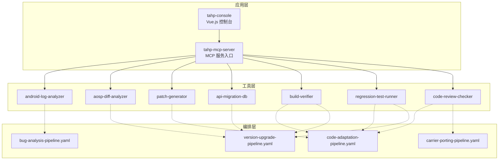

**图表来源**
- [tahp-mcp-server/server.py:103-340](file://tahp-mcp-server/server.py#L103-L340)
- [docs/architecture/system-overview.md:292-314](file://docs/architecture/system-overview.md#L292-L314)
- [playbooks/bug-analysis-pipeline.yaml:1-43](file://playbooks/bug-analysis-pipeline.yaml#L1-L43)
- [playbooks/code-adaptation-pipeline.yaml:1-35](file://playbooks/code-adaptation-pipeline.yaml#L1-L35)
- [playbooks/version-upgrade-pipeline.yaml:1-61](file://playbooks/version-upgrade-pipeline.yaml#L1-L61)
- [playbooks/carrier-porting-pipeline.yaml:1-41](file://playbooks/carrier-porting-pipeline.yaml#L1-L41)
- [tahp-console/README.md:277-293](file://tahp-console/README.md#L277-L293)

**章节来源**
- [docs/architecture/system-overview.md:316-396](file://docs/architecture/system-overview.md#L316-L396)

## 核心组件
- MCP 服务入口与工具注册：MCP 服务通过标准协议暴露工具清单，并在运行时分发到具体处理函数。工具包括任务执行、状态查询、纠偏、质量门禁、知识检索、日志分析、代码审查、API 迁移等。
- Vue.js 控制台：基于 Vue 3 + TypeScript + Vite 构建的现代化 Web 控制台，提供聊天会话管理、平台渠道配置、使用分析、定时任务、模型管理、多配置文件等功能。
- 配置管理：支持从 YAML 文件与环境变量加载配置，包含项目根目录、日志级别、并发任务数、任务超时、模块与领域映射、目录结构等。
- 执行编排：通过 YAML Playbook 定义跨引擎的流水线，支持串行与并行步骤、条件分支与工具调用。

**章节来源**
- [tahp-mcp-server/server.py:103-340](file://tahp-mcp-server/server.py#L103-L340)
- [tahp-mcp-server/config.py:36-176](file://tahp-mcp-server/config.py#L36-L176)
- [tahp-console/README.md:32-152](file://tahp-console/README.md#L32-L152)
- [playbooks/bug-analysis-pipeline.yaml:6-37](file://playbooks/bug-analysis-pipeline.yaml#L6-L37)
- [playbooks/code-adaptation-pipeline.yaml:6-34](file://playbooks/code-adaptation-pipeline.yaml#L6-L34)
- [playbooks/version-upgrade-pipeline.yaml:6-60](file://playbooks/version-upgrade-pipeline.yaml#L6-L60)
- [playbooks/carrier-porting-pipeline.yaml:6-40](file://playbooks/carrier-porting-pipeline.yaml#L6-L40)

## 架构总览
下图展示 MCP 服务、Vue.js 控制台与工具、编排之间的交互关系，以及双引擎（诊断/适配）的工作流向。

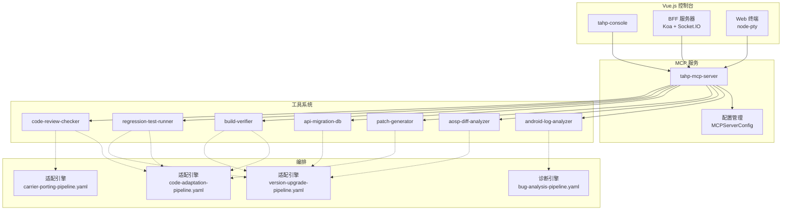

**图表来源**
- [tahp-mcp-server/server.py:103-340](file://tahp-mcp-server/server.py#L103-L340)
- [tahp-mcp-server/config.py:36-176](file://tahp-mcp-server/config.py#L36-L176)
- [tahp-console/README.md:277-293](file://tahp-console/README.md#L277-L293)
- [playbooks/bug-analysis-pipeline.yaml:1-43](file://playbooks/bug-analysis-pipeline.yaml#L1-L43)
- [playbooks/code-adaptation-pipeline.yaml:1-35](file://playbooks/code-adaptation-pipeline.yaml#L1-L35)
- [playbooks/version-upgrade-pipeline.yaml:1-61](file://playbooks/version-upgrade-pipeline.yaml#L1-L61)
- [playbooks/carrier-porting-pipeline.yaml:1-41](file://playbooks/carrier-porting-pipeline.yaml#L1-L41)

## 详细组件分析

### MCP 服务组件
- 工具清单与参数校验：服务启动后注册工具清单，对每个工具调用进行参数校验与异常处理，确保输入合法性与可追踪性。
- 生命周期与初始化：服务初始化时设置日志、加载配置、注册进度发射器，打印可用模块与已加载工具列表。
- 异步运行：通过标准 IO 通道运行 MCP 服务器，便于与 Claude Code 等客户端对接。

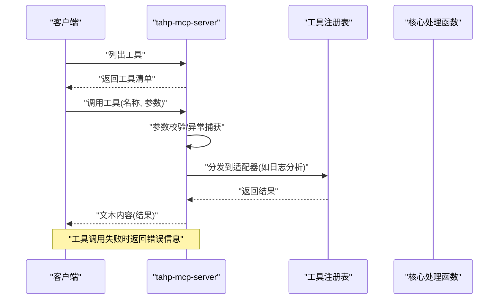

**图表来源**
- [tahp-mcp-server/server.py:327-367](file://tahp-mcp-server/server.py#L327-L367)
- [tahp-mcp-server/server.py:369-448](file://tahp-mcp-server/server.py#L369-L448)

**章节来源**
- [tahp-mcp-server/server.py:103-340](file://tahp-mcp-server/server.py#L103-L340)
- [tahp-mcp-server/server.py:450-484](file://tahp-mcp-server/server.py#L450-L484)

### Vue.js 控制台组件
- 前端架构：基于 Vue 3 Composition API + TypeScript + Vite + Naive UI + Pinia + Vue Router + vue-i18n 构建，提供响应式用户界面。
- 后端服务：Koa 2 作为 BFF 层，处理 Socket.IO 聊天流、Hermes 代理桥接、文件上传下载、会话 CRUD、配置凭证管理等。
- Web 终端：集成 node-pty 和 @xterm/xterm，支持多会话终端会话、实时键盘输入和 PTY 输出流。
- 聊天运行时：基于 Socket.IO 的聊天流，通过 Hermes 代理桥接 Hermes Agent 运行时。

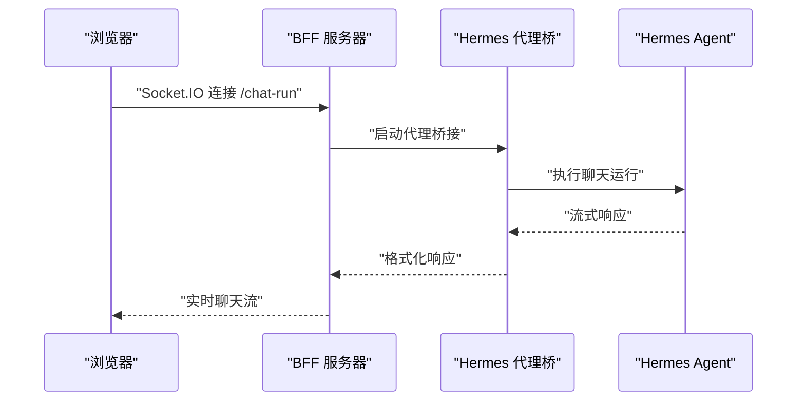

**图表来源**
- [tahp-console/README.md:277-293](file://tahp-console/README.md#L277-L293)
- [tahp-console/vite.config.ts:98-102](file://tahp-console/vite.config.ts#L98-L102)

**章节来源**
- [tahp-console/README.md:32-152](file://tahp-console/README.md#L32-L152)
- [tahp-console/README.md:277-293](file://tahp-console/README.md#L277-L293)

### 配置组件
- 配置来源：优先从项目根目录下的 YAML 配置文件加载，支持环境变量覆盖；提供目录属性与路径解析方法，便于工具与编排定位资源。
- 关键参数：日志级别、最大并发任务数、任务超时、模块与领域白名单、Playbook 映射等。
- 校验与映射：提供模块与领域的合法性校验，Playbook 路径解析。

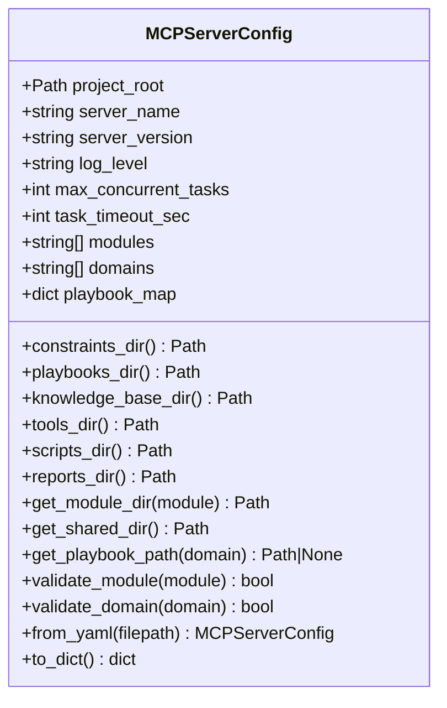

**图表来源**
- [tahp-mcp-server/config.py:36-176](file://tahp-mcp-server/config.py#L36-L176)

**章节来源**
- [tahp-mcp-server/config.py:18-34](file://tahp-mcp-server/config.py#L18-L34)
- [tahp-mcp-server/config.py:130-161](file://tahp-mcp-server/config.py#L130-L161)

### 诊断引擎编排
- 跨模块分析：根据 Bug 描述识别涉及模块，加载约束，多模块并行分析，最终合成统一报告并记录反馈。
- 关键步骤：解析 Bug → 加载约束 → 并行分析 → 汇总 → 记录反馈。


**图表来源**
- [playbooks/bug-analysis-pipeline.yaml:6-37](file://playbooks/bug-analysis-pipeline.yaml#L6-L37)

**章节来源**
- [playbooks/bug-analysis-pipeline.yaml:1-43](file://playbooks/bug-analysis-pipeline.yaml#L1-L43)

### 代码适配引擎编排
- 适配流程：加载分析与约束 → 范围检查 → 输出修改计划 → 执行修改 → 质量门禁 → 记录反馈。
- 关键步骤：范围校验 → 修改计划 → 执行修改 → 门禁检查 → 记录反馈。


**图表来源**
- [playbooks/code-adaptation-pipeline.yaml:6-34](file://playbooks/code-adaptation-pipeline.yaml#L6-L34)

**章节来源**
- [playbooks/code-adaptation-pipeline.yaml:1-35](file://playbooks/code-adaptation-pipeline.yaml#L1-L35)

### 版本升级适配引擎编排
- 升级流程：加载版本约束与迁移规则 → AOSP Diff 分析 → 影响扫描 → 策略分类 → 并行适配（全自动/半自动/人工）→ 编译验证 → 回归测试 → 生成报告。
- 关键步骤：Diff 分析 → 影响评估 → 策略分类 → 并行适配 → 编译验证 → 回归测试 → 报告生成。

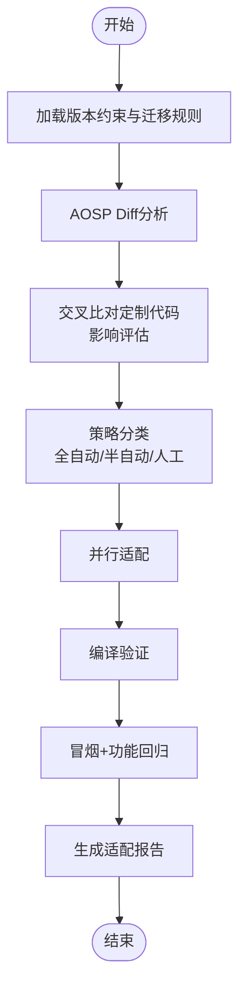

**图表来源**
- [playbooks/version-upgrade-pipeline.yaml:6-60](file://playbooks/version-upgrade-pipeline.yaml#L6-L60)

**章节来源**
- [playbooks/version-upgrade-pipeline.yaml:1-61](file://playbooks/version-upgrade-pipeline.yaml#L1-L61)

### 运营商移植引擎编排
- 移植流程：加载运营商约束 → 解析需求 → 策略分类 → 并行移植（自动/人工）→ 合规检查 → 生成报告。
- 关键步骤：需求解析 → 策略分类 → 并行移植 → 合规检查 → 报告生成。


**图表来源**
- [playbooks/carrier-porting-pipeline.yaml:6-40](file://playbooks/carrier-porting-pipeline.yaml#L6-L40)

**章节来源**
- [playbooks/carrier-porting-pipeline.yaml:1-41](file://playbooks/carrier-porting-pipeline.yaml#L1-L41)

## 依赖关系分析
- MCP 服务依赖：mcp、pyyaml、click、rich 等；通过 pyproject.toml 与 requirements.txt 维护。
- Vue.js 控制台依赖：Vue 3、TypeScript、Vite、Naive UI、Pinia、Vue Router、vue-i18n 等现代前端技术栈。
- 工具与编排：MCP 服务通过工具注册表分发到具体工具；工具与编排通过 Playbook 协同工作。
- 项目根目录与资源定位：配置类提供目录属性，便于定位 constraints、playbooks、knowledge-base、tools、scripts、reports 等。

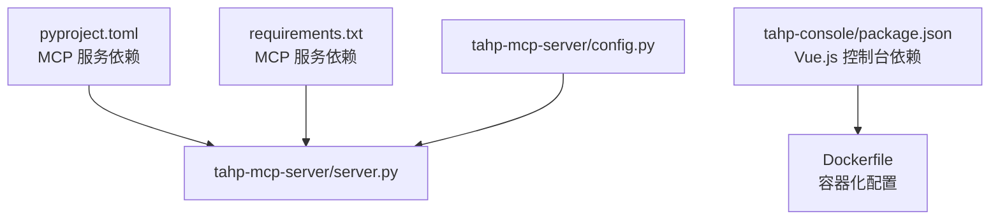

**图表来源**
- [tahp-mcp-server/pyproject.toml:10-18](file://tahp-mcp-server/pyproject.toml#L10-L18)
- [tahp-mcp-server/requirements.txt:1-5](file://tahp-mcp-server/requirements.txt#L1-L5)
- [tahp-mcp-server/server.py:61-82](file://tahp-mcp-server/server.py#L61-L82)
- [tahp-mcp-server/config.py:10-15](file://tahp-mcp-server/config.py#L10-L15)
- [tahp-console/package.json:41-106](file://tahp-console/package.json#L41-L106)

**章节来源**
- [tahp-mcp-server/pyproject.toml:1-19](file://tahp-mcp-server/pyproject.toml#L1-L19)
- [tahp-mcp-server/requirements.txt:1-5](file://tahp-mcp-server/requirements.txt#L1-L5)
- [tahp-mcp-server/config.py:81-103](file://tahp-mcp-server/config.py#L81-L103)
- [tahp-console/package.json:1-108](file://tahp-console/package.json#L1-L108)

## 性能考虑
- 并发与超时：配置最大并发任务数与任务超时，避免资源争用与长时间阻塞；结合工具执行时间与资源消耗，合理设置超时阈值。
- I/O 与日志：控制日志级别与输出大小，避免过长结果导致传输与存储压力；必要时分页或截断输出。
- 工具并行：编排中充分利用并行步骤（如多模块并行分析、批量适配），缩短端到端时延。
- 资源隔离：容器或 Pod 中限制 CPU/内存，避免单任务拖累整体吞吐；对编译与回归测试等重负载任务单独调度。
- 缓存与索引：知识库与迁移规则库应具备快速检索能力；Playbook 与约束文件尽量保持精简与结构化，减少解析开销。
- Vue.js 控制台优化：前端采用代码分割和懒加载，大型依赖单独打包，构建时使用 esbuild 提升速度。

## 故障排除指南
- 工具调用失败
  - 现象：工具返回错误信息或异常堆栈。
  - 排查：检查参数完整性与合法性；查看服务日志；确认工具适配器是否正确注册。
  - 参考
    - [tahp-mcp-server/server.py:361-367](file://tahp-mcp-server/server.py#L361-L367)
- 配置加载异常
  - 现象：配置未生效或默认值被使用。
  - 排查：确认 YAML 文件路径与权限；检查环境变量覆盖；验证配置字段类型与取值范围。
  - 参考
    - [tahp-mcp-server/config.py:130-161](file://tahp-mcp-server/config.py#L130-L161)
- 模块/领域非法
  - 现象：参数校验抛出非法模块或领域错误。
  - 排查：核对模块与领域白名单；确认 constraints 与 playbooks 目录结构。
  - 参考
    - [tahp-mcp-server/server.py:384-387](file://tahp-mcp-server/server.py#L384-L387)
    - [tahp-mcp-server/config.py:122-128](file://tahp-mcp-server/config.py#L122-L128)
- 结果过大导致截断
  - 现象：工具返回被截断的结果提示。
  - 排查：改用状态查询或分段输出；优化工具输出粒度。
  - 参考
    - [tahp-mcp-server/server.py:355-358](file://tahp-mcp-server/server.py#L355-L358)
- 编排步骤失败
  - 现象：某一步骤执行失败或超时。
  - 排查：查看该步骤工具日志与返回；核对输入参数与前置条件；检查并行分支的依赖关系。
  - 参考
    - [playbooks/code-adaptation-pipeline.yaml:25-29](file://playbooks/code-adaptation-pipeline.yaml#L25-L29)
    - [playbooks/version-upgrade-pipeline.yaml:44-55](file://playbooks/version-upgrade-pipeline.yaml#L44-L55)
- Vue.js 控制台连接问题
  - 现象：无法连接到 MCP 服务或聊天功能异常。
  - 排查：检查 Socket.IO 连接状态；验证代理桥接配置；确认端口映射正确。
  - 参考
    - [tahp-console/vite.config.ts:98-102](file://tahp-console/vite.config.ts#L98-L102)

## CI/CD 工作流配置

### GitHub Actions 流水线
项目采用 GitHub Actions 实现持续集成，包含质量门禁检查、单元测试和评估报告生成。

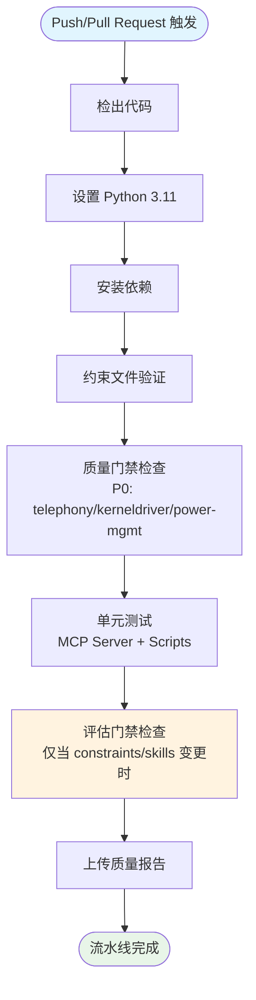

**图表来源**
- [.github/workflows/ci.yml:1-70](file://.github/workflows/ci.yml#L1-L70)

### 流水线步骤详解
- **约束文件验证**：运行 `scripts/validate_constraints.py` 检查所有约束文件的 YAML 语法和结构完整性
- **质量门禁检查**：对 telephony、kernel-driver、power-mgmt 三个领域执行 P0 级别门禁检查
- **单元测试**：运行 MCP 服务和脚本的单元测试套件
- **评估门禁**：当检测到 constraints 或 skills 目录变更时，执行技能评估评估

**章节来源**
- [.github/workflows/ci.yml:8-70](file://.github/workflows/ci.yml#L8-L70)

## 预提交钩子集成

### Windows 预提交钩子
提供 PowerShell 版本的预提交钩子，用于本地质量门禁检查。

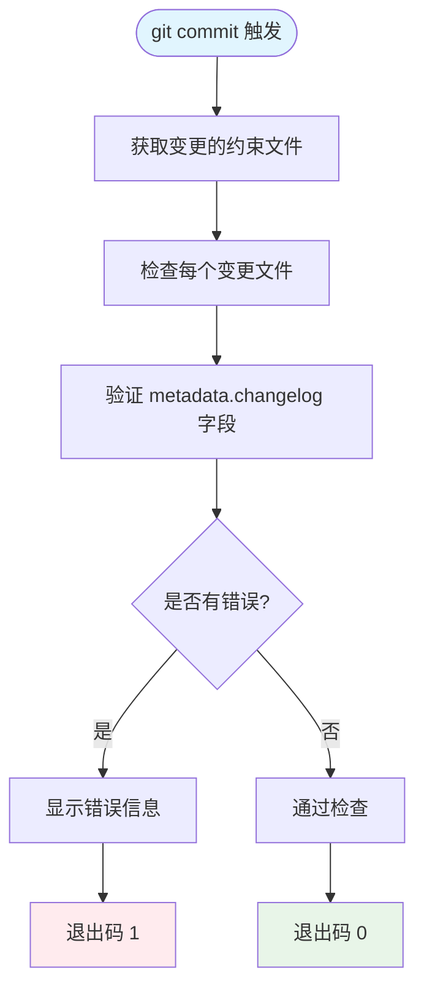

**图表来源**
- [githooks/pre-commit.ps1:1-35](file://githooks/pre-commit.ps1#L1-L35)

### 本地质量门禁检查
提供完整的预提交检查脚本，包含四个主要检查阶段：

**章节来源**
- [githooks/pre-commit.ps1:1-35](file://githooks/pre-commit.ps1#L1-L35)
- [scripts/pre-commit-check.ps1:1-98](file://scripts/pre-commit-check.ps1#L1-L98)

## 质量门禁检查

### 三级质量门禁机制
系统实现 P0/P1/P2 三级质量门禁，分别对应阻断性、警告性和信息性检查。

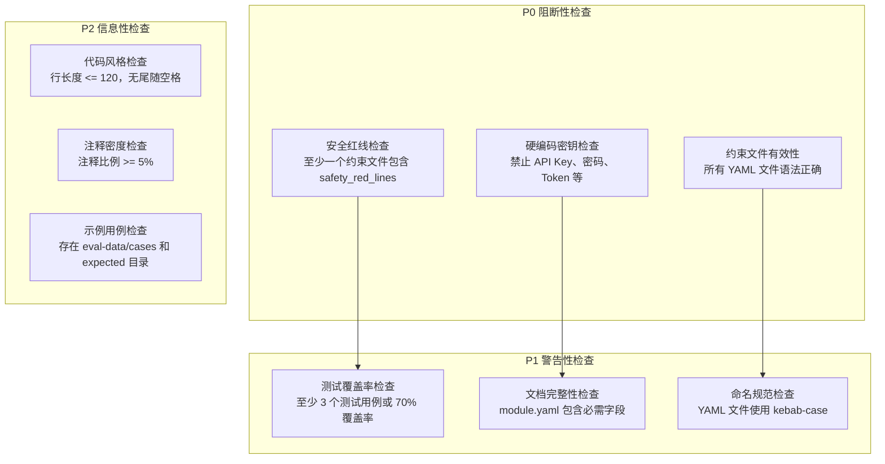

**图表来源**
- [scripts/gate_check.py:96-350](file://scripts/gate_check.py#L96-L350)

### P0 阻断性检查
- **安全红线检查**：确保至少有一个约束文件包含非空的安全红线列表
- **硬编码密钥检查**：检测并阻止 API Key、密码、Token 等敏感信息硬编码
- **约束文件有效性**：验证所有 YAML 文件的语法正确性和结构完整性

### P1 警告性检查
- **测试覆盖率检查**：基于测试用例数量估算覆盖率，要求至少 3 个用例或 70% 覆盖率
- **文档完整性检查**：验证 module.yaml 包含模块名称、所有者、作用域等必需字段
- **命名规范检查**：确保 YAML 文件使用 kebab-case 命名约定

### P2 信息性检查
- **代码风格检查**：检查行长度和尾随空格等基础代码风格
- **注释密度检查**：统计注释占总行数的比例
- **示例用例检查**：验证评估数据目录结构的完整性

**章节来源**
- [scripts/gate_check.py:36-350](file://scripts/gate_check.py#L36-L350)

## 约束文件验证

### 约束文件验证工具
提供专门的约束文件验证工具，确保约束文件符合 TAHP 规范。

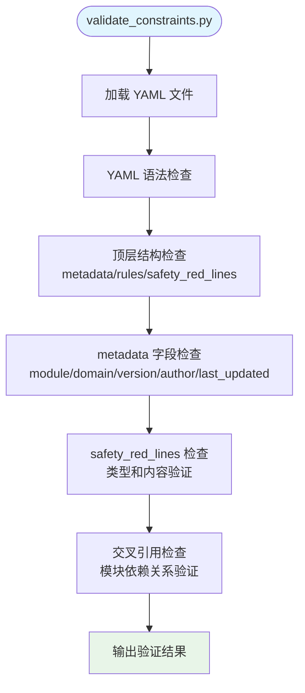

**图表来源**
- [scripts/validate_constraints.py:80-250](file://scripts/validate_constraints.py#L80-L250)

### 验证规则详解
- **YAML 语法检查**：确保文件可解析且为有效的 YAML 格式
- **顶层结构检查**：验证必需的顶级键是否存在（metadata、rules、safety_red_lines）
- **metadata 字段检查**：验证模块名称、域名、版本、作者、最后更新时间等字段
- **safety_red_lines 检查**：验证安全红线列表的类型和内容
- **交叉引用检查**：验证模块间的依赖关系是否有效

**章节来源**
- [scripts/validate_constraints.py:67-250](file://scripts/validate_constraints.py#L67-L250)

## 技能评估工具

### AI 技能评估系统
提供完整的 AI 技能评估工具，支持准确性、完整性、安全性等多维度评估。

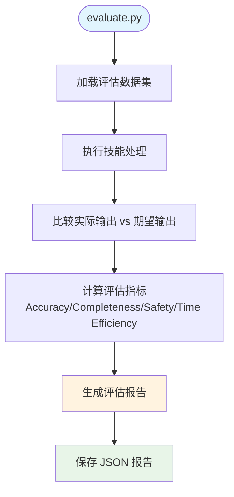

**图表来源**
- [scripts/evaluate.py:290-384](file://scripts/evaluate.py#L290-L384)

### 评估指标体系
- **准确性 (Accuracy)**：实际输出与期望输出的匹配程度，字符串使用模糊匹配算法
- **完整性 (Completeness)**：期望字段在实际输出中的出现比例
- **安全性 (Safety Compliance)**：检测潜在的安全违规行为，如硬编码密钥
- **时间效率 (Time Efficiency)**：基于平均执行时间的效率评分

### 执行流程
1. **数据加载**：从 eval-data 目录加载测试用例
2. **技能执行**：调用 AI 技能处理测试输入
3. **结果比较**：对比实际输出与期望输出
4. **指标计算**：计算各项评估指标
5. **报告生成**：生成结构化的 JSON 报告

**章节来源**
- [scripts/evaluate.py:135-384](file://scripts/evaluate.py#L135-L384)

## 运维自动化与日常维护

### 自动化脚本
- **模块初始化**：通过脚本生成标准化模块目录与约束文件，支持交互与非交互模式
- **质量门禁检查**：提供完整的预提交检查流程，包含约束验证、门禁检查和单元测试
- **约束文件验证**：自动化验证约束文件的语法和结构完整性
- **Hermes 冗余功能清理**：提供专门的清理脚本，移除不再使用的冗余功能

**章节来源**
- [scripts/init_module.py:14-200](file://scripts/init_module.py#L14-L200)
- [scripts/pre-commit-check.ps1:21-98](file://scripts/pre-commit-check.ps1#L21-L98)
- [scripts/validate_constraints.py:239-365](file://scripts/validate_constraints.py#L239-L365)
- [tahp-console/scripts/cleanup-hermes-redundant.sh:1-182](file://tahp-console/scripts/cleanup-hermes-redundant.sh#L1-L182)

### 日常维护流程
- **依赖更新**：定期同步依赖版本，关注安全公告；在测试环境验证后再上线
- **配置审计**：定期检查配置文件与环境变量，确保一致性与合规性
- **编排优化**：根据执行数据优化流水线步骤与并行度，减少瓶颈环节
- **质量门禁**：严格执行 P0/P1/P2 三级门禁，确保代码质量
- **系统简化维护**：定期清理冗余功能，保持系统简洁高效

**章节来源**
- [scripts/requirements.txt:1-6](file://scripts/requirements.txt#L1-L6)

### 系统简化与冗余清理
基于Hermes平台移除后的系统简化，提供专门的清理脚本和维护流程：

**清理功能类别**
- Group Chat 群聊：移除约5000行冗余代码
- Kanban 看板：移除约3000行冗余代码  
- Jobs 定时任务：移除约1500行冗余代码
- Memory 记忆系统：移除约800行冗余代码
- TTS 语音合成：移除约1000行冗余代码
- Usage 统计：移除约2000行冗余代码
- Weixin 微信集成：移除约500行冗余代码
- 第三方 OAuth：移除约3000行冗余代码
- Gateway Manager：移除约2000行冗余代码
- i18n 非中英文语言包：移除约7700行冗余代码

**清理流程**
1. 运行清理脚本进行预检查（--dry-run）
2. 执行实际清理操作
3. 手动处理剩余的路由和初始化配置
4. 更新国际化配置
5. 编译验证确保系统正常运行

**章节来源**
- [tahp-console/scripts/cleanup-hermes-redundant.sh:1-182](file://tahp-console/scripts/cleanup-hermes-redundant.sh#L1-L182)

## Vue.js 控制台 Docker 部署

### Docker 镜像构建
Vue.js 控制台基于 hermes-agent 基础镜像构建，包含完整的 Node.js 运行时和依赖安装。

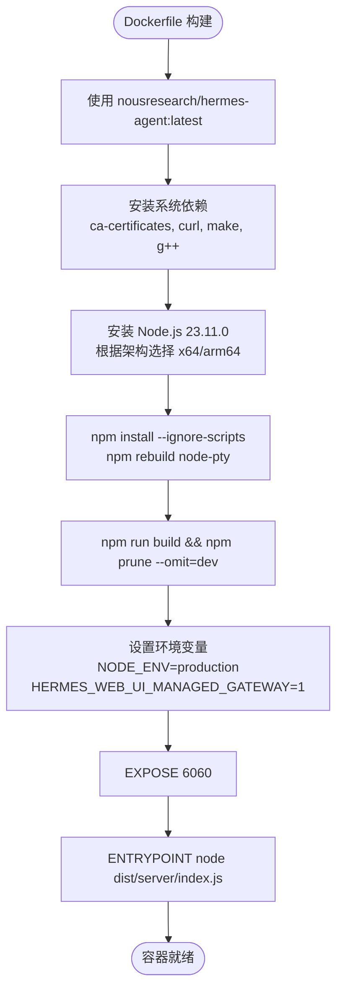

**图表来源**
- [tahp-console/Dockerfile:1-44](file://tahp-console/Dockerfile#L1-L44)

### Docker Compose 配置
提供环境变量驱动的 Docker Compose 设置，支持预构建镜像和源码构建两种方式。

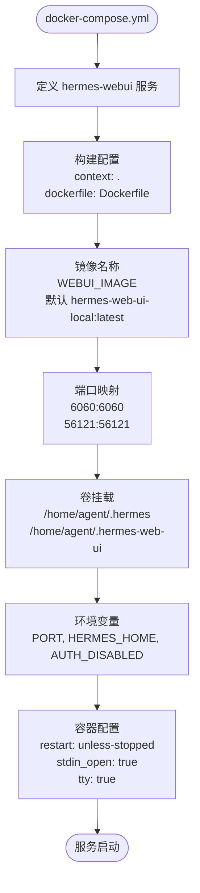

**图表来源**
- [tahp-console/docker-compose.yml:1-26](file://tahp-console/docker-compose.yml#L1-L26)

### 快速启动指南
支持两种部署方式：使用预构建镜像或从源码构建。

**使用预构建镜像（推荐）**
```bash
WEBUI_IMAGE=ekkoye8888/hermes-web-ui docker compose up -d
docker compose logs -f hermes-webui
```

**从源码构建**
```bash
docker compose up -d --build
docker compose logs -f hermes-webui
```

**访问控制台**
打开浏览器访问：http://localhost:6060

**章节来源**
- [tahp-console/docs/docker.md:1-109](file://tahp-console/docs/docker.md#L1-L109)
- [tahp-console/README.md:182-204](file://tahp-console/README.md#L182-L204)

### 环境变量配置
所有关键运行时设置都通过环境变量配置。

| 变量名 | 默认值 | 描述 |
|--------|--------|------|
| `PORT` | `6060` | Web UI 监听端口 |
| `BIND_HOST` | `0.0.0.0` | Web UI 绑定主机地址 |
| `HERMES_BIN` | `/opt/hermes/.venv/bin/hermes` | Hermes CLI 二进制路径 |
| `HERMES_AGENT_IMAGE` | `nousresearch/hermes-agent:latest` | Hermes Agent 基础镜像 |
| `WEBUI_IMAGE` | `hermes-web-ui-local:latest` | Web UI 镜像名称 |
| `HERMES_DATA_DIR` | `./hermes_data` | Hermes 运行时数据目录 |
| `AUTH_DISABLED` | `false` | 是否禁用登录认证 |

**章节来源**
- [tahp-console/docs/docker.md:31-59](file://tahp-console/docs/docker.md#L31-L59)
- [tahp-console/docker-compose.yml:14-23](file://tahp-console/docker-compose.yml#L14-L23)

### 数据持久化
- **Hermes 数据**：存储在 `./hermes_data`，映射到容器内 `/home/agent/.hermes`
- **Web UI 数据**：存储在 `./hermes_data/hermes-web-ui/`，映射到容器内 `/home/agent/.hermes-web-ui`
- **认证令牌**：首次运行时自动生成，可通过日志或文件查看

**章节来源**
- [tahp-console/docs/docker.md:61-72](file://tahp-console/docs/docker.md#L61-L72)

## 容器化配置与监控告警

### 容器健康检查
- **健康检查端点**：通过 6060 端口提供 Web UI 服务
- **Hermes 集成**：使用 hermes-agent 基础镜像，自动集成 Hermes CLI 和代理桥接
- **认证配置**：支持禁用认证或使用令牌认证，首次运行自动生成认证令牌

### 监控指标建议
基于系统简化后的架构，建议以下监控指标：

**服务层指标**
- 请求速率、响应时间、错误率、并发连接数
- 系统资源使用率（CPU、内存、磁盘）

**应用层指标**
- 聊天会话数、文件上传下载量、用户活跃度
- 模型调用统计、会话消息量

**Hermes 集成指标**
- 代理桥接状态、聊天运行时性能
- 配置更新触发频率、网关重启次数

**清理后系统监控**
- 代码体积减少带来的性能提升
- 冗余功能移除后的资源占用降低
- 系统启动时间和内存使用优化

### 告警策略
- **服务不可用**：容器停止或端口不可访问
- **性能告警**：响应时间超过阈值、内存使用率过高
- **业务告警**：聊天会话失败率上升、文件操作异常
- **资源告警**：磁盘空间不足、网络连接异常

### 日志管理
- **容器日志**：Docker 日志驱动收集容器标准输出和错误输出
- **应用日志**：Vue.js 控制台使用 pino 日志库，支持结构化日志
- **Hermes 日志**：集成 Hermes Agent 运行时日志
- **日志轮转**：建议使用 Docker 日志驱动的轮转策略

**章节来源**
- [tahp-console/Dockerfile:33-43](file://tahp-console/Dockerfile#L33-L43)
- [tahp-console/package.json:91-92](file://tahp-console/package.json#L91-L92)
- [tahp-console/packages/server/src/services/logger.ts:1-58](file://tahp-console/packages/server/src/services/logger.ts#L1-L58)

## 开发与调试指南

### 开发环境搭建
Vue.js 控制台提供完整的开发环境配置，支持热重载和调试。

**开发命令**
```bash
# 安装依赖
npm install

# 启动开发服务器
npm run dev

# 运行测试
npm run test
npm run test:coverage
npm run test:e2e

# 构建生产版本
npm run build
```

**开发服务器配置**
- **前端开发服务器**：http://localhost:5173
- **后端开发服务器**：http://localhost:8650
- **代理配置**：Vite 代理到后端服务器，支持 Socket.IO 转发

**章节来源**
- [tahp-console/DEVELOPMENT.md:1-105](file://tahp-console/DEVELOPMENT.md#L1-L105)
- [tahp-console/package.json:23-35](file://tahp-console/package.json#L23-L35)

### 构建配置
- **前端构建**：Vite + Vue 3 + TypeScript，使用 esbuild 进行代码分割
- **后端构建**：TypeScript 编译，生成服务器端代码
- **开发配置**：nodemon 监听服务器文件变化，自动重启
- **测试配置**：Vitest 单元测试，Playwright 端到端测试

**章节来源**
- [tahp-console/vite.config.ts:1-105](file://tahp-console/vite.config.ts#L1-L105)
- [tahp-console/tsconfig.json:1-9](file://tahp-console/tsconfig.json#L1-L9)
- [tahp-console/tsconfig.app.json:1-19](file://tahp-console/tsconfig.app.json#L1-L19)
- [tahp-console/tsconfig.node.json:1-25](file://tahp-console/tsconfig.node.json#L1-L25)

### 调试技巧
- **前端调试**：Chrome DevTools 支持 Vue 3 组件调试
- **后端调试**：Node.js 调试器支持断点调试
- **Socket.IO 调试**：浏览器开发者工具 Network 面板查看实时聊天流
- **Hermes 集成调试**：查看代理桥接状态和聊天运行时日志

### 系统简化后的开发流程
基于Hermes平台移除后的简化架构，开发流程更加直接：

**健康检查优化**
- 简化的健康检查接口，专注于核心功能
- 减少冗余的平台集成检查
- 更快的启动和响应时间

**配置管理简化**
- 移除复杂的多平台配置管理
- 简化环境变量映射
- 减少配置文件复杂度

**监控集成优化**
- 集中化的日志管理
- 简化的指标收集
- 更直观的监控面板

**章节来源**
- [tahp-console/nodemon.json:1-17](file://tahp-console/nodemon.json#L1-L17)
- [tahp-console/packages/server/src/controllers/health.ts:1-82](file://tahp-console/packages/server/src/controllers/health.ts#L1-L82)
- [tahp-console/packages/server/src/services/hermes/hermes-cli.ts:1-800](file://tahp-console/packages/server/src/services/hermes/hermes-cli.ts#L1-L800)

## 结论
本指南基于仓库现有文件梳理了 MCP 服务、Vue.js 控制台、配置管理、工具与编排的生产部署要点。结合多部署方式、监控告警、日志管理、性能优化与高可用设计，可形成可操作的运维体系。

**更新内容** 基于Hermes平台移除后的系统简化，更新容器化配置、监控告警和运维流程。新增Hermes冗余功能清理脚本的使用指导，提供更加简洁高效的部署方案。替代原有的复杂Hermes平台集成，新的架构更加轻量级，便于维护和扩展。

## 附录

### 部署方式与最佳实践

- **传统服务器部署**
  - 环境准备：安装 Python 3.10+，克隆仓库，安装依赖（参考 pyproject 与 requirements）。
  - 配置文件：在项目根目录创建配置文件，设置项目根目录、日志级别、并发与超时等。
  - 启动服务：通过 MCP 服务入口启动，确保与客户端（如 Claude Code）的连接通道正常。
  - 参考
    - [tahp-mcp-server/pyproject.toml:10-18](file://tahp-mcp-server/pyproject.toml#L10-L18)
    - [tahp-mcp-server/requirements.txt:1-5](file://tahp-mcp-server/requirements.txt#L1-L5)
    - [tahp-mcp-server/server.py:478-484](file://tahp-mcp-server/server.py#L478-L484)
    - [tahp-mcp-server/config.py:130-161](file://tahp-mcp-server/config.py#L130-L161)

- **Docker 容器化部署**
  - **MCP 服务容器化**：基于官方 Python 运行时镜像，复制仓库代码，安装依赖，暴露 MCP 通信端口，设置工作目录与环境变量。
  - **Vue.js 控制台容器化**：基于 hermes-agent 基础镜像，安装 Node.js 运行时，构建前端和后端代码，暴露 6060 端口。
  - 健康检查：通过 STDIO 通道探测服务可用性；设置重启策略与资源限制。
  - 参考
    - [tahp-mcp-server/server.py:461-476](file://tahp-mcp-server/server.py#L461-L476)
    - [tahp-mcp-server/config.py:18-34](file://tahp-mcp-server/config.py#L18-L34)
    - [tahp-console/Dockerfile:1-44](file://tahp-console/Dockerfile#L1-L44)

- **Kubernetes 集群部署**
  - 建议：使用 Deployment/StatefulSet 管理 MCP 服务和 Vue.js 控制台副本；通过 ConfigMap/Secret 管理配置与密钥；使用 Service 暴露服务；设置 HPA 根据 CPU/内存或自定义指标扩缩容。
  - 安全：限制容器权限，只挂载必要卷；启用 Pod 安全策略；网络策略隔离。
  - 参考
    - [docs/architecture/system-overview.md:383-396](file://docs/architecture/system-overview.md#L383-L396)

### 监控与告警
- **指标建议**
  - 服务层：请求速率、响应延迟、错误率、并发任务数、队列长度。
  - 工具层：工具执行成功率、平均耗时、失败分布（参数错误/内部错误/超时）。
  - 编排层：流水线成功率、步骤耗时、重试次数、失败节点定位。
  - Vue.js 控制台：聊天会话数、文件操作量、用户活跃度、代理桥接状态。
  - 系统简化后：重点关注核心功能指标，减少冗余监控项。
- **告警策略**
  - 错误率突增、超时比例上升、并发达到阈值、编排失败率上升、容器资源不足等触发告警。
- **日志管理**
  - 分层日志：MCP 服务、Vue.js 控制台、工具、编排分别输出结构化日志；按级别与任务 ID 聚合。
  - 存储与轮转：集中收集至日志系统，设置保留周期与压缩策略。
  - 参考
    - [tahp-mcp-server/server.py:84-90](file://tahp-mcp-server/server.py#L84-L90)

### 高可用与灾难恢复
- **高可用**
  - 多副本部署：通过副本数与亲和性策略保证服务可用；使用就绪/存活探针保障健康实例。
  - 负载均衡：在容器或集群外层配置负载均衡，实现流量分发与故障切换。
- **灾难恢复**
  - 数据备份：定期备份配置文件、Playbook、知识库与评估报告；确保版本控制与快照。
  - 服务回滚：基于容器镜像标签与 Helm/Deployment 回滚策略，快速恢复。
  - 参考
    - [docs/architecture/system-overview.md:383-396](file://docs/architecture/system-overview.md#L383-L396)

### 运维自动化与日常维护
- **自动化脚本**
  - 模块初始化：通过脚本生成标准化模块目录与约束文件，支持交互与非交互模式。
  - 质量门禁检查：提供完整的预提交检查流程，包含约束验证、门禁检查和单元测试。
  - 约束文件验证：自动化验证约束文件的语法和结构完整性。
  - 技能评估：支持 AI 技能的自动化评估和报告生成。
  - Vue.js 控制台：提供 Docker 部署脚本和容器化配置模板。
  - **Hermes 冗余清理**：提供专门的清理脚本，移除不再使用的冗余功能。
  - 参考
    - [scripts/init_module.py:14-200](file://scripts/init_module.py#L14-L200)
    - [scripts/pre-commit-check.ps1:21-98](file://scripts/pre-commit-check.ps1#L21-L98)
    - [scripts/validate_constraints.py:239-365](file://scripts/validate_constraints.py#L239-L365)
    - [scripts/evaluate.py:290-384](file://scripts/evaluate.py#L290-L384)

- **日常维护**
  - 依赖更新：定期同步依赖版本，关注安全公告；在测试环境验证后再上线。
  - 配置审计：定期检查配置文件与环境变量，确保一致性与合规性。
  - 编排优化：根据执行数据优化流水线步骤与并行度，减少瓶颈环节。
  - 质量门禁：严格执行 P0/P1/P2 三级门禁，确保代码质量。
  - **系统简化维护**：定期清理冗余功能，保持系统简洁高效。
  - 参考
    - [scripts/requirements.txt:1-6](file://scripts/requirements.txt#L1-L6)
    - [scripts/gate_check.py:368-507](file://scripts/gate_check.py#L368-L507)
    - [scripts/tests/test_gate_check.py:1-177](file://scripts/tests/test_gate_check.py#L1-L177)
    - [scripts/tests/test_validate_constraints.py:1-191](file://scripts/tests/test_validate_constraints.py#L1-L191)

### 系统简化后的运维优化
基于Hermes平台移除后的系统简化，运维流程得到显著优化：

**性能优化**
- 减少容器启动时间：移除复杂的Hermes网关管理
- 降低内存占用：清理冗余功能模块
- 简化监控复杂度：减少平台集成监控项

**运维简化**
- 简化配置管理：移除多平台配置复杂性
- 减少故障点：移除冗余的第三方集成
- 降低维护成本：减少代码量和依赖项

**监控优化**
- 集中化监控：专注于核心功能指标
- 精简告警：移除冗余告警规则
- 提高告警准确性：减少误报和噪音

**章节来源**
- [tahp-console/scripts/cleanup-hermes-redundant.sh:1-182](file://tahp-console/scripts/cleanup-hermes-redundant.sh#L1-L182)
- [tahp-console/packages/server/src/controllers/health.ts:1-82](file://tahp-console/packages/server/src/controllers/health.ts#L1-L82)
- [tahp-console/packages/server/src/services/logger.ts:1-58](file://tahp-console/packages/server/src/services/logger.ts#L1-L58)