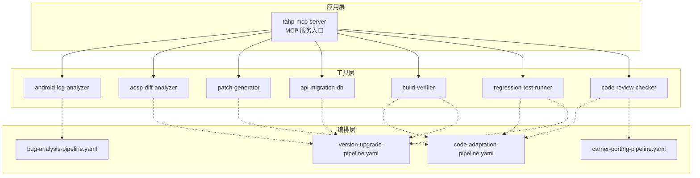
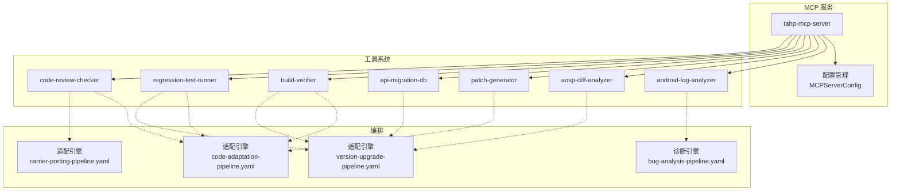
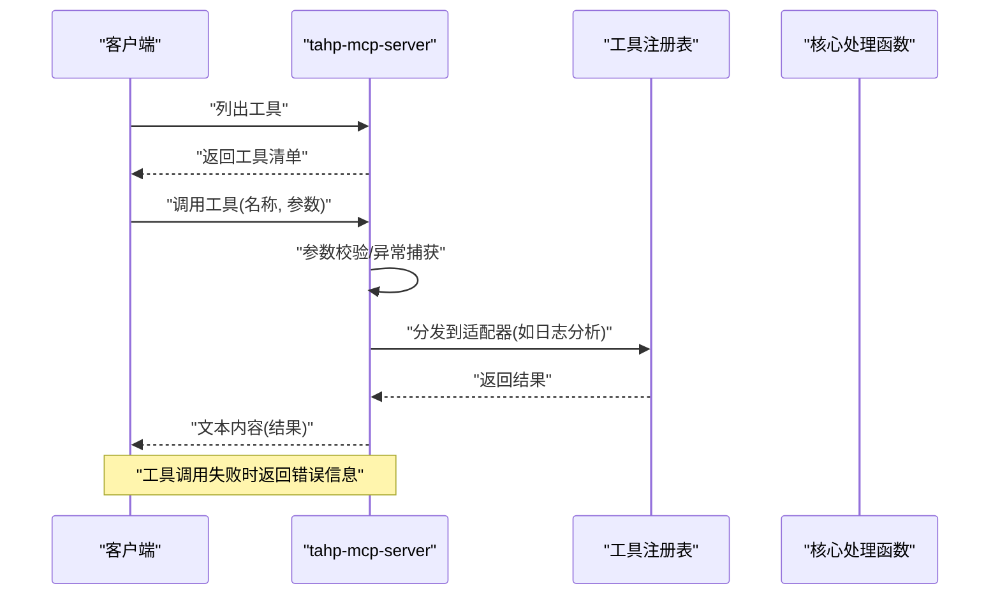
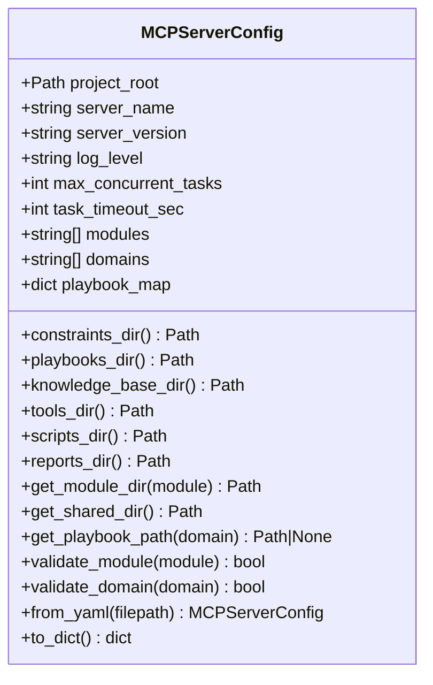
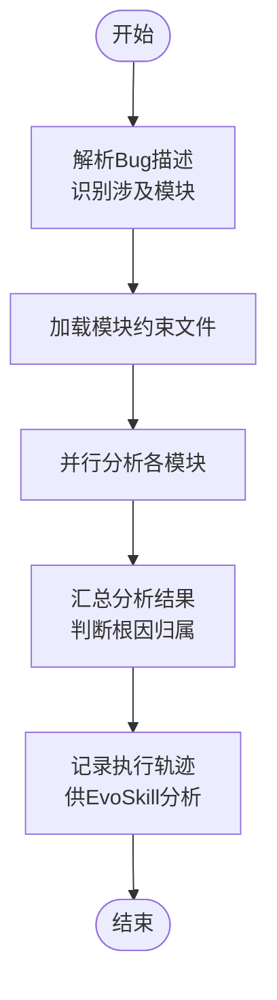
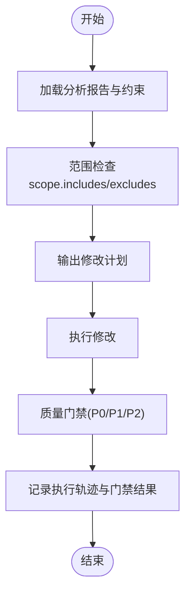
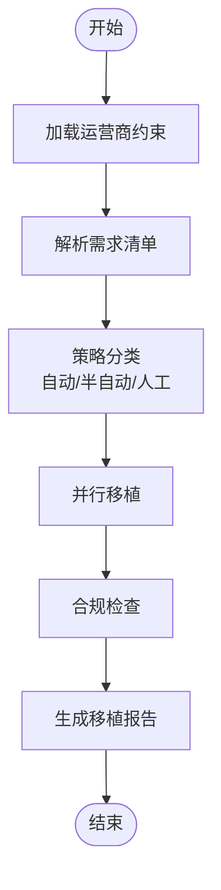
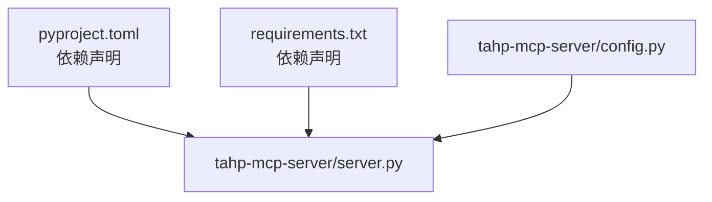

# 部署与运维

<cite>
**本文引用的文件**
- [tahp-mcp-server/pyproject.toml](file://tahp-mcp-server/pyproject.toml)
- [tahp-mcp-server/requirements.txt](file://tahp-mcp-server/requirements.txt)
- [tahp-mcp-server/config.py](file://tahp-mcp-server/config.py)
- [tahp-mcp-server/server.py](file://tahp-mcp-server/server.py)
- [docs/architecture/system-overview.md](file://docs/architecture/system-overview.md)
- [playbooks/bug-analysis-pipeline.yaml](file://playbooks/bug-analysis-pipeline.yaml)
- [playbooks/code-adaptation-pipeline.yaml](file://playbooks/code-adaptation-pipeline.yaml)
- [playbooks/version-upgrade-pipeline.yaml](file://playbooks/version-upgrade-pipeline.yaml)
- [playbooks/carrier-porting-pipeline.yaml](file://playbooks/carrier-porting-pipeline.yaml)
- [scripts/init_module.py](file://scripts/init_module.py)
- [scripts/requirements.txt](file://scripts/requirements.txt)
</cite>

## 目录
1. [引言](#引言)
2. [项目结构](#项目结构)
3. [核心组件](#核心组件)
4. [架构总览](#架构总览)
5. [详细组件分析](#详细组件分析)
6. [依赖关系分析](#依赖关系分析)
7. [性能考虑](#性能考虑)
8. [故障排除指南](#故障排除指南)
9. [结论](#结论)
10. [附录](#附录)

## 引言
本指南面向生产环境的部署与运维，围绕 TAHP 平台的 MCP 服务与工具生态，提供多部署方式（传统服务器、Docker 容器化、Kubernetes 集群）的实践步骤；涵盖监控告警、日志管理、性能优化、高可用与灾难恢复、运维自动化与日常维护流程。文档中的所有技术细节均来自仓库现有文件与架构说明，确保可落地与可追溯。

## 项目结构
TAHP 采用“约束驱动 + 工具协议 + 执行编排”的分层架构。MCP 服务作为工具系统的入口，承载多种工具（日志分析、AOSP Diff、补丁生成、API 迁移、构建验证、回归测试、代码审查等），并通过 YAML Playbook 定义跨引擎的执行流程。

图表来源
- [tahp-mcp-server/server.py:103-340](file://tahp-mcp-server/server.py#L103-L340)
- [docs/architecture/system-overview.md:292-314](file://docs/architecture/system-overview.md#L292-L314)
- [playbooks/bug-analysis-pipeline.yaml:1-43](file://playbooks/bug-analysis-pipeline.yaml#L1-L43)
- [playbooks/code-adaptation-pipeline.yaml:1-35](file://playbooks/code-adaptation-pipeline.yaml#L1-L35)
- [playbooks/version-upgrade-pipeline.yaml:1-61](file://playbooks/version-upgrade-pipeline.yaml#L1-L61)
- [playbooks/carrier-porting-pipeline.yaml:1-41](file://playbooks/carrier-porting-pipeline.yaml#L1-L41)

章节来源
- [docs/architecture/system-overview.md:316-396](file://docs/architecture/system-overview.md#L316-L396)

## 核心组件
- MCP 服务入口与工具注册：MCP 服务通过标准协议暴露工具清单，并在运行时分发到具体处理函数。工具包括任务执行、状态查询、纠偏、质量门禁、知识检索、日志分析、代码审查、API 迁移等。
- 配置管理：支持从 YAML 文件与环境变量加载配置，包含项目根目录、日志级别、并发任务数、任务超时、模块与领域映射、目录结构等。
- 执行编排：通过 YAML Playbook 定义跨引擎的流水线，支持串行与并行步骤、条件分支与工具调用。

章节来源
- [tahp-mcp-server/server.py:103-340](file://tahp-mcp-server/server.py#L103-L340)
- [tahp-mcp-server/config.py:36-176](file://tahp-mcp-server/config.py#L36-L176)
- [playbooks/bug-analysis-pipeline.yaml:6-37](file://playbooks/bug-analysis-pipeline.yaml#L6-L37)
- [playbooks/code-adaptation-pipeline.yaml:6-34](file://playbooks/code-adaptation-pipeline.yaml#L6-L34)
- [playbooks/version-upgrade-pipeline.yaml:6-60](file://playbooks/version-upgrade-pipeline.yaml#L6-L60)
- [playbooks/carrier-porting-pipeline.yaml:6-40](file://playbooks/carrier-porting-pipeline.yaml#L6-L40)

## 架构总览
下图展示 MCP 服务与工具、编排之间的交互关系，以及双引擎（诊断/适配）的工作流向。

图表来源
- [tahp-mcp-server/server.py:103-340](file://tahp-mcp-server/server.py#L103-L340)
- [tahp-mcp-server/config.py:36-176](file://tahp-mcp-server/config.py#L36-L176)
- [playbooks/bug-analysis-pipeline.yaml:1-43](file://playbooks/bug-analysis-pipeline.yaml#L1-L43)
- [playbooks/code-adaptation-pipeline.yaml:1-35](file://playbooks/code-adaptation-pipeline.yaml#L1-L35)
- [playbooks/version-upgrade-pipeline.yaml:1-61](file://playbooks/version-upgrade-pipeline.yaml#L1-L61)
- [playbooks/carrier-porting-pipeline.yaml:1-41](file://playbooks/carrier-porting-pipeline.yaml#L1-L41)

## 详细组件分析

### MCP 服务组件
- 工具清单与参数校验：服务启动后注册工具清单，对每个工具调用进行参数校验与异常处理，确保输入合法性与可追踪性。
- 生命周期与初始化：服务初始化时设置日志、加载配置、注册进度发射器，打印可用模块与已加载工具列表。
- 异步运行：通过标准 IO 通道运行 MCP 服务器，便于与 Claude Code 等客户端对接。

图表来源
- [tahp-mcp-server/server.py:327-367](file://tahp-mcp-server/server.py#L327-L367)
- [tahp-mcp-server/server.py:369-448](file://tahp-mcp-server/server.py#L369-L448)

章节来源
- [tahp-mcp-server/server.py:103-340](file://tahp-mcp-server/server.py#L103-L340)
- [tahp-mcp-server/server.py:450-484](file://tahp-mcp-server/server.py#L450-L484)

### 配置组件
- 配置来源：优先从项目根目录下的 YAML 配置文件加载，支持环境变量覆盖；提供目录属性与路径解析方法，便于工具与编排定位资源。
- 关键参数：日志级别、最大并发任务数、任务超时、模块与领域白名单、Playbook 映射等。
- 校验与映射：提供模块与领域的合法性校验，Playbook 路径解析。

图表来源
- [tahp-mcp-server/config.py:36-176](file://tahp-mcp-server/config.py#L36-L176)

章节来源
- [tahp-mcp-server/config.py:18-34](file://tahp-mcp-server/config.py#L18-L34)
- [tahp-mcp-server/config.py:130-161](file://tahp-mcp-server/config.py#L130-L161)

### 诊断引擎编排
- 跨模块分析：根据 Bug 描述识别涉及模块，加载约束，多模块并行分析，最终合成统一报告并记录反馈。
- 关键步骤：解析 Bug → 加载约束 → 并行分析 → 汇总 → 记录反馈。

图表来源
- [playbooks/bug-analysis-pipeline.yaml:6-37](file://playbooks/bug-analysis-pipeline.yaml#L6-L37)

章节来源
- [playbooks/bug-analysis-pipeline.yaml:1-43](file://playbooks/bug-analysis-pipeline.yaml#L1-L43)

### 代码适配引擎编排
- 适配流程：加载分析与约束 → 范围检查 → 输出修改计划 → 执行修改 → 质量门禁 → 记录反馈。
- 关键步骤：范围校验 → 修改计划 → 执行修改 → 门禁检查 → 记录反馈。

图表来源
- [playbooks/code-adaptation-pipeline.yaml:6-34](file://playbooks/code-adaptation-pipeline.yaml#L6-L34)

章节来源
- [playbooks/code-adaptation-pipeline.yaml:1-35](file://playbooks/code-adaptation-pipeline.yaml#L1-L35)

### 版本升级适配引擎编排
- 升级流程：加载版本约束与迁移规则 → AOSP Diff 分析 → 影响扫描 → 策略分类 → 并行适配（全自动/半自动/人工）→ 编译验证 → 回归测试 → 生成报告。
- 关键步骤：Diff 分析 → 影响评估 → 策略分类 → 并行适配 → 编译验证 → 回归测试 → 报告生成。

图表来源
- [playbooks/version-upgrade-pipeline.yaml:6-60](file://playbooks/version-upgrade-pipeline.yaml#L6-L60)

章节来源
- [playbooks/version-upgrade-pipeline.yaml:1-61](file://playbooks/version-upgrade-pipeline.yaml#L1-L61)

### 运营商移植引擎编排
- 移植流程：加载运营商约束 → 解析需求 → 策略分类 → 并行移植（自动/人工）→ 合规检查 → 生成报告。
- 关键步骤：需求解析 → 策略分类 → 并行移植 → 合规检查 → 报告生成。

图表来源
- [playbooks/carrier-porting-pipeline.yaml:6-40](file://playbooks/carrier-porting-pipeline.yaml#L6-L40)

章节来源
- [playbooks/carrier-porting-pipeline.yaml:1-41](file://playbooks/carrier-porting-pipeline.yaml#L1-L41)

## 依赖关系分析
- MCP 服务依赖：mcp、pyyaml、click、rich 等；通过 pyproject.toml 与 requirements.txt 维护。
- 工具与编排：MCP 服务通过工具注册表分发到具体工具；工具与编排通过 Playbook 协同工作。
- 项目根目录与资源定位：配置类提供目录属性，便于定位 constraints、playbooks、knowledge-base、tools、scripts、reports 等。

图表来源
- [tahp-mcp-server/pyproject.toml:10-18](file://tahp-mcp-server/pyproject.toml#L10-L18)
- [tahp-mcp-server/requirements.txt:1-5](file://tahp-mcp-server/requirements.txt#L1-L5)
- [tahp-mcp-server/server.py:61-82](file://tahp-mcp-server/server.py#L61-L82)
- [tahp-mcp-server/config.py:10-15](file://tahp-mcp-server/config.py#L10-L15)

章节来源
- [tahp-mcp-server/pyproject.toml:1-19](file://tahp-mcp-server/pyproject.toml#L1-L19)
- [tahp-mcp-server/requirements.txt:1-5](file://tahp-mcp-server/requirements.txt#L1-L5)
- [tahp-mcp-server/config.py:81-103](file://tahp-mcp-server/config.py#L81-L103)

## 性能考虑
- 并发与超时：配置最大并发任务数与任务超时，避免资源争用与长时间阻塞；结合工具执行时间与资源消耗，合理设置超时阈值。
- I/O 与日志：控制日志级别与输出大小，避免过长结果导致传输与存储压力；必要时分页或截断输出。
- 工具并行：编排中充分利用并行步骤（如多模块并行分析、批量适配），缩短端到端时延。
- 资源隔离：容器或 Pod 中限制 CPU/内存，避免单任务拖累整体吞吐；对编译与回归测试等重负载任务单独调度。
- 缓存与索引：知识库与迁移规则库应具备快速检索能力；Playbook 与约束文件尽量保持精简与结构化，减少解析开销。

## 故障排除指南
- 工具调用失败
  - 现象：工具返回错误信息或异常堆栈。
  - 排查：检查参数完整性与合法性；查看服务日志；确认工具适配器是否正确注册。
  - 参考
    - [tahp-mcp-server/server.py:361-367](file://tahp-mcp-server/server.py#L361-L367)
- 配置加载异常
  - 现象：配置未生效或默认值被使用。
  - 排查：确认 YAML 文件路径与权限；检查环境变量覆盖；验证配置字段类型与取值范围。
  - 参考
    - [tahp-mcp-server/config.py:130-161](file://tahp-mcp-server/config.py#L130-L161)
- 模块/领域非法
  - 现象：参数校验抛出非法模块或领域错误。
  - 排查：核对模块与领域白名单；确认 constraints 与 playbooks 目录结构。
  - 参考
    - [tahp-mcp-server/server.py:384-387](file://tahp-mcp-server/server.py#L384-L387)
    - [tahp-mcp-server/config.py:122-128](file://tahp-mcp-server/config.py#L122-L128)
- 结果过大导致截断
  - 现象：工具返回被截断的结果提示。
  - 排查：改用状态查询或分段输出；优化工具输出粒度。
  - 参考
    - [tahp-mcp-server/server.py:355-358](file://tahp-mcp-server/server.py#L355-L358)
- 编排步骤失败
  - 现象：某一步骤执行失败或超时。
  - 排查：查看该步骤工具日志与返回；核对输入参数与前置条件；检查并行分支的依赖关系。
  - 参考
    - [playbooks/code-adaptation-pipeline.yaml:25-29](file://playbooks/code-adaptation-pipeline.yaml#L25-L29)
    - [playbooks/version-upgrade-pipeline.yaml:44-55](file://playbooks/version-upgrade-pipeline.yaml#L44-L55)

## 结论
本指南基于仓库现有文件梳理了 MCP 服务、配置管理、工具与编排的生产部署要点。结合多部署方式、监控告警、日志管理、性能优化与高可用设计，可形成可操作的运维体系。后续可在容器与集群层面进一步细化镜像构建、健康检查、滚动更新与弹性伸缩策略。

## 附录

### 部署方式与最佳实践

- 传统服务器部署
  - 环境准备：安装 Python 3.10+，克隆仓库，安装依赖（参考 pyproject 与 requirements）。
  - 配置文件：在项目根目录创建配置文件，设置项目根目录、日志级别、并发与超时等。
  - 启动服务：通过 MCP 服务入口启动，确保与客户端（如 Claude Code）的连接通道正常。
  - 参考
    - [tahp-mcp-server/pyproject.toml:10-18](file://tahp-mcp-server/pyproject.toml#L10-L18)
    - [tahp-mcp-server/requirements.txt:1-5](file://tahp-mcp-server/requirements.txt#L1-L5)
    - [tahp-mcp-server/server.py:478-484](file://tahp-mcp-server/server.py#L478-L484)
    - [tahp-mcp-server/config.py:130-161](file://tahp-mcp-server/config.py#L130-L161)

- Docker 容器化部署
  - 建议：基于官方 Python 运行时镜像，复制仓库代码，安装依赖，暴露 MCP 通信端口，设置工作目录与环境变量。
  - 健康检查：通过 STDIO 通道探测服务可用性；设置重启策略与资源限制。
  - 参考
    - [tahp-mcp-server/server.py:461-476](file://tahp-mcp-server/server.py#L461-L476)
    - [tahp-mcp-server/config.py:18-34](file://tahp-mcp-server/config.py#L18-L34)

- Kubernetes 集群部署
  - 建议：使用 Deployment/StatefulSet 管理 MCP 服务副本；通过 ConfigMap/Secret 管理配置与密钥；使用 Service 暴露服务；设置 HPA 根据 CPU/内存或自定义指标扩缩容。
  - 安全：限制容器权限，只挂载必要卷；启用 Pod 安全策略；网络策略隔离。
  - 参考
    - [docs/architecture/system-overview.md:383-396](file://docs/architecture/system-overview.md#L383-L396)

### 监控与告警
- 指标建议
  - 服务层：请求速率、响应延迟、错误率、并发任务数、队列长度。
  - 工具层：工具执行成功率、平均耗时、失败分布（参数错误/内部错误/超时）。
  - 编排层：流水线成功率、步骤耗时、重试次数、失败节点定位。
- 告警策略
  - 错误率突增、超时比例上升、并发达到阈值、编排失败率上升等触发告警。
- 日志管理
  - 分层日志：MCP 服务、工具、编排分别输出结构化日志；按级别与任务 ID 聚合。
  - 存储与轮转：集中收集至日志系统，设置保留周期与压缩策略。
  - 参考
    - [tahp-mcp-server/server.py:84-90](file://tahp-mcp-server/server.py#L84-L90)

### 高可用与灾难恢复
- 高可用
  - 多副本部署：通过副本数与亲和性策略保证服务可用；使用就绪/存活探针保障健康实例。
  - 负载均衡：在容器或集群外层配置负载均衡，实现流量分发与故障切换。
- 灾难恢复
  - 数据备份：定期备份配置文件、Playbook、知识库与评估报告；确保版本控制与快照。
  - 服务回滚：基于容器镜像标签与 Helm/Deployment 回滚策略，快速恢复。
  - 参考
    - [docs/architecture/system-overview.md:383-396](file://docs/architecture/system-overview.md#L383-L396)

### 运维自动化与日常维护
- 自动化脚本
  - 模块初始化：通过脚本生成标准化模块目录与约束文件，支持交互与非交互模式。
  - 参考
    - [scripts/init_module.py:14-365](file://scripts/init_module.py#L14-L365)
- 日常维护
  - 依赖更新：定期同步依赖版本，关注安全公告；在测试环境验证后再上线。
  - 配置审计：定期检查配置文件与环境变量，确保一致性与合规性。
  - 编排优化：根据执行数据优化流水线步骤与并行度，减少瓶颈环节。
  - 参考
    - [scripts/requirements.txt:1-6](file://scripts/requirements.txt#L1-L6)