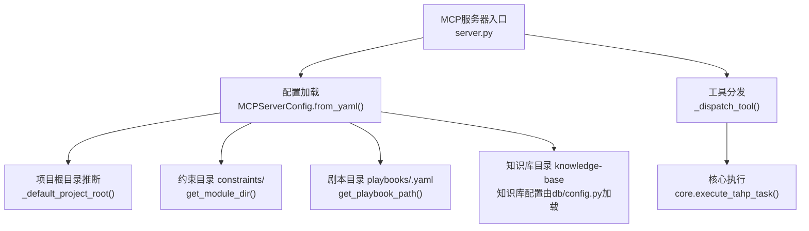
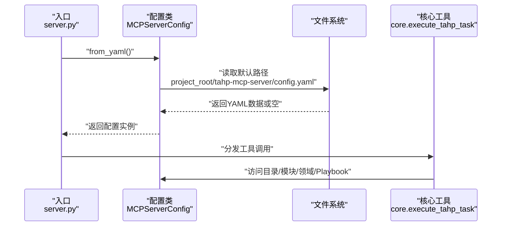
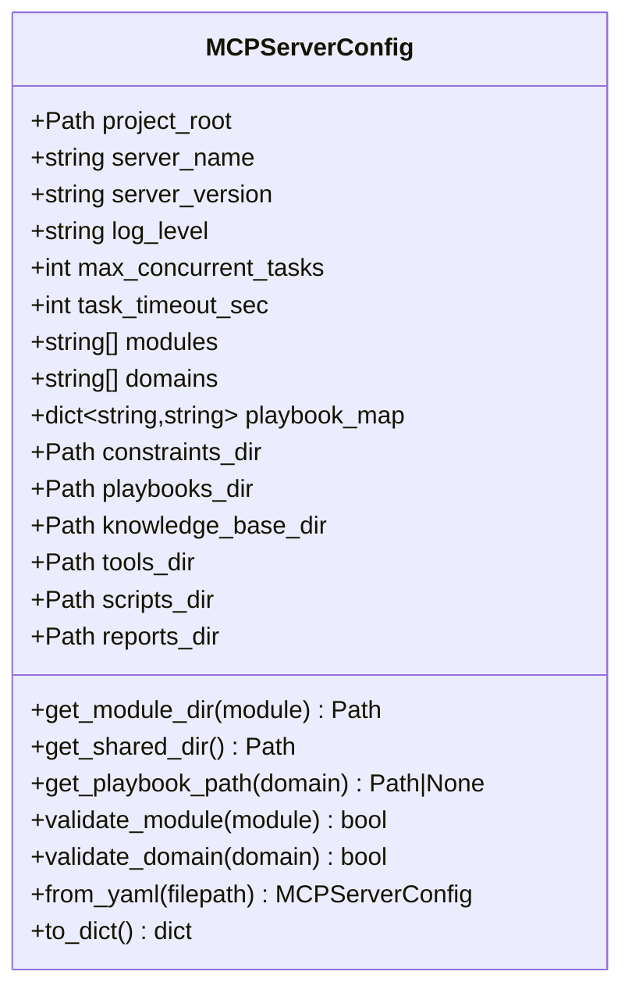
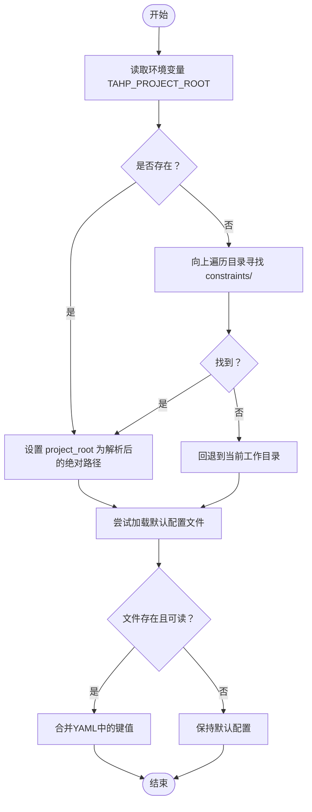
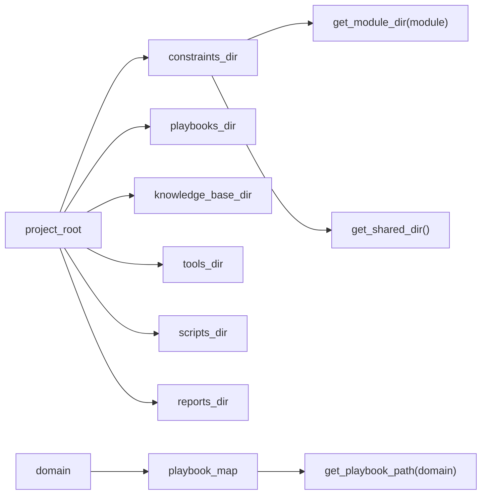
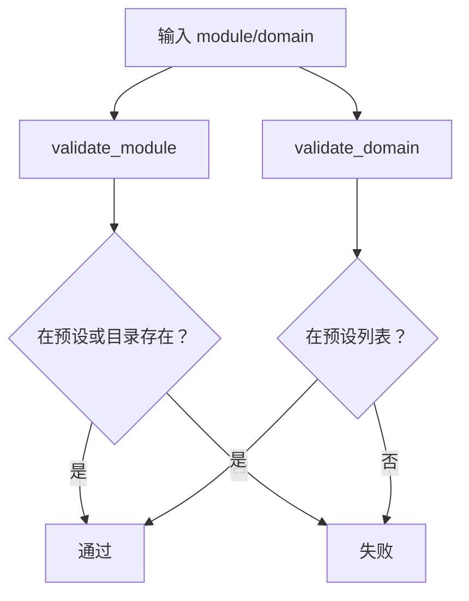
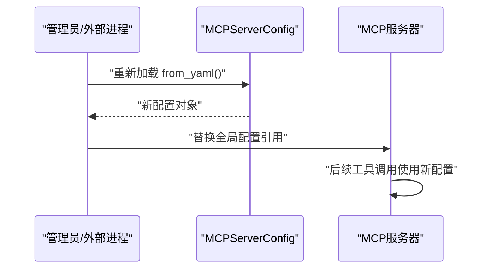
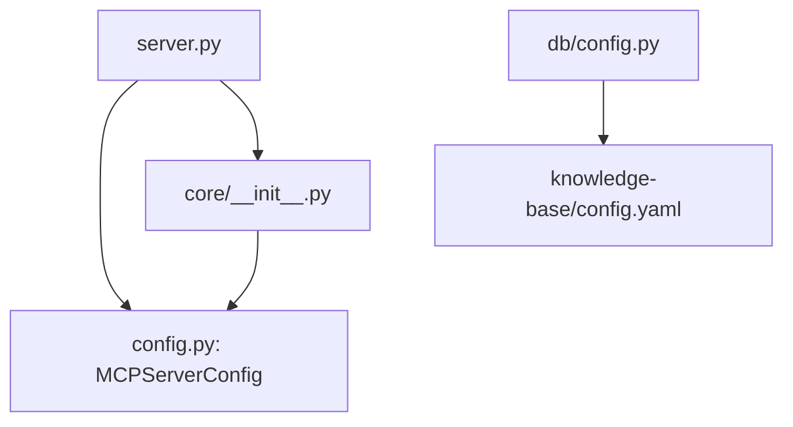

# MCP服务器配置

<cite>
**本文引用的文件**
- [config.py](file://tahp-mcp-server/config.py)
- [server.py](file://tahp-mcp-server/server.py)
- [.mcp.json](file://.mcp.json)
- [pyproject.toml](file://tahp-mcp-server/pyproject.toml)
- [test_server.py](file://tahp-mcp-server/test_server.py)
- [core/__init__.py](file://tahp-mcp-server/core/__init__.py)
- [knowledge-base/config.yaml](file://knowledge-base/config.yaml)
- [db/config.py](file://db/config.py)
</cite>

## 目录
1. [简介](#简介)
2. [项目结构](#项目结构)
3. [核心组件](#核心组件)
4. [架构总览](#架构总览)
5. [详细组件分析](#详细组件分析)
6. [依赖分析](#依赖分析)
7. [性能考虑](#性能考虑)
8. [故障排除指南](#故障排除指南)
9. [结论](#结论)
10. [附录](#附录)

## 简介
本文档面向MCP服务器配置，围绕MCPServerConfig类展开，系统阐述其配置项、加载机制、默认值推断、验证逻辑、目录解析与映射关系，并结合实际代码路径给出配置示例、环境变量优先级说明、热更新建议、验证与最佳实践。

## 项目结构
MCP服务器位于tahp-mcp-server目录，核心配置集中在config.py中，服务启动入口在server.py，工具调用与业务流程在core/__init__.py中实现；项目根目录通过.mcp.json中的TAHP_PROJECT_ROOT环境变量注入，用于定位约束、剧本、知识库等目录。

**图表来源**
- [server.py:94](file://tahp-mcp-server/server.py#L94)
- [config.py:18-33](file://tahp-mcp-server/config.py#L18-L33)
- [config.py:105-120](file://tahp-mcp-server/config.py#L105-L120)
- [core/__init__.py:110-298](file://tahp-mcp-server/core/__init__.py#L110-L298)

**章节来源**
- [server.py:94](file://tahp-mcp-server/server.py#L94)
- [config.py:18-33](file://tahp-mcp-server/config.py#L18-L33)
- [config.py:105-120](file://tahp-mcp-server/config.py#L105-L120)
- [core/__init__.py:110-298](file://tahp-mcp-server/core/__init__.py#L110-L298)

## 核心组件
MCPServerConfig类集中管理MCP服务器运行所需的全部配置，包括：
- 项目根目录(project_root)：支持环境变量优先与向上查找推断
- 服务器标识(server_name, server_version)
- 日志级别(log_level)
- 并发与超时(max_concurrent_tasks, task_timeout_sec)
- 模块与领域(modules, domains)
- Playbook映射(playbook_map)
- 目录派生属性(constraints_dir, playbooks_dir, knowledge_base_dir, tools_dir, scripts_dir, reports_dir)
- 验证方法(validate_module, validate_domain)
- 配置加载(from_yaml)与导出(to_dict)

上述字段与行为均来自MCPServerConfig类的定义与方法实现。

**章节来源**
- [config.py:36-176](file://tahp-mcp-server/config.py#L36-L176)

## 架构总览
MCP服务器启动时，先通过MCPServerConfig.from_yaml()加载配置；若未显式传入文件路径，则默认在project_root/tahp-mcp-server/config.yaml加载；若该文件不存在或读取失败，则保留默认配置。随后，server.py中的全局_config实例被创建并传递给工具分发器与核心执行流程。

**图表来源**
- [server.py:94](file://tahp-mcp-server/server.py#L94)
- [config.py:131-161](file://tahp-mcp-server/config.py#L131-L161)

**章节来源**
- [server.py:94](file://tahp-mcp-server/server.py#L94)
- [config.py:131-161](file://tahp-mcp-server/config.py#L131-L161)

## 详细组件分析

### MCPServerConfig类与配置项详解
- 项目根目录(project_root)
  - 默认工厂函数优先读取环境变量TAHP_PROJECT_ROOT
  - 若未设置，则向上遍历最多5层目录，寻找包含constraints/的父目录
  - 若仍不可得，则回退到当前工作目录
- 服务器标识
  - server_name: 默认字符串
  - server_version: 默认字符串
- 日志级别(log_level): 默认INFO
- 并发与超时
  - max_concurrent_tasks: 默认5
  - task_timeout_sec: 默认600秒
- 模块与领域
  - modules: 默认包含telephony、kernel-driver、power-mgmt
  - domains: 默认包含bug_analysis、code_adaptation、version_adaptation、carrier_porting
- Playbook映射(playbook_map): 将领域映射到对应YAML文件名
- 目录派生属性
  - constraints_dir/playbooks_dir/knowledge_base_dir/tools_dir/scripts_dir/reports_dir
  - get_module_dir/get_shared_dir用于定位模块与共享约束
  - get_playbook_path(domain)根据映射与存在性返回剧本文件路径
- 验证方法
  - validate_module: 检查模块名是否在预设列表或存在对应目录
  - validate_domain: 检查领域名是否在预设列表
- 配置加载与导出
  - from_yaml: 从YAML文件加载，支持覆盖project_root、log_level、max_concurrent_tasks、task_timeout_sec、modules、playbook_map
  - to_dict: 导出配置为字典

**图表来源**
- [config.py:36-176](file://tahp-mcp-server/config.py#L36-L176)

**章节来源**
- [config.py:18-33](file://tahp-mcp-server/config.py#L18-L33)
- [config.py:36-176](file://tahp-mcp-server/config.py#L36-L176)

### 配置文件加载机制与环境变量优先级
- 默认加载路径
  - 若未显式传参，from_yaml会尝试读取project_root/tahp-mcp-server/config.yaml
- 环境变量优先级
  - 项目根目录推断优先读取TAHP_PROJECT_ROOT
  - 该优先级贯穿于后续目录派生与工具调用
- 容错与默认值
  - 文件不存在或读取异常时，返回默认配置对象
  - 仅对存在的键进行覆盖，缺失键保持默认

**图表来源**
- [config.py:18-33](file://tahp-mcp-server/config.py#L18-L33)
- [config.py:131-161](file://tahp-mcp-server/config.py#L131-L161)

**章节来源**
- [config.py:18-33](file://tahp-mcp-server/config.py#L18-L33)
- [config.py:131-161](file://tahp-mcp-server/config.py#L131-L161)

### 目录路径解析与Playbook映射
- 目录解析
  - constraints_dir/playbooks_dir/knowledge_base_dir/tools_dir/scripts_dir/reports_dir均基于project_root派生
  - get_module_dir(module)拼接constraints/<module>
  - get_shared_dir()拼接constraints/shared
- Playbook映射
  - playbook_map将领域映射到具体YAML文件名
  - get_playbook_path(domain)根据映射与存在性返回路径

**图表来源**
- [config.py:82-120](file://tahp-mcp-server/config.py#L82-L120)

**章节来源**
- [config.py:82-120](file://tahp-mcp-server/config.py#L82-L120)

### 模块验证与领域验证
- validate_module(module)
  - 模块名在预设列表中，或存在对应constraints/<module>目录
- validate_domain(domain)
  - 领域名在预设列表中

**图表来源**
- [config.py:122-128](file://tahp-mcp-server/config.py#L122-L128)

**章节来源**
- [config.py:122-128](file://tahp-mcp-server/config.py#L122-L128)

### 配置热更新与验证
- 热更新
  - 当前实现为一次性加载：服务器启动时创建全局_config，工具调用时直接使用
  - 如需热更新，可在工具内部或外部触发重新加载from_yaml并替换全局配置引用
- 配置验证
  - 服务器启动时打印project_root、modules、已加载工具适配器等信息，便于核验
  - 工具调用前对module/domain进行validate，避免非法参数

**图表来源**
- [server.py:452-458](file://tahp-mcp-server/server.py#L452-L458)
- [config.py:131-161](file://tahp-mcp-server/config.py#L131-L161)

**章节来源**
- [server.py:452-458](file://tahp-mcp-server/server.py#L452-L458)
- [config.py:131-161](file://tahp-mcp-server/config.py#L131-L161)

## 依赖分析
- 服务器入口依赖配置类
  - server.py在启动时创建全局配置实例
- 核心工具依赖配置类
  - core.execute_tahp_task等工具通过config访问目录、模块、领域与Playbook
- 知识库配置独立于MCP配置
  - 知识库配置由db/config.py加载knowledge-base/config.yaml，二者并行存在

**图表来源**
- [server.py:94](file://tahp-mcp-server/server.py#L94)
- [core/__init__.py:18](file://tahp-mcp-server/core/__init__.py#L18)
- [db/config.py:94-161](file://db/config.py#L94-L161)

**章节来源**
- [server.py:94](file://tahp-mcp-server/server.py#L94)
- [core/__init__.py:18](file://tahp-mcp-server/core/__init__.py#L18)
- [db/config.py:94-161](file://db/config.py#L94-L161)

## 性能考虑
- 并发与超时
  - max_concurrent_tasks控制同时执行的任务数，建议结合CPU/内存与工具链开销合理设置
  - task_timeout_sec控制单任务最长执行时间，避免长时间占用资源
- 目录与文件访问
  - get_playbook_path存在性检查与多次目录拼接应尽量减少重复IO
- 日志级别
  - 生产环境建议提升至INFO或更高，避免过多DEBUG输出影响性能

## 故障排除指南
- 项目根目录未识别
  - 确认是否设置了TAHP_PROJECT_ROOT
  - 确认项目根目录包含constraints/目录
  - 参考路径：[config.py:18-33](file://tahp-mcp-server/config.py#L18-L33)
- 配置文件未生效
  - 确认默认路径project_root/tahp-mcp-server/config.yaml是否存在且可读
  - 确认YAML语法正确，键名与类型匹配
  - 参考路径：[config.py:131-161](file://tahp-mcp-server/config.py#L131-L161)
- 工具调用报模块/领域无效
  - 检查validate_module/validate_domain的预设值与实际目录
  - 参考路径：[config.py:122-128](file://tahp-mcp-server/config.py#L122-L128)
- Playbook未找到
  - 检查playbook_map映射与playbooks目录下文件名一致性
  - 参考路径：[config.py:74-79](file://tahp-mcp-server/config.py#L74-L79)、[config.py:113-120](file://tahp-mcp-server/config.py#L113-L120)
- 知识库配置冲突
  - 知识库配置独立于MCP配置，确认knowledge-base/config.yaml路径与键名
  - 参考路径：[knowledge-base/config.yaml:1-36](file://knowledge-base/config.yaml#L1-L36)、[db/config.py:94-161](file://db/config.py#L94-L161)

**章节来源**
- [config.py:18-33](file://tahp-mcp-server/config.py#L18-L33)
- [config.py:131-161](file://tahp-mcp-server/config.py#L131-L161)
- [config.py:122-128](file://tahp-mcp-server/config.py#L122-L128)
- [config.py:74-79](file://tahp-mcp-server/config.py#L74-L79)
- [config.py:113-120](file://tahp-mcp-server/config.py#L113-L120)
- [knowledge-base/config.yaml:1-36](file://knowledge-base/config.yaml#L1-L36)
- [db/config.py:94-161](file://db/config.py#L94-L161)

## 结论
MCPServerConfig提供了清晰的配置模型与稳健的加载机制，结合环境变量优先与默认值推断，能够适应不同部署场景。通过validate_module/validate_domain与目录派生方法，确保工具调用的安全与一致性。建议在生产环境中明确设置TAHP_PROJECT_ROOT与配置文件，合理配置并发与超时，并定期验证模块与领域清单。

## 附录

### 配置文件示例与环境变量配置
- 环境变量
  - TAHP_PROJECT_ROOT：指向项目根目录
  - 参考路径：[.mcp.json:7-9](file://.mcp.json#L7-L9)
- 配置文件位置
  - 默认：project_root/tahp-mcp-server/config.yaml
  - 参考路径：[config.py:135-136](file://tahp-mcp-server/config.py#L135-L136)
- 配置项覆盖
  - 支持覆盖：project_root、log_level、max_concurrent_tasks、task_timeout_sec、modules、playbook_map
  - 参考路径：[config.py:148-159](file://tahp-mcp-server/config.py#L148-L159)

**章节来源**
- [.mcp.json:7-9](file://.mcp.json#L7-L9)
- [config.py:135-136](file://tahp-mcp-server/config.py#L135-L136)
- [config.py:148-159](file://tahp-mcp-server/config.py#L148-L159)

### 工具调用与配置验证示例
- 启动与工具调用
  - server.py中定义了多个工具，如tahp_execute、tahp_status、tahp_gate_check等
  - 参考路径：[server.py:103-322](file://tahp-mcp-server/server.py#L103-L322)
- 功能验证脚本
  - test_server.py演示了工具调用与结果解析
  - 参考路径：[test_server.py:13-76](file://tahp-mcp-server/test_server.py#L13-L76)

**章节来源**
- [server.py:103-322](file://tahp-mcp-server/server.py#L103-L322)
- [test_server.py:13-76](file://tahp-mcp-server/test_server.py#L13-L76)

### 最佳实践建议
- 明确设置TAHP_PROJECT_ROOT，确保路径解析一致
- 将MCP配置文件纳入版本控制，配合CI进行静态校验
- 合理设置max_concurrent_tasks与task_timeout_sec，避免资源争用与僵尸任务
- 定期校验modules与domains清单，确保与实际目录一致
- 使用validate_module/validate_domain在工具入口处进行参数校验
- 如需热更新，设计外部触发机制，保证全局配置替换的原子性与一致性